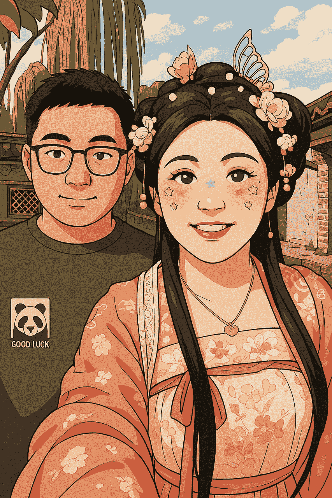

# 2025年

> 来源：[https://my.feishu.cn/docx/HKGfdE2ymorM3YxAh49cnFPWnq7](https://my.feishu.cn/docx/HKGfdE2ymorM3YxAh49cnFPWnq7)

> **碎碎念**

> [1月](https://ghlf0s3q3l.feishu.cn/wiki/T9JVw3HX6itmnokkn4ncZ6gwnSg) [2月](https://ghlf0s3q3l.feishu.cn/wiki/DnfgwprSHiJBJhkzmyFcBEZmnGf) [3月](https://ghlf0s3q3l.feishu.cn/wiki/H6xpw4peWid6XFkPsPbcuspnn7c?from=from_copylink)

# 20251102

没想到时隔多年又体验了一下沪漂。疫情前线上面试了上海的一家公司，之后刚到上海就感冒了。我是有点相信玄学的，感觉气场不合，所以决定不入职了，最终在上海酒店躺了三天，一来是休息二来是考虑中。之后还是先回扬州了，回扬州感冒好了就又去了北京，之后刚到北京就接到长沙大千影业的录取通知，我就又去了长沙。

这次因为公司原因，从 8 月 13 日到上海到现在的 11 月份，体验了一段时间的沪漂。😂

# 20250328

ChatGPT 的文生图太好玩儿了。

