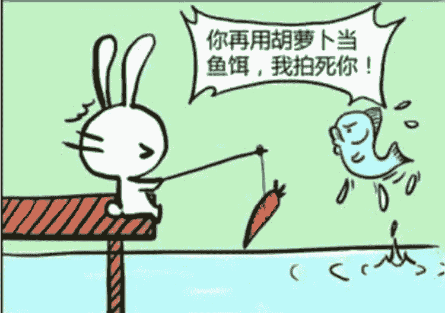

# 2 月碎碎念：触动和反馈

> 来源：[https://my.feishu.cn/docx/Pdcid7nMFoOMIEx2LE5cXaqInvh](https://my.feishu.cn/docx/Pdcid7nMFoOMIEx2LE5cXaqInvh)

## 20250228

最近比较忙，思考的感觉并不多。不过写碎碎念是个好习惯，即便在忙，也要保持着这个习惯。

3 月，我来了～

## 20250227

AI时代，核心技能从知识积累转向适应力、思辨能力和提问能力，热爱和好奇心将成为驱动个人和团队成功的关键因素。

以往的以知识积累为主的学习，在未来将会被淘汰。因为AI大模型，将人类的知识水平拉到了平均值。任何人只需要会提问，就会在极短的时间内获得人类平均水平的答案。

## 20250226

触动是最好的筛选器

在《认知觉醒》这本书中，我看到了一个有意思的概念——“触动是最好的筛选器”。回想自己加入赚钱，很多时候，正是某些精华帖触动了我。这些触动点，时常出现在学习和成长的过程中，它们让我更加渴望去探寻更多的知识。每一次触动，我都会把它当成一个目录，四周扩散，汲取更多的信息。

这些一个个的触动，就是我成长的最宝贵的部分。它们不仅帮助我筛选出真正重要的东西，也在不断引导我走向更加深入的思考和实践。

## 20250225

摘录《宝贵的人生建议》

制做任何东西，都要额外多做一些准备，比如额外的材料、零件、空间、装饰。这些额外的东西是应对错误的保障，能减轻压力，防范未来的风险。这是最便宜的保险。

## 20250224

之前我做过一些短视频矩阵，对去重有些心得。我们是原创的拍摄素材，但如果每天要发一两百条视频，拍那么多素材就需要大量的人力、物力和时间。

因此，我想到一个非常实用的解决方案——测试脚本。通过测试出一个爆款脚本，我们可以拆分出镜头和步骤，准备素材，再通过混剪和去重，爆款依然能不断重复。

举个例子，假设我们拆分了5个镜头，那就有了5个文件夹。摄影师按照这5个文件夹的内容去拍摄大量素材。然后，使用软件将这5个文件夹中的镜头随机排列组合。现有素材可以制作出几百上千条不同的视频。

除了固定镜头外，还可以通过不同的排列方式（如12345、54321、14352等）来增加变化。再加上文案、音乐、配音、字幕、颜色和效果等变量，保证了每个视频的“独一性”。

## 20250223

知识就是知识，当你得到了它，你就得到了一小片自己世界观的拼图，你拼得越多，世界观就越完善，在这个过程中，会有一种东西渐渐浮现，那就是你关于信息的直觉。

——河森堡

把你的世界观想象成一个大拼图，知识越多，这个拼图就越完整，你所能看见的图景就越全，你的直觉就会越强烈。

## 20250222

在这个信息爆炸的时代，发现赚钱机会就像是“刷”出来的。

无论是刷抖音、📕、视频号，还是👸号、朋友圈、🧣、知乎、B站、即刻、快手，甚至是电商平台如淘宝、闲鱼、拼多多、得物……只要细心观察，总能捕捉到一丝丝商机。看到别人晒收入、群聊、朋友聊天、线下趋势，甚至是BOSS直聘上的招聘信息，这些都在反映市场需求的变化。

通过刷各种平台和社交媒体，我们可以看到其中的相似之处，正是这些无数相似的点构成了规律。

作为普通人，顺势而为，从模仿开始，用最小可行性产品（MVP）进行尝试。一旦获得正向反馈，再通过时间、资本和人力杠杆的投入，逐步放大。

而这一切的前提是先发现机会，然后通过不断尝试和迭代，逐步完善和扩展。

## 20250221

做项目的第一阶段是验证价值，第二阶段是放大价值。

验证价值，就是通过最小可行性产品（MVP）快速与市场互动，获得正向反馈。

放大价值，就是加杠杆：时间、资本和人力的投入。拆解流程，将所有动作纳入SOP，只有标准化、模块化，才能实现复制和提高效率。

## 20250220

之前通过AI和网络搜索，大家都说应该先去社区医院建小卡，再去妇幼建大卡。网上都是这么说的，加上AI的汇总也是这个结果，感觉可信度很高。

然而，今天去社区医院才发现，现在的大卡都是直接在社区医院建的了。

通过这次经历，加上AISEO的思考，我意识到，判断力和执行力在未来AI时代将变得尤为重要。因为信息已经变得如此容易获取，真正重要的，是如何判断信息的对错、如何进行逻辑推理，并根据获取到的信息去执行。这个能力，将是我们在这个信息爆炸时代中，更加珍贵的竞争力。

## 20250219

TikTok短视频的流量来源主要有三种：推荐流量、付费流量和搜索流量。

其中，搜索流量通常更加精准。通过关键词搜索，用户能够主动找到自己感兴趣的内容，这使得搜索流量具备了更高的转化率。

现在，抖音上已经开始有DSO，通过优化信息布局，使得平台能够更好地呈现搜索结果。这类似于传统的SEO，但在短视频平台上应用，它帮助视频在搜索结果中排名更高，吸引更多精准流量。

此外，随着AI技术的飞速发展，AISEO也逐渐成为了一个新的优化方向。AISEO专注于优化AI搜索引擎的结果，通过信息的精准布局，确保在AI搜索中获得更好的曝光。这对任何依赖AI搜索的内容创作者和商家来说，都是一个巨大的机会。

TikTok短视频也可以朝着这个方向发展，通过优化搜索流量来提升曝光和转化。现在我越来越觉得，SEO的潜力真的是无限的，非常有趣。

## 20250218

SEO的本质就是流量入口。过去，我总是根据平台来判断流量入口，但通过深入了解SEO，我发现每一个有价值的精准关键词，都是一个让目标用户看到你的入口。

举个例子，如果你是做减肥产品的，仅仅使用“减肥”这个关键词，竞争会非常激烈，难度也会大大增加。那如果你加上具体的城市名呢？比如“江苏减肥”、“南京减肥”……这些更具地域性的关键词，可以帮助你触及到更精准的潜在用户。

除了大词，很多看似不相关的关键词也能带来流量。像“减脂餐食谱”、“学生党宿舍健身”、“梨形身材春夏穿搭”等等，虽然它们不完全符合主流的关键词逻辑，但却是用户真正关注的痛点，也是破圈引流的黄金钥匙。

所以，关键词的研究和尝试非常值得我们不断投入精力。它们不仅仅是流量的入口，更是通向精准用户的桥梁。

## 20250217

“贾樟柯说：不能因为整个时代都在奔跑向前，就忘了那些被时代撞倒的人。被撞倒就应躺在原地修复，才能保命，才能有继续上牌桌的机会，不允许自己停下来，不允许自己失败，是熬不过一道道坎的”

这个时代把「快速迭代」捧上神坛，但真正的生存智慧，是给「系统崩溃」留好冗余空间。毕竟连互联网协议都允许丢包重传，血肉之躯又何苦追求零失误？

## 20250216

今天看到一个读书方式特别好。通过deepseek来对自己提问。然后自己再去回顾书中的内容，写下思考和答案。

将问题和回答记录在flomo中，后续再通过flomo的AI功能进行笔记提问。

这种将AI作为认知洛阳铲的方法，让每本书都变成待挖掘的思想遗址。

## 20250215

管理是一项十分复杂且具有挑战性的任务。但在飞书项目中，我很喜欢一句话：

“流程作为核心资产沉淀在组织中。”

回想当年在大润发和孩子王做主管时，常常遇到一个问题：店内员工和导购流动性大。可能教会了某个人一些操作，但他很快就离职了，然后新的人又得重新培养。这对于主管来说，确实是个不小的挑战。

无论在哪家公司，人员流动都是不可避免的。没有哪家公司能做到所有的信息都依赖一个员工。如果某个员工突然离开，业务就停摆了，那显然是有问题的。

因此，流程和制度显得尤为重要。通过优化系统，当某个人离开时，接替者能够迅速上手，确保系统依然能正常运转。这才是科学且有效的管理方法，而不是凭空想出一些临时的应对措施。那样成功的概率往往会非常低。

## 20250214

每个团队都需要开会，但为什么同样是开会，效率差距却如此之大？回顾我曾经所在的几个团队，会议的形式和效率差异确实让我印象深刻。

想起来飞书推过一种会议方式，叫做“飞阅会”。这是一种非常高效的会议形式，整个过程都有明确的文档支持，确保了会议不仅仅是简单的讨论，更是一种有序的思考和沉淀。在飞阅会上，每个参与者都提前准备了相关资料和问题，并通过文档进行共享和讨论，这样即使是远程工作，也能保持信息的流通和团队的协作。

与飞书的飞阅会类似，亚马逊也有类似的“默读会”。这也是一种强调准备和深度思考的会议形式，参与者会事先接收相关资料，并在会议前做好充分的准备，确保会议中的讨论有深度、有方向。

我认为，会议的效率高低，和我们是否事先设定主题、是否做好记录、是否形成明确的todo任务密切相关。没有主题的会议，常常容易变成“鸡同鸭讲”的状态，没有记录和跟进，所有的讨论就像流水一样，永远无法沉淀出有效的行动。而有了明确的主题、有了记录和待办事项，会议才真正能够发挥它的价值，帮助团队实现高效协作和行动落地。

通过这两种会议方式的借鉴，我更加意识到，想要提高会议效率，首先要确保每一次会议都有主题、有准备、有记录和有行动。这些看似简单的要素，才能确保我们在会议之后走得更远，做得更好。

## 20250213

deepseek 说的戳中我的心窝。

“在失序环境中活得足够久的人，终将成为新规则的定义者。保持低功耗运转，等待临界点的到来”

## 20250212

《金钱心理学》预防失败的诀窍是：做好你的财务规划，使其不至于因为一次糟糕的投资和未能达成的财务目标而全盘崩溃，保证自己能在投资道路上持续前进，一直等到好运降临的那一刻。

抗风险的重要性，做重要不紧急的事情，而不是都等到重要的事情紧急了才去做。

## 20250211

现在各个平台都开始对接 deepseek 大模型，get 笔记也支持满血版的R1 了，可以根据过往笔记进行提炼和回答，还会标注出是引用哪一条笔记。

趋势已经出现了，如果说之前的AI是缓缓上升，现在就是 90° 的爆发。

## 20250210

飞书多维表格的AI字段有个deepseek字段了，满血版R1。每一个飞书账户会有100万token，用完了之后注册一个火山引擎，就可以充值和生成`apikey`了。

太牛逼了，之前用AI字段但是不多，现在支持deepseek，可玩性更大了！！

## 20250209

“走下坡路不丢人，不管有没有到过巅峰，终究是要下山的。上山是为了体验，不是为了永立巅峰。人生要学会走下来，下山也有独特的风景。学会接受下山，好好下山，享受下山。首先要面对这个状态，再来决定未来如何走好一段下山路。”

## 20250208

“我们学习商业，是日复一日地去深化熟悉之物，在这个过程里去伪存真，分辨哪些是装腔作势，不疼不痒；哪些是内心真实的渴求，一碰就疼，一拉就动。这样，你就会拥有自己的笃定和生存的安全感。人在所有关系中的安全感，都源自他清楚自己被对方需要。”——《真需求》

## 20250207

今天看到群里有朋友对 DeepSeek 感到焦虑，尤其是官网现在比较慢。有些人通过本地部署，喂自己的数据，来提升效率。

但是我觉得，永远都不算晚。现在这个阶段就像是乱世，聪明的人能在其中发现机会并实践，从中获得反馈。但也有一些人折腾了很久，却没能得到想要的结果，浪费了时间和金钱。稳妥的做法是伺机而动，关注，但先保持冷静，保持学习，机会总会在的，晚一点又能如何？

AI 绘画曾是热门话题，SD 需要部署、LoRA、下载各种模型等，门槛很高。但后来出现了 ComfyUI，以及各种线上平台，进一步降低了门槛，支持的功能也更多，效果也更好。

关键是，结合自身的业务场景来实现才是最可行的路径。

+   做社群的，可以立刻把星球名称改成 DeepSeek，赚取流量。

+   做网盘拉新的，可以通过公域和私域分享 DeepSeek 相关资料。

+   文案工作者，可以借助 DeepSeek 提高工作效率。

+   学习者，可以借助 DeepSeek 提升学习效率。

+   做自媒体的，可以发布与 DeepSeek 相关的内容。

……

不管在哪个领域，把工具与自己的目标结合，往往能带来更多的可能性。也是最实际的做法。

## 20250206

王阳明曾说：“志不利如无堕之舟，无贤之马。”如果没有明确的志向，就像一艘失去方向的船，最终会迷失在茫茫大海中。真正的志向源自内心，它指引我们不断前行，帮助我们超越眼前的困境，走向生命的远方。

这让我想起了罗振宇在采访中提到的一个观点，与王阳明的思想非常契合：“能力没那么重要，愿力>业力>能力。”

**能力**是我们完成某件事的实际本领，包含学习能力、注意力、记忆力、思维能力等素质。即便一个人能力再强，也会受到其他因素的影响。

**业力**，在宗教中是因果的力量，是过去行为、思想、言语的结果。简单来说，善有善报，恶有恶报。业力是一种惯性，影响着我们未来的选择和行动。即使能力很强，业力（如过往的不良习惯或负面经历）也可能成为成功的阻力。

**愿力**则是源自内心强烈的愿望和志向所产生的力量。愿力带着积极主动的动力，激励我们克服困难，实现目标。比如，一个想成为作家的人的愿力，会推动他克服所有障碍，持续努力，最终实现理想。

在这一过程中，愿力就像王阳明提到的“立志”，也是OKR中的“总目标”。虽然我们常依赖能力解决问题，但真正决定我们能走多远的，往往是内心的愿力。能力可能是起点，业力是制约，而愿力，则是最终引领我们实现目标的关键。

## 20250205

今天突然想起了《山月记》中的人虎传故事。

几年前，一个曾经一起在长沙做剪辑的朋友来扬州找我玩，临别时我们聊了很久。当他说起我选择继续留在扬州而不去其他城市时，显得有些惊讶。我当时给他讲了《山月记》中的人虎传的故事，试图用这个故事表达我内心的纠结与妥协。

《山月记》讲述了一个名叫李征的书生的故事。他梦想成为诗人，但因为现实的压力，他选择了当官。然而，他对官场心生鄙视，最终决定辞官追求自己的诗人梦想。可是，回到诗坛后，他并未获得成功，甚至开始怀疑自己的才华。

当他回到家乡后，因生活所迫，他打算重返官场，却发现昔日的同僚早已升迁。感到羞愧和愤怒的他，最终选择逃入山林，化为一只老虎。即便他变成了野兽，内心依然保留着人类的情感和理智，痛苦与挣扎贯穿其中。

为什么这个故事给我留下了深刻的印象呢？因为我害怕自己去大城市追逐梦想，最后一无所获，最后回到家乡，却发现那些和我同龄的人都已经有所成就，有家庭、有事业。自己却不得不从零开始，还要面对家庭和父母的压力。

渐渐地，我发现，是否去大城市并不重要，互联网已经成为我们眼睛和手臂的延伸，它为我们提供了许多机会。无论选择怎样的路径，其实都是一种修行和挑战。与其在无尽的选择中迷茫，不如权衡利弊，选择最适合自己的道路。

书中有这样一段话：“我深怕自己本非美玉，故而不敢加以刻苦琢磨，却又半信自己是块美玉，故又不肯庸庸碌碌，与瓦砾为伍。于是我渐渐地脱离凡尘，疏远世人，结果便是一任愤懑与羞恨日益助长内心那怯弱的自尊心。其实，任何人都是驯兽师，而那野兽，无非就是各人的性情而已。”

## 20250204

品牌的建立确实不是一蹴而就的事情，读完《真需求》后，我对品牌的理解更加深刻了。品牌的本质不仅仅是一个商标，更是人心中一种记忆和情感的反应。梁宁老师在书中提到，品牌的核心是信息，而不是有形的物质。品牌能存在和发展的根本原因，正是它在人心中的“无形”力量。

在我之前的认知中，品牌总是与大公司、大品牌相关，尤其是在科技、时尚和奢侈品行业。而现在，才意识到品牌的背后有着如此深刻的内涵。产品是有形的，可以触摸、使用和体验，而品牌则是一种无形的存在。它是一种信息，在每个人的心中沉淀，并形成特定的情感反应。品牌的力量来自于它与消费者建立的情感连接，而这种连接是独一无二的，能够跨越时间和空间的限制。

例如，高通的芯片和英伟达的 GPU，它们之所以能有高定价权，除了技术的领先外，更因为它们在消费者心中已经形成了强大的品牌识别度。这些品牌通过多年的积累与创新，已经不仅仅是产品的代名词，更是技术创新和可靠性的象征。正如梁宁所说，品牌的价值不仅仅体现在产品的功能上，更体现在它能够激发的情感共鸣上。

而这种情感共鸣，正是品牌的独特之处。比如，苹果的品牌魅力，不仅仅是它的硬件产品，而是它代表的创新精神、简洁的设计和独特的用户体验。这些无形的元素共同塑造了苹果的品牌价值，让消费者愿意为其支付更高的溢价。

另外，梁宁老师还提到，网红和大牌的区别在于核心的力量。网红依赖于新鲜感和话题性，而大牌则依赖于辨识度和情感的唤起。一个成功的品牌，首先要有明确的辨识度，才能在市场中占有一席之地。只有通过长时间的品牌积累，才能在消费者心中留下深刻的印象，并在竞争中脱颖而出。

从这些观点中，我不仅学到了品牌的核心价值，也看到了打造品牌背后的坚持和耐心。品牌的建立不仅仅是一次性的营销活动，而是一个长期的过程，需要不断的积累与投入。每一个成功的品牌背后，都是无数次的尝试和调整。对于我们每一个创业者来说，理解品牌的真正含义，才能在市场中站稳脚跟，并且长期生存。

总的来说，品牌的建设不仅仅关乎产品的质量，更关乎如何在消费者心中种下深刻的印象，建立情感联系。

## 20250203

产品价值 = 功能价值 + 情绪价值 + 资产价值

大多数时候，我们关注的往往是产品的功能价值，即它能够满足基本需求的能力。但随着社会的发展，物质越来越丰富，产品之间的同质化现象也日益严重。此时，产品的情绪价值和资产价值变得愈发重要，成为了区分产品好坏、决定其市场价值的关键因素。

功能价值 是指产品能够满足基本需求的能力。这是所有产品的基础，是消费者购买的最初驱动力。

然而，情绪价值 则更为抽象，它与消费者的情感、心理需求息息相关。例如，Jellycat 这一品牌的毛绒玩具，它的价格远超普通的玩具，许多消费者购买它并不仅仅是为了玩具的功能性，而是为了获得一种情感上的满足，甚至在二手市场上转售，价格翻倍。你可以去 B 站或者抖音搜索一下 Jellycat，看看相关的用户分享和采访，便能感受到其背后浓厚的情绪价值。

除此之外，资产价值 也在现代产品中逐渐显现。例如，泡泡玛特的盲盒不仅仅是普通的玩具，它背后隐藏的收藏价值和转售价值，使得消费者在购买时，更多的是视其为投资品。泡泡玛特通过情绪价值和资产价值的结合，成功地吸引了一大批忠实粉丝。

这两种价值的提升，不仅让产品本身变得有吸引力，也让消费者在购买时产生了更多的情感认同和潜在收益的预期。

## 20250202

商业的本质可以归结为价值、共识和模式这三个核心要素。

首先是价值，商业活动的起点。价值不是单方面认定的，而是基于市场需求。当产品或服务能够满足客户的需求，且客户愿意为此付费时，才真正具备商业价值。这里让我想起薛辉曾提到的一个有趣的画面：小白兔用胡萝卜钓鱼。这正好提醒我们，价值的体现必须是双向的，不能只靠企业自嗨，客户的认可是至关重要的。

# 商业共识与模式

## 共识

然后是共识，商业交易的核心。当企业与客户达成默契，明确了双方的需求与目标，才能顺利开展合作并实现交易。只有当产品的价值被客户认可，交易才能顺利进行。

## 模式

最后是模式，决定企业生存与发展的关键。商业模式不仅仅是赚钱的方式，更是企业如何持续生存、发挥自身优势、创造竞争力的方式。书中的一个例子让我印象深刻：不同的能力系统让企业在面对同样的机会时，能够采取不同的行动。例如，瑞幸咖啡凭借其独特的能力系统，能够采取与其他咖啡品牌不同的模式，这也是它能够快速发展的原因之一。

# 20250201

## 需求三阶

突然发现喝水也有「需求三阶」：

+ **基本需求**：杯子里得有水（没水会渴死）
+ **期望需求**：水温刚好 45℃（太烫骂娘，太凉皱眉）
+ **兴奋需求**：水里飘着两片薄荷（哇靠这杯子成精了？）

手机厂商最懂这套：

电池不漏电是底线→夜景模式决定口碑→突然弹出十年前照片才是王炸

看梁宁的《真需求》学习到的 KANO 模型，很有意思。再次联想到不管是实体店还是短视频还是文章，只要是和用户交互的东西，都会再浅层中满足用户的某种需求，可以是实质上的需求，也可以是情绪的需求满足。
