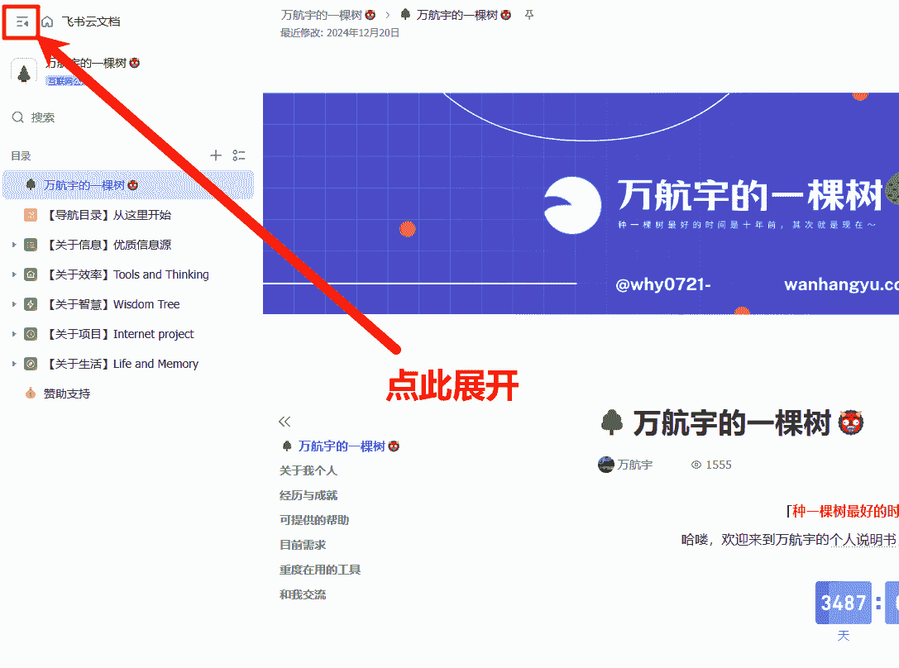

# 万航宇的一棵树👹

> 来源：[https://my.feishu.cn/docx/T8akdPtWPocPP7xo2v7c3yrCnUh](https://my.feishu.cn/docx/T8akdPtWPocPP7xo2v7c3yrCnUh)

**「****种**一棵树最好的时间是十年前，其次就是现在～」

哈喽，欢迎来到万航宇的个人说明书，你也可以记住www.wanhangyu.com直达这里~

这里是一个持续迭代的「数字工具箱」，记录我的成长方法论、实战经验与资源沉淀，期待与同频者共创价值。

# 关于我个人

**个人特点：**

+   **盖洛普优势**前五：学习、搜集、思维、和谐、追求

+   **MBTI**: INTJ-A

+   **学习能力强**：具备快速学习新知识和技能的能力，善于搜集和整理信息。

+   **思维敏捷**：善于分析问题，能够从多角度思考解决方案。

+   **和谐相处**：擅长与人沟通，能够在团队中创造和谐的工作氛围。

**正在努力：**

+   增阅读量，提升认知

+   持续写作，深度思考

+   掌握 RPA，拉高效率

+   建立原则，知行合一

# **经历与成就**

+   **户外探险**：徒步 318 川藏线，展现了坚韧不拔的意志和卓越的体能。

+   **媒体经验**：参与综艺节目《说唱听我的 2》《令人心动的 office3》等后期剪辑工作，积累了媒体制作经验。

+   **短视频矩阵运营**：成功运营多个短视频账号，包括零食号、同城曝光、私域引流、Tiktok 等，具有实战经验。

+   **内容创作**：👸号订阅人数超过 5000，证明了内容创作和吸引用户的能力。

+   **引流技巧**：通过📕进行资料表格私域引流，单日引流 200+，展现了高效的用户增长策略。

# **可提供的帮助**

+   **资料整理**：https://link3.cc/xiaokuangren

+   **短视频矩阵经验**：提供短视频内容创作和账号运营的咨询服务。

+   **有问必答**：愿意解答在相关领域的问题，提供建议。

+   **TikTok电商**：[TikTok](https://ghlf0s3q3l.feishu.cn/wiki/EMgRw0iCuixdRekaGrFcUojIn4e)

+   **万航宇的一棵树**：这个[知识库](https://ghlf0s3q3l.feishu.cn/wiki/AIMawhguPisFO1kqabmcuK34nUg)中会存放我的一些思考和提升效率的小技巧，希望会对你有帮助。

# **目前需求**

+   **资料整理深化**：希望交流资料整理的高级技巧，优化工作流程。

+   **RPA 技术交流**：对自动化流程感兴趣，寻求 RPA 相关的知识和实践经验交流。

# 重度在用的工具

+   **AI 产品：**[ChatGPT](https://chat.openai.com/)、gemini、Claude code、openclaw

+   **记账工具：**[钱迹](https://www.qianjiapp.com/)

+   **知识库：**[飞书知识库](https://ghlf0s3q3l.feishu.cn/wiki/)

+   **笔记工具：**[飞书文档](https://ghlf0s3q3l.feishu.cn/drive/home/)、[flomo](https://flomoapp.com/)、Obsidian

+   **输入法：**[🛰️输入法](https://z.weixin.qq.com/)

+   **密码管理：**[账号本子](https://uccmawei.com/account-box.html)

+   **网盘：**[OneDrive](https://www.microsoft.com/zh-cn/microsoft-365/onedrive/online-cloud-storage)、夸克云盘

+   **电子书阅读：**[🛰️读书](https://weread.qq.com/#login)、[得到](https://www.dedao.cn/)

+   **其它小工具：**[Eagle](https://eagle.cool/)、[Utools](https://www.u.tools/)、[PixPin](https://v2ex.com/t/989393#reply54)

+   **资源小狂人资源站🔥：**https://link3.cc/xiaokuangren

# 和我交流

| 🛰️ | 👸号：小宇录 |
| --- | --- |
|  |  |

---

⏬ 联系方式 ⏬

wx : why0721- | 飞书个人号 :

（添加🛰️请备注“一棵树”，快速通过审核）