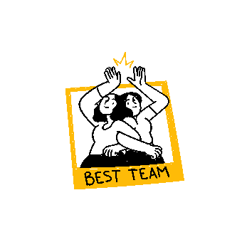

# 社区城市合伙人招募🎯

> 来源：[https://yunyinghui.feishu.cn/docx/BQjDd9RVLoRzonxMmDIc7mRfnuZ](https://yunyinghui.feishu.cn/docx/BQjDd9RVLoRzonxMmDIc7mRfnuZ)

### 城市合伙人是推动线上社区本地化发展的重要一环

### 「万象 AI 实验室」诚邀各个城市 AI 领域的人才共建城市合伙人体系

### 持续为万象 AI 实验室扩散本地影响力、组织有质量的同城活动

# **社区基本介绍**

万象 AI 实验室创始人为大国，原教育大厂**离职创业者。万象 AI 实验室**是一个面向 AI 技能提升和商业落地的学习型社区，旨在推动 AI 实际应用，创造行业案例。自 2023 年 3 月份成立以来，开源知识库已经累积阅读量超 500 万，覆盖超 50 万人，聚集了超 10 万人在社区学习。我们一直希望通过优质的内容传递价值，通过真实的案例推动「AI 真能用，AI 真好用」的落地及商业化。

# 城市合伙人招募画像

#

**有知识**

熟悉 AI 行业现状、发展及趋势

**懂实战**

拥有丰富的实战经验，并有成功案例

**懂工具**

擅长某类 AI 工具的操作及落地应用

**有资源**

有当地相关的政府、企业及场地相关等资源，知道如何拓展商务资源

**有经验**

有过往的线下活动组织经验，并且能够独立承担组织活动的能力

**加分项**

名校，名企背景；在细分行业或者领域具有一定的影响力和知名度；有破圈作品

# 城市合伙人合作场景

**组织活动**

为同城社区的成员组织相关活动，并且做出有质量的同城活动

**链接资源**

参与社区的建设，不断为社区链接优质资源，提升社区影响力

**活动出席**

代表社区参与重大的活动现场，提升社区在活动中的影响力和曝光度

**运营社群**

参与线上同城社群的运营，不断扩大同城社群成员的人数

**线下大课**

参与同城线下工作坊课程的开发，作为教练带队指导学员实操

**企业内训**

参与同城企业的定制化内训需求，帮助企业落地 AI 应用，或者定制开发工作流

# 城市合伙人合作流程

＞＞点击这里填写万象 AI 实验室城市合伙人报名表：

<https://yunyinghui.feishu.cn/share/base/form/shrcnXJS91H9NmfunrwYifePGge?iframeFrom=docx&ccm_open=iframe>

#   城市合伙人认证

[社区认证同城合伙人汇总](https://yunyinghui.feishu.cn/wiki/VyPWwUWoeigsiYkPtKRcWwGln0e?from=from_copylink)＞点击这里查看同城合伙人名单：

# 城市合伙人合作权益

**官方认证**

凡通过认证面试并完成正式授课且交付合格的外部讲师将获得[万象 AI 实验室认证同城合伙人」荣誉称号和官方渠道展示。

**IP 打造**

优秀外部认证讲师将获得官方学习平台、🛰️号、知识库收录，更有机会获得官方流量扶持，提升同城合伙人个人 IP 打造，扩大讲师影响力。

**收益分成**

社区活动佣金（最高 50% 分成）、本地商家合作抽成、社区会员费阶梯分成等。

**资源拓展**

优秀同城合伙人将优先参与官方平台活动及重点项目，同时为同城合伙人提供行业和优质企业交流机会，帮助扩展同城合伙人人脉和商机。

**交流共创**

认证同城合伙人优先参与官方共创会，和万象 AI 实验室内部专家沟通共画行业新蓝图。

**学习成长**

认证同城合伙人将进入同城合伙人专属社群，优先获得官方最新政策信息、培训机会，与行业大咖随时随地交流。

# 城市合伙人合作推广

|  |  |  |
| --- | --- | --- |
|  |  |  |