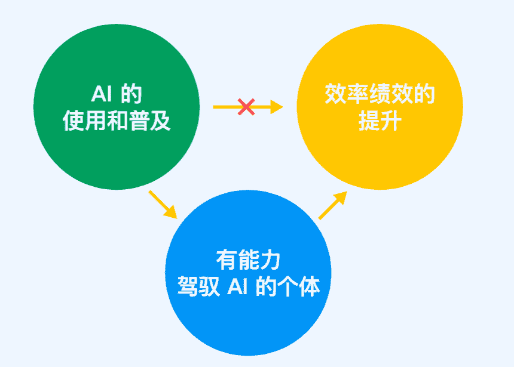
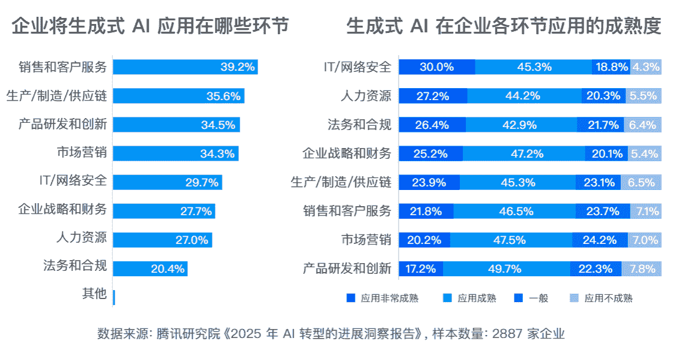
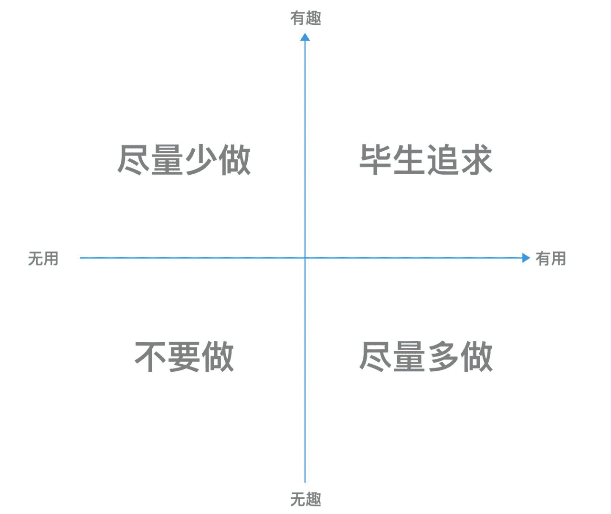
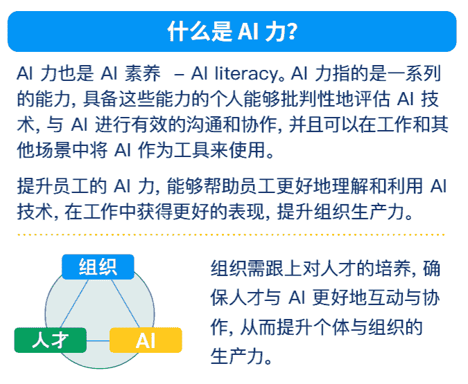

# 新人 AI 应用学习指南

> 来源：[https://yunyinghui.feishu.cn/docx/SbBfdzhZBozBC0xZwxFcaCx4nJb](https://yunyinghui.feishu.cn/docx/SbBfdzhZBozBC0xZwxFcaCx4nJb)

> **适用人群：****互联网 AI 学习新人**

> 首发时间：2025 年 6 月 7 日

> 更新时间：2025 年 6 月 30 日

> **内容出品人：**** **

> **内容出品方：**[Mix AI Lab](https://yunyinghui.feishu.cn/wiki/WhelwZnxQi55mpkOzatc3Xran5b?from=from_copylink)

> **使用建议：**如果需要快速定位到精确内容，可以使用快捷键 Ctrl +F/Command +F 的形式，搜索关键字/词，查找你想要的内容。

> **为 AI 实验室同学持续更新**** ****AI 应用入门学习的建议**，为初入 AI 领域的小伙伴进行扫盲科普。

> 🎯全**网最接地气 AI 知识库：「**[**万象 AI 实验室」知识库（**](https://yunyinghui.feishu.cn/wiki/space/7340161844864598017?ccm_open_type=lark_wiki_spaceLink&open_tab_from=wiki_home)AI 设计、AI 办公、AI 视频等应用技能）

# 前言

很多人进入 AI 领域学习的时候，并没有明确的规划和学习方向，导致了很多人存在盲学的情况；还存在**一部分人学习了**很多，但是始终无法用上的情况，所以，作为社区主理人大国，有必要为每一位入局 AI 应用学习的小伙伴提供一份学习建议和指南。

本学习指南，主要是面向** AI 应用学习的人群，如 AI 工具的使用**，AI 知识的科普，AI 场景解决方案等，非 AI 技术和产品伙伴学习指南，在应用端的用户占多数，所以有必要做个全面的学习建议和指导。

在 AI 技术快速迭代的今天，AI 应用能力比代码能力更易落地。根据权威机构的数据显示，2025 年企业对 AI 内容创作、智能工具操作等应用型人才的需求增长了 300%。掌握 AI 工具的实际应用，能快速提升工作效率、开拓副业机会，甚至实现职业转型，例如，用 AI 生成📕爆款文案、制作企业宣传视频、优化数据分析报告等场景，已成为职场必备技能。

# 一、明确学习目的

这是大多数人进入 AI 学习要考虑的第一个问题，当然，很多新人一开始也并不能想清楚，甚至在学习了 AI 一段时间以后也没有找到明确的方向，也有一些在一开始没有方向在慢慢接触 AI 以后找到学习目的和方向的。在这里我先做一些归纳总结，目前所有进入 AI 的伙伴大概的学习目的类型：

大家身份不同，学习目的和方向自然就不同，针对不同的学习目的，这里给到对应的学习建议：

## 目的 1：提升工作效率（职场人/企业优先）

**学习重点：**

+   办公提效工具：通义千问（文档生成 / 数据分析）、ChatExcel（表格自动化）、Copilot（代码辅助）

+   内容创作工具：豆包（文案生成）、剪映 AI（短视频剪辑）、PPTMagic（自动生成 PPT）

+   流程诊断：分析现有工作中重复 / 耗时环节（如数据整理、会议纪要），用 AI 替代

**学习路径：**

1.  3 天诊断：用笔记记录每天工作中耗时＞30 分钟的重复任务（如每周做数据报表）

1.  5 天实操：针对 1 个核心场景（如 “用 AI 生成周报”），跟着官方教程完成从输入到输出的全流程

1.  长期优化：每周尝试 1 个新工具（如用 AI 生成会议纪要），逐步替代手动操作

**案例：**

+   行政岗：用 AI 生成活动方案 + 自动统计报名数据

+   销售岗：用 AI 分析客户聊天记录，提取需求关键词

## 目的 2：副业变现（自由职业者 / 学生优先）

**学习重点：**

+   技能定位：选择高需求领域（文案＞设计＞数据分析＞编程），聚焦 1-2 个工具深耕（如专注用豆包写带货文案）

+   接单平台：闲鱼（低门槛）、淘宝（流量大）、米画师（设计类）、一品威客（企业订单）

+   商业思维：研究平台爆款标题（如 “AI 生成📕文案 5 元 / 篇”），制作低价引流套餐（如 “9.9 元试写 3 条”）

**学习路径：**

1.  5 天作品集：用 AI 生成 10 个不同类型作品（如📕文案、海报、简历），整理成 PDF 或📕案例合集

1.  3 天平台入驻：在闲鱼发布 3 条商品信息，标题带关键词（如 “AI 文案代写｜可定制风格”）

1.  实战优化：前 3 单主动收集客户反馈，调整服务流程（如增加 “初稿修改 2 次” 条款）

**避坑提醒：**

+   不要夸大 AI 能力（如 “完全原创”），需注明 “AI 辅助 + 人工优化”

+   先用免费工具练手（如豆包、Canva），熟练后再付费升级功能

## 目的 3：兴趣探索（爱好者优先）

**学习重点：**

+   创意工具：文心一格（AI 绘画）、Genie（AI 音乐）、DeepSeek-R1（AI 写作）

+   低代码开发：腾讯云微搭（AI 小程序）、Zapier（自动化流程），实现 “AI + 个人需求” 落地

+   社区交流：加入Mix AI Lab 学习小组，参与 “21 天 AI 相关实战营”

**学习路径：**

1.  每日 1 练：用 AI 生成 1 条朋友圈（如 “AI 根据我的心情画了幅画”），附带工具名称和创作思路

1.  主题项目：用 7 天完成 1 个小目标（如 “用 AI 生成 10 张宠物表情包”“写 1 篇科幻短篇小说”）

1.  分享变现：将作品发布到📕 / 抖音，带话题 #AI 创作，吸引同好关注

**案例：**

+   手工爱好者：用 AI 设计文创图案，打印成贴纸出售

+   铲屎官：用 AI 生成宠物拟人化故事，做成短视频账号

## 目的 4：职业转型（转行者优先）

**学习重点：**

+   岗位对标：研究目标岗位 JD（如 “AI 运营” 需掌握工具使用 + 数据分析 + 社群运营）

+   复合技能：传统技能 + AI 工具（如 “新媒体运营”+“用 AI 做选题 / 写脚本”）

+   行业报告：阅读《2025 中国 AI 应用行业报告》，了解教育、电商、医疗等领域的 AI 落地场景

**学习路径：**

1.  1 周调研：在招聘网站筛选 3 个目标岗位，用表格对比 “必备技能” 和 “AI 相关技能”

1.  30 天攻坚：每天学习 1 个岗位核心 AI 工具（如 “用 Tableau+AI 做数据可视化”），并输出学习笔记

1.  模拟项目：虚构一个项目（如 “用 AI 优化某品牌社交媒体运营”），用 PPT 呈现方案，附 AI 工具使用截图

**简历技巧：**

+   在 “技能” 栏单独列 “AI 工具应用”，标注掌握程度（如 “豆包：熟练生成营销文案，效率提升 40%”）

+   在 “项目经验” 中加入 AI 相关成果（如 “用 AI 分析用户评论，提取 3 个产品改进方向”）

## 目的 5：优化生活（大多人通用）

**学习重点：**

+   生活类工具：WakeUp（AI 睡眠监测）、MyFitnessPal（AI 饮食规划）、DeepL（实时翻译）

+   家庭场景：用 AI 生成儿童学习计划、整理旅行攻略、制作家庭记账表

+   效率管理：用 Todolist+AI 自动拆解任务（如 “写年度总结” 拆分为 “数据收集→大纲生成→修改润色”）

**学习路径：**

1.  场景清单：列出 5 个生活痛点（如 “每天花 1 小时想晚餐吃什么”“孩子作业辅导难”）

1.  工具匹配：针对每个痛点搜索对应 AI 工具（如 “菜谱生成”→“豆包 + 美食关键词”）

1.  习惯养成：每周固定 1 天用 AI 优化一个生活流程（如周日用 AI 制定下周日程表）

**实用技巧：**

+   用 AI 生成 “懒人食谱”（输入现有食材，自动推荐菜谱）

+   给父母演示 “用豆包查天气 + 健康知识”，降低长辈使用门槛

#### 通用学习原则

1.  工具不在多，在精：先专注 1-2 个工具精通（如豆包 + 即梦 AI），再扩展学习

1.  用输出倒逼输入：每天花 10 分钟在朋友圈 / 学习群分享 AI 使用心得（如 “今天用 AI 做了张生日海报，效率比 PS 快 3 倍”）

# 二、30 天 AI 学习路径规划

## 第一阶段：基础认知（第 1-5 天）

+   核心目标：建立 AI 应用的基础框架，明确学习方向

+   学习内容：

1.  **概念扫盲：**通过 30 分钟了解 AI 三大分支（生成式 AI、分析型 AI、自动化 AI）的应用场景，例如生成式 AI 可用于文案创作、图像设计，分析型 AI 适用于数据洞察，自动化 AI 能实现流程优化。

1.  **工具图谱：**用思维导图整理主流 AI 工具分类，包括内容创作类（豆包、DeepSeek）、设计类（即梦 AI、Midjourney）、办公类（通义千问、Gamma）、数据分析类（办公小浣熊、Power BI）等。

1.  **趋势洞察：**阅读《2025 AI 应用白皮书》，了解 AI 在电商、教育、医疗等领域的最新落地案例，例如跨境电商用 DeepSeek 实现多语言客服实时响应，效率提升 80%。

> **推荐学习内容**

> [AI必学基础知识](https://yunyinghui.feishu.cn/wiki/RbqEwrycBiICcikuYs5cOnQCnzb?from=from_copylink)

> [AI 入门百问百答](https://yunyinghui.feishu.cn/wiki/THiEwGHU9iwHPbkhcJScC6AJnid?from=from_copylink)

> [AIGC 学习手册](https://yunyinghui.feishu.cn/wiki/XMHhwqwAqiW9R2kOIGPcYWEZnj8?from=from_copylink)

> [AI 学习参考书单](https://yunyinghui.feishu.cn/wiki/LrC2wttSLiY4pnkVNaXc17VFn4g?from=from_copylink)

## 第二阶段：技能突破（第 6-20 天）

+   核心目标：掌握 3-5 款主流工具，形成垂直领域应用能力

+   学习策略：

1.  **工具实战：**

+   内容创作：用豆包生成 3 种风格的📕带货文案（促销型、情感型、知识型），对比人工修改前后的转化率差异。

+   设计辅助：使用即梦 AI 生成 3 套不同风格的电商海报（国潮风、二次元、极简风），分析用户点击率数据。

+   办公提效：通过通义千问自动生成 Excel 复杂公式，处理销售数据并生成可视化报告。

1.  **专项训练：**

+   Prompt 优化：学习 “主题 + 风格 + 细节” 三段式提示词技巧，例如 “生成一篇关于 AI 教育的科普文章，要求语言生动有趣，包含 3 个实际案例”。

+   多工具协作：用 ChatGPT 生成视频脚本，导入可灵 AI 自动剪辑并添加特效，输出完整的抖音短视频。

## 第三阶段：项目落地（第 21-30 天）

+   核心目标：通过真实项目验证能力，积累作品集

+   实践方案：

1.  **副业探索：**

+   AI + 剧本创作：在淘宝接单为中小企业生成短视频脚本，利用豆包的多轮对话功能细化需求，收费标准从 50 元 / 条逐步提升至 200 元 / 条。

+   AI + 设计定制：在📕发布 “LOGO 转建筑设计” 系列作品，引导用户到私域进行定制化服务，客单价 200-500 元。

1.  **企业应用：**

+   效率优化：为公司设计 “AI + 招聘” 流程，用 Kimi 智能助手自动解析简历并生成候选人评估报告，缩短招聘周期 30%。

+   内容升级：用 Gamma 制作年度汇报 PPT，通过 AI 自动排版和数据可视化功能，使报告美观度提升 50%。

AI 应用学习的本质是用工具解放生产力，用创意创造价值。通过 30 天的系统学习，大多人不仅能掌握主流 AI 工具的核心技能，更能建立 “需求分析 - 工具选择 - 效果优化” 的完整思维链条。记住，在 AI 时代，不是要与 AI 竞争，而是要与不会使用 AI 的人竞争。

> **学习方法锦囊**

+   **费曼技巧：**每周录制 1 个 5 分钟短视频，讲解 AI 工具的使用方法，通过输出倒逼输入。

+   **刻意练习：**每天投入 30 分钟进行 “10 分钟工具操作 + 20 分钟案例复现”，例如用 Midjourney 复现 3 张经典海报设计。

+   **跨界融合：**将 AI 工具与现有技能结合，例如摄影师用 Stable Diffusion 生成创意背景，设计师用 Kimi 分析用户反馈优化作品。

# 三、学习效果复盘与调整

## 复盘核心框架：三维度诊断法

### 成果达标度检查（量化指标）

### 问题归因分析（质化总结）

+   优势项：

副业接单能力强（闲鱼响应快，客户好评率 100%）

文案生成效率高（豆包使用熟练度达★★★★☆）

+   薄弱项：

多工具协作不足（未尝试 “文案→设计→发布” 全流程）

数据可视化能力弱（图表类型单一，分析结论不精准）

+   阻碍因素：

时间分配问题：因工作加班，压缩企业实践时间

工具学习误区：过度追求工具数量（尝试 5 个设计工具，导致每个不精）

### 能力矩阵评估（四象限法）

+   **高价值高熟练（优先巩固）**：文案生成（拓展📕 / 抖音不同平台风格）

+   **高价值低熟练（重点突破）**：数据处理（补充 Power BI 可视化课程）

+   **低价值高熟练（可暂缓）**：工具认知（减少通用理论学习，聚焦垂直场景）

## 高效学习方法论

### **输入层**

碎片化：每日 30 分钟工具官方教程/案例拆解

系统化：万象AI实验室知识库

### **实践层**

刻意练习：每日 10 分钟操作 +20 分钟案例复现

跨界融合：AI+现有技能（如摄影师→AI 背景生成）

### **输出层**

费曼技巧：每周 1 个 5 分钟工具讲解视频

作品集：整理文案/设计/报告 3 大类型成果

#### 复盘工具推荐

1.  **数据追踪表：**用 Excel 记录每日学习时长、工具使用次数、项目成果数据（如文案转化率、海报点击率）

1.  **思维导图：**用 XMind 绘制 “能力现状→目标差距→改进措施” 脑图，直观呈现优化方向

1.  **语音复盘法：**每天花 5 分钟用手机录音总结 “今天学会了什么 / 哪里卡住了”，周末统一整理

#### 关键原则

1.  **聚焦 “最小闭环”：**优先完善已启动的项目（如未完成的企业流程优化），而非开启新领域

1.  **用 “数据 + 案例” 说话：**复盘时避免模糊描述（如 “学得不错”），改用 “用 AI 写文案效率提升 60%，客户复购率 30%”

1.  **保持弹性：**预留 20% 时间应对突发需求（如某工具突然更新重要功能，需及时学习）

建议每月进行一次深度复盘，每季度调整一次长期计划，**确保 AI 技能始终服务于你的**核心目标（副业 / 提效 / 转型/兴趣）。

# 四、新人常见学习问题及方案

## 工具选择困难

策略：根据需求优先级排序，例如内容创作者优先学习豆包、即梦 AI，数据分析人员侧重办公小浣熊、Power BI。

资源：参考各类工具测评文章及报告，了解各工具在响应速度、功能丰富度、学习成本等方面的对比数据。

## 创意枯竭

技巧：建立 “灵感库”，收集优秀的 Prompt 案例、设计作品、行业报告，定期进行重组和创新。

社群：加入 AI 相关交流群，参与 各类创意比赛挑战，例如用即梦 AI 生成 “复古主义风格的咖啡店海报”。

## 动力不足

激励：设定阶段性目标，例如 “第 10 天能独立完成📕爆款图文制作”，完成后奖励自己。

变现：通过闲鱼、淘宝等平台接单，将学习成果转化为收入，增强学习动力。

## 定位模糊

行业深耕：差异化定位，选择 1-2 个垂直领域（如教育、医疗），成为 “AI + 行业” 复合型人才。

IP 打造：在📕、抖音等平台分享 AI 应用经验，打造个人品牌，吸引合作机会

## 随波逐流

关注需求：很多非技术和产品的人群，也非得关注 AI 技术和产品的迭代更新，实际上很多技术和产品还没到大面积应用层的时候，普通人不需要花过多的精力放在产品和技术上面。

场景落地：不断地挖掘场景，找到可以和 AI 结合的点，知道自己的身份，不是做 AI 技术开发和产品创新就应该把精力放在应用落地上面来。

融入一个合适的组织也是非常重要的一步，Mix AI Lab 坚定 AI 应用学习知识和场景落地，帮助大家体系化的学习工具和解决各类 AI 落地方案，欢迎大家加入组织，长期共学！

---

# AI 学习交流社群

1.持续关注并更新 AI 的相关资讯动态，研究报告，落地场景，赚钱案例，常见问题，免费在线查看，目标是成为最大的开源 AI 应用及技能提升学习社群，做有高质量的开源知识库。

2.已建立社群聊 **AI** 发展及应用，**没进群的可以扫码加入，🛰️群可加 AI 研究爱好者大国🛰️ ID：zyg90s（备**注：AI）申请加入，已经在社群内的无需重复加入，有 AI 方向的合作也欢迎交流。

3.**关于文档负责人大国**：高帆文化 CEO，曾就职于教培大厂，目前创业，主攻研究 AI 落地应用、企业流量增长及达人 IP 孵化。

**5000 人飞书学习交流群**

**飞书交流群**

🛰️好友（ID：zhangyuguo94s）

**扫码加🛰️入🛰️群**

进群或者加好友了解更多 AI 实战学习案例

**觉得有用欢迎留个赞**