# AI 学习必备书单

> 来源：[https://yunyinghui.feishu.cn/docx/VRFmdA0pZoyQ3KxqVGWcmwqOnwG](https://yunyinghui.feishu.cn/docx/VRFmdA0pZoyQ3KxqVGWcmwqOnwG)

> 首发时间：2023 年 5 月 25 日

> 更新时间：2025 年 7 月 14 日

> **内容出品人：**** **

> **内容出品方：**[Mix AI Lab](https://yunyinghui.feishu.cn/wiki/WhelwZnxQi55mpkOzatc3Xran5b?from=from_copylink)

> **使用建议：**如果需要快速定位到精确内容，可以使用快捷键 Ctrl +F/Command +F 的形式，搜索关键字/词，查找你想要的内容。

> **特别说明：**飞书内容花了大量心思做构思和整理，请勿直接抄袭复制，如有发现会追究相关责任。

> **为 AI 实验室同学持续更新**** AI 前沿学习**及底层知识的阅读书单等全套学习内容。

> 🎯全**网最接地气 AI 知识库：「**[**万象 AI 实验室」知识库（**](https://yunyinghui.feishu.cn/wiki/space/7340161844864598017?ccm_open_type=lark_wiki_spaceLink&open_tab_from=wiki_home)AI 绘画、AI 写作、AI 视频等应用技能）

---

# AI 经典书单：入门篇（10 本）

> **说明：**人工智能科普&哲学

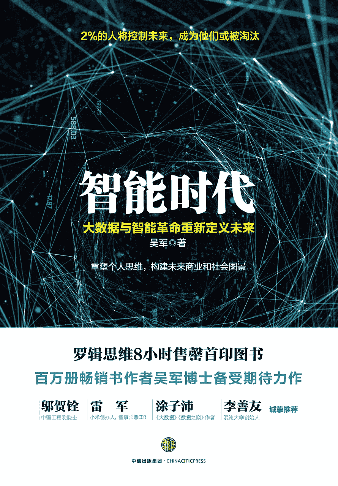

**附件电子书：**

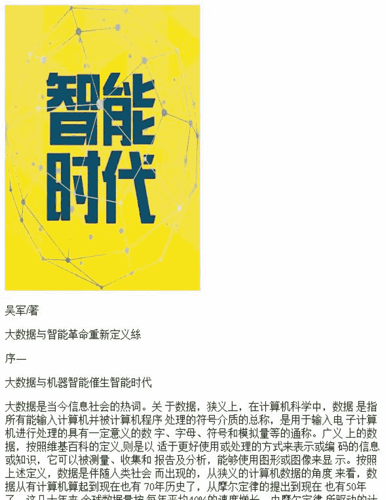

[智能时代-吴军.pdf](https://internal-api-drive-stream.feishu.cn/space/api/box/stream/download/all/Ilitb5AuUoIwMgxZoblcq0RTnZg)

**说明：**只找到了第一版电子书

## 《智能时代》

**作者：**吴军

**出版年： **2016-8

**豆瓣评分：**8.4

**作者简介：**吴军，博士，2002 年加入谷歌公司，2010 年加盟腾讯公司，出任负责搜索和搜索广告的副总裁。2012-2014 年回到谷歌，领导计算机自动问答项目。2014 年，他在硅谷创办了丰元资本风险投资公司。他在美国两家风险投资基金（中国世纪基金和 ZPark 风险基金）分别担任董事和顾问，也是约翰霍普金斯大学工商学院董事会董事，以及该校国际事务委员会的顾问。

**内容简介：**大数据和机器智能的出现，对我们的技术发展、商业和社会都会产生重大的影响。作者吴军在《智能时代：大数据与智能革命重新定义未来》中指出，首先，我们在过去认为非常难以解决的问题，会因为大数据和机器智能的使用而迎刃而解，比如解决癌症个性化治疗的难题。同时，大数据和机器智能还会彻底改变未来的商业模式，很多传统的行业都将采用智能技术实现升级换代，同时改变原有的商业模式。大数据和机器智能对于未来社会的影响是全方位的。

---

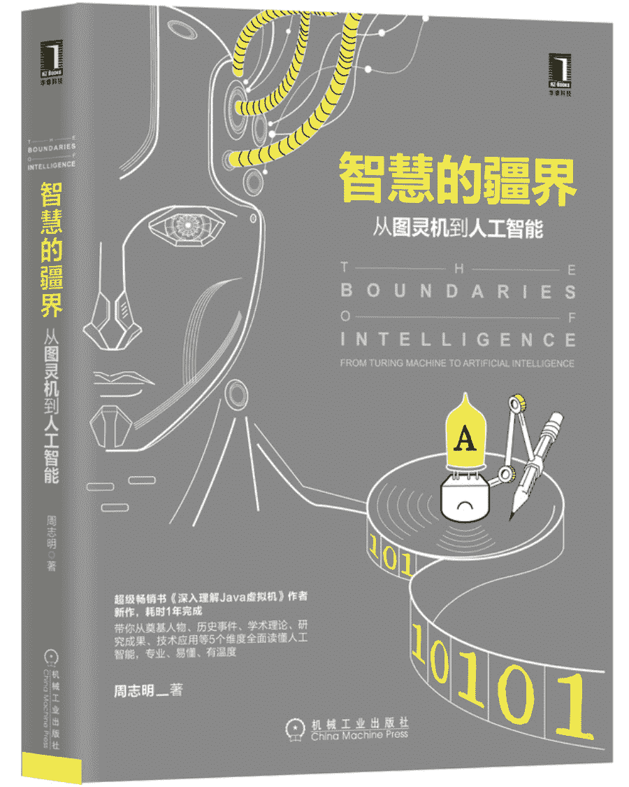

**附件电子书：**

[智慧的疆界](https://weread.qq.com/web/bookDetail/b9732f007168ac3cb976eca)（微信读书）

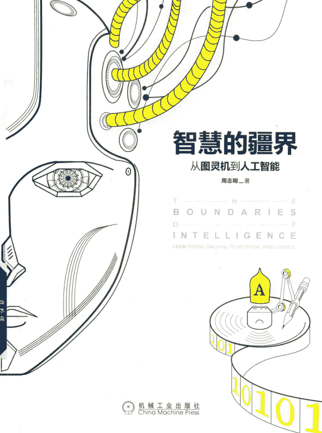

[智慧的疆界.pdf](https://internal-api-drive-stream.feishu.cn/space/api/box/stream/download/all/GNQmbUPYRoY2GTxWM0TcZdT1nid)

## 《智慧的疆界》

**作者：**周志明

**出版年：**2018-1

**豆瓣评分：**9.3

**作者简介：**周志明，Java 技术、机器学习和企业级开发技术专家，现任远光软件研究院院长，人工智能博士在读，著有畅销书本书。开源技术的积极倡导者和推动者，对计算机科学和相关的多个领域都有深刻的见解，尤其是人工智能、Java 技术和敏捷开发等领域。曾受邀在 InfoQ 和 IBMDeveloperWorks 等网站撰写技术专栏。著作颇丰，著有《深入理解 Java 虚拟机》《深入理解 OSGi》，翻译了《Java 虚拟机规范》等著作。其中《深入理解 Java 虚拟机》第 1 版出版于 2011 年，已经出至第 2 版，累计印刷超过 30 次，不仅销量好，而且口碑更好，是中文计算机图书领域公认的、难得一见的佳作。

**内容简介：**这是一部对人工智能充满敬畏之心的匠心之作，由《深入理解 Java 虚拟机》作者耗时一年完成，它将带你从奠基人物、历史事件、学术理论、研究成果、技术应用等 5 个维度全面读懂人工智能。本书以时间为主线，用专业的知识、通俗的语言、巧妙的内容组织方式，详细讲解了人工智能这个学科的全貌、能解决什么问题、面临怎样的困难、尝试过哪些努力、取得过多少成绩、未来将向何方发展，尽可能消除人工智能的神秘感，把阳春白雪的人工智能从科学的殿堂推向公众面前。

---

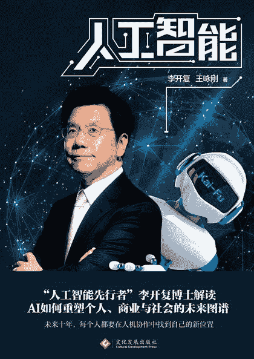

**附件电子书：**

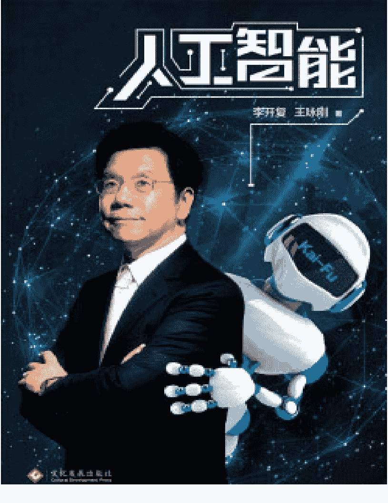

[人工智能：李开复谈AI如何重塑个人、商业与社会的未来图谱.pdf](https://internal-api-drive-stream.feishu.cn/space/api/box/stream/download/all/LTxUb6GeEoIF0rxuOHgc3uc0nJh)

## 《人工智能》

**作者：**李开复/王咏刚

**出版年： **2017-8

**豆瓣评分：**7.2

**作者简介：**李开复博士，创新工场董事长兼首席执行官/创新工场人工智能工程院院长李开复博士于 2009 年创立创新工场，曾任谷歌全球副总裁兼大中华区总裁、微软全球副总裁、苹果交互式多媒体部门副总裁。1998 年，李开复创办微软中国研究院（后更名为微软亚洲研究院），这是一所培养人工智能人才的黄埔军校。他开发的“奥赛罗”人机对弈系统，于 1988 年击败了得过世界团体比赛冠军的选手。

王咏刚：创新工场技术副总裁兼人工智能工程院副院长。王咏刚毕业于北京大学，毕业后长期从事金融行业软件研发，任方正奥德公司技术总监。2006-2016 在谷歌公司任 Staff Engineer、资深技术经理等职，在输入法、知识图谱、分布式系统、HTML5 动画/游戏引擎等技术领域拥有深厚的积累。

**内容简介：**人工智能已经来了，它就在我们身边，几乎无处不在。人工智能技术正在彻底改变人类的认知，重建人机相互协作的关系。史无前例的自动驾驶正在重构我们头脑中的出行地图和人类生活图景，今天的人工智能技术也正在翻译、写作、绘画等人文和艺术领域进行大胆的尝试。我们真的知道什么是人工智能吗？我们真的准备好与人工智能共同发展了吗？我们该如何在心理上将人和机器摆在正确的位置？我们该如何规划人工智能时代的未来生活。当人工智能时代成为必然，《人工智能》一书告诉我们：个人应该做些什么，才能避免被 AI 取代？企业应该如何升级，才能在新的商业变局到来前抓住先机？我们无需担忧和惧怕人工智能时代的到来，我们所要做的，应当是尽早认清 AI 与人类的关系，了解变革的规律，更好地拥抱新时代的到来。

---

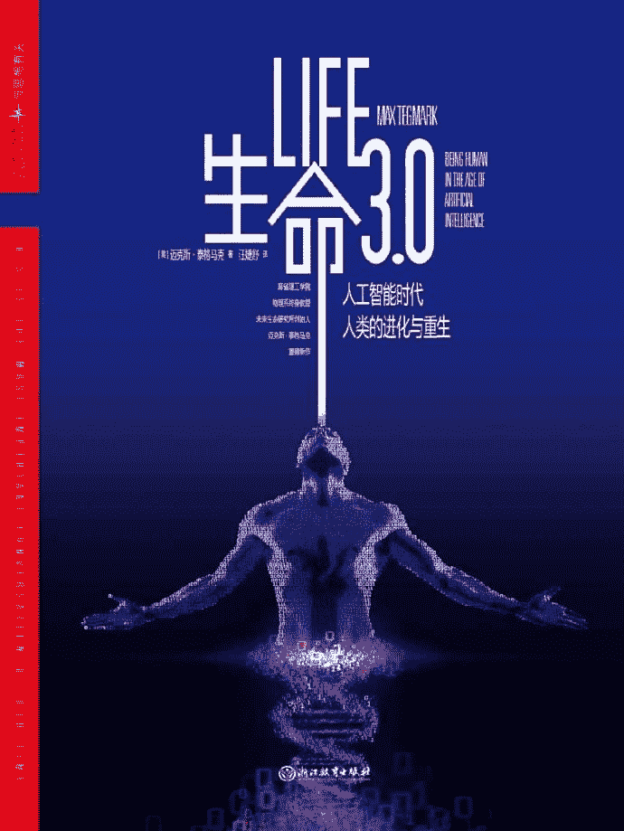

**附件电子书：**

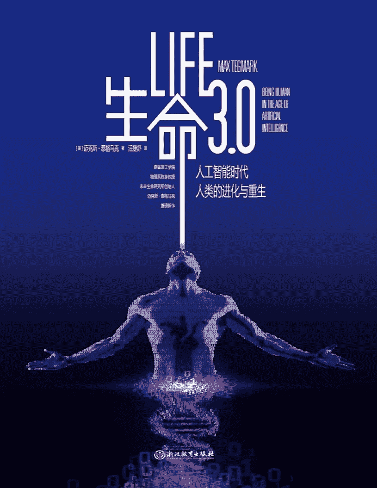

[生命3.0：人工智能时代，人类的进化与重生.pdf](https://internal-api-drive-stream.feishu.cn/space/api/box/stream/download/all/ULnZbUJtpo3LxVxyOoQcMUhUnad)

## 《生命 3.0》

**作者：**【美】迈克斯·泰格马克

**出版年：**2018-6

**豆瓣评分：**8.3

**作者简介：**迈克斯·泰格马克 （Max Tegmark），未来生命研究所（Future of Life Institute）创始人，致力于用科技来改善人类的未来。该组织自成立起汇聚了 8000 多位世界杰出人工智能专家，包括史蒂芬·霍金、埃隆·马斯克、比尔·盖茨、雷·库兹韦尔、拉里·佩奇等，还获得许多著名组织的 支持，包括亚马逊、谷歌、Facebook、微软、IBM，以及研究了 AIphaGo 的 Deepmind 公司。麻省理工学院物理系终身教授，平行宇宙理论研究专家，首次提出“数学宇宙假说”。

**内容简介：**《生命 3.0》一书中，作者迈克斯·泰格马克对人类的终极未来进行了全方位的畅想，从我们能活到的近未来穿行至 1 万年乃至 10 亿年及其以后，从可见的智能潜入不可见的意识，重新定义了“生命”“智能”“目标”“意识”，并澄清了常见的对人工智能的误解，将帮你构建起应对人工智能时代动态的全新思维框架，抓住人类与人工智能共生演化的焦点。迈克斯·泰格马克不仅以全景视角探讨了近未来人工智能对法律、战争、就业和社会带来的影响，还将目光投向了这场变革更为深远之处：在未来的 1 万年乃至 10 亿年及其以后，我们能否与人工智能实现共生与繁荣？宇宙生命发展的终极物理极限是什么？更为重要的是，我们如何在这场变革中迎来重生，同时又不会陷入危机，丧失生而为人的意义？《生命 3.0》这本书将是你人工智能时代的思考利器。此书对未来生命的终极形式进行了大胆的想象：生命已经走过了 1.0 生物阶段和 2.0 文化阶段，接下来生命将进入能自我设计的 3.0 科技阶段。

---

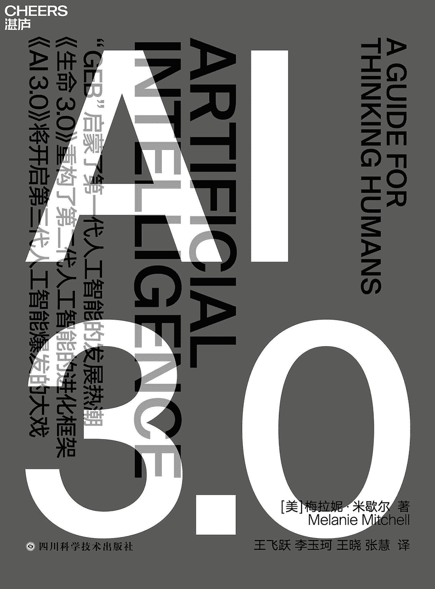

**附件电子书：**

[AI3.0](https://weread.qq.com/web/bookDetail/a72320c072289166a7200ff)（微信读书）

## **《**AI 3.0》

**作者：** [美] 梅拉妮·米歇尔

**出版年：**2021-2

**豆瓣评分：**8.5

**作者简介：**梅拉妮·米歇尔（Melanie Mitchell），波特兰州立大学计算机科学教授，曾在美国圣塔菲研究所（Santa Fe Institute）和洛斯阿拉莫斯国家实验室（Los Alamos National Laboratory）工作，主要的研究领域为类比推理、复杂系统、遗传算法等。在圣塔菲研究所时，米歇尔主导了复杂系统领域的研究工作，并教授了相关的在线课程。她的在线课程 Introduction to Complexity 已有近 30000 名学生选修，成为 Coursera 排名前 50 位的在线课程之一。

**内容简介：**什么是人工智能？人工智能背后的原理是什么？从问世到演化至今，人工智能经历了怎样的历史变迁？当下人工智能的能力边界在哪里？人工智能与人类智能的差异是什么？未来人工智能又将面对什么样的挑战和机遇？关于这些疑问，本书将为你一一揭晓答案。本书是超级畅销书《复杂》作者、复杂系统前沿科学家梅拉妮·米歇尔历经 10 年思考，厘清人工智能与人类智能的全新力作。本书源自米歇尔多年来对人工智能领域发展真实状态的记录，她在书中通过 5 个部分揭示了“现在的人工智能可以做什么，以及在未来几十年我们能从它们身上期待什么”。在描述了人工智能的发展历史之后，作者通过对视觉识别、游戏与推理、自然语言处理、常识判断这 4 大人工智能领域的热门应用的发展现状和局限性的探究，厘清了人工智能与人类智能的关系，书中关于人脸识别、无人驾驶、机器翻译等方面的案例分析都充满了巨大的启示！而这些，都是当下人工智能发展所面临的困境、人工智能想要取得突破性进展所必须重新思考的。看懂这本书，你将对人工智能领域有一个全景式的认知。

---

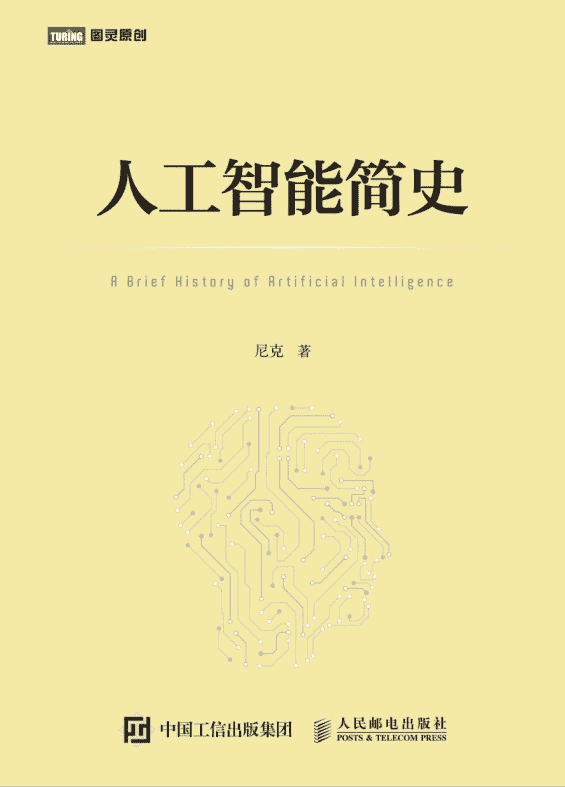

**附件电子书：**

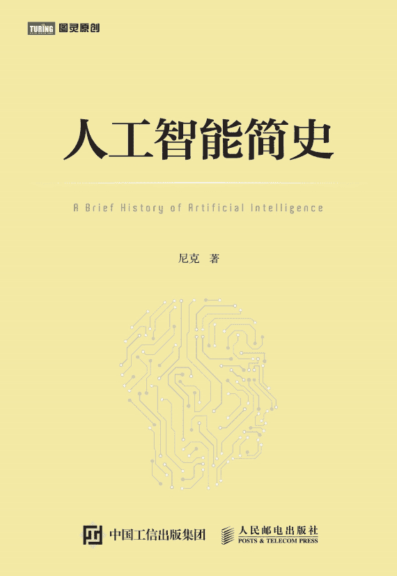

[人工智能简史.pdf](https://internal-api-drive-stream.feishu.cn/space/api/box/stream/download/all/GWYhb6g6YoZT8jx3kvJcOaHNnlf)

## 《人工智能简史》

**作者：**尼克

**出版年：**2017-12

**豆瓣评分：**7.2

**作者简介：**早年曾任职哈佛和惠普；后创业投资，往返于大陆和硅谷。无论忙闲不忘读书写字，作品多发表于《上海书评》，并有著作《UNIX 系统 V 内核剖析》和《哲学评书》。

**内容简介：**本书全面讲述人工智能的发展史，几乎覆盖人工智能学科的所有领域，包括人工智能的起源。、自动定理证明、专家系统、神经网络、自然语言处理、遗传算法、深度学习、强化学习、超级智能、哲学问题和未来趋势等，以宏阔的视野和生动的语言，对人工智能进行了全面回顾和深度点评。本书作者和书中诸多人物或为师友或相熟相知，除了详实的考证还有有趣的轶事。本书既适合专业人士了解人工智能鲜为人知的历史，也适合对人工智能感兴趣的大众读者作为入门的向导。

---

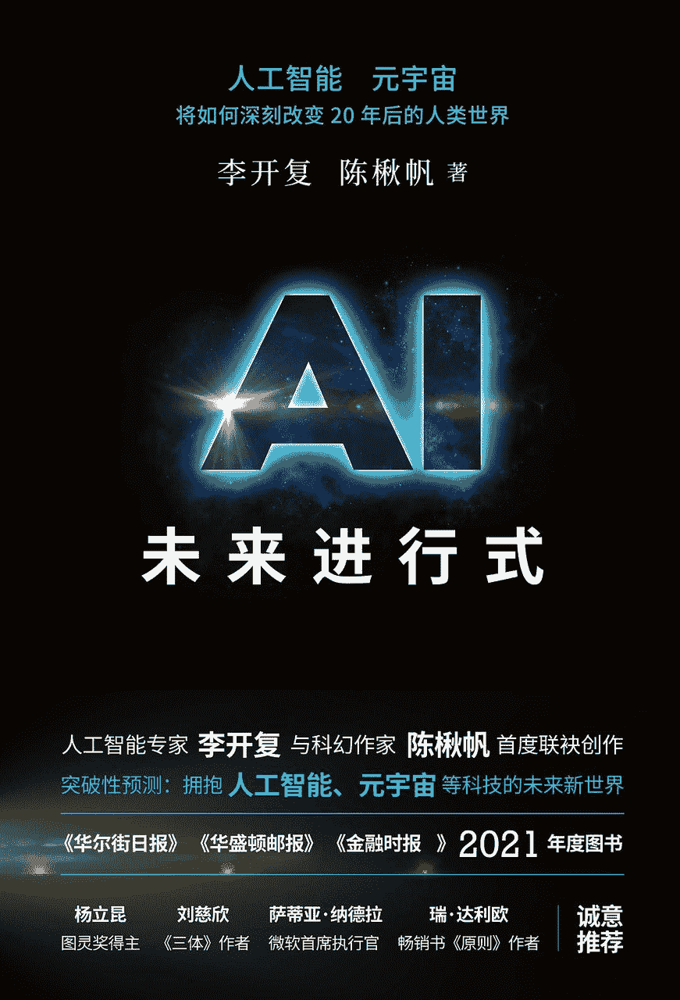

**附件电子书：**

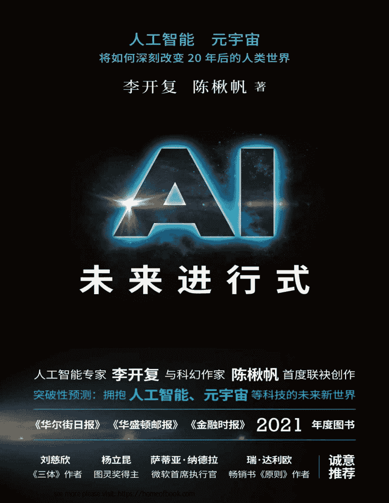

[AI未来进行式（李开复陈楸帆新书，樊登、俞敏洪、刘慈欣、杨立昆、萨蒂亚·纳德拉、瑞·达利欧、贝尼特·米勒等强势推荐！全新预测AI时代未来趋势！） (财之道丛书).pdf](https://internal-api-drive-stream.feishu.cn/space/api/box/stream/download/all/SClibOgxoopnhxx25txcQzTmnXb)

## 《AI 未来进行式》

**作者：**李开复 / 陈楸帆

**出版年：**2022-4

**豆瓣评分：**7.9

**作者简介：**李开复：卡内基梅隆大学计算机科学博士。全球著名人工智能专家、投资人、畅销书作家。曾担任谷歌全球副总裁兼大中华区总裁，并曾在微软、苹果等公司担任要职。2009 年创立创新工场，致力帮助创业者成长与发展。出任世界经济论坛人工智能委员会联席主席，并被《时代》周刊评选为影响全球 100 位年度人物之一。出版中文畅销书 10 余本。陈楸帆：科幻作家、编剧、翻译、策展人。中国科普作家协会副理事长，世界华人科幻协会名誉会长。曾获得星云奖、银河奖、科幻奇幻翻译奖、茅盾新人奖等奖项，在许多欧美科幻杂志均为首位发表作品的中国作家。其作品曾被翻译为 20 多国语言，代表作有《荒潮》《人生算法》等。

**内容简介：**这本书里通过 10 个短篇故事，为我们描绘了，20 年后，也就是 2042 年，人类世界将会在人工智能的影响下变成什么样子。每一个故事的主人公，都是生活在 2042 年的普通人。我们会跟随他们的视角，看到一系列仿佛来自科幻小说的场景——比如，能帮助人们寻找幸福的 AI 小岛、能以假乱真的人造视频、充斥在人们生活中的各类机器人，等等；也会感受到 AI 所带来的一系列社会议题—比如，AI 会在一些领域代替人，承担一些特定的工作，那么在就业市场里，人类如何跟 AI 共存？还有，AI 需要通过对大量数据的学习，才能真正变得“智能”，那么怎么解决 AI 时代的数据隐私问题？还有，AI 能便利人们的生活，但 AI 能给人们带来幸福感吗？等等。那么，这是一本开脑洞的科幻故事集吗？并不是。这本书的作者说，他写这本书的初衷，是用一种坦率、客观、负责任的态度，描绘在时光隧道的另一头可能发生的 AI“真实故事”。在这本书里，他所做的分析和预测，都是基于现有技术的发展脉络展开的。20 年后，书里的场景估计有八成，将成为现实。

---

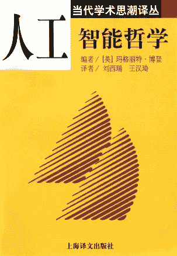

**附件电子书：**

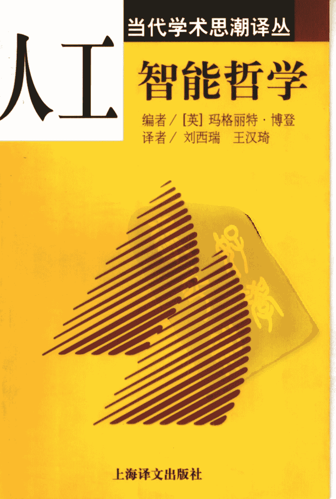

[《人工智能哲学》[英]玛格丽特·博登编著 (上海译文出版社 2001).pdf](https://internal-api-drive-stream.feishu.cn/space/api/box/stream/download/all/FoxObCIy3ot6gKx6jrWcZhLEnyf)

## 《人工智能哲学》

**作者： **玛格丽特·博登

**出版年：**2001-11

**豆瓣评分：**8.9

**作者简介：**玛格丽特·A。 博登（Margaret A。 Boden，生于 1936 年）是英国科学院院士，历任英国心理学会哲学、历史分会主席，以及英国皇家哲学学会理事。著有《人工智能史》一书，是人工智能领域的权威人士。

**内容简介：**人工智能哲学是伴随现代信息理论和计算机技术发展起来的一个哲学分支。本书收集了人工智能研究领域著名学者的十五篇代表性论文，这些论文为计算机科学的发展和人工智能哲学的建立作出了开创性的贡献。这些文章总结了人工智能发展的历程，近年来该学科发展的趋势，以及人工智能中的重要课题。

---

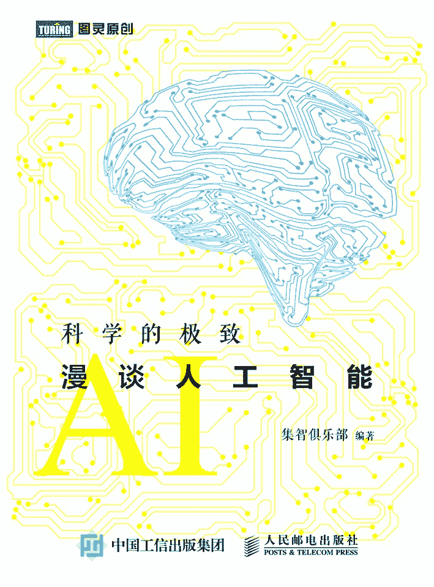

**附件电子书：**

[科学的极致：漫谈人工智能](https://weread.qq.com/web/bookDetail/6f4324f0715c01bd6f41018)（微信读书）

## 《科学的极致：漫谈人工智能》

**作者：**集智俱乐部

**出版年：**2015-7

**豆瓣评分：**8.1

**作者简介：**集智俱乐部（Swarm Agents Club，简称“SA Club”）成立于 2008 年，是一个从事学术研究、享受科学乐趣的探索者组成的团体。倡导以平等开放的态度、科学实证的精神进行跨学科的研究与交流，力图搭建一个中国的“没有围墙的研究所”。

**内容简介：**集智俱乐部成员将带你了解图灵机模型、冯·诺依曼计算机体系结构、怪圈与哥德尔定理、通用人工智能、深度学习、人类计算与自然语言处理，与你一起展开一场令人热血沸腾的科学之旅。

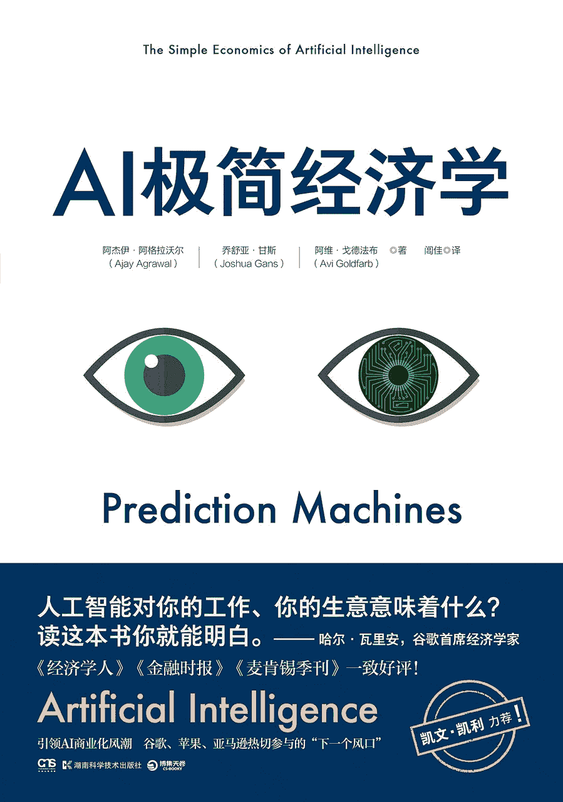

**附件电子书：**

[AI 极简经济学](https://weread.qq.com/web/bookDetail/f7b327207170f8eff7b149c)（电子书）

## 《AI 极简经济学》

**作者：**《伊·阿格拉沃尔 / 乔舒亚·甘斯 / 阿维·戈德法布》

**出版年：**2018-12

**豆瓣评分：**7.3

**作者简介：**阿杰伊·阿格拉沃尔（Ajay Agrawal）：颠覆性创新实验室创始人，多伦多大学罗特曼管理学院策略管理教授，美国全国经济研究所研究员，“未来人工智能”（Next AI）组织的共同创始人。乔舒亚·甘斯（Joshua Gans）：颠覆性创新实验室首席经济学家，多伦多大学罗特曼管理学院策略管理教授，《纽约时报》《哈佛商业评论》《福布斯》等多家媒体撰稿人。

**内容简介：**在《AI 极简经济学》一书中，三位深耕人工智能和决策领域的经济学家给出了清晰的答案。他们以坚实的经济学理论剖析动态，把握本质，将人工智能领域变化多端的表象总结为不断提高的机器预测能力。无论你是需要做出决策的企业家，还是尚且在规划职业生涯的普通人，或是面对剧烈社会变动的思考者，都能从这本书中获得重要启发。

---

# AI 经典书单：进阶篇（5 本）

> **说明：**人工智能深度学习&Tensorflow

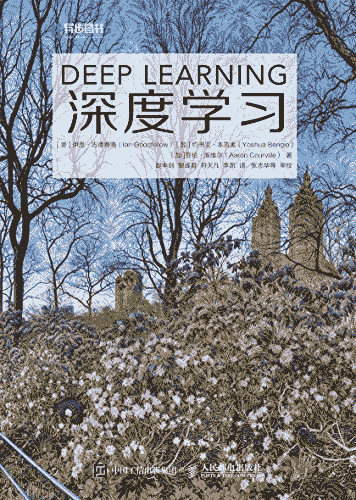

**附件电子书：**

[深度学习](https://weread.qq.com/web/bookDetail/e2332fe07159a1b5e232f89)（微信读书）

## 《深度学习》

**作者：** [美] 伊恩·古德费洛 / [加] 约书亚·本吉奥 / [加] 亚伦·库维尔

**出版年：**2017-7

**豆瓣评分：**8.4

**作者简介：**Ian Goodfellow，谷歌公司（Google） 的研究科学家，2014 年蒙特利尔大学机器学习博士。他的研究兴趣涵盖大多数深度学习主题，特别是生成模型以及机器学习的安全和隐私。Ian Goodfellow 在研究对抗样本方面是一位有影响力的早期研究者，他发明了生成式对抗网络，在深度学习领域贡献卓越。Yoshua Bengio，蒙特利尔大学计算机科学与运筹学系（DIRO） 的教授，蒙特利尔学习算法研究所（MILA） 的负责人，CIFAR 项目的共同负责人，加拿大统计学习算法研究主席。Yoshua Bengio 的主要研究目标是了解产生智力的学习原则。他还教授“机器学习”研究生课程（IFT6266），并培养了一大批研究生和博士后。Aaron Courville，蒙特利尔大学计算机科学与运筹学系的助理教授，也是 LISA 实验室的成员。目前他的研究兴趣集中在发展深度学习模型和方法，特别是开发概率模型和新颖的推断方法。Aaron Courville 主要专注于计算机视觉应用，在其他领域，如自然语言处理、音频信号处理、语音理解和其他 AI 相关任务方面也有所研究。

**内容简介：**《深度学习》由全球知名的三位专家 Ian Goodfellow、Yoshua Bengio 和 Aaron Courville 撰写，是深度学习领域奠基性的经典教材。全书的内容包括 3 个部分：第 1 部分介绍基本的数学工具和机器学习的概念，它们是深度学习的预备知识；第 2 部分系统深入地讲解现今已成熟的深度学习方法和技术；第 3 部分讨论某些具有前瞻性的方向和想法，它们被公认为是深度学习未来的研究重点。《深度学习》适合各类读者阅读，包括相关专业的大学生或研究生，以及不具有机器学习或统计背景、但是想要快速补充深度学习知识，以便在实际产品或平台中应用的软件工程师。

---

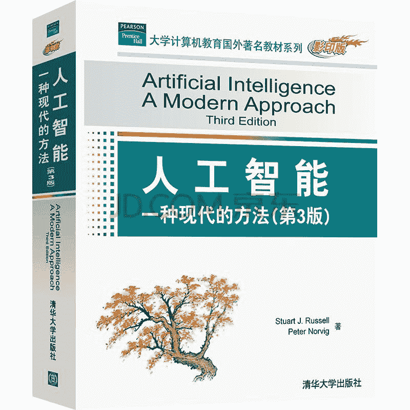

**附件电子书：**

[人工智能：一种现代的方法](https://weread.qq.com/web/bookDetail/fc332020813ab7942g0102ad)

[人工智能 一种现代的方法.第3版.pdf](https://internal-api-drive-stream.feishu.cn/space/api/box/stream/download/all/JLBgbvH6JobTfLxHuIRcoAD0nxh)

## 《人工智能：一种现代的方法》

**作者：**Stuart J。 Russell / Peter Norvig

**出版年：**2011-7

**豆瓣评分：**9.4

**作者简介：**Stuart Russell，1962 年生于英格兰的 Portsmouth。他于 1982 年以一等成绩在牛津大学获得物理学学士学位，并于 1986 年在斯坦福大学获得计算机科学的博士学位。之后他进入加州大学伯克利分校，任计算机科学教授，智能系统中心主任。他是美国人工智能学会的会士和前执行委员会委员。他已经发表 100 多篇论文，主题广泛涉及人工智能领域。Peter Norvig，现为 Google 研究院主管（Director of Research），2002-2005 年为负责核心 Web 搜索算法的主管。他是美国人工智能学会的会士和 ACM 的会士。他曾经是 NASAAmes 研究中心计算科学部的主任，负责 NASA 在人工智能和机器人学领域的研究与开发，他作为 Junglee 的首席科学家帮助开发了一种最早的互联网信息抽取服务。

**内容简介：**这本书可以说是人工智能领域的《圣 经》，这是一本全面介绍人工智能知识和内容的书籍，任何从事人工智能相关领域的人都应该读一读这本书。最权威、最经典的人工智能教材，已被全世界 100 多个国家的 1200 多所大学用作教材。最新版全面而系统地介绍了人工智能的理论和实践，阐述了人工智能领域的核心内容，并深入介绍了各个主要的研究方向。全书仍分为八大部分：第一部分“人工智能”，第二部分“问题求解”，第三部分“知识与推理”，第四部分“规划”，第五部分“不确定知识与推理”，第六部分“学习”，第七部分“通信、感知与行动”，第八部分“结论”。本书既详细介绍了人工智能的基本概念、思想和算法，还描述了其各个研究方向最前沿的进展，同时收集整理了详实的历史文献与事件。

---

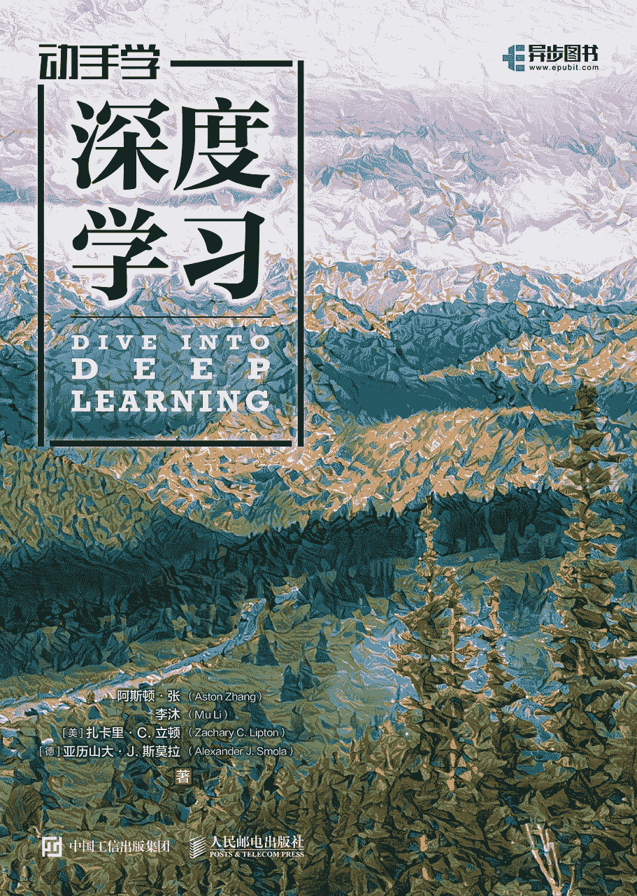

**附件电子书：**

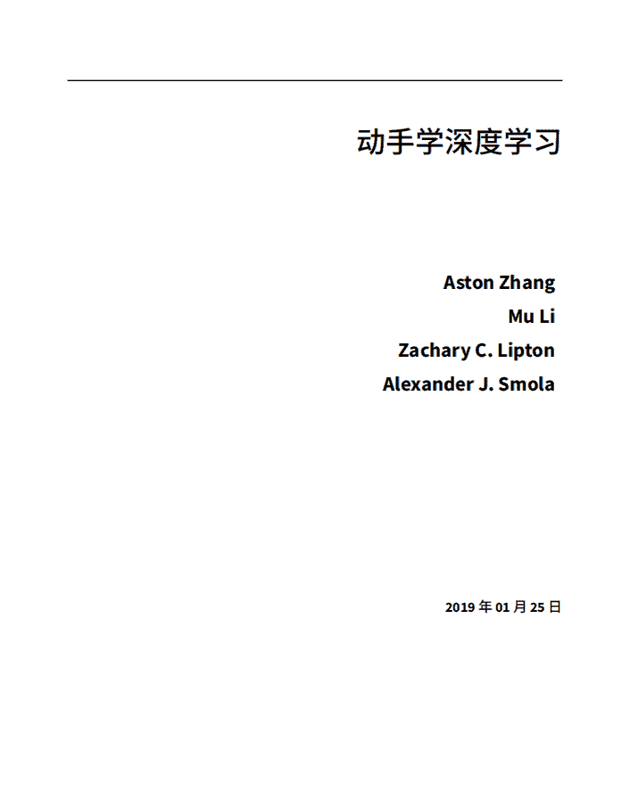

[动手学深度学习.pdf](https://internal-api-drive-stream.feishu.cn/space/api/box/stream/download/all/Qs3zbK9D7oefOMxUg9LciRconzb)

## 《动手学深度学习》

**作者：**阿斯顿·张（Aston Zhang） / 李沐（Mu Li） / [美] 扎卡里·C。 立顿（Zachary C。 Lipton） / [德] 亚历山大·J。 斯莫拉（Alexander J。 Smola)

**出版年：**2019-6

**豆瓣评分：**9.3

**作者简介：**阿斯顿·张（Aston Zhang）：亚马逊应用科学家，美国伊利诺伊大学香槟分校计算机科学博士，统计学和计算机科学双硕士。他专注于机器学习的研究，并在数个顶级学术会议发表过论文。李沐（Mu Li）：亚马逊首席科学家（Principal Scientist），加州大学伯克利分校客座助理教授，美国卡内基梅隆大学计算机系博士。他专注于分布式系统和机器学习算法的研究。他是深度学习框架 MXNet 的作者之一。他曾任机器学习创业公司 Marianas Labs 的 CTO 和百度深度学习研究院的主任研发架构师。扎卡里·C。 立顿（Zachary C。 Lipton）：亚马逊应用科学家，美国卡内基梅隆大学助理教授，美国加州大学圣迭戈分校博士。他专注于机器学习算法及其社会影响的研究，特别是在时序数据与序列决策上的深度学习。这类工作有着广泛的应用场景，包括医疗诊断、对话系统和产品推荐。亚历山大·J。 斯莫拉（Alexander J。 Smola）：亚马逊副总裁/ 杰出科学家，德国柏林工业大学计算机科学博士。他曾在澳大利亚国立大学、美国加州大学伯克利分校和卡内基梅隆大学任教。他发表了超过 200 篇学术论文，并著有 5 本书，其论文及书被引用超过 10 万次。他的研究兴趣包括深度学习、贝叶斯非参数、核方法、统计建模和可扩展算法。

**内容简介：**本书旨在向读者交付有关深度学习的交互式学习体验。书中不仅阐述深度学习的算法原理，还演示它们的实现和运行。与传统图书不同，本书的每一节都是一个可以下载并运行的 Jupyter 记事本，它将文字、公式、图像、代码和运行结果结合在了一起。此外，读者还可以访问并参与书中内容的讨论。全书的内容分为 3 个部分：第一部分介绍深度学习的背景，提供预备知识，并包括深度学习最基础的概念和技术；第二部分描述深度学习计算的重要组成部分，还解释近年来令深度学习在多个领域大获成功的卷积神经网络和循环神经网络；第三部分评价优化算法，检验影响深度学习计算性能的重要因素，并分别列举深度学习在计算机视觉和自然语言处理中的重要应用。本书同时覆盖深度学习的方法和实践，主要面向在校大学生、技术人员和研究人员。阅读本书需要读者了解基本的 Python 编程或附录中描述的线性代数、微分和概率基础。

---

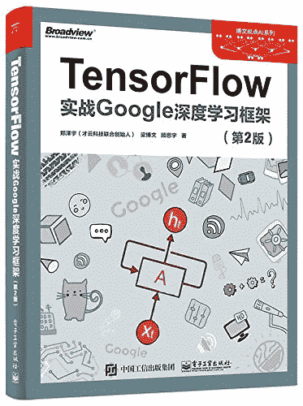

**附件电子书：**

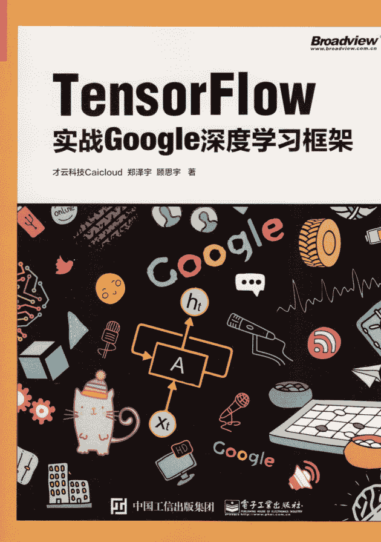

[Tensorflow 实战Google深度学习框架.pdf](https://internal-api-drive-stream.feishu.cn/space/api/box/stream/download/all/XYjtbLpGxoNJOqxwtghcKFn4nFd)

## 《TensorFlow：实战 Google 深度学习框架》

**作者：**顾思宇 / 梁博文 / 郑泽宇

**出版年：**2018-2

**豆瓣评分：**8.1

**作者简介：**郑泽宇，2011 年获北京大学计算机学士学位，2013 年获卡内基梅隆大学计算机硕士学位，前谷歌高级工程师，现为才云科技（Caicloud.io）联合创始人、首席大数据科学家。针对分布式 TensorFlow 上手难、管理难、监控难、上线难等问题，带领团队成功开发国内成熟的分布式 TensorFlow 深度学习平台，在机器学习、人工智能领域有着丰富的经验。梁博文，谷歌工程师。2011 年获北京大学计算机学士学位，2013 年获哥伦比亚大学计算机硕士学位，同年加入谷歌翻译组，参与并领导了多个项目，负责了 3 个语言的翻译模型的研发工作，在自然语言处理方面有丰富经验，在统计翻译模型、神经网络翻译模型、语料数据清洗等方面均有深入研究。

**内容简介：**TensorFlow 是谷歌 2015 年开源的主流深度学习框架，目前已得到广泛应用。《TensorFlow：实战 Google 深度学习框架（第 2 版）》为 TensorFlow 入门参考书，旨在帮助读者以快速、有效的方式上手 TensorFlow 和深度学习。书中省略了烦琐的数学模型推导，从实际应用问题出发，通过具体的 TensorFlow 示例介绍如何使用深度学习解决实际问题。书中包含深度学习的入门知识和大量实践经验，是走进这个前沿、热门的人工智能领域的优选参考书。适用于想要使用深度学习或 TensorFlow 的数据科学家、工程师，希望了解深度学习的大数据平台工程师，对人工智能、深度学习感兴趣的计算机相关从业人员及在校学生等。

---

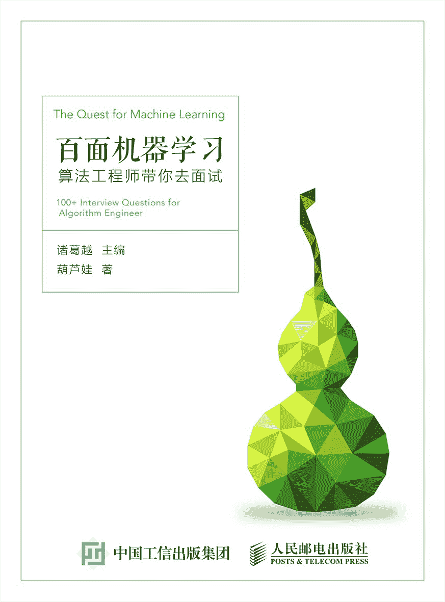

**附件电子书：**

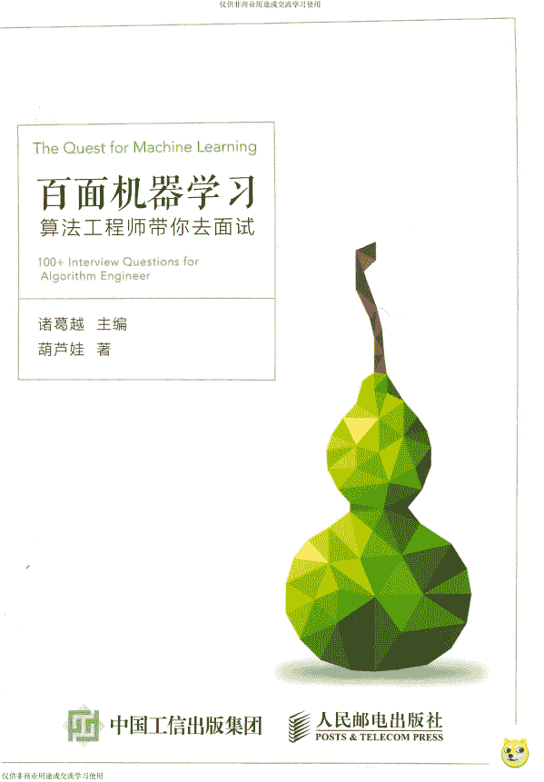

[百面机器学习：算法工程师带你去面试.pdf](https://internal-api-drive-stream.feishu.cn/space/api/box/stream/download/all/BcGjbFcSeo0gG1xdKdFc2Hl0nMc)

## 《百面机器学习》

**作者：**诸葛越

**出版年：2018-8**

**豆瓣评分：8.7**

**作者简介：**诸葛越：现任 Hulu 公司全球研发副总裁，中国研发中心总经理。曾任 Landscape Mobile 公司联合创始人兼 CEO，前雅虎北京全球研发中心产品总监， 微软北京研发中心项目总经理，雅虎美国高级软件架构师。诸葛越获美国斯坦福大学的计算机硕士与博士，纽约州立大学石溪分校的应用数学硕士，曾就读于清华大学计算机科学与技术系。诸葛越的研究结果获多项专利，2005 年获美国计算机学会数据库专业委员会十年 z 佳论文奖。葫芦娃：15 位 Hulu 北京创新实验室的人才。他们利用擅长的机器学习、深度学习等领域知识和算法模型，建立了一套定制化的机 AI 平台，改变着推荐引擎、视频编解码、内容理解、广告投放等多项与用户息息相关的在线业务技术。

**内容简介：**人工智能领域正在以超乎人们想象的速度发展，本书赶在人工智能彻底占领世界之前完成编写，实属万幸。书中收录了超过 100 道机器学习算法工程师的面试题目和解答，其中大部分源于 Hulu 算法研究岗位的真实场景。本书从日常工作、生活中各种有趣的现象出发，不仅囊括了机器学习的基本知识 ，而且还包含了成为出众算法工程师的相关技能，更重要的是凝聚了笔者对人工智能领域的一颗热忱之心，旨在培养读者发现问题、解决问题、扩展问题的能力，建立对机器学习的热爱，共绘人工智能世界的宏伟蓝图。

# AI 经典书单：高级篇（7 本）

> 人工智能机器学习类&Python&数据科学。

**附件电子书：**

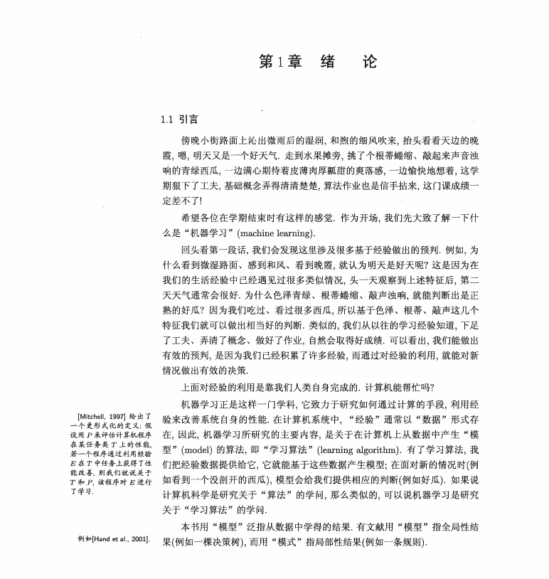

[周志华-机器学习.pdf](https://internal-api-drive-stream.feishu.cn/space/api/box/stream/download/all/R0tnb9UGSoFQa5xi3EBc8CJ3nAf)

## 《机器学习》（俗称“西瓜书”）

**作者：**周志华

**出版年：**2016-1

**豆瓣评分：**8.6

**作者简介：**周志华，南京大学教授，计算机科学与技术系副主任，软件新技术国家重点实验室常务副主任，机器学习与数据挖掘研究所（LAMDA）所长，校、系学术委员会委员；ACM 杰出科学家，IEEE Fellow，IAPR Fellow，中国计算机学会会士；长江学者特聘教授，国家杰出青年基金获得者。2007 年创建南京大学机器学习与数据挖掘研究所（LAMDA），2010 年 11 月任软件新技术国家重点实验室常务副主任，2013 年 5 月任计算机系副主任。

**内容简介：**机器学习是计算机科学与人工智能的重要分支领域。本书作为该领域的入门教材，在内容上尽可能涵盖机器学习基础知识的各方面。为了使尽可能多的读者通过本书对机器学习有所了解，作者试图尽可能少地使用数学知识。然而，少量的概率、统计、代数、优化、逻辑知识似乎不可避免。因此，本书更适合大学三年级以上的理工科本科生和研究生，以及具有类似背景的对机器学习感兴趣的人士。为方便读者，本书附录给出了一些相关数学基础知识简介。全书共 16 章，大致分为 3 个部分：第 1 部分（第 1～3 章）介绍机器学习的基础知识；第 2 部分（第 4～10 章）讨论一些经典而常用的机器学习方法（决策树、神经网络、支持向量机、贝叶斯分类器、集成学习、聚类、降维与度量学习）；第 3 部分（第 11～16 章）为进阶知识，内容涉及特征选择与稀疏学习、计算学习理论、半监督学习、概率图模型、规则学习以及强化学习等。前 3 章之外的后续各章均相对独立，读者可根据自己的兴趣和时间情况选择使用。根据课时情况，一个学期的本科生课程可考虑讲授前 9 章或前 10 章；研究生课程则不妨使用全书。

---

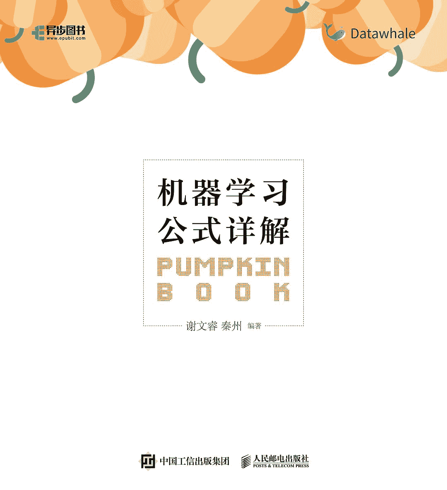

**附件电子书：**

[机器学习公式详解](https://weread.qq.com/web/bookDetail/d89322a072327b15d896afb)

**说明：**微信读书已上架。

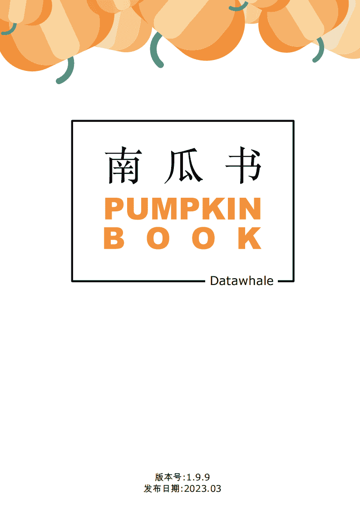

[机器学习公式详解.pdf](https://internal-api-drive-stream.feishu.cn/space/api/box/stream/download/all/ADS4bem6SoqfcwxjdcJcOedunUf)

## 《机器学习公式详解》

**作者：**谢文睿 / 秦州

**出版年：**2021-3

**豆瓣评分：**9.2

**作者简介：**谢文睿：北京工业大学硕士， 开源组织 Datawhale 核心成员兼开源项目负责人，主要研究方向为机器学习与自然语言处理。秦州：康奈尔大学计算机硕士，Datawhale 重要贡献成员。阿里巴巴算法工程师，主要研究方向为图神经网络的研发和应用。CIKM 2019 最佳应用论文作者，开源图神经网络框架 graph-learn 核心开发者。

**内容简介：**周志华老师的《机器学习》（俗称“西瓜书”）是机器学习领域的经典入门教材之一。本书（俗称“南瓜书”）基于 Datawhale 成员自学“西瓜书”时记下的笔记编著而成，旨在对“西瓜书”中重难点公式加以解析，以及对部分公式补充具体的推导细节。全书共 16 章，与“西瓜书”章节、公式对应，每个公式的推导和解析都以本科数学基础的视角进行讲解，希望能够帮助读者达到“理工科数学基础扎实点的大二下学期学生”水平。每章都附有相关阅读材料，以便有兴趣的读者进一步钻研探索。本书思路清晰，视角独特，结构合理，可作为高等院校计算机及相关专业的本科生或研究生教材，也可供对机器学习感兴趣的研究人员和工程技术人员阅读参考。

---

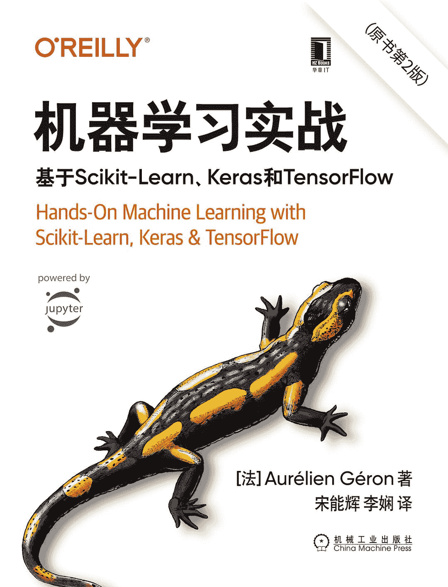

**附件电子书：**

[机器学习实战](https://weread.qq.com/web/bookDetail/e8e327a07208f4d1e8ec475)

说明：微信读书已上线。

**英文原版：**

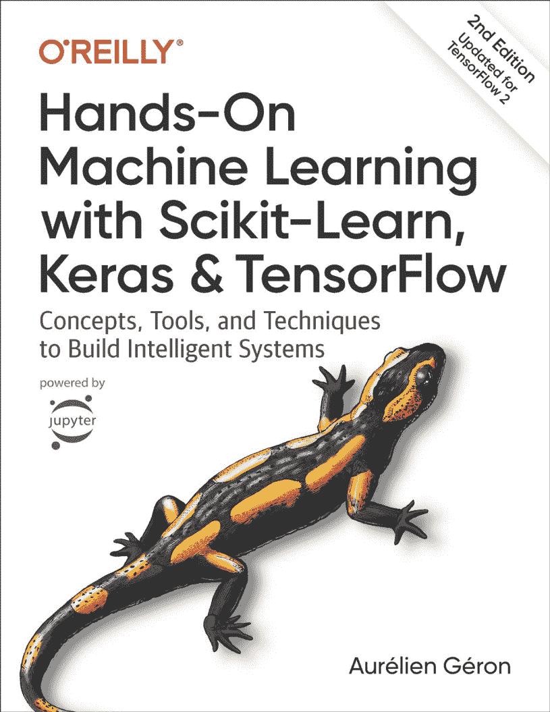

[《机器学习实战：基于Scikit-Learn、Keras和TensorFlow》第二版.pdf](https://internal-api-drive-stream.feishu.cn/space/api/box/stream/download/all/BkN8b3miloz9jlxb1qlcOACBnlc)

## 《机器学习实战》

**作者：** [法] Aurélien Géron

**出版年：**2020-10

**豆瓣评分：**9.7

**作者简介：**Aurélien Géron 是机器学习方面的顾问。曾就职于 Google，在 2013 年到 2016 年领导过 YouTube 视频分类团队。Wifirst 公司的创始人并于 2002 年至 2012 年担任该公司的首席技术官。于 2001 年创办 Ployconseil 公司并任首席技术官。

**内容简介：**这本机器学习畅销书基于 TensorFlow 2 和 Scikit-Learn 的新版本进行了全面更新，通过具体的示例、非常少的理论和可用于生产环境的 Python 框架，从零帮助你直观地理解并掌握构建智能系统所需要的概念和工具。全书分为两部分。第一部分介绍机器学习基础，涵盖以下主题：什么是机器学习，它试图解决什么问题，以及系统的主要类别和基本概念；第二部分介绍神经网络和深度学习，涵盖以下主题：什么是神经网络以及它们有什么用，使用 TensorFlow 和 Keras 构建和训练神经网络的技术，以及如何使用强化学习构建可以通过反复试错，学习好的策略的代理程序。第一部分主要基于 Scikit-Learn，而第二部分则使用 TensorFlow 和 Keras。通过本书，你会学到一系列可以快速使用的技术。每章的练习可以帮助你应用所学的知识，你只需要有一些编程经验。所有代码都可以在 GitHub 上获得。

---

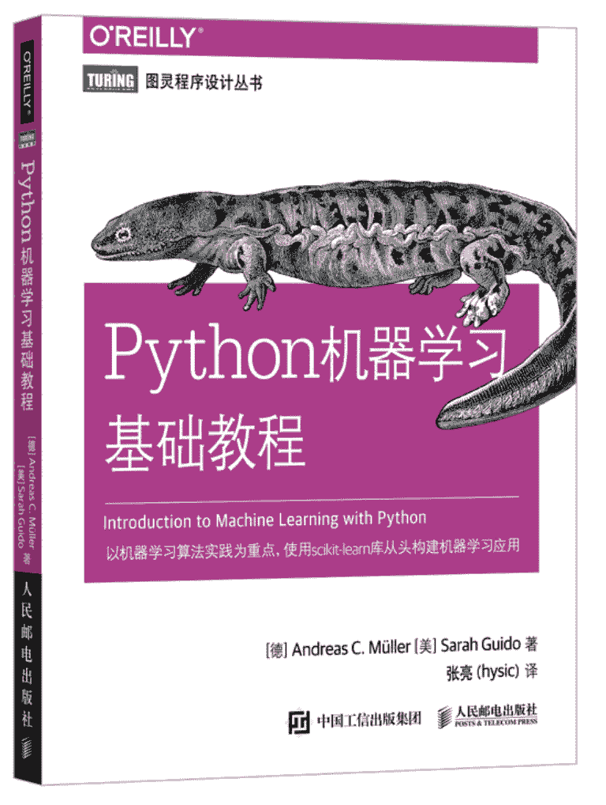

**附件电子书：**

[Python 机器学习基础教程](https://weread.qq.com/web/bookDetail/b0d32910718ff601b0d0aee)

**说明：**微信读书已上架。

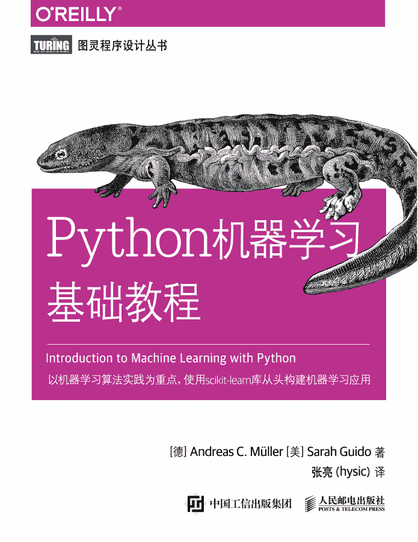

[Python机器学习基础教程.pdf](https://internal-api-drive-stream.feishu.cn/space/api/box/stream/download/all/N4KvbmxFIoHxDSx3nAQcH5FInbd)

## 《Python 机器学习基础教程》

**作者：** [德] 安德里亚斯·穆勒 / [美] 莎拉·吉多

**出版年：**2018-1

**豆瓣评分：**8.9

**作者简介：**Andreas C。 Müller：scikit-learn 库维护者和核心贡献者。现任哥伦比亚大学数据科学研究院讲师，曾任纽约大学数据科学中心助理研究员、亚马逊公司计算机视觉应用的机器学习研究员。在波恩大学获得机器学习博士学位。Sarah Guido：Mashable 公司数据科学家，曾担任 Bitly 公司首席数据科学家。

**内容简介：**本书是机器学习入门书，以 Python 语言介绍。主要内容包括：机器学习的基本概念及其应用；实践中最常用的机器学习算法以及这些算法的优缺点；在机器学习中待处理数据的呈现方式的重要性，以及应重点关注数据的哪些方面；模型评估和调参的高级方法，重点讲解交叉验证和网格搜索；管道的概念；如何将前面各章的方法应用到文本数据上，还介绍了一些文本特有的处理方法。

---

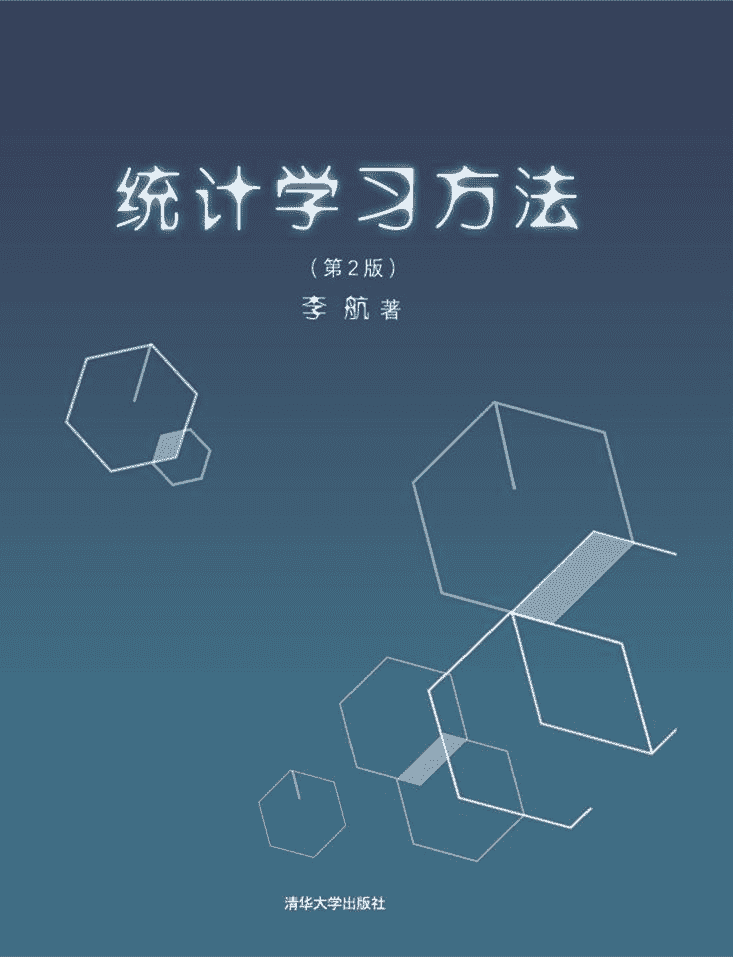

**附件电子书：**

[统计学习方法](https://weread.qq.com/web/bookDetail/c0032560813ab6c02g010482)

**说明：**微信读书已上架。

[统计学习方法.pdf](https://internal-api-drive-stream.feishu.cn/space/api/box/stream/download/all/L1IpbzDbiobuLGxTwsqcvd8CnSg)

## 《统计学习方法》（第二版）

**作者：李航**

**出版年：**2019-5

**豆瓣评分：**9.4

**作者简介：**李航，男，毕业于日本京都大学电气电子工程系，日本东京大学获得计算机科学博士学位。北京大学、南京大学兼职教授。曾任日本 NEC 公司中央研究所研究员，微软亚洲研究院高级研究员与主任研究员、华为技术有限公司诺亚方舟实验室主任。现任今日头条人工智能实验室主任。

**内容简介：**统计学习方法即机器学习方法，是计算机及其应用领域的一门重要学科。本书分为监督学 习和无监督学习两篇，全面系统地介绍了统计学习的主要方法。包括感知机、k 近邻法、朴素贝叶斯法、决策树、逻辑斯谛回归与最大熵模型、支持向量机、提升方法、EM 算法、隐马尔可夫模型和条件随机场，以及聚类方法、奇异值分解、主成分分析、潜在语义分析、概率潜在语义分析、马尔可夫链蒙特卡罗法、潜在狄利克雷分配和 PageRank 算法等。除有关统计学习、监督学习和无监督学习的概论和总结的四章外，每章介绍一种方法。叙述力求从具体问题或实例入手， 由浅入深，阐明思路，给出必要的数学推导，便于读者掌握统计学习方法的实质，学会运用。 为满足读者进一步学习的需要，书中还介绍了一些相关研究，给出了少量习题，列出了主要参考文献。 本书是统计机器学习及相关课程的教学参考书，适用于高等院校文本数据挖掘。

---

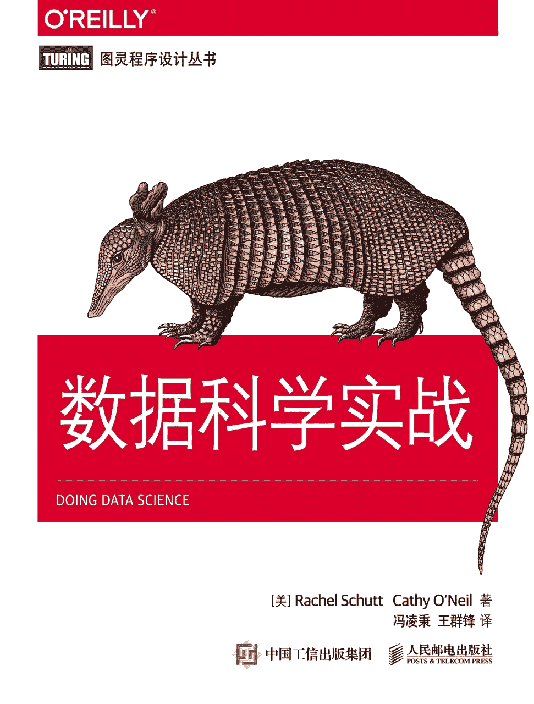

**附件电子书：**

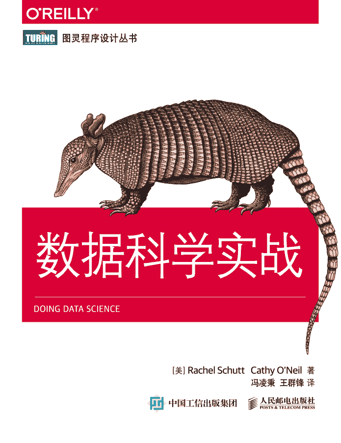

[数据科学实战.pdf](https://internal-api-drive-stream.feishu.cn/space/api/box/stream/download/all/JxfTbVbGMoqXybxk2vzchGM4n3Y)

## 《数据科学实战》

**作者：**[美] Rachel Schutt / [美] Cathy O'Neil

**出版年：**2015-3

**豆瓣评分：**8.1

**作者简介：**Rachel Schutt：美国新闻集团旗下数据科学部门高级副总裁、哥伦比亚大学统计系兼职教授、约翰逊实验室高级研究科学家，同时也是哥伦比亚大学数据科学及工程研究所教育委员会的发起人之一。她曾在谷歌研究院工作数年，负责设计算法原型并通过建模理解用户行为。Cathy O'Neil 约翰逊实验室高级数据科学家、哈佛大学数学博士、麻省理工学院数学系博士后、巴纳德学院教授，曾发表过大量算术代数几何方面的论文。他曾在著名的全球投资管理公司 D.E。 Shaw 担任对冲基金金融师，后加入专门评估银行和对冲基金风险的软件公司 RiskMetrics。

**内容简介：**本书脱胎于哥伦比亚大学“数据科学导论”课程的教学讲义，它界定了数据科学的研究范畴，是一本注重人文精神，多角度、全方位、深入介绍数据科学的实用指南，堪称大数据时代的实战宝典。本书旨在让读者能够举一反三地解决重要问题，内容包括：数据科学及工作流程、统计模型与机器学习算法、信息提取与统计变量创建、数据可视化与社交网络、预测模型与因果分析、数据预处理与工程方法。另外，本书还将带领读者展望数据科学未来的发展。

---

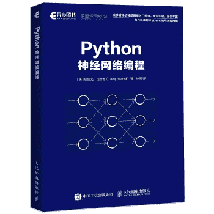

**附件电子书：**

[Python 神经网络编程](https://weread.qq.com/web/bookDetail/a0b328807159b27ba0ba937)（微信读书）

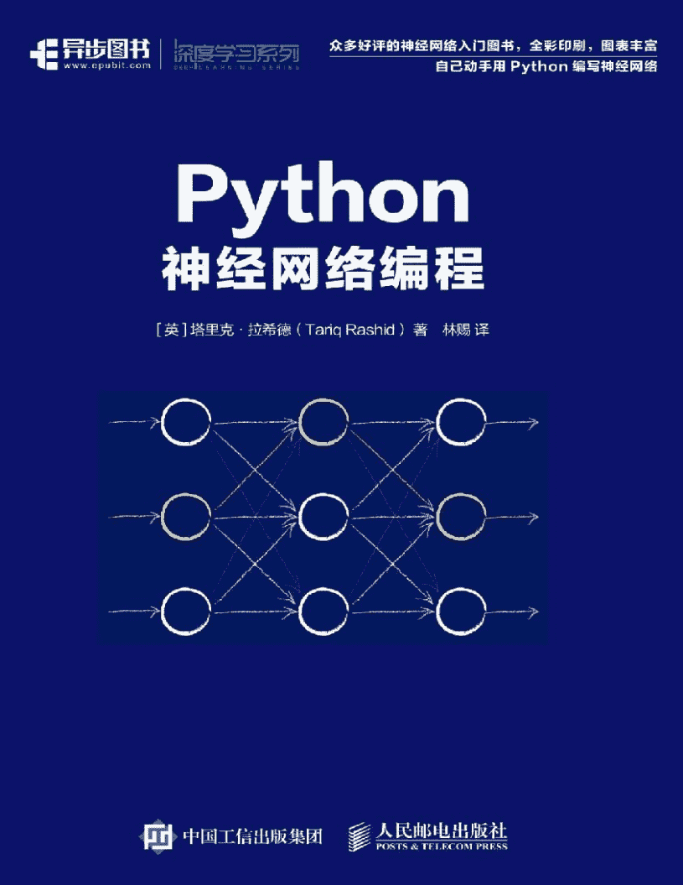

[Python神经网络编程高清版.pdf](https://internal-api-drive-stream.feishu.cn/space/api/box/stream/download/all/UMFHbzDQeoV0E6xTiWtcFpXwnPg)

## 《Python 神经网络编程》

**作者：**【英] Tariq Rashid

**出版年：**2018-4

**豆瓣评分：**9.2

**作者简介：**Tariq Rashid 拥有物理学学士学位、机器学习和数据挖掘硕士学位。常年活跃于伦敦的技术领域，领导并组织伦敦 Python 聚会小组（近 3000 名成员）。

**内容简介：**本书首先从简单的思路着手，详细介绍了理解神经网络如何工作所必须的基础知识。第一部分介绍基本的思路，包括神经网络底层的数学知识，第 2 部分是实践，介绍了学习 Python 编程的流行和轻松的方法，从而逐渐使用该语言构建神经网络，以能够识别人类手写的字母，特别是让其像专家所开发的网络那样地工作。第 3 部分是扩展，介绍如何将神经网络的性能提升到工业应用的层级。

---

# AI 经典书单：专家篇（8 本）

> 人工智能算法&策略&神经网络&自然语言处理&推荐系统&系统算法&图像算法&贝叶斯&概率编程&数学算法等。

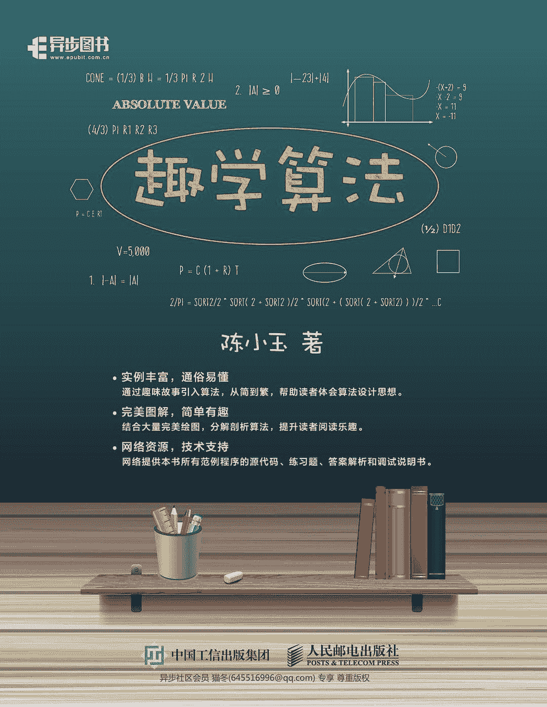

**附件电子书：**

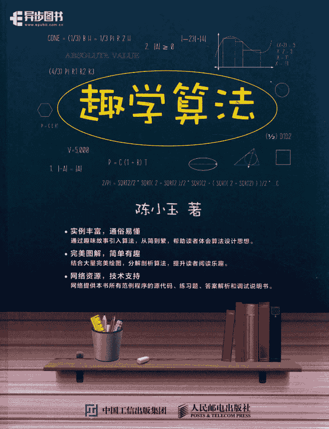

[趣学算法.pdf](https://internal-api-drive-stream.feishu.cn/space/api/box/stream/download/all/WlCPbVDTzohdeJxekRDcBtGOnlb)

## 《趣学算法》

**作者：**陈小玉

**出版年：**2017-7

**豆瓣评分：**8.0

**作者简介：**陈小玉，副教授，硕士，高级程序员，研究方向：智能计算、机器学习与数据挖掘。主讲《数据结构**》**、《算法设计与分析》、《人工智能》等专业课程，并发表过多篇计算机专业论文和项目。

**内容简介：**本书内容按照算法策略分为 7 章。第 1 章从算法之美、简单小问题、趣味故事引入算法概念、时间复杂度、空间复杂度的概念和计算方法，以及算法设计的爆炸性增量问题，使读者体验算法的奥妙。第 2～7 章介绍经典算法的设计策略、实战演练、算法分析及优化拓展，分别讲解贪心算法、分治算法、动态规划、回溯法、分支限界法、线性规划和网络流。每一种算法都有 4～10 个实例，共 50 个大型实例，包括经典的构造实例和实际应用实例，按照问题分析、算法设计、图解、伪代码详解、实战演练、算法解析及优化拓展的流程，讲解清楚且通俗易懂。本书可作为程序员的学习用书，也适合从未有过编程经验但又对算法有强烈兴趣的初学者使用，同时也可作为高等院校计算机、数学及相关专业的师生用书和培训学校的教材。

---

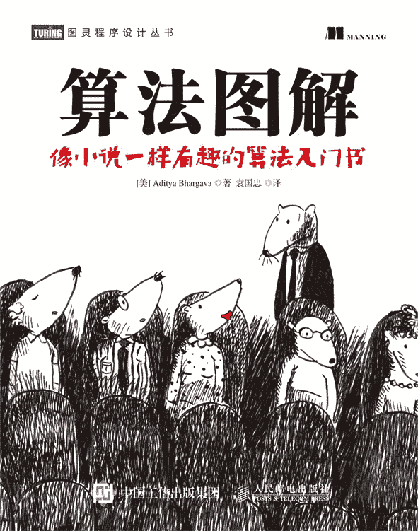

**附件电子书：**

[算法图解](https://weread.qq.com/web/bookDetail/fbf32b80715c0184fbff41f)

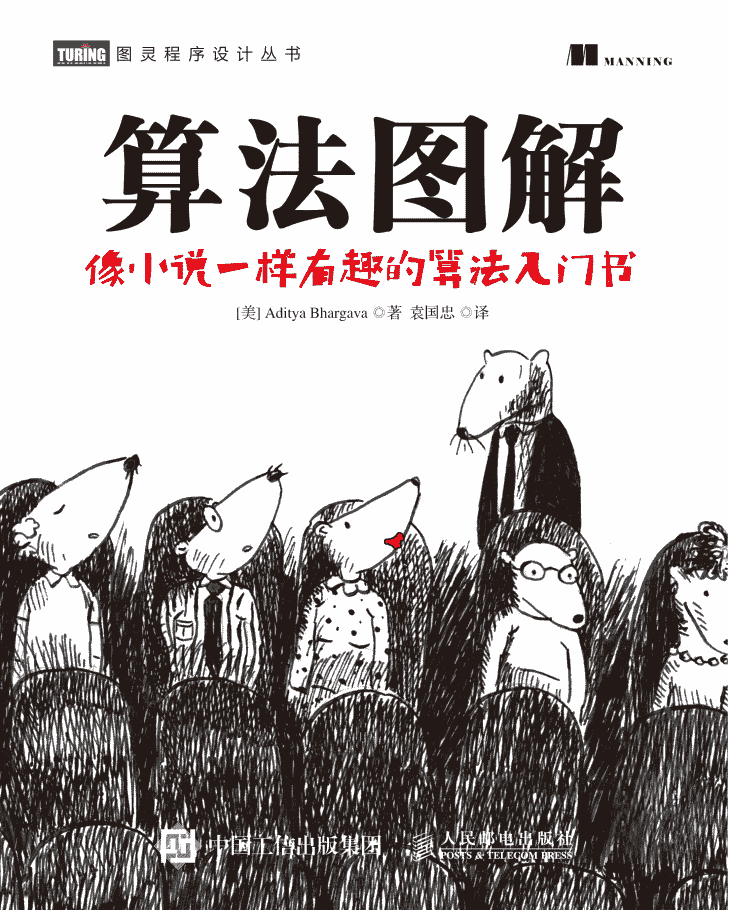

[算法图解.pdf](https://internal-api-drive-stream.feishu.cn/space/api/box/stream/download/all/X3PJb5wtqo6Tujx6rxxcw0y7nVg)

## **《**算法图解》

**作者：**[美] Aditya Bhargava

**出版年：**2017-3

**豆瓣评分：**8.5

**作者简介：**Aditya Bhargava，软件工程师，兼具计算机科学和美术方面的教育背景，在 adit.io 撰写编程方面的博客。

**内容简介：**本书示例丰富，图文并茂，以让人容易理解的方式阐释了算法，旨在帮助程序员在日常项目中更好地发挥算法的能量。书中的前三章将帮助你打下基础，带你学习二分查找、大 O 表示法、两种基本的数据结构以及递归等。余下的篇幅将主要介绍应用广泛的算法，具体内容包括：面对具体问题时的解决技巧，比如，何时采用贪婪算法或动态规划；散列表的应用；图算法；K 最近邻算法。

---

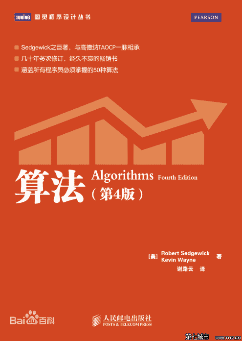

**附件电子书：**[

算法（第 4 版](https://weread.qq.com/web/bookDetail/7cc32910718ff66b7cc8d9d)）

说明：微信读书已上架。

[《算法 第4版》.pdf](https://internal-api-drive-stream.feishu.cn/space/api/box/stream/download/all/BZ8TbqRnio5QEtxTXjicMEeznTh)

## 《算法》（第 4 版）

**作者：**【美] Robert Sedgewick / [美] Kevin Wayne

**出版年：**2012-10

**豆瓣评分：**9.4

**作者简介：**Robert Sedgewick，斯坦福大学博士（导师是 Donald E。 Knuth），从 1985 年开始一直担任普林斯顿大学计算机科学系教授，曾任该系主任，也是 Adobe Systems 公司董事会成员，曾在 Xerox PARC、国防分析研究所（Institute for Defense Analyses）和法国国家信息与自动化研究所（INRIA）从事研究工作。他的研究方向包括解析组合学、数据结构和算法的分析与设计、程序可视化等。Kevin Wayne，康奈尔大学博士，普林斯顿大学计算机科学系高级讲师。研究方向包括算法的设计、分析和实现，特别是图和离散优化。

**内容简介：**本书作为算法领域经典的参考书，全面介绍了关于算法和数据结构的必备知识，并特别针对排序、搜索、图处理和字符串处理进行了论述。第 4 版具体给出了每位程序员应知应会的 50 个算法，提供了实际代码，而且这些 Java 代码实现采用了模块化的编程风格，读者可以方便地加以改造。配套网站 algs4.cs.princeton.edu 提供了本书内容摘要以及相关代码、测试数据、编程练习、教学课件等资源。

---

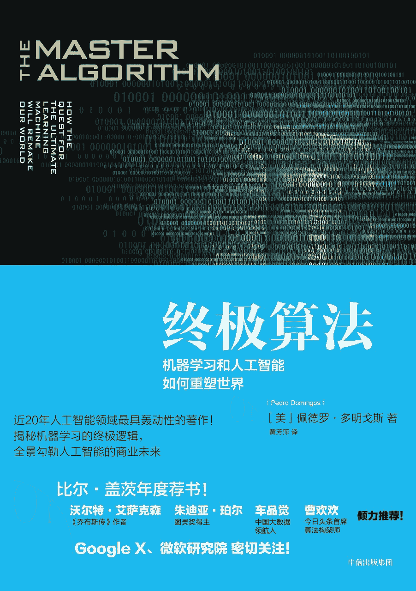

**附件电子书：**

[终极算法](https://weread.qq.com/web/bookDetail/a38329305e00bca3852990b)（微信读书）

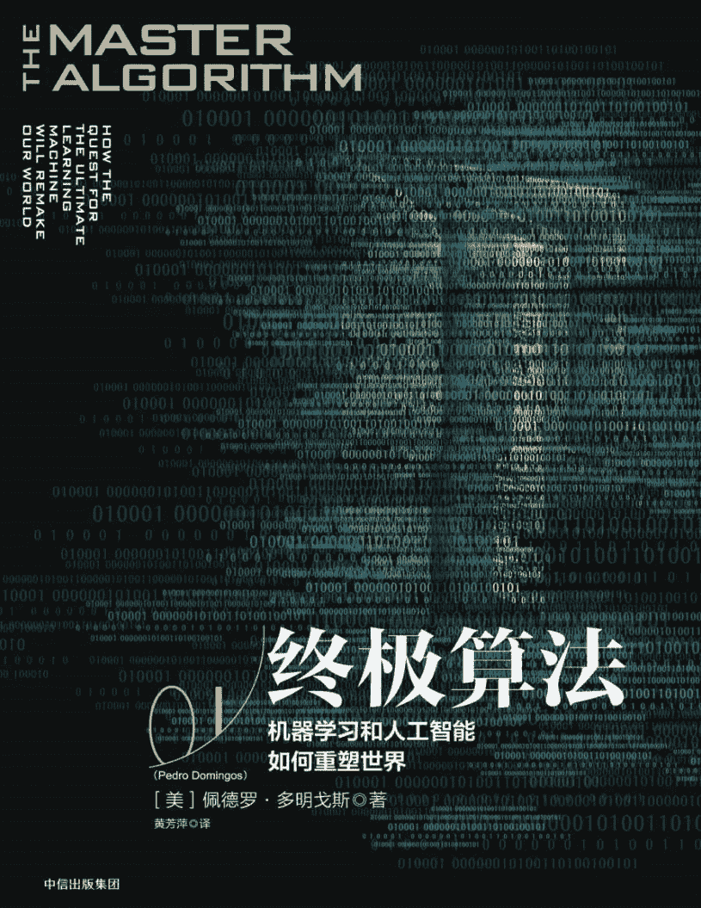

[终极算法.pdf](https://internal-api-drive-stream.feishu.cn/space/api/box/stream/download/all/MZtRbJy2XosDtKxOXj0cW8nfnFc)

## 《终极算法》

**作者：**[美] 佩德罗·多明戈斯

**出版年：**2017-1

**豆瓣评分：**7.0

**作者简介：**佩德罗•多明戈斯（Pedro Domingos）：美国华盛顿大学计算机科学教授，加州大学欧文分校信息与计算机科学博士，在机器学习与数据挖掘方面著有 200 多部专业著作和数百篇论文。国际机器学习学会联合创始人，《机器学习》杂志编委会成员，JAIR 前副主编。美国人工智能协会院士（AAAI Fellow，国际人工智能界的最高荣誉），荣获 SIGKDD 创新大奖（数据科学领域的最高奖项）、斯隆奖（Sloan Fellowship）、美国国家科学基金会成就奖（NSF CAREER Award）、富布赖特奖学金、IBM 学院奖以及多个顶级论文奖项。

**内容简介：**什么是终极算法？机器学习五大学派，每个学派都有自己的主算法，能帮助人们解决特定的问题。而如果整合所有这些算法的优点，就有可能找到一种“终极算法”，该算法可以获得过去、现在和未来的所有知识，这也必将创造新的人类文明。你为什么必须了解终极算法？不论你身处什么行业、做什么工作，了解终极算法都将带给你崭新的科学世界观，预测以后的科技发展，布局未来，占位未来！

---

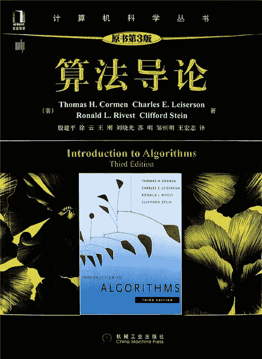

**附件电子书：**

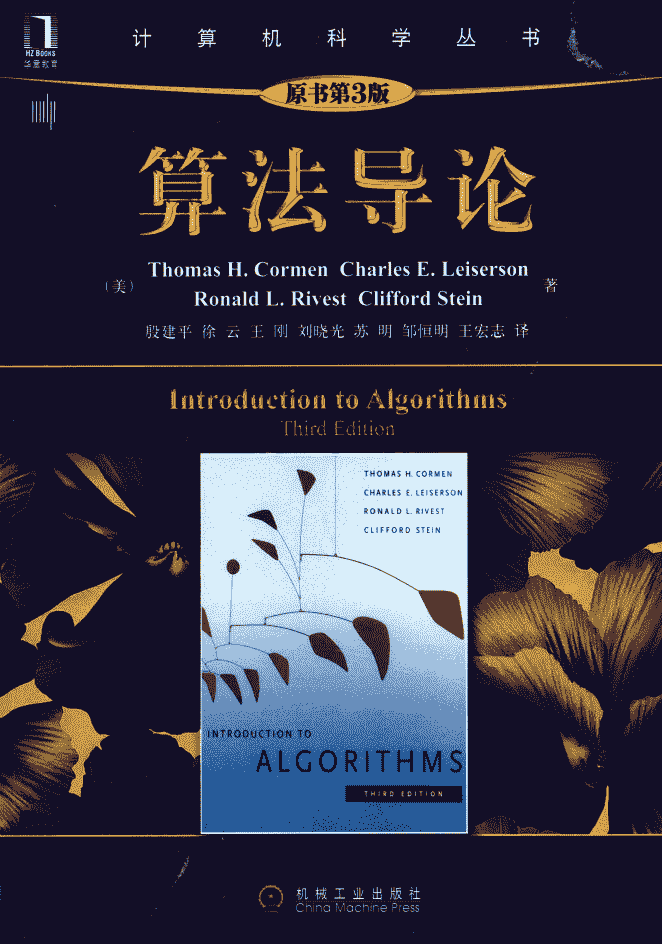

[算法导论 第3版 .pdf](https://internal-api-drive-stream.feishu.cn/space/api/box/stream/download/all/T2LNbEwT1o6PmtxsPKOcRep5nD6)

## 《算法导论》（原书第 3 版）

**作者：**Thomas H.Cormen / Charles E.Leiserson / Ronald L.Rivest / Clifford Stein

**出版年：**2012-12

**豆瓣评分：**9.3

**作者简介：**

Thomas H. Cormen （托马斯•科尔曼） 达特茅斯学院计算机科学系教授、系主任。目前的研究兴趣包括：算法工程、并行计算、具有高延迟的加速计算。他分别于 1993 年、1986 年获得麻省理工学院电子工程和计算机科学博士、硕士学位，师从 Charles E。 Leiserson 教授。由于他在计算机教育领域的突出贡献，Cormen 教授荣获 2009 年 ACM 杰出教员奖。Charles E. Leiserson（查尔斯•雷瑟尔森）麻省理工学院计算机科学与电气工程系教授，Margaret MacVicar Faculty Fellow。他目前主持 MIT 超级计算技术研究组，并是 MIT 计算机科学和人工智能实验室计算理论研究组的成员。他的研究兴趣集中在并行和分布式计算的理论原理，尤其是与工程现实相关的技术研究。Leiserson 教授拥有卡内基•梅隆大学计算机科学博士学位，还是 ACM、IEEE 和 SIAM 的会士。Ronald L. Rivest （罗纳德•李维斯特）现任麻省理工学院电子工程和计算机科学系安德鲁与厄纳•维特尔比（Andrew and Erna Viterbi）教授。他是 MIT 计算机科学和人工智能实验室的成员，并领导着其中的信息安全和隐私中心。他 1977 年从斯坦福大学获得计算机博士学位，主要从事密码安全、计算机安全算法的研究。他和 Adi Shamir 和 Len Adleman 一起发明了 RSA 公钥算法，这个算法在信息安全中获得最大的突破，这一成果也使他和 Shamir、Adleman 一起得到 2002 年 ACM 图灵奖。他现在担任国家密码学会的负责人。Clifford Stein（克利福德•斯坦）哥伦比亚大学计算机科学系和工业工程与运筹学系教授，他还是工业工程与运筹学系的系主任。在加入哥伦比亚大学大学之前，他在达特茅斯学院计算机科学系任教 9 年。Stein 教授拥有 MIT 硕士和博士学位。他的研究兴趣包括：算法的设计与分析，组合优化、运筹学、网络算法、调度、算法工程和生物计算。

**内容简介**：在有关算法的书中，有一些叙述非常严谨，但不够全面；另一些涉及了大量的题材，但又缺乏严谨性。本书将严谨性和全面性融为一体，深入讨论各类算法，并着力使这些算法的设计和分析能为各个层次的读者接受。全书各章自成体系，可以作为独立的学习单元；算法以英语和伪代码的形式描述，具备初步程序设计经验的人就能看懂；说明和解释力求浅显易懂，不失深度和数学严谨性。全书选材经典、内容丰富、结构合理、逻辑清晰，对本科生的数据结构课程和研究生的算法课程都是非常实用的教材，在 IT 专业人员的职业生涯中，本书也是一本案头必备的参考书或工程实践手册。

---

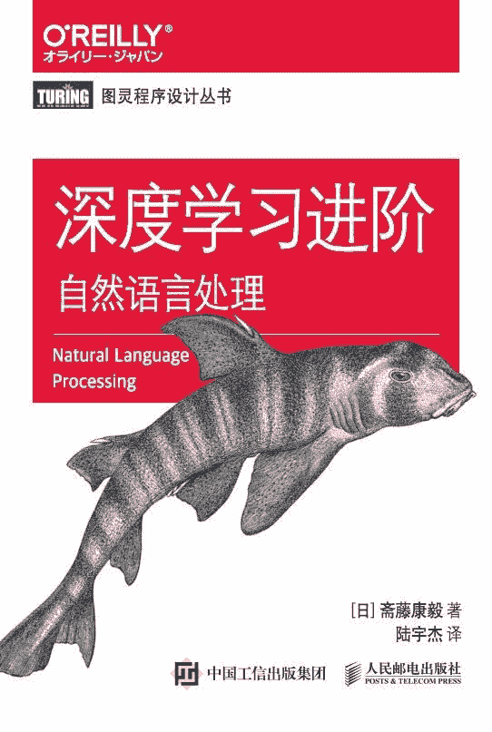

**附件电子书：**

[深度学习进阶：自然语言处理](https://weread.qq.com/web/bookDetail/c81324b0720befa3c81025e)（微信读书）

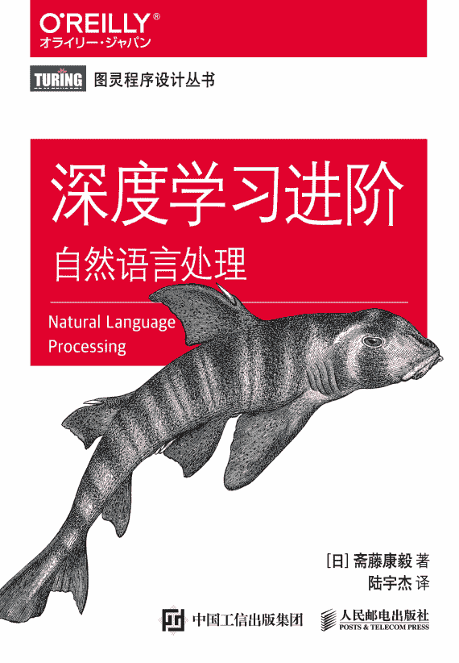

[深度学习进阶：自然语言处理.pdf](https://internal-api-drive-stream.feishu.cn/space/api/box/stream/download/all/MqSkbOUZAonlThxgdZkcMwh0nUQ)

## 《深度学习进阶：自然语言处理》

**作者： **[ 日］ 斋藤康毅

**出版年：**2020-10

**豆瓣评分：**9.4

**作者简介：**斋藤康毅，1984 年生于日本长崎县，东京工业大学毕业，并完成东京大学研究生院课程。目前在某企业从事人工智能相关的研究和开发工作。著有《深度学习入门：基于 Python 的理论与实现》

**内容简介：**《深度学习进阶：自然语言处理》是《深度学习入门：基于 Python 的理论与实现》的续作，围绕自然语言处理和时序数据处理，介绍深度学习中的重要技术，包括 word2vec、RNN、LSTM、GRU、seq2seq 和 Attention 等。本书语言平实，结合大量示意图和 Python 代码，按照“提出问题”“思考解决问题的新方法”“加以改善”的流程，基于深度学习解决自然语言处理相关的各种问题，使读者在此过程中更深入地理解深度学习中的重要技术。

---

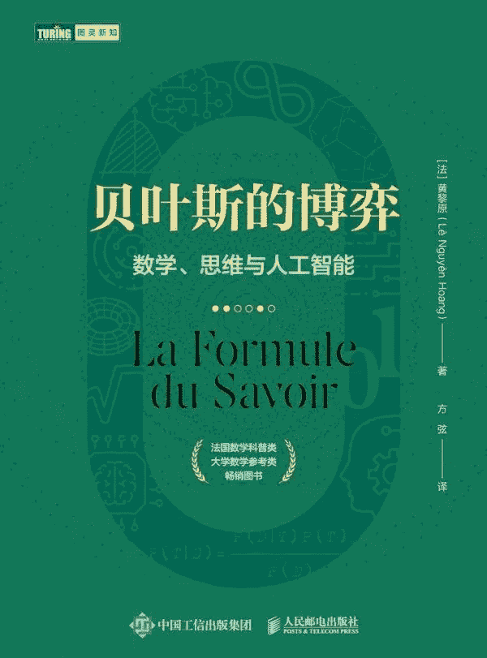

##

## **附件电子书：**

## 贝叶斯的博弈：数学、思维与人工智能（微信读书）

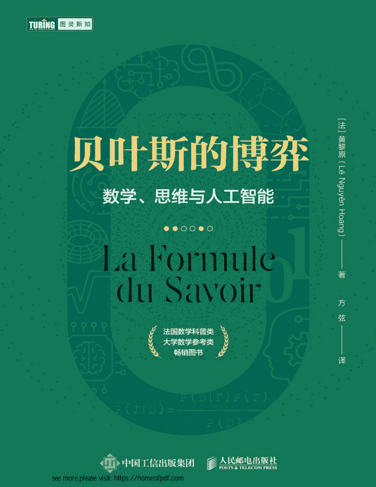

[贝叶斯的博弈：数学、思维与人工智能（图灵图书）.pdf](https://internal-api-drive-stream.feishu.cn/space/api/box/stream/download/all/RJlRblisKoKt8SxoihJcK2mHnSe)

##

## 《贝叶斯的博弈：数学、思维与人工智能》

**作者：**黄黎原（Lê Nguyên Hoang）

**出版年：**2021-3

**豆瓣评分：**8.0

**作者简介：**黄黎原（Lê Nguyên Hoang），瑞士洛桑联邦理工学院科学信息与通信学院研究员，美国麻省理工学院博士后，加拿大蒙特利尔理工学校应用数学博士。设立多个科普网站、网络视频频道及播客，著有多部数学、计算机理论著作。

**内容简介：**书从数学、哲学、计算机科学、神经科学和人工智能等角度，全面阐述了贝叶斯理论背后的基础知识、思维方式和丰富哲理。贝叶斯定理一旦与算法相结合，就不再是一套枯燥的数学理论或认识论，而变成了应用广泛的知识宝库，催生了众多现代数学定理，以及令人称道的实践成果。作者一改传统的数学探讨模式，不仅展现了贝叶斯理论背后的科学思想，还阐述了它与人类思维之间的深刻关系，并对各相关领域和人工智能的发展进行了展望。本书适合喜爱数学、算法、机器学习、人工智能、逻辑学和哲学的大众读者，读者无须过多数学和算法知识就能读懂。

# AI 经典书单：技术篇（1 本）

**附件电子书：**

[集体智慧编程-python算法应用.pdf](https://internal-api-drive-stream.feishu.cn/space/api/box/stream/download/all/SyHzbSJwPogt6VxcmdCc2NXrnev)

## 《集体智慧编程》

**作者：**[美] Toby Segaran

**出版年：**2009-1

**豆瓣评分：**9.0

**作者简介：**Toby Segaran 是 Genstruct 公司的软件开发主管，这家公司涉足计算生物领域，他本人的职责是设计算法，并利用数据挖掘技术来辅助了解药品机理。Toby Segaran 还为其他几家公司和数个开源项目服务，帮助它们从收集到的数据当中分析并发掘价值。除此以外，Toby Segaran 还建立了几个免费的网站应用，包括流行的 tasktoy 和 Lazybase。

**内容简介：**本书以机器学习与计算统计为主题背景，专门讲述如何挖掘和分析 Web 上的数据和资源，如何分析用户体验、市场营销、个人品味等诸多信息，并得出有用的结论，通过复杂的算法来从 Web 网站获取、收集并分析用户的数据和反馈信息，以便创造新的用户价值和商业价值。全书内容翔实，包括协作过滤技术（实现关联产品推荐功能）、集群数据分析（在大规模数据集中发掘相似的数据子集）、搜索引擎核心技术（爬虫、索引、查询引擎、PageRank 算法等）、搜索海量信息并进行分析统计得出结论的优化算法、贝叶斯过滤技术（垃圾邮件过滤、文本过滤）、用决策树技术实现预测和决策建模功能、社交网络的信息匹配技术、机器学习和人工智能应用等。本书是 Web 开发者、架构师、应用工程师等的绝佳选择。

---

# AI 经典书单：产品篇（4 本）

**附件电子书：**

[硬战：人工智能时代的爆款产品](https://weread.qq.com/web/bookDetail/3f832fa0811e37944g017c0f)（微信读书等上架）

## 《硬战：人工智能时代的爆款产品》

**作者：**邹大湿

**出版年：**2018-11

**豆瓣评分：**7.7

**作者简介：**邹大湿，曾就职于大疆创新、UBTECH（优必选）， IBM 原战略咨询顾问，是 36Kr、雷锋网等媒体专栏作者，受邀为多家知名企业提供 AI 产品规划。

**内容简介：**《硬战：人工智能时代的爆款产品》围绕 AI 产品的商业史和方法论，让你深入了解当今的科技浪潮。本书选取了智能音箱、智能机器人、机器翻译和 AI 相机四个品类，讲述这些 AI 产品发展的“前世今生”。如何结合 AI 技术，打造人工智能时代的爆款产品，成了创业者和传统企业都关心的问题。《硬战：人工智能时代的爆款产品》将结合海内外的案例，讲述人工智能时代，爆款产品的发展历程和设计方法。本书从“AI+硬件”的视角，提出了有别于互联网思维的产品规划方法论，让人们了解人工智能，帮助创业者寻找创新方向，协助企业创新落地。适合产品经理和 AI 从业者阅读，特别适合想在 AI 浪潮中转型突围的企业人员阅读，也可以作为一本了解 AI 产品发展历程的科普读物。

---

**附件电子书：**

[《手把手构建人工智能产品》](https://weread.qq.com/web/bookDetail/3c632a90811e3794cg0146e8)（微信读书待上架）

## 《手把手构建人工智能产品》

**作者：**高飞

**出版年：**2020-4

**豆瓣评分：**6.1（评分不高，可当科普内容看）

**作者简介：**高飞：资深产品专家，拥有数学、计算机、药学等多个学位及交叉学科背景。在大数据与人工智能领域专注于行业与技术的结合，拥有超过 7 年的人工智能算法与产品经验，对产业互联网的相关业务与商业模式研究深入。现为某世界 500 强大型科技企业产品总监，资深产品专家，人人都是产品经理社区首批专栏作家。

**内容简介：**随着人工智能技术在越来越多的行业中应用，诸多问题也随之而来，最主要的问题在于人工智能技术与行业的结合深度不足。在大多数情况下，人工智能技术只能解决表层的行业问题，对于深层的业务问题赋能不足。当前急需探索人工智能技术与行业结合的方法与模式。本书结合了笔者构建人工智能产品的实际经验，从人工智能产品流程、行业能力模型、人工智能技术等方面详细地叙述了人工智能产品的构建过程，特别突出了人工智能技术应用于行业的分析方法。本书也阐述了人工智能产品经理的工作流程、思维方式及成长路径。本书可作为现阶段想了解人工智能产品构建过程的人，或想成为人工智能产品经理的人的学习素材，也可作为各行各业人士了解人工智能产品构建过程的参考书。

---

**附件电子书：**

产品经理的 AI 实战—人工智能产品和商业落地（微信读书）

## 《产品经理的 AI 实战—人工智能产品和商业落地》

作者：车马

出版年：2020-5

豆瓣评分：7.5

作者简介：车马，中国最早的一批互联网产品经理之一，曾是中国电商行业第一家上市公司慧聪网唯一的产品经理，是周鸿祎起家产品 3721 网络实名的产品经理。曾任捷银支付的产品总监、中国平安集团移动互联网部门的总经理、北京房斯达克电子商务公司 CEO & CPO、北京车托帮移动科技公司 COO 等职。经过长期的产品实战、商业实战，构建了“车马能力增长体系”，为众多人士提供互联网行业职业发展顾问服务，为多家企业提供技术商业咨询服务。

内容简介：如今讲人工智能的书大多属于两种类型：第一种面向广大公众进行人工智能科普；第二种针对专业技术人员详细讲解人工智能的技术。这两种书，产品经理虽然都可以阅读，但他们更迫切需要第三种——从商业的角度讲人工智能，以产品的方式让人工智能落地的书，而本书正是这种少数类型。《产品经理的 AI 实战——人工智能产品和商业落地》具有针对性强、系统性强、实操性强、原创度高的特点。本书共分为三篇。第一篇是基础篇，讲解技术商业的基本规律、AI 技术的实质和边界、AI 的商业格局和应用现状。第二篇是合格 AI 产品经理篇、包含合格 AI 产品经理的能力体系、AI 技术-场景适配和 AI 产品规划、AI 产品经理的职业发展等内容。第三篇是高级 AI 产品经理篇，包含高级 AI 产品经理的能力体系、AI 技术-场景的洞察、AI 商业模式设计等内容。本书适合两类人群阅读。一是未来的人工智能产品经理，他们可能是互联网产品经理，也可能是对人工智能产品工作感兴趣的大学生、职场新人，也可能是希望转行做人工智能产品经理的技术人员。 二是对人工智能的应用、产品、商业模式感兴趣，想系统了解的人士，包括企业家、创业者等。

---

**附件电子书：**

人工智能产品经理技能图谱：AI 技术与能力升级（微信读书等上架）

## 《人工智能产品经理技能图谱：AI 技术与能力升级》

**作者：**俊林 / 王斌

**出版年：**2021-8

**豆瓣评分：**8.6

**作者简介：**张俊林，人人都是产品经理，专栏作者，三节课 AI 产品课程，特约讲师，AI 产品经理总舵创建者。王斌，AI 产品经理总舵创建者。

**内容简介：**《人工智能产品经理技能图谱》首先对人工智能产品经理做了分类，并对每类人工智能产品经理的工作流程进行了介绍，然后从相关技术、数学、算法、软件设计、硬件设计等方面对人工智能产品经理需掌握和了解的相关知识做了详细介绍。本书以丰富的实际案例贯穿始终，对各类人工智能产品设计方法论和人工智能技术指标进行了详细说明，方便读者快速掌握人工智能的发展现状及相关产品的设计方法。 《人工智能产品经理技能图谱》适合希望或刚刚走上人工智能产品经理岗位的读者阅读，也适合人工智能相关专业的高年级本科生或研究生以及教师参考。

# AI 经典书单：应用篇（1 本）

**附件电子书：**

[AIGC 未来已来](https://weread.qq.com/web/bookDetail/db0323d0813ab7cb1g017765)（微信读书）

## 《AIGC 未来已来》

**作者：**翟尤 / 郭晓静 / 曾宣玮

**出版年：**2023-5

**豆瓣评分：**7.6

**作者简介：**翟尤，副研究员，工业和信息化部通信经济专家委员会办公室原副主任；北京第二外国语大学人工智能应用实验室顾问；ISO/IEC WG6 标准工作组专家。出版《5G 社会》《数字时代》两本图书，在数字科技和产业安全领域发表 20 余篇文章。目前就职于腾讯。

**内容简介：**本书旨在通过深入浅出的讲解，帮助读者认识并了解 AIGC，进一步探究 AIGC 未来的发展方向及其可能面临的挑战，并通过一系列丰富的 AIGC 应用案例展示其在各个领域应用的无限可能。此外，本书还联合投资界、学术界和创业圈的三位专业人士畅谈了关于 AIGC 的深入洞察。本书无须读者具备专业知识基础，适合对 AIGC 感兴趣的读者阅读。

应用层面国外有很多书，但是尚未翻译过来，能看懂英文的可以参考：

https://bookauthority.org/books/best-selling-chatgpt-ebooks

---

# AI 经典书单：职场篇（2 本）

**附件电子书：**

[“AI失业”时代生存指南.pdf](https://internal-api-drive-stream.feishu.cn/space/api/box/stream/download/all/E9gybvnVToLhOzxTt18cikiDncc)

## 《“AI 失业”时代生存指南》

**作者：**【日】铃木贵博

**出版年：**2019-8

**豆瓣评分：**7.4

**作者简介：**铃木贵博，日本百年咨询顾问公司董事长，美国注册会计师。东京大学工学院物理工学科毕业。1986 年进入波士顿咨询集团。曾参与多项对跨国企业、高科技新兴企业的咨询工作。2003 年创立百年咨询顾问公司，为企业提供成长和持续发展战略，协助企业跨越“寿命”壁垒。

**内容简介：**人工智能时代即将到来，在“工作消失”之时，白领的很多行业都将发生巨大变化。专家认为，人工智能和机器将在未来 20 年中剥夺人类一半的工作，但现在大多数人对此警戒心不强。日本百年咨询顾问公司董事长铃木贵博在本书中预测了严酷的未来：由人工智能造成的劳动环境变化已经开始，尤其是白领，将在未来五年遭受残酷变化的冲击。书中提出并解答了诸多和我们息息相关的问题：为什么工作一年比一年忙，收入却没有增加？工作岗位将以怎样的方式消失？今后应该怎样择业？未来十年间，能够生存下去的岗位有哪些？我们的未来究竟会发生什么？现在应该怎么做？本书在即将到来的“AI 失业”前夕，从专业视角为你做彻底的预测和解读，帮助你提前改变自己的职业和人生规划，应对即将到来的巨大冲击。

---

**附件电子书：**

[AI改变设计——人工智能时代的设计师生存手册.pdf](https://internal-api-drive-stream.feishu.cn/space/api/box/stream/download/all/AC1MbafEmoGOSzxlQg5cU6Jgnee)

## 《AI 改变设计：人工智能时代的设计师生存手册》

**作者：**薛志荣

**出版年：**2019-1

**豆瓣评分：**7.0

**作者简介：**曾任职华为，百度，交互设计师，人人都是产品经理专栏作者，《写给设计师的技术书》、《前瞻交互》、《AI 改变设计》的作者。

**内容简介：**通过这本书，能为大家深入浅出地讲解现在的人工智能是什么，尤其是为没有开发经验的设计师讲解清楚人工智能的历史背景和现有技术；再结合一些人工智能和设计的案例，让大家清楚现在和未来我们能做什么、怎么做；最后通过对一些跨界设计师的采访，希望能给大家带来一些启发。

# **延展阅读：**

## 1.人工智能技术知识图谱

### （1）机器学习

### （2）人工神经网络

### **（3）深度学习**

### （4）深度学习框架下的神经网络

### （5）深度学习之外的人工智能

### （6）数学基础

### （7）应用场景

## 2.人工智能导论

---

# 关联阅读

[玩赚 AI 实验室](https://yunyinghui.feishu.cn/wiki/WhelwZnxQi55mpkOzatc3Xran5b?from=from_copylink)

---

# AI 学习交流社群

1.持续关注并更新 AI 的**相关资讯动态，研究报告，赚钱案**例，常见问题，永久免费在线查看，无收费内容，目标是成为最大的免费 AI 学习社群。

2.已建立社群聊聊 **AI** 发展及应用，**没进群的可以扫码加入，群满可加 AI 研究爱好者大国微信 ID：zyg90s（备**注：AI），已经在社群内的无需重复加入，开源知识库及社群学习全部为公开免费分享。

3.**关于文档负责人大国**：高帆文化CEO，曾就职于教培大厂，目前创业，主攻研究AI落地应用、企业流量增长及达人IP孵化。

**5000人飞书学习交流群**

**飞书交流群**

微信好友（ID：zhangyuguo94s）

**微信入群渠道**

进群或者加好友了解更多 AI 相关书单

**觉得有用欢迎留个赞**