# Soul App | 元创营高校 AI Agent 创新赛

> 来源：[https://yunyinghui.feishu.cn/docx/BXoXdRoqgonHabxlvXYcCUPTneh](https://yunyinghui.feishu.cn/docx/BXoXdRoqgonHabxlvXYcCUPTneh)

> **本次 Soul **App**| 元创营高校 AI **Ag**ent 创新赛由**中国技术创业协会指导，Soul App 主办，由万象AI 实验室联合宣传，旨在公开征集活动，致力于打造一场年轻玩家的 AI 盛会创作优质作品。

>

> 本次大赛奖金池 24 万元，排名前 100 可瓜分 5 万现金激励。

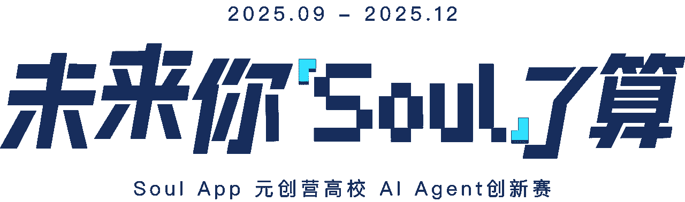

# **一、赛事简介**

Soul App 元创营高校 AI Agent 创新赛是一场专为高校学子打造的 AI 创新竞技盛宴，该赛事在中国技术创业协会指导下，由 S**oulApp 主办，校企专委（CUEC）承办，融合科技、创意与**青年文化，鼓励年轻人用智能体重新定义未来的社交与娱乐方式。赛事总奖池极具吸引力，一等奖高达 10 万元，并额外提供商业化落地支持和 Soul App 实习机会。

「元创营」最初源于 Soul App 内部一场“头脑风暴”，现正式对外开放，我们面向全球高校学生开放舞台，征集一切有趣、有料、有温度的 AI 智能体。从社交搭子到游戏伙伴，从创意内容到虚拟陪伴，每个 Agent 都有机会成为年轻人的“灵魂 CP”。

脑洞不设限，灵感即高光——这一次，未来你 Soul 了算！

# 二、大赛亮点

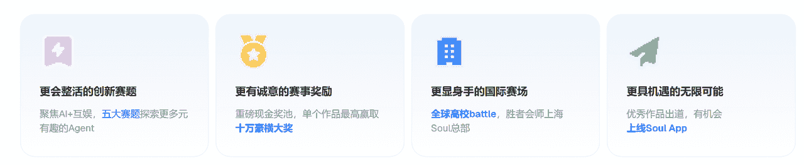

# 三、大赛赛题

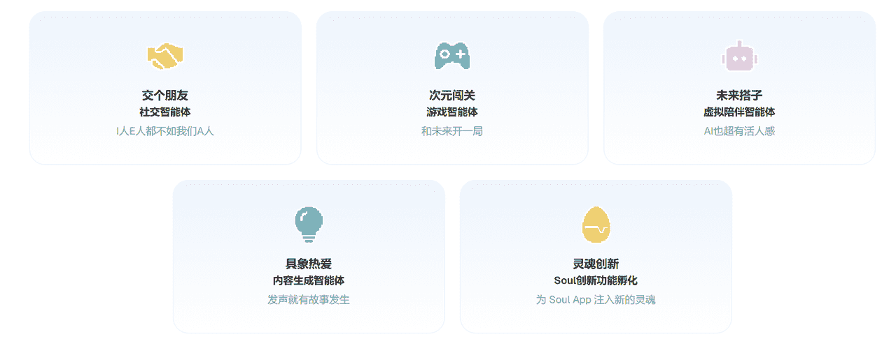

**赛道一 交个朋友**

**社交智能体：**开发创新社交工具 Agent，如智能聊天辅助系统， 分析用户聊天习惯与情感倾向，实时提供个性化建议，提升社交质量与趣味性。还可构建社交画像，精准推荐社交对象，策划社交活动，打破传统社交局限，挖掘用户兴趣，匹配志同道合伙伴，打破传统局限，拓展社交边界。

**赛道二 次元闯关**

**游戏智能体：**打造与社交融合的游戏 AI Agent，让游戏更具挑战性、社交性和趣味性，为玩家带来全新游戏社交体验。例如 AI 游戏关卡设计师，依玩家水平和风格生成个性化关卡；AI 游戏角色扮演者，智能互动并提供剧情线索和奖励。

**赛道三 未来搭子**

**虚拟陪伴智能体：**开发情感支持与陪伴的 AI Agent，为用户提供温暖关怀，让生活不再孤单，构建情感慰藉的港湾。如 AI 情感倾听者，理解情绪并给予回应和安慰；AI 生活助手兼伙伴，根据生活习惯提供建议和陪伴。

**赛道四 具象热爱**

**内容生成智能体：**可围绕 Soul App 平台的兴趣社区，开发 AI 驱动的内容生成 Agent，帮助用户高效创作优质内容，提升表达能力，丰富社交平台内容生态，维护良好的社区氛围。如 AI 创意写作助手， 提供写作灵感和初稿；AI 图片视频编辑助手，提供建议优化。

**赛道五 灵魂创新**

**Soul ****创新功能孵化：**探索 AI 在社交领域的新应用，针对不同群体和场景， 开发创新社交解决方案，突破常规思维，引领社交创新潮流，为社交平台发展注入新活力。如全息社交、区块链社交信任系统等。

# 四、参赛时间及流程

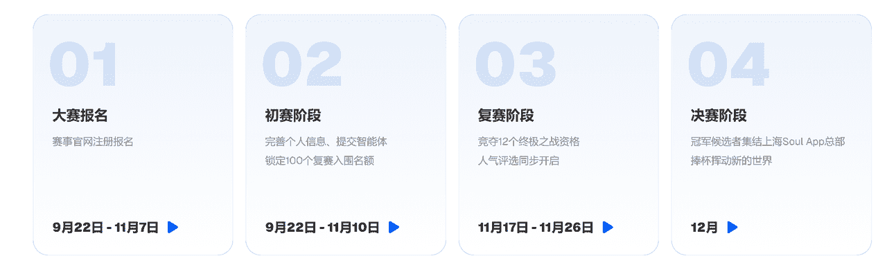

> **参赛基本****流程**

> **1、大赛报名**

> 通过大赛官网注册报名，阅读并同意《参赛协议》与《隐私政策》，填写准确个人信息。所填信息将直接用于联络、评审与奖项核对，请务必确保真实、准确。

> **报名地址：****h**ttps://agent.soulapp.cn/auth/register?referral_code=TA005

>

> **2、****初赛阶段**

> 按要求提交智能体作品等相关材料（含链接、代码、文档、演示视频等）。大赛组委会将评审选出 100 强晋级复赛。

> **3.复赛阶段**

> 评审选出 12 强晋级决赛。复赛期间开启“作品人气榜”与“院校人气榜”评选，TOP1 作品获“人气智能体”奖。人气评选不计入作品最终评审分数，具体评审规则以大赛官网公布为准。

> **4.决赛阶段**

> 12 强团队将受邀赴上海 Soul App 总部参加总决赛，进行线下路演与答辩。参赛团队需面向专家评委及观众全面展示作品成果，由评审团决出最终奖项归属。

# **五、参赛对象**

1、**参赛对象：**本次大赛面向全球高校在校大学生（本科、硕士、博士等均可，需提供有效学生身份证明）

2、**组队要求：**大赛倡导自由开放的共创模式，既可以 1 个人参赛，也可以 2-5 人共创参赛，鼓励跨校、跨国、跨专业组合，只要你对 AI Agent 领域感兴趣、具备创意构想，即可报名参赛。

3**、导师制度：**可邀请校内/业界导师指导，但导师不得参与作品实际操控或比赛环节。

# 六、**奖项设置**

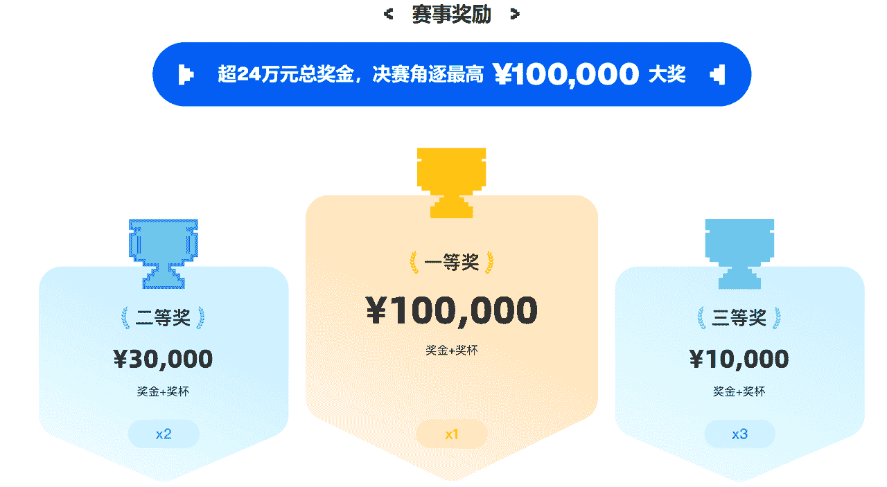

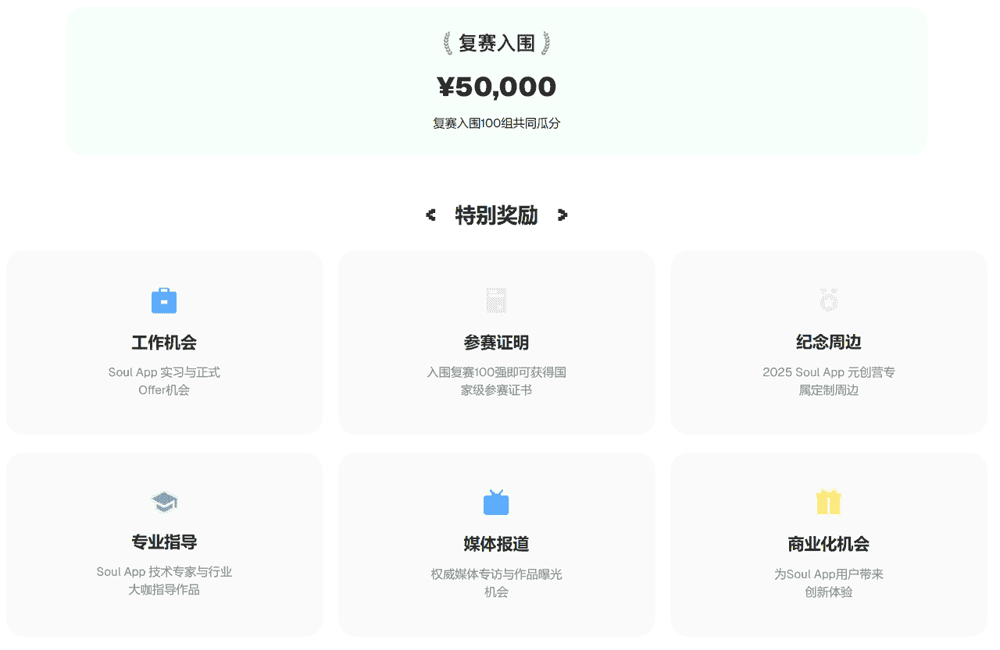

本次大赛的评审结果由大赛组委会审定，并在赛事官方网站公布。获奖奖金、奖杯、证书由大赛组委会统一制作与颁发，颁奖典礼将在决赛评审结束后进行。

**1.复赛奖项**

（1）复赛入围奖金池：总额 50,000 元（按 100 强均分或大赛组委会公示方案发放）

（2）人气智能体：颁发荣誉证书（共设 1 个名额）

**2.决赛奖项**

（1）一等奖：奖金 100,000 元 + 定制奖杯（共设 1 个名额）

（2）二等奖：奖金 30,000 元 + 定制奖杯（共设 2 个名额）

（3）三等奖：奖金 10,000 元 + 定制奖杯（共设 3 个名额）

**3.更多权益**

除赛事奖金和奖杯外，参赛者有机会获得以下参赛权益：

（1）工作机会：Soul App 实习与正式 Offer 机会

（2）参赛证明：入围复赛 100 强即可获得国家级参赛证书

（3）纪念周边：2025 Soul App 元创营专属定制周边

（4）专业指导：Soul App 技术专家与行业大咖指导作品

（5）媒体报道：权威媒体专访与作品曝光机会

（6）商业化机会：优秀作品有机会为 Soul App 用户带来创新体验

**4.奖金发放**

奖金为税前金额，参赛者收取奖金需完成身份核验及收款资料提交，大赛组委会将依法代扣代缴相关税费；发放以赛事公告流程与时间为准。

# **七、作品要求与提交**

1.内容需契合大赛“AI+互娱”的整体赛题方向，按具体赛题分类选择提交。

2.作品需基于 AI Agent，具备清晰的应用场景和实际交互能力。

3.每人最多可参与 5 个共创作品，但不得以同一作品重复参赛。

4.所有作品必须为原创，不得抄袭、套壳或侵犯第三方知识产权。

5.作品不得含违法、低俗、歧视、仇恨或其他不当内容；需具备相应的安全策略（如敏感词过滤等）。

6.每个作品需指定主创作为唯一联系人，负责提交智能体和接收赛事通知。

# **八、评审标准**

大赛组委会负责全部评审工作，秉持公平、公正、公开的原则，对参赛作品进行综合评定。在评审方式上，初赛与复赛阶段采用线上评审形式，决赛阶段将于 Soul App 总部举行现场路演。评审以大赛组委会专家为主，评委阵容包括 Soul App 高管及核心技术专家、知名高校学者等，以确保评审的全面性与权威性。

**1.评审过程**

（1）初赛评审（9 月 22 日 -11 月 10 日）

评审形式：线上评审

评审维度：创意性（60%）、完整性（40%）

评审结果：选出 100 个作品晋级复赛

并列处理：如总分并列，依次比较创意性、完整性

（2）复赛评审（11 月 17 日 -11 月 26 日）

评审形式：线上评审

评审维度：完整性（40%）、创意性（30%）、技术力（30%）

评审结果：选出 12 个作品晋级决赛，复赛百强作品开展人气评选，票数 TOP1 作品将获得“人气智能体”奖项

并列处理：如总分并列，依次比较完整性、创意性、技术力

**（3）决赛评审（12 月） **

评审形式：上海 Soul App 总部线下路演

评审维度：完整性（30%）、创意性（20%）、技术力（20%）、商业价值（20%）、现场表现（10%）

评审结果：选出 6 个等级奖作品（一等奖 1 个、二等奖 2 个、三等奖 3 个）

并列处理：如总分并列，依次比较完整性、创意性、技术力、商业价值、现场表现；仍并列则增加现场即兴任务

**2.评审维度**

评审维度按不同赛程调整，不同维度权重随赛段升级。

**2.1 创意性**

（1）选题及定位

（2）原创性与突破性

**2.2 完整性**

（1）方案完成度

（2）细节完善度与可实施性

**2.3 技术力**

（1）技术先进性

（2）技术实现质量

**2.4 商业价值**

（1）用户需求贴合度

（2）市场潜力

**2.5 现场表现**

（1）现场表达逻辑

（2）材料质量与完整度

# 九、参赛者交流群

**参赛有任何问题，可以进群沟通交流，群满 200 人可以加**🛰️拉群，不定时投放参赛物料，发品牌福利

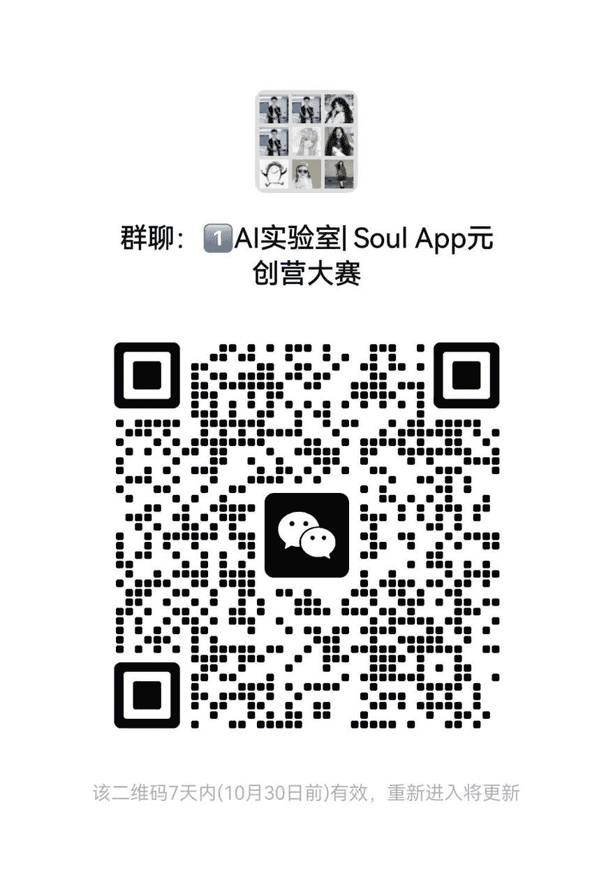

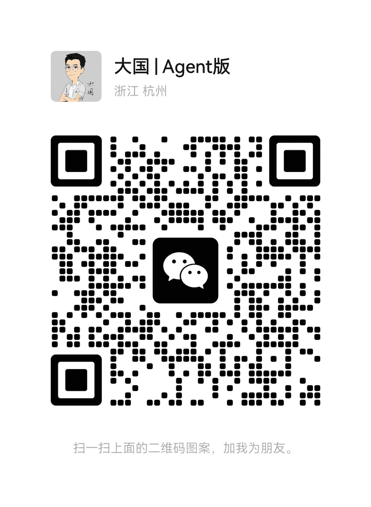

🛰️ ID：zhangyuguo94s

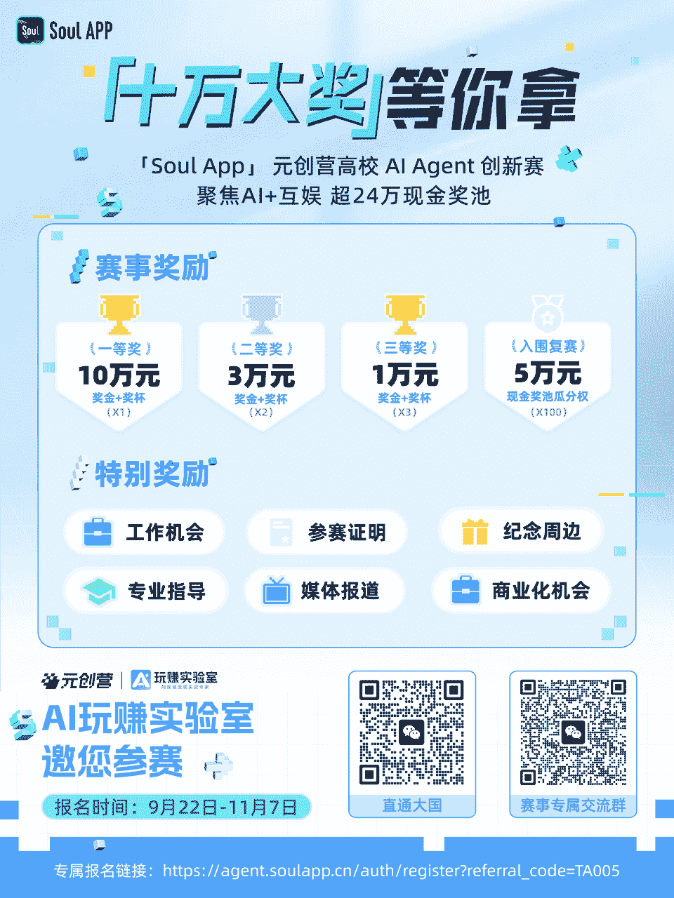

# **十、注意事项**

（1）作品知识产权归参赛团队所有，参赛即授予大赛组委会非独占、免费、全球范围的宣传使用权。

（2）若作品与 Soul App 开展合作，具体事宜以双方另行签署的协议为准。

（3）严禁抄袭、刷量、数据造假等行为，违规者将取消参赛资格并追回奖金与荣誉。情节严重者，主办方保留追究法律责任的权利。

（4）对评审结果或处罚决定有异议者，可在结果公示后 3 个工作日内联系大赛组委会提交书面申诉，逾期不予受理。

（5）本规则自发布之日起生效，适用于本届所有参赛者与作品。

（6）为提供更好的服务或因国家法律法规、政策调整、技术条件等变化需要，主办方可能会适时对章程进行变动或调整，相关变动或调整将公布在官网页面上，公布后依法生效。用户继续参赛则视为同意并接受变动或者调整后的章程内容。如果用户拒绝章程的相关变更或者调整，请放弃参赛。

# 附：合作伙伴

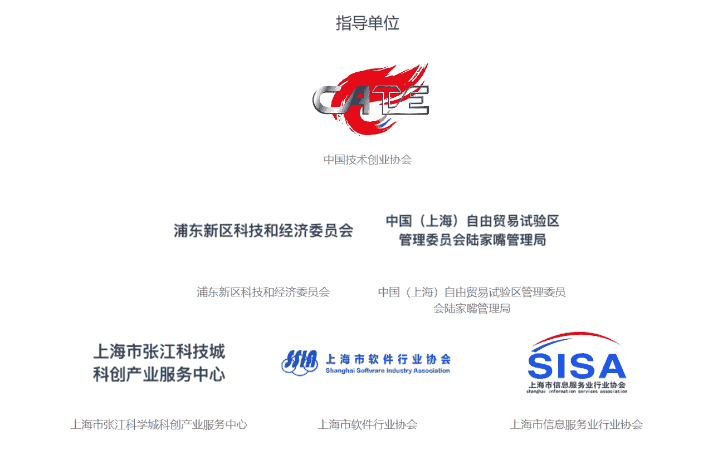

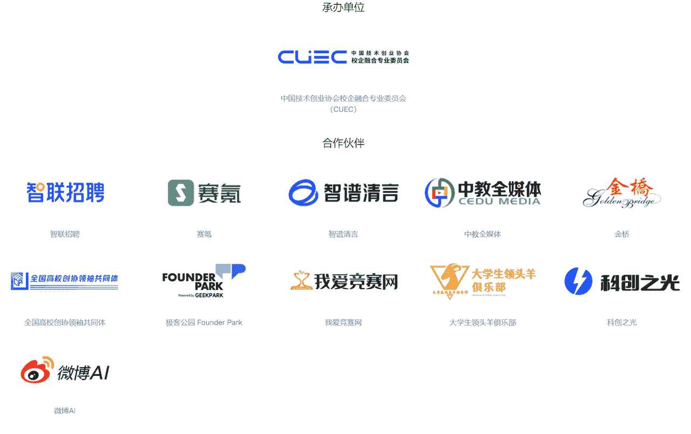