# 百度秒哒 | 中国首届非程序员黑客松大赛

> 来源：[https://yunyinghui.feishu.cn/docx/DmZPdkY9xokHUsxOZacc590Nn8c](https://yunyinghui.feishu.cn/docx/DmZPdkY9xokHUsxOZacc590Nn8c)

> 本次非程序员黑客松主题大赛由**百度秒哒联合📕科技共同**发起，由**万象 AI 实验室**联合宣传，旨在公开征集活动，邀请全球非程序员参与秒哒创作优质作品。

>

> 本次大赛**奖金池 30 万元**，所有参与者均可获得**电子版参赛证明。**

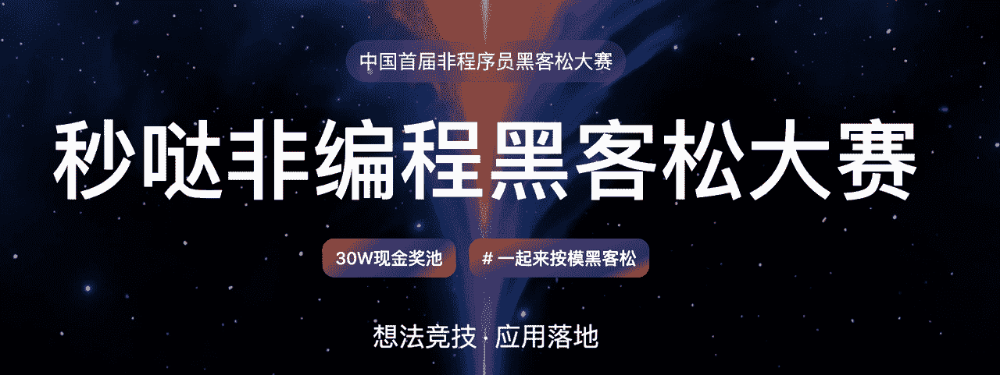

# 一、大赛理念

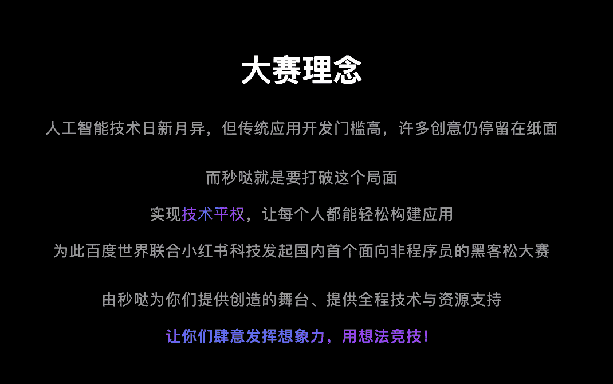

**参赛有任何问题，可以进群沟通交流，群满200人可以加**🛰️拉群，不定时投放参赛物料，发品牌福利

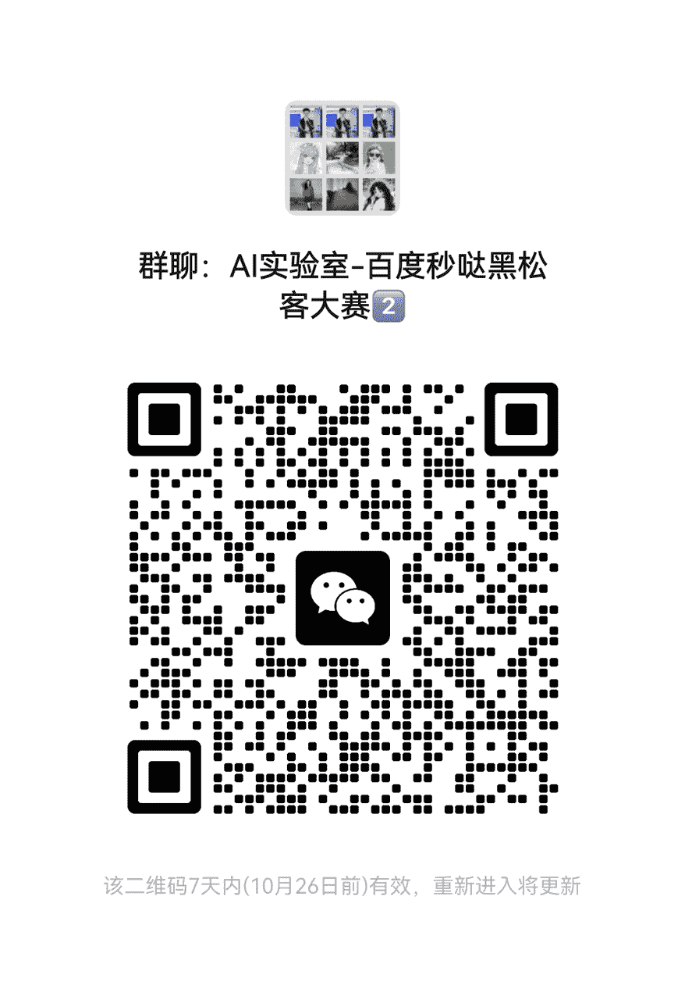

# 二、大赛赛题

> 本次大赛共有两大赛道："码"上搞定、治"郁"按"模"！

## 赛道一："码"上搞定

解决实际痛点，让效率触手可及

聚焦于开发实用工具和解决方案，解决现实生活中的实际问题，提升工作与生活效率

## 赛道二：治"郁"按"模"

提供情绪价值，治愈所有不开心

专注于心理健康与情绪管理，通过创新方式提供情感支持，帮助人们缓解压力、焦虑等负面情绪

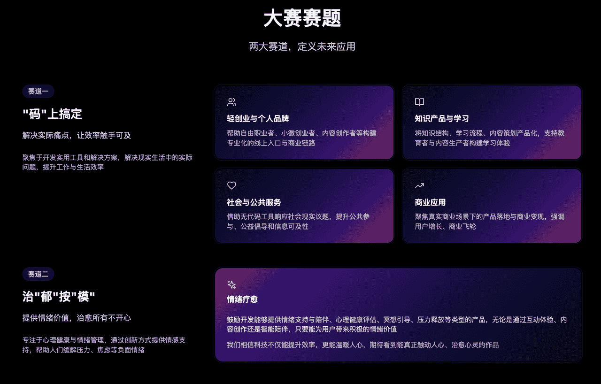

# 三、参赛时间

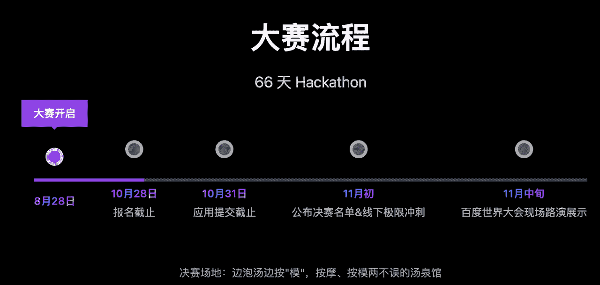

# 四、大赛奖项

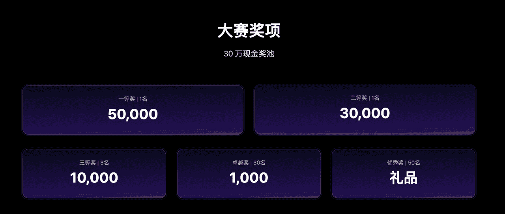

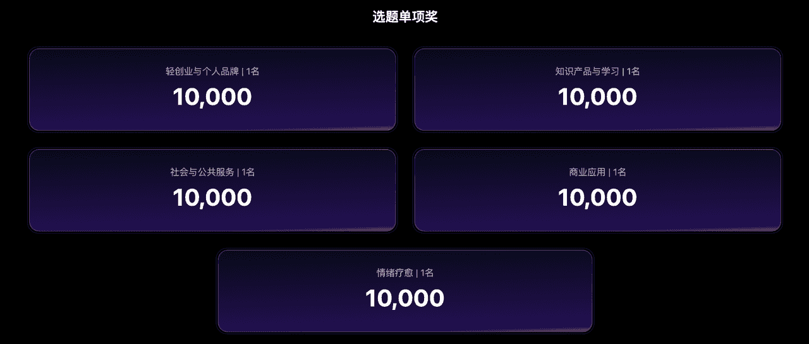

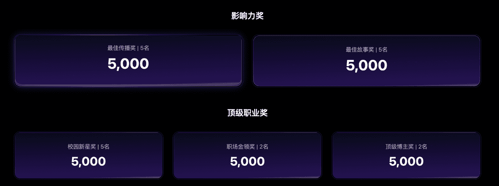

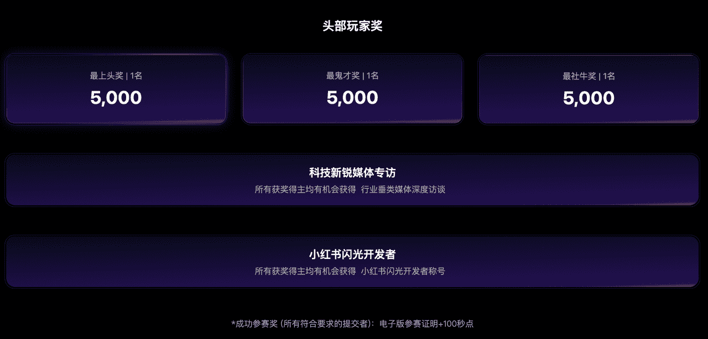

# 五、参赛要求

全国创意者集结，非程序员也能 SOLO 单挑全场！

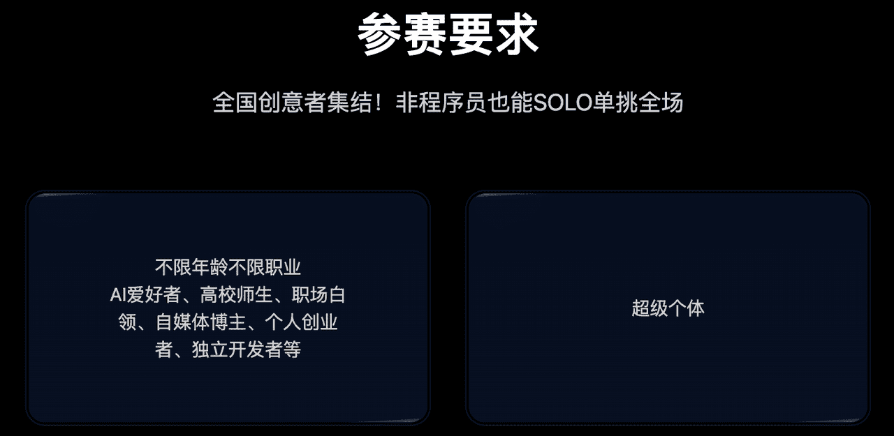

1）用秒哒平台创建应用并发布至应用广场

2）请附上发布于📕的作品介绍链接

• 发记录项目从想法到原型的全过程，优质笔记有机会获得大额流量激励

• 项目的社区影响力同样是评审参考维度

• 媒体平台发布： 请发布至大赛官方唯一指定平台【📕】

**小红****书： 发布文案带 **[**#一起来按模 #百度**](https://www.xiaohongshu.com/search_result/?keyword=%25E7%25A7%2592%25E5%2593%2592%25E9%259D%259E%25E7%25BC%2596%25E7%25A8%258B%25E9%25BB%2591%25E5%25AE%25A2%25E6%259D%25BE&type=54&source=web_note_detail_r10)世界大会 #秒哒非编程黑客松 #万象 AI 实验室 发布「开发笔记」，并@百度秒哒 @科技薯 点击进入话题页 >

3）将应用链接与📕链接提交至大赛官网，审核通过后将展现在应用广场「黑客松专区」

秒哒非编程黑客松-📕科技&百度世界联合发起

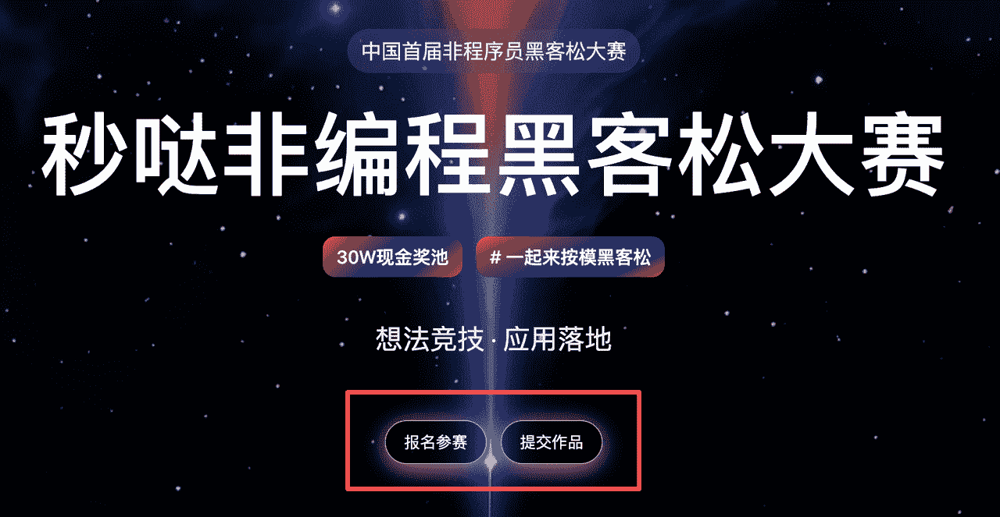

> 大赛官网提交作品以后，请在社区渠道再提交一次，方便社区核对作品和发放激励！

+   **万象 AI 实验室****社区填写表单回传作品：**[**作品回填登记**](https://yunyinghui.feishu.cn/share/base/form/shrcnRM5fcWFfUH59o2bSXdNV0g)

+   所有填写回传作品的，社区赠送价值 299 元的【副业案例库】会员权益。

#### 应用说明

+   **核心要求：**必须完全使用百度秒哒平台进行开发

+   **应用形式：**最终提交应用必须是可公开访问的

+   **原创性：**作品创意和实现需为原创，严禁抄袭、剽窃，如引用第三方资源需注明出处。

+   **内容合规：**作品内容需符合国家法律法规及公序良俗，不得包含侵权、违法、色情、暴力、歧视等不良信息

+   **应用评分：**应用作品采用积分制进行评估，总积分 = 基础分 + 创作分 + 评审分 + 传播分

+   **应用数量：**每个团队在比赛期间可提交任意数量的应用，最终择最优 20 个应用参与创作分与评审分计算

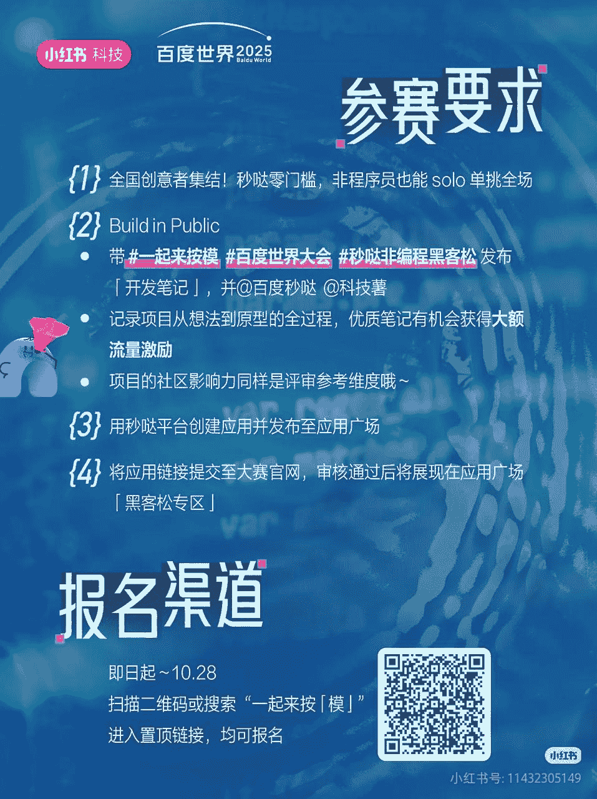

# 附：秒哒实战培训课

[秒哒无代码应用开发实战课程](https://cloud.baidu.com/partner/training-camp/3cow1rzi2ux.html)

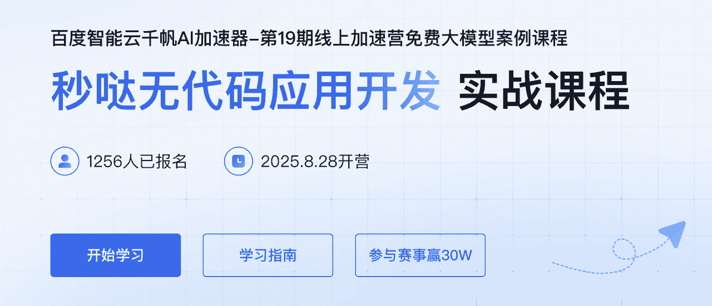

[百度秒哒 | 中国首届非程序员黑客松大赛参赛攻略](https://yunyinghui.feishu.cn/wiki/VYoJwPXC4iWQmlkkQb8cEN5gnAg?from=from_copylink)