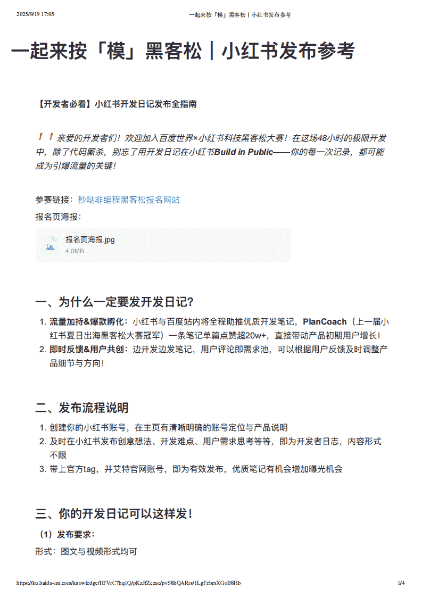

# 百度秒哒 | 中国首届非程序员黑客松大赛参赛攻略

> 来源：[https://yunyinghui.feishu.cn/docx/Wb24d3v8JozL5SxWv4scMgpmn6d](https://yunyinghui.feishu.cn/docx/Wb24d3v8JozL5SxWv4scMgpmn6d)

# 一、参赛核心流程

### 1. 应用开发与发布

+   使用百度秒哒平台创建应用并发布至应用广场

+   确保应用完全基于秒哒平台开发，且可公开访问

### 2. 📕作品推广

+   发布记录项目从想法到原型全过程的开发笔记

+   文案需添加话题标签：#一起来按模 #百度世界大会 #秒哒非编程黑客松 #万象 AI 实验室，并@百度秒哒 @科技薯

+   优质笔记有机会获得大额流量激励

[一起来按「模」黑客松｜📕发布参考.pdf](https://internal-api-drive-stream.feishu.cn/space/api/box/stream/download/all/VeFTbgS6OoOrAJxZ5LpcPp66nMe)

### 3. 作品提交渠道

+   将应用链接与📕链接提交至大赛官网：秒哒非编程黑客松-📕科技&百度世界联合发起

+   同时在万象[ AI 实验](https://yunyinghui.feishu.cn/share/base/form/shrcnRM5fcWFfUH59o2bSXdNV0g)室社区填写表单回传作品：作品回填登记

+   完成回传可获价值 299 元的【副业案例库】会员权益

+   参赛截止时间：**10月28日**

# 二、评分规则解析

总积分 = 基础分 + 创作分 + 评审分 + 传播分

+   **基础分**：完成应用开发与发布的基本要求

+   **创作分**：应用创意性、实用性及技术实现水平

+   **评审分**：专业评委对应用的综合评价

+   **传播分**：📕作品的社区影响力（点赞、收藏、评论等数据）

# 三、灵感选题方向

## 赛道一："码"上搞定选题参考

#### 学习辅助工具

1.  考研英语高频词汇智能记忆卡片生成器

1.  考公行测公式自动查询与例题匹配工具

1.  中小学错题本自动分类与薄弱点分析系统

1.  外语学习情景对话生成器（支持多语种）

1.  论文参考文献格式自动转换工具

1.  读书笔记思维导图一键生成器

1.  历史时间轴可视化制作工具

1.  数学公式手写识别与解题步骤生成器

1.  四六级作文模板智能匹配系统

1.  教师资格证考点速记卡片工具

#### 办公效率提升

1.  会议纪要关键词自动提取与待办事项生成器

1.  多平台文件格式批量转换助手（PDF/Word/Excel）

1.  邮件模板智能推荐与自动填充工具

1.  工作周报数据可视化自动生成系统

1.  跨平台日程同步与冲突提醒工具

1.  合同条款风险点智能检测工具

1.  客户沟通话术库与智能推荐系统

1.  项目进度甘特图在线制作工具

1.  发票信息自动识别与报销单生成器

1.  团队任务分配与进度追踪看板

#### 生活便捷助手

1.  家庭月度预算规划与支出追踪工具

1.  旅行行程智能规划与景点推荐应用

1.  菜谱食材搭配与营养分析工具

1.  垃圾分类智能查询与积分管理系统

1.  个人健康数据记录与趋势分析工具

1.  宠物喂食提醒与健康记录系统

1.  租房信息筛选与比价工具

1.  电影票比价与场次提醒工具

1.  快递单号批量查询与物流追踪系统

1.  水电煤缴费提醒与自动统计工具

#### 商业服务工具

1.  小微企业客户信息管理系统

1.  线上课程报名与签到管理工具

1.  餐饮外卖订单统计与菜品热销分析

1.  自媒体内容选题日历与发布提醒

1.  二手物品交易信息发布与管理平台

1.  活动报名表单制作与数据统计工具

1.  健身房会员管理与课程预约系统

1.  花店订单追踪与配送路线规划工具

1.  社区团购团长订单汇总工具

1.  培训机构学员考勤与成绩管理系统

#### 创意工具

1.  社交媒体图文排版模板生成器

1.  短视频脚本框架自动生成工具

1.  表情包在线制作与分享平台

1.  生日祝福文案智能生成器

1.  朋友圈文案灵感库与排版工具

1.  手账素材模板生成与排版工具

1.  婚礼邀请函在线制作工具

1.  节日贺卡模板生成与分享系统

1.  儿童故事图文自动生成器

1.  旅行照片智能排版与游记生成工具

## 赛道二：治"郁"按"模"

#### 心理疏导工具

1.  负面情绪日记与自我疗愈引导应用

1.  正念冥想引导与呼吸训练助手

1.  焦虑自评量表与缓解方案推荐系统

1.  睡眠质量记录与改善建议工具

1.  压力源分析与应对策略推荐系统

1.  情绪色彩日记（用颜色记录心情变化）

1.  感恩练习提醒与记录工具

1.  自我肯定语生成与语音播放系统

1.  心理韧性训练计划生成器

1.  社交焦虑场景模拟与应对训练工具

#### 兴趣治愈空间

1.  虚拟植物养成与心情记录应用

1.  治愈系音乐推荐与场景营造工具

1.  数字油画填色与解压应用

1.  自然白噪音混合器（雨声/森林/海浪）

1.  电子手账模板与治愈系贴纸库

1.  星座运势与心理暗示引导工具

1.  宠物陪伴虚拟互动助手

1.  微型花园种植记录与生长观察工具

1.  手工制作教程推荐与材料清单生成器

1.  星空观测模拟与星座故事讲解工具

#### 社交支持平台

1.  匿名情绪分享与互助社区

1.  职场压力吐槽与解决方案交流平台

1.  大学生心理互助小组匹配系统

1.  亲子沟通技巧学习与练习平台

1.  老年人情感陪伴与回忆记录工具

1.  失恋心理重建支持社区

1.  产后情绪调节经验分享平台

1.  慢性病患者心理支持互助小组

1.  校园霸凌受害者支持社区

1.  残障人士心理赋能交流平台

#### 健康生活助手

1.  运动打卡与情绪变化关联分析工具

1.  健康饮食推荐与情绪影响分析系统

1.  瑜伽课程推荐与动作指导工具

1.  徒步路线推荐与心理疗愈效果记录

1.  中医养生知识与情绪调节建议平台

1.  芳香疗法精油推荐与使用指南工具

1.  茶道学习与冥想结合引导工具

1.  森林浴模拟与心理放松引导应用

1.  太极教学视频与进度追踪工具

1.  温泉疗养地推荐与身心放松指南

#### 创意疗愈工具

1.  情绪涂鸦板与色彩心理学分析

1.  诗歌创作辅助与情感表达引导工具

1.  即兴音乐创作与情绪释放平台

1.  心理剧脚本生成与角色扮演指导

1.  沙盒游戏心理投射分析工具

1.  陶艺制作过程模拟与情绪调节应用

1.  编织图案生成与手工疗愈引导工具

1.  摄影主题推荐与情绪表达指导

1.  戏剧表演练习与自信心培养工具

1.  折纸教程与心理疗愈效果记录系统

# 四、关键注意事项

1.  **原创性要求**：作品创意和实现需为原创，严禁抄袭、剽窃，引用第三方资源需注明出处

1.  **内容合规性**：作品内容需符合国家法律法规及公序良俗

1.  **多渠道提交**：完成官网提交后务必在社区渠道再次提交，以便核对作品和发放激励

1.  **培训资源**：推荐参与[秒哒无代码应用开发实战课程](https://cloud.baidu.com/partner/training-camp/3cow1rzi2ux.html)提升开发技能

##

# 五、常见问题解答

### 参赛资格与组队

1.  Q：非程序员如何定义？是否允许有基础编程知识的人参赛？
A：大赛面向所有非专业程序员群体，允许有基础编程知识但非职业开发者参与。只要您的主要职业不是软件开发相关岗位，均可参赛。

1.  Q：是否可以组队参赛？团队人数限制是多少？
A：支持个人或团队参赛，团队人数最多不超过 3 人。建议在作品介绍中注明团队成员分工。

1.  Q：企业员工可以参赛吗？是否允许使用公司资源开发作品？
A：企业员工可以参赛，但需确保作品原创性且不侵犯公司知识产权，禁止使用公司内部数据或保密资源。

### 作品开发与提交

1.  Q：必须完全使用百度秒哒平台开发吗？能否集成其他工具或 API？
A：核心功能必须通过百度秒哒平台实现，允许使用平台提供的官方 API 接口，但禁止接入第三方外部系统。

1.  Q：应用广场发布需要审核吗？审核周期多久？
A：是的，发布到应用广场需经过平台审核，通常 1-3 个工作日完成。建议提前提交避免错过截止日期。

1.  Q：📕发布有哪些格式要求？图文和视频哪种更容易获得流量？
A：建议采用「图文教程+开发心路」形式，视频需包含实际操作演示。优质内容（清晰步骤+真实感悟）更容易获得推荐，与形式无关。

1.  Q：多个作品提交如何计算成绩？可以同时参加两个赛道吗？
A：每个团队可提交多个作品，最终择最优 20 个参与评分；允许同时参加两大赛道，但需确保作品符合对应赛道主题。

### 评审与奖励

1.  Q：创作分和传播分具体如何计算？
A：创作分由评委根据创意性（30%）、实用性（40%）、完成度（30%）打分；传播分参考📕笔记点赞（30%）、收藏（30%）、评论互动（40%）数据，截止时间为提交后 72 小时。

1.  Q：获奖作品有知识产权要求吗？需要开源或转让版权吗？
A：参赛者保留作品知识产权，但百度秒哒拥有获奖作品的展示权和宣传权，无需开源或转让版权。

1.  Q：电子版参赛证明如何领取？提交作品后自动获得吗？
A：是的，作品提交成功后系统将自动发放电子版参赛证明至注册邮箱，请注意查收垃圾邮件文件夹。

### 技术支持

1.  Q：零基础如何快速上手秒哒平台？有推荐的学习资源吗？
A：推荐优先学习官方提供的「秒哒无代码应用开发实战课程」（https://cloud.baidu.com/partner/training-camp/3cow1rzi2ux.html），社区群内也会定期分享教程和案例。

1.  Q：开发过程中遇到技术问题怎么办？有官方支持渠道吗？
A：可加入参赛者交流群获取实时帮助，群内有技术导师答疑；也可通过秒哒平台「帮助中心」提交工单，工作日 24 小时内响应。