# 秒哒爆款案例拆解——如何靠参赛笔记引爆流量？

> 来源：[https://yunyinghui.feishu.cn/docx/IoojdGkx0oTV9Ux1kXicfHmCnwr](https://yunyinghui.feishu.cn/docx/IoojdGkx0oTV9Ux1kXicfHmCnwr)

---

# 1、百度世界 × 小红书科技「一起来按模」黑客松

+   **活动介绍：**百度世界联手小红书科技共同打造了“一起来按「模」｜秒哒非编程黑客松”，两大赛道，30w 奖金池，百万级小红书流量包，决赛在汤泉馆，边按摩边按模。泡出来的不止一身轻松，还有下一个爆款应用。

+   **赛道设置：**紧扣「2025 百度世界大会」主话题，将赛道分为两个方向

+   **‘码’上轻松**：结合百度世界大会主题，注重解决实际需求，鼓励开发者利用百度 AI 技术打造高效、实用的应用。

+   **治‘郁’按‘模’**：结合黑客松主题，注重解决精神需求，鼓励开发者创造能够缓解压力、提升幸福感的产品。

+   这次黑客松有什么不一样？为什么必须冲？

💆 决赛在汤泉馆里进行，按摩按“模”两不误

📒 开发者日志小红书实时连载，小红书专属百万流量等你拿

🔥 冠军直通“百度世界大会”，让创意被“世界”看见

🏆 奖金池高达 30 万，行业媒体深度访谈等超多激励等你解锁

> 具体赛事介绍文档：[百度秒哒 | 中国首届非程序员黑客松大赛](https://yunyinghui.feishu.cn/wiki/ORwCwC1L4iYb3ako4xDcQuSDnhO?from=from_copylink)

**秒哒最新更新**

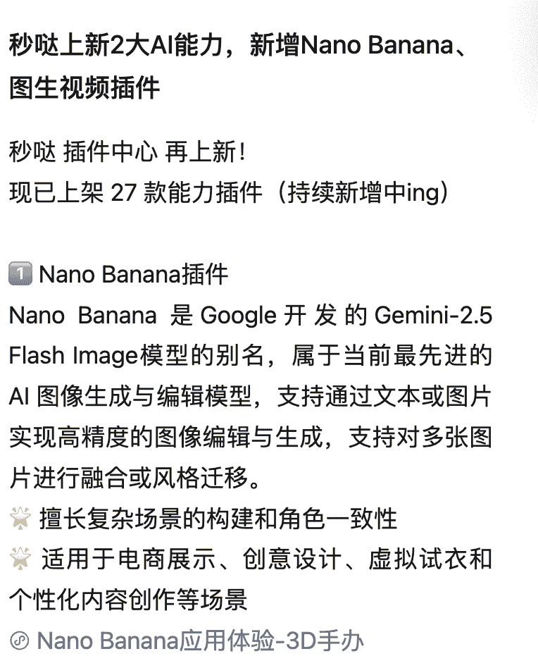

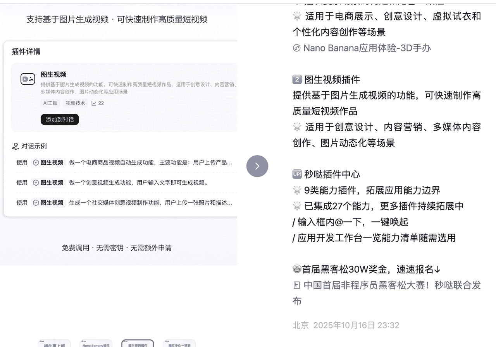

---

# 2、如何做出“美观”的应用（Vide Coding）

## 秒哒最新上新功能

1.  新增 Nano Banana 与图生视频（可灵）插件：覆盖文/图生图、多图参考生图、风格迁移及图生视频等场景，支持 3D 手办生成、人物姿势转换、虚拟试穿等近期热门玩法，可产出高质量图像与视频内容，丰富应用玩法


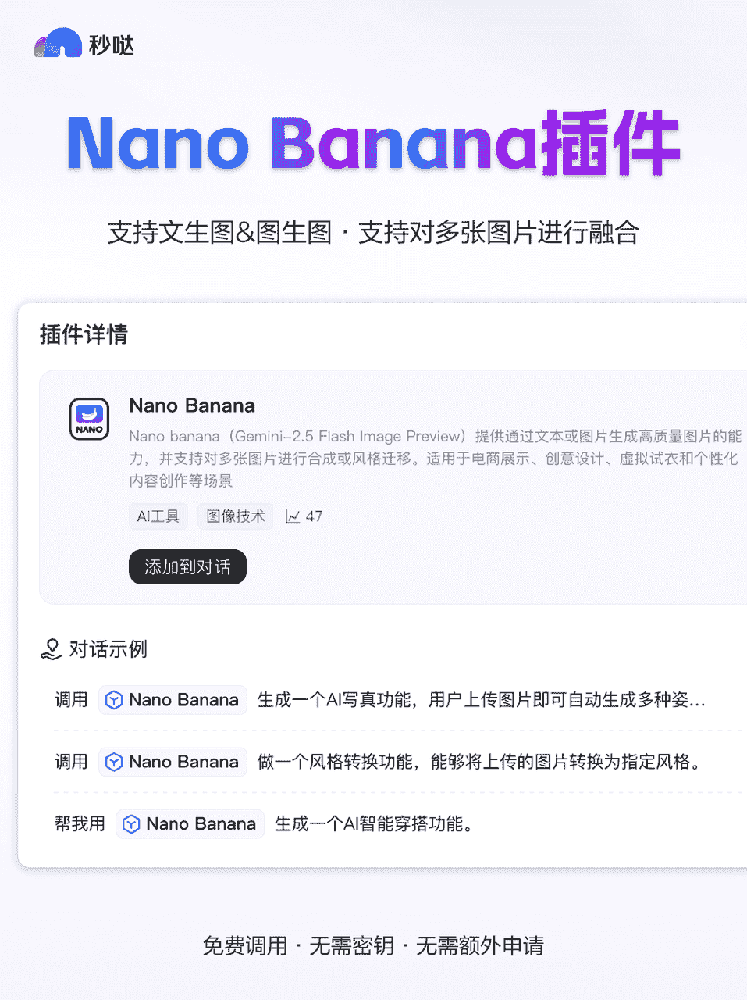

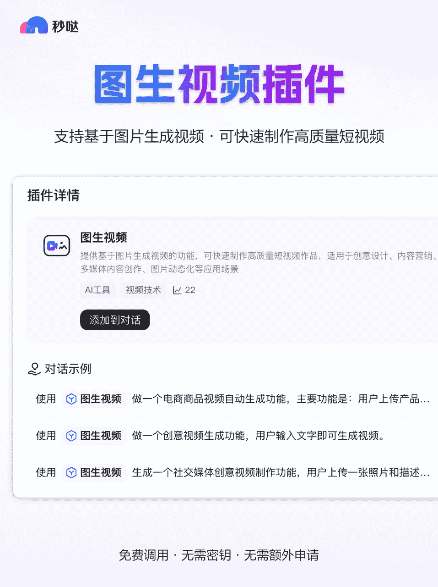

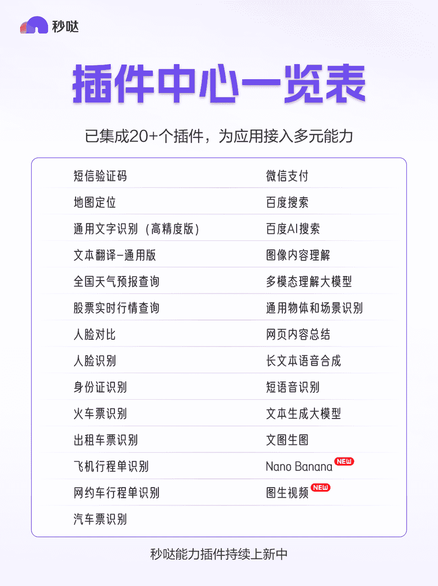

1.  **多模态能力扩展：**应用修改阶段新增图片上传功能，并将首页和修改阶段的图片上限扩展至 5 张，便于用户进行内容优化

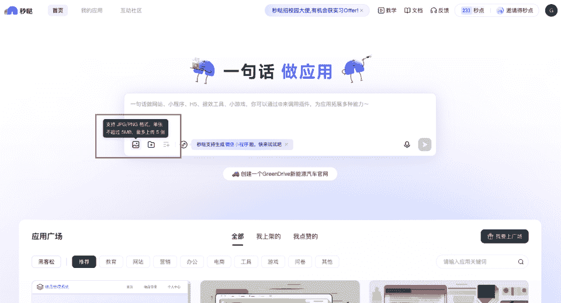

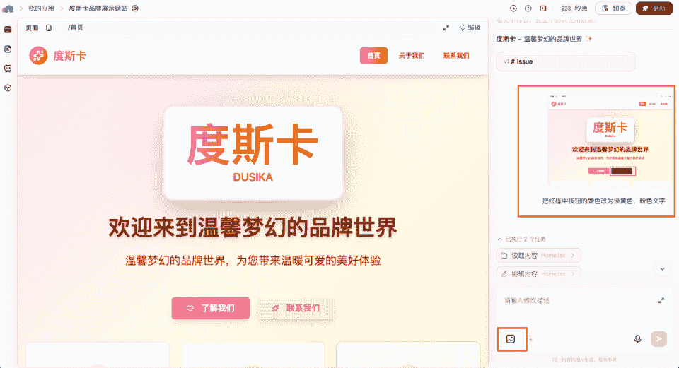

1.  **自动修复功能：**预览态出现白屏、无响应等异常现象时，系统自动提示“尝试修复”，点击后大模型自动排查修复且不消耗秒点。功能处于效果测试阶段，修复成功率将随数据积累逐步提升

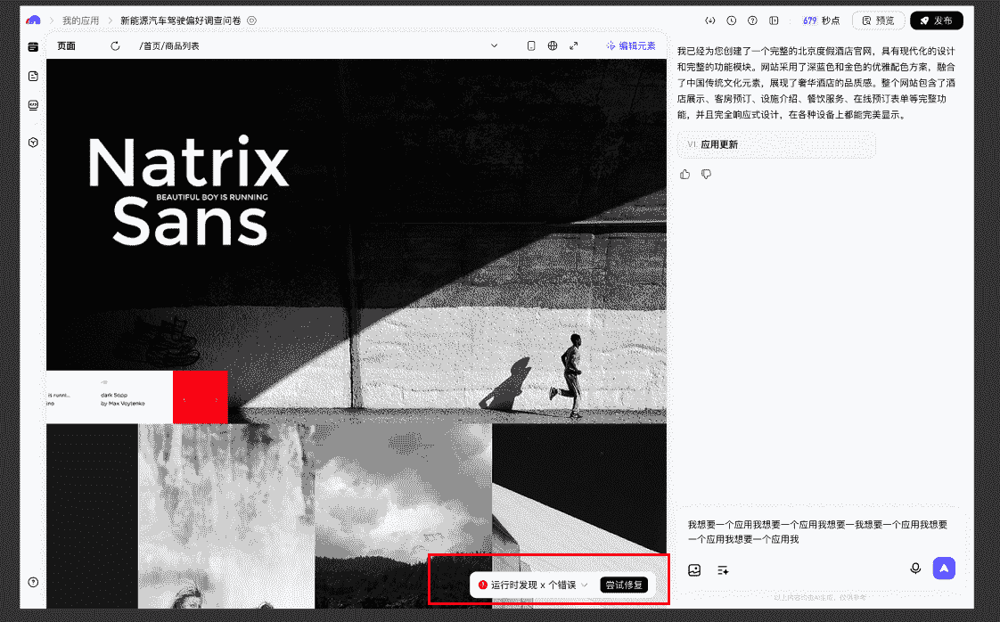

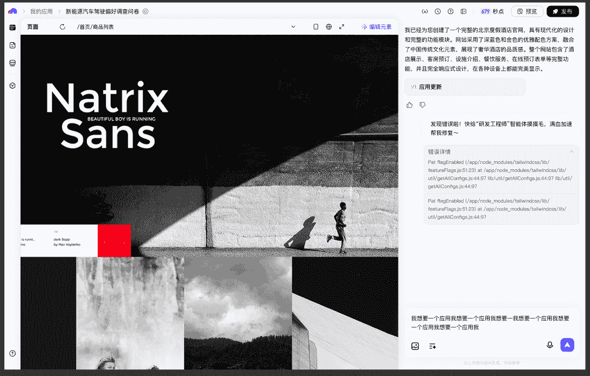

##  什么是好 UI

你可能听过这样的感慨  “这个 UI 真不错”

你也可能发出过这样的感慨  “这应用挺好看”、 “这个好难用啊”

这都来自大家的主观感受，所有的感受都来源于 “应用的视觉设计”和“应用的交互设计”，可以统称为 UI。

在现阶段互联网极度内卷的时代，只是单纯的“能用”、“好用”已经无法满足用户的胃口，大家在此基础上更追求“好看”、“交互有创新”，甚至会单纯因为“好看”而用一个应用。

那什么是好 UI，可以简单从 3 个点进行定义

### 易操作

不用想就能上手

将用户的理解成本降为 0

### 好审美

通用审美：色系、排版、有温度

用户审美：符合目标用户的审美

### 能落地

了解技术边界、用户场景

不做“概念”设计

接下来就开始我们的“美”之旅（重点从好审美展开）

## 什么是“好看”的应用

> “简洁、舒服、愉悦”

### 视觉一致性

1.  色系：颜色不超过 3 种主色，颜色之间相对融合不跳跃

1.  风格：风格全部一致，如均采用“可爱风”，不可进行风格混搭

1.  元素：元素设计规格都一致，如都圆角，不可圆角、直角混搭

### 排版有逻辑

1.  留白：模块之间有间隔、有留白，给出视觉空间，不拥挤

1.  层级：标题、正文等层级分明，模块排版有规律，快速 get 重点

1.  多端适配：手机端、ipad、电脑等多端的适配、尺寸与排版合理

### 有温度懂用户

1.  细节：注意细节设计照顾用户情绪，如报错/加载页面的处理

1.  惯性：交互逻辑符合用户认知、符合用户习惯，如返回的设计

## 怎么用 Vide Coding 做出“好看”的应用

### 简易版（提示词）

#### 01 全新应用

##### STEP 01 撰写原始提示词

提示词需包含以下基础内容：

1.  需求（什么应用、大概为了实现什么、基础功能描述）

1.  应用类型（网站、小程序、H5、小工具、小游戏）

1.  应用结构设想（几个页面、每个页面的基本要求）

1.  应用能力（需要集成哪些能力：登录、地图定位、微信支付等等）

1.  设计需求（呈现什么风格、什么色系、什么感觉）

###### 提示词参考

```
帮我生成一个北京特产购物微信小程序的应用，有线下门店，可以在小程序上进行下单，下单时可以选择门店自提或者邮寄，完成微信支付后下单成功。
门店自提：需集成地图定位展示门店具体位置，下单成功后需显示取货码，商家可在后台进行取货管理
邮寄：下单时需选择邮寄地址，除新疆、西藏、海南地区满128元包邮，下单成功后显示邮寄状态，商家可在后台上传快递单号
小程序菜单分为首页、商品、购物车、我的，页面说明如下：
首页：展示店铺介绍、福利活动等
商品：展示商品列表，可以按照分类查看、支持搜索，点击商品查看商品详情（照片、规格、介绍、价格）与进行加购
购物车：展示已加购的商品、并可以微信支付下单结算
我的：包含基础信息、积分权益、我的订单等
```

##### STEP 02 提示词美观度部分专项优化

###### 提示词优化工具

建议选用以下大模型完成提示词优化，按需选用

百灵大模型

https://ling.tbox.cn/

Deepseek

https://chat.deepseek.com/

豆包

https://www.doubao.com/

###### 优化咒语参考

```
“原始提示词”这个需求帮我再进行拓展升级，重点关注视觉上的呈现、排版结构与交互设计。
你可以模仿：“请创建一个为独立音乐人打造的个人品牌展示型网站，包含音乐作品试听、现场演出日程、乐迷互动留言板、专辑购买入口、社交媒体链接等核心模块。页面风格需突出个性与艺术气质，可选择复古磁带风、街头涂鸦风，或带有暗黑浪漫气息的夜店光感风格，整体设计应有粗颗粒纹理背景、霓虹标题、低饱和色调搭配高对比度组件。网站支持嵌入 Spotify / Apple Music 播放器，音乐页面提供分专辑/单曲浏览，演出页面需展示时间、地点、购票链接。建议使用卡片式布局与横向滑动组件增强浏览体验，整体兼顾移动端与桌面端适配，注意交互设计排版的美观，每栏的子板面居中，并列放置。”
```

###### 优化示例：北京特产购物微信小程序

| 输入提示词 | 输出提示词 |
| --- | --- |
| “帮我生成一个北京特产购物微信小程序的应用，有线下门店，可以在小程序上进行下单，下单时可以选择门店自提或者邮寄，完成微信支付后下单成功。 | ``` ### **「京韵 · 食光」北京特产小程序 - 视觉升级方案** **一、 核心设计理念** *   **主题风格：新京式美学 &amp;amp; 数字胡同**     *   **色彩体系：**         *   **主色调：** 故宫**朱墙红**、**琉璃黄**。用于重要按钮、图标、价格，传递皇家底蕴与喜庆。         *   **辅助色：** **青石灰**、**墨色**。用于背景、文字，营造沉稳与历史感。         *   **点缀色：** **景泰蓝**。用于标签、优惠信息，增添精致与活力。     *   **视觉元素：**         *   **背景纹理：** 带有细微质感的**宣纸底纹**或**老城墙砖墙纹理**，提升整体质感。         *   **图形图标：** 图标设计融合**故宫窗棂**、**云纹**、**中国结**等传统纹样，进行现代化简笔处理。         *   **字体：** 标题可使用有设计感的书法字体（如汉仪尚巍手书），正文使用清晰的无衬线字体（如 PingFang SC），确保可读性。 **二、 页面视觉设计与功能拓展** 我们将采用**卡片式布局**与**横向滑动组件**作为核心交互骨架，增强浏览的趣味性与节奏感。 #### **1. 首页 - 「皇城根下」** *   **视觉焦点：** 顶部通栏轮播图采用**宫门开启**的动效，缓缓展示最新的福利活动。 *   **核心模块：**     *   **店铺寄语：** 以一卷徐徐展开的**圣旨**或**古籍书卷**的卡片形式，呈现店铺介绍，文字竖排，配以一枚“京韵”的红色印章。     *   **活动专区：** 采用**横向滑动**的“琉璃瓦”卡片。每张卡片是一个活动，如“新客尝鲜礼”、“时令糕点限时购”。     *   **精选分类：** 图标设计为**冰糖葫芦**（果脯）、**兔儿爷**（工艺品）、**铜锅**（美食）等北京特色符号，纵向排列，点击后带动感。     *   **人气推荐：** 商品以**高低错落的宫灯**卡片形式展示，卡片阴影营造悬浮感，突出商品图片。 #### **2. 商品页 - 「京品大集」** *   **顶部布局：**     *   **搜索框：** 设计成**老式牌匾**的样式，内部有“搜索京味好物”的灰色 placeholder 文字。     *   **分类导航：** 采用**横向滑动**的标签，选中状态为朱红色底，并有“红绸带”滑动动效。 *   **商品列表：**     *   **瀑布流/双列卡片：** 商品卡片背景为微泛黄的**宣纸质感**，边框采用**简约窗棂**样式。     *   **商品信息：** 商品名使用深灰色，价格使用醒目的**琉璃黄**，“包邮”标签使用**景泰蓝**色小气泡。     *   **交互反馈：** 点击商品图片，有轻微的“放大落下”动效，模拟拿起一件物品的感觉。 #### **3. 商品详情页 - 「宝物细赏」** *   **视觉呈现：**     *   **图片轮播：** 轮播指示器设计成**中式折扇**的扇骨样式。     *   **商品标题：** 衬于一块半透明的**墨色镇纸**背景上。     *   **规格选择：** 规格按钮设计成**印章**样式，选中时如盖章般变为红色并带有“已选”字样。     *   **商品介绍：** 内容区域采用**信笺**式的分隔线，图文并茂。 *   **底部操作栏：**     *   融合了**故宫红墙**的色块，将“加入购物车”与“立即购买”按钮左右并列，视觉上非常稳固且醒目。 #### **4. 购物车页 - 「御前清单」** *   **顶部提示：** 清晰展示包邮政策：“御赐恩典：除新疆、西藏、海南，满128元享京畿直送（包邮）”。 *   **商品列表：**     *   每个商品项是一个独立的卡片。左侧商品图片带有**中国结**式的勾选框。     *   数量加减按钮设计成**中式盘扣**的样式，极具特色。 *   **结算栏：**     *   总计金额突出显示。结算按钮在金额足够时显示为**朱红色**并提示“御前结算”，不足时则为**青灰色**并显示“还差XX元享包邮”。 #### **5. 我的页面 - 「我的京韵」** *   **个人头图：** 背景使用**抽象的水墨北京天际线**（央视大楼、中国尊与天坛祈年殿结合）。 *   **功能入口：** 采用**九宫格**或**横向滑动**的“玉玺”图标，代表“我的订单”、“积分权益”、“收货地址”、“客服”等。 *   **我的订单：**     *   订单状态标签（待付款、待自提等）设计成**京剧脸谱**色块，如待付款用红色，待自提用蓝色。 *   **积分权益：**     *   积分展示像一个**传统算盘**，用户滑动时可以模拟算珠滚动的动效。积分兑换商品以**卷轴**列表形式呈现。 #### **6. 门店自提与地图 - 「亲临宝地」** *   **地图页面：** 不是简单的原生地图，而是定制了**手绘风格的北京地图**，重点标注出我们的门店位置，图标设计为**小小的宫门**。 *   **门店列表：** 点击宫门，弹出卡片，展示门店详情。卡片设计如**老北京门牌**，包含地址、营业时间、联系电话。 *   **路线规划：** 底部提供“一键导航”按钮，按钮样式为**一个指向远方的箭头路标**。 **三、 交互与动效细节** *   **全局加载：** 加载动画是一个**旋转的兔儿爷**或**抖动的糖人**。 *   **下拉刷新：** 下拉时，顶部会出现一个**踩着单车送货的北京大爷**动画。 *   **加入购物车：** 商品图片会缩略成一个小图，沿着一条抛物线轨迹飞入底部的购物车图标。 *   **支付成功：** 支付成功后，页面会有**金色礼花**绽放的动效，并伴随一句“得嘞，您稍候！”的京味儿提示音（可选）。 **四、 技术实现建议** *   **前端框架：** 使用微信小程序原生框架或 Taro、uni-app 等多端框架。 *   **地图服务：** 集成百度地图，实现门店定位与导航。 *   **支付：** 完美对接微信支付。 *   **后台管理：** 需要配套的后台管理系统，用于上下架商品、管理订单、处理物流信息、发布活动等。 通过以上从理念到细节的全面视觉升级，您的北京特产小程序将不再是一个冰冷的工具，而是一个充满文化温度、视觉惊喜和购物乐趣的线上“京味儿博物馆”，能极大地提升用户粘性和品牌价值。  ``` |

##### STEP 03 提示词输入给秒哒

给秒哒什么：原始提示词（保核心功能）+优化后提示词（补充视觉升级）

```
“原始提示词” “优化后提示词”
```

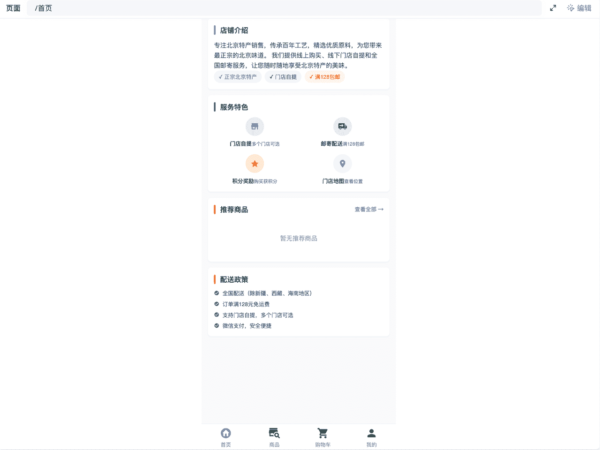

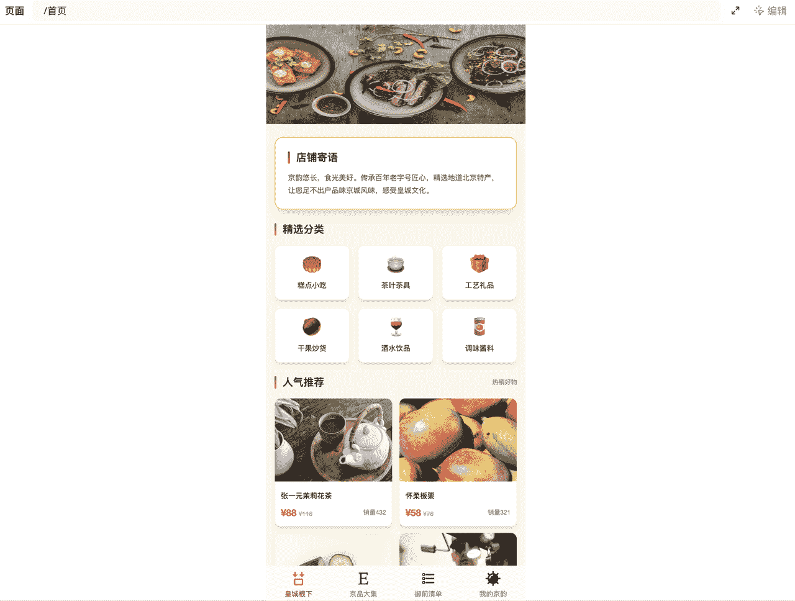

#### 02 老应用（已多轮修改）

##### STEP 01 应用现状整理

```
按照过往修改记录输出一份最新的产品需求文档
```

###### 优化示例：校园论坛 BBS 应用

| 输入咒语 | 秒哒输出 |
| --- | --- |
| 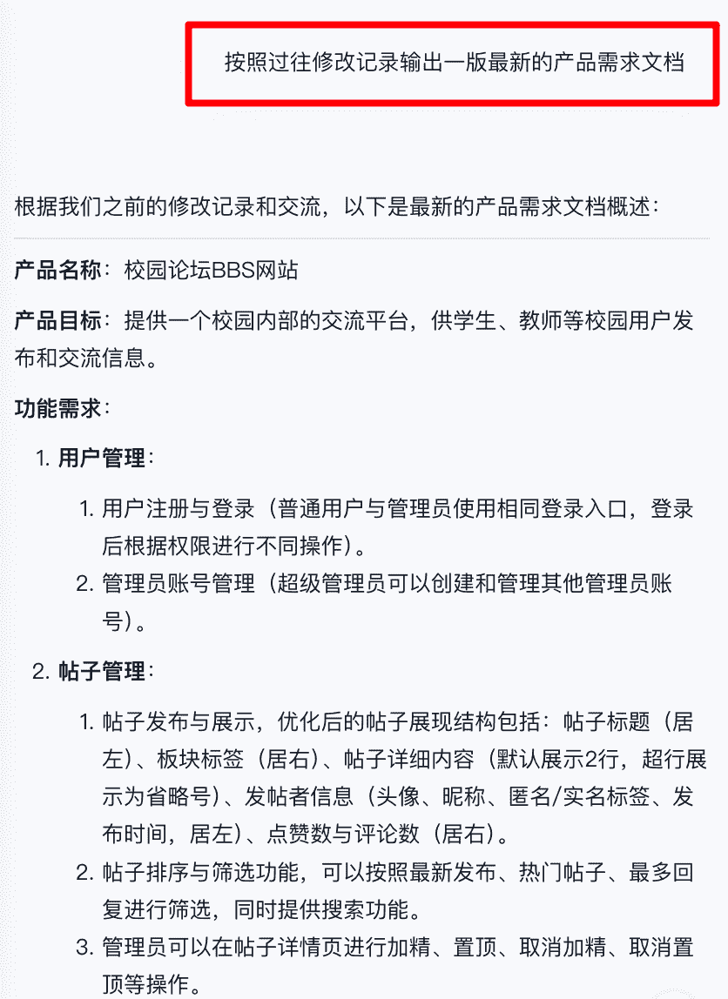 | ``` 产品名称：校园论坛BBS网站 产品目标：提供一个校园内部的交流平台，供学生、教师等校园用户发布和交流信息。 功能需求： 1.用户管理： - 用户注册与登录（普通用户与管理员使用相同登录入口，登录后根据权限进行不同操作）。 - 管理员账号管理（超级管理员可以创建和管理其他管理员账号）。 2.帖子管理： - 帖子发布与展示，优化后的帖子展现结构包括：帖子标题（居左）、板块标签（居右）、帖子详细内容（默认展示2行，超行展示为省略号）、发帖者信息（头像、昵称、匿名/实名标签、发布时间，居左）、点赞数与评论数（居右）。 - 帖子排序与筛选功能，可以按照最新发布、热门帖子、最多回复进行筛选，同时提供搜索功能。 - 管理员可以在帖子详情页进行加精、置顶、取消加精、取消置顶等操作。 3.板块管理： - 超级管理员可以在管理后台进行板块管理，包括新增板块、修改板块名称、设定版主。 - 对于特定板块（如社团活动），用户发帖时需要进一步选择所属分类（如社团）。 4.管理后台： - 提供管理后台界面，供超级管理员进行用户账号管理、帖子管理、板块管理等高级操作。 5.响应式设计： - 优化移动端和web端的展示效果，调整字体大小等，确保在不同设备上都能良好显示。 修改记录： - 优化了帖子的展现结构。 - 降低了页面头部区域的高度，减少了页面占幅。 - 增加了帖子排序和筛选功能，以及搜索功能。 - 修改了超级管理员账号密码，并解决了登录失败的问题。 - 管理员可以直接在帖子详情页内进行加精、置顶等操作。 - 发帖时选择社团活动板块需进一步选择所属社团。 - 超级管理员可在管理后台配置板块信息。 ``` |

##### STEP 02 提示词美观度部分专项优化

###### 提示词优化工具

建议选用以下大模型完成提示词优化，按需选用

百灵大模型

https://ling.tbox.cn/

Deepseek

https://chat.deepseek.com/

豆包

https://www.doubao.com/

###### 优化咒语参考

```
“秒哒输出的应用现状提示词”这个需求帮我再进行拓展升级，重点关注视觉上的呈现，在保留所有功能的基础上，提升视觉风格、排版结构、交互设计。
你可以模仿：“请创建一个为独立音乐人打造的个人品牌展示型网站，包含音乐作品试听、现场演出日程、乐迷互动留言板、专辑购买入口、社交媒体链接等核心模块。页面风格需突出个性与艺术气质，可选择复古磁带风、街头涂鸦风，或带有暗黑浪漫气息的夜店光感风格，整体设计应有粗颗粒纹理背景、霓虹标题、低饱和色调搭配高对比度组件。网站支持嵌入 Spotify / Apple Music 播放器，音乐页面提供分专辑/单曲浏览，演出页面需展示时间、地点、购票链接。建议使用卡片式布局与横向滑动组件增强浏览体验，整体兼顾移动端与桌面端适配，注意交互设计排版的美观，每栏的子板面居中，并列放置。”
```

###### **优化示例：李白的一生**

| 输入咒语 | 秒哒输出 |
| --- | --- |
| “产品需求文档 | ``` 在完全保留原始功能基础上，以专业级数字文化产品标准重构视觉语言与用户体验，融合古典意境与现代交互美学： ### **升级版产品需求文档** **项目名称**：谪仙行迹——李白的沉浸式时空漫游   **网站类型**：文化叙事型数字博物馆（信息展示+情感化交互）   **核心理念**：以“水墨为骨，数据为脉”，构建可游、可读、可聆的盛唐数字诗境   ### **一、视觉风格升级：三维水墨时空系统** 1. **主视觉语言**      - **动态山水底纹**：全站背景采用程序化生成的水墨粒子动画（参考《千里江山图》笔意），随滚动/光标产生涟漪、墨迹晕染、远山淡出等微交互      - **材质系统**：        - 绢本纹理：正文区采用半透明仿古宣纸叠加效果，文字如墨书浮现        - 青铜/青瓷UI组件：按钮与卡片边框融入唐代器物纹样（宝相花、卷草纹），悬停时泛起铜绿光泽        - 光影逻辑：模拟午后斜阳穿透窗棂的光影层次，重要信息区投射竹影窗格的光斑   2. **色彩体系**      ```markdown    主色：       - 天青 #4A90A4（盛唐官服色）       - 绛紫 #5D2E8C（夜宴烛光）     辅助色：      - 赭石 #A3633A（古卷批注）      - 月白 #F5F3E9（绢本留白）    强调色：      - 朱砂 #D34336（诗眼高亮/轨迹路径）      - 流金 #FFD76F（重要事件光效）    ```    - **渐变逻辑**：所有色彩过渡模仿矿物颜料剥落感，采用非均匀渐变（如青→紫→墨的破碎式融合） 3. **字体系统**      - 标题：**方正清刻本悦宋**（宋版刻本刀痕感）+ 动态笔锋动画（落笔时墨迹扩散）      - 正文：**思源宋体** + 行距1.8em营造古籍呼吸感      - 交互文字：**汉仪尚巍手书**（重要按钮/诗题）搭配毛玻璃质感衬底   ### **二、空间化信息架构：四维叙事框架** ```mermaid graph LR A[时空卷轴] --&amp;gt; B[地理轨迹层] A --&amp;gt; C[诗歌年表层] A --&amp;gt; D[精神意象层] A --&amp;gt; E[声景沉浸层] ``` 1. **主界面 - 折叠式立体地图**      - 采用**等距斜轴投影地图**，山脉以青绿山水笔触3D建模，长江为流动光带      - 轨迹点设计为**悬浮墨滴**，鼠标接近时自动展开为菱形诗笺卡片（卡片边缘做旧撕边效果）      - **季节模式切换**：春（杏花烟雨）/秋（红叶栈道）/冬（雪覆夔门）对应李白不同时期心境 2. **轨迹详情页 - 诗卷交互剧场**      - **空间分层结构**：        ```      [前景] 动态诗轴（竖排文字自右向左徐展）        [中景] 3D微缩场景（如黄鹤楼送别场景，帆船可拖拽）        [背景] 地理信息层（唐代与现代地名双标注，卫星图做水墨晕染处理）        ```    - **事件可视化**：        - 政治失意期 → 背景渐变为灰青色，文字出现墨点遮蔽特效        - 漫游期 → 地图边缘浮现水墨云气，诗句随机飘入视野   3. **诗歌展示系统 - 动态装帧设计**      - **诗体自适应**：        - 乐府诗 → 竹简书卷形式，文字带竹节分隔符        - 绝句 → 四扇屏风布局，每句独立浮现        - 古风 → 仿长卷手卷，支持横向手势滑动      - **吟诵激活**：        - 长按诗句触发方言吟诵（可选四川/碎叶/长安腔）        - 声纹可视化：声波转化为墨色涟漪，与诗中意象联动（如“大江”触发金色浪纹）   ### **三、核心功能交互增强** 1. **地图探索系统**      - **墨迹导航**：初始界面为纯白生宣，鼠标移动如笔锋扫过渐显山水轮廓      - **时空缩放**：滚轮控制时间维度（青年/中年/晚年）与空间尺度（郡县级→洲际级）      - **足迹热度图**：在轨迹层下叠加半透明赭石色浓度云，显示停留时长与创作密度   2. **诗歌矩阵**      - **多维筛选**：        - 情绪维度：激昂（金红）/孤寂（靛蓝）/超逸（青碧）        - 地理维度：按流域/关隘/都会分类        - 物质维度：涉及酒器/乐器/兵器等文物      - **诗境生成器**：输入现代地点，AI匹配李白诗中意境（如输入“重庆洪崖洞”→ 输出《巴女词》相关场景重构）   3. **声景档案馆**（新增模块）      - 古乐器采样：复原唐代尺八、阮咸、羯鼓音源      - 诗歌空间音频：点击《早发白帝城》自动加载江水流声+猿啼采样，支持3D音效定位      - **声纹年谱**：将李白26首代表诗作的吟诵频率分析为色谱带，形成声纹人生轨迹   ### **四、响应式交互细节** 1. **移动端手势语言**      - 双指缩放 → 切换诗歌字体大小（小楷→榜书）      - 上滑抛投 → 翻页式浏览年谱事件      - 长按震动 → 触发诗句金石篆刻音效   2. **桌面端深度交互**      - **Ctrl+拖动**：旋转三维诗境空间视角      - **Shift+悬停**：展开诗句的典故注释气泡（气泡形制为唐代铜镜）      - **空格键**：暂停/继续全局水墨动画   3. **暗黑模式**      - 夜间自动切换「墨池模式」：背景转为玄黑，文字呈现银粉书写效果，轨迹线变为萤火微光   ### **五、情感化设计组件** 1. **「诗债」时间提醒**      - 每日酉时（17-19点）弹出仿古信笺：“今日宜读《将进酒》，君有三百杯未酬？”      - 配合铜壶滴漏动画与浊酒声效   2. **「谪仙笔」创作工具**      - 用户可手写输入文字，实时转化为瘦金体/狂草风格      - 生成专属数字诗笺，可分享至社交媒体   3. **「长安十二时辰」模式**      - 实时时钟映射唐代时辰，点击时辰自动定位李白当日活动轨迹      - 子时（23-1点）触发《静夜思》沉浸场景：月光随鼠标移动洒落   ### **六、技术实现建议** 1. **渲染引擎**      - Three.js + WebGL水墨着色器（实现宣纸渗透效果）      - Deck.gl地理图层 + 自定义唐代地图瓦片服务   2. **动效曲线库**      ```typescript    // 模仿毛笔提按的缓动函数    const inkEase = cubicBezier(0.7, 0.15, 0.3, 0.95);     // 模拟宣纸吸水延迟    transition: transform 1.2s inkEase, opacity 0.8s step-end;    ``` 3. **无障碍设计**      - 高对比模式：墨书转白描+朱砂批注      - 语音导航：切换为说书人口吻（“且听下回分解...”）   ### **七、视觉叙事动线示例** ``` [入口] 泼墨开场 → 墨滴渐变为三维地图 →  [初唐] 碎叶城雪景模式 → 点击「铁杵磨针」图标 →  [场景] 动态呈现老媪磨杵，诗句《上李邕》从杵尖生长而出 →  [交互] 拖动铁杵改变磨杵速度 → 对应诗句字体从规整到狂放渐变 →  [出口] 折扇收起动画 → 生成用户专属「李白精神基因报告」 ``` ### **交付价值升级** 1. **学术严谨性**：所有地理轨迹标注《李白全集编年笺注》版本依据   2. **文化破圈**：      - AR模式：手机扫描现实场景触发对应李白诗句全息投影      - 诗酒盲盒：每月解锁一款唐代酒器3D模型+匹配诗作   3. **可持续叙事**：预留「诗星对照」接口，未来可扩展至杜甫/苏轼等文人数字宇宙   &amp;gt; 此方案将历史真实性转化为可感知的数字诗意，通过**物质性设计**（宣纸/青铜/墨迹）连接当代用户与唐代文化肌理，使信息展示升维为跨时空的情感对话，在每处交互细节埋藏诗性隐喻，实现“技术为表，文化为里”的沉浸式体验。  ``` |

##### STEP 03  将提示词扔给秒哒

1.  对输出的提示词进行细微调整，删减非必要部分，按需求调整部分

1.  将修改/调整后的提示词扔给秒哒进行生成

1.  等待优化完毕

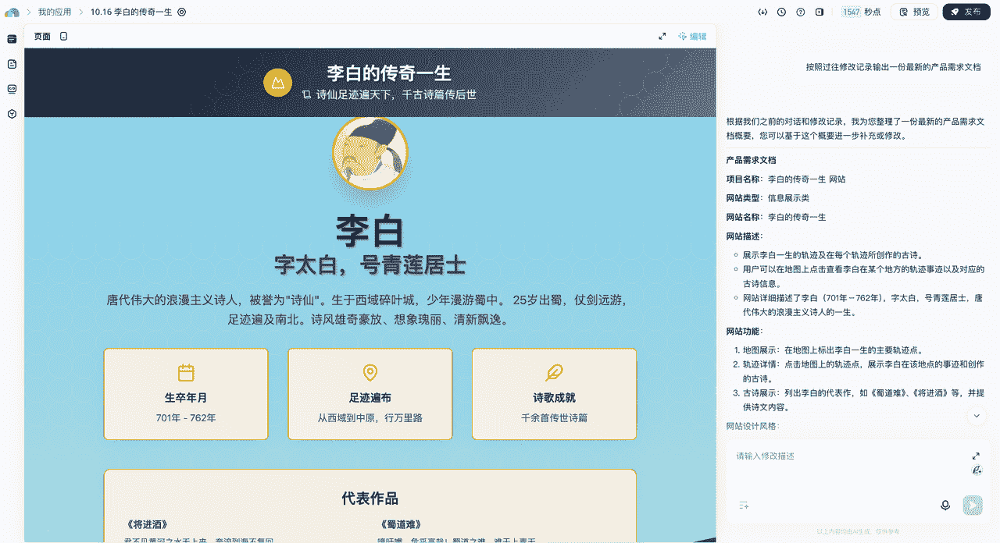

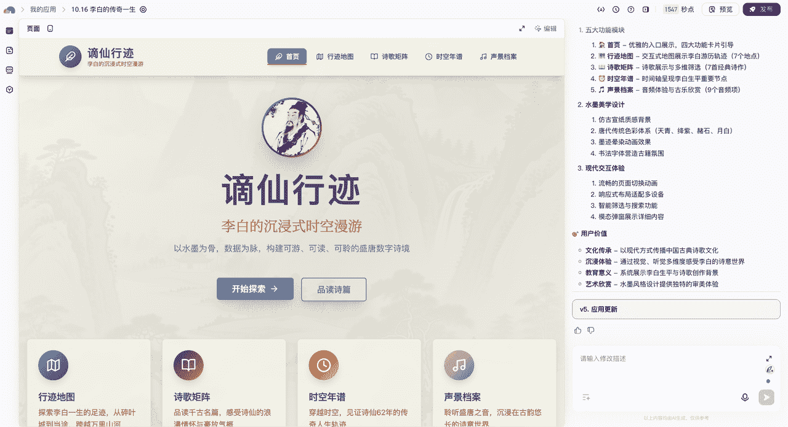

### 进阶版（设计+代码）

本节更适用于没有设计能力，但有深度 UI 定制化需求的开发者

+   非设计师，但可以简用设计软件实现 UI 样式定制升级

+   非程序员，但可以使用一些代码实现 动效/交互 的定制升级

**请谨记三秘诀**

让大模型给你帮助

灵活运用 F12

深度使用 CSS

以下内容以“秒哒非编程黑客松大赛”官网应用进行举例

#### 有网站想抄：html to design

**适用场景**

1.  想要制作网站类应用

1.  有心仪的网站样式，想要直接复刻上手“抄”

**使用工具**

+   工具：Figma https://www.figma.com/

+   [插件：](https://www.figma.com/community/plugin/1159123024924461424/html-to-design-by-divriots-import-websites-to-figma-designs-web-html-css)html.to.design https://www.figma.com/community/plugin/1159123024924461424/html-to-design-by-divriots-import-websites-to-figma-designs-web-html-css

**操作方法**

| 步骤 | 动作 | 图示 |
| --- | --- | --- |
| 第一步 | 发现或找到喜欢、想“抄”的网站 |  |
| 第二步 |  | 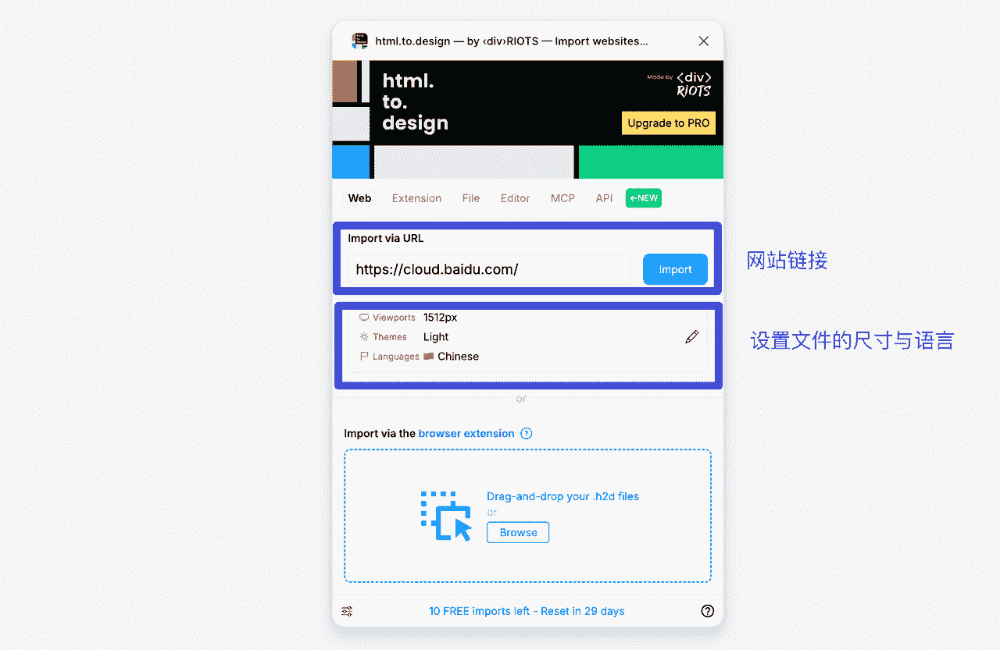 |
| 第三步 | 输入网站链接，完成网站设计文件复刻 |  |
| 第四步-方案 1 | 将设计文件导出为 PNG 图片扔给为秒哒进行完整复刻制作 | 将图片扔给秒哒进行复刻 |
| 第四步-方案 2 | 进入开发模式，复制特定模块的 CSS 扔给秒哒修改特定模块 |  |

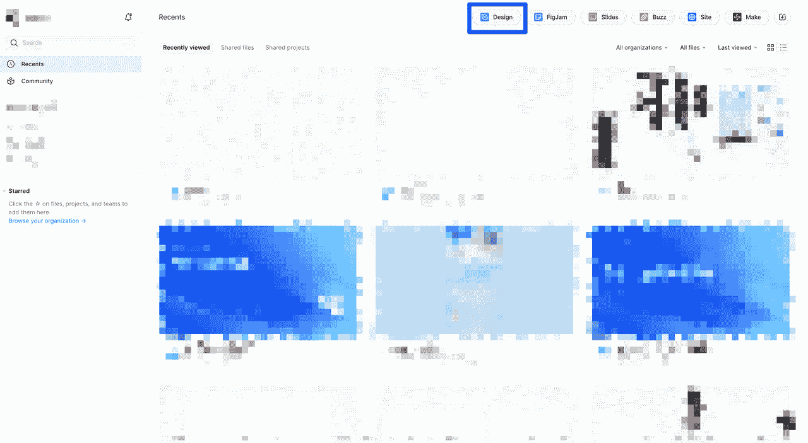

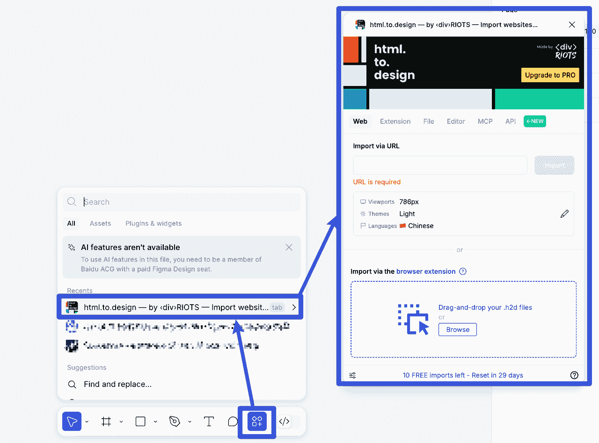

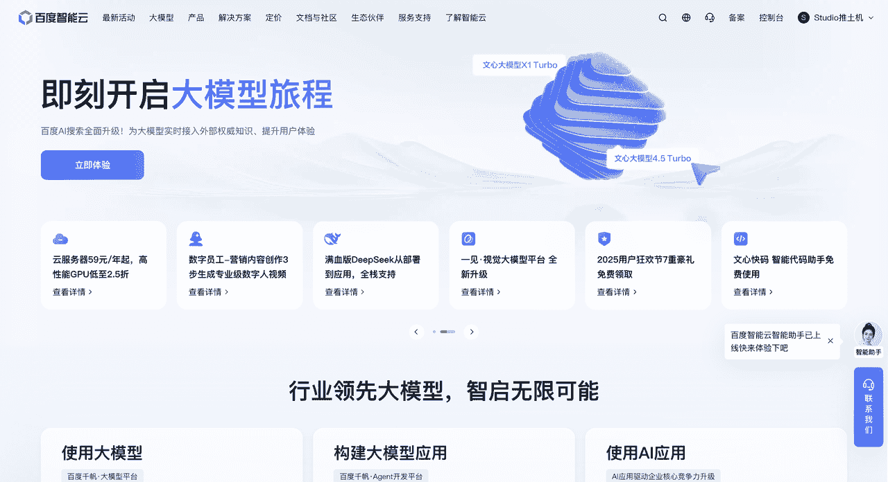

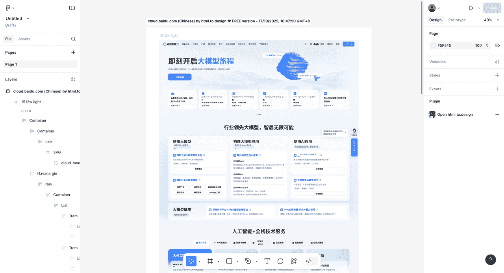

#### 有配色想精调

**适用场景**

1.  对于配色有极高定制化的需求

1.  有基础的审美和设计能力

**使用工具**

+   工具：Figma 等设计工具 https://www.figma.com/

**操作方法**

| 步骤 | 动作 | 图示 |
| --- | --- | --- |
| 第一步-方案 1 | 进入设计软件，自行完成配色设计 | 配色设计（模块+字体） |
| 第一步-方案 2 | 心仪的网站，按 F12 复制配色色号 | 配色（模块+字体）复制学习 |
| 第二步 | 选中模块将 CSS 扔给秒哒实现 |  |

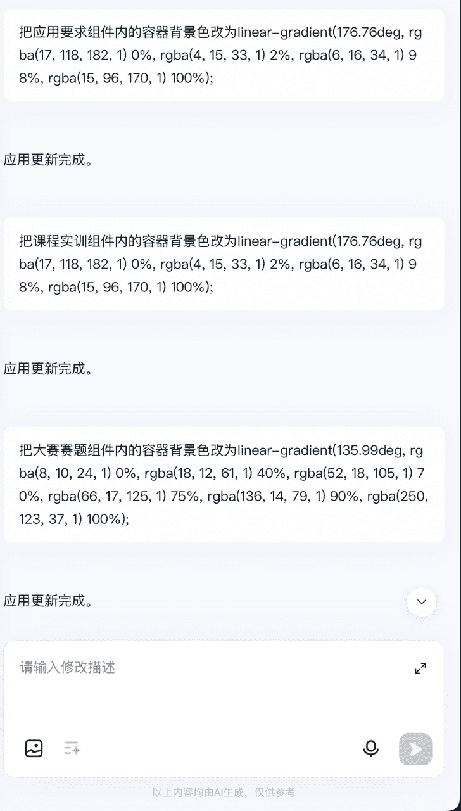

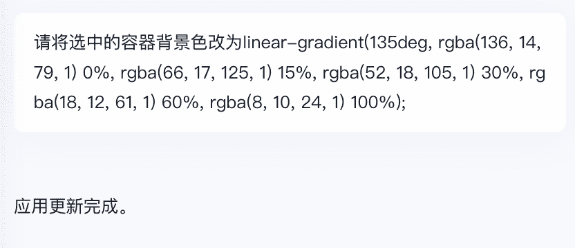

#### 有样式想定制

**适用场景**

1.  有想要的特定组件

1.  想减少在秒哒上使用的试错成本（避免影响整体功能逻辑），那可以先让大模型帮你试错有

**使用工具**

+   工具：code 类大模型产品（有代码预览模式）

**操作方法**

| 步骤 | 动作 | 示例 |
| --- | --- | --- |
| 第一步 | 明确想新增或优化的组件需求 | 1.  我想给‘秒哒非编程黑客松’增加一个秒哒水印 |
| 第二步 | 将需求描述给大模型，进行多轮修改，直至符合预期 | 1.  将复制的 CSS 代码+优化需求，给到大模型 |
| 第三步 | 复制 CSS 代码给到秒哒 | 将代码丢给秒哒生成 |

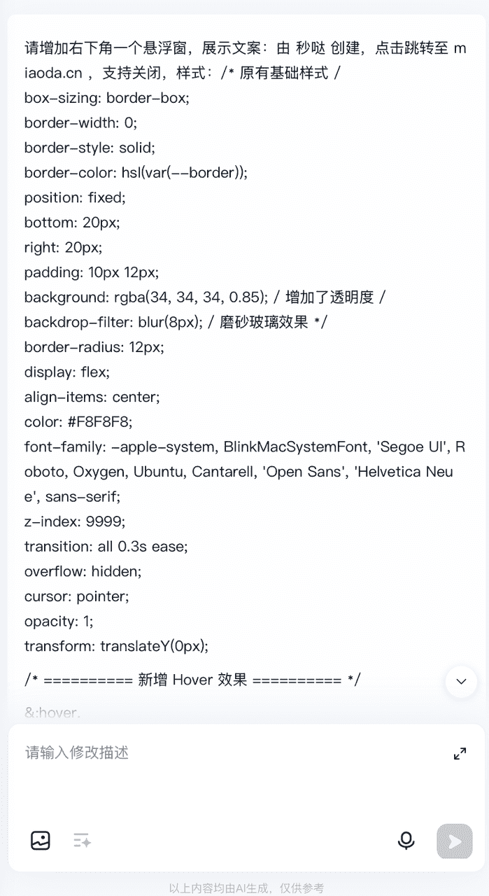

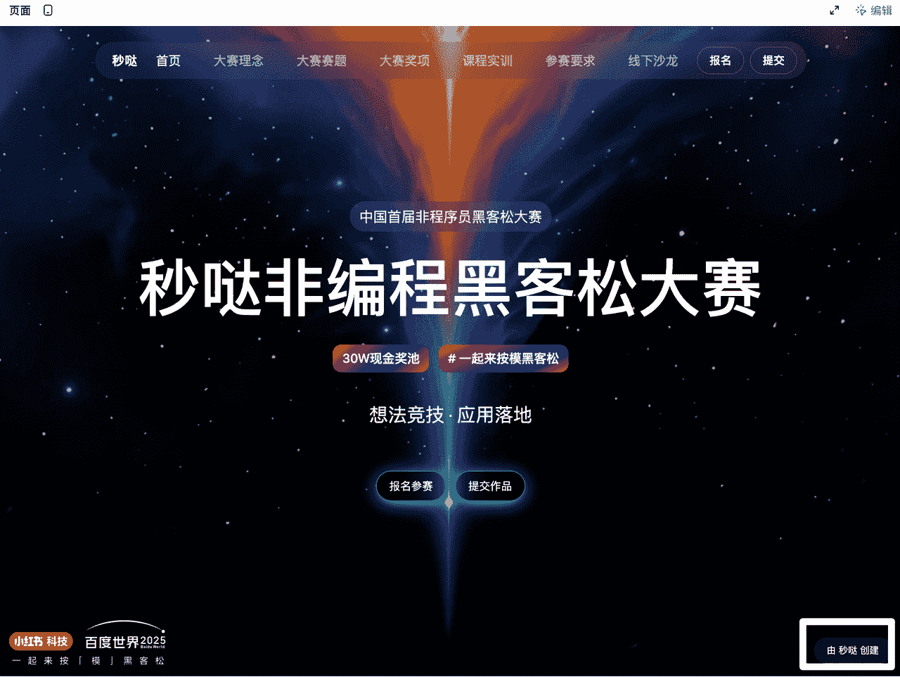

#### 有排版没思路

**适用场景**

1.  特定模块的排版优化

1.  想减少在秒哒上使用的试错成本（避免影响整体功能逻辑），那可以先让大模型帮你试错有

**使用工具**

+   工具：多模态理解大模型+code 类大模型产品（有代码预览模式）

**操作方法**

| 步骤 | 动作 | 示例 |
| --- | --- | --- |
| 第一步 | 明确有想调整的排版 | ‘秒哒非编程黑客松’要升级成 2 个赛道，但是排版没有头绪 |
| 第二步 | 将需求描述给大模型，让大模型给你方案 | 1.  截个图+加背景信息+需求，给到多模态理解大模型 |
| 第三步 | 将优化后的排行需求给到秒哒实现（结合 GUI 进行选中实现） | 将排版描述的提示词扔给秒哒 |

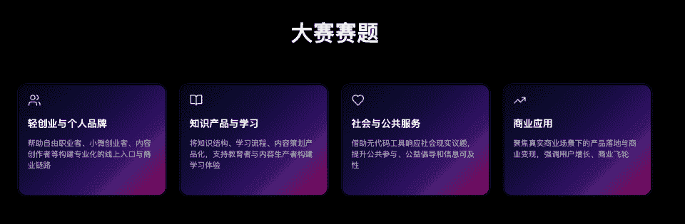

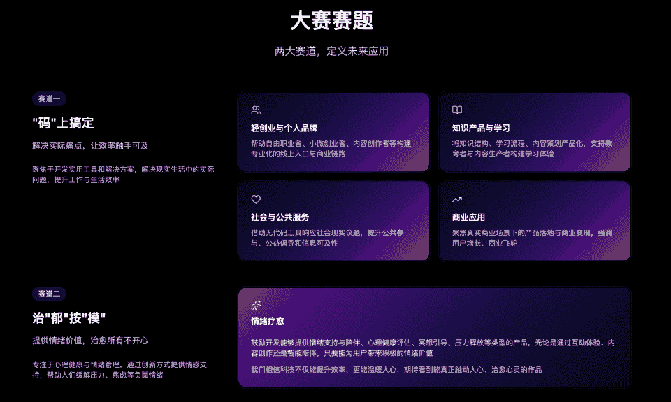

#### 找动效去实现

**适用场景**

1.  有样式想定制，想追求高级的动效

**使用工具**

+   工具：开源开放的动效组件库 https://21st.dev/

**操作方法**

| 步骤 | 动作 | 示例 |
| --- | --- | --- |
| 第一步 | 进入开源开放库，寻找组件 | 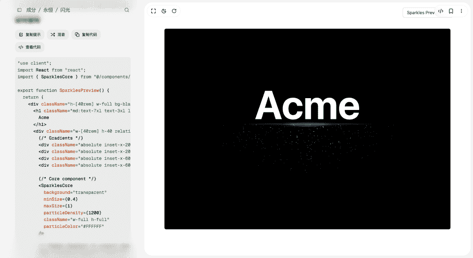 |
| 第二步 | 复制部分代码，仅保留核心部分，扔给秒哒进行拓展实现复制 CSS 代码给到秒哒 | 将代码丢给秒哒生成 |

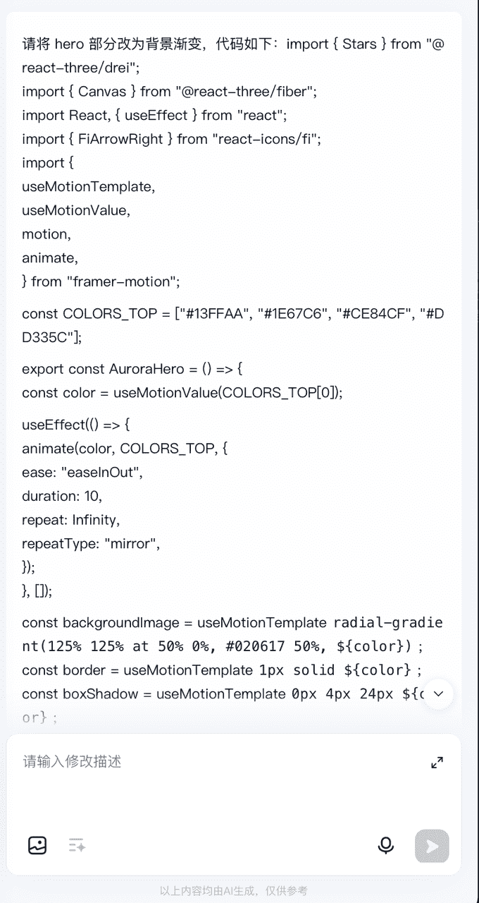

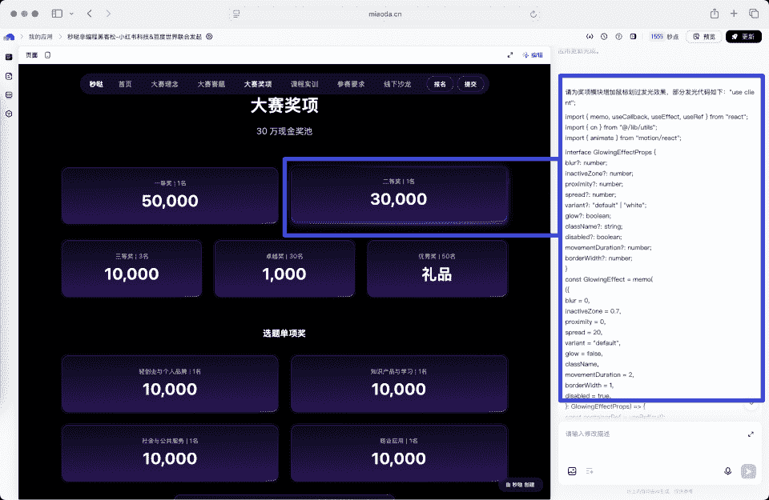

### 小结

1.  Vibe Coding 极其重要的点就是【提示词】，让大模型理解清楚你的清楚，并完美呈现。如果你担心描述不明白，那就交给大模型帮你进行需求填充，再交给下一个大模型去执行开发落地

1.  Vibe Coding 做得好，需要你清晰知晓当前的技术边界，哪些可能实现、哪些是现阶段技术做不到的。合理描述你的需求，功能有优先级，关注核心重点功能，做“小而精”

1.  Vibe Coding 应用“美”，需要你有审美、懂用户体验，站在用户视觉去评估，是否符合目标用户的审美、用户是否用的流程、看的明白

# 3、韩熔丨我真的把「技能五子棋」做出来了

应用链接：[https://www.miaoda.cn/apps/](https://www.miaoda.cn/apps/app-6hpuhkk191c1?s=s)app-6hpuhkk191c1?s=s

## **为什么选择这个方向**

####  先机在哪？——从热点里发现机会

在小红书上刷到了技能五子棋，看了这个视频后觉得非常有意思，同时观察了一下小红书各种相关帖子的增长趋势，就发现这个话题一定会火，而且当时还没有很多人借势传播。

#### **怎么做得更好？——用产品力说话**

技能五子棋是有游戏性质的，天然的就可以作为一个游戏的形态出现，我也看到了有其他博主做的技能五子棋的游戏，但要么规则混乱，要么介绍不清晰。我想做一个更清晰、更好玩的版本，正好「秒哒」可以帮我轻松实现。

## **我是怎么做的**

#### 🛠️ 选对工具，效率翻倍

擅长快速做游戏的 Vibe Coding 工具，是秒哒和 lovable，V0 擅长做纯前端，bolt 和 replit 用得不太顺手。于是构想了一下游戏逻辑，快速出了一版提示词：

做一个双人五子棋对战游戏，对战双方的名字分别为：“技能五”和“子祺”同时要增加一些特殊技能，每个人都有几个技能，下面是技能名字和对应的效果「飞沙走石」可以选中对手的一枚棋子，令其消失，弹窗提示「棋子被丢进了什刹海」「静如止水」可以冻结对方这一回合，我方连续进行两个回合「力拔山兮」我方直接获胜「东山再起」当我方失败时，使用该技能可以重置游戏「两极反转」平局，但使用的一方会说「你的面向都变了」

喂给 lovable 和秒哒，比较初版生成的效果，秒哒完胜，于是在秒哒的初版上继续修改润色。

#### **🎥 录制演示视频，一次过**

录视频我用的是 Screen Studio，一口气录了三版。回看时发现第一版最自然，就直接用了。

重点不是功能多完美，而是清晰展示“怎么做的”和“为什么有趣”。

在内容设计上，明确本次游戏开发演示的核心目标并非追求功能完整度，而在于高效实现并清晰传达设计思路，以提升内容的吸引力与观众参与感。考虑到实际游戏用户数量可能有限，因此在制作过程中注重敏捷与效率，避免陷入过度优化的误区，力求在较短时间内完成高质量的内容输出。

## **总结一下**

✅ 半小时搞定一个互动游戏，全程不用代码

✅ 「秒哒」目前免费，而且一直在更新，越来越强

✅ 对内容创作者来说：你得到的不是一个游戏，而是一个“活的”互动内容平台

这才是真正的价值：

你创造的不再是静态的图文或视频，而是一个用户可以参与、可以玩的“内容载体”。粉丝的每次点击、每次互动，都在共同创造内容。比如你可以做一个“粉丝共创追星站”，大家一起更新内容、一起玩——这个过程本身，就是你源源不断的创作素材。

最后送大家一句话：

“不要等完美，先快速做出一个‘能玩’的版本，让用户和你一起迭代。”

# **4**、纯新小白丨 AI 法律工具“法盾” ：从一条 3800 赞评论到 AI 应用上线——小白开发者的“法盾”爆款拆解

应用链接：[https://www.miaoda.cn/a](https://www.miaoda.cn/apps/app-6hizv59fghkx)pps/app-6hizv59fghkx

## 🎯 怎样找到真实需求？

你是不是经常觉得：想法很多，但不知道哪个需求真正值得做？

其实，最高效的方法不是自己埋头想，而是——去流量最多的地方，看大家“用赞投票”选出来的痛点！

来看这条改变我轨迹的小红书笔记 👇

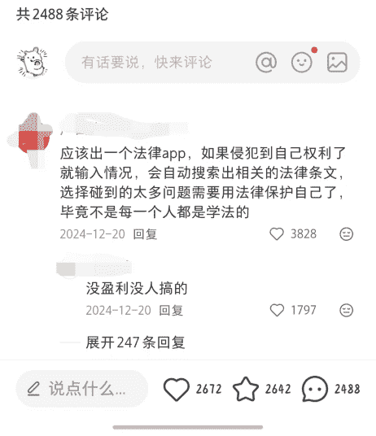

这条笔记本身有 2600 多赞，讲的是一个普遍的法律困境。但真正有意思的是评论区：

+   “普通人请律师太难了” → 3800 赞，比原文还高！

+   一条反对观点的评论 → 也拿到了 1700 多赞

这告诉我们什么？三个超实用信号：

✅ 共识性痛点：高赞=一群人的刚性需求，不是一个人的矫情

✅ 天然话题场：有对立、有讨论，就是传播的好土壤

✅ 低成本契机：“不赚钱所以没人搞”？正好是我们无代码/AI 开发者的机会！

所以，第一个核心经验是：去评论区找被赞出来的痛点，比我们自己猜需求准得多！

## 🛠️从想法到原型

找到需求后，问题来了：我一个小白，怎么判断这个想法 AI 能不能实现？

答案是：不做天马行空的想象，而是学会“技术侦察”——搞懂你手中工具的能力地图！

### 🔍 第一步：静态侦察——读懂工具的“说明书”

在无代码平台，api_list 就是我们的核心技术地图

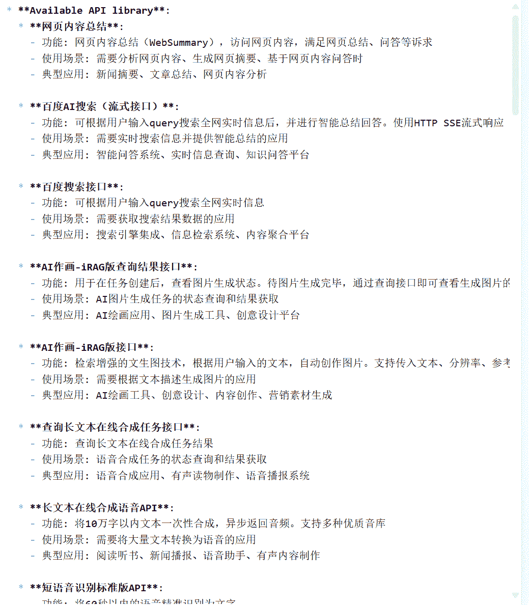

比如“法盾”需要两个能力：

1.  信息检索 → 对应“搜索模块”

1.  内容理解生成 → 对应“AI 分析模块”

一个复杂想法，就这样拆解成平台能执行的步骤：

用户输入 → 触发搜索 → 结果送AI分析 → 返回解释

### ⚠️ 第二步：动态侦察——探知系统的“能力边界”

但说明书只讲“理想情况”，我们还得动手测试。

比如，当 AI 返回“文本过长，我将进行裁剪”时——这就是系统在提醒你：需要优化流程啦！

### 🚫 案例：为什么我放弃了一个“很酷”的功能

我曾想加“自动定位最近法律援助中心”的功能，听起来很贴心对吧？

但技术侦察后发现：

+   需要精准地理位置 → 平台可能没有对应接口

+   要调用地图服务 → 生态中没有现成的 API

+   要查 POI 数据库 → 根本没有这个数据源

结论：核心依赖的 API 在平台“武器库”里不存在，果断放弃！

此外，我还明确了 AI 的能力边界：

+   ✅ 能力域：法律概念查询、信息整合、基于规则的计算

+   ❌ 限制域：提供法律建议、预测案件结果、共情支持

## **🚀包装与展示**

当一个可运行的原型诞生后，怎样让它被更多人看到？

我的两个小心得：

1.  提升“视觉完成度”

我用 PWA 技术，让网页能像 App 一样被“安装”。这个小动作，极大提升了产品的专业感和信任度。

1.  讲好“产品故事”

在项目介绍里，我直接引用了那条 3800 赞的评论。让产品从一个真实的故事开始，比任何技术辞藻都更有力量。

（当然，直接放链接最方便，但小红书有时会限流…嗯，我被限过两次了）

## **🌟 总结一下**

找到一个被流量验证的需求痛点 → 吃透你的 AI 工具能力边界 → 用心把它包装出来

这就是我作为一个小白开发者，完整跑通的全过程。

这条路我已经走通了，现在，工具箱和地图都在你们手中。接下来，就等你动手了！

# 5、云中江树丨 AI Coding 实战共学分享：从想法到上线的菜谱网站

## 项目背景与成果

最近关于预制菜的争议闹得沸沸扬扬，但老乡鸡对菜品公开透明的做法却赢得了大家的好评。这种坦诚让人很有好感，也引发了一个思考：能不能做一个菜谱公开网站，让大家对吃进嘴里的东西更了解、更放心？

这个想法在脑子里盘旋了很久，直到遇到了百度秒哒这个 AI 工具。它号称"一句话做应用"，结果真的只用了十几分钟，想法就变成了现实。

**项目成果**：

+   🔗 在**线访问：**https://app-6c2x5n0ta41t.appmiaoda.com/

+   📊 数**据规模：**收录 102 道菜谱，11 个分类

+   🔍 核**心功能：**分类浏览、关键词搜索、详情查看

+   🤖 智**能助手：**配置了"老乡鸡大厨"AI 机器人

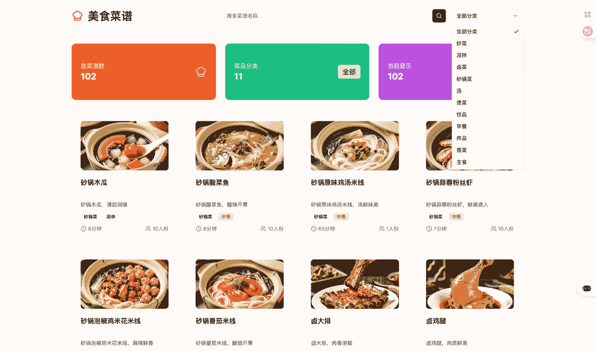

**关键亮点**：整个过程没写一行前端代码，纯粹用 AI 工具完成。

---

## 第一部分：AI 时代的应用开发逻辑

### 传统思维 vs AI 时代思维

**传统应用开发流程**：

```
想法 → 学习技术栈 → 编写代码 → 测试调试 → 部署上线
```

+   ❌ 门槛高：需要掌握前端、后端、数据库等多项技能

+   ❌ 周期长：从学习到上线可能需要数月甚至数年

+   ❌ 成本高：个人开发者很难独立完成

**AI 时代的新范式**：

```
想法 → 选择AI工具 → 自然语言描述 → 快速上线
```

+   ✅ 门槛低：会说话就能开发应用

+   ✅ 周期短：从想法到上线可能只需要几分钟到几小时

+   ✅ 成本低：个人就能完成完整项目

**但核心能力要求变了**：

> 创意 + 数据质量 > 代码编写能力

### 这个项目的起点：洞察需求


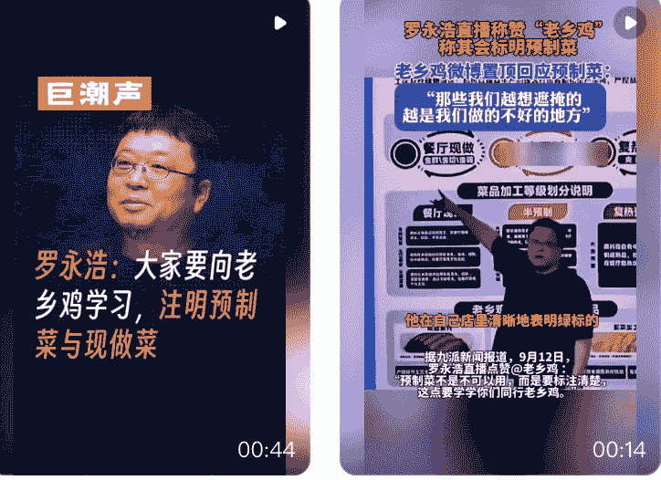

**市场观察**：

+   预制菜争议引发公众对食品透明度的关注

+   老乡鸡公开菜谱赢得好评

+   年轻人想自己做饭，但缺乏烹饪知识

**需求洞察**：

+   痛点：信息不透明 + 不知道怎么做

+   机会：提供公开透明的菜谱信息

+   目标用户：想学做饭的年轻人

**行动策略**：

+   找到优质数据源：GitHub 开源项目 CookLikeHOC： https://github.com/Gar-b-age/CookLikeHOC

+   用 AI 工具快速实现：百度秒哒


### 第一个关键洞见

> **AI 能轻松生成代码，但无法保证数据质量。**优质真实数据 > AI 生成的虚假数据。

现在很多 AI 生成的应用，数据都是 AI 编造的。但 AI 在现阶段对于复杂领域的数据生成，胡编乱造的情况还比较严重。

所以，真实、优质的数据源是 AI 应用成功的关键。

---

## 第二部分：AI Coding 实战流程

### 步骤 1：数据准备（最关键的一步）

从 GitHub 开源项目 https://github.com/Gar-b-age/CookLikeHOC 获取菜谱数据后，需要进行整理：

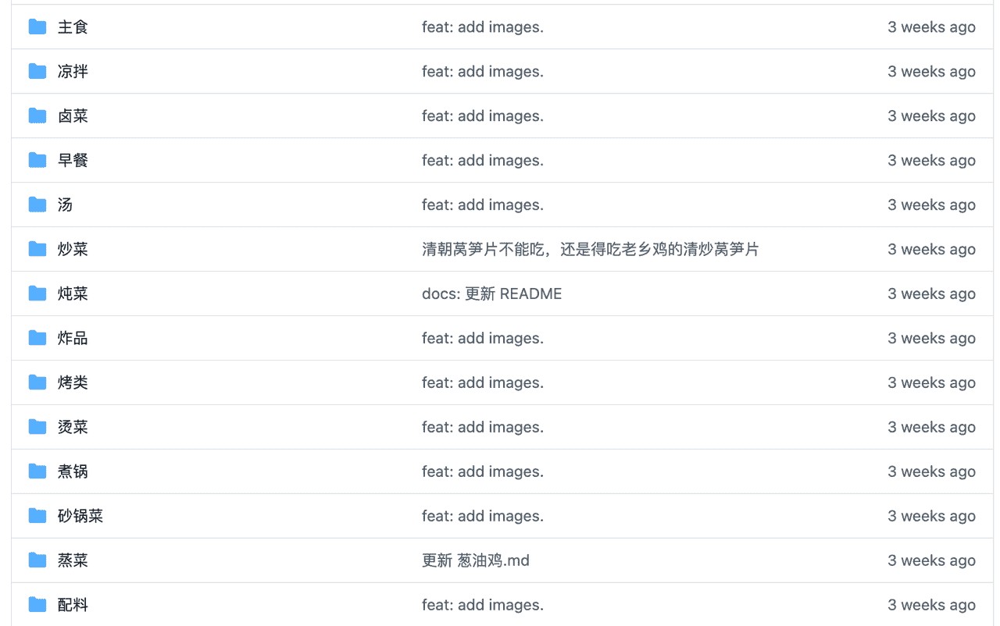

**数据结构化**：

+   每道菜包含：菜名、类别、配料、烹饪步骤

+   使用统一的分隔符（=======）标注

+   确保数据格式清晰、易于解析

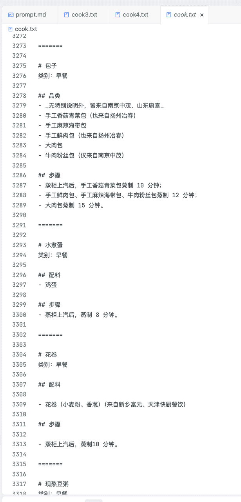

**为什么数据准备如此重要？**

1.  **数据质量直接决定应用质量**：垃圾进，垃圾出

1.  **结构清晰，AI 才能正确理解**：格式混乱会导致解析错误

1.  **真实数据增加可信度**：用户能感知到内容的专业性

### 步骤 2：用自然语言描述需求

不需要写代码，只需要清晰地描述你的需求。

**我给秒哒的 Prompt**：

```
请制作一个菜谱网站，展示各类菜谱。
我已经给你提供了菜谱文件，cook_副本.txt 文件中包含了上百道菜谱，
包含菜名、类别、配料、步骤，每个菜谱之间用 ======= 隔开。
```

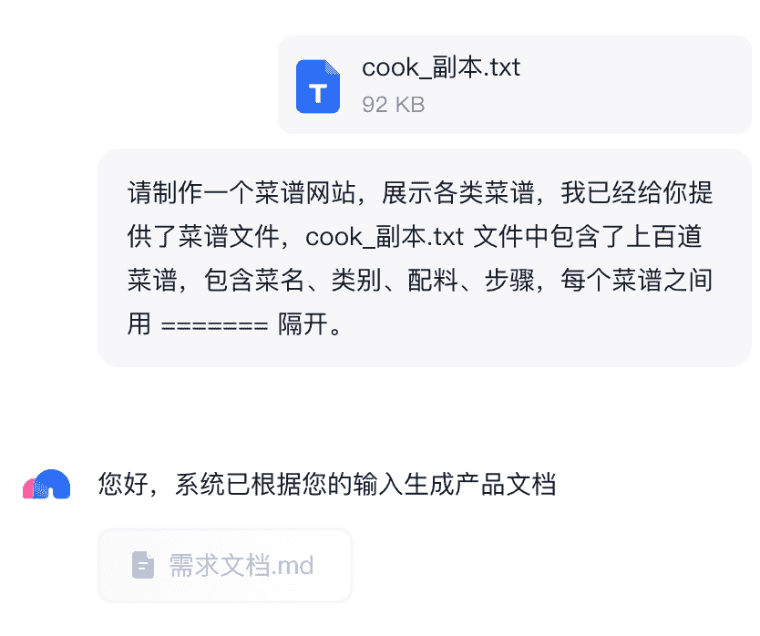

**写好 Prompt 的要点**：

+   ✅ 清晰说明要做什么（菜谱网站）

+   ✅ 说明数据结构（字段和分隔符）

+   ✅ 让 AI 理解你的意图

+   ❌ 不用写技术细节（用什么框架、什么数据库）

### 步骤 3：AI 智能体团队自动协作

接下来，秒哒内部的 AI 团队开始工作：

1.  **AI 产品经理：撰写需求文档**

产品经理会自动生成详细的需求文档，包括：

+   整体网站描述

+   核心功能列表（浏览、分类、详情、搜索）

+   菜品分类信息

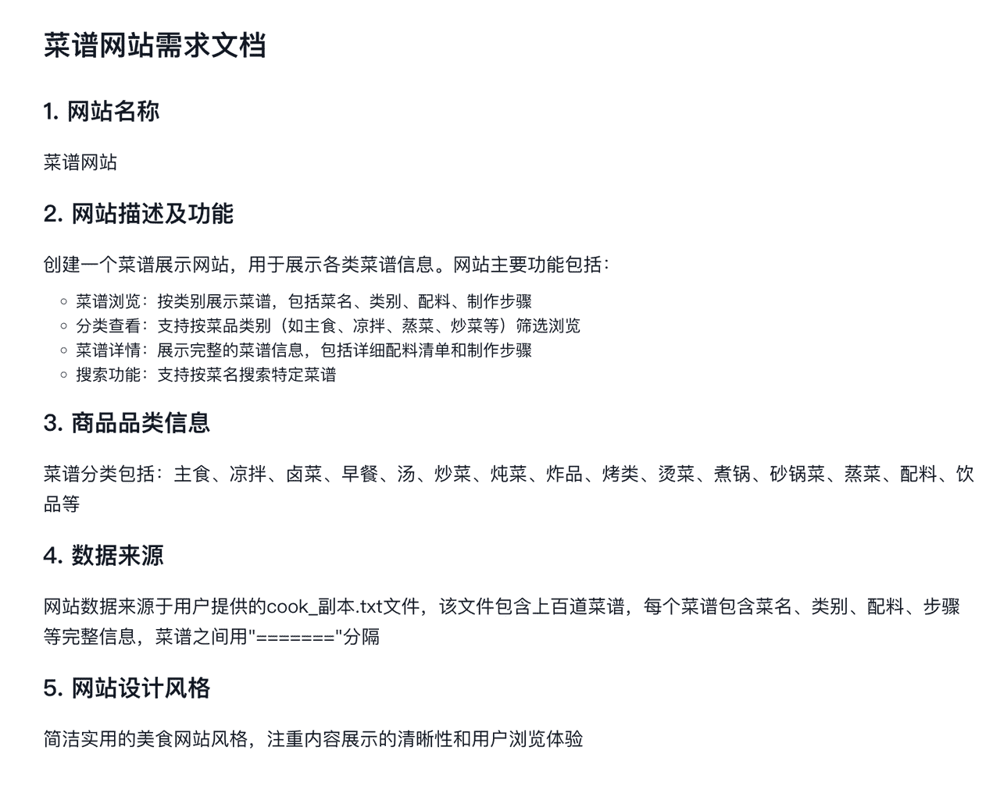

1.  **AI 架构师：规划页面框架**

架构师会进行技术架构设计和页面框架规划。

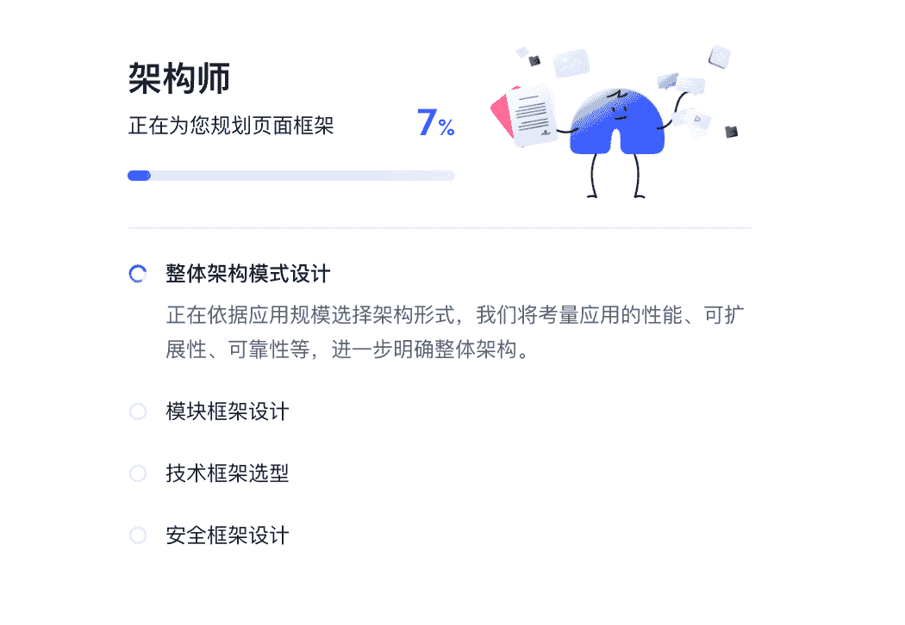

1.  **AI 工程师：编写代码**

工程师会根据需求文档和架构设计，自动生成前端和后端代码。

1.  **AI 测试员：测试验证**

测试工程师会对各个页面和功能进行自动化测试。

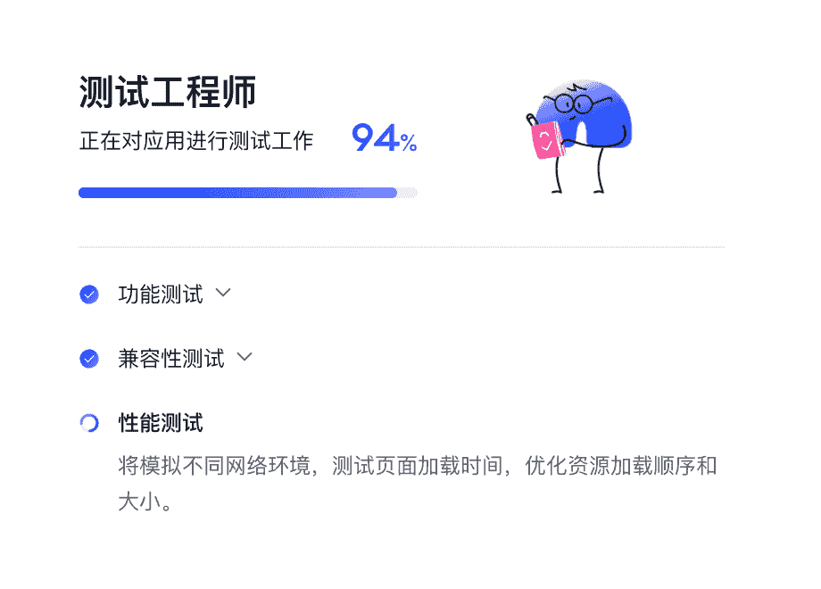

**整个过程的特点**：

+   🔄 全自动化：无需人工干预

+   👁️ 过程可见：每一步都清晰展示

+   ⏱️ 后台运行：可以退出页面，任务继续执行


### 第二个关键洞见

> 真正的 AI 应用开发，不是"你写代码"，而是"你做产品经理"。

你的角色从程序员变成了产品经理：

+   你负责定义需求、提供数据

+   AI 负责实现技术细节

+   这是思维方式的根本转变

### 步骤 4：快速迭代优化

应用生成后，修改和迭代非常方便，完全不需要改代码。

**案例：添加新菜品**

直接对话：

```
&quot;帮我把这几个菜谱添加到&#x27;炒菜&#x27;类别里。&quot;
```

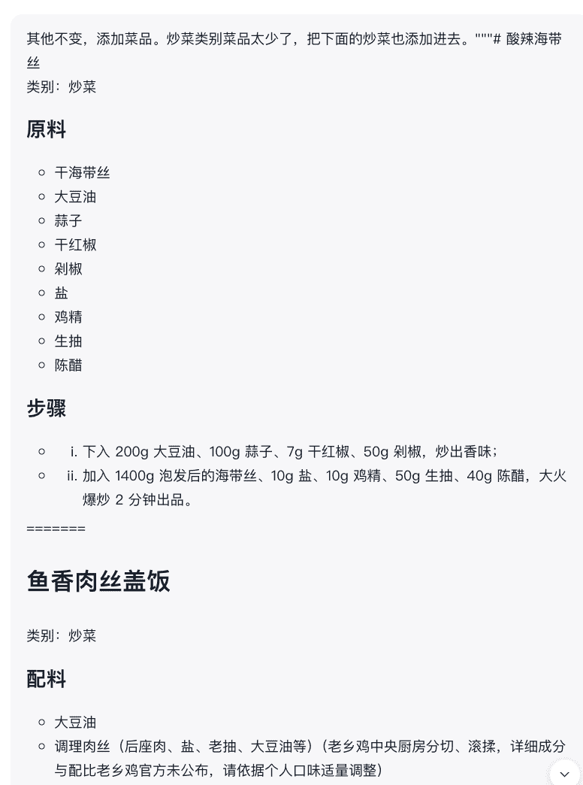

**结果**：从 4 道菜到 11 道菜，一句话完成。

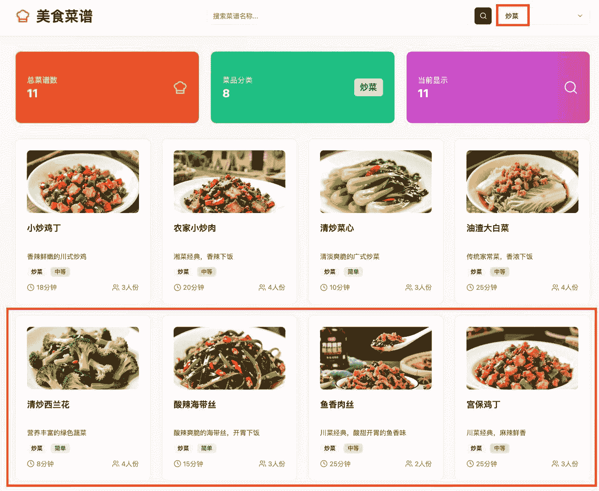

**迭代的优势**：

+   🚀 快速响应：想到什么改什么

+   💬 对话式交互：像和助手聊天一样

+   🔄 持续优化：随时根据需求调整

### 步骤 5：集成 AI 智能助手

网站不仅能看，还能"聊"。通过集成 AI 智能体，让用户可以交互式获取信息。

**配置流程**：

1.  在百度千帆平台创建"老乡鸡大厨"智能体

1.  上传菜谱数据作为知识库

1.  配置对话能力和提示词

1.  将智能体嵌入网站侧边栏

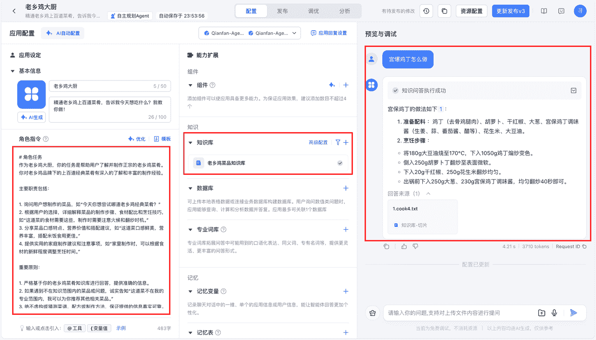

**用户体验**：

+   用户可以直接问："香菇鸡汤面怎么做？"

+   机器人调用知识库，给出详细步骤

+   实现了从"查看"到"对话"的升级

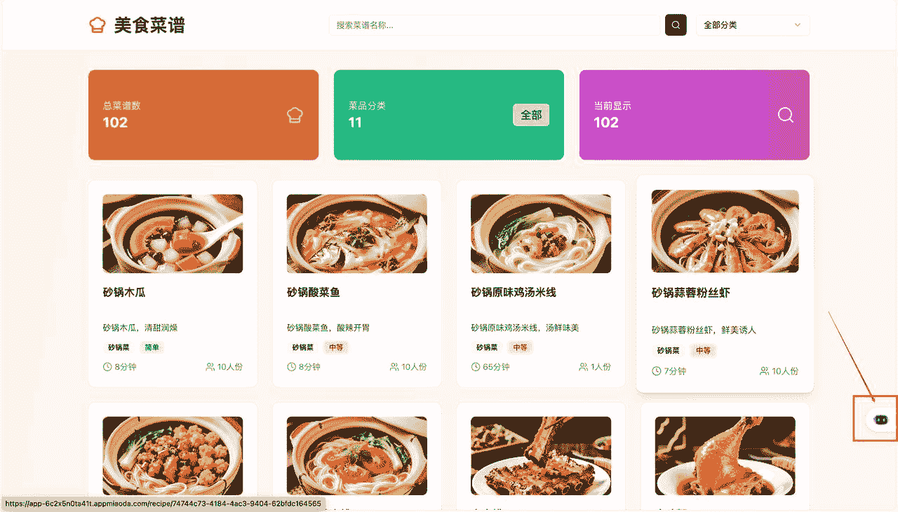

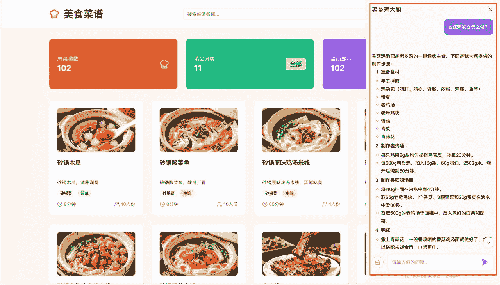

### 最终成果展示

**网站功能**：

+   📚 102 道菜谱，11 个分类

+   🔍 支持关键词搜索（如搜索"鸡"）

+   📑 分类浏览（炒菜、凉拌、卤菜等）

+   🤖 智能客服机器人

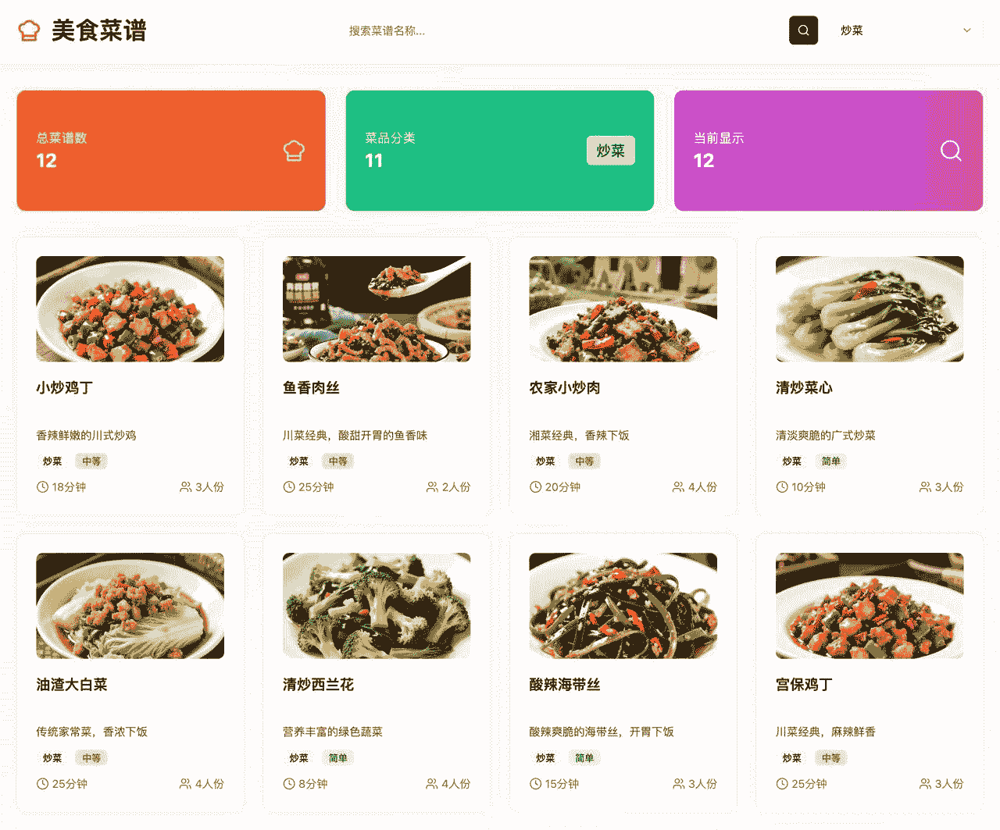

**开发成本**：

+   ⏱️ 时间：十几分钟

+   💰 金钱：几乎为零（使用免费工具）

+   👨‍💻 技能：不需要会写代码

---

## 第三部分：核心方法论和洞见（3 分钟）

### 三个关键认知

1.  AI 降低的是执行门槛，不是思考门槛

+   技术壁垒在降低

+   但对创意、洞察力的要求更高

+   你要知道"做什么"，AI 帮你"怎么做"

1.  **数据比代码更重要**

+   AI 可以生成代码

+   但优质真实数据需要你去找、去整理

+   数据质量 = 应用质量

1.  **场景定位是第一步**

+   不是"我要做个网站"

+   而是"解决什么问题？服务谁？"

+   我的场景：想做饭但不会的年轻人

### 可复用的方法

**做 AI 应用的三步法**：

1.  **找痛点**：观察生活，发现需求

1.  **找数据**：获取优质真实数据（开源项目、公开数据、自己整理）

1.  **找工具**：用 AI 工具快速实现

**验证很重要**：

+   AI 生成的结果要验证

+   数据准确性要检查

+   用户反馈要收集

---

### 给大家的建议

**如果你想尝试 AI 应用开发**：

1.  不要被技术吓到，先从小项目开始

1.  重点放在创意和数据上

1.  用 AI 工具降低执行成本

**当前的机会**：

+   秒哒非编程黑客松大赛

+   30W 奖金池，0 门槛参赛

+   报名地址：https://app-5evpqvjb6zgh.appmiaoda.com/

### 一句话总结

> 未来属于那些既有创意又懂得利用 AI 和数据的人。

我的案例已经报名参赛，欢迎大家访问体验： https://app-6c2x5n0ta41t.appmiaoda.com/