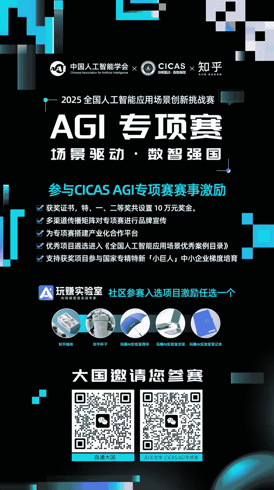
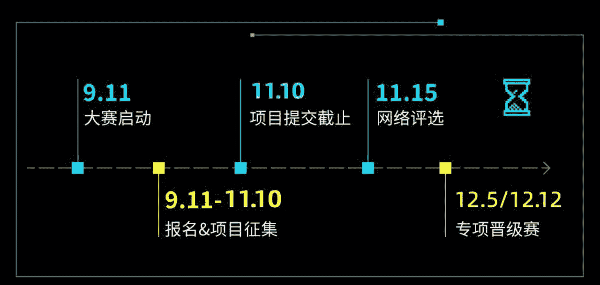
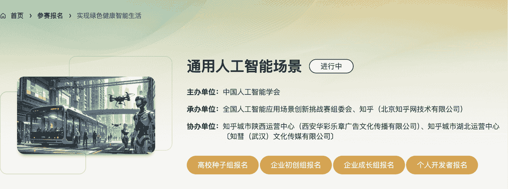
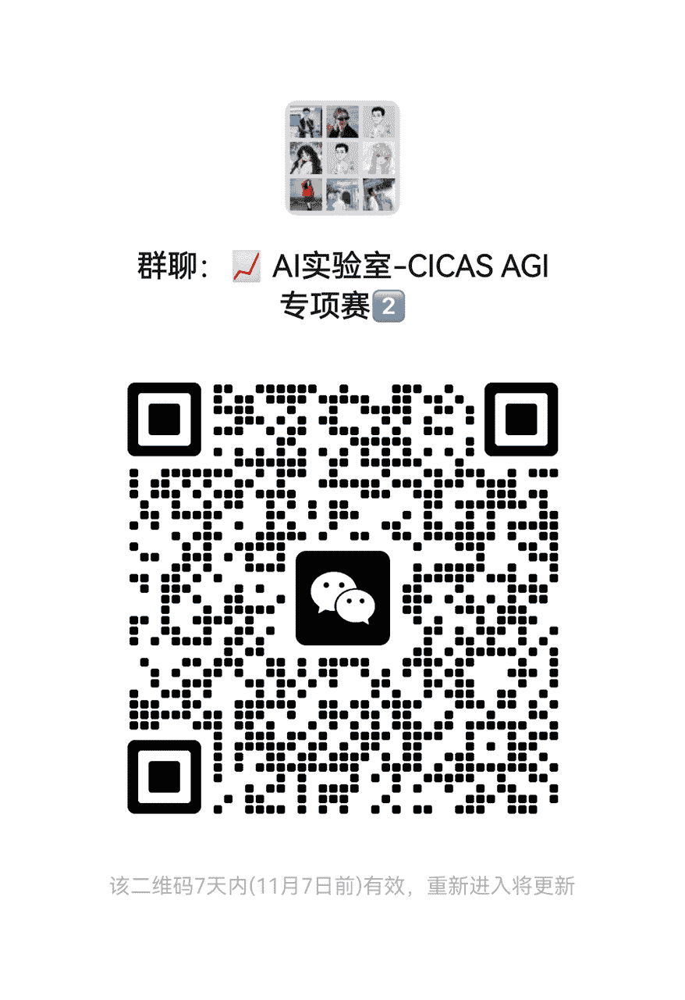
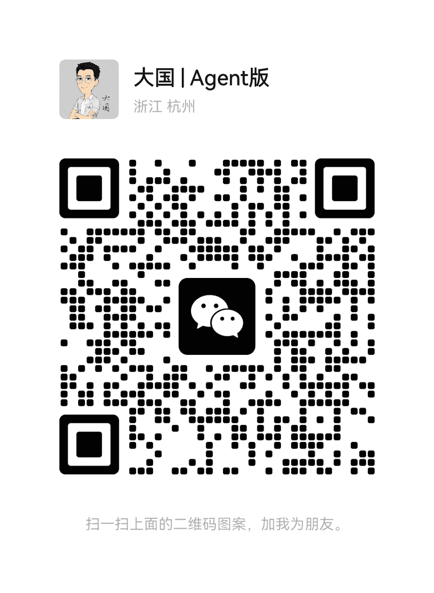

# 2025 第三届全国人工智能应用场景创新挑战赛（CICAS大赛） | 通用人工智能（AGI）专项赛

> 来源：[https://yunyinghui.feishu.cn/docx/HbO3dTLZpoVP7bxSD5ZcdUJwnGg](https://yunyinghui.feishu.cn/docx/HbO3dTLZpoVP7bxSD5ZcdUJwnGg)

> 本次大赛由中国人工智能学会主办，CICAS组委会和知乎联合承办，面向国内外公开征集AGI场景应用项目或行业解决方案，邀请人工智能领域工程应用、开创性技术突破和产业化落地的项目团队参赛挑战。

# 一、大赛背景

为深入贯彻党中央、国务院关于加快人工智能产业创新发展的决策部署，落实国务院《新一代人工智能发展规划》，科技部、工信部等六部委联合印发的《关于加快场景创新以人工智能高水平应用促进经济高质量发展的指导意见》，加速人工智能核心技术攻关和行业应用，着力解决人工智能重大产业化问题，推动通用人工智能与未来产业、实体经济高质量发展，加快形成新质生产力，2025 年 9 月—11 月，中国人工智能学会主办以「场景驱动·数智强国」为主题的「2025 第三届全国人工智能应用场景创新挑战赛通用人工智能（AGI）专项赛」。

> **AGI 专项赛场景解析：**

> 通用人工智能（AGI）专项赛依托生成式 AI、多模态交互、端到端语音识别、知识图谱、情感计算、loT 设备联动等前沿技术，面向绿色健康智能生活的多元场景需求，通过跨模态数据融合与自主决策能力，实现从环境感知到智能执行的闭环赋能，打造覆盖民生各环节的 AGI 应用解决方案。

# 二、参赛对象

**高校种子组：**高校学生团队

**企业初创组：**企业团队

**企业成长组：**企业团队

**个人开发者：**非高校非企业个人/团队

# 三、赛道方向

> **专题赛道三：**实现绿色健康智能生活的通用人工智能应用场景

**赛题一：弱势群体关怀**

聚焦视障、听障、表达受限、老年人等弱势群体在日常出行、沟通与健康管理上的效率痛点，鼓励基于生成式 AI 与多模态交互的温情化解决方案。

**赛题二：职场效率提升**

面向各类工作团队和角色（管理者、研发、创意、客服等），帮助解决会议记录、任务分配、团队协作、创意脑暴等环节中的效率与情感温度需求。

**赛题三：教育学习辅导**

聚焦中小学、大学及终身学习者在知识获取、复习巩固、论文写作和考试准备中的效率瓶颈，鼓励将生成式 AI、多模态可视化和自适应测评结合。

**赛题四：健康智能家电生态**

面向家庭成员在日常家电使用场景中衍生的健康管理、生活效率提升、情感互动等需求，鼓励跨设备协同、数据互通、对话式 Agent 的综合应用，让家电从功能工具升级为家庭健康生活的主动服务者。

**赛题五：家庭助理智能体**

围绕家庭在财务管理、资源调度、关系维护与情感关怀等方面的复杂协同需求，探索融合多模态感知、长期记忆与个性化对话的智能体方案，打造真正懂家庭、能陪伴、会成长的未来生活助理。

# 四、赛事周期

# 五、赛事激励

（一）组委会为获奖项目颁发获奖证书和奖金。通用人工智能专项赛设特等奖、一等奖、二等奖、三等奖四个等级，特、一、二等奖共设置 10 万元奖金。

（二）组委会通过中央或省级媒体、行业媒体等多渠道传播矩阵对专项赛进行品牌宣传。线下组织晋级赛及颁奖典礼、嘉年华等活动，扩大产业生态聚合影响力。

（三）组委会为专项赛搭建产业化合作平台，为参赛项目团队开放场景及数据，推荐落地的项目及人才合作对接，持续推进人工智能场景应用、创新创业、招商引资和成果转化落地。

（四）通用人工智能专项赛获特等奖和一等奖的项目，推荐入围 2025 第三届全国人工智能应用场景创新挑战赛全国总决赛。对种子组获得全国总决赛特等奖、一等奖项目的指导老师颁发「优秀指导老师」证书。

（五）总决赛获奖项目进入《全国人工智能应用场景优秀案例目录》，优先竞选「全国人工智能应用场景最具有推广示范效应的解决方案」。

（六）组委会对获得全国总决赛特等奖项目推荐申报「吴文俊人工智能科学技术奖」会评资格。对种子组获得全国总决赛特等奖-等奖项目的指导老师颁发「优秀指导老师」证书。

（七）支持获奖项目参与国家专精特新「小巨人」中小企业梯度培育，获奖企业优先参与应用场景标准编制、研究咨询报告发布。

# 六、参与方式

[可登录全国人工智能应用场](http://www.cicas.cn)景创新挑战赛官网（www.cicas.cn）进行报名，参赛报名要求及需提交材料详见官网申报系统，申报材料递交时间截止于北京时间 2025 年 11 月 10 日 24:00。

> **本次大赛项目地址：**https://www.cicas.cn/Reg/Detail/243

> 大赛官网提交项目以后，请在社区渠道再提交一次，方便社区核对项目和发放激励！

+   **知乎×****万象 AI 实验室****社区填写表单回传项目：**[参赛项目项目回填](https://yunyinghui.feishu.cn/share/base/form/shrcnqUEp1d2wz2ETx5GMO9NX5X)

+   所有填写回传项目的，社区赠送知乎周边奖品。

# 七、参赛者交流群

**参赛有任何问题，可以进群沟通交流，群满 200 人可以加**🛰️拉群，不定时投放参赛物料，发品牌福利

# 附：常见问题

> **大赛官方答疑：**必看攻略 | 从参赛申报到项目路演，2025CICAS 大赛答疑合辑

## **Q1：**如何报名参赛？报名渠道和截止时间是什么？

A：本次大赛可通过以下官网进行报名：全国人工智能应用场景创新挑战赛官网：https://www.cicas.cn/Reg/Detail/243

**报名系统开放时间为：**2025 年 9 月 11 日 00:00

**截止时间为：**2025 年 11 月 10 日 23:59

请务必在此时间段内完成报名信息填写与材料提交。

## **Q2：我可以参加哪个组别？**

A：本次大赛分为四个组别，请根据您的身份选择对应组别

高校种子组：项目未进行工商注册，负责人及成员为高校在读或毕业未创业的学生。

个人开发者：未进行工商注册的个人开发者或团队。

企业初创组：未融资或已完成天使轮/A 轮融资、员工 5 人以上的企业。

企业成长组：已完成 B 轮及以上融资的企业，各级「专精特新」企业，或行业头部/链主企业。

## **Q3：报名需要提交哪些材料？**

A：报名需在官网申报系统中提交以下材料：

参赛信息：选择参赛赛道、组别、场景及项目名称。

项目信息：项目概述、核心技术、应用案例、商业模式等。

团队信息：团队成员名单及各自分工。

证明文件：专利、软著、论文等知识产权证明。

上传材料：商业计划书、路演 PPT、项目演示视频、第三方检测报告、认证证书、用户评价等佐证材料。

## Q4：一个人或一个团队可以报名多个赛题或多个项目吗？

A：原则上，一个项目只能选择一个赛题方向参赛。同一个负责人或核心团队不建议申报多个项目，以确保每个项目的参赛质量。具体规定请参阅大赛官网的详细说明。

## **Q5：报名是否收费？**

A：本次大赛不向参赛者收取任何报名费用。

## Q6：大赛的具体流程和时间安排是怎样的？

A：大赛分为以下几个阶段：

参赛报名：2025 年 9 月 11 日 -11 月 10 日

网络选拔赛：2025 年 11 月（线上评审，11 月 15 日完成）

专项晋级赛：2025 年 11 月（线下路演答辩）

全国总决赛：专项赛优胜项目将推荐进入全国总决赛。

## Q7：比赛的形式是什么？需要现场答辩吗？

A:

网络选拔赛：采用线上评审形式，评委根据提交的材料进行打分。

专项晋级赛：需要线下路演答辩，预计 11 月底在武汉、西安举行，具体安排将另行通知。

## **Q****8****：大赛有哪些奖项和奖励？**

A： **奖项设置：**专项赛设特等奖、一等奖、二等奖、三等奖，大赛组委会为获奖项目颁发获奖证书。

**奖金支持：**特、一、二等奖共设置 10 万元奖金。

**晋级机会：**特等奖和一等奖项目将推荐入围全国总决赛，角逐更高荣誉和奖励。

## **Q****9****：获奖后能获得哪些后续支持？**

A：大赛组委会将提供全方位的生态支持：

品牌宣传：通过中央/省级媒体、行业媒体、社交媒体等渠道对获奖项目进行广泛宣传。

荣誉推荐：优秀项目可入选《全国人工智能应用场景优秀案例目录》，并有机会推荐申报「吴文俊人工智能科学技术奖」

企业培育：获奖企业可优先参与国家「专精特新」中小企业梯度培育及应用场景标准编制。

## **Q1****0**：高校学生获奖对升学、就业有帮助吗？

A：非常有帮助。本次大赛由中国人工智能学会主办，具有很高的权威性和行业认可度。获奖证书是证明您创新能力和技术实践能力的重磅凭证，无论对于考研、留学、还是求职，都是一份极具竞争力的履历素材。总决赛特等奖项目的指导老师还将获得「优秀指导老师」证书。

## **Q1****1**：项目已经有了一定的融资或已经注册公司，应该报哪个组？

A：若已完成天使轮或 A 轮融资，请申报企业初创组。

若已完成 B 轮及以上融资或是「专精特新」企业，请申报企业成长组。

## **Q1****2**：如果还有问题，如何联系组委会？

A：如有其他未尽事宜，请通过以下方式联系我们：

关注CICAS大赛官网/官微，知乎科技/知乎日报等平台发布的最**新通知，或通过**官网公布的邮箱、联系电话、社区大赛参赛群等进行咨询联系。