# GPT常见问题学习手册

> 来源：[https://yunyinghui.feishu.cn/docx/OpRwdhea3oKTaaxnIhicbcbMnwb](https://yunyinghui.feishu.cn/docx/OpRwdhea3oKTaaxnIhicbcbMnwb)

> **适用人群：****互联网关注 GPT 发展人群**

> 首发时间：2023 年 11 月 8 日

> 更新时间：2024 年 1 月 26 日

> **使用建议：**如果需要快速定位到精确内容，可以使用快捷键 Ctrl +F/Command +F 的形式，搜索关键字/词，查找你想要的内容。

> **持续更新 GPT账号的****知识科普，相****关问题，具体玩法等，**永久免费在线查看，欢迎收藏转发支持，文末有惊喜，大国出品，必属精品。

# 一、知识科普

## 1.什么是 GPT  Alpha 账号？（目前Alpha账号已经下线）

答：**11 月 4 日**，OpenAI 公司悄悄放出了 ChatGPT 的最新模式-Alpha 阿尔法，目前只在电脑端，手机端无法使用。随着算法的不断进步和用户体验的深度优化，ChatGPT All Tools 模式将继续拓宽人工智能的应用边界，为各行各业提供更为智能化和个性化的解决方案。我们有理由相信，ChatGPT All Tools 模式会成为未来智能助手领域的一个里程碑。

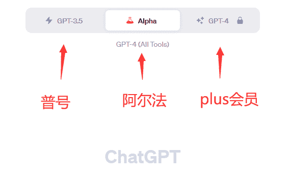

## 2.阿尔法 Alpha 功能是什么？和 GPT-4 有什么不同？

答：阿尔法功能和 GPT-4 的功能大致一样，但阿**尔法不需要充值 ****p**lus 就可以使用 GPT-4 的大部分功能，包括生成图片、解读图片、联网查询、文件格式转换、插件调用等等，提问次数 3 小时超过 50 次（GPT-4 是 3 小时 50 次）。可无限使用 4.0-32k，支持 32k 文本输入。具备所有功能，可识别图片，可上传附件分析数据，可联网，可用 AI 绘画（Dall-e 3）而且最可怕的是，它居然是不限时的？（要知道，plus 会员可是 20 美金/月）

## 3.阿尔法 Alpha 账号有什么优势和劣势？

答：优势：可无限使用 4.0-32k，支持 32k 文本输入，可无限次提问（不受 3 小时 50 次提问限制），具备所有功能，可识别图片，可上传附件分析数据，可联网，可用 AI 绘画（Dall-e 3）。使用无期限，也不存在续费这一说。

缺点：目前在手机 app 上无法使用，只能在网页版使用，无法使用语音功能。

## 4.有阿尔法 Alpha 模型测试吗？

答：见图：

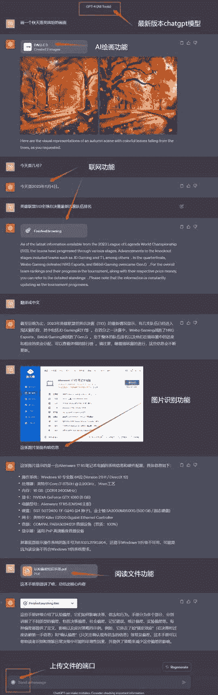

# 二、常见问题

## 1.拿到账号如何修改 GPT 账号及密码？

答：GPT 账号改密方式

进入官网 chat.openai.com，按照下图进行操作。

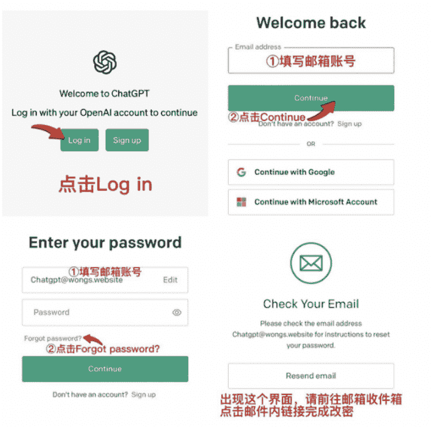

Mail 邮箱改密方式（看账号邮箱后缀，选择对应邮箱网址，常见就是谷歌，微软等邮箱）

示例邮箱地址：mail.com

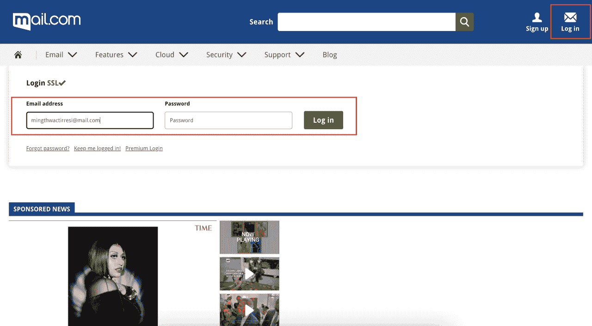

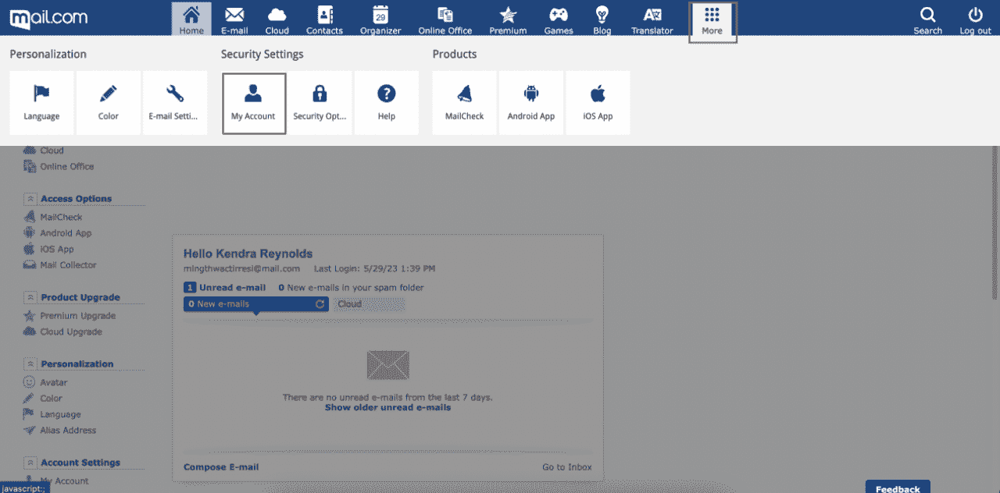

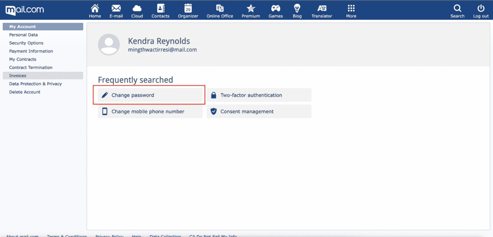

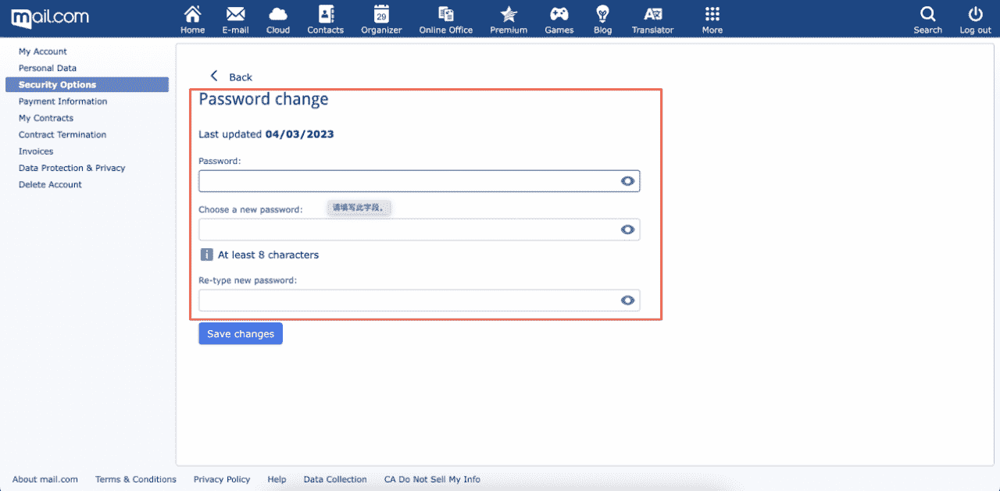

## 2.怎么确定自己的梯子是正常的梯子？

答：尽量不要买便宜的梯子，有能力的情况下，尽量自己建。

## 3.我更改密码的时候显示更改成功，结果登的时候显示错误怎么回事？

答：

因为你们改了密码，但是浏览器里有缓存，是没清理的，建议采用无痕模式；

此外也存在你修改以后输入错误的情况。

## 4.为什么会出现 oops 的提示？

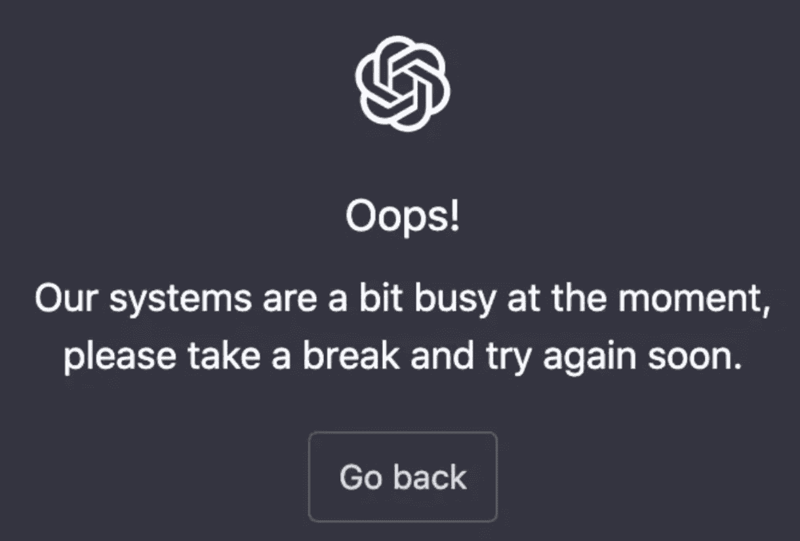

答：OpenAI 验证你的身份失败，换个好一点的节点。官网出现了系统繁忙，官网服务器问题 ，人太多了……多刷新几次。如果还不行，尝试换节点。

## 5.为什么会出现 429 的提示？

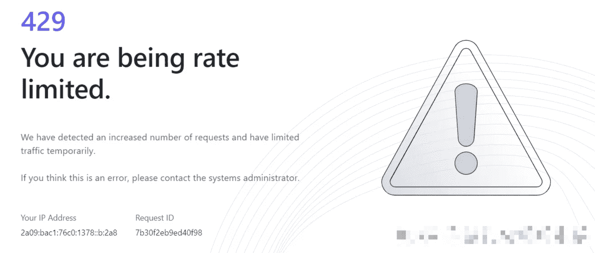

答：受到了频率限制。说明你当前的节点请求频率太高或太多人共用了，换个好一点的节点再试吧。

## 6.为什么我会出现“Sorry，you have been blocked”的提示？

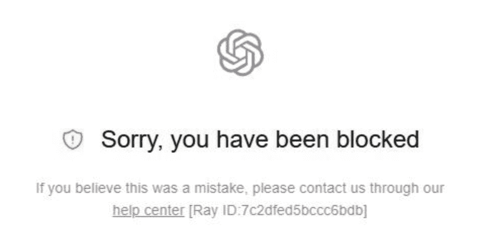

答：换节点…还是不行就换个好一点的魔法…

## 7.为什么会出现红色提示？

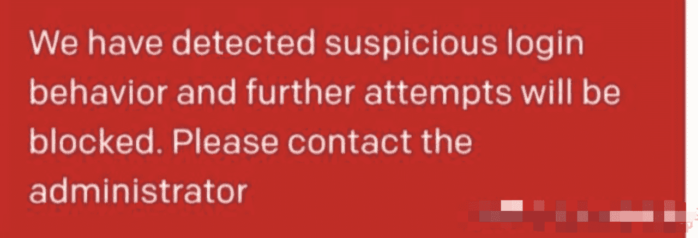

答：检测到可疑的登录行为，说明你当前魔法的节点不稳，被质疑，被检测出来了。换节点，换魔法…

## 8.GPT 对话框为什么会出现红色感叹号？

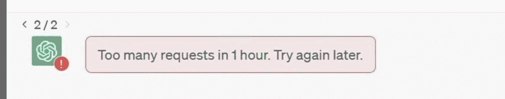

答：一小时内请求过多，解决办法换节点或者刷新页面，不行就等一段时间吧…

## 9.什么情况下才是账号被封？

答：两张图显示，账号已停用，账号封禁，账号被封了，换个号吧。

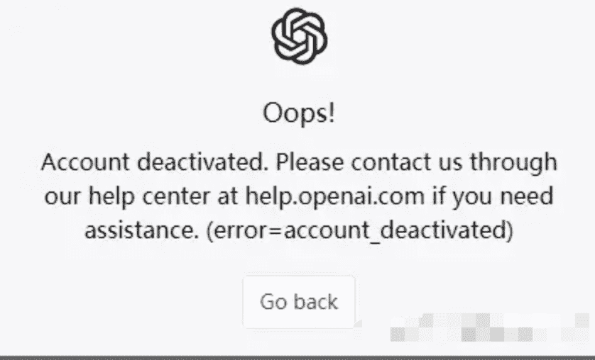

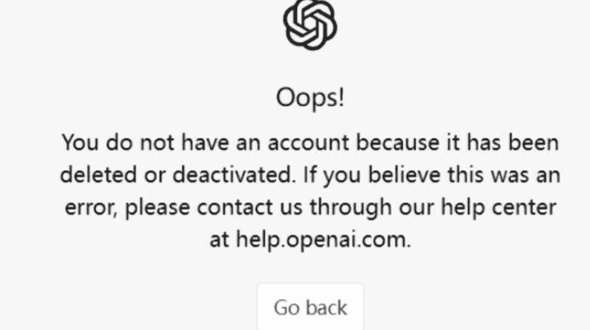

## 10.到底是什么问题不能正常访问 GPT？

答：大多数都是网络（梯子）问题，清除浏览器缓存（数据），换浏览器，浏览器开无痕模式/隐私模式。梯孑开全局，用韩国、日本或新加坡等的节点线路。如果还是无法解决问题，请重复这个过程几次或者换一个靠谱的强大魔法。

## 11.对话框出现联系 Open AI 帮助中心怎么解决？

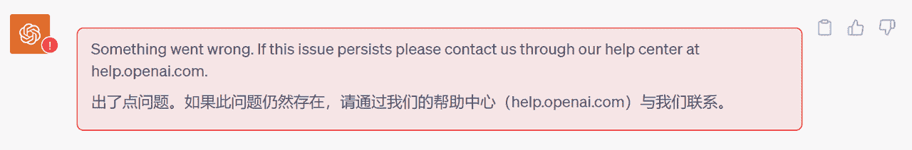

答：这类问题会经常出现，一般都是访问过载导致

**解决方法：**换个节点、刷新网页就好。

## 12.为什么会提示“**Not available”？**

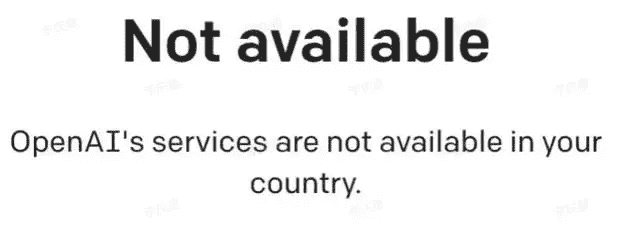

答：遇到 Not available，这里提示一下 （中国，香港，澳门，俄罗斯地区的 IP 不行），如果你开启代理成功之后，浏览器搜索，输入自己的 IP 可以查看到自己所在的位置

**解决方法：** IP 有问题，确保 M 法/T 子代理地区没问题，重新刷新网页或者重新登陆即可。

## 13.为什么会出现“Something went wrong”？

答：出现现 Something went wrong 基本上是网络问题

**解决方法：**刷新一下网页即可、换个节点。

如果不能解决说明的你 IP 网络存在问题（用的都是免费白嫖这些 M 法/T 子）影响因素、网络波动、共享 IP 节点、中转都时不时会出现这样的问题。

## 14.为什么我修改密码后无法登录 GPT？

答：清除 Web 浏览器中的 ChatGPT 保存数据是解决“无法登录 ChatGPT”问题的另一种最佳方法。以下是清除 Chrome 浏览器上保存的 ChatGPT 数据的方法。

1）打开 Google Chrome 网络浏览器并访问 chat.openai.com。

**2） 接下**来，使用您的帐户登录。如果您无法登录，请单击 URL 旁边的挂锁图标。

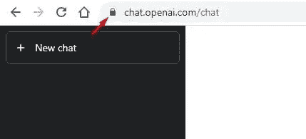

3）将出现一个选项列表；单击“**站点设置**”。

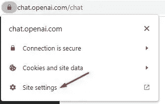

4）在 chat.openai.com 的站点设置中，单击使用下的“**清除数据**”按钮。

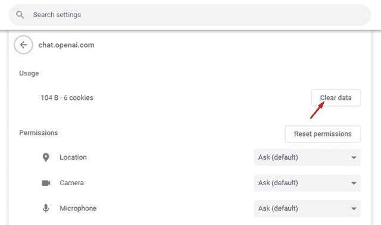

就是这样！清除网络浏览器上所有已保存的 ChatGPT 数据就是这么简单。

# 三、常见玩法

## 1.**实时联网查询能力**

+   问题分类：信息检索

+   测评结论：联网查询毫无压力，信息检索正确。

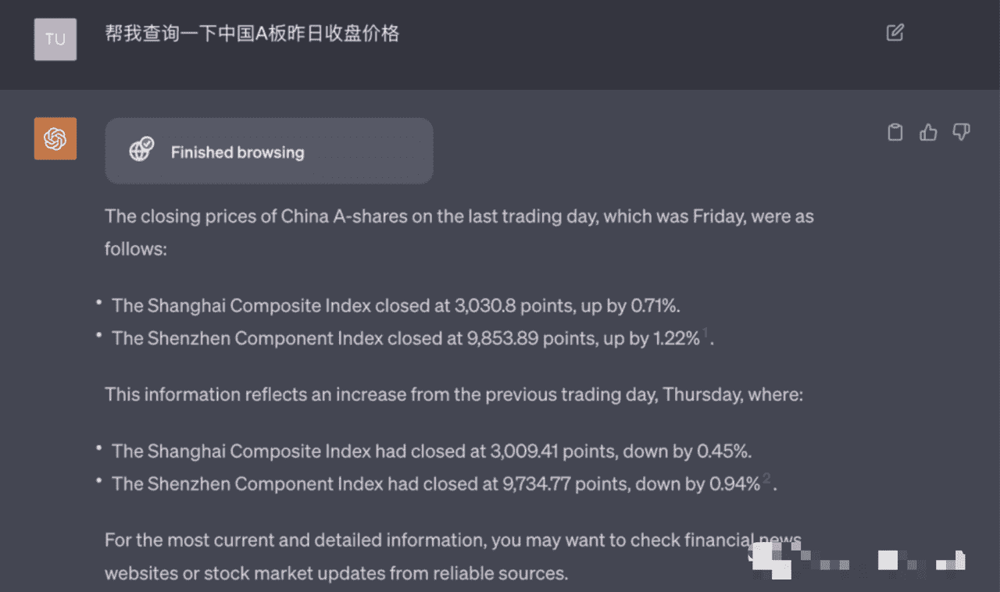

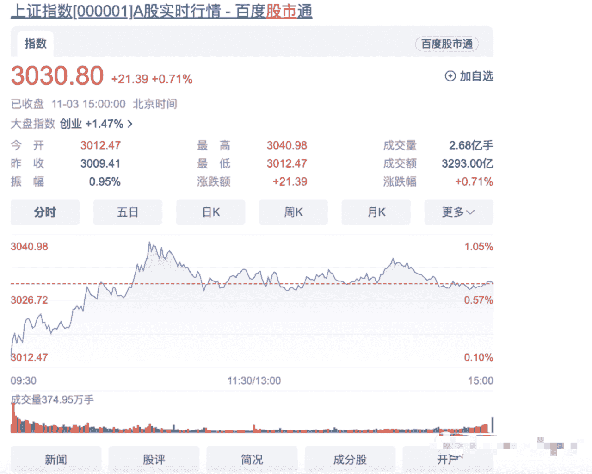

## 2.**处理 CSV 文件的功能**

+   问题分类：文件处理能力

+   测评结论：上传 CSV 文件并进行数据处理或提取特定信息，可以到文件在字符编码上一开始可能存在问题，ChatGPT 进行自我纠错，最终完成 CSV 解析功能，但在 Alpha 测试版本中，我们无法看到最终整理好的数据文件下载地址。

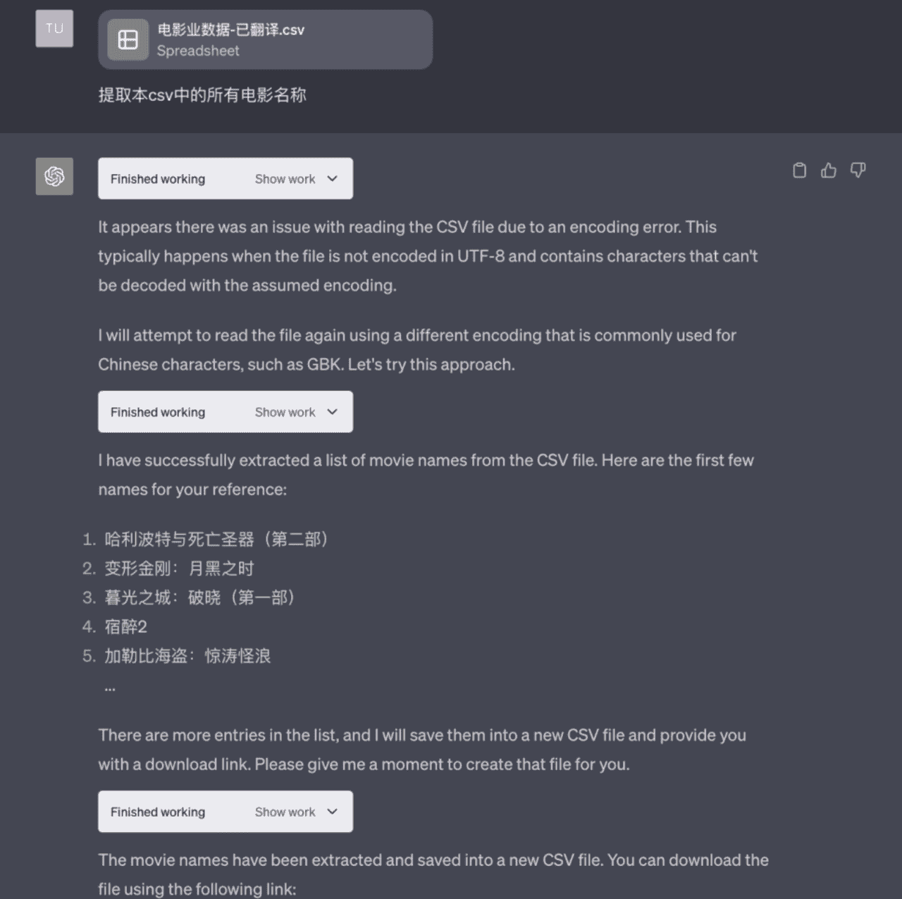

## 3.**高级数据分析工具的准确性**

+   问题分类：数据处理分析

+   测评结论：支持用户一键上传数据集，ChatGPT 可以自动选择工具，并自动切换到曾经的“Advanced Data Analysis”模式，运算速度也比较快，最终答案也是准确的。

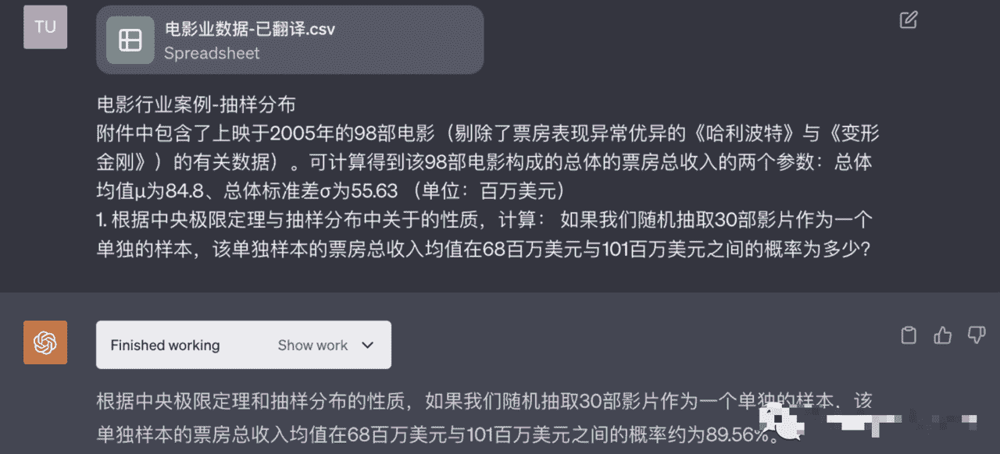

## 4.使用 DALLE3 绘图的创造性

+   问题分类：图像的创意表达与生成

+   测评结论：我尝试使用 DALLE3 根据我的要求绘制一些突破性的图像（联网查询类的绘图），可以看到先经过的联网查询数据后，在将数据给到 DALLE3 进行绘制，但是我多次尝试下来无法将日期数据快速画入至图像中（绘图中的时间是不准确的），或许需要更精准的 Prompt 提示词。

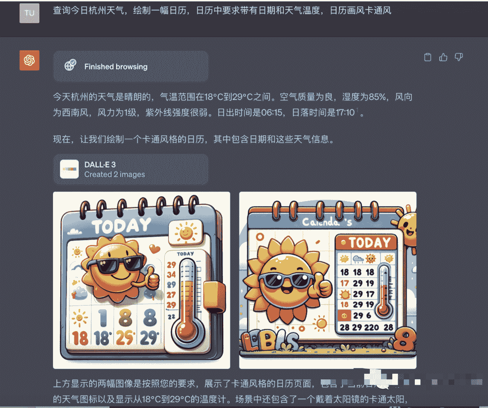

## 5.**阅读 PDF 文件的能力**

+   问题分类：文件处理能力

+   测评结论：上传不同类型的 PDF 文件并要求提取或分析内容文本识别，可以准确快速的处理（但默认为什么是英文？)

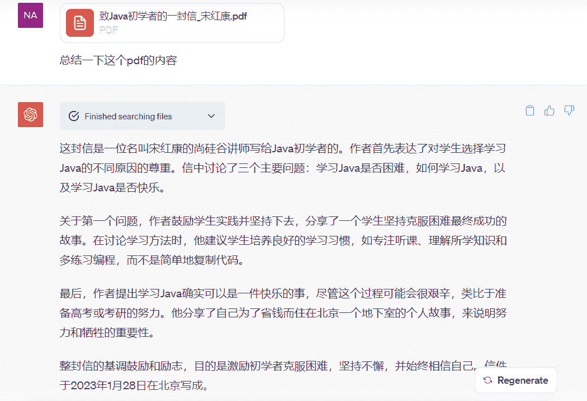

## 6.**查找论文的能力**

+   问题分类：学术研究支持

+   测评结论：原先使用 Scholar AI 插件可以提出查询特定学术领域的论文检索请求，但在 All Tools 模式下，目前似乎没有办法直接调用插件，或者指定插件进行调用，查找速度、结果的相关性和准确性。

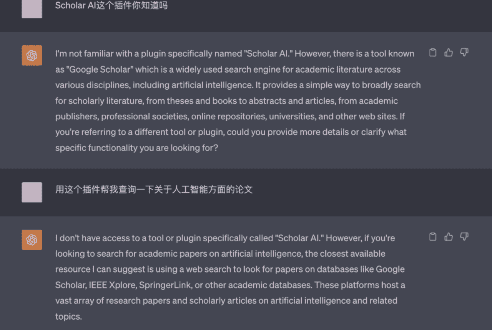

## 7.分析图片的能力

+   问题分类：图片解读

+   测评结论：可以详细的解读图片内容。

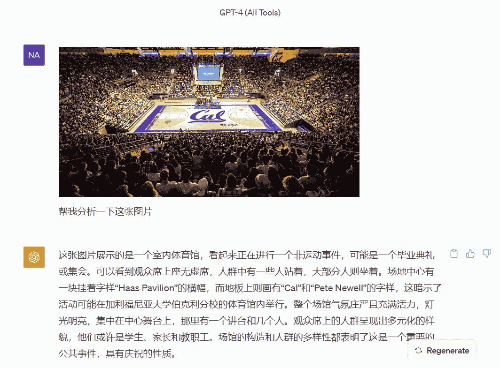

## 8.联网咨询功能

+   问题分类：联网咨询功能

+   测评结论：可以链接最新的互联网知识。

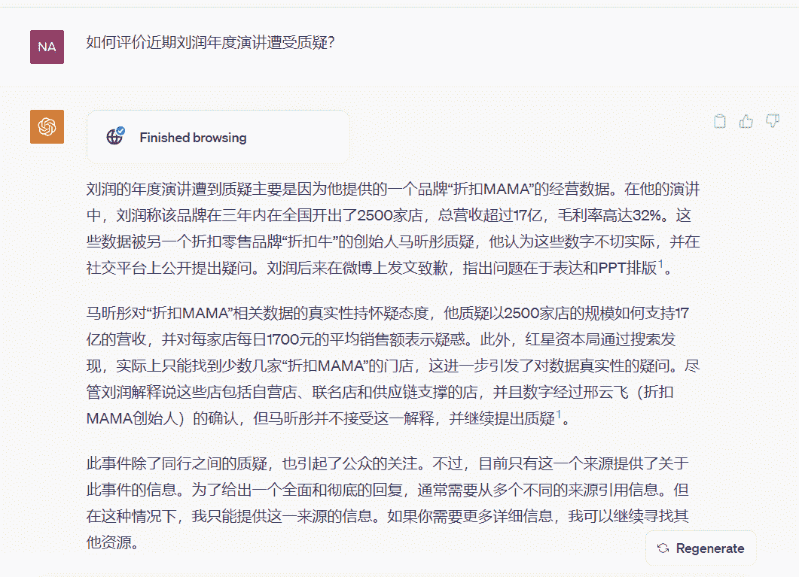

---

# AI学习交流社群

1.持续关注并更新 AI 的**相关资讯动态，研究报告，赚钱案**例，常见问题，永久免费在线查看，无收费内容，目标是成为最大的免费 AI 学习社群。

2.已建立社群聊聊 **AI** 发展及应用，**没进群的可以扫码加入，群满可加 AI 研究爱好者大国微信 ID：zyg90s（备**注：AI），已经在社群内的无需重复加入，开源知识库及社群学习全部为公开免费分享。

3.**关于文档负责人大国**：高帆文化CEO，曾就职于教培大厂，目前创业，主攻研究AI落地应用、企业流量增长及达人IP孵化。

**5000人飞书学习交流群**

**飞书学习交流群**

微信好友（ID：zhangyuguo94s）

**微信入群渠道**

进群或者加好友了解更多 AI相关书单

**觉得有用欢迎留个赞**