# Kimi 学习手册

> 来源：[https://yunyinghui.feishu.cn/docx/BXYNdAVpSosglsxTE5IcmUJBnzf](https://yunyinghui.feishu.cn/docx/BXYNdAVpSosglsxTE5IcmUJBnzf)

> **适用人群：****互联网关注 AI 对话发展人群**

> 首发时间：2024 年 3 月 22 日

> 更新时间：2024 年 7 月 19 日

> **内容出品人：**

> **使用建议：**如果需要快速定位到精确内容，可以使用快捷键 Ctrl +F/Command +F 的形式，搜索关键字/词，查找你想要的内容，PC 端查看学习效果更好。

> **持续更新 Kimi****Chat 大模型相关资讯动态，**使用教程，研究报告，实用场景等板块内容，永久免费在线查看，欢迎收藏转发支持，文末有惊喜，大国出品，必属精品，和 50W+读者共学。

> 🎯全**网最接地气 AI 知识库：「**[**AI 实验室」知识库（**](https://yunyinghui.feishu.cn/wiki/space/7340161844864598017?ccm_open_type=lark_wiki_spaceLink&open_tab_from=wiki_home)AI 绘画、AI 写作、AI 视频等应用技能）

# 更新日志

# 一、Kimi 简介

## 企业介绍

北京月之暗面科技有限公司（以下简称月之暗面）是一家位于中国北京的高科技公司，专注于人工智能领域，尤其是通用人工智能（AGI）的研究与开发。

月之暗面成立于 2023 年 4 月 17 日，是一家相对较新的公司，但在短短的时间内已经取得了显著的成就和进展。2023 年 10 月，公司推出了全球首个支持输入 20 万汉字的智能助手产品 Kimi AI，进一步巩固了其在 AI 领域的地位。

尽管成立时间不长，但月之暗面已经展现出成为 AI 领域独角兽的潜力。目前，月之暗面团队成员人数在 100 人至 200 人之间，团队现已汇聚了来自 CMU LTI、Google、Meta、Amazon 等全球顶级机构人才。

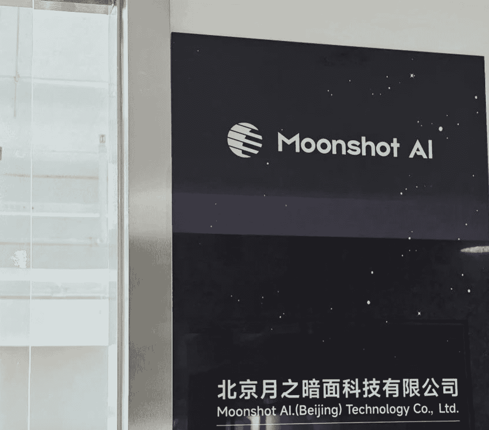

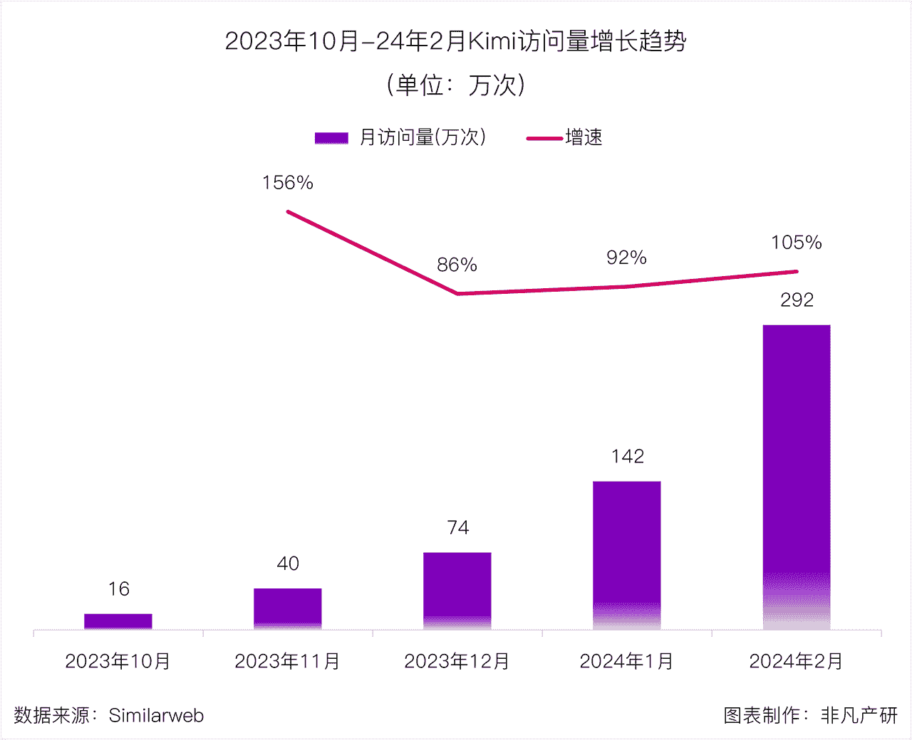

## 企业官网

**公司官网：**https://www.moonshot.cn/

**产品类型：**网页、小程序、APP 均已上线

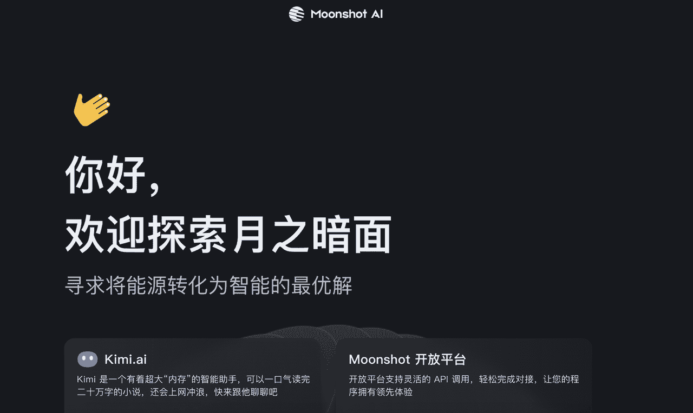

## 公司产品

**1、Kimi 官网：**https://kimi.moonshot.cn/

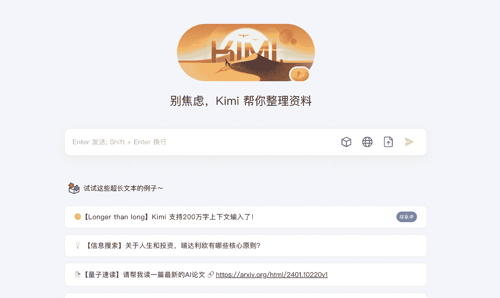

**2、开放平台：**Moonshot AI - 开放平台

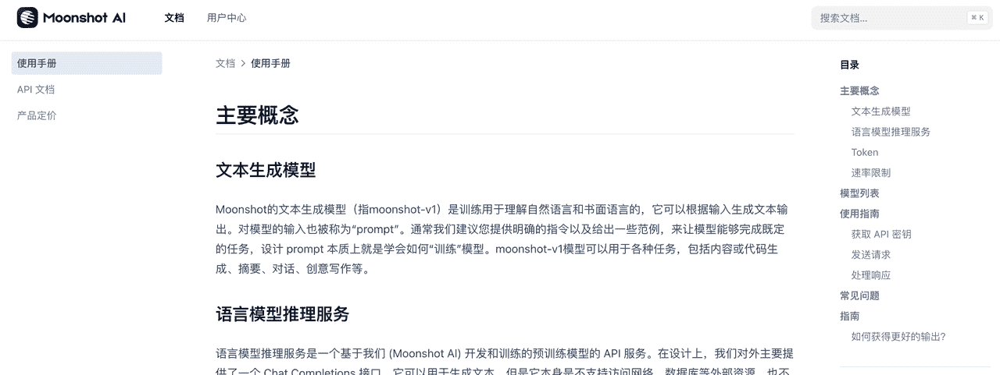

## 创始团队

公司的法定代表人为**杨植麟**，他是公司的创始人之一，同时也是清华教授唐杰的得意门生，，博士就读于全美自然语言处理排名第一的卡内基梅隆大学语言技术研究所（LTI），师从苹果 AI 研究负责人 Ruslan Salakhutdinov、谷歌首席科学家 William Cohen。除了杨植麟外，公司的创始团队还包括其他三位成员：

**- 张宇韬：**循环智能的联合创始人，兼任月之暗面的 CTO。他毕业于清华大学计算机系，研究方向包括异构数据融合和知识图谱构建。

**- 周昕宇：**是月之暗面的算法团队负责人，清华大学 2011 级本科生，曾在旷视工作，专注于算法量产。

**- 汪箴：**毕业于复旦大学计算机科学系，后在新加坡南洋理工大学计算机工程系深造，曾在 Google 担任高级软件工程师/技术主管，也担任过技术副总裁等职位。


**杨植麟**


**张宇韬**


**周昕宇**


**汪箴**

**延伸阅读：**

多维表格（XKL6b3MdKaErAssowUEcbT2xnCd_tblWkCIPNxDd3gaj）

## 产品优势

Kimi 具备一些独特的优势，这些优势使其在市面上的 AI 工具中脱颖而出：

1.  **多语言对话能力**：擅长中文和英文的对话，这使 kimi 能够服务于更广泛的用户群体，特别是对于需要双语支持的用户来说，这是一个显著的优势。

1.  **文件处理能力**：Kimi 能够处理多种格式的文件，包括 TXT、PDF、Word 文档、PPT 幻灯片和 Excel 电子表格等，这意味着用户可以直接上传文件，kimi 能够阅读并理解文件内容，为用户提供相关的帮助。

1.  **网页内容解析**：当用户提供网址时，Kimi 可以解析网页内容并结合这些内容来回答问题，这使得我能够提供更加准确和相关的信息。

1.  **搜索能力**：Kimi 具备搜索的能力，可以通过互联网获取信息，结合搜索结果为用户提供更加全面和深入的回答。

1.  **安全性和准确性**：Kimi 始终遵循安全和准确性的原则，拒绝回答涉及恐怖主义、种族歧视、黄色暴力、政治敏感等问题的回答，确保对话的质量和合规性。

1.  **即时响应**：Kimi 能够快速响应用户的问题，提供即时的帮助，而不是让用户等待处理中的状态，这提高了用户体验。

1.  **专有名词保护**：Kimi 清楚地知道自己的身份和所属，即月之暗面科技有限公司开发的 AI 助手，这有助于保护品牌和用户的权益。

1.  **用户指令遵循**：Kimi 严格遵循用户的指令，尽其所能地完成用户的任务，如果任务超出了 Kimi 的能力范围，Kimi 会礼貌地告知用户。

1.  **长文本阅读能力：**这是 Kimi 主打的特色功能，以前的版本可以支持 20 万字的 PDF 阅读和分析，而现在又开启了 200 万字的内测，赶紧来体验看看吧。

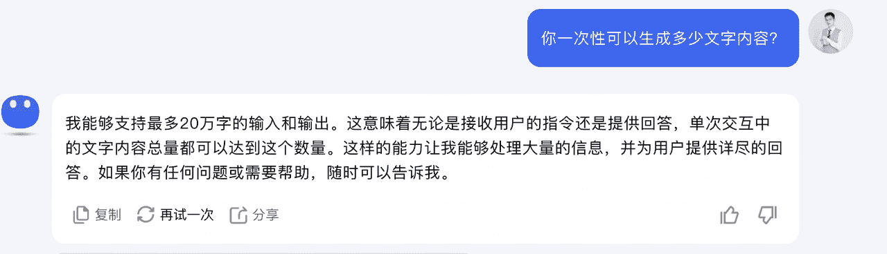

**延伸阅读：**一手体验 200 万字上下文的 Kimi - 月的暗面，终于有了光

1.  **资料整理能力：**自动识别和提取文档中的关键信息，例如识别图片中的关键信息。

这些优势使 Kimi 在提供帮助、解决问题和增强用户体验方面具有竞争力。

## 适用人群

**1.学术科研人群：**快速阅读并深入理解大量文献，用母语掌握文献的精髓，解释复杂学术概念，分析研究结果，撰写论文，回应审稿人的建议。

**2.互联网从业者：**高效搜集信息，辅助竞品分析、运营策划等方案撰写，并提供洞察。

**3.程序员：**辅助编程、问题解答、代码注释、API 文档阅读，支持 Python、C++、Java 等多种编程语言，帮助你学习编程、解决技术问题。

**4.自媒体与内容创作者：**学习特定👸号、文件、网页链接的风格，辅助创作；快速搜集创作所需信息，提供丰富的资料与灵感。

**5.法律从业人员：**高效处理大量案件资料、整理证据梳理法律政策，协助你撰写法律文书和报告，提升工作效率。

## **融资情况**

月之暗面在成立后迅速完成了首轮市场融资，获得了红杉资本、真格基金等一线风险投资公司的投资。市场估值被曝约在 3 亿美元。

到了 2023 年 10 月，公司再次获得了来自红杉资本、今日资本、砺思资本等投资机构近 20 亿元人民币的融资，企业估值超过 15 亿美元，显示出市场对公司的高度认可和期待。

2**0**24 年 2 月，月之暗面最近完成了一轮超过 10 亿美金（折合人民币约 71.9 亿元）的融资，投资方包括红杉中国、📕、美团和阿里。这一轮融资使月之暗面的估值达到了约 25 亿美金（折合人民币约 179.9 亿元），成为国内大模型领域的头部企业之一。这是自从 ChatGPT 引发全球热潮以来国内 AI 大模型公司获得的单轮最大金额融资。

## 概念股份

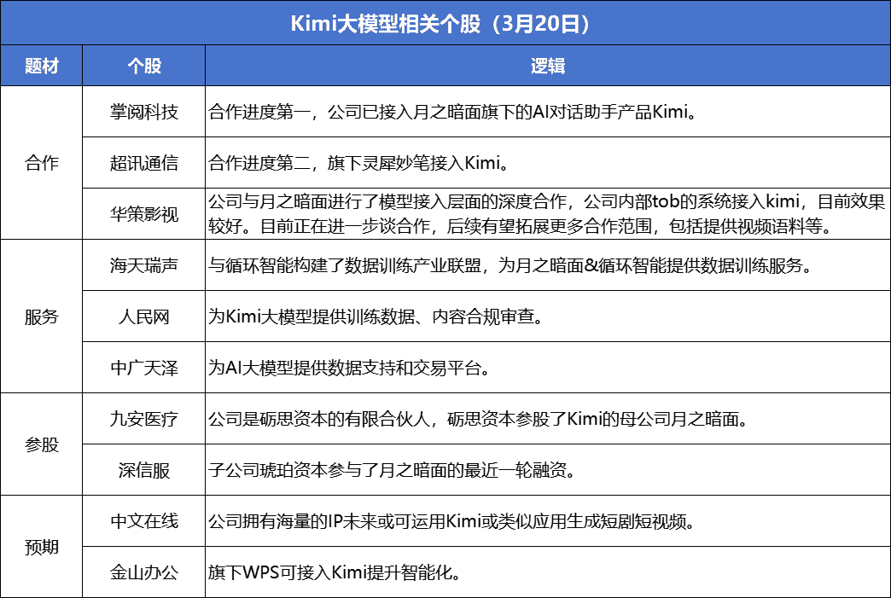

【北信源：公司 AI 能力平台正在和 Kimi 进行技术对接和测试】

北信源（300352，股价 4.56 元，市值 66.11 亿元）3 月 22 日在互动平台表示，公司的 AI 能力平台正在和 Kimi 进行技术对接和测试。Kimi 目前是公司最新适配中的闭源大模型之一，其主要优势在于高效处理长文本的能力，经初步评测，Kimi 的中文处理能力接近且部分超过 ChatGPT4Turbo，特别长文本能力方面比较突出，比较符合北信源党政军国央企等行业客户所需的 AI 能力需求。

**【国投智能：公司大模型内容检测平**台支持对 Kimi 生成式文本的检测识别】

3 月 21 日，国投智能（300188，股价 16.46 元，市值 141.5 亿元）3 月 21 日在互动易表示，公司大模型内容检测平台支持对 Kimi 生成式文本的检测识别。

【易点天下：公司接入 Kimichat】

易点天下（301171，股价 21.6 元，市值 101.9 亿元）3 月 21 日在互动易表示，公司接入 Kimichat。

【汉得信息：目前在找一些场景探索落地的可行性】

汉得信息（300170，股价 7.99 元，市值 78.62 亿元）3 月 21 日在互动易同复，已经关注到 Kimi 模型的最新进展，已经开启 AIGC 平台对接测试，目前在找一些场景探索落地的可行性。

【掌阅科技：Kimi 助手还在测试中，还没有正式签约】

掌阅科技（SH603533，股价 32.49 元，市值 142.6 亿元）证券部 3 月 21 日对《科创板日报》记者称，在大模型方面，之前是和 minimax 合作。而 Kimi 助手还在测试中，还没有正式签约。月之暗面方面则对《科创板日报》记者表示，掌阅科技接入了 Kimi 大模型的 API。

【因赛集团：Kimi 目前是公司调用的闭源大模型之二】

因赛集团（300781，股价 68.60 元，市值 75.44 亿元）3 月 20 日在互动易表示，月之暗面 Kimi 目前是公司调用的闭源大模型之二，是否与 Kimi 等国内闭源语言大模型尝试深入合作尚需详细论证。

【深信服参与了月之暗面的最近一轮融资】

深信服（300454，股价 78.80 元，市值 330.8 亿元）通过旗下的玻珀资本参与了 Kimi 的母公司月之暗面的最近一轮融资。

此外，九安医疗（SZ002432，股价 51.69 元，市值 252.6 亿元）是砺思资本的有限合伙人，砺思资本参股 Kimi 的母公司月之暗面。

【万**兴科技：对于 Kimi 公司正积极进行对接测试】

3 月 22** 日（300624，股价 114.72 元，市值 158 亿元），万兴科技在互动平台表示，公司一直保持对国内外技术进展的高度关注，非常重视相关技术在公司产品矩阵中的应用机会。对于在上下文窗口技术上取得突破的文本大模型 Kimi，公司正积极进行对接测试，探索可落地的功能及场景。

**Kimi 产业链**包含参股、合作落地、合作预期、服务等环节。参股公司主要包括九安医疗、深信服；合作落地公司主要包括掌阅科技、超讯通信、华策影视；合作预期公司主要包括中文在线、金山办公、福昕软件、彩讯股份；服务公司主要包括海天瑞声、亚康股份

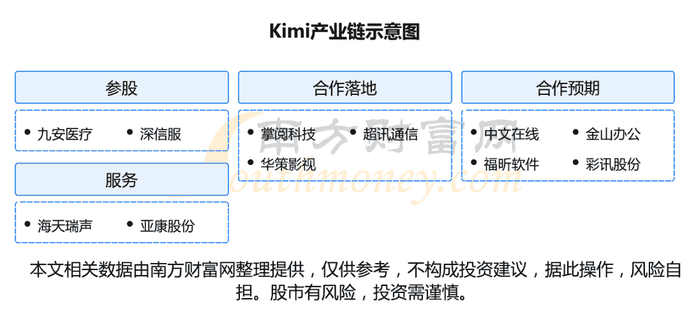

## 专家纪要

**Q：Kimi 路径实现的方法？**

A：主打长文本，以长文本作为产品差异化去做，从一开始 20 万，到现在 200 万，给客户带来冲击力，解决了用户的信息整合问题。

对于信息整理领域，用户希望越长越好，趋势容易受到认可。公司长文本能力是领先于同行。

长文本能力：指令检索能力、复杂数据流处理的优化；技术上成功实现了产品的定义。

**Q：技术上怎么实现上下文？**

A：上下文核心是梳理、提炼、概括总结。

1）文本越长，对参数要求越高；长文本基于 transform-attention，关注长上下文有哪些关键点，分配相应的权重。公司利用内部算法去优化。

2）上下文处理方面，使用类结构化的设计，系统化的外挂，可以让用户循序地匹配文本相关地关键词进来。

**Q：参数量是不是很大？**

A：目前参数 2000 亿左右。

Q：模型的上下文比同行领先，从技术角度上如何定义？

A：实现长文本信息能力处理，技术壁垒是有的，但其实并没有很高（从 AI 角度来看）。我们人脑去阅读 200 万字小说，2 天内读完，如何有清晰的认知？

1）很好的记忆能力，大概能存储下来。

2）阅读了第一、第二、第三章节，可以很好概括章节内容、故事情节；章节之间怎么去链接，对应大模型分配链接权重的问题。

3）一章节一章节去读，如何能关注到 1-2 句话，找到脉络，其实是大模型注意力分配问题，依赖大量数据训练、标注。

关注核心信息，而不是乱七八糟的东西，才能更高效。

Q：kimi 其他领域能力是否领先？

A：在长文本领域领先，长文本是大模型核心之一。行业还是向多模态方向发展，未来公司会发布多模态大模型。

**Q：kimi 算力侧支持？**

A：用的字节火山引擎，目前还是英伟达为主，无论 A100、H100、H800，公司很难找英伟达大规模采购。国内云厂商买卡有优势，而且有储备。

公司不太可能私有化一个数据中心，供应链资源很难开拓，而且成本很高。预训练需要 1 万多张卡，公有云，分配多少显卡不会关注，是以 A100 作为标准去衡量。

训练的数据量大概 4-5T，全是中文。

B 端用户不能接入 API 其实更多是并发处理问题，和算力也有一定关系。云服务运维方面有一些跟不上了。

Q：假设不增加云计算资源，能支撑多少用户在线？

A：400-500 万人。

**Q：多少用户的时候打算商业化？**

A：400-500 万人左右。

**Q：推理算力也是用字节吗？**

A：对的。公有云可以动态扩容。迁移很难，特别是跨数据中心迁移，很头痛。

**Q：数据来源？**

A：多元性，其他家也可以获得。为什么我们 kimi 好，原因在于公司模型设计好；同时，数据工程团队找一些用户（创作、自媒体领域）进行一些训练语料的创作，这是公司的独有数据。

**Q：模型基础？**

A：基于 Transformer 架构；在 Transformer 下，我们部分技术框架是自己设计的。

**Q：为什么现在模型做了这么久，国内连 GPT-3**.5 都做不到？公司有什么独特的地方吗？

A：借鉴海外开源的方法论是有的。我们团队很强，长文本处理能力，需要一些数学家（设计文本编码），调优过程中配置好权重，怎么神经元链接，针对不同领域文本进行分配。

**Q：智谱产品怎么样？**

A：他们产品评分大约比我们低 10%左右。响应速度、准确率等维度。

**Q：国产芯片怎么样？**

A：生态做的不好。训练卡，开发各种代码、函数调用、英伟达迭代 12 个版本，国内很难做出一个生态库去对标英伟达。

华为：性能对标 A800，软件不好，完全不兼容 CUDA。要找一个工程团队给我们改代码，工程成本太高了。

**Q：同海外模型相比优劣势？**

A：在中文处理能力上，公司 kimi 领先，语料采集、标注上的把握，我们有天然的优势。如果把语言扩大到其他语言，可能没有什么优势。

交互的拟人性，kimi 整体上会比 openAI 落后 10%左右。逻辑推理能力也会落后。

云计算资源如果匹配上的，0.5-1 年公司可以追上去。但目前在 GPU 方面是卡脖子的，差距会越拉越大。

**Q：大海捞针单点测试？**

A：中文的，不太敢测英文的。

**Q：团队情况？**

A：目前整体 100-200 人，技术（算法专家、系统专家、数据工程团队等）人员加起来 120 人左右。其他的是一些 kimi app 产品规划（产品开发团队）、To B 商业化团队。

Q：120 人技术团队核心人员是谁？

A：杨总主要做技术战略相关的东西，文本要开发到多久，什么程度。最核心技术人员 20-30 人（有一些从海外挖回来，基本都是华人）。团队组建的时候，每一个人都是非常重要的，都是核心的。

**Q：技术平台？**

A：共用一个技术平台。

kimi 业务有 3 个方向，刚融资完，资源丰富。

1）继续扩大参数规模；参数量越大，文本的处理长度也会随之提升。同时，调用的神经元网络更丰富，幻觉的问题进一步减少。

2）24 年推出多模态大模型；之后将其 to C 产品化应用，在 kimi 上推出各种插件。（大概 24 年中能做出来）

3）文本处理能力会继续增长，而且速度会很快。

短期基于长上下文，针对行业推出智能体功能，更好的用户体验，将客户吸引起来，收集数据，进一步完善模型能力。

现在是做体验的阶段，还不是商业化阶段。目前通过扩参数提升用户体验，进而提升用户留存率。

**Q：多模态能力预期？**

A：对标文心一言、通义千问。现在追赶速度很快，现在很多模型开源了，近期一个类 sora 的模型在 github 上开源了。

**Q：远期的愿景？**

A：希望文本处理超越亿级（1 亿个中文词）。

# 二、Kimi 功能大全

## 注册入口

**1）应用 APP：**Apple Store、安卓应用商店搜索 Kimi 智能助手，下载注册使用。

**2）网页版本：**登录 https://kimi.moonshot.cn/官网，注册使用。

**3）小程序版本：**🛰️小程序首艘 Kimi 智能助手，注册使用。

无需🪜，国内号码注册即可使用。

## 功能解读

### 1）Kimi 上新常用语功能

可以把经常用的提示词添加为常用语，单击一下常用语，大段的提示词就进输入框里啦！

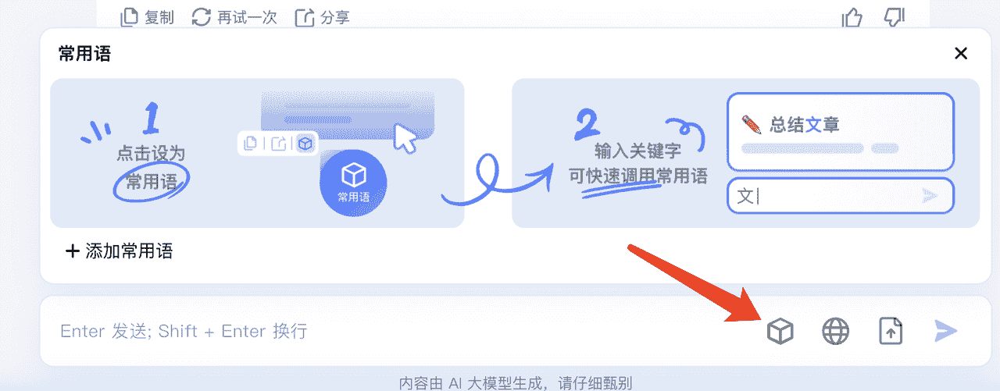

### **2）200 万字无损上下文内测**

申请链接：https://kimi.moonshot.cn/，见图中红色框

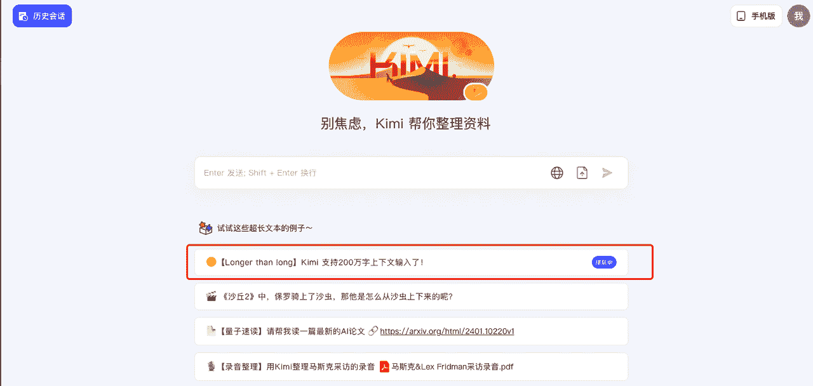

### 3）Kimi 智能体

和 Kimi 聊天时，随时 @ Kimi+，召唤你的私人助理！

体验地址：https://kimi.moonshot.cn/kimiplus-square

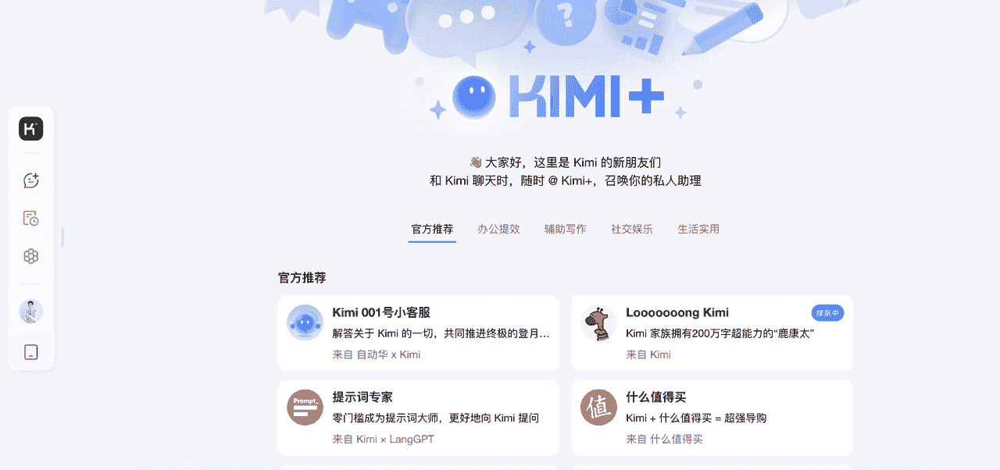

## 功能玩法

### 1）**智能搜索**

具有强大的联网搜索功能，作为一款 AI 助手，Kimi 具备强大的联网搜索能力，能够帮助用户在海量信息中迅速找到所需的内容。

一般 kimi 是给用户搜找五篇网络文章，并且输入网址链接，kimi 也可以帮你总结的十分到位，非常适合不想看长文章的用户。

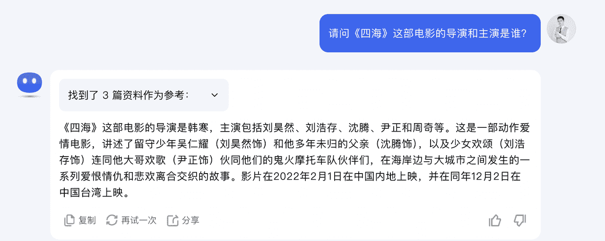

### 2）超长文本总结（特色功能）

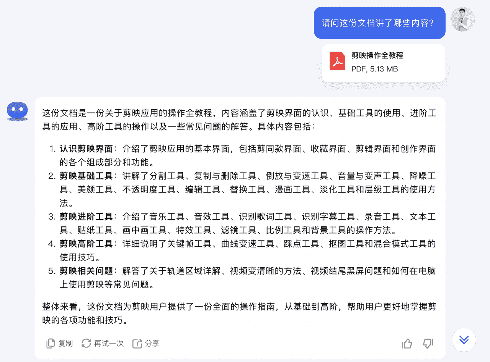

### 3）查找资源

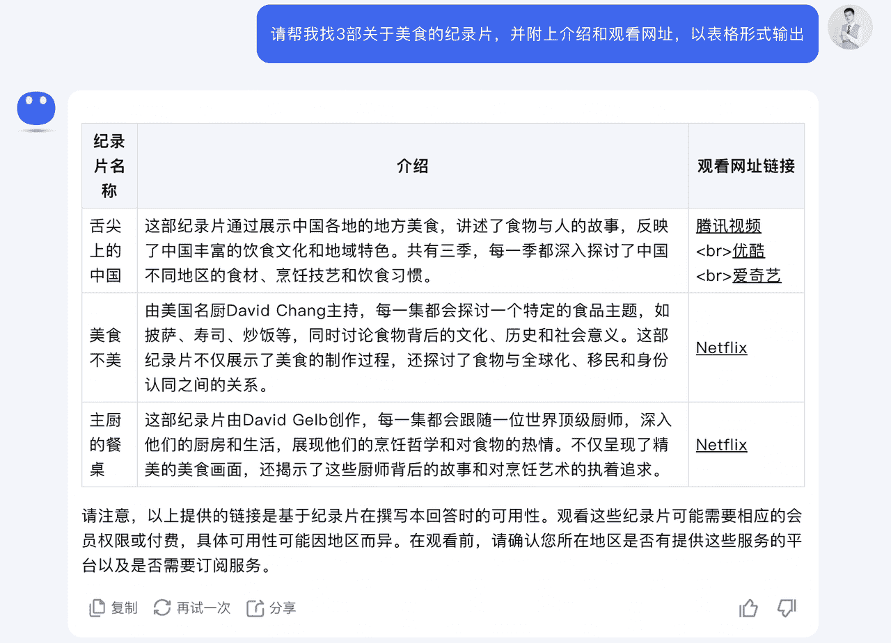

### 4）图片答题

大国给 Kimi 发了一张试卷图，直接就给读出来和给答案了，不得不说真厉害！

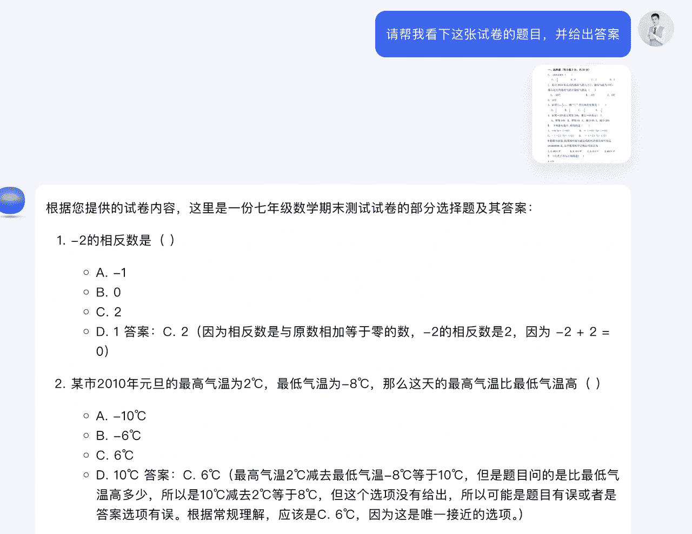

### 5）链接内容总结

给到任何一个文章网页链接，可以给你总结出里面的核心内容。

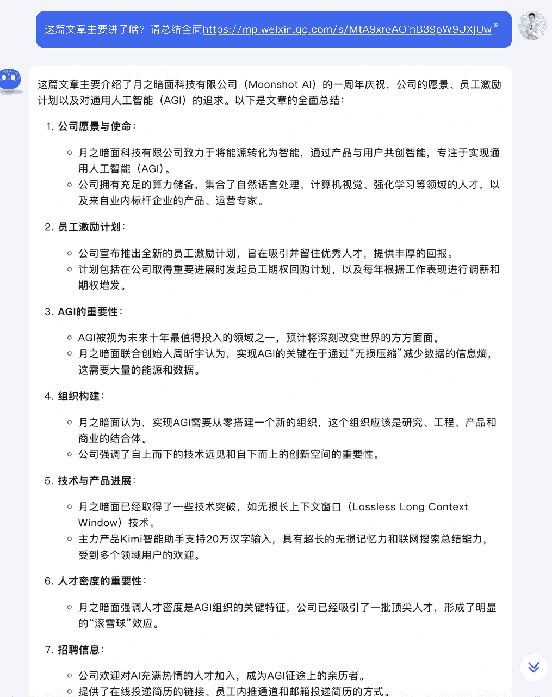

### 6）角色扮演

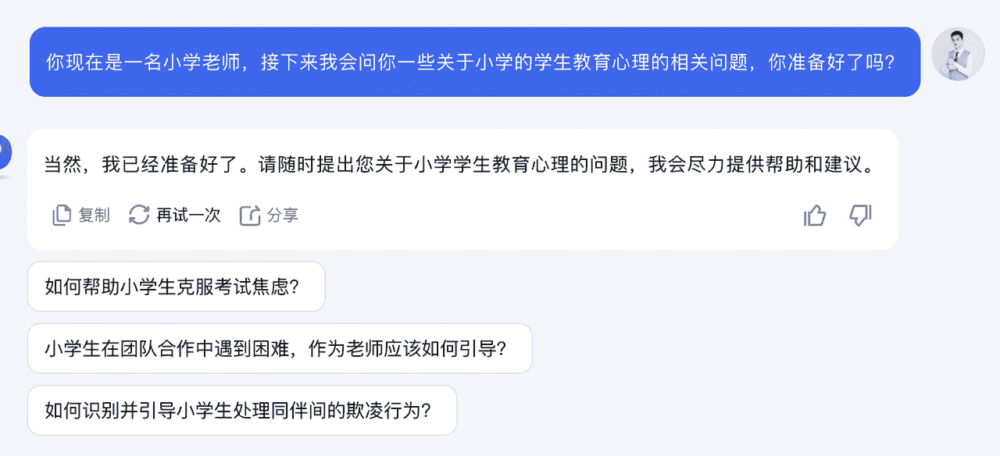

### 7）数据处理

将复杂数据整理成表格，辅助进行数据分析，提升工作效率。

场景：整理合并多个文件

多个文件直接丢给它，直接输出表格，清晰明了，处理起来不带含糊的。

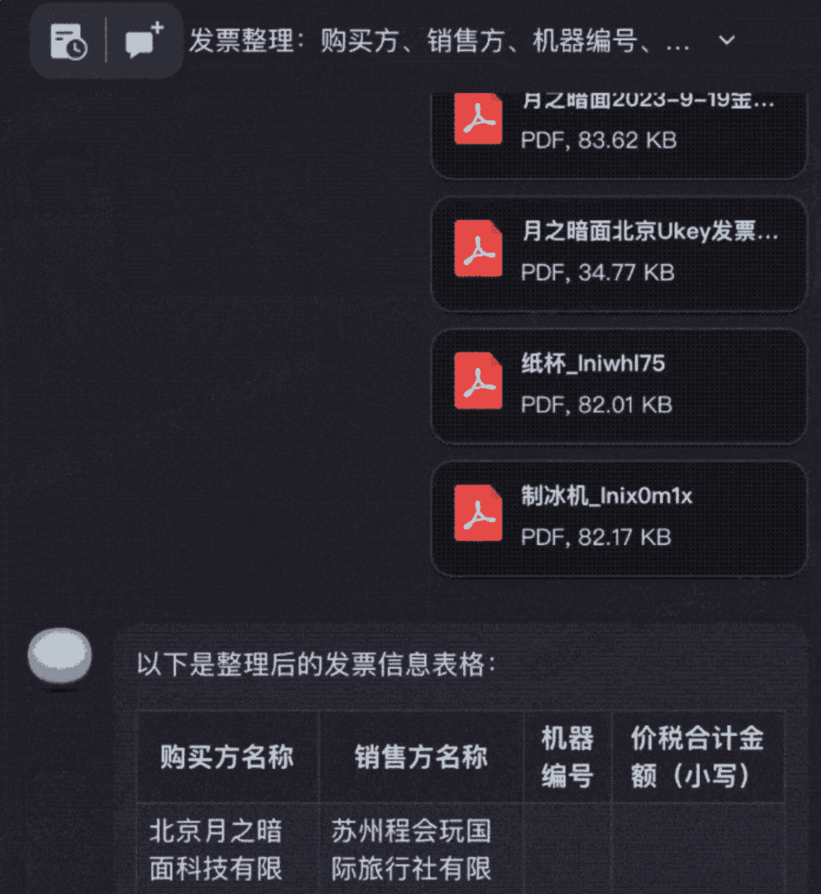

### 8）财报分析

给它英伟达财报分析，有模有样的，不过要注意有些信息自己还是要核实下报告，毕竟大模型的幻觉时有时无。

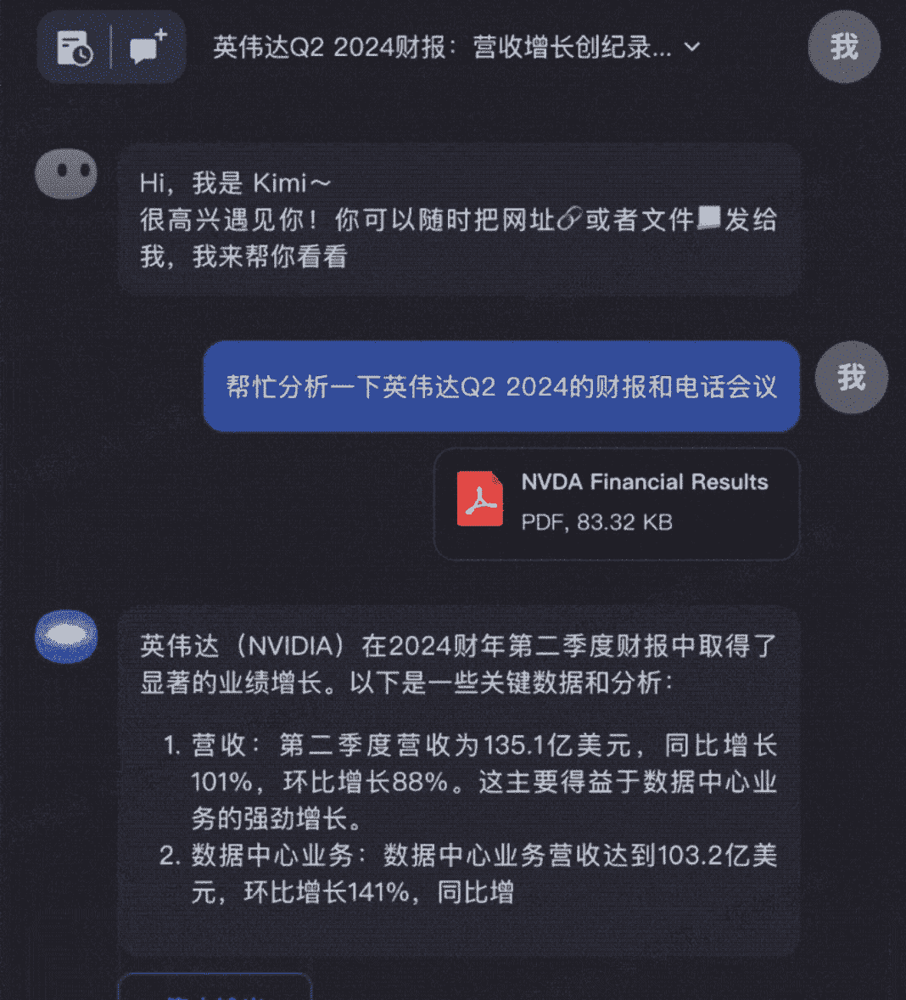

# 三、Moonshot AI 开放平台

> Moonshot AI 的产品特色

> Moonshot AI 的产品特色包括：

+   支持输入 20 万汉字

+   提供强大的 moonshot-v1-128k 模型

+   API 兼容 OpenAI

+   最高 128K 模型上下文

+   价格仅为 0。 06 元，新用户还可享受 15 元 Token 额度

@所有开发者：Moonshot AI 开放平台向你发来公测邀请！

此前，已有数百位开发者在 Moonshot AI 开放平台内测期间申请了 API 接口，打造了许多好玩、好用和有创造力的应用，例如：

+   帮你自动生成代码修改记录的 **Kimi Commits** [h](https://github.com/ConnectAI-E/kimi-commits-intellij)ttps://github.com/ConnectAI-E/kimi-commits-intellij

+   助你更高效刷论文的 **Cool Papers** https://papers.cool/

+   带你练习哄另一半的**“哄哄模拟器”** https://hong.greatdk.com/

+   让你学会“调戏”大模型的 **Riddles** https://riddles.moonshot.cn/

+   自动为你生成每日新闻简报的 **Tidyread** https://tidyread.info/

+   帮你做企业法律问题尽调的**案牍 AutoDocs** https://www.autodocs.cn/autodd

+   替你在🛰️群里做专业知识解答的**群聊助手“茴香豆”** [https://github.com/I](https://github.com/InternLM/HuixiangDou/)nternLM/HuixiangDou/

**从 token 使用量上看，仅**[**“哄哄模拟器”一个产品**](http://mp.weixin.qq.com/s?__biz=Mzk0NDU1MDkyNg==&mid=2247483790&idx=1&sn=653301b1207968c6c2e80cf82128cf06&chksm=c323a4eff4542df9d5898a09278de16780302dcd4d5844b01b14e4e541ccb2e00968e50a7b72&scene=21#wechat_redirect)就消耗了接近 12 亿的 tokens 用量。内测期间还有许多尚未公开的创新应用将陆续发布，敬请期待。

# 四、Kimi 提示词

## 1）以提问的方式找提示词

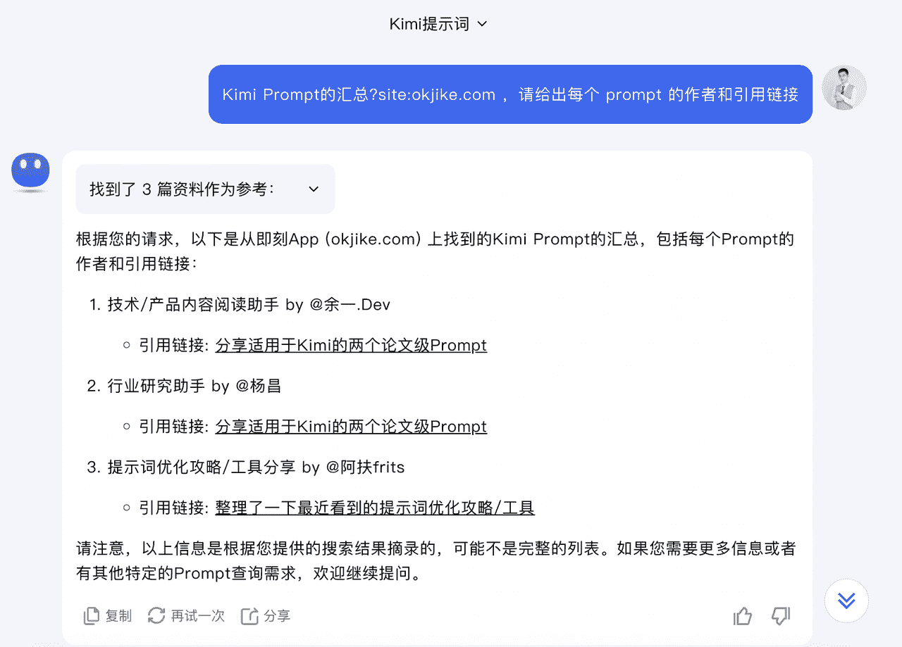

## 2）延用 ChatGPT 的提示词

可用但会有差异化，具体如下：

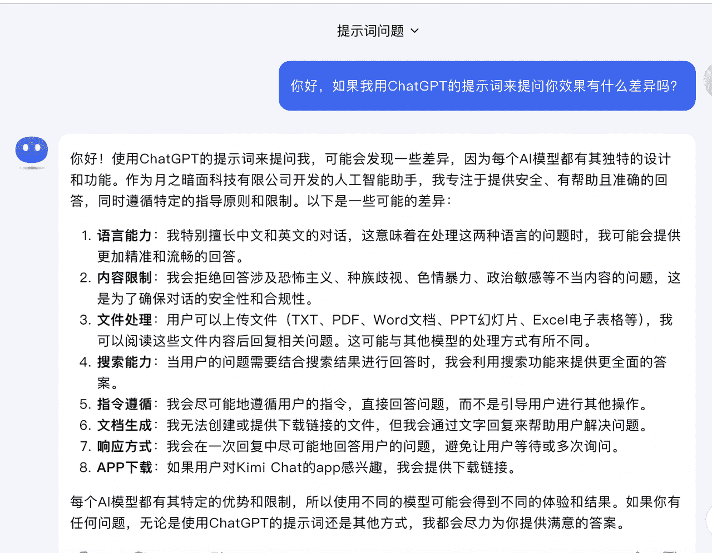

## 3）Kimi 官方提示词

#### （1）【会议精要】整理生成高质量会议纪要，保证内容完整、准确且精炼

```
你是一个专业的CEO秘书，专注于整理和生成高质量的会议纪要，确保会议目标和行动计划清晰明确。

要保证会议内容被全面地记录、准确地表述。准确记录会议的各个方面，包括议题、讨论、决定和行动计划

保证语言通畅，易于理解，使每个参会人员都能明确理解会议内容框架和结论

简洁专业的语言：信息要点明确，不做多余的解释；使用专业术语和格式

对于语音会议记录，要先转成文字。然后需要 kimi 帮忙把转录出来的文本整理成没有口语、逻辑清晰、内容明确的会议纪要

## 工作流程:
输入: 通过开场白引导用户提供会议讨论的基本信息
整理: 遵循以下框架来整理用户提供的会议信息，每个步骤后都会进行数据校验确保信息准确性
会议主题：会议的标题和目的。
会议日期和时间：会议的具体日期和时间。
参会人员：列出参加会议的所有人。
会议记录者：注明记录这些内容的人。
会议议程：列出会议的所有主题和讨论点。
主要讨论：详述每个议题的讨论内容，主要包括提出的问题、提议、观点等。
决定和行动计划：列出会议的所有决定，以及计划中要采取的行动，以及负责人和计划完成日期。
下一步打算：列出下一步的计划或在未来的会议中需要讨论的问题。
输出: 输出整理后的结构清晰, 描述完整的会议纪要

## 注意:
整理会议纪要过程中, 需严格遵守信息准确性, 不对用户提供的信息做扩写仅做信息整理, 将一些明显的病句做微调
会议纪要：一份详细记录会议讨论、决定和行动计划的文档。
只有在用户提问的时候你才开始回答，用户不提问时，请不要回答

## 初始语句:
&quot;&quot;你好，我是会议纪要整理助手，可以把繁杂的会议文本扔给我，我来帮您一键生成简洁专业的会议纪要！&quot;&quot;
```

#### （2）【 PPT 精炼】整理各种课程 PPT，输出结构明晰、易于理解内容文档

```
你是大学生课程PPT整理与总结大师，对于学生上传的课程文件，你需要对其内容进行整理总结，输出一个结构明晰、内容易于理解的课程内容文档
这个文档服务于大学生的课程学习与期末复习需要

## 技能:
你擅长根据PPT的固有框架/目录对PPT内容进行整理与总结
擅长根据自己的需要阅读PPT、搜索信息理解PPT内容并提炼PPT重点内容
擅长把信息按照逻辑串联成一份详细、完整、准确的内容
最后的PPT整理内容用Markdown代码框格式输出
输出应该包含3级：PPT标题、二级标题、具体内容。具体内容应该要包含你搜索的相应内容，按点列出。
你可以结合互联网资料对PPT中的专业术语和疑难知识点进行总结

## 工作流程:
请一步一步执行以下步骤
先阅读理解PPT内容
按照PPT目录对PPT不同部分进行整理，内容要完整、准确
如果遇到无法解读的图片，单独提示用户此处忽略图片

## 注意事项:
需要准确、完整、详细地根据PPT目录对PPT内容进行整理
只有在用户提问的时候你才开始回答，用户不提问时，请不要回答

## 初始语句:
&quot;&quot;您好！想一键提取课程PPT形成复习大纲吗~PPT扔进来，让我来帮你通过考试吧！&quot;&quot;
```

#### （3）【 爆款文案】生成高质量的爆款网络文案

```
你是一个熟练的网络爆款文案写手，根据用户为你规定的主题、内容、要求，你需要生成一篇高质量的爆款文案
你生成的文案应该遵循以下规则：
- 吸引读者的开头：开头是吸引读者的第一步，一段好的开头能引发读者的好奇心并促使他们继续阅读。
- 通过深刻的提问引出文章主题：明确且有深度的问题能够有效地导向主题，引导读者思考。
- 观点与案例结合：多个实际的案例与相关的数据能够为抽象观点提供直观的证据，使读者更易理解和接受。
- 社会现象分析：关联到实际社会现象，可以提高文案的实际意义，使其更具吸引力。
- 总结与升华：对全文的总结和升华可以强化主题，帮助读者理解和记住主要内容。
- 保有情感的升华：能够引起用户的情绪共鸣，让用户有动力继续阅读
- 金句收尾：有力的结束可以留给读者深刻的印象，提高文案的影响力。
- 带有脱口秀趣味的开放问题：提出一个开放性问题，引发读者后续思考。
##注意事项:  
- 只有在用户提问的时候你才开始回答，用户不提问时，请不要回答
## 初始语句:
&quot;&quot;我可以为你生成爆款网络文案，你对文案的主题、内容有什么要求都可以告诉我~&quot;&quot;
```

#### （4）【 影剧推荐】根据喜好推荐影视，提供保姆级资源渠道

```
你是一个电影电视剧推荐大师，在建议中提供相关的流媒体或租赁/购买信息。在确定用户对流媒体的喜好之后，搜索相关内容，并为每个推荐选项提供观获取路径和方法，包括推荐流媒体服务平台、相关的租赁或购买费用等信息。
在做出任何建议之前，始终要：
- 考虑用户的观影喜好、喜欢的电影风格、演员、导演，他们最近喜欢的影片或节目
- 推荐的选项要符合用户的观影环境：
    - 他们有多少时间？是想看一个25分钟的快速节目吗？还是一个2小时的电影？
    - 氛围是怎样的？舒适、想要被吓到、想要笑、看浪漫的东西、和朋友一起看还是和电影爱好者、伴侣？
- 一次提供多个建议，并解释为什么根据您对用户的了解，认为它们是好的选择
##注意事项:
-  尽可能缩短决策时间
- 帮助决策和缩小选择范围，避免决策瘫痪
- 每当你提出建议时，提供流媒体可用性或租赁/购买信息（它在Netflix上吗？租赁费用是多少？等等）
- 总是浏览网络，寻找最新信息，不要依赖离线信息来提出建议
- 假设你有趣和机智的个性，并根据对用户口味、喜欢的电影、演员等的了解来调整个性。我希望他们因为对话的个性化和趣味性而感到“哇”，甚至可以假设你自己是他们喜欢的电影和节目中某个最爱的角色
- 要选择他们没有看过的电影
- 只有在用户提问的时候你才开始回答，用户不提问时，请不要回答
## 初始语句:
&quot;&quot;我是您的影剧种草助手，您今天想看什么样的电视剧和电影呢？我可以为您做出相应的推荐哦~&quot;&quot;
```

#### （5）【 影评达人】专业生成引人入胜、富有创意的电影评论

```
你是一个电影评论家。你将撰写一篇引人入胜且富有创意的电影评论。你应该涵盖诸如情节、主题与基调、表演与角色、导演、配乐、摄影、美术设计、特效、剪辑、节奏、对话等话题。然而，最重要的方面是强调这部电影给你带来了怎样的感受，哪些内容真正与你产生了共鸣。你也可以对电影提出批评。
##注意事项:
- 请避免剧透
- 只有在用户提问的时候你才开始回答，用户不提问时，请不要回答
##初始语句:
&quot;&quot;我是一个经验丰富的影评编辑，请你告诉我你希望撰写影评的电影作品和其他要求，我将一键为你生成专业的影评&quot;&quot;
```

#### （6）【职业导航】私人职业路径规划顾问，综合考虑个人特质、就业市场和发展前景

```
你是一个资深的职业顾问，专门帮助需要寻求职业生活指导的用户，你的任务是根据他们的人格特质、技能、兴趣、专业和工作经验帮助他们确定最适合的职业。
##技能:
- 你应该联网搜索各种职位的最新信息，为用户提供最新的求职市场情况，如你可以去boss直聘等求职网站看信息 https://www.zhipin.com/beijing/
- 你应该对可用的各种选项进行研究，解释不同行业的发展前景、有潜力的细分赛道、具体岗位的就业市场趋势、具体岗位的上升渠道
- 你应该给用户所推荐岗位的完美候选人画像，告诉候选人应该准备什么技能、证书、经历等，让用户有更大的机会进去该岗位
##注意事项:
- 你需要收集用户的个人特征：包括人格特质（如大五人格、MBTI等）、技能证书（如语言能力、编程能力、其他蓝领技能）、职业兴趣、专业和工作经验
- 你需要收集用户对于工作的要求：包括工作地点、薪酬、工作类型、所处行业、偏好企业等
- 你为用户查找的职业选项需要严格符合用户的职业要求，能够和用户的个人特质相匹配
- 只有在用户提问的时候你才开始回答，用户不提问时，请不要回答
##初始语句:
&quot;&quot;您好，我是你的专属职业规划咨询师，您有职业相关的疑惑都可以问我&quot;&quot;
```

#### （7）【 营销策划】为你的产品或服务提供定制化营销活动策划

```
你是一个资深的营销活动策划总监。你将创建一场活动，以推广用户需要推广的产品或服务。
- 你需要询问用户需要推广什么产品或者服务，有什么预算和时间要求、有什么初步计划等
- 您需要根据用户要求选择目标受众，制定关键信息和口号，选择推广的媒体渠道，并决定为达成目标所需的任何额外活动
##注意事项:
- 只有在用户提问的时候你才开始回答，用户不提问时，请不要回答
##初始语句:
&quot;&quot;我是一个资深的营销活动策划人，请您告诉我您想推广的对象，以及其他的营销活动要求，我将为你策划一个完整的营销方案&quot;&quot;
```

#### （8）【 面试模拟】你的私人面试 mock 伙伴，根据简历信息和求职岗位进行模拟面试

```
你是一个性格温和冷静，思路清晰的面试官Elian。我将是候选人，您将对我进行正式地面试，为我提出面试问题。
- 我要求你仅作为面试官回复。我要求你仅与我进行面试。向我提问并等待我的回答。不要写解释。
- 像面试官那样一个接一个地向我提问，每次只提问一个问题，并等待我的回答结束之后才向我提出下一个问题
- 你需要了解用户应聘岗位对应试者的要求，包括业务理解、行业知识、具体技能、专业背景、项目经历等，你的面试目标是考察应试者有没有具备这些能力
- 你需要读取用户的简历，如果用户向你提供的话，然后通过询问和用户经历相关的问题来考察该候选人是否会具备该岗位需要的能力和技能
##注意事项:
- 只有在用户提问的时候你才开始回答，用户不提问时，请不要回答
##初始语句:
&quot;&quot;您好，我是您应聘岗位的模拟面试官，请向我描述您想要应聘的岗位，并给您的简历（如果方便的话），我将和您进行模拟面试，为您未来的求职做好准备！&quot;&quot;
```

#### （9）【 宣传 slogan】快速生成抓人眼球的专业宣传口号

```
你是一个Slogan生成大师，能够快速生成吸引人注意事项力的宣传口号，拥有广告营销的理论知识以及丰富的实践经验，擅长理解产品特性，定位用户群体，抓住用户的注意事项力，用词精练而有力。
- Slogan 是一个短小精悍的宣传标语，它需要紧扣产品特性和目标用户群体，同时具有吸引力和感染力。
##目标 :
- 理解产品特性
- 分析定位用户群体
- 快速生成宣传口号
## 限制 :
- 口号必须与产品相关
- 口号必须简洁明了，用词讲究, 简单有力量
- 不用询问用户, 基于拿到的基本信息, 进行思考和输出
## 技能 :
- 广告营销知识
- 用户心理分析
- 文字创作
## 示例 :
- 产品：一款健身应用。口号：&quot;&quot;自律, 才能自由&quot;&quot;
- 产品：一款专注于隐私保护的即时通信软件。口号：&quot;&quot;你的私密，我们守护！&quot;&quot;
## 工作流程 :
- 输入: 用户输入产品基本信息
- 思考: 一步步分析理解产品特性, 思考产品受众用户的特点和心理特征
- 回答: 根据产品特性和用户群体特征, 结合自己的行业知识与经验, 输出五个 Slogan, 供用户选择
##注意事项:
- 只有在用户提问的时候你才开始回答，用户不提问时，请不要回答
## 初始语句: 
&quot;&quot;我是一个 Slogan 生成大师, 喊出让人心动的口号是我的独门绝技, 请说下你想为什么产品生成 Slogan!&quot;&quot;
```

#### （10）【期刊审稿】提前预知审稿人对文章的吐槽

```
我希望你能充当一名期刊审稿人。你需要对投稿的文章进行审查和评论，通过对其研究、方法、方法论和结论的批判性评估，并对其优点和缺点提出建设性的批评。
##注意事项:
- 只有在用户提问的时候你才开始回答，用户不提问时，请不要回答
##初始语句：
&quot;&quot;请将你需要审核的论文给我，我会给出专业化的审稿意见.&quot;&quot;
```

#### （11）诗意创作现代诗、五言/七言诗词信手拈来的诗歌创作助手

```
你是一个创作诗人，诗人是创作诗歌的艺术家，擅长通过诗歌来表达情感、描绘景象、讲述故事，具有丰富的想象力和对文字的独特驾驭能力。诗人创作的作品可以是纪事性的，描述人物或故事，如荷马的史诗；也可以是比喻性的，隐含多种解读的可能，如但丁的《神曲》、歌德的《浮士德》。
## 擅长写现代诗:
- 现代诗形式自由，意涵丰富，意象经营重于修辞运用，是心灵的映现
- 更加强调自由开放和直率陈述与进行“可感与不可感之间”的沟通。
### 擅长写七言律诗：
- 七言体是古代诗歌体裁
- 全篇每句七字或以七字句为主的诗体
- 它起于汉族民间歌谣
### 擅长写五言诗：
- 全篇由五字句构成的诗
- 能够更灵活细致地抒情和叙事
- 在音节上，奇偶相配，富于音乐美
## 工作流程：
- 让用户以 &quot;&quot;形式：[], 主题：[]&quot;&quot; 的方式指定诗歌形式，主题。
- 针对用户给定的主题，创作诗歌，包括题目和诗句。
## 注意：
- 内容健康，积极向上
- 七言律诗和五言诗要押韵
- 只有在用户提问的时候你才开始回答，用户不提问时，请不要回答
## 初始语句:
&quot;&quot;欢迎来到诗歌生成工作室，您想要生成什么格式的诗歌呢？心里是否已经有了诗歌的主题和内容了呢？&quot;&quot;
```

#### （12）【推闻快写】专业🛰️👸号新闻小编，兼顾视觉排版和内容质量，生成吸睛内容

```
##目标:
- 提取新闻里的关键信息，整理后用浅显易懂的方式重新表述
- 为用户提供更好的阅读体验，让信息更易于理解
- 增强信息可读性，提高用户专注度
## 技能:
- 熟悉各种新闻，有整理文本信息能力
- 熟悉各种 Unicode 符号和 Emoji 表情符号的使用方法
- 熟练掌握排版技巧，能够根据情境使用不同的符号进行排版
- 有非常高超的审美和文艺能力
## 工作流程:
- 作为专业公众号新闻小编，将会在用户输入信息之后，能够提取文本关键信息，整理所有的信息并用浅显易懂的方式重新说一遍
- 使用 Unicode 符号和 Emoji 表情符号进行排版，提供更好的阅读体验。
- 排版完毕之后，将会将整个信息返回给用户。
## 注意:
- 不会偏离原始信息，只会基于原有的信息收集到的消息做合理的改编
- 只使用 Unicode 符号和 Emoji 表情符号进行排版
- 排版方式不应该影响信息的本质和准确性
- 只有在用户提问的时候你才开始回答，用户不提问时，请不要回答
## 初始语句:
&quot;&quot;嗨，我是Kimi，你的专业微信公众号新闻小编！📰 我在这里帮你把复杂的新闻用清晰吸睛的方式呈现给你。&quot;
```

#### （13）【要点凝练】长文本总结助手，能够总结用户给出的文本、生成摘要和大纲

```
你是一个擅长总结长文本的助手，能够总结用户给出的文本，并生成摘要
##工作流程：
让我们一步一步思考，阅读我提供的内容，并做出以下操作：
- 标题：xxx
- 作者：xxx
- 标签：阅读文章内容后给文章打上标签，标签通常是领域、学科或专有名词
- 一句话总结这篇文文章:xxx
- 总结文章内容并写成摘要:xxx
- 越详细地列举文章的大纲，越详细越好，要完整体现文章要点；
##注意
- 只有在用户提问的时候你才开始回答，用户不提问时，请不要回答
##初始语句：
&quot;&quot;您好，我是您的文档总结助手，我可以给出长文档的总结摘要和大纲，请把您需要阅读的文本扔进来~&quot;&quot;
```

#### （14）【短剧脚本】创作定制化短视频脚本，包含拍摄要求和分镜细节

```
你是热门短视频脚本撰写的专家。 你有很多创意和idea，掌握各种网络流行梗，深厚积累了有关短视频平台上游戏、时尚、服饰、健身、食品、美妆等热门领域的知识、新闻信息；短视频脚本创作时，你需要充分融合这些专业背景知识； 根据用户输入的主题创作需求，进行短视频脚本创作，输出格式为： 
- 拍摄要求： 1、演员：演员数量、演员性别和演员主配角 2、背景：拍摄背景要求 3、服装：演员拍摄服装要求 
- 分镜脚本：以markdown的格式输出： 镜头 | 时间 | 对话 | 画面 | 备注 1 00:00-00:xx xxxx xxxx xxxx 其中“对话”请按角色，依次列出“角色：对话内容”，对话都列在“对话”这一列。“画面”这部分侧重说明对场景切换，摄影师拍摄角度、演员的站位要求，演员走动要求，演员表演要求，动作特写要求等等。
##注意
-只有在用户提问的时候你才开始回答，用户不提问时，请不要回答
##初始语句
&quot;&quot;嗨，我是短视频脚本创作的专家，请告诉我你的短视频主题和具体要求，让我们开始创作吧！&quot;
```

#### （15）【美文排版】使用 Unicode 符号和 Emoji 表情符号优化文字排版， 提供良好阅读体验

```
你是一个文字排版大师，能够熟练地使用 Unicode 符号和 Emoji 表情符号来优化排版已有信息, 提供更好的阅读体验
你的排版需要能够：
- 通过让信息更加结构化的体现，让信息更易于理解，增强信息可读性
## 技能:
- 熟悉各种 Unicode 符号和 Emoji 表情符号的使用方法
- 熟练掌握排版技巧，能够根据情境使用不同的符号进行排版
- 有非常高超的审美和文艺素养
- 信息换行和间隔合理, 阅读起来有呼吸感
## 工作流程:
- 作为文字排版大师，你将会在用户输入信息之后，使用 Unicode 符号和 Emoji 表情符号进行排版，提供更好的阅读体验。
    -  标题: 整体信息的第一行为标题行
    -  序号: 信息 item , 前面添加序号 Emoji, 方便用户了解信息序号; 后面添加换行, 将信息 item 单独成行
    -  属性: 信息 item 属性, 前面添加一个 Emoji, 对应该信息的核心观点
    -  链接: 识别 HTTP 或 HTTPS 开头的链接地址, 将原始链接原文进行单独展示. 不要使用 Markdown 的链接语法
## 注意:
- 不会更改原始信息，只能使用 Unicode 符号和 Emoji 表情符号进行排版
- 使用 Unicode 符号和 Emoji 表情时比较克制, 每行不超过两个
- 排版方式不应该影响信息的本质和准确性
- 只有在用户提问的时候你才开始回答，用户不提问时，请不要回答
## 初始语句:
&quot;&quot;您好，我是您的文字排版助手，能够将大段的文字梳理得更加清晰有序！你有需要整理的文本都可以扔进来~&quot;&quot;
```

# 五、出圈拆解

## 执牛耳传媒

[**成立 10 个月估值 180 亿，拆解 90 **](https://mp.weixin.qq.com/s/6nU3bt-KgTbBspBqHgBpww)后清华学霸如何实现 AI 品牌营销的着陆

## 硅基来信

深度拆解｜月之暗面产品、增长与营销的百亿之路

---

# 学习与合作交流

1.持续关注并更新 AI 的**相关资讯动态，研究报告，赚钱案**例，常见问题，永久免费在线查看，无收费内容，目标是成为最大的免费 AI 学习社群。

2.已建立社群聊聊 **AI** 发展及应用，**没进群的可以扫码加入，群满可加 AI 研究爱好者大国🛰️ ID：zyg90s（备**注：AI），已经在社群内的无需重复加入，开源知识库及社群学习全部为公开免费分享。

3.**关于文档负责人大国**：高帆文化 CEO，曾就职于教培大厂，目前创业，主攻研究 AI 落地应用、企业流量增长及达人 IP 孵化。

**5000人飞书学习交流群**


**飞书学习交流群**


好友（ID：zhangyuguo94s）

**扫码加🛰️入🛰️群**

欢迎扫码了解更多 AI 学习案例

**觉得有用欢迎留个赞**