# 元宝任务的邪修用法，一键复制使用！

> 来源：[https://yunyinghui.feishu.cn/docx/X4qJdFzAmobmEdxvrCDcLInXnee](https://yunyinghui.feishu.cn/docx/X4qJdFzAmobmEdxvrCDcLInXnee)

> **原创公众号：**阿真 Irene

> **发文时间：**2026-01-31 18:11:59

> **收录开源AI知识库：**[万象 AI 实验室](https://yunyinghui.feishu.cn/wiki/WhelwZnxQi55mpkOzatc3Xran5b?from=from_copylink)

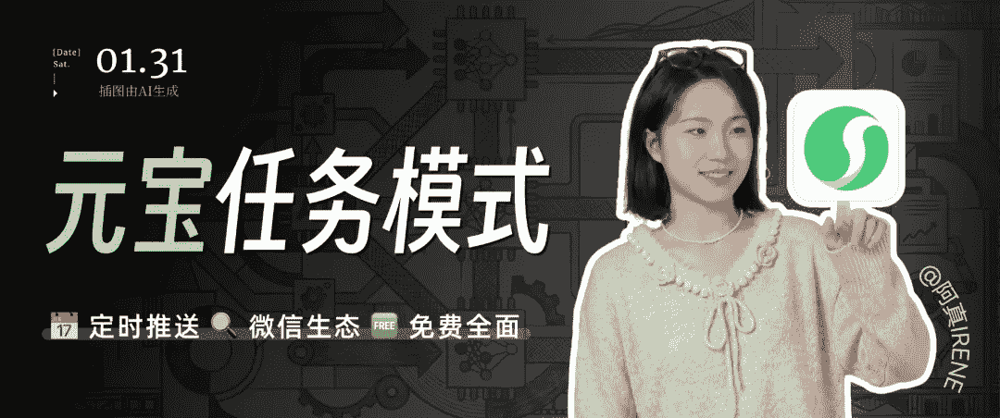

嗨大家好！我是阿真！

今天分享一个国产 APP 的功能，月初写了想起来还没发哎嘿。

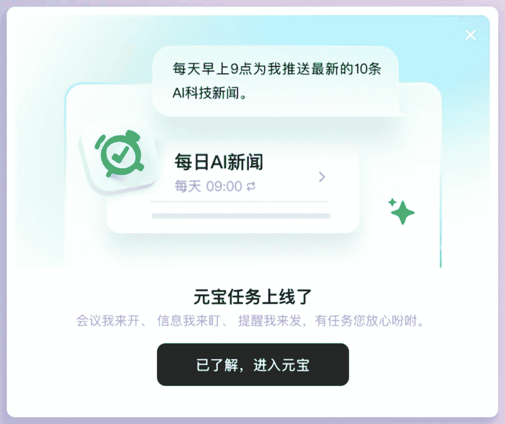

元宝想必大家也都很熟悉了，内置双引擎，混元模型响应快，DeepSeek R1 逻辑好，我们可以根据需求随时切换。处理文档方面可以直接上传很多份 PDF，跨端提取文件和跨文档对比分析也超级方便。

它也是唯一一个可以住在微信和我们谈天说地怼表情包的 AI 助手，拥有微信封闭数据池的独家访问权，是全网唯一能直接检索微信公众号文章和视频号的 AI 工具，轻轻松松就能获取高质量资讯和内容。而且我们还能直接在公众号、视频号甚至 QQ 音乐评论区直接@元宝出来解答问题。APP 上还有 AI 录音笔、静态图转视频、拍照答题、编程、写作等等功能，全都是免费的。

不止如此，元宝的“任务”功能直接把 AI 工具的交互模式改变了。今天我分享几个我觉得超实用的任务功能玩法给大家。

网页版： https://yuanbao.tencent.com/chat/

APP：应用商店搜索【元宝】

# 1. 任务模式

传统的日历或者待办 App，通常是打开、选日期、填标题、设重复规则、保存吧啦吧啦，整套流程下来至少要点七八下。如果只是想设个简单提醒，操作起来就显得很繁琐。

任务模式的新建非常简单：要新建什么任务，直接发送就行。只需要说清楚时间，频率和要求。

比如有个打工人痛点，天气多变，在室内有时候打开窗户也感知不到降温了，就可以像我这样直接在微信里跟元宝说：“每天早上 7 点，查询深圳今日天气，给出具体的穿衣建议。”，它就会自动识别时间和事件。

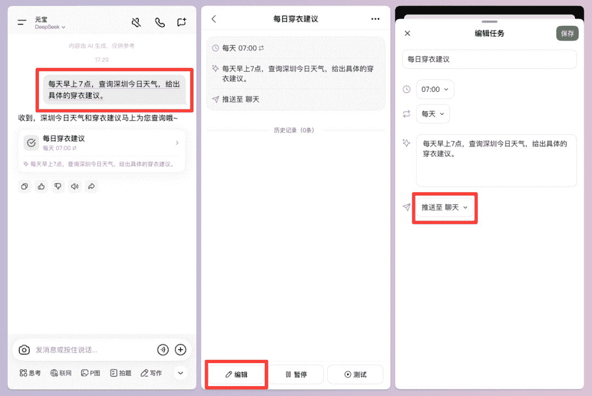

点击以后就生成了每日天气与穿衣建议，每天 7 点会推送给我。可以点击【测试】先看看结果自己是否满意👇

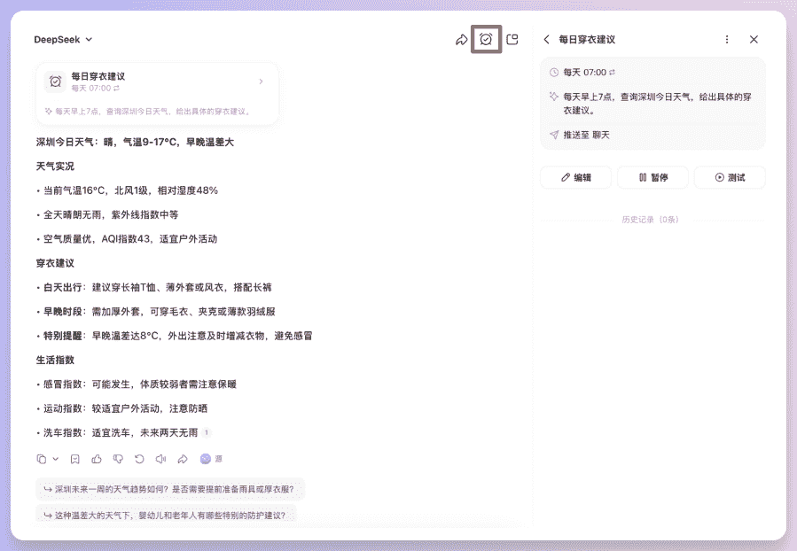

上面就是最简单的任务模式使用方法，实际上可用的场景还有很多。这里我把我常用的几个场景和提示词分享给大家，供参考。

# 1.1 每日资讯发送

比如我想要每天定时接收 AI 最新讯息，做为自己定制的 AI 日报，可以新建一个任务，设置频率时间，下面是提示词：

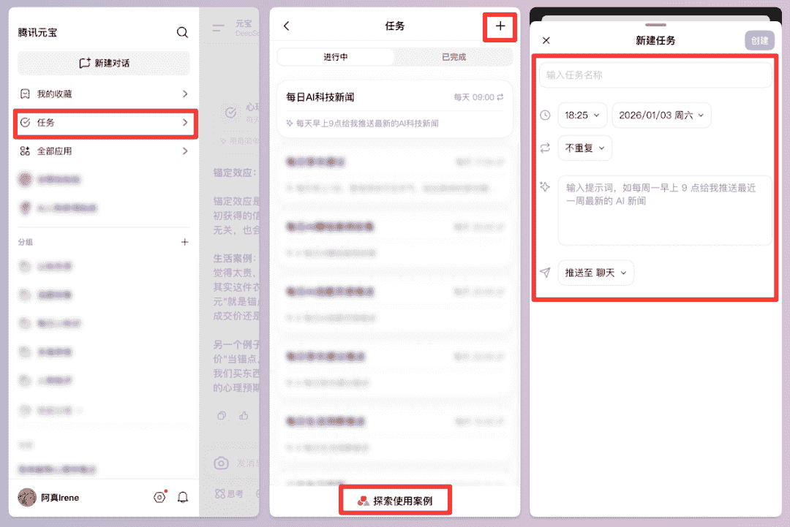

```
你是专业AI行业资讯编辑，整理过去24小时内发布的AI新闻简报，服务对象是AI内容创作者和工具测评师。重点关注领域（按优先级）：
1. 大模型动态：主流模型更新、新模型发布、重大能力升级
2. 视觉生成模型：图像生成、视频生成新功能或新版本
3. AI工具上新：效率工具、创作工具、开发工具的新品发布或重大更新
4. 行业大事件：融资、收购、政策、开源项目等硬性要求：* 仅收录过去24小时内的新闻* 每条标注具体发布时间（如”3小时前“或”昨日22:00“）* 附信息源链接**输出格式：**按重要性排序，每条1-2句话概述，20-30 条。无符合条件的新闻时如实说明。
```

可以设置想什么时候接收就什么时候接收。内容质量也高，点击右上角数字和最下方的小图标可以溯源查看原始文章内容，核实信息👇

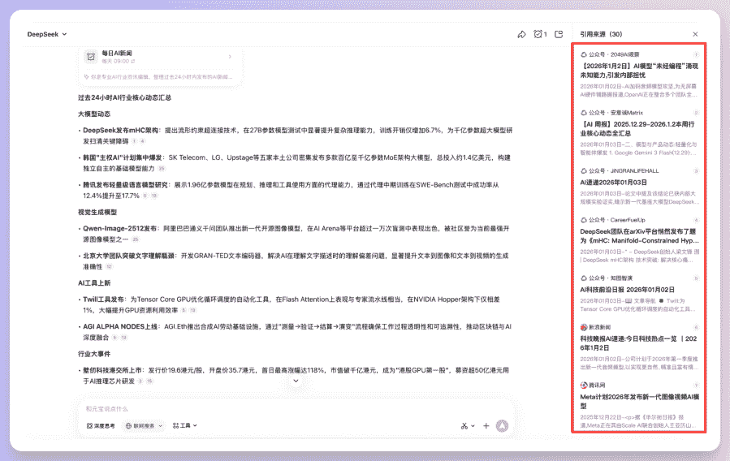

不想像我上面要求那么多，想看全面内容，就直接说“每天早上 9 点给我推送最新的 AI 科技新闻”，讯息更多元全面。

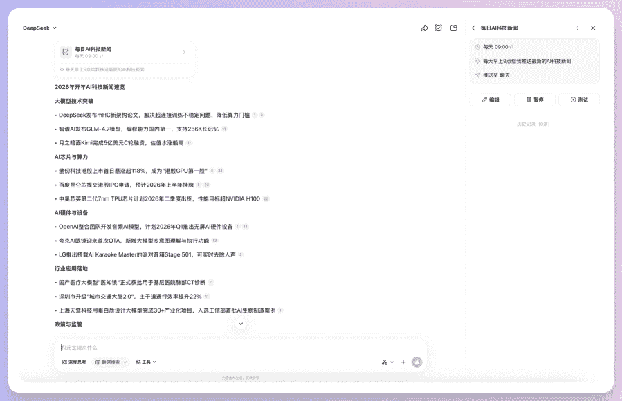

# 1.2 碎片式学习

除了接受各种讯息以外，还可以每天趁着碎片时间学习一点点。比如有的知识不属于我们必须知道的，但是可以有所了解的，就可以在碎片时间学点。像是每天了解一个心理学概念、设计理论等。

可以每天一个生活洞察，了解一个原理并获得启发。举个例子，什么是【锚定效应】：

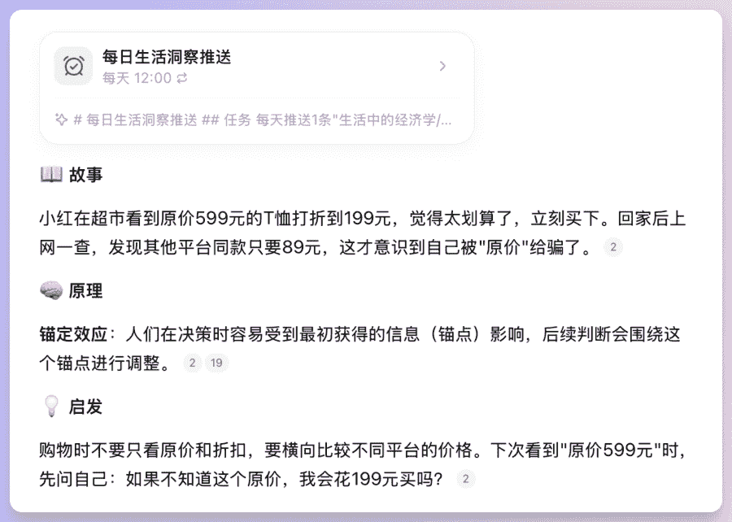

+

+

+

+

+

```
# 每日生活洞察推送
## 任务每天推送1条&quot;生活中的经济学/心理学&quot;，用一个小故事引出背后的学科原理。
## 内容结构1. **📖 故事**：一个简短的生活场景故事（3-5句话），有具体人物和情境，让人一看就觉得&quot;这不就是我吗&quot;2. **🧠 原理**：故事背后的经济学/心理学概念名称 + 一句话解释3. **💡 启发**：知道这个原理后能怎么用
## 故事要求- 主角用&quot;小明&quot;&quot;小红&quot;或&quot;你&quot;- 场景具体：超市、外卖、打车、工作、网购等- 有小冲突或小纠结（选A还是B、买不买、做不做）
## 风格- 故事口语化，像朋友讲给你听- 原理点到为止，不掉书袋- 总字数150-200字
## 选题经济学和心理学交替推送
```

更复杂一点，可以定制学习路径，让元宝基于我们的要求输出（我给的提示词的基础设定部分可以按自己的需要修改，比如每天一个 AI 术语学习之类的 ！) 👇

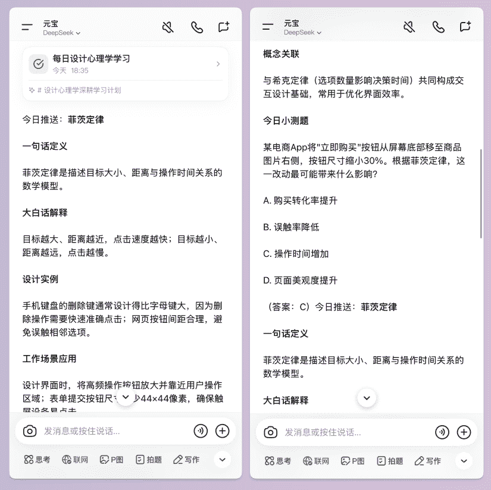

+

+

+

+

+

```
# 主题深耕每日学习计划
## 基础设定- 深耕领域：[填写，如&quot;认知心理学&quot;&quot;行为经济学&quot;&quot;谈判技巧&quot;&quot;设计心理学&quot;]- 我的基础：[小白/了解一些/有一定基础]- 学习目标：[填写，如&quot;能用这些概念分析日常现象&quot;&quot;能在工作中应用&quot;]
## 任务每天推送该领域的1个核心概念，帮我系统性地建立知识体系。
## 每日推送内容| 模块 | 内容 ||------|------|| 📚 今日概念 | 概念名称 + 一句话定义 || 🔍 深入解释 | 用大白话讲清楚这个概念（100字内） || 🎬 场景应用 | 1-2个生活/工作中的具体场景，说明这个概念如何起作用 || 🔗 概念关联 | 与之前学过的哪个概念有关系，怎么关联 || ✅ 今日小测 | 1道测试题，检验是否真正理解 |
## 学习路径要求- 概念推送顺序：由浅入深，基础概念先于进阶概念- 知识关联：第5天起，每个新概念要关联之前学过的概念- 难度递进：每周难度略有提升
## 小测题型（轮换使用）- 场景判断：给一个场景，问体现了什么概念- 概念辨析：区分两个相似概念的差异- 应用题：给一个问题，用今天学的概念分析- 反例识别：哪个选项不属于该概念的表现
## 输出格式卡片式，控制在300字内，早上5分钟能看完
```

可能几分钟就能看完，看完也不一定能记住，但多少会有一些印象。还可以将任务归类，推送到制定文件夹后续再复习👇

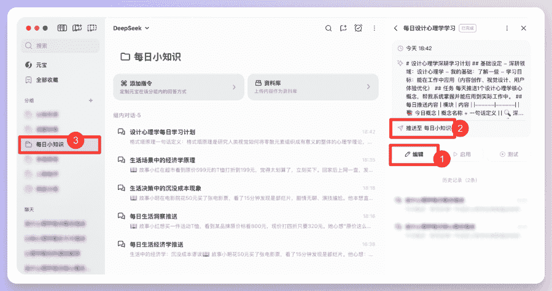

# 1.3 生活助手

在生活上元宝也可以提供帮助，可以结合自己的职业做一些方便的小提醒。像是运营，每天发布各类内容，有时候一个不注意就忘记了某个重要的节点，或者需要注意的日期避讳，就可以设置一个每天定时任务，每天上班前就知道了最近发布内容要抓住什么热点，避讳什么节点。如果有需要，还可以加上今日热门话题与选题建议等👇

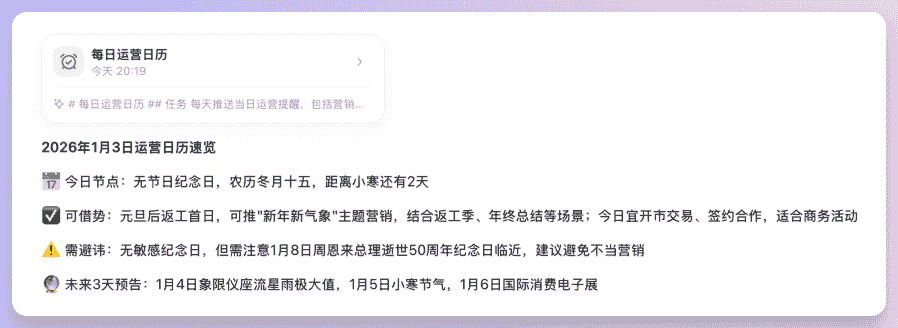

```
# 每日运营日历
## 任务每天推送当日运营提醒，包括营销机会和避讳事项。
## 推送内容| 类型 | 说明 ||------|------|| 📅 今日节点 | 节日/节气/纪念日/网络热梗日（如：世界读书日、秋分、双11预热） || ✅ 可借势 | 适合做内容/营销的点，附简要建议 || ⚠️ 需避讳 | 敏感纪念日/近期舆情/不宜营销的节点 || 🔮 未来3天预告 | 提前规划的重要节点 |
## 要求- 基于国情和舆论环境- 区分&quot;必须避开&quot;和&quot;建议低调&quot;- 节点来源：官方节日、网络热点日、行业营销节点
## 输出格式50字内速览卡片
```

线下见过我的人大都能看出来我是个 i 人，为了和人碰面聊天不尴尬，我叫元宝每天给我发个定时推送，告诉我今天如何和不熟悉的人聊一些轻松一点的话题，给我 5 个万金油话题做为聊天启动句，让我从 i 到 e 丝滑切换。简单来说就是【突然要和完全不熟悉的人尬聊怎么办】锦囊。哪怕突然没准备就遇到了，偷看一眼小抄也妥妥的。


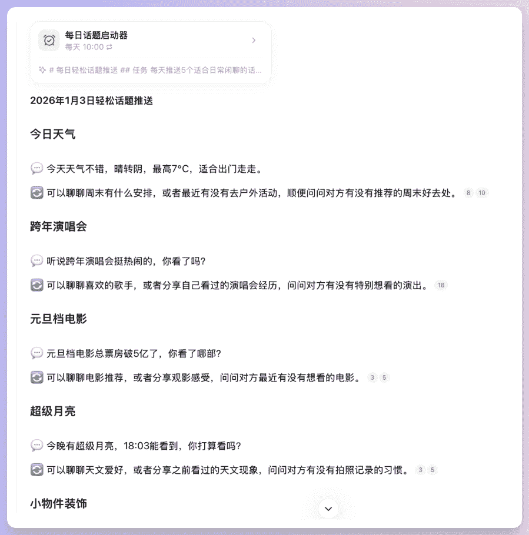

+

```
# 每日轻松话题推送
## 任务每天推送5个适合日常闲聊的话题启动器，用于同事、邻居、不太熟的朋友之间的轻松对话。
## 话题要求- 无压力、不尴尬、人人能接- 避开政治、收入、隐私等敏感区- 结合当天热点/天气/季节/生活小事/头条新闻
## 每个话题包含- 💬 开场话术（直接能说的1-2句）- 🔄 接话思路（对方回应后怎么往下聊）
## 输出格式5个话题，每个50字内，卡片式呈现。
```

还可以做一做懒人决策、成语/古诗/单词每日一学之类的。

如果一开始不知道新建什么任务，任务界面底部有个【探索使用案例】入口。点进去能看到官方精选的各种场景案例：健康打卡、学习计划、工作提醒、创意灵感等等，可以直接套用，或者看完之后根据自己的需求改一改。这个设计还挺贴心的，降低了使用门槛👇

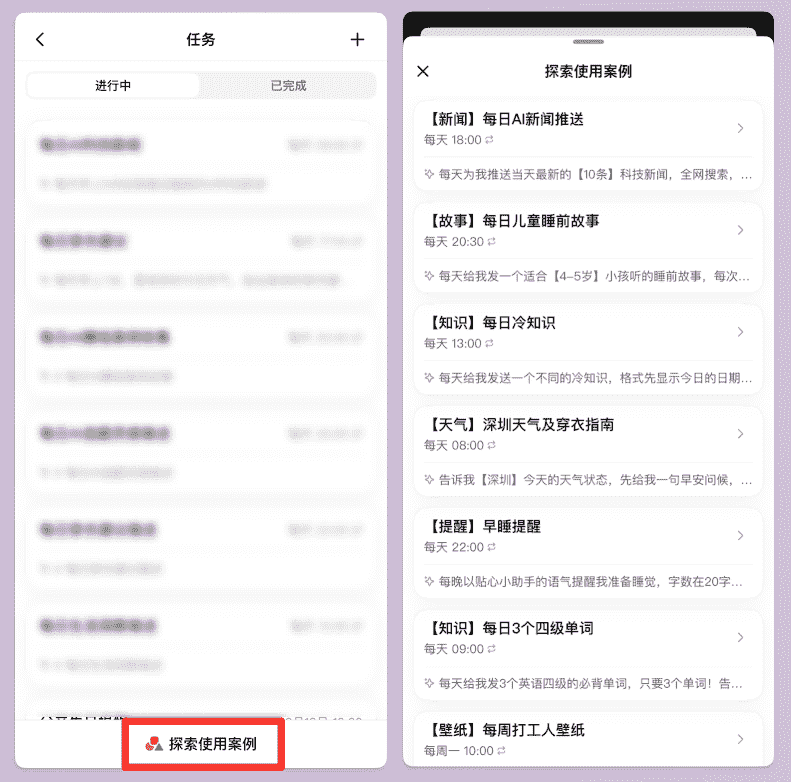

定时推送功能适合做我们的“第二大脑”，想养成习惯、工作忙怕忘事、需要定期收集灵感的人，核心就是到点自动提醒，点开即可查收，主打一个省事省心。

普通对话模式，问它问题，它你答案，聊完就结束了。它不会“记住”我们说过的事，更不会主动来提醒。任务模式不一样，它能记住+到点执行+主动提醒，让它从“被动回答问题的工具”变成了“主动管理时间和任务的助手”。

# 2. 其他功能

除了任务模式以外，元宝也还有很多其他实用有趣的功能，比如我之前分享过它的 AI 录音笔功能（此处插入链接）。

还可以疾速转文档格式，比如把 PDF 转为 Word 文档，把表格图片转为可以下载的表格文件等，这些在电脑端和手机 APP 上都可以操作，非常方便高效👇

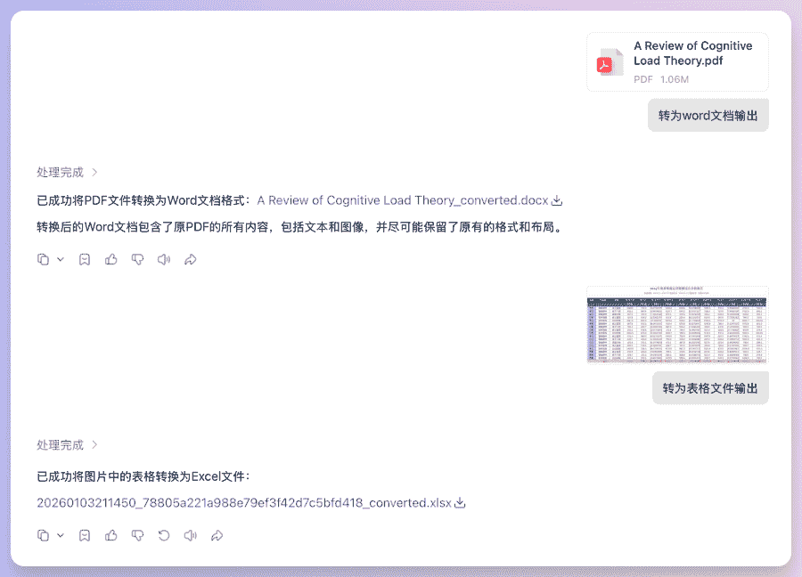

总结公众号内容（这个添加元宝为好友直接转发给元宝也很方便）👇

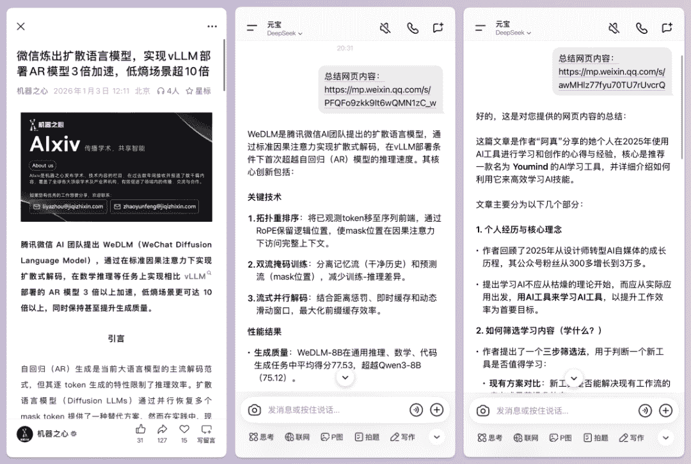

还有这个人像微动效果，可以基于人像生成视频，目前免费，很多趣味特效可选择👇

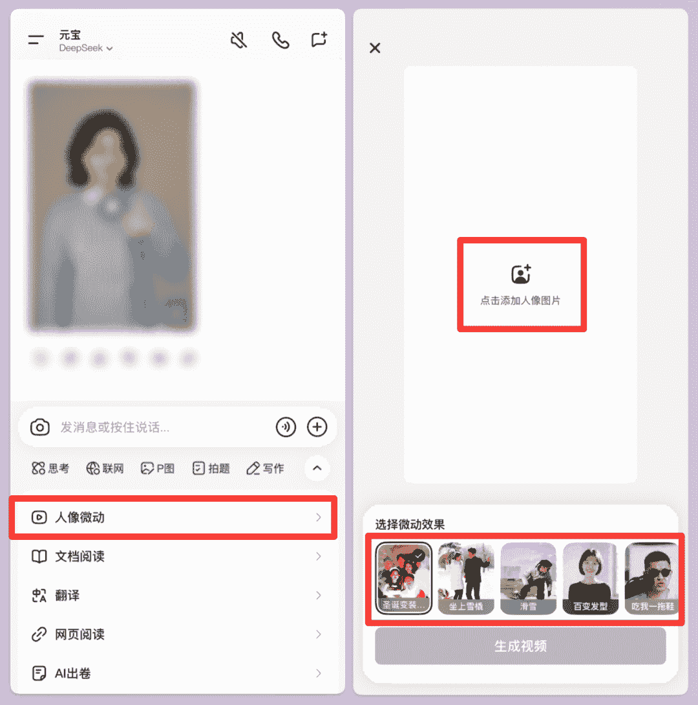


# 3. 小结

元宝这次上新的任务模式，其实是从你问我答模式升级到了“我主动服务你”模式。

以前 AI 助手像个百科全书，但我们主动翻它才有用；现在元宝逐渐更像真正的助理，记事、提醒、到点执行。背靠微信生态的独家数据，再加上主动服务的能力，元宝正在从一个内容工具变成生活服务入口。

当然，目前任务模式还比较基础，支持的场景和复杂度有限。但方向对了，后面的想象空间就大了。卷参数、卷速度的阶段快过去了，接下来卷的是谁能真正融入日常生活、替用户把事办了。元宝现在方向就挺对的，加油啊。

好啦今天的分享就到这里了，如果觉得内容有用或有帮助，欢迎猛猛三连鼓励阿真，我会持续产出更多内容的！

有更多想法、玩法，欢迎评论区一起交流～