# AI 春节抢红包手册（全网首发&持续更新 ing...

> 来源：[https://yunyinghui.feishu.cn/docx/Zs8UdkQDioTldbx5JjncwhEwn5g](https://yunyinghui.feishu.cn/docx/Zs8UdkQDioTldbx5JjncwhEwn5g)

> **适用人群：** 智能手机全民用户（长辈友好版）

> **首发时间：**2026 年 2 月 1 日

> **更新时间：**2026 年 2 月 5 日

> **内容出品人：**** **

> **内容出品方：**[玩赚 AI 实验室](https://yunyinghui.feishu.cn/wiki/WhelwZnxQi55mpkOzatc3Xran5b)**×****春节 AI 红包研究院**

> **核心定位**：可落地超详细的春节 AI 抢红包实操攻略指南

> **使用建议：**建议电脑端打开学习，如果需要快速定位到精确内容，可以使用快捷键 Ctrl +F/Command +F 的形式，搜索关键字/词，查找你想要的内容。

>

> **持续更新春节 AI 大战的****相关介绍，玩法步骤，隐藏口令等内**容，帮助大家最大化抢红包，永久免费在线查看，欢迎收藏、转发和支持，内容创作不易，请勿直接抄袭搬运。

# **🌈前言概述**

2026 年 AI 春节大战，是自 2015** 年🛰️****红包之后，时隔 1**1 年再次以“全民节日”为舞台的战略级对决。其意义远超营销本身，它是中国互联网巨头对“AI 时代入口主权”的第一次正面交锋，也可能是决定未来十年科技格局的关键战役。

**本次 AI 红包大战的核**心特点：金额高、周期长、玩法新。

1.  总金额创新高：**四大巨头红包总额超 50 亿元**，其中腾讯 “元宝” 红包 10 亿元，百度 “文心” 红包 5 亿元，阿里系红包数亿元级别，字节跳动春晚联动红包亿级规模，单个红包最高可达 1 万元甚至更高，锦鲤红包更是高达 8888 元。

1.  活动周期覆盖广：百度红包活动从 1 月 26 日持续至 3 月 12 日，长达一个半月；腾讯、阿里、字节跳动的活动也从 1 月底开始预约，贯穿整个春节假期，让用户每天都有参与机会。

1.  AI 玩法多样化：摆脱了传统的 “点点点” 抢红包模式，融入了 AI 问答互动、文生图创作、语音交流、社交裂变等创新玩法，既增加了趣味性，也提高了用户粘性。

1.  多平台联动发力：同一巨头旗下多个产品协同作战，如阿里打通支付宝、淘宝、天猫、千问 App，字节跳动联动抖音、豆包、火山引擎，形成全方位的红包入口矩阵。

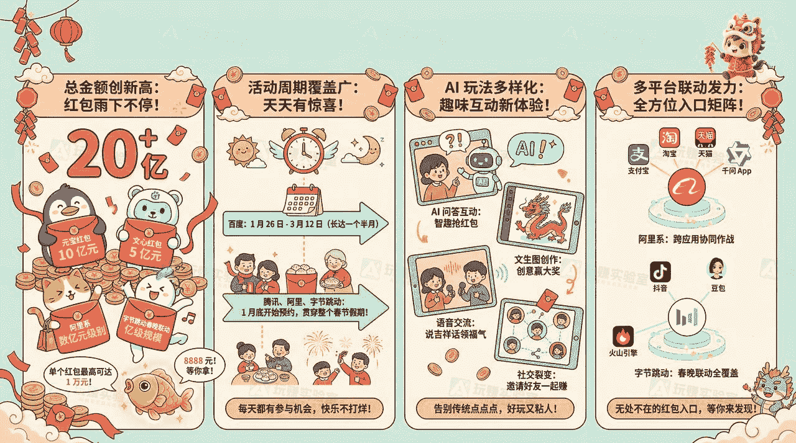

这场大战的胜负，不看谁撒钱最多，而看谁能让用户在红包领完后，依然每天打开它的 AI 产品。

本次 AI 春节大战总金额大、参与方式丰富，为帮助更多人能够知道玩法规则，更好的参与抢红包。但对于很多长辈来说，特别是 60 岁以上的叔叔阿姨，很多玩法看起来可能有点复杂。我会把腾讯、百度、阿里、字节跳动等大厂的红包统统梳理出来 ：

有哪些公司发红包

**每个红包金额大**概是多少

到底在哪里领、怎么领

参与步骤教给你让你“照着做就能领到”

...

**通篇干货，通俗易懂，全网首发，全网最全，不看遗憾。有**需要互助抢红包的，以及需要交流玩法的，欢迎🛰️扫码进群交流，大国在这里提前祝大家春节快乐！

**🛰️扫码进群**

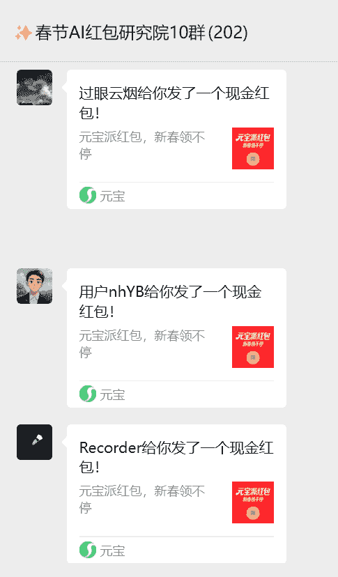

---

# 一、腾讯元宝：10 亿红包

作为中国市值最高、掌握最大流量入口的互联网公司，腾讯今年在春节**红包**大战中重振旗鼓，旗下 AI 应用 “元宝” 推出总额 10 亿元的现金红包，目标是重现 2015 年🛰️红包的高光时刻。活动从 2 月 1 日正式上线，已经在 1 月 25 日开放预约。参与用户只要打开元宝 App 预约，就可以在节日期间获得抽红包资格。

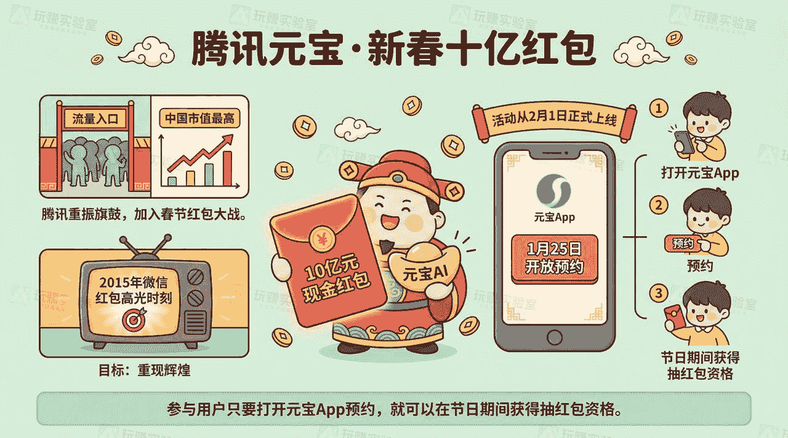

## **1.1 活动核心信息**

**总金额：**10 亿元

**单个红包金额：**不固定，最高 1 万元（或更高）大奖

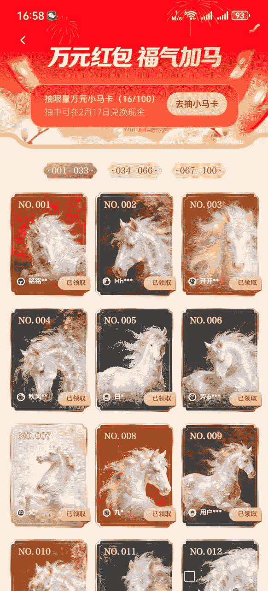

**活动时间：**1 月 25 日开放预约，2 月 1 日正式上线

**参与平台：**元宝 App（需更新至最新版本）

**提现渠道：**🛰️零钱

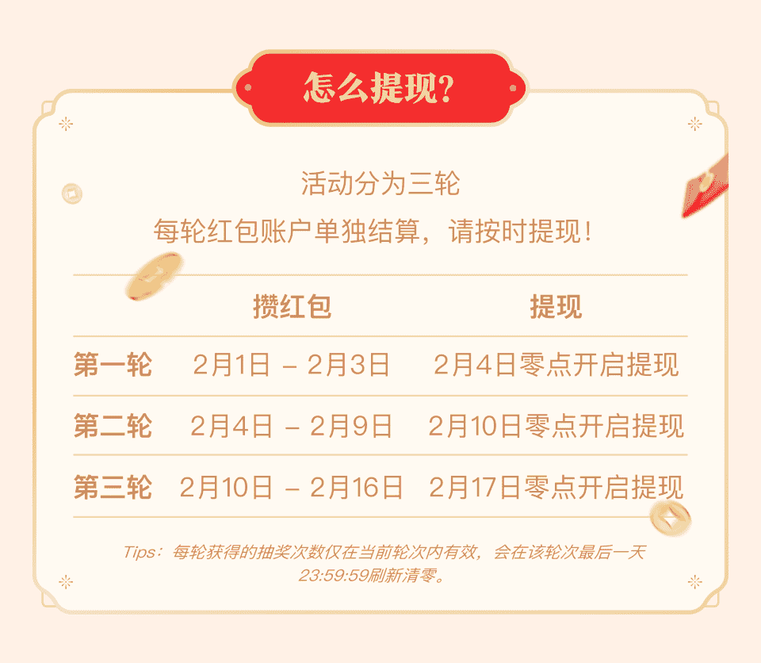

## 1.2 详细参与步骤

### 第一步：下载与更新

+   安卓用户：在应用商店搜索 “元宝”，下载安装后，进入设置页面点击 “检查更新”，确保版本更新至 2.55.0 及以上。（最新版本 V2.56.0.316）

+   苹果用户：打开 App Store，搜索“元宝”，点击右上角“更新”，同样需更新至 2.55.0 及以上版本，旧版本无活动入口，切记！（最新版本 V2.56.0.316）

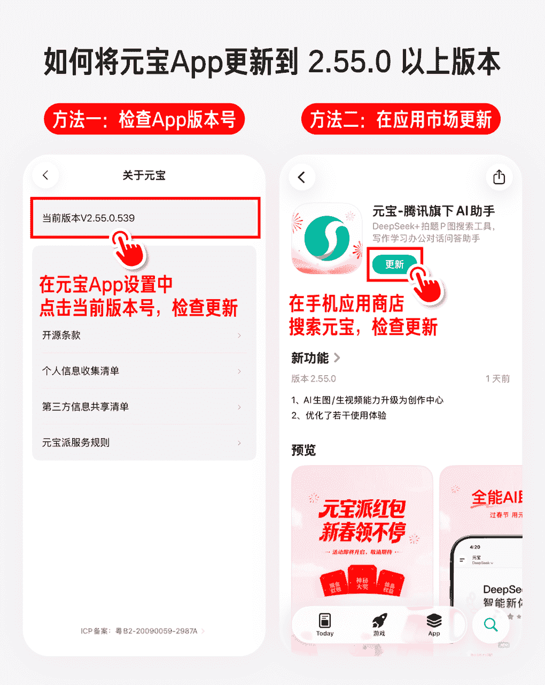

### 第二步：预约报名（2 月 1 日前有效）

1.  打开元宝 App，使用🛰️或手机号登录（建议用🛰️登录，方便后续提现）。

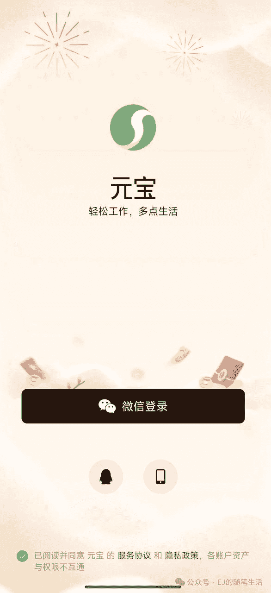

1.  在首页上方显著位置找到 “**春节活动开启预约**” 预约入口，点击立即预约。

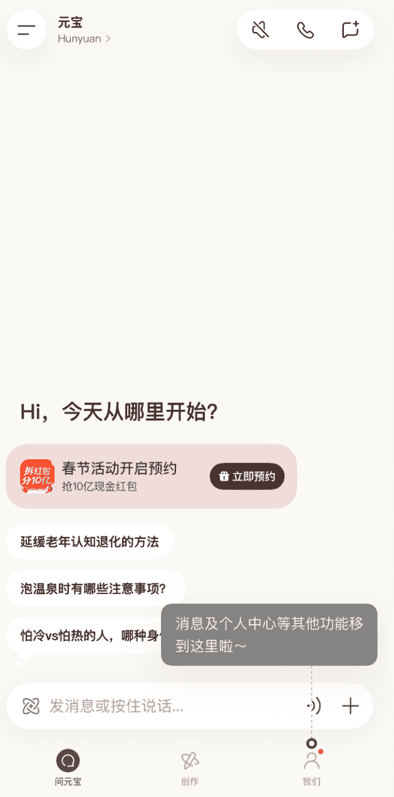

1.  预约成功后，系统会提示 “预约成功，2 月 1 日开启抽红包，并赠送初始抽奖次数。

### 第三步：完成任务积累抽奖机会

预约成功后，可通过以下任务增加抽奖次数，提高中奖概率：

1.  **每日登录：**每天打开元宝 App 即可获得 1 次抽奖机会。

1.  **AI 互动任务：**与元宝 AI 助手进行聊天、问答、指令操作（如让其推荐春节菜谱、写春联等），每次有效互动可获得 1-2 次机会。

1.  **社交裂变分享：**将活动页面分享给🛰️好友、🐧 好友或朋友圈，每成功邀请 1 位好友预约或参与活动，可获得 2 次抽奖机会，上不封顶。

1.  **内容创作任务：**使用元宝的 AI 生图功能制作春节主题图片（如全家福、春联、福字），并分享至社交平台，可获得 3 次抽奖机会。

1.  **联合任务：**参与元宝与🛰️读书、腾讯视频、王者荣耀等腾讯系产品的联动任务，如在🛰️读书阅读指定时长、在腾讯视频观看春节档影片片段等，可获得额外抽奖次数。

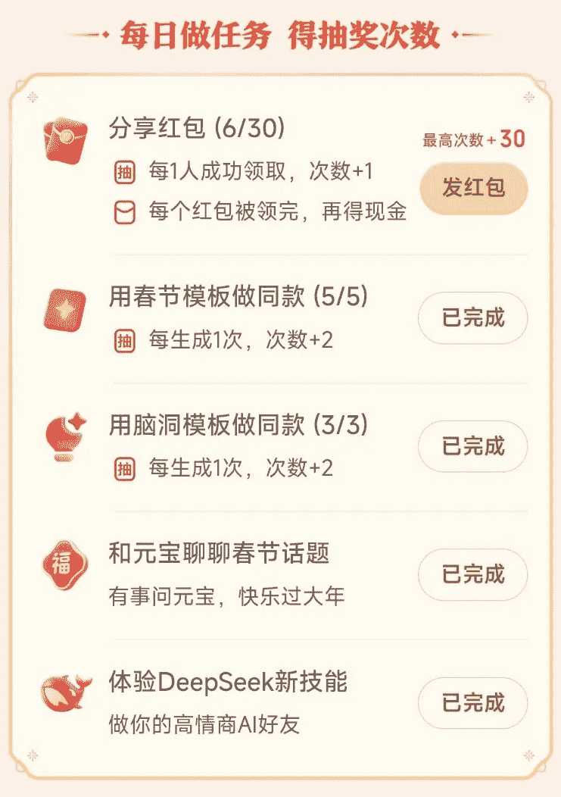

> 活动期间用户每日登录可领保底红包，通过分享、完成任务获得额外抽奖次数（每日最多额外获得 40+次），并可通过输入特定祝福语触发隐藏红包。

### 第四步：抽红包与开奖

+   **2 月 1 **日活动正式开启后，**登录元宝 App**，进入 “抢 10 亿” 活动页面，点击 “抽 1 次” 即可参与。

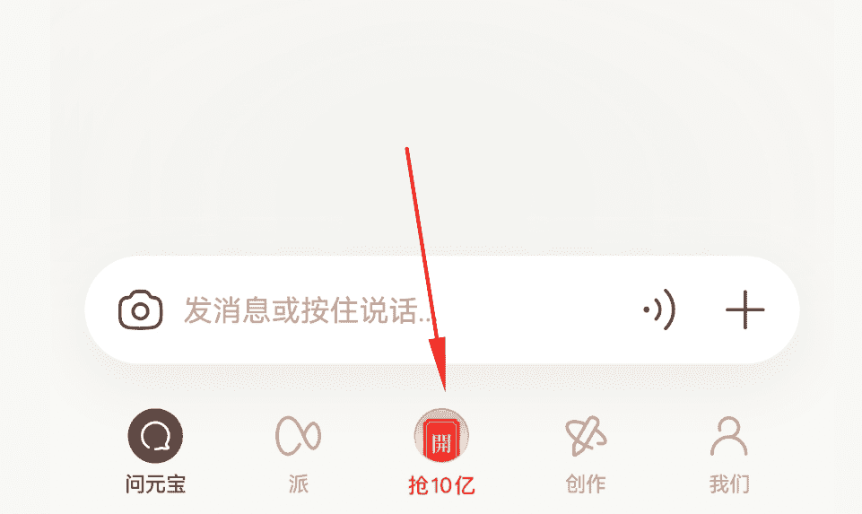

+   抽奖结果实时显示，中奖金额直接计入红包余额，未中奖也可获得其他福利，部分可兑换额外抽奖次数或腾讯系产品会员。

+   活动期间，每天都有固定开奖时段（如 12:00、18:00、20:00），此时段大奖概率更高，建议重点关注。

### 第五步：提现流程

1.  进入元宝 App “我的” 页面，找到 “红包余额” 入口。

1.  点击 “提现”，选择提现至🛰️零钱（需绑定🛰️账号，确保🛰️已完成实名认证）。

1.  提现金额无最低限制（部分用户可能需满 1 元），提现申请提交后，一般 24 小时内到账，春节高峰期可能延迟至 48 小时。

1.  注意：提现需在活动结束后 30 天内完成，逾期未提现的红包金额将自动失效。

## 1.3 专属技巧与隐藏福利

+   **提前预约福利：**1 月 25 日 - 1 月 31 日期间预约的用户，可额外获得 “预约专属红包”，开奖时中奖金额保底 1 元。

+   **好友助力翻倍：**邀请 3 位及以上好友组成 “红包战队”，团队成员抽奖时中奖概率翻倍，队长可额外获得 “战队红包”（最高 88 元）。

+   **夜间福利场：**每天 00:00-01:00 为夜间福利场，此时段参与任务获得的抽奖次数翻倍，适合熬夜党参与。

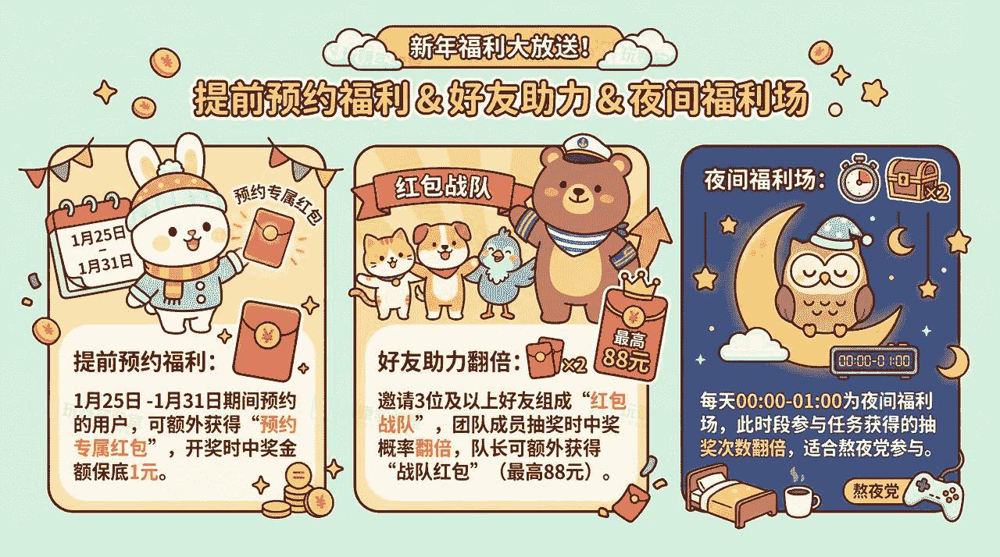

+   **三个隐藏福利，轻松多赚现金：**

**1️⃣隐藏祝福语红包：**每天会不定期下发红包祝福语（口令），在 App“问元宝”对话框输入指定祝福语并发送，即可触发红包，有机会抽到 188 元、888 元大额红包。

> **隐藏祝福语口令合集：**

> **隐藏口令：**祝你今年金拱门

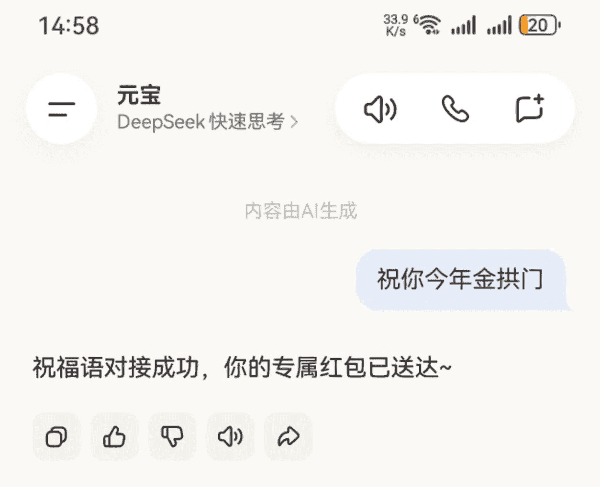

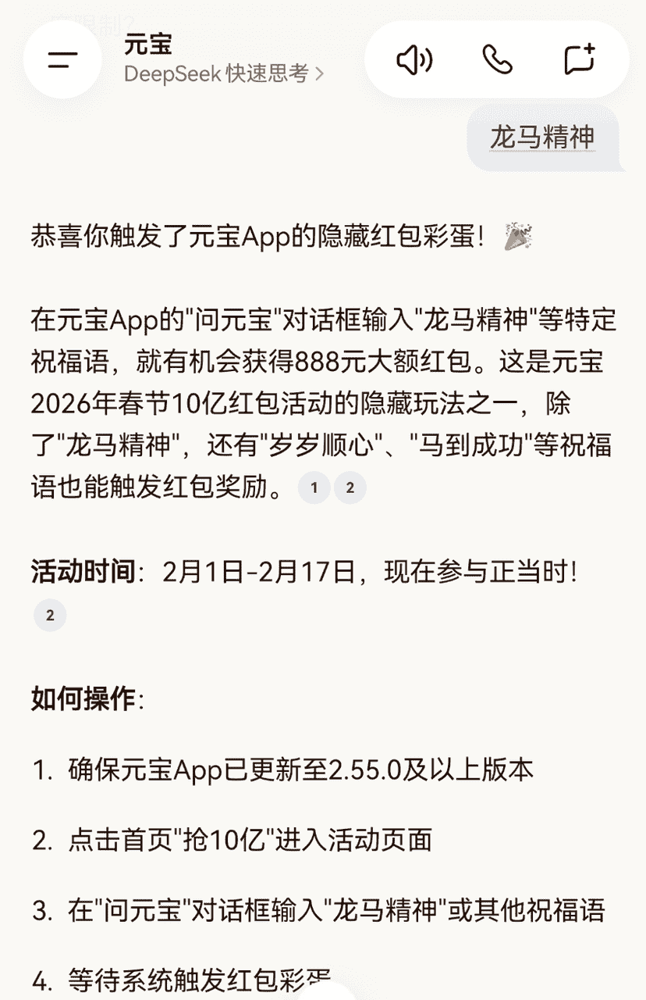

**2️⃣红包雨：**活动期间，App 会不定时开启红包雨，点击屏幕掉落的红包，即可直接领取现金，记得打开 App 消息通知，避免错过。

**3️⃣惊喜拜年红包：**活动期间（2 月 16 日 0 点 -2 月 17 日 23:59:59）会不定时触发 0.01-8.88 元随机金额惊喜拜年红包，在拜年活动时间内在 APP 活跃或从相关活动界面进入元宝 APP 的用户有机会领取。

## 1.4 常见问题解答

+   Q：元宝 App 无法更新怎么办？

A：安卓用户可前往元宝官网下载最新安装包，苹果用户可尝试退出 App Store 重新登录后更新，若仍无法更新，可联系元宝客服（App 内 “我的”-“客服中心”）。

+   Q：分享给好友后未获得抽奖机会？

A：需确保好友是首次下载并登录元宝 App，且成功完成预约或参与活动，好友完成操作后，抽奖机会将在 24 小时内到账。

+   Q：**提现时提示实名认证未完成？**

A：需先完成🛰️的实名认证（绑定银行卡），再返回元宝 App 重新提交提现申请。

+   **Q：没预约能参加正式活动吗？**

A：可以。

+   Q：提现多久到账？会不会有手续费？

A：实时到账（几秒内），无任何手续费，全额到账🛰️零钱，可直接使用。

+   Q：一个手机能登录多个账号参与吗？

A：不可以，同一设备、同一🛰️/手机号视为同一用户，多账号操作会违规，奖励清零。

+   Q4：万元小马卡真的能抽到吗？抽到后能顺利提现吗？

A：真的！活动官方明确说明，限量 100 张，每张可兑换 1 万元现金，抽到后按提示在 2 月 17 日当天提现，即可顺利到账🛰️。

---

# 二、百度文心：5 亿红包

**百度紧随其后，宣布在 2**026 马年春节期间开启 5 亿元现金红包活动 。红包活动从 1 月 26 日开始，一直持续到 3 月 12 日 ，活动周期长达一个半月，覆盖整个春节黄金期，玩法丰富且门槛低，适合持续参与。

**2 月 17 日 19:30**

百度 APP 将作为**首席 AI 合作伙伴**

登上 2026 北京广播电视台春节联欢晚会

## 2.1 活动核心信息

+   **总金额：**5 亿元

+   **单个红包金额：**最高 1 万元，另有 666 元、888 元等大额红包

+   **活动时间：**1 月 26 日 - 3 月 12 日

+   **参与平台：**百度 App（需更新至最新版本）

+   **提现渠道：**🛰️、支付宝

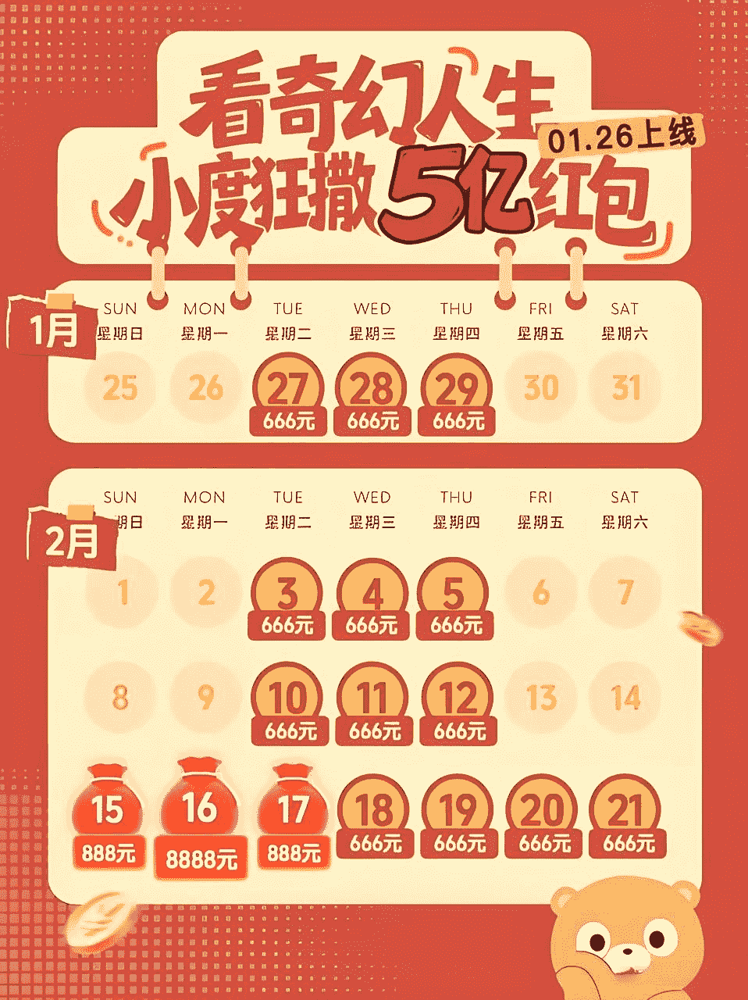

## 2.2 详细参与步骤

### 第一步：准备工作

+   下载并安装百度 App（已安装的用户需更新至最新版本）。

+   用手机号登录百度 App，完成实名认证。

### 第二步：寻找活动入口

1.  打开百度 App，在首页搜索栏输入 “春节红包”“文心红包” 或 “分 5 亿”，点击搜索结果顶部的活动入口进入。

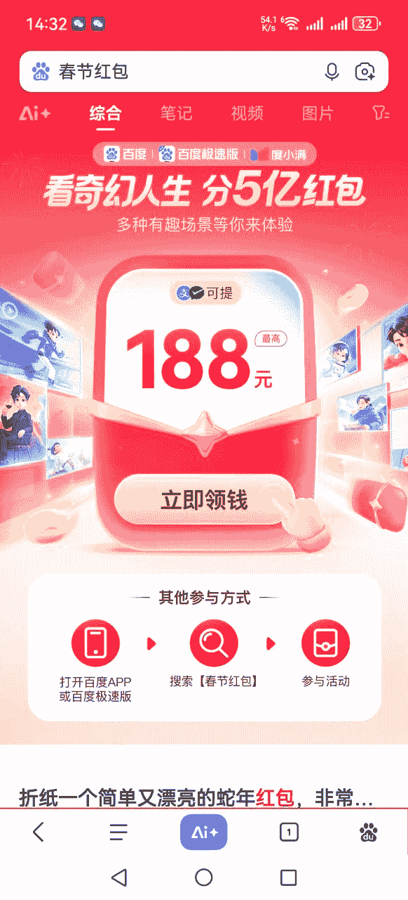

1.  活动入口为红色背景，带有 “**看奇幻人生分 5 亿红包**” 字样，非常显眼，容易找到。

### 第三步：参与玩法与任务

#### 玩法一：全新玩法！边看视频边领钱

**1 月 26 日**起，上百度 APP 搜索**「****春节红包****」**

体验与众不同的“人生游戏”⬇️

现实中无法实现的「另一种人生」

在百度 APP 都可以愿望成真！

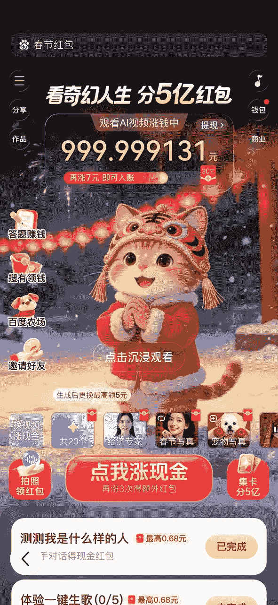

#### **玩法二：**奇幻人生集卡！最高得万元

在奇幻人生互动玩法的基础上

百度 APP 打造「**奇幻人生卡**」集卡活动

在体验互动剧情时，做出不同选择解锁身份

就有机会获得不同人生主题的卡面

多种“人生盲盒”等你来开！

集卡活动共四轮

每一轮集齐后都可以瓜分丰厚奖金！

**划重点****⬇️⬇️⬇️**

除了常规卡之外，还有五种稀有卡：

马上发财卡、马上转运卡、马上脱单卡

**马上成功卡、马上有福卡**

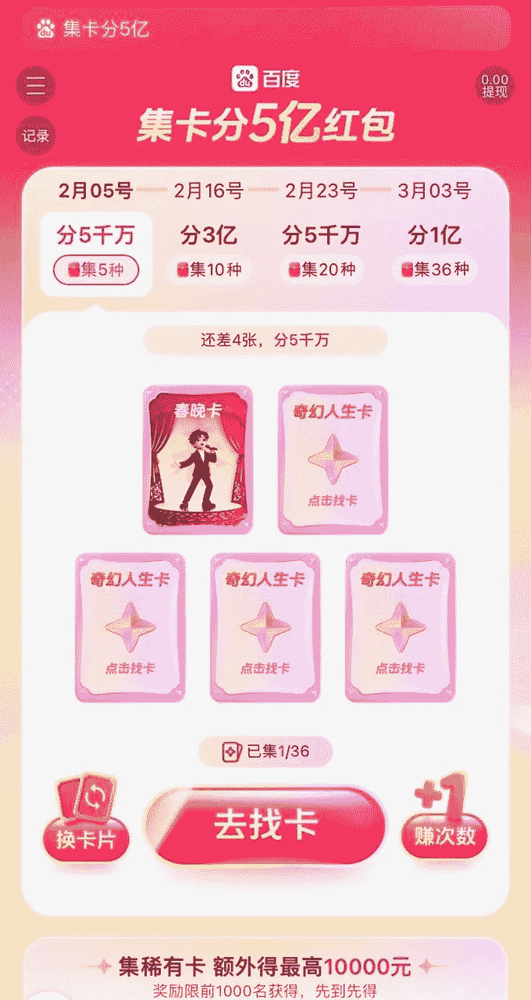

集齐这五张卡后 无需等待 立即开奖

前 1000 名集齐稀有卡片的用户

最高可获得** 10000 元现金**！

活动持续至 2 月 24 日 万元现金等你拿！

#### **玩法三：**召唤文心助手，5 亿红包越玩越有！

1 月 27 日 -2 月 21 日晚 20 点

📕官方账号@百度搜索 将发布线索

进行“**看马图猜口令词**”

只需在文心助手内输入猜中的口令词

即可开启隐藏红包彩蛋！

最高有机会斩获

**8888、888、666 **元不等的惊喜大奖！

一定不要错过！活动将持续到 2 月 21 日！

**别划走！红包还没完——**

红包任务已融入文心助手

近百种春节创意玩法之中

活动期间，只要使用文心助手

就能**瓜分 5 亿现金红包！**

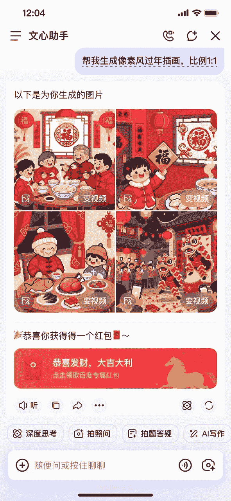

打开文心助手，还有超多玩法都会掉落惊喜红包

---

# 三、阿里千问/支付宝：30 亿

虽然**阿里巴**巴官方未完全公开 “千问” 红包的具体金额，但根据行业估计，阿里系红包总额达数亿元级别。作为少数具备全栈式 AI 能力的科技公司，阿里将通义千问 AI 助手与支付宝、淘宝、天猫等产品深度联动，经典的 “集福卡” 活动也将与 AI 互动结合，玩法丰富且覆盖广泛。

## 3.1 活动核心信息

+   **总金额：****30 亿**

+   **单个红包金额：**最高 888 元，集福卡合成后可平分亿元红包

+   **活动时间：**1 月 30 日 - 2 月 17 日（除夕当天为开奖高峰）

+   **参与平台：**支付宝 App、淘宝 App、天猫 App、千问 App

+   **提现渠道：**支付宝余额

## 3.2 支付宝集福攻略

---

# 四、字节：豆包/火山引擎/春晚互动红包

字节跳动今年以最高价码拿下央视春晚的合作，火山**引擎**成为春晚 AI 云合作伙伴，智能助手豆包深度嵌入春晚互动，旗下抖音、今日头条等平台同步推出红包活动，亿级奖池覆盖全民。

## 4.1 活动核心信息

+   **总金额：**亿级规模（具体金额未完全公开）

+   **单个红包金额：**最高 8888 元锦鲤红包，普通红包金额 0.1-200 元不等

+   **活动时间：**1 月 28 日 - 2 月 17 日（春晚当天 20:00-00:00 为高峰时段）

+   **参与平台：**抖音 App、豆包 App、今日头条 App、火山引擎相关产品

+   **提现渠道：**抖音钱包、支付宝余额

## 4.2 详细参与步骤

### 第一步：平台准备

+   下载并更新抖音 App、豆包 App（今日头条 App 若已安装需更新至最新版本）。

+   用手机号登录各平台，完成实名认证（抖音钱包需绑定银行卡）。

### 第二步：春晚直播互动红包

这是字节跳动春节红包的重头戏，大概步骤如下：

1.  春晚当天（2 月 17 日）20:00，打开抖音 App 或豆包 App，进入春晚直播页面（首页会有显著入口）。

1.  参与直播互动任务：

+   **整点红包雨：**春晚直播期间，每个整点（20:00、21:00、22:00、23:00、00:00）会发放红包雨，点击屏幕上的红包即可领取，红包金额随机。

+   **口令红包：**主持人会在春晚节目中公布红包口令，在抖音 App 或豆包 App 输入口令，即可参与抢红包，口令有效期一般为 10 分钟。

+   **AI 互动任务：**根据直播提示，与豆包 AI 助手互动，如发送 “春晚快乐”“豆包送福” 等指令，有机会获得大额红包。

+   **点赞 / 评论互动：**对春晚直播进行点赞、评论，每天可获得 3 次抽奖机会，有概率抽中锦鲤红包。

1.  红包领取后，金额直接计入抖音钱包或豆包 App 红包余额，可随时提现。

---

# 五、怎么一步步领取红包？老年人也能照做！

这里给大家整理一套“**通用领红包步骤**”，60 岁的叔叔阿姨也一看就懂：

## 第一步：准备好智能手机

+   **安卓/苹果均可 **，建议提前更新 App 到最新版本。

+   连接稳定的 Wi-Fi 网络（避免使用流量，节省话费且网络更稳定）。

## 第二步：下载相关 App

+   🛰️/🐧（用于分享领取）

+   元宝 App（腾讯红包）

+   百度 App（文心红包）

+   支付宝 App（阿里红包）

+   抖音/快手/京东/拼多多等（可选）

## 第三步：登录账号

用您的手机号/🛰️登录，如果没有可以让家人帮助注册。

## 第四步：寻找红包入口

打开对应 App 后：

腾讯元宝：首页会有“春节分 10 亿”预约卡片；

百度 App：搜索“春节红包”或进入红包专区；

支付宝：搜索“春节红包/千问”；

豆包/春晚互动：进入春晚互动页面即可参与。

## 第五步：参与任务领取

不同平台有不同任务：

+   **每天登录签到**

+   **完成搜索任务**

+   **参与 AI 互动答题**

+   **分享给好友增加抽奖次数**

+   **观看直播活动抽红包**

这些任务非常简单，不会占用太多时间，家人陪着做更轻松。

## 第六步：提现红包

平台发放的现金红包多可以 **直接提现到🛰️零钱/支付宝余额**** **，有的需要先兑换或满足最低提现条件。

---

# 六、抢红包技巧：提高中奖率的 10 大秘诀

###  1、提前预约，抢占先机

所有大厂红包活动都支持提前预约，提前预约不仅能获得专属福利，还能第一时间收到活动开启提醒，避免错过最佳参与时间。建议 1 月 25 日 - 1 月 31 日期间完成所有目标平台的预约，不要等到活动开启后再参与。

### 2、每日坚持，积累机会

大部分红包活动都需要每日参与任务积累抽奖机会，坚持每天登录、完成简单任务，能显著提高中奖概率。建议设置手机闹钟，每天固定时间（如早上 9:00、晚上 8:00）参与任务，避免遗漏。

### 3、社交裂变，扩大机会

邀请好友参与是获得额外抽奖机会的重要方式，建议组建红包助力群，与好友互赠福卡、助力，既能快速完成任务，又能增加中奖概率。邀请新用户参与的奖励更丰厚，可优先邀请未下载相关 App 的亲友。

### 4、关注高峰，精准出击

各大平台都有红包发放高峰时段，如整点、晚间黄金时段（19:00-21:00）、春晚直播时段等，这些时段的奖池金额更高、中奖概率更大，建议重点关注，提前做好准备。

### 5、善用 AI，触发彩蛋

今年红包活动大量融入 AI 互动，发送特定指令可触发隐藏红包，建议多尝试与 AI 助手互动，发送春节相关的祝福语、指令，如 “马年大吉”“红包拿来”“送我福卡” 等，可能会有意外惊喜。

### 6、优化设备，保障流畅

抢红包时设备卡顿会错失机会，建议提前清理手机内存（关闭后台不必要的应用）、连接高速 Wi-Fi（避免使用流量）、降低屏幕亮度（延长续航），确保手机操作流畅。

### 7、多平台参与，分散风险

不要只专注于一个平台，可同时参与多个大厂及小众平台的红包活动，既能增加红包总额，又能避免因单个平台中奖率低而空手而归。建议根据自身时间和操作能力，选择 3-5 个重点平台深耕。

### 8、注意细节，避免踩坑

+   仔细阅读活动规则，了解红包有效期、提现条件、任务要求，避免因操作不当导致红包失效。

+   完成任务后及时领取抽奖机会，部分任务的抽奖机会有时间限制，逾期未领取将自动失效。

+   提现时确保账号已完成实名认证，绑定正确的提现账户（🛰️、支付宝或银行卡），避免提现失败。

### 9、利用辅助，提高效率

+   电脑端打开活动攻略，用快捷键 Ctrl+F/Command+F 搜索关键词，快速查找所需信息。

+   加入红包资讯群，及时获取最新活动信息、隐藏口令、助力资源。

+   老年人可让家人帮忙设置 App 提醒，确保不错过重要活动时段。

### 10、保持心态，享受乐趣

抢红包的核心是享受春节的热闹氛围，不要过于执着于大额红包，保持平常心，积少成多也能收获满满。参与过程中多与家人、好友互动，让春节更有意义。

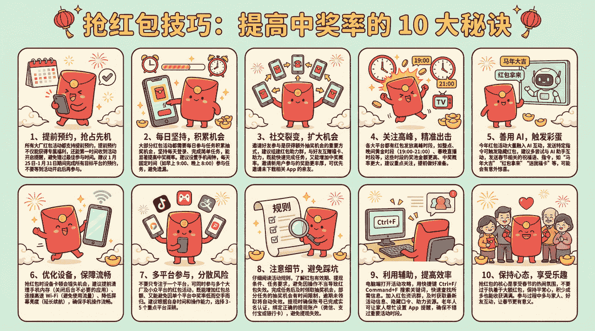

---

# 七、安全提示与常见问题解答

## 7.1 安全提示

1.  **警惕诈骗链接：**不要点击陌生人发送的 “红包链接”“中奖链接”，所有红包活动均通过官方 App 参与，避免被骗。

1.  **保护个人信息：**不要向他人泄露手机号、验证码、银行卡号等个人信息，官方活动不会要求提供这些信息。

1.  **拒绝高额缴费：**正规红包活动无需缴纳任何费用，若提示 “缴费参与”“缴费提现”，一律视为诈骗。

1.  **谨慎授权：**参与活动时，App 若请求授权（如位置、相册、麦克风），可根据需求选择是否授权，不必要的授权可拒绝。

1.  **及时更新 App：**保持 App 为最新版本，既能享受最新功能，又能避免因旧版本存在漏洞导致账号安全问题。

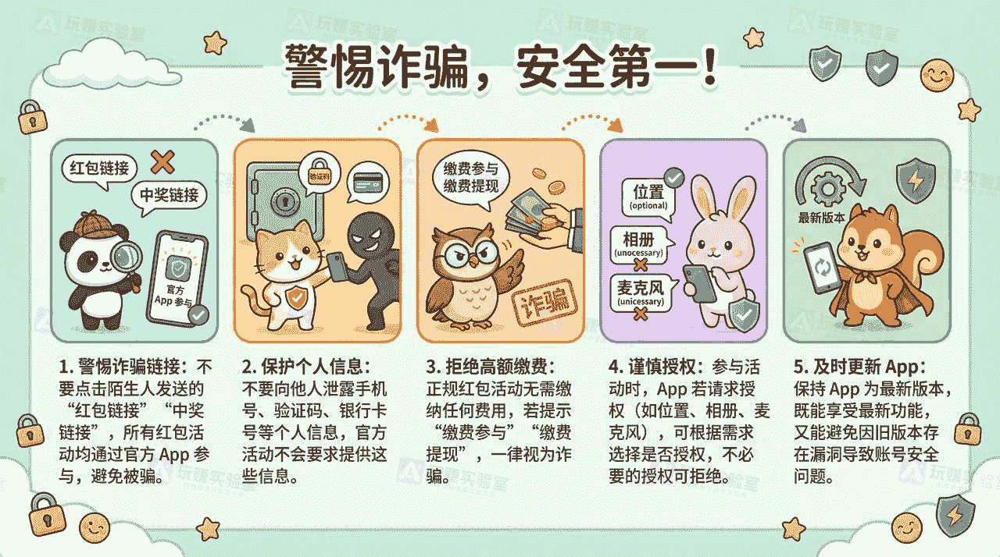

## 7.2 常见问题解答

**Q：红包活动是否需要付费参与？**

A：所有正规平台的红包活动均为免费参与，无需缴纳任何费用，若遇到付费参与的情况，可直接举报。

**Q：红包提现需要手续费吗？**

A：大部分平台的红包提现均无需手续费，少数平台可能对大额提现收取手续费（会提前告知），建议优先选择无手续费的提现渠道。

Q：未成年人可以参与红包活动吗？

A：未成年人需在监护人陪同下参与，提现需使用监护人的实名认证账号，部分平台对未成年人的红包金额有上限限制。

Q：同一设备可以登录多个账号参与活动吗？

A：大部分平台禁止同一设备登录多个账号参与活动，若违规操作，可能导致账号被封禁、红包失效，建议使用个人专属设备参与。

Q：红包活动结束后未提现怎么办？

A：不同平台的规则不同，大部分平台的红包余额在活动结束后 30 天内仍可提现，部分平台逾期未提现将自动失效，建议及时提现。

Q：参与活动时遇到问题如何咨询？

A：可通过 App 内的 “客服中心” 咨询，或拨打平台官方客服电话，也可在平台官方🧣、🛰️👸号留言咨询。

---

# 总结

2026 年马年春节 AI 红包大战已全面打响，腾讯、百度、阿里、字节跳动四大巨头携巨额资金和 AI 技术入局，各类小众平台也纷纷加入，形成了全民参与的热闹格局。这场红包大战不仅是一场 “撒钱盛宴”，更是一次 AI 技术的全民普及，从 AI 互动答题、文生图创作到语音交流、社交裂变，让不同年龄段的用户都能感受到 AI 的魅力。

本手册详细拆解了各大平台的红包活动，从活动信息、参与步骤、提现流程到抢红包技巧，全方位为你提供支持。无论你是追求高额红包的年轻群体，还是想轻松参与的中老年朋友，都能在手册中找到适合自己的内容。

最后，提醒大家在抢红包的同时，注意安全、理性参与，不要过度沉迷。春节的核心是团圆与快乐，与家人、好友一起参与红包活动，分享喜悦，才是最珍贵的收获。祝大家在 2026 年马年春节红包多多、好运连连、阖家幸福！

本手册将持续更新春节红包活动的**最新信息、隐藏口令、玩法升级**等内容，欢迎收藏、转发，让更多人享受 AI 红包的乐趣！如有任何问题或建议，可在评论区留言，我们将及时回复。