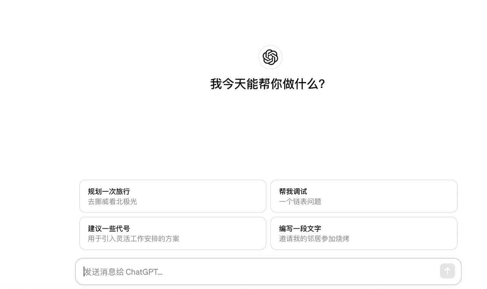
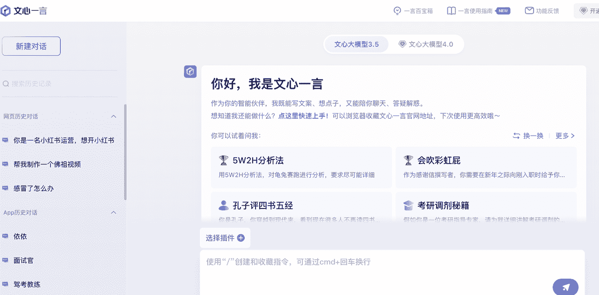
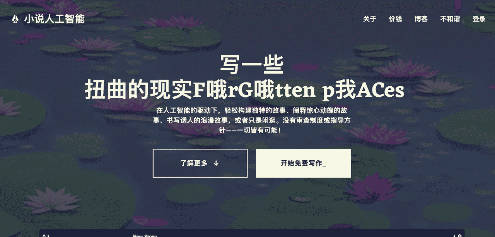
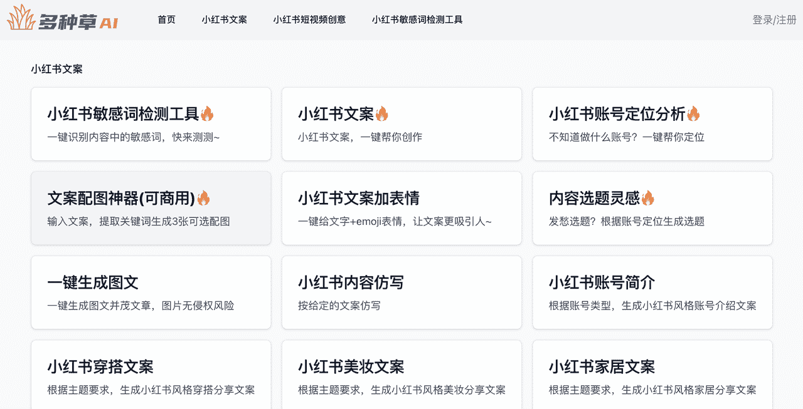
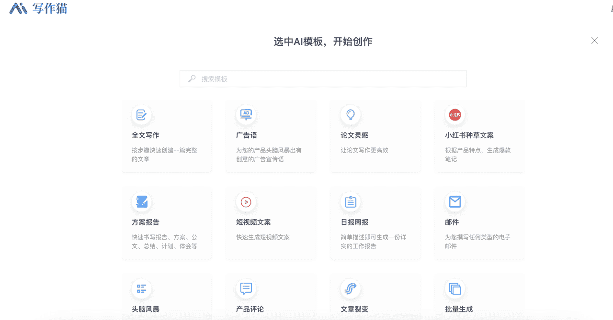
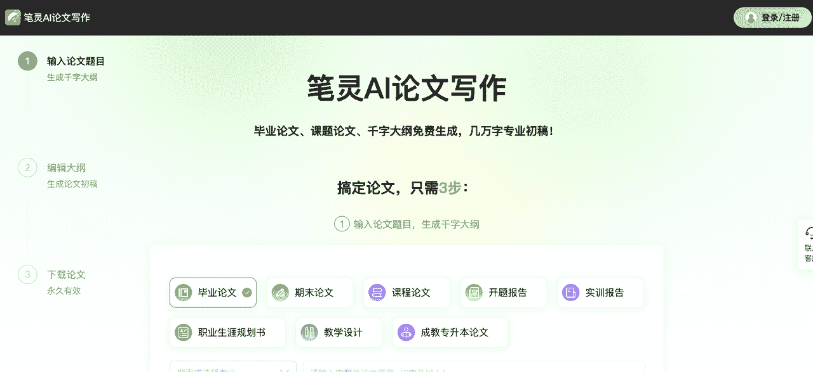
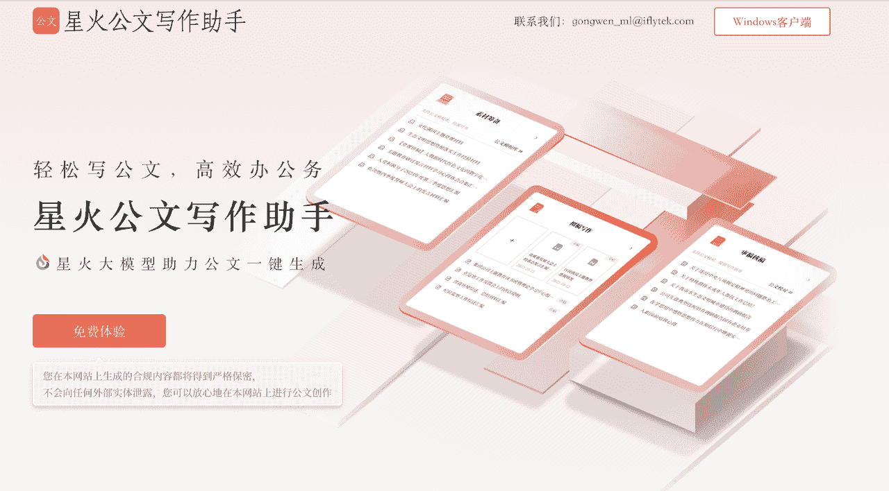
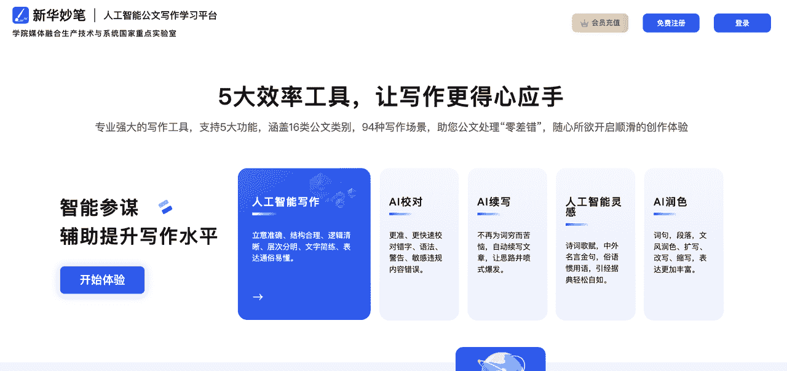
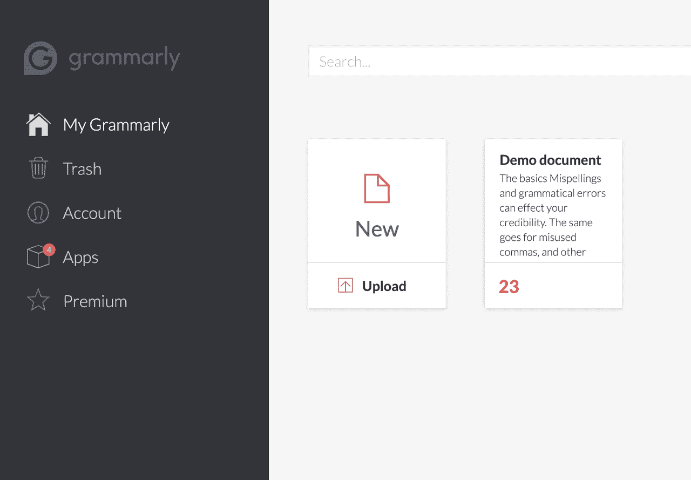

# AI 写作工具精选

> 来源：[https://yunyinghui.feishu.cn/docx/TdSmdHXnho6KH4xqQ21cu5ujnIg](https://yunyinghui.feishu.cn/docx/TdSmdHXnho6KH4xqQ21cu5ujnIg)

> **适用人群：****互联网 AI 写作人群**

> 首发时间：2024 年 3 月 12 日

> 更新时间：2024 年 3 月 12 日

> **内容出品人：**

> **内容出品方：**[Mix AI Lab](https://yunyinghui.feishu.cn/wiki/WhelwZnxQi55mpkOzatc3Xran5b?from=from_copylink)

> **使用建议：**如果需要快速定位到精确内容，可以使用快捷键 Ctrl +F/Command +F 的形式，搜索关键字/词，查找你想要的内容。

> **持续更新 AI 写作好用的****相关工具，工****具介绍等内容，工具经**过测评口碑相对比较不错的精选出来，永久免费在线查看，欢迎收藏转发支持，文末有惊喜，大国出品，必属精品。

# 更新记录

# 写作工具导航

| ## 写作工具导航 |  |  |  |  |
| --- | --- | --- | --- | --- |
| [**AI 文章写作**](https://yunyinghui.feishu.cn/wiki/Icvjw2vW5iiDcGkGUqScMjWfnNb#MmtUdYxIqooaLPxJid0cFTrqnwh) | [**AI 小说写作**](https://yunyinghui.feishu.cn/wiki/Icvjw2vW5iiDcGkGUqScMjWfnNb#part-CkPjd6iJboUnVQxnYg1cGMrMnQc) | [**AI 营销写作**](https://yunyinghui.feishu.cn/wiki/Icvjw2vW5iiDcGkGUqScMjWfnNb#part-Q4zWd5SDSoURTOxehnVcm4xXnVh) | [**AI 自媒体写作**](https://yunyinghui.feishu.cn/wiki/Icvjw2vW5iiDcGkGUqScMjWfnNb#part-HfygdcgDIohZwqx8k4mc9POJnWe) | [**AI 作文写作**](https://yunyinghui.feishu.cn/wiki/Icvjw2vW5iiDcGkGUqScMjWfnNb#part-LoBtd71XFo950GxgRb5cvwnVnvb) |
| [**AI 论文写作**](https://yunyinghui.feishu.cn/wiki/Icvjw2vW5iiDcGkGUqScMjWfnNb#part-DTyEdZOw6okYQGx4577c9QGMnUg) | [**AI 公文写作**](https://yunyinghui.feishu.cn/wiki/Icvjw2vW5iiDcGkGUqScMjWfnNb#part-Pis9dfh9EoJEPsxUsmjcDEAQn8H) | [**AI 英文写作**](https://yunyinghui.feishu.cn/wiki/Icvjw2vW5iiDcGkGUqScMjWfnNb#part-KZNCd5q0joQ6ehxLO99ceiqdnPe) |  |  |

# AI 文章写作

## **1.ChatGPT**

**工具介绍：**ChatGPT 是人工智能技术驱动的自然语言处理工具，它能够通过理解和学习人类的语言来进行对话，还能根据聊天的上下文进行互动，真正像人类一样来聊天交流，甚至能完成撰写邮件、视频脚本、文案、翻译、代码，写论文等任务。

**工具优点：**目前最强的语言大模型，超强的对话能力，主要通过提示词和投喂训练才能生产符合要求的内容

**是否免费：**4.0 以下版本免费，4.0 以上版本需要付费

**网络条件：**需要特殊网络

**体验网址：**https://chat.openai.com/auth/login

**使用建议：**在所有写作软件当中最优先体验和使用的工具，用好有一定的门槛

## 2.Notion AI

**工具介绍：**Notion AI 是一个连接的助手，可以帮助用户更好地写作、编辑和总结文档。

**工具优点：**

1）自动化生成：NotionAI 可以自动化生成文章，让写作变得更加便捷和高效。

2）质量保证：NotionAI 生成的文章质量高，具有流畅性、逻辑性和准确性，可以满足不同场景下的需求。

3）多领域适用：NotionAI 不仅仅适用于新闻报道，还可以用于科技、商业、娱乐等各个领域的文章生成，满足不同用户的需求。

**是否免费：**有免费的试用，会员付费 10 美元起步

**网络条件：**需要特殊网络

**体验网址：**[www.notion.so](https://www.notion.so/3f3eec81f36e4ef7ab5d0ae298649f9d?p=c6134c98ade6484a8a37c04af50cd045&showMoveTo=true&saveParent=true)

**使用建议：**写优质文章的可以使用该工具

## 3.文心一言

**工具介绍：**文心一言是基于飞桨深度学习平台和文心知识增强大模型的 AI 对话互动工具，可以根据你的输入生成各种类型的文本内容和图片，也可以进行知识问答和多模态交互。

**工具优点：**百度出品，主要是训练模型的中文内容库丰富，要提示词和投喂训练才能生产符合要求的内容

**是否免费：**4.0 以下版本免费，4.0 以上版本需要付费

**网络条件：**不需要特殊网络

**体验网址：**https://yiyan.baidu.com/

**使用建议：**国内最先发布的中文对话大模型，总体来说满足基本需求，推荐简单使用

# AI 小说写作

## 1.Novel AI

**工具介绍：**NovelAI 是一个基于人工智能的故事生成器，可以根据你的输入和偏好，创作出类似人类的写作，让你无论有无写作能力，都能创作出优质的文学作品。这是一款专门为生成小说而设计的强大的 AI 写作助手。 通过接受用户提示，Novel AI 可以创建丰富而详细的故事情节、角色和对话。

**工具优点：**超强的写故事能力，Novel AI 的独特功能之一是它能够保持故事的长期连贯性，使其特别适合编写小说等较长的作品。

**是否免费：**有免费的试用，会员付费 10 美元起步

**网络条件：**需要特殊网络

**体验网址：**https://novelai.net/

**使用建议：**写长篇小说的可以使用该工具

## 2.Sudowrite

**工具介绍：**创始人是作家 Amit Gupta 和 James Yu。我们的投资者包括 Twitter、Medium、Gumroad、烂番茄、WordPress 的创始人以及《大鱼》、《阿拉丁》、《谍影重重》、《十二罗汉》等的编剧/导演。帮助作者摆脱写作障碍并提升他们的故事讲述能力。 通过提供简单的文本提示，用户可以产生想法、人物和情节来丰富他们的故事。

**工具优点：**

+   用于故事生成的先进人工智能引擎

+   情节、人物和对话的实时建议

+   用户友好的界面和体验

+   与流行的写作软件轻松集成

+   替代短语、同义词和句子结构

+   识别陈词滥调和过度使用的表达方式并提出改进建议

**是否免费：**免费试用后每月 10 美元，随时取消。

**网络条件：**需要特殊网络

**体验网址：**https://www.sudowrite.com/

**使用建议：**写长篇小说的可以使用该工具

## 3.彩云小梦

**工具介绍：** 这是一款可以帮助用户更好写作的写作软件，软件以 AI 智能为基础，帮助用户在写作时进行续写，软件会按照用户的前文，根据风格续写三种文章，让用户可以在多种续写中选择一款自己最喜欢的，或者是进行修改。

**工具优点：**主要是超强的续写能力，包括已有的经典故事续写。

**是否免费：**有免费的试用，会员付费连续包月 6 元

**网络条件：**不需要特殊网络

**体验网址：****https://www.xiaomengai.**com/dashboard/novels

**使用建议：**写续写小说的可以使用该工具

## 4.百度作家助手

**工具介绍：** 百度作家助手是一个致力于帮助作家、创作者更好地进行文学创作、作品管理和推广的平台。

**工具优点：**

+   创作工具：百度作家助手提供了一系列在线创作工具，如文字编辑、大纲规划、人物设定等，帮助作家更系统更有效地进行创作。

+   作品管理：平台支持作家上传和管理自己的作品，提供云端存储，方便作家随时随地调整和查阅。

+   推广平台：百度作家助手拥有庞大的用户基础，作家可以通过平台推广自己的作品，增加作品的曝光度和影响力

+   原创保护：百度作家助手为作家提供原创作品保护服务，打击抄袭和侵权行为，保障作家的权益

+   写作教程：平台还提供了丰富的写作教程和资料，帮助新手作家提高写作技巧，助力作品创作

+   合作伙伴：百度作家助手与多家知名出版社、文学网站建立合作关系，为作家提供更多的发展机会和空间

**是否免费：**免费

**网络条件：**不需要特殊网络

**体验网址：**https://zuojia.baidu.com/

**使用建议：**在百度生态做小说内容创作的人

# AI 营销写作

## 1.Jasper

**工具介绍：**Jasper 是国外最受欢迎的 AI 写作软件工具之一，因其丰富的模板和强大的智能写作功能而广受欢迎。用户可以使用 Jasper 创建博客、文章、书、剧本、帖子和任何其他内容。只需选择一个话题，填写关键词和细节，Jasper 将自动写作内容。

**工具优点：**官方提供 500 多个有用的 Jasper 提示词库；集成了 SEO 软件，可以创建具有高排名机会的内容；集成了 Grammarly 和 Copyscape，确保内容的准确性和独特性。

**是否免费：**有免费的试用 7 天，会员付费 49 美元每月起步

**网络条件：**需要特殊网络

**体验网址：**https://www.jasper.ai/

**使用建议：**写营销文章的可以使用该工具

## 2.copydone

**工具介绍：**Al 营销内容创作，等多类型内容，AIGC 智能引擎，专为营销而生，可生成丰富商品类型、海量内容平台风格的文案、图片和视频内容，有效提升市场运营、网络营销、海外营销、视频营销、网络直播、办公文案撰写、广告文案创作，文案灵感等内容工作的效率。

**工具优点：**一键生成营销文案，主打国内营销内容创作

**是否免费：**有免费体验，付费起步 29.9 元

**网络条件：**不需要特殊网络

**体验网址：**https://copyai.cn/?channel=aigc.cn

**使用建议：**写营销文章的可以使用该工具，主要是国内的

# AI 自媒体写作

## 1.多种草 AI

**工具介绍：**基于小红书的 AI 写作工具，覆盖小红书内容创作的各种场景。

**工具优点：**场景比较全，专为小红书而生。

**是否免费：**免费工具

**网络条件：**不需要特殊网络

**体验网址：**https://duozhongcao.com/

**使用建议：**做小红书相关内容的可以使用该工具

## 2.**搭画快写**

**工具介绍：**基于自媒体的 AI 写作工具，自动写作平台，免费 ChatGPT 智能 AI 写文章工具，AI 论文辅助、文案稿、诗词、小说、剧本、代码程序、作文助手。改写、续写、伪原创的写作工具。

**工具优点：**功能比较全，自媒体平台需要的内容创作形式基本都有

**是否免费：**付费工具，起步 9.9 元 3 天体验

**网络条件：**不需要特殊网络

**体验网址：**[AI 写作软件-AI 写文章工具平](https://www.dahuaba.com/posts)台-智能生成器 ChatGLM—搭画快写

**使用建议：**写自媒体相关文章的可以使用该工具

# AI 作文写作

## 1.火山写作

**工具介绍：**火山写作是由字节跳动开发的一款免费的中英文写作纠错和润色工具，专为职场人士、科研人员和学生等日常接触写作的群体而设计。它提供了语法拼写纠错、表达润色和智能改写等功能，旨在帮助用户更好地与世界沟通。

**工具优点：**语法纠错、表达润色、智能改写

**是否免费：**免费工具

**网络条件：**不需要特殊网络

**体验网址：**[火山写作](https://www.writingo.net/invitation?key=YUUY%24%23DS6q!v)

**使用建议：**学生作文改写可用润色

## 2.秘塔猫

**工具介绍：**秘塔科技已经拥有数百万用户，成立北京和成都两大研发中心，在 AIGC、文档辅助创作、智能合同等方向上开展研发与产品落地。新一代交互式中英文写作辅助平台，集智能写作、文本校对、改写润色、自动配图等功能为一体 Al Native 创作平台。

**工具优点：**

1.语言生成能力：秘塔写作猫拥有强大的语言生成能力，可以根据用户提供的输入自动生成高质量的文章段落、句子和关键词。它能够帮助用户快速生成内容，并提供丰富的写作灵感和构思。

2.提供多种写作模式：秘塔写作猫支持多种写作模式，包括说明文、议论文、故事文等。无论用户需要写作什么类型的文本，它都可以根据用户需求提供相应的写作指导和建议。

3.提供语法和拼写纠正：秘塔写作猫内置了强大的语法和拼写检查功能，可以及时捕捉和修正您文章中的语法错误和拼写错误，提高文章的准确性和质量。

4.知识库和引用支持：秘塔写作猫集成了广泛的知识库和引用资源，可以提供相关的背景知识和引用资料。这有助于写作过程中提供可靠的支持和参考，提升文章的可信度和可读性。

5.可定制化和个性化：秘塔写作猫可以根据用户的需求进行个性化定制。可以设定写作风格、指定特定的行业术语和关键词，以满足您的特定写作需求。

**是否免费：**有免费试用，付费 24 元/月起

**网络条件：**不需要特殊网络

**体验网址：**[秘塔写作猫](https://xiezuocat.com/?redirect=recent)

**使用建议：**学生用户比较多，写作文类用的比较多

# AI 论文写作

## 1.笔灵 AI 论文

**工具介绍：**专业 AI 论文写作，免费生成千字论文大纲，AI 一键生成 4w 字毕业论文、 课题论文、期末

论文等。

**工具优点：**各个阶段的论文均可用。

**是否免费：**付费工具

**网络条件：**不需要特殊网络

**体验网址：**ai 论文写作助手、论文生成器-笔灵 AI 写作

**使用建议：**写论文相关的可以使用该工具

## 2.AI 论文帮

**工具介绍：**专业 AI 论文写作，免费生成千字论文大纲，AI 一键生成 5w 字毕业论文、 课题论文、期末

论文等。

**工具优点：**各个阶段的论文均可用。

**是否免费：**付费工具

**网络条件：**不需要特殊网络

**体验网址：**AI 论文帮 - 更智能的 AI 论文写作工具

**使用建议：**写论文相关的可以使用该工具

# AI 公文写作

## 1.星火公文写作助手

**工具介绍：**是一款依托于讯飞星火大模型、专为广大公文材料撰稿人打造的高效公文写作平台。基于讯飞星火通用大模型，并结合公文写作场景，对大模型进行生成效果优化定制。目前已支持通知公告、领导讲话、工作报告、心得体会、邀请函五类公文类型。可以通过补充标题、场合、提要、关键词等，即可自动生成一篇公文文稿。目前，星火公文写作助手完全免费面向用户开放。

**工具优点：**场景丰富，免费使用。

**是否免费：**免费工具

**网络条件：**不需要特殊网络

**体验网址：**[讯飞星火公文助手-官方网站](https://gw.iflydocs.com/?from=aigc#/dashboard)

**使用建议：**写公文相关的可以使用该工具

## 2.新华妙笔

**工具介绍：**由新华通讯社媒体融合生产技术与系统国家重点实验室与博特智能公司联合研发。集查、写、审、学一体，在公文内容权威供给、公文内容决策辅助、公文内容自动生成、公文内容智能审核领域为公职人员提效降本、知识赋能。

**工具优点：**专业强大的写作工具，支持 5 大功能，涵盖 16 类公文类别，94 种写作场景，助您公文处理“零差错”，随心所欲开启顺滑的创作体验。

**是否免费：**付费工具

**网络条件：**不需要特殊网络

**体验网址：**[新华妙笔](https://miaobi.xinhuaskl.com/?channel=AIGC)

**使用建议：**写公文相关的可以使用该工具

# AI 英文写作

## 1）有道写作

**工具介绍：**智能修改， 实现完美英文写作，更懂中国人的英文写作神器。

**工具优点：**

1）权威的批改体系，以确保语法的准确性、语言风格的得体性、造句的多样性和句意的清晰度。

2）基于国人的英语写作习惯，面向国人的母语级润色，支持中英双语写作，助力文章一气呵成。

3）支持手写文章，拍照上传。有道写作结合有道词典 APP，手写英文习作拍照上传，图片转文字，快速批改。

4）支持多场景写作。批改体系覆盖小初高、四六级、考研、雅思、托福、学术论文等多种写作类型，为你提供全面指导。

**是否免费：**免费体验，付费工具

**网络条件：**不需要特殊网络

**体验网址：**[有道写作](https://write.youdao.com/#/homepage)

**使用建议：**写英文作文，论文相关的可以使用该工具

## 2）Grammarly

**工具介绍：**Grammarly是一款AI驱动的英语语法纠正和校对工具，支持Windows、Mac、i0S和Android等多个平台。它能够检查单词**拼写**、纠正标点符号、修正语法错误、调整语气以及给出风格建议等。Grammarly可以帮助用户在写作和沟通中更加准确、流畅地表达自己的意思，提高英语写作和沟通的能力。

**工具优点：**

1）语法检查。检查错误拼写、遗漏的标点符号、常见的混淆词、动词使用时态等，确保你的英文写作正确无误。

2）语气建议。Grammarly可以提供专业的写作语气建议，以调整你文章表达出的情绪和态度，而不会改变原有的意思。

3）原创度检测。Grammarly内置了剽窃检查器，可以帮助检测用户文本中的重复度，并检查其他写作问题。

4）支持多个平台和网站应用。Grammary支持500.000 多个移动、Web 和桌面应用程序，可以帮助用户在创作、工作、学习和生活聊天中使用完美的用词。

5）提供生成式AI写作助手。今年3月Gramamrly推出了基于生成式AI技术的GrammarlyGo，可为用户提供快速撰写、重写、构思和回复的能力。

**是否免费：**免费体验，付费工具

**网络条件：**不需要特殊网络

**体验网址：**https://app.grammarly.com/

**使用建议：**写英文内容的可以使用该工具

---

# AI 学习交流社群

1.持续关注并更新 AI 的**相关资讯动态，研究报告，赚钱案**例，常见问题，永久免费在线查看，无收费内容，目标是成为最大的免费 AI 学习社群。

2.已建立社群聊聊 **AI** 发展及应用，**没进群的可以扫码加入，群满可加 AI 研究爱好者大国微信 ID：zyg90s（备**注：AI），已经在社群内的无需重复加入，开源知识库及社群学习全部为公开免费分享。

3.**关于文档负责人大国**：高帆文化CEO，曾就职于教培大厂，目前创业，主攻研究AI落地应用、企业流量增长及达人IP孵化。

**5000人飞书学习交流群**

**飞书扫码进群学习**

好友（ID：zhangyuguo94s）

**扫码加微信入微信群**

进群或者加好友了解更多 AI 相关信息

**觉得有用欢迎留个赞**