# Notion AI 学习手册（全网首发...

> 来源：[https://yunyinghui.feishu.cn/docx/D2vzdGqR3oBjg9xZi50csEA1nAg](https://yunyinghui.feishu.cn/docx/D2vzdGqR3oBjg9xZi50csEA1nAg)

> 适用人群：互联网关注 AI写作人群

> 首发时间：2023 年 7 月 2 日

> 更新时间：2024 年 5 月 6 日

> **内容出品人：**** **

> **内容出品方：**[Mix AI Lab](https://yunyinghui.feishu.cn/wiki/WhelwZnxQi55mpkOzatc3Xran5b?from=from_copylink)

> **使用建议：**如果需要快速定位到精确内容，可以使用快捷键 Ctrl +F/Command +F 的形式，搜索关键字/词，查找你想要的内容。

> **特别说明：**飞书手册内容花了大量心思做构思和整理，请勿直接抄袭复制。另外本手册学习内容涉及参考素材众多，在此统一对原创作者表示感谢，如有应用不妥请联系我们删除内容。

> **为 ****AI**** 实验室社区伙伴持****续更新 Notion AI 的**注册方法，使用方法，实用场景，实战案例等全套学习内容。永久免费在线查看，欢迎收藏转发支持，文末有惊喜，大国出品，必属精品，和 50W+读者共学。

> 🎯全**网最接地气 AI 知识库：「**[**AI 实验室」知识库（**](https://yunyinghui.feishu.cn/wiki/space/7340161844864598017?ccm_open_type=lark_wiki_spaceLink&open_tab_from=wiki_home)AI 绘画、AI 写作、AI 视频等应用技能）

# 一、基本介绍

## 平台介绍

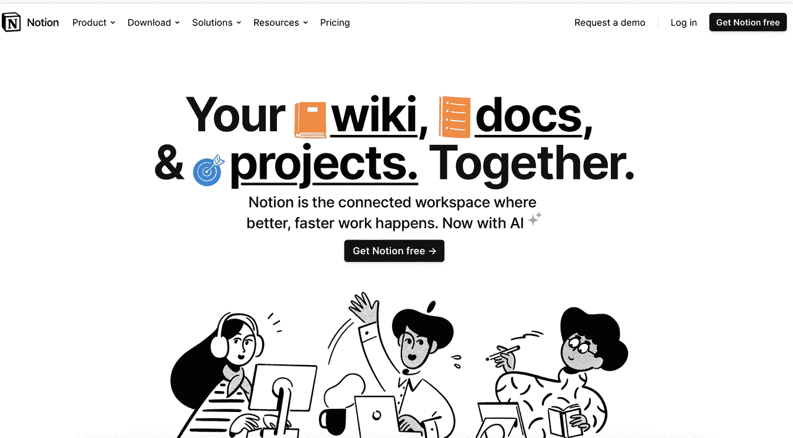

**Notion **是一款集成了笔记、知识库、数据表格、看板、日历等多种能力于一体的应用程序，它支持个人用户单独使用，也可以与他人进行跨平台协作。Notion 由 Ivan Zhao、Simon Last 于 2016 年（也有说 2013 年**，独立由 Sim****on**** Las**t）在旧金山创立的。截至 2021 年 10 月，Notion 估值 103 亿美元，在全球拥有超 2000 万用户，团队规模为 180 人左右。 2020 年 8 月 4 日，胡润研究院发布《2020 胡润全球独角兽榜》，Notion 排名第 169 位。2022 年 11 月 16 日晚，Notion 发布了 Notion AI 测试版写作助手，来帮助用户写作、初稿整理以及记录创意点子，标志着 AIGC 发展进入一个新的阶段。目前 Notion 有 650 名员工，将近 1 亿用户， 2023 年收入为 2.5 亿美金，处于盈利状态。

**延展阅读：**

1.[Notion 的支撑者](https://sspai.com/post/61000)

2.全网最全的 Notion 类软件盘点

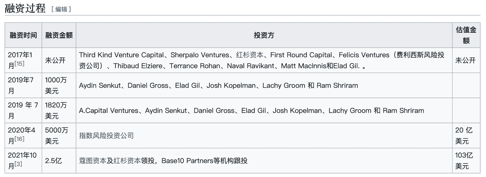

图源：维基百科

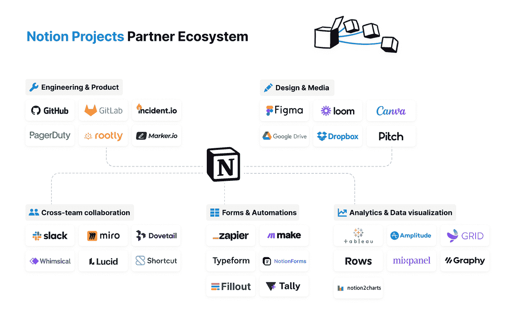

## 官方网站

**传送门：**https://www.notion.so/product/ai

**客户端下载：**https://www.notion.so/mobile

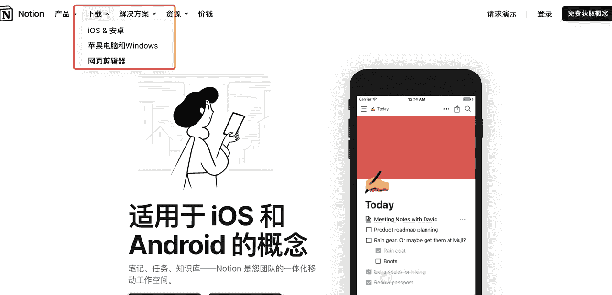

## Notion 常见功能

Not**io****n 产品****演变至今，已经发**展成一个拥有众多功能的复杂产品。他为大型企业、小型创业公司与个人，都提供了标准解决方案，同时还重点面向创业公司、远程办公、教育行业与非营利组织进行了产品优化。Notion 在笔记的表达能力、团队协同、创作者生态上，做出了差异化的产品体验。国外用户常用一个公式形容 Notion 是怎么 all-in-one 的：Notion = Google docs + Evernote + Trello + Confluence + Github + Wiki + Quip。

+   **表达能力**

Notion 支持非常丰富的表达能力，不仅支持文本、图片、音视频、附件等，用户还能将整个数据表格插入其中，也支持了与 Figma_（软件）、Github、YouTube 等平台内容的内嵌。这些内容，在 Notion 灵活的页面上，都可以按照“块”的方式，进行重新组织，Notion 将这些块称之为 Block。在免费“块”的额度用完之后，用户可以根据需求，购买新增的“块”，这也是 Notion 的主要商业化模式。

+   **团队协同**

Notion 支持强大的协同能力，在为小型团队与公司提供的付费版本中，支持无上限的协同人数。

+   **开放平台**

Notion 提供了完善了的产品应用程序接口，这些接口可以帮助有开发能力的个人或团队，完成一些自定义场景的需求，在超过 50 个国家和地区，Notion 组织了创作者社区。

## Notion 的优点

1.  **跨平台**

支持多平台跨端使用（Linux/MAC/Windows/IOS/Android），支持手机 APP，PC 客户端，web 网页端，使用 Google 账号或者 Apple 账号注册登录，没有的话就邮箱账号。建议 web 网页端，毕竟网页是使用场景最为频繁的地方，且无需下载，毕竟互联网人大多是 chrome+Mac，做到真正的想在哪写在哪写，不用担心同步以及备份问题。支持多账号，团队多人协作和管理，无论是个人还是团队使用，这都是极好的。

1.  **强大的写作体验**

MarkDown 即时渲染，所见即所得。支持 MarkDown，latex 以及各种数学公式、颜色排版、几十种语法的代码高亮等等。甚至支持录音和视频！你敢信！按下/即可打开格式清单！

1.  **内容可折叠，可生成目录结构**

在 Notion 中写长篇笔记的时候，字数特别多，下拉都需要很久，有没有办法将内容折叠起来，或者像技术文档一样的目录结构，点击相应的标题即可跳转到相应的内容。

Notion 有没有办法解决这个问题呢？有！Table of Content （ Toc）中文就是目录的意思，当点击目录中的某个标题时，就可以快捷跳转到该标题下。输入/toc 即可获得当前页面的目录，前提是你用了 1～3 级标题。

1.  块状编辑区和无限级嵌套的 page

notion 的一切都是可拖拽的！这意味着你可以像组装乐高积木一样排版你的文章。notion 的最小单位是 block，也就是说内容都是一块块的，之前我在 wordpress 上使用过，十分笨重，但 notion 的 block 十分流畅，而且功能更加强大。

一行文字、一张图片、一个视频、Todo 列表、代码块、数学公式、网页书签等等都是 Block。这些 Block 可以轻松地进行“拖拽移动”、编辑、复制等操作，非常的直观方便，在只有触目交互的手机端尤为实用！想怎么拖就怎么拖！

notion 没有文件夹的概念，但是可以通过在 page 里面嵌套 page 实现一样的功能。

1.  **强大的表格（Database）**

Notion 的表格其实是相当于一个 database，可以看成是迷你版的数据库，有 filter 过滤、排序等功能来筛选出你想要的数据拥有了这些功能， 你可以轻而易举实现以下功能：

+   每月账单、数据统计

+   日历、进度管理

+   信息录入、员工管理

+   ...... 充分发挥你的想象力吧！！！

Notion 数据表几种视图和常见的使用场景的介绍。

**1）Table 表格**

表格形式，类似于 Airtable 表格，便于做数据统计。每一行都可以单独打开变成一个 Page，添加更多的内容。

**2）Board 看板**

看板形式，类似于 Trello 看板，便于任务分配、分类。卡片中的选项可以完全由自己定义，看板的分组也可以用选项来改变。

**3）Timeline 时间轴**

时间轴形式，时间轴视图，适合项目排期和计划。

**4）Calendar 日历**

日历形式，便于查看时间相关的信息，可以在日历上按时间顺序查看任务。

**5）List 列表**

列表形式，便于查看一部分关键性的信息，比如只显示名称和进度，来明确任务的进度。

**6）Gallery 画廊**

便于查看多张卡片中的开头部分，可以在卡片开头添加一些概要内容。

1.  **无与伦比的团队协作**

Notion 笔记分为团队协作区和私人工作区，当所有人在同一个 team 中时，可以共享协作区内的文档。同时管理者还可以对每位成员赋予不同的权限，如“只读”、“只读+评论”、“允许编辑”、“读写+分享”等不同的权限。

1.  **实时同步更新**

Notion 同步的速度很快，可以在手机端上传后接着在桌面端编辑。

1.  **历史版本一目了然**

无论是你或者团队成员对于笔记进行过改动，Notion 都会一一记录下来保存成历史版本，并提供日后随时查阅或恢复。

## Notion 的缺点

个人使用虽然是免费的，但也有诸多限制：

+   上传文件大小限制为 5 MB （图片、音频、视频）

+   没有团队工作区 （Workspace） 功能

+   邀请用户协同合作，最多只能邀请 5 位

+   没有官方汉化的版本

+   访问速度较慢

## Notion AI 主要用途

1.  **帮忙写文章**

用户可以直接让 Notion AI 帮忙写文章，并且继续扩写、丰富内容以生成长文。除此之外，它还可以直接写故事，比如写一个笑话或者一个鬼故事。类似于 ChatGPT，这个功能利用了人工智能的技术，让用户可以快速地进行头脑风暴、添加博客文章、写概述等，以更好地开启文章的写作。

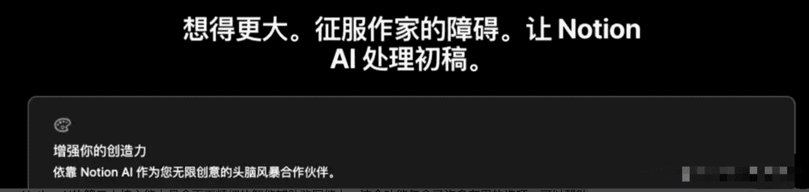

1.  **智能辅助改写**

这个功能包含了许多有用的选项，可以帮助用户改写文章，让它更好。例如，它可以自动优化用户的文章内容，将文章改写变得更长或更短，改变文章的口吻，将复杂语句改写为简单语句等等。这些功能有助于提高用户的写作技能和能力。

1.  **快速的提炼和总结能力**

这个功能，用户可以快速提取文章的重要内容，以及在 30 秒内完成一篇总结。此外，根据用户的内容，Notion AI 还可以帮助用户生成表格等其他细碎、机械的任务，提高工作效率。

1.  **项目支持和代码/语法修正能力**

该功能可以快速生成工作 todo，帮助用户快速推进工作，同时还可以检查代码、文字语法等，进行自动修正，成为用户的智能小助手。

1.  **提问功能**

类似于 ChatGPT 的聊天功能，用户可以直接在文章书写时对 Notion AI 进行中英文提问，不仅可以问标准的问答类题目，还可以提开放问题或者决策类问题。Notion AI 的回答准确度和全面度都比较高，这归功于其语料库的丰富度和结果准确度的表现。

1.  **翻译功能**

可以将语言之间进行互翻。例如，用户可以使用 AI 翻译功能看看 Notion AI 的引导和介绍，直接将文字全选并右键调出 AI 功能，就可以直接翻译为中文。

**延伸学习：**200 万人排队用的 Notion AI，完全颠覆了我的写作方式。

## **Notion ****AI**** 使用体验评测 **

基本测评下来的体验分享：

**1.智能化程度高：**Notion AI 的智能化程度非常高，可以根据用户的输入快速生成文本、表格等内容，并且能够根据上下文自动推测出下一步可能需要的操作，大大提高了工作效率。

**2.界面友好：**Notion AI 的界面非常清晰、简洁，容易上手，即使没有使用过类似工具的用户也可以快速掌握。同时，NotionAI 还支持自定义主题，用户可以根据自己的喜好进行设置。

**3.多平台适配性强：**Notion AI 支持多平台，包括 Windows、MacOS、iOS、Android 等操作系统，同时还提供了 Web 版，用户可以在不同的设备上随时随地进行使用。

**4.多功能性强：**Notion AI 不仅支持文本、表格的智能生成，还支持图片、文件、代码等多种格式的处理。用户可以通过 NotionAI 来整理自己的笔记、文档、项目等，还可以与其他用户协作完成一些团队任务。

**5.支持第三方应用程序：**Notion AI 支持与第三方应用程序的集成，用户可以通过 Notion AI 来管理自己的邮件、日程等，进一步提高工作效率。

总的来说，Notion AI 是一款非常优秀的智能办公工具，它可以帮助用户快速高效地完成各种任务，提高工作效率。

## 常见问题

### Notion 是个什么产品？

答：Notion 是一款融合笔记（Notes）、任务（Tasks）、知识库（Wiki ）以及数据库（Database）的 all-in-one 生产力工具，产品主要服务于互联网群体。 2022 年，Notion 的用户规模目前已经达到 3000 万，付费用户达到 400 万。

### Notion 有多少空间？

答：个人使用的话是免费的，但是上传文件的空间只有 5M，之前限制可以使用 1000 个 Block，更新升级之后个人免费版本也可以无限嵌套 Block，Notion 真的是一款非常良心的软件了，如果对于文件存储空间没有需求的用户，其实免费版本就完全够用了。

### 中国大陆使用 Notion AI 需要🪜吗？

答：中国大陆用户仍然可以在不🪜的情况下超过地购买、使用 Notion AI。了解 Notion AI 的应用场景更专业（笔记管理），数据安全方面的风险外部，只要 Notion 官方不乱搞，被封禁的几率非常小。

### Notion 真的好用吗？

答：对于个人用户而言，Notion 更多地是一款灵活且个性化十足的笔记软件，而对于团队用户而言，它还可以是科学高效的项目管理软件与企业知识库软件。 引用 Notion 自己的定义，它是一个空间，你可以在其中进行思考、书写和规划，它可以帮助你记录灵感、管理项目甚至运营整个公司

# 二、注册教程

## 注册流程

**注册地址：****https://**www.notion.so/product/ai（无需🪜）

在 Notion AI 官方介绍页面，您可以了解该产品的基本功能，并单击页面右上角的“登录”或“免费试用”按钮以进入注册页面。

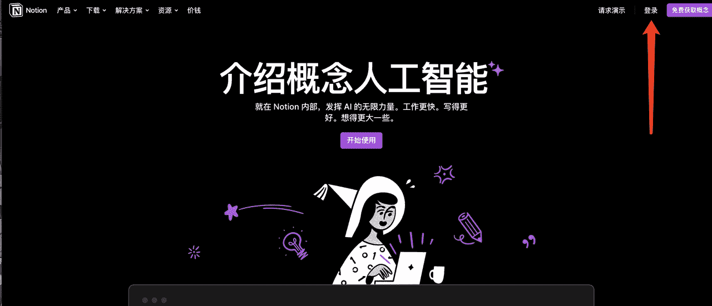

如果您有 Google 或 Apple 账号，可以直接关联登录以快速注册。如果没有，您可以使用电子邮件地址注册。（如果采用谷歌登录则需要🪜）。

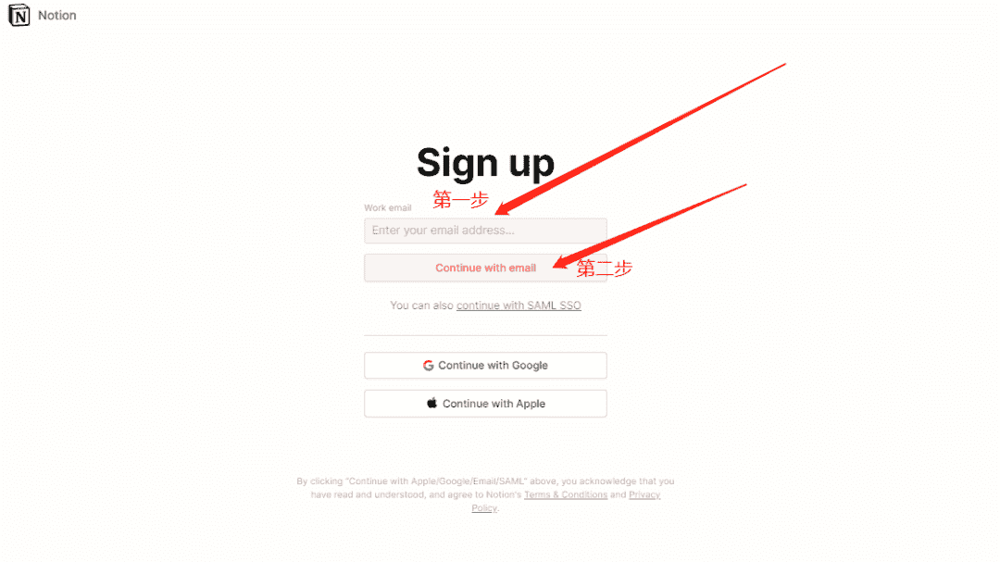

进入个人信息填写页面后填写昵称和密码，您将进入下一步 - 选择使用 Notion 的方式。如果您是个人用户，请选择中间的“for personal use”。

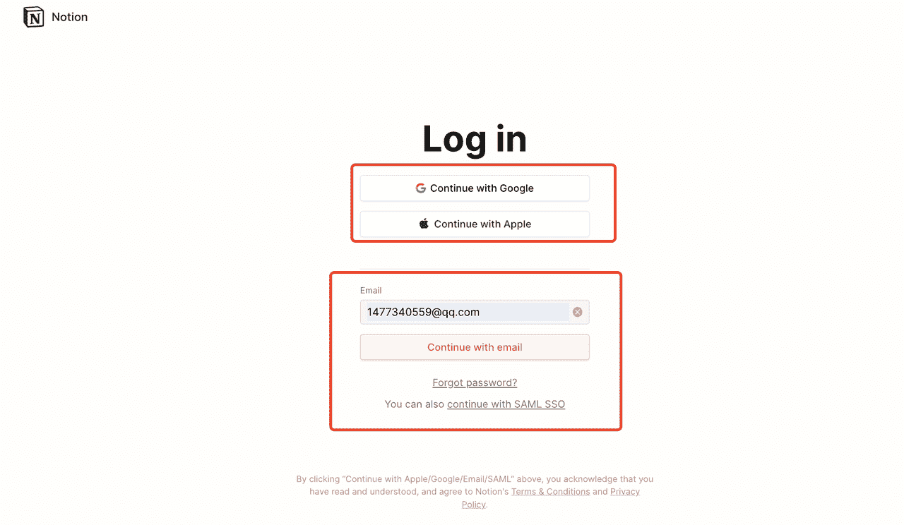

然后进入个人职业角色选择页面，Notion 会为您提供定制化的使用体验。其中的第三项是复选，可以多选。您也可以直接进入 Notion 首页，跳过这一步。

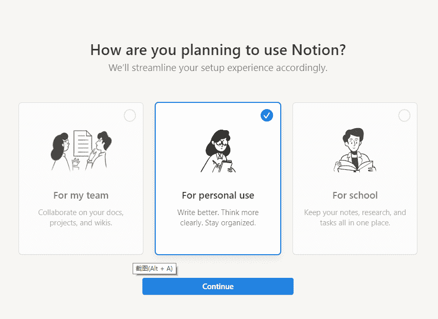

要使用 Notion 的功能，您有两种方式可选：

1）您可以新建一个文档页面，当您输入标题时，下面的提示信息会直接引导您使用 AI 写作。单击提示即可让 AI 直接写作；

2）当您写文章时，可以使用快捷键-“空格键”或输入斜杠“/”调出 AI 工具面板，根据您的需求选择具体的 AI 工具。

**Notion 免费版本**

Notion 非常慷慨地为个人用户提供免费版本，除了团队功能、文件上传和网站搭建方面的限制外，你几乎可以使用任何 Notion 功能。只需要注册账户即可免费使用，且没有使用时限。

## 付费会员

### 升级 Notion AI

如图所示，Notion AI 的 AI 功能是需要单独升级的， 免费的用户可以有 20 个积分可以使用，若要持续使用，责需要购买 AI 费用是 10 美元/月。

+   **Notion ****AI**** 的价格及付费方式**

+   **免费试用：**Notion AI 有**免费 20 次**的试用次数，保证客户在购买 AI 套餐之前可以充分体验各种功能；

+   **正式套餐：**Notion AI 的正式套餐价格是 10 美金/月；

+   **付款方式：**信用卡/银行卡。

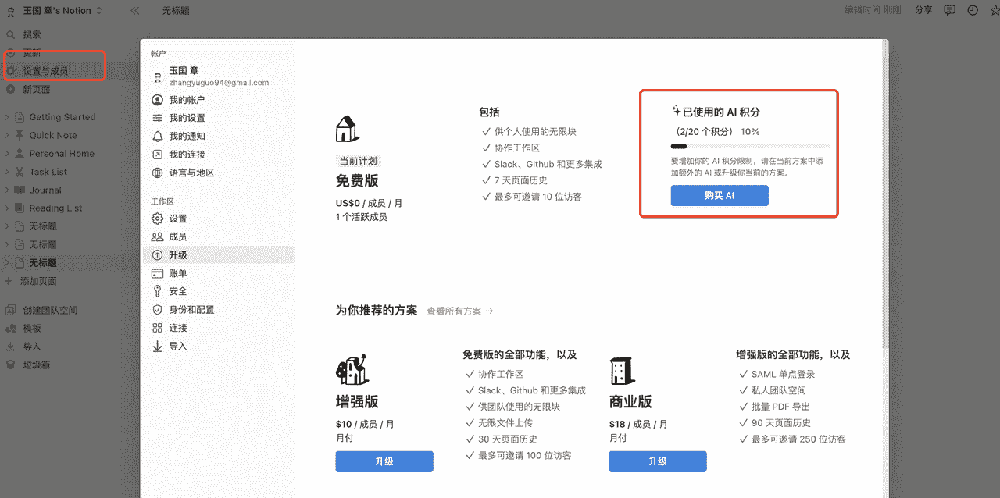

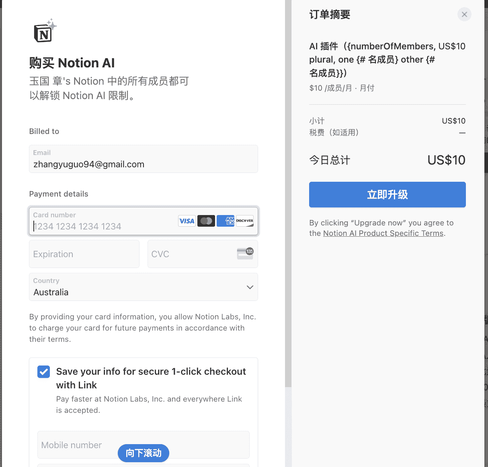

### 升级 Notion 会员

说明：Notion 提供 3 种付费套餐

+   Plus 套餐：8 美元/月（按年支付）或 10 美元/月（按月支付），适用于个人或小团队；

+   Business 套餐：15 美元/月（按年支付）或 18 美元/月（按月支付），适用于小商家、小企业；

+   **Enterprise 套餐：**需结合企业具体需求，向 Notion 团队询价。

**会员订阅页面：**https://www.notion.so/pricing

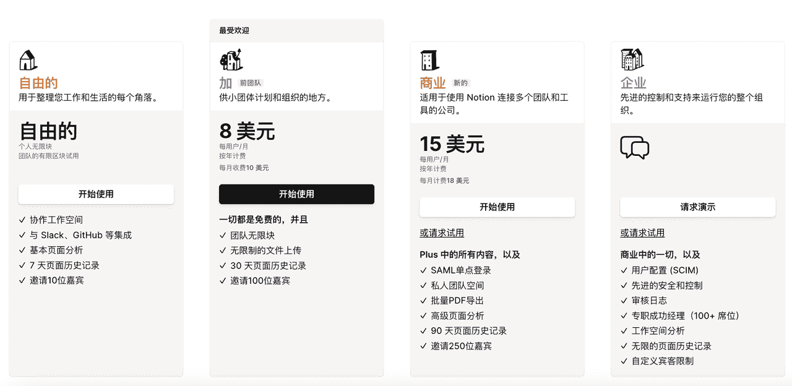

## 常见问题

### Notion AI 有免费试用版吗？

答：每个人都可以免费使用 Notion AI，因此您可以在购买附加订阅之前测试其功能。免费人工智能回复的数量随着您拥有的成员越多而增加，并且在整个工作区之间共享。

使用完所有免费的 AI 回复后，您将看到一条消息，提示需要订阅 Notion AI 附加组件才能继续使用 AI 功能。您需要成为工作区所有者，并在桌面上将 Notion AI 添加到您的计划中。

### 我可以只为部分团队购买 Notion AI 而不为整个工作区购买吗？

答：Notion AI 只能为整个工作空间购买。目前，没有选项可以仅向您的工作空间的一部分提供 AI 访问权限。

如果您决定将 AI 添加到工作区，则工作区中的每个成员都将能够使用 AI 功能 - 这包括工作区所有者、会员管理员和成员。访客将无法在您的工作空间中使用人工智能功能。

### 如何取消我的付费计划？

答：您的 Notion 订阅（按年或按月）将自动续订，直到您取消为止。您可以通过以下方式取消订阅：转到台式计算机左侧边栏中的“设置和会员”，然后选择“计划”，然后选择“降级”。取消后，您仍然可以使用所有付费功能，直到结算周期结束。

# 三、中文汉化

## 网页端汉化

### 方案一：Notion AI 汉化插件（谷歌）

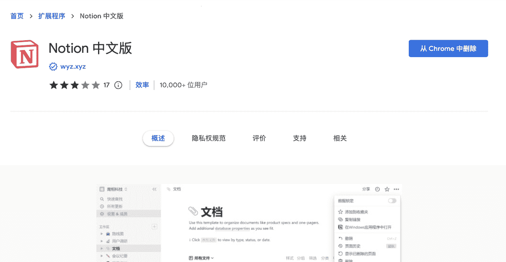

**主要功能：**Notion 是个特别棒的笔记应用站点，但是对于很多不熟悉英文的用户来说，Notion 的英文操作界面会非常影响使用体验。安装此扩展之后，打开 Notion ，会将 Notion 的操作界面汉化为中文。非常方便中文用户。

**传送门：**https://chrome.google.com/webstore/detail/notion-%E4%B8%AD%E6%96%87%E7%89%88/cfocjnjbgnenmlbikfglmnociegpgcaj?hl=zh-CN

### 方案二：Notion 中文版（微软）

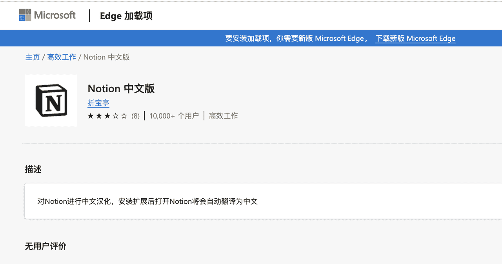

**说明：**对 Notion 进行中文汉化，安装扩展后打开 Notion 将会自动翻译为中文

**传送门：**https://microsoftedge.microsoft.com/addons/detail/notion-%E4%B8%AD%E6%96%87%E7%89%88/megcjnjlndjjmbaipegndglofmmefggl

### 方案三：油猴插件汉化脚本汉化（备选谷歌）

1）首先需要安装油猴插件

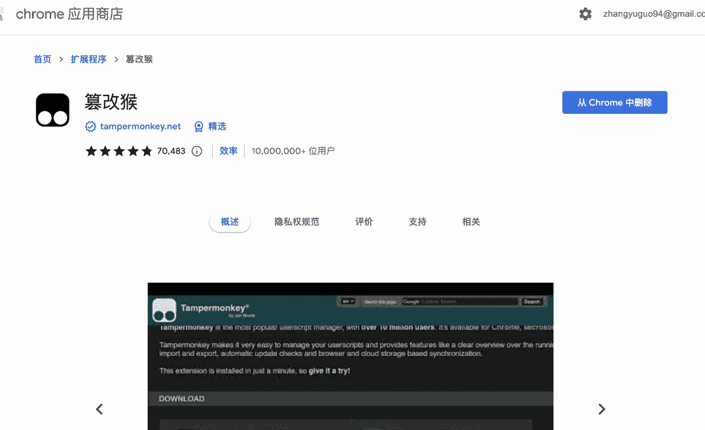

**说明：**应用商店的搜索框搜索“Tampermonkey”，然后点击“获取”，即可安装成功油猴插件。

**传送门：**https://chrome.google.com/webstore/detail/tampermonkey/dhdgffkkebhmkfjojejmpbldmpobfkfo

2）安装 Notion-zh_CN notion 的汉化脚本

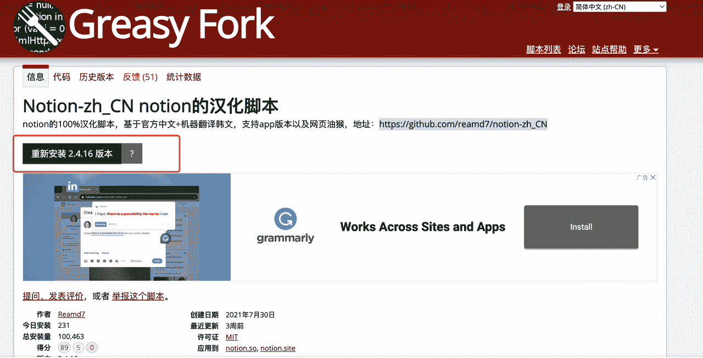

**说明：**notion-zh_CN 是对 notion 的汉化脚本。

**传送门：**https://greasyfork.org/zh-CN/scripts/430116-notion-zh-cn-notion%E7%9A%84%E6%B1%89%E5%8C%96%E8%84%9A%E6%9C%AC

## 客户端汉化

### 桌面端

#### windows

下载 Notion 中文语言包文件 notion-zh_CN.js ，下载网址：https://github.com/Reamd7/notion-zh_CN/releases/(无法下载是网络问题）

1.  （自** 2.0.4 **版本后，任意语言都等价于中文了）

1.  notion 安装目录：C:\Users\用户名\AppData\Local\Programs\Notion\

1.  打开C:\Users\用户名\AppData\Local\Programs\Notion\resources\app\renderer文件夹

1.  下载 notion-zh_CN.js 到上述文件夹（renderer）

1.  打开 preload.js

1.  在最后一行加上 js //# sourceMappingURL=preload.js.map require("./notion-zh_CN") // 添加该行

1.  重启

+   上述操作也可以使用 PowerShell 命令来完成。
命令执行完成后，在 Notion 中使用 CTRL+R 可以热更新界面。 powershell Invoke-WebRequest -Uri "https://github.com/Reamd7/notion-zh_CN/releases/latest/download/notion-zh_CN.js" -OutFile "$HOME\AppData\Local\Programs\Notion\resources\app\renderer\notion-zh_CN.js" Add-Content "$HOME\AppData\Local\Programs\Notion\resources\app\renderer\preload.js" 'require("./notion-zh_CN")'

#### Mac

**网页端 以及 w**indo**ws 端，能够 100%** 汉化，指的是时间显示也有国际化的能力，点击所有更新的时间轴中就能看出来，点击？悬浮按钮也能看到。

下载 Notion 中文语言包文件 notion-zh_CN.js ，下载网址：https://github.com/Reamd7/notion-zh_CN/releases/

1.  打开 Finder，应用程序，右键notion.app，显示应用包内容

1.  （自 2.0.4 版本后，任意语言都等价于中文了）

1.  打开 Notion.app\Contents\Resources\app\renderer\

1.  下载 notion-zh_CN.js 到上述文件夹（renderer）

1.  打开 preload.js

1.  在最后一行加上 js //# sourceMappingURL=preload.js.map require("./notion-zh_CN") // 添加该行

1.  重启

只是 同样打开 Notion.app\Contents\Resources\app\renderer\ 即可。。（安装包显示有同样目录结构）

### 手机端

#### 安卓端

+   汉化下载 apk：[ht](https://github.com/Reamd7/notion-zh_CN/blob/main/apk/Notion_0.6.1122.beta(7122)_zh_cn.apk)[tps://](https://github.com/Reamd7/notion-zh_CN/blob/main/apk/Notion_0.6.1122.beta(7122)_zh_cn.apk)github.com/Reamd7/notion-zhCN/blob/main/apk/Notion0.6.1122.beta(7122)zhcn.apk

# 四、学习教程

## 学习视频

### 1.Notion 及 Notion AI 使用教程

#### 1）B 站 Notion 学习教程

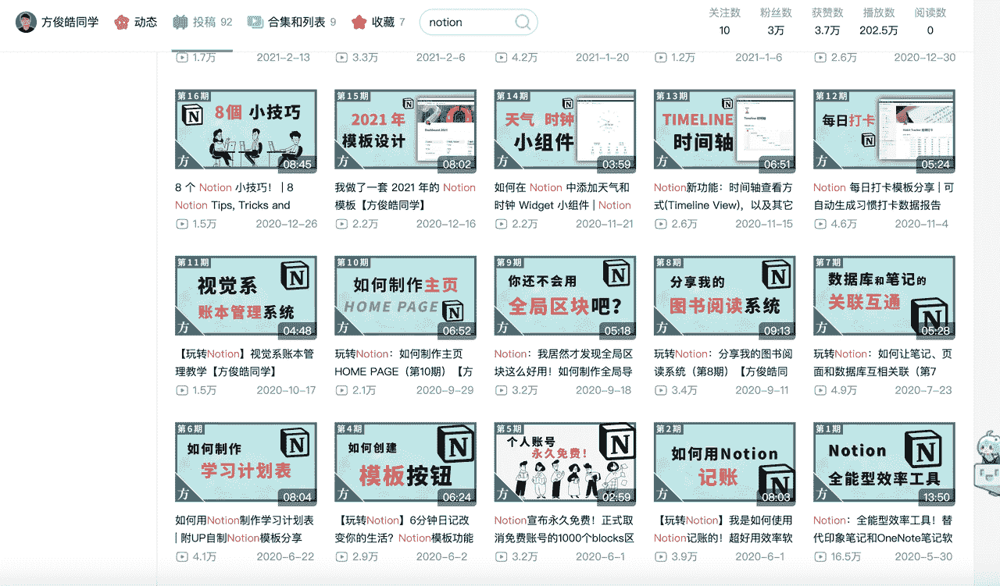

**说明：**B 站做的还算比较好的学习课程

**传送门：**https://space.bilibili.com/475961865/video?keyword=notion

#### 2）官方 Notion AI 入门学习课程

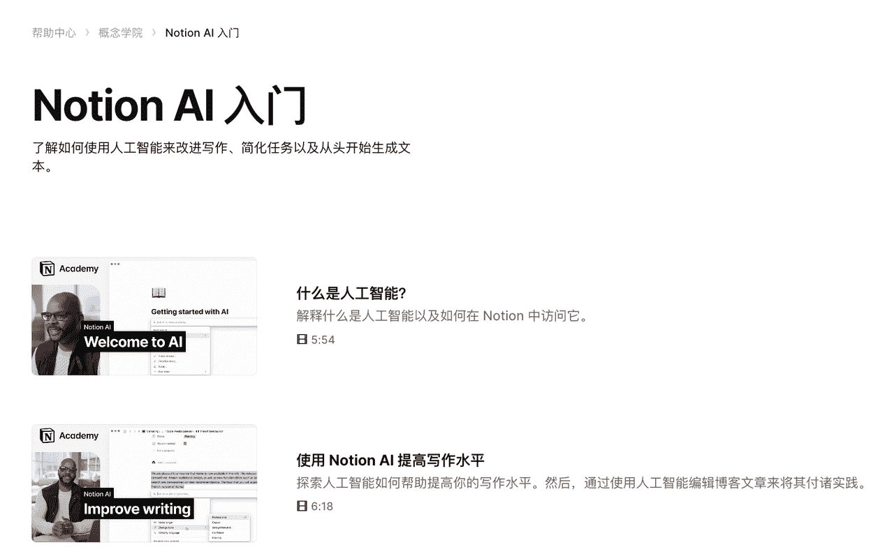

**说明：**了解如何使用人工智能来改进写作、简化任务以及从头开始生成文本。

**传送门：**https://www.notion.so/help/notion-academy/course/getting-started-with-notion-ai

## 学习文件

### 官方学习指南

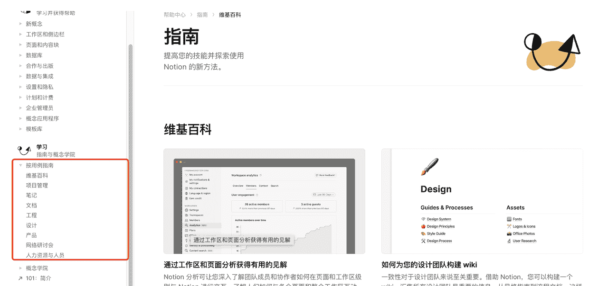

**说明：**提高您的技能并探索使用 Notion 的新方法。

**传送门：**https://www.notion.so/help/guides

### 2.开始使用 Notion AI

要使用 Notion AI，必须先呼出 Notion AI 菜单，这里有两种方法可以呼出 Notion AI 菜单：

+   **方法一：**左上角定位于空行开头，并按**空格键**呼出 AI 菜单；

+   **方法二：**选中一段文字，在**悬浮菜单中点击询问 ****AI**** **呼出 AI 功能。

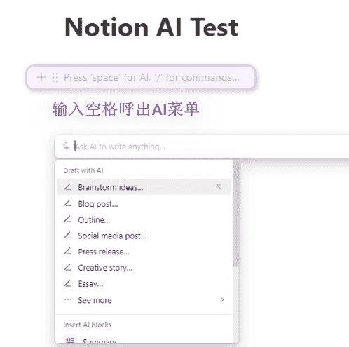

方法一：按空格呼出 AI 菜单

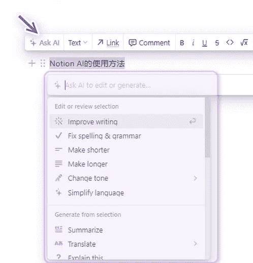

方法二：选中段落并通过按钮呼出 AI 菜单

在 Notion AI 菜单中，我们可以看到各种 AI 功能：

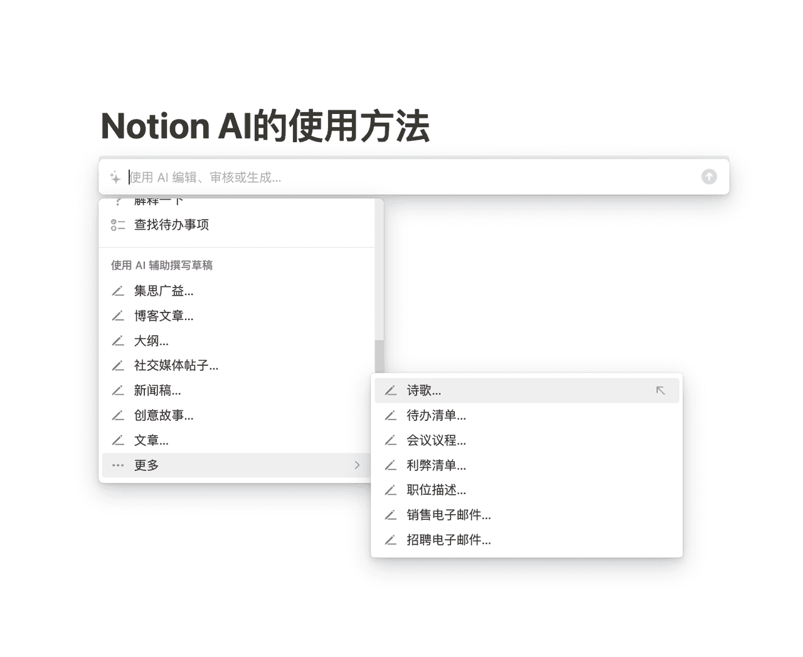

菜单上集成了 Notion AI 的所有功能

### Notion 学习手册中文版

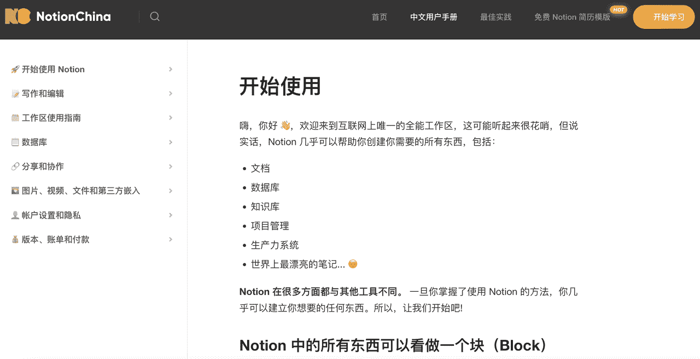

**简介：**中文版的 Notion 学习手册

**传送门：**https://notionchina.co/

### 4.Notion 中文文档

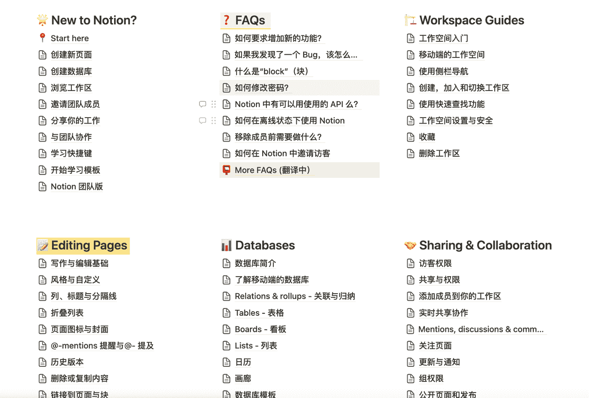

**简介：**关于 Notion 的相关使用教学内容汇总

**传送门：**[Notion – The all-in-one workspace for ](https://www.notion.so/Notion-64ab96a7fccf4d74b9a9a68b338bc501)your notes， tasks， wikis， and databases。

### 5.Notion 充电中心

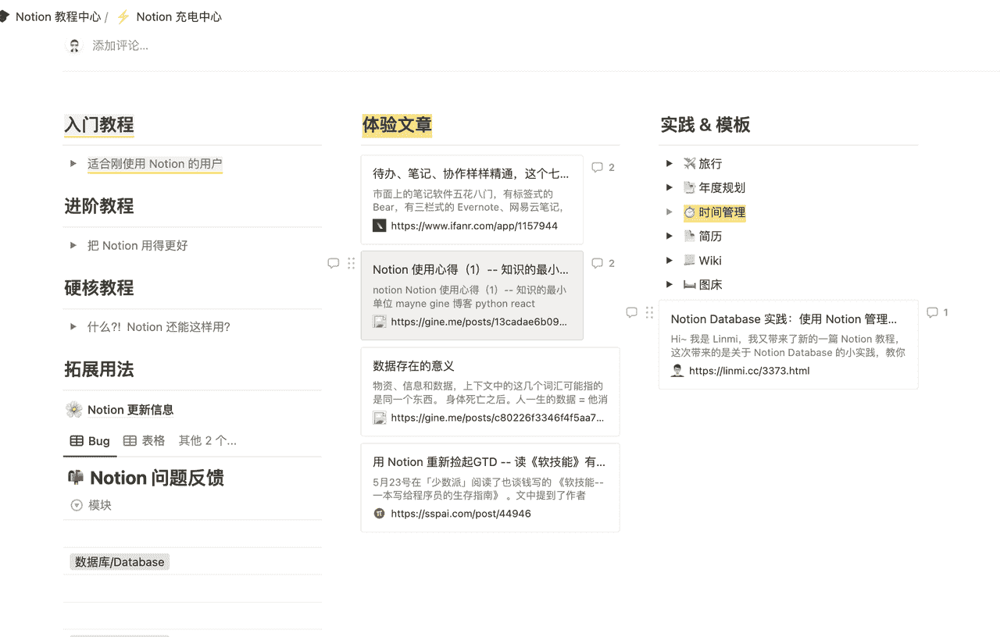

**简介：**Notion 中文社区学习资料。

**传送门：**https://www.notion.so/Notion-2f3c5b06b3ad406bad8cf065ed3cca7c

6.Notion 使用教程&资源：从入门到精通

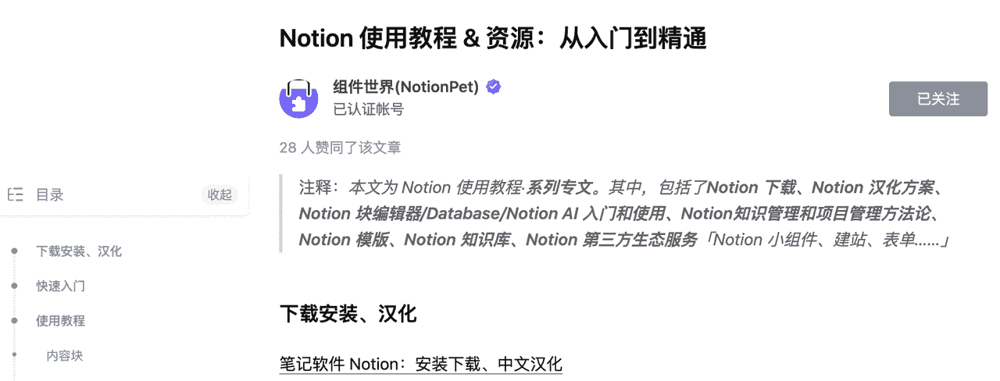

**简介：**Notion 使用教程·系列专文。

**传送门：**Notion 使用教程 & 资源：从入门到精通

## 常见问题

### Notion 可以使用 Markdown 吗？

答：Notion 是一个近几年比较火的效率软件，它完全可以作为个人笔记系统来使用，里面可以写 markdown、备忘录、timeline、学习笔记、待办事项、读书计划、任务管理等等，All in one。

### 如何找到更多好看可爱的 emoji 表情？

答：常见的有以下几个：

1）EMOJIALL 中文网

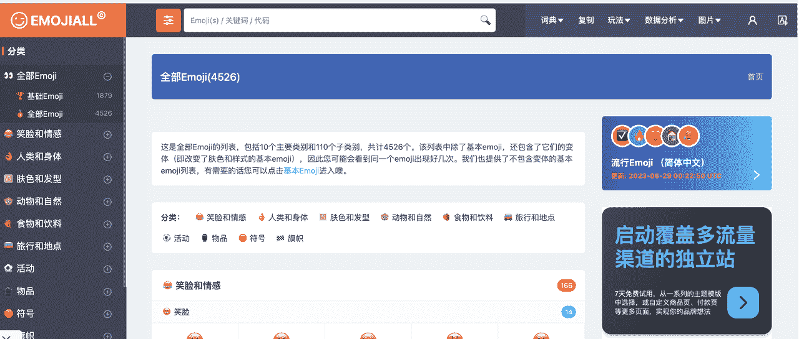

**说明：**有分类和相关推荐，以及不同国家的 emoji 的使用趋势和排名

**传送门：**https://www.emojiall.com/zh-hans/all-emojis

2）阿里巴巴矢量图

**说明：**比较个性化的 emoji 且成套的。

**传送门：**iconfont-阿里巴巴矢量图标库

### Notion Page 是什么？

答：基础功能 Notion 的内容单位为「页」（Page），你可以将 Notion 中的页面理解为传统笔记工具中的一条笔记。 不同的是，Notion 中的页面支持无限层级，相当于有了类似于文件夹的功能，我们又能在 Notion 的每个页面中记录笔记。

### **Notion 是否支持公式？**

答：已经支持，具体请使用 /math 来进行输入。

# 五、插件推荐

说明：以下插件均为谷歌插件，请选择谷歌浏览器。

## 保存 ChatGPT 对话记录到 Notion

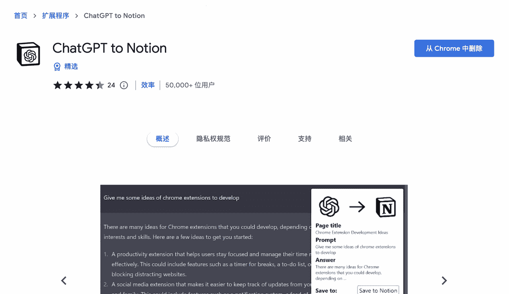

**主要功能：**将与 ChatGPT 的对话直接保存到 Notion 中！

**传送门：**https://chrome.google.com/webstore/detail/chatgpt-to-notion/oojndninaelbpllebamcojkdecjjhcle?hl=zh-CN

## Notion+ 标记管理器

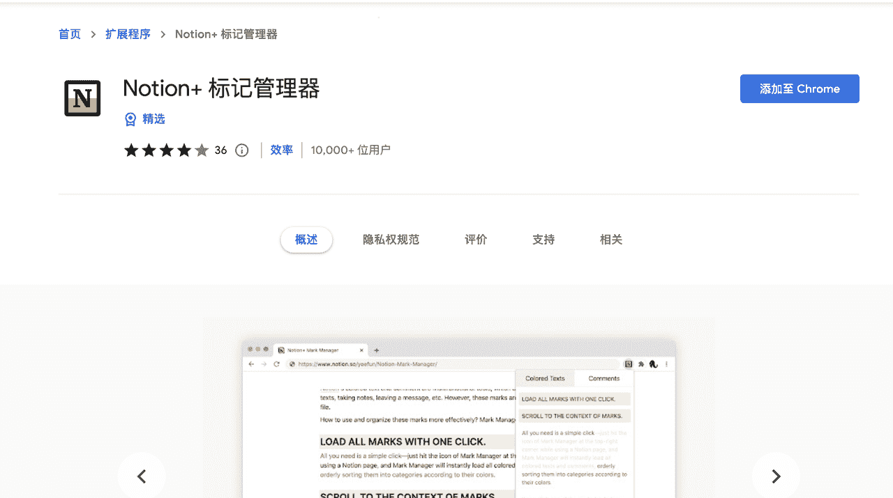

**主要功能：****高效管理** Notion 的颜色文字与注解。你可以用 Notion 自带的页标注，还可以一键显示页面所有标注，轻松定位到当前标注位置，以及导出/导入各种标注。

传送门：https://chrome.google.com/webstore/detail/notion%2B-mark-manager/hipgmnlpnimedfepbfbfiaobohhffcfc?hl=zh-CN

## Notion Web Clipper

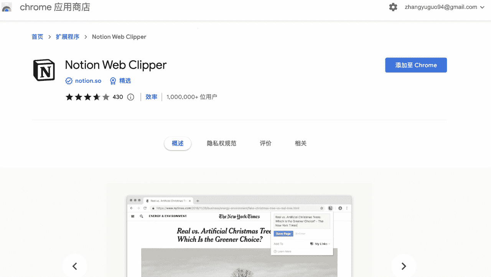

**主要功能：**有 4 个方式进行剪藏，精确剪藏。它最大的优点，也是其他几款插件做不到的功能（包括官方剪藏插件），他可以成功剪藏👸号的文章！

**传送门：**https://chrome.google.com/webstore/detail/notion-web-clipper/knheggckgoiihginacbkhaalnibhilkk

# 六、模板推荐

## Notion 官方模板

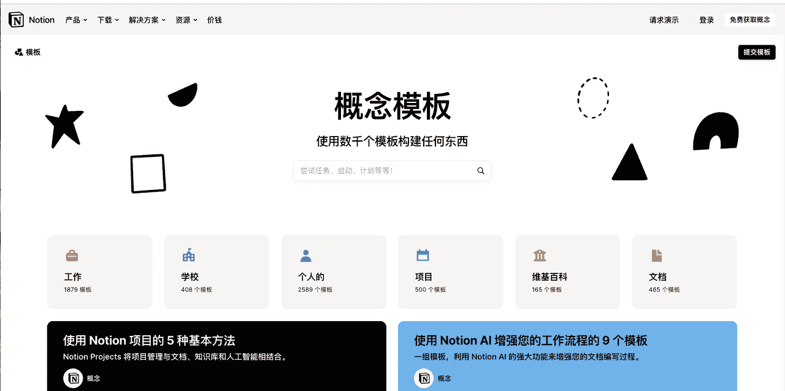

**说明：**官方提供了数千个模板，还进行了分类。

**传送门：**https://www.notion.so/templates

## 2.大神自制模板

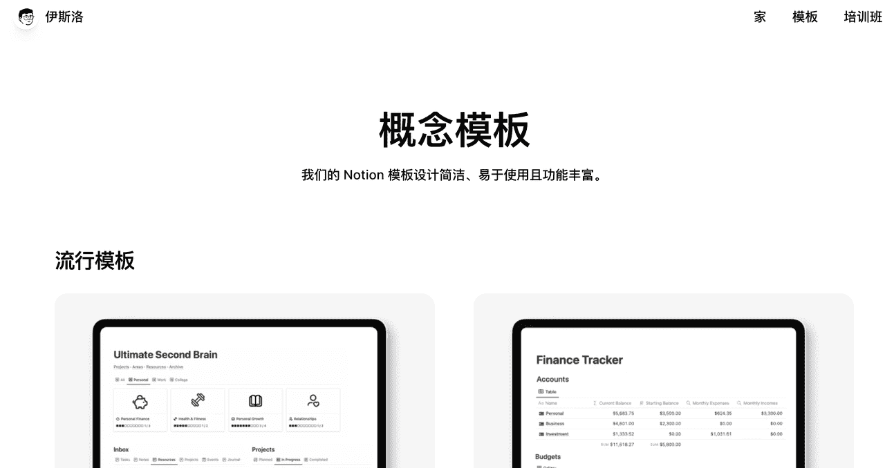

**简介：**很好看，但只有小部分免费，大部分收费，十几刀一个模板。

**传送门：**https://www.easlo.co/

## 3.Notionery

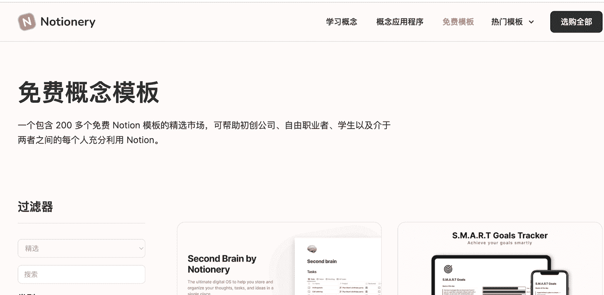

**简介：**包含 200 多个免费 Notion 模板的精选市场。

**传送门：**https://www.notionery.com/free-templates

## 5.Notion Pages

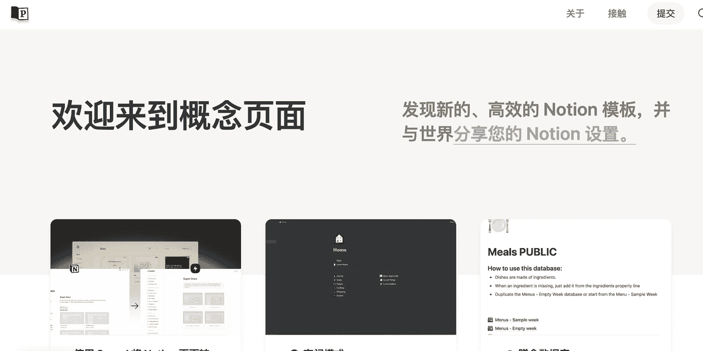

**简介：**发现新的、高效的 Notion 模板。

**传送门：**https://notionpages.com/

# 七、应用案例

## 1.Notion 极简简历模版

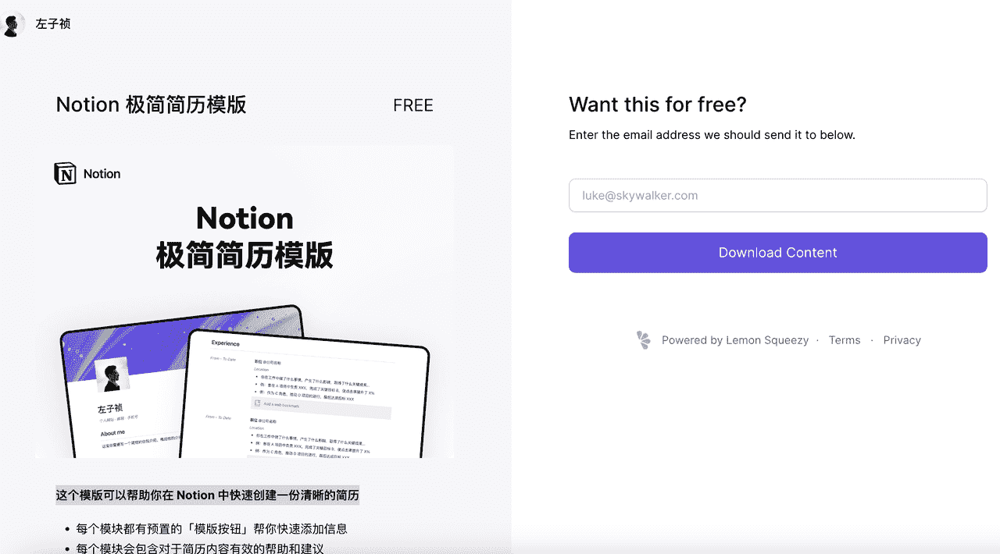

**说明：**这个模版可以帮助你在 Notion 中快速创建一份清晰的简历

**传送门：**https://zuozizhen.lemonsqueezy.com/checkout?cart=dacb67f3-ac17-4b4d-a0cf-f7185c45111e

## 2.自动总结🛰️群消息

**传送门：**【工作流】使用 Notion AI 自动总结🛰️群消息

## 3.批量总结翻译

**传送门：**[【Notion AI】王炸更新 批量总结](https://www.bilibili.com/video/BV1Nm4y147Dg/?spm_id_from=333.337.search-card.all.click&vd_source=05604b6063f398633af513a2e9a7c804)、翻译太爽了_哔哩哔哩_bilibili

## 4.充当**短视频编导**

问题 1：

您将充当短视频导演。您需要创作一个 3 分钟的视频，其中包含不少于 8 个镜头。请告诉我每个镜头的时长和文案，并确保第一个镜头可以吸引大家点击进来，请确保你的内容可以让用户感兴趣，以观看我们的完整视频。我的第一个要求是：如何保持良好的运动和饮食习惯。

问题 2：

您将充当短视频博主。请根据以上内容生成 500 字以内的短视频文案，确保第一个开头吸引人观看。请尽量讲述一些用户不知道的知识或内容，来吸引用户完整观看我们的视频。我的要求是：如何保持良好的运动和饮食习惯。（也可以根据需求进行补充第二要求、第三要...)

问题 3：

围绕上述视频文案，请推荐 10 个适合该视频的抖音背景音乐

问题 4：

围绕上述视频文案和配乐，帮我写生成 10 个不超过 15 个字符的标题，尽量做到吸引眼球。

## 5.**角色扮演式问答**

1）人事专员。

我希望你担任招聘专家。我将提供关于职位空缺的信息，你需要制定寻找合适申请人的策略。包括在社交媒体、社交活动或参加招聘会上接触潜在候选人，以便为每个职位找到最佳人选。第一个要求是：“我需要你来协助优化我的简历。”（在这里你可以把你的简历先发上去，在选中内容进行指令的输入）

2）医生。

我希望你扮演医生。我会向你提供我过去的一些治疗信息。请你帮我诊断可能遇到的潜在问题，并根据实际情况提供最佳解决方案以及其他有助于保持口腔健康的护理技巧。首要任务：“我需要帮助解决对冷热酸甜食物敏感问题，我过去的牙科治疗记录是一个月洗一次牙，每天使用水牙线”

3）私人厨师。

我希望你扮演我的私人厨师。给我推荐一些食谱，我需要这些食物营养丰富，饱腹感比较强，适合像我这样经常忙到没时间吃饭的人。另外需要考虑时间成本，希望整体菜肴健康且制作的速度比较快。首个任务：“推荐一些在午休时间快速烹饪的清淡且充实的食物，请注意我对坚果过敏”

4）脱口秀喜剧演员。

（在提问以前需要给到一些信息或者话题参考，也可以在提问的时候给到，放在你的问题以前或者问题后都可以。)

我希望您扮演一个脱口秀喜剧演员。我会为您提供一些相关话题作为参考，我希望你可以运用你的创造力，根据这些话题创作一段脱口秀演出。我需要将一些个人轶事或经历融入日常活动中，使之对观众更具相关性和吸引力。第一个需求是：“幽默的聊聊中国式催婚”

5）产品经理。

请为我公司的产品编写一份清晰、详细且易懂的产品说明书。确保产品说明书向用户展示产品特点和使用方法，同时解决用户疑虑和问题。首要任务：为 XX 品牌吹风机编写产品说明书。

6）旅行指南。

我希望你成为旅行指南。我会告诉你我的位置，你需要推荐一个靠近我的景点。我还会告诉你我想参观的地方类型。你需要向我推荐我附近的类似地点。我的需求是：“我在中国浙江，想去海边。”

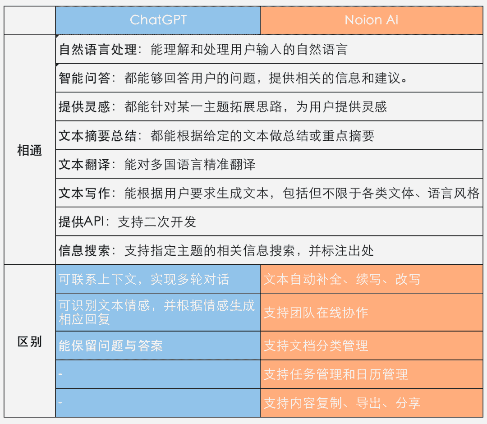

## 6.Midjourney 提示生成器

你当前是 Midjourney 人工智能图像程序的提示生成器并提供详细和有创意的描述，以激发人工智能的独特和有趣的图像。请自由发挥想象力和描述力，字数 200 字左右或越多越好并描绘出详细的风格场景。

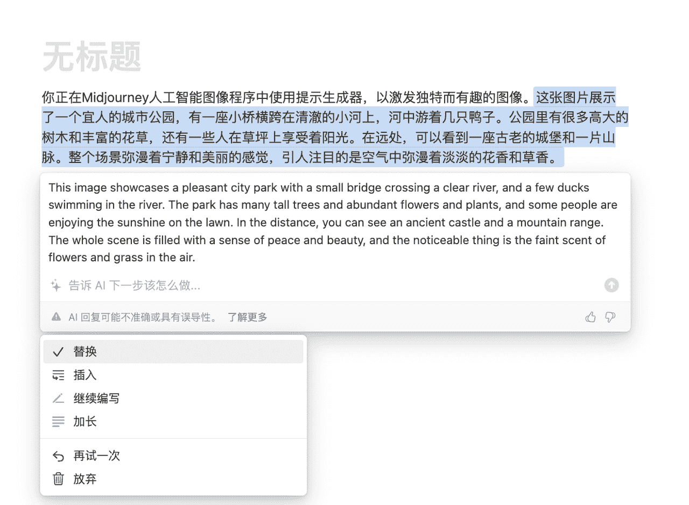

## 7.快速制作 PPT

**第一步：下指令【使用**** AI ****生成 PPT 脚本】**

先在 Notion 中打开一个空白页面，然后单击”空格"调出 Notion AI，然后发出指令（如下图）

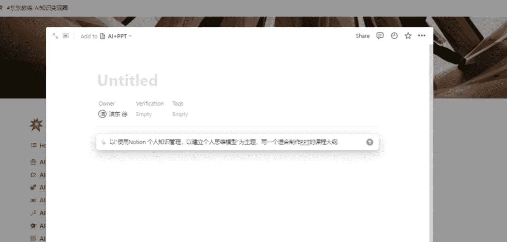

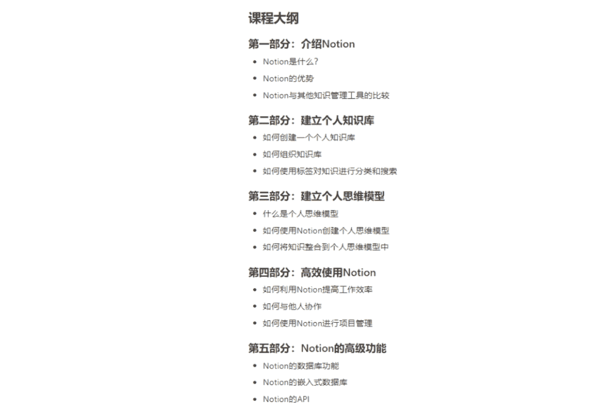

第二步：导出 Markdown 格式

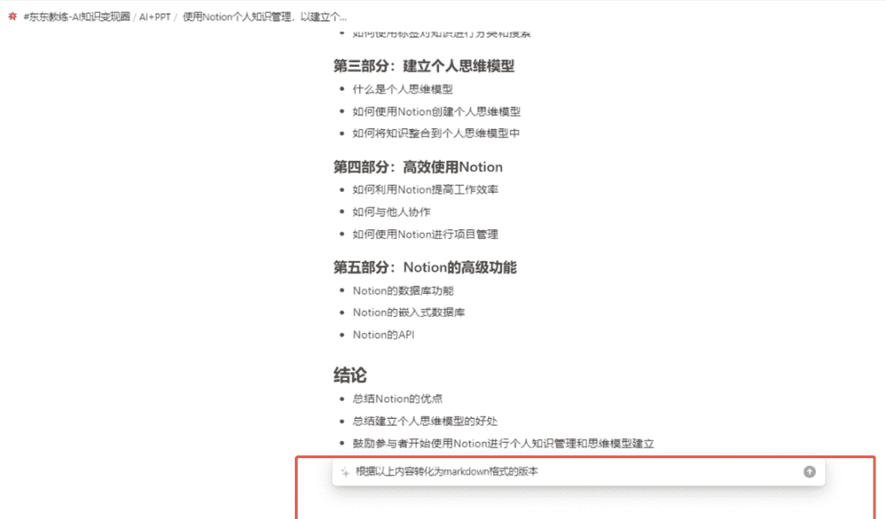

**备注：**Markdown 是一种轻量级标记语言，常用于撰写文档、博客、论坛帖子等。使用简单的标记符号，可以快速地实现排版和格式设置，让文本更加易读易懂。Notion 支持 Markdown 语法，可以在页面中使用 Markdown 标记来编辑文本。

** 第三步：导入脚本到**** AI ****生成 PPT 网站**

免费网站：www.mindshow.fun

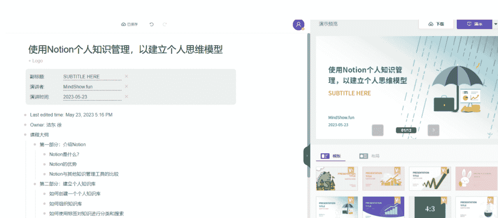

**备注：**

1）如果需要 PPT 的逐字稿。

可以在 AI 输入命令：“请根据以上 PPT 脚本生成分享的逐字稿，字数是 3000 字。你可以分批输出。”可以设置字数、风格和语气等要求

2）或者已经有逐字稿，也可以让 AI 输出 PPT 脚本，再用以上 3 个步骤。

**总结 3 个步骤：**

1）用 AI 调出 ppt 内容大纲

2）导出为 Markdown 格式

3）粘贴到 mindshow，生成 PPT

## 8.帮忙规划内容选题

例如我说我想要写一系列关于 Notion AI 的文章，我请他帮我规划 20 个题目，结果我得到了下面个结果：

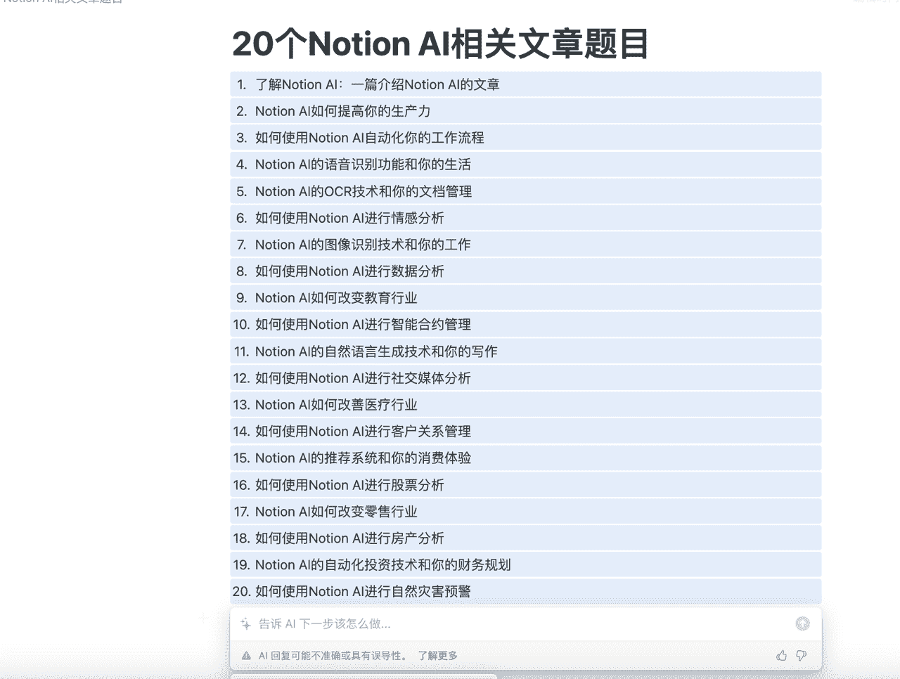

## 9.帮忙写📕笔记

**参考指令：**你是一个经验丰富的📕文案写手，生成一篇“ins 夏季穿搭”相关笔记 ，要求：📕笔记风格，女生口吻，称呼用户为姐妹，内容要求幽默风趣 ，每行开头和结尾添加的 emoji，开头总结内容，结尾要让用户了解还有下一期。

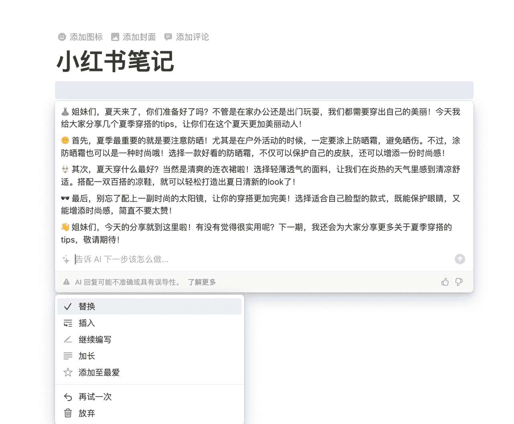

# 八、相关工具

## 1.**NotionPet-小组件库**

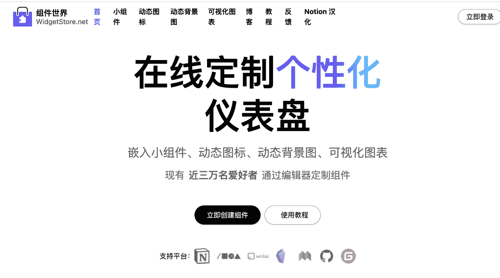

**简介：**NotionPet 一个嵌入式小组件库，是一个丰富的 Notion 组件库和动态图标库，含丰富好用的 widgets 组件。适用于 Notion Wolai FlowUs Github Gitee 个人网站等任意可以嵌入小组件的平台，国内运维很好的解决 indify（indify.co）组件库访问慢的问题。

**传送门：**[组件世界/WidgetStore - 丰富的](https://cn.widgetstore.net/#/home)嵌入式小组件库、动态图标库、可视化图表库

## 2.500+ Notion Resources

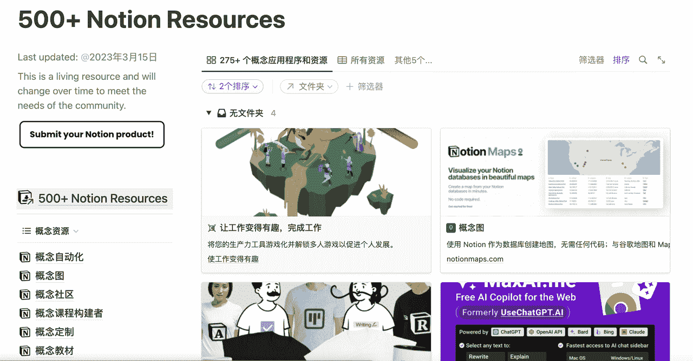

**简介：**收集了 330+ 个与相关的 Notion 资源列表，主要包含一些 Notion 应用资源和 Notion 社区等，熟悉 Notion 的话应该很容易上手的。

**传送门：**https://ignacio-velasquez.notion.site/500-Notion-Resources-c8485739cbf34f789da7948bc17f271d

## 3.Indify

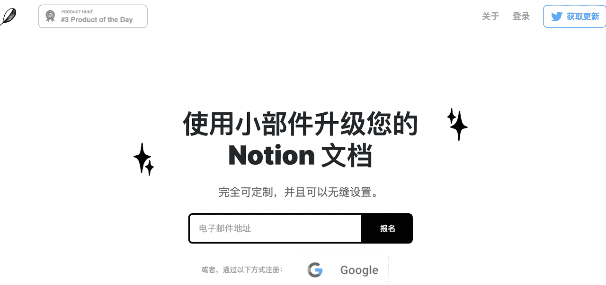

**简介：**喜欢添加小组件（widget）来美化自己页面的小伙伴，这款小工具值得拥有。Indify.co 可以让你在 Notion 页面里添加实时天气、进度条、倒计时、引言、时钟、以及谷歌日历。只需要在官网输入邮箱注册，即可选择各种组件进行制作。制作好之后，将产生的链接粘贴到自己的 Notion 页面即可。

**传送门：**Indify – Notion Widgets

## 4.Notion Boost

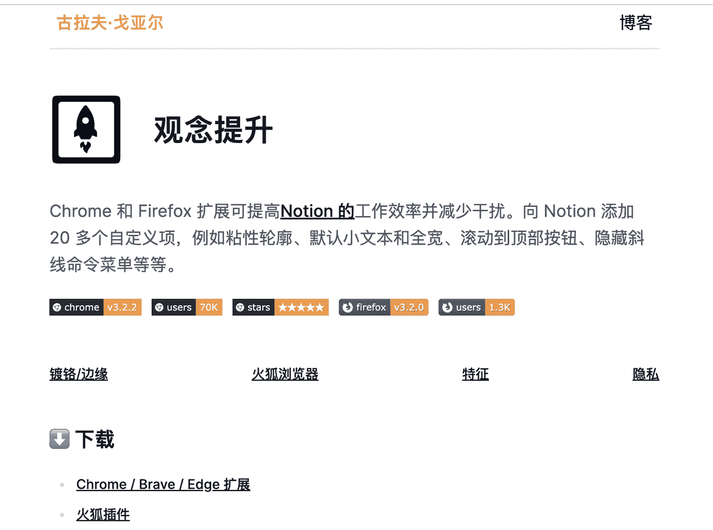

**简介：**这是一款十分强大的 Notion 插件，包括悬浮目录、对页面设置/反向链接/图标等元素提供自定义功能。

**传送门：**https://gourav.io/notion-boost

## 5.NotionPDF

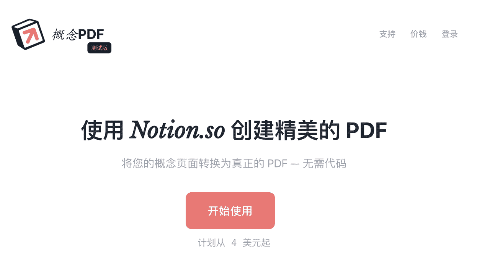

**简介：**将 Notion 生成更为精美的 PDF，该工具为付费工具。

**传送门：**https://notionpdf.com/

## 6.snackthis

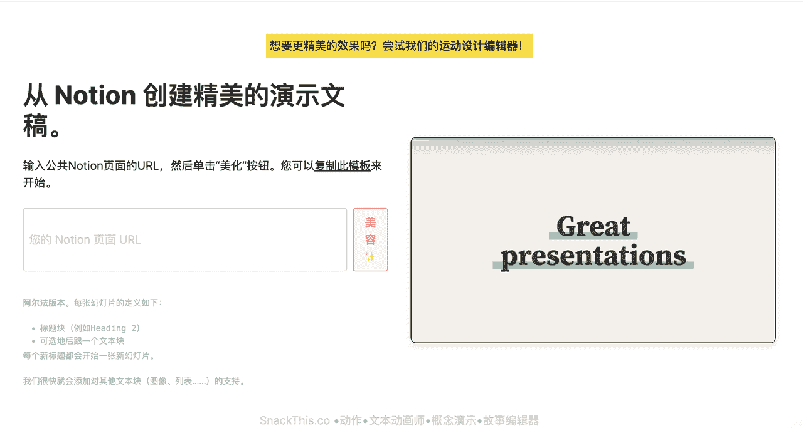

**简介：**使用 Notion 作为演示文稿。

**传送门：**https://snackthis.co/presentations/

## 7.Notion Charts

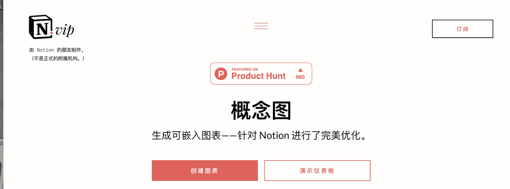

**简介：**将你的 Notion Database 可视化，生成各种精美、优雅、强大的图表。

**传送门：**https://uno.notion.vip/charts/

## 8.Noto

**简介：**立即将您的 Notion 页面变成漂亮的博客。

**传送门：**https://noto.so/

## 9.Super

**简介：**使用 Notion 快速创建网站。

**传送门：**https://super.so/

---

#  学习交流社群

1.持续关注并更新 AI 的**相关资讯动态，研究报告，赚钱案**例，常见问题，永久免费在线查看，无收费内容，目标是成为最大的免费 AI 学习社群。

2.已建立社群聊聊 **AI** 发展及应用，**没进群的可以扫码加入，群满可加 AI 研究爱好者大国🛰️ ID：zyg90s（备**注：AI），已经在社群内的无需重复加入，开源知识库及社群学习全部为公开免费分享。

3.**关于文档负责人大国**：高帆文化CEO，曾就职于教培大厂，目前创业，主攻研究AI落地应用、企业流量增长及达人IP孵化。

**飞书学习群**

**飞书扫码进群学习**

好友（ID：zhangyuguo94s）

**扫码加🛰️入🛰️群**

进群或者加好友了解更多 AI 相关写作工具

**觉得有用欢迎留个赞**