# AI 绘画工具精选

> 来源：`https://yunyinghui.feishu.cn/docx/IotedIbAco6mZnxFoG6cJ5hEnXb`

> **适用人群：**互联网学习 AI 绘画人群

> 首发时间：2024 年 4 月 5 日

> **更新时间：**2024 年 5 月 12 日

> **内容出品人：**

> **使用建议：**如果需要快速定位到精确内容，可以使用快捷键 `Ctrl + F`/`Command + F` 的形式，搜索关键字/词，查找你想要的内容，PC 端查看学习效果更好。

> **特别说明：**飞书手册内容花了大量心思做构思和整理，请勿直接抄袭复制。

> **为 AI 实验室持续**更新 AI 绘画提示词的提示词网站，模型网站等全套学习内容，欢迎收藏转发支持，文末有惊喜，大国出品，必属精品。

## 一、AI 图片插画生成

### 1）即梦

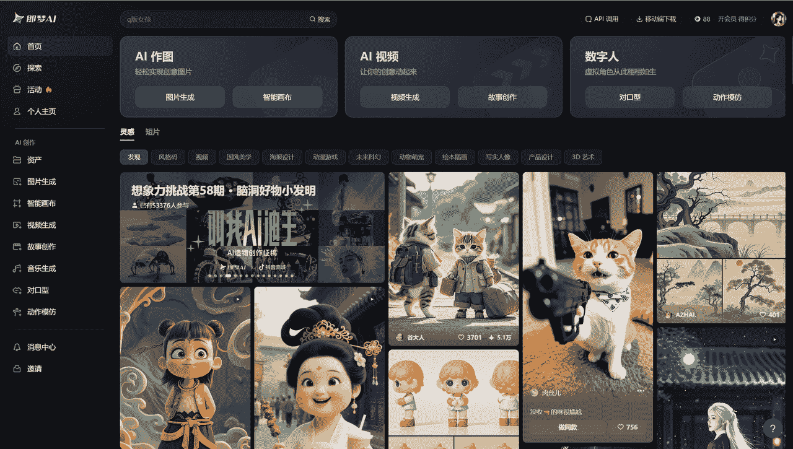

**工具介绍：**即梦 AI（`Dreamina`）是由字节跳动旗下深圳市脸萌科技有限公司开发的一站式 AI 创意创作平台，支持通过文本描述或图片输入生成高质量图像及视频，涵盖动漫、写实、3D 渲染、国风、赛博朋克等 30+艺术风格

**工具优点：**

> **零门槛易用性：**界面简洁直观，支持中文提示词输入，无需绘画基础或英文能力，适合小白快速上手。

> **多场景适配：**覆盖商业设计（海报、电商图）、个人创作（动漫、表情包）、文旅宣传等场景，尤其擅长古风、国潮、卡通 IP 设计。

> **技术迭代迅速：**基于 `GAN` 和 `VAE` 模型优化，3.0 版本显著提升细节表现（如文字精度、光影层次），支持生成 `4K` 分辨率图像。

**是否免费：**免费体验

**网络条件：**不需要特殊网络

**体验网址：**`https://jimeng.jianying.com/ai-tool/home`

### 2）豆包

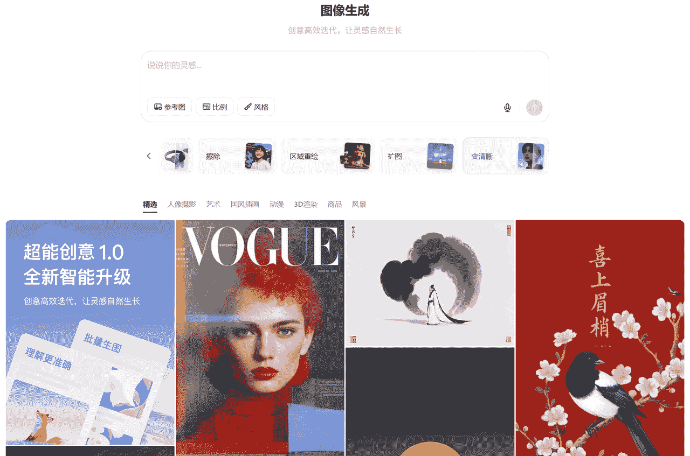

**工具介绍：**豆包 AI 绘画是由字节跳动开发的基于深度学习的 AI 图像生成工具，支持通过文本描述生成高质量图像，涵盖动漫、写实、3D 渲染、国风等 30+风格，尤其擅长分镜漫画、城市地标融合、影视海报设计等场景。其最新 3.0 版本支持一次性生成 20 张差异化图像，并保持风格、色调与人物一致性，大幅提升创作效率。

**工具优点：**

> **操作简易：**无需专业绘画基础，输入中文描述即可生成，支持语音指令和参数调整（如比例、风格强度）。

> **风格多样：**涵盖动漫、水彩、油画、赛博朋克、3D 渲染等 30+风格，满足商业设计、教育、个人创作需求。

> **细节优化：**3.0 版本提升了光影、色彩过渡和复杂场景的细节表现，画面更细腻自然。

**是否免费：**免费体验

**网络条件：**不需要特殊网络

**体验网址：**`https://www.doubao.com/chat/create-image`

### 3）通义万相

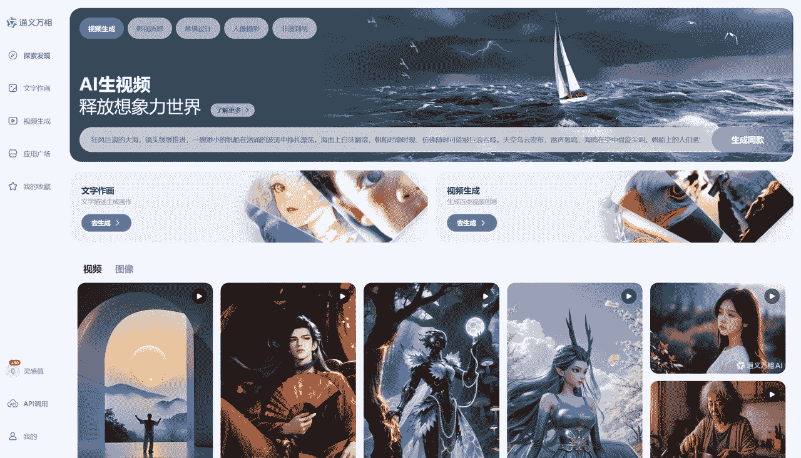

**工具介绍：**

通义万相 AI 绘画是阿里云推出的 AI 绘画创作大模型，基于自研的组合式生成模型 `Composer`，可对配色、布局、风格等设计元素进行拆解与组合，实现高度可控的图像生成效果

**工具优点：**

> 采用 `Composer` 模型，生成图像细节丰富、光影自然，尤其擅长国风、古风等中式元素

> 持调整配色、布局、风格强度等参数，实现个性化创作

> 全中文界面，支持语音输入和智能扩写，降低提示词门槛

**是否免费：**免费体验

**网络条件：**不需要特殊网络

**体验网址：**`https://tongyi.aliyun.com/wanxiang/`

### 4）可灵

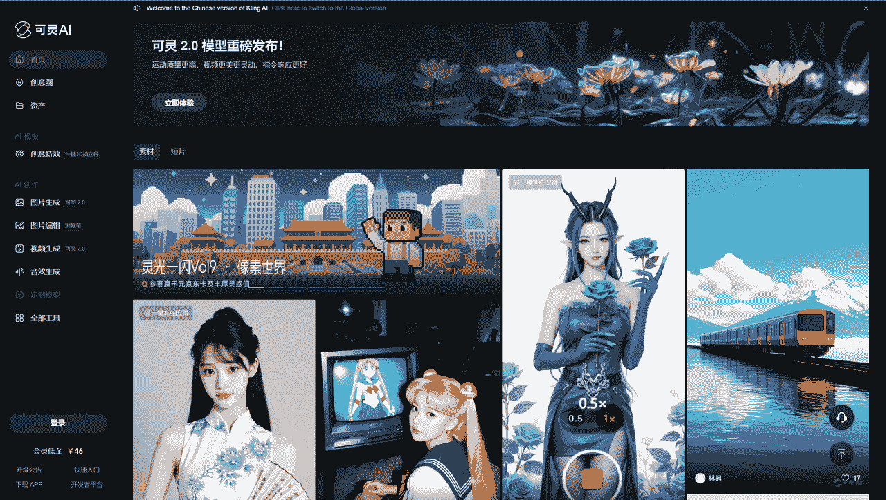

**工具介绍：**可灵 AI 绘画是快手推出的 AI 绘画工具，基于自研大模型“可图”和“可灵”，专注于通过文本或图片生成高质量视觉内容。

**工具优点：**

> **中文提示词理解精准：**在实测中，可灵 AI 对中文描述的语义捕捉能力得分 4.9/5，尤其在国风、武侠等场景中能还原细节（如“侠客的杀气”）。

> **生成速度快：**单张图生成时间约 10-15 秒，批量生成 9 张图仅需 1 分钟内完成，免费版即可体验。

> **娱乐化适配性强：**生成画面偏向“抓眼球”风格（如高饱和度配色、夸张表情），适合短视频封面、带货素材、表情包制作

**是否免费：**免费体验

**网络条件：**不需要特殊网络

**体验网址：**`https://app.klingai.com/cn/`

### 5）文心一言

**工具介绍：**文心一言是百度开发的 AI 绘画工具，基于深度学习技术，支持文生图、图生图、多比例出图、风格迁移等核心功能。其 AI 绘画模块（含 `文心一格` 技术）聚焦于高效生成与创意辅助

**工具优点：**

> 多风格覆盖：支持卡通、写实、水墨、水彩、赛博朋克、国潮等 30+艺术风格，满足插画设计、商业海报、教育素材等场景。

> 多比例出图：可自定义生成比例（如 1:1、3:4、9:16 等），适配新媒体配图、📕封面、手机壁纸等需求，支持“一键生成多尺寸图片”。

> 智能优化与扩展：提供“灵感扩写”功能，自动补全用户简略描述（如“萌宠笔记配图”扩展为完整场景）

**是否免费：**免费体验

**网络条件：**不需要特殊网络

**体验网址：**`https://yiyan.baidu.com/task/painting`

### 6）慧言 AI

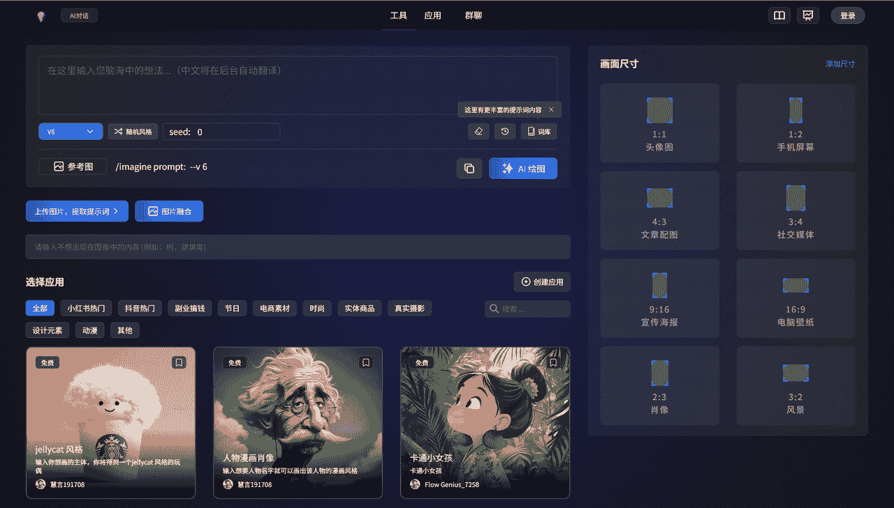

**工具介绍：**慧言 AI 是由深圳市脸萌科技有限公司开发的 AI 绘画工具，其核心功能基于 `Midjourney` 和 `Dalle-3` 两大模型，覆盖文生图、图生图、图像优化等全流程创作场景。

**工具优点：**

> **创作自由度：**提供 139 类细分提示词库（如容貌、服饰、环境），支持一键组合标签生成定制化内容，降低新手门槛。

> **高效与兼容性：**单图生成仅需 10-15 秒，支持 批量生成 9 张/次，免费版即可体验基础功能。

> **商业适配性：**输出图像可直接用于 电商配图、`LOGO` 设计、影视分镜

**是否免费：**免费体验

**网络条件：**不需要特殊网络

**体验网址：**`https://openflowai.net/midjourney`

### 7）无界 AI

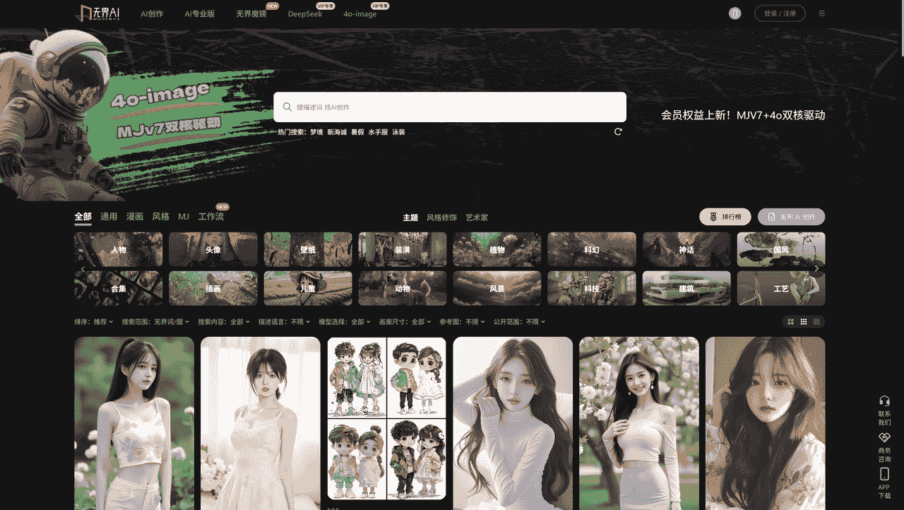

**工具介绍：**无界 AI 是杭州超节点信息科技有限公司推出的 AI 绘画工具，专注于通过人工智能技术生成高质量图像。

**工具优点：**

> 采用自研模型与 `Midjourney-v7` 融合架构，生成图像光影层次细腻，尤其擅长国风、二次元等风格。

> 全中文界面，支持语音输入与“一键同款”功能，10 秒内生成图像，无需绘画基础。

> 覆盖从写实插画到抽象艺术的超 50 种细分风格，支持自定义比例（1:1、9:16 等）与批量生成（最多 9 张/次）。

> 用户可分享作品至广场，学习他人提示词并一键生成同款，形成活跃的 `AIGC` 创作者生态

**是否免费：**免费体验

**网络条件：**不需要特殊网络

**体验网址：**`https://www.wujieai.com/`

### 8）智绘

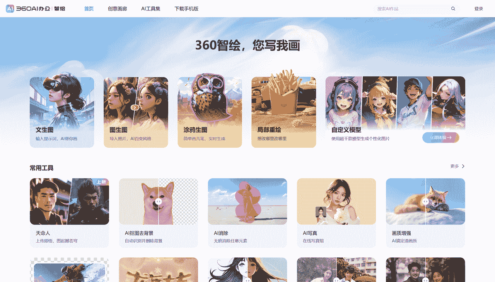

**工具介绍：**智绘 AI 是一款基于深度学习的 AI 绘画工具，支持文生图、图生图、风格迁移、多尺寸生成等核心功能，覆盖动漫、国风、写实、科幻等多样化艺术创作需求

**工具优点：**

> **零门槛操作：**全中文界面，支持语音输入和“一键生成”功能，10 秒内出图，无需绘画基础。

> **风格多样性：**覆盖写实、抽象、国潮等超 50 种细分风格，支持自定义参数（如线条粗细、光影强度）。

> **高效生成与批量处理：**单图生成仅需 10-15 秒，免费版支持批量生成多张图片（最多 9 张/次），便于筛选优化

**是否免费：**免费体验

**网络条件：**不需要特殊网络

**体验网址：**`https://aigc.360.com/`

### 9）Midjourney

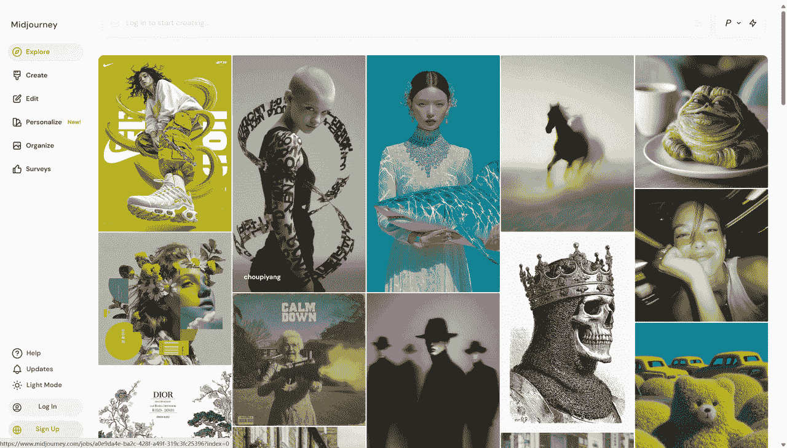

**工具介绍：**`Midjourney` 是一款由 David Holz 团队于 2022 年 3 月推出的 AI 绘画工具，基于深度学习技术（如生成对抗网络和扩散模型），能够根据用户输入的文本描述快速生成高质量图像，涵盖写实、抽象、动漫等多种艺术风格，2025 年 5 月推出的 `V7` 模型 和 `Omni-Reference`（参照万物） 功能进一步提升了其核心竞争力

**工具优点：**

> **细节表现：**优化手部结构、表情和光影层次，生成分辨率达 `8K` 的图像，支持写实、超现实、动漫等风格。

> **智能生成：**新增 `Draft Mode`（草稿模式），生成速度提升 10 倍，适合快速测试灵感，后续可一键升级为高清图。

> **精准控制：**支持上传参考图（如角色、物体、风格），通过参数 `--ow`（0-1000）调节参考权重，实现风格迁移或细节保留

**是否免费：**付费订阅

**网络条件：**需要特殊网络

**体验网址：**`https://www.midjourney.com/home`

### 10）Stable Diffusion

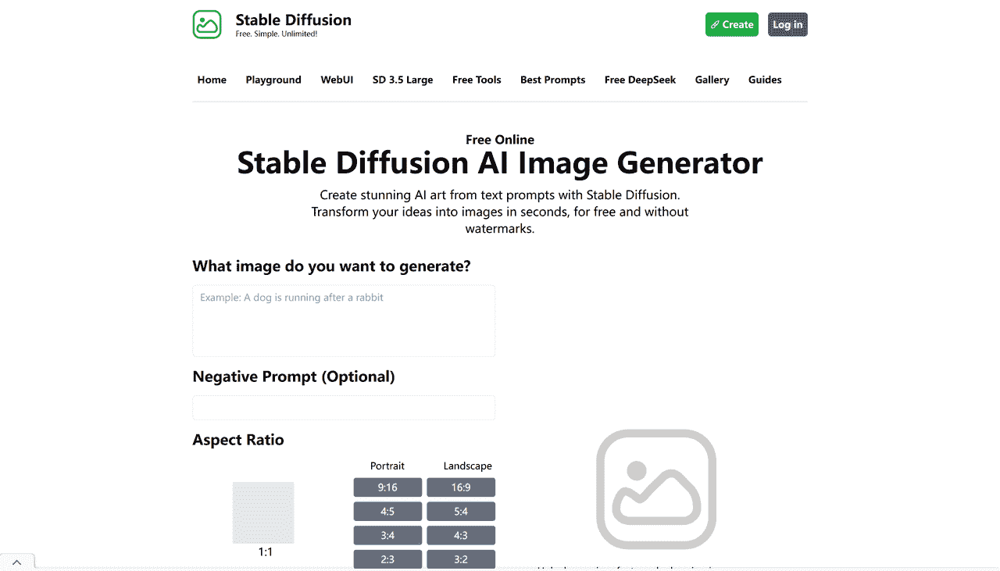

**工具介绍：**`Stable Diffusion` 是一种先进的 AI 图像生成技术，由 `Stability AI`、`Compvis` 和 `Runway` 团队合作开发。这项技术基于 `Latent Diffusion` 模型，该模型由慕尼黑大学的机器学习研究小组 `Compvis` 和纽约的 `Runway` 团队共同研发。

**工具优点：**

> 多模态 `Transformer` 架构（`MMDiT`）：结合扩散模型与 `Transformer` 技术，提升文本理解和图像生成精度，支持生成分辨率高达 `2048×2048` 像素 的超高清图像。

> **多主题支持：**通过单一文本提示生成包含多个元素的复杂图像（如“未来城市+机械恐龙+赛博朋克风格”

> **本地整合包：**秋叶 aaaki 等开发者提供一键安装包（含中文界面），支持 `NVIDIA` 显卡（显存≥`4GB`）本地运行。

> **云端体验：**通过官网申请试用 `Stable Diffusion 3`，或使用国内镜像站（如 `LibLibAI`）在线生成。

**是否免费：**免费体验

**网络条件：**不需要特殊网络

**体验网址：**`https://stabledifffusion.com/tools/ai-image-generator`

### 11）GPT-4o

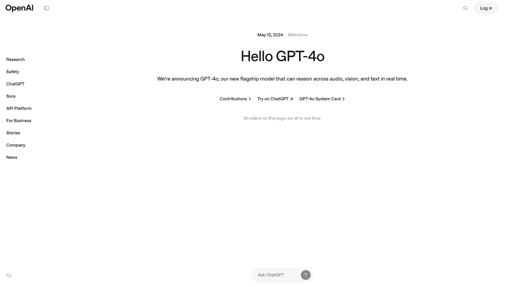

**工具介绍：**`GPT-4o` 是 `OpenAI` 于 2024 年 5 月推出的新一代多模态大模型，名称中的 “o” 代表 “omni”（全能），具备 文本、图像、音频、视频 的实时交互能力

**工具优点：**

> **多模态输入：**支持文本描述、单图或多图输入生成图像，如“赛博朋克夜景”“吉卜力风格人像”。

> **动态优化**：基于对话历史或参考图调整生成结果，支持局部修改（如更换服装、调整构图）。

> **多风格适配：**涵盖超写实、抽象艺术、吉卜力动画、水彩画等十余种风格，并可跨风格转换（如草图→写实）

**是否免费：**免费体验

**网络条件：**需要特殊网络

**体验网址：**`https://chatgpt.com/?model=gpt-40`

## 二、AI 图片背景移除

### 1）稿定 AI 抠图

**工具介绍：**稿定 AI 抠图是由稿定设计团队开发的在线智能抠图工具，基于深度学习算法实现精准图像分割，尤其擅长处理复杂背景和细节主体（如发丝、透明材质等）。2025 年版本新增 `AI 增强模式` 和 `多场景批量处理引擎`

**工具优点：**

> **高精度与高效性**

> `AI` 算法优化后，对复杂主体（如透明婚纱、宠物毛发）的识别准确率提升至 98% ，边缘过渡自然。

> 处理速度比传统 `PS` 快 10 倍以上 ，支持实时预览和微调。

> **用户友好性**

> 界面简洁直观，提供 一键修复 和 手动细化工具 （保留/去除笔刷），新手也能快速上手。

> 兼容多种格式（`PNG`、`JPG`、`WEBP`），导出分辨率最高达 `4096×4096` 像素 。

**是否免费：**免费体验

**网络条件：**不需要特殊网络

**体验网址：**`https://www.gaoding.com/koutu?hmsr=ai-bot-ai-bot-kt--koutu-koutu-bdqd&utm_source=ai-bot`

### 2) Piccopilot

**工具介绍：**`PicCopilot` 是由阿里巴巴国际 AI 团队开发的 AI 电商图像处理工具，专为跨境电商和电商运营者设计，结合深度学习算法与海量商品数据训练，实现高效、精准的图像处理。

**工具优点：**

> **高效性与精准度**

> 基于阿里海量数据训练，商品主体识别准确率达 98%以上，减少误扣（如屏幕内容、模糊边缘）。

> 批量处理效率比人工操作提升 10 倍，支持实时预览和手动微调（如擦除误识别区域）。

> **用户友好性**

> 界面简洁直观，提供 `智能模板推荐` 和 `参数可视化面板` ，无需专业设计技能即可操作。

> 导出分辨率高达 `4096×4096` 像素，满足高清印刷和线上展示需求。

> **多功能集成**

> 与阿里生态无缝衔接，可联动 `AI 背景生成`、`视频翻译`、`数字人口播` 等工具，形成全链路电商解决方案

**是否免费：**免费体验

**网络条件：**需要特殊网络

**体验地址：**`https://www.piccopilot.com/create/?utm_source=aff&utm_medium=aibot1`

### 3）鲜艺 AI 抠图

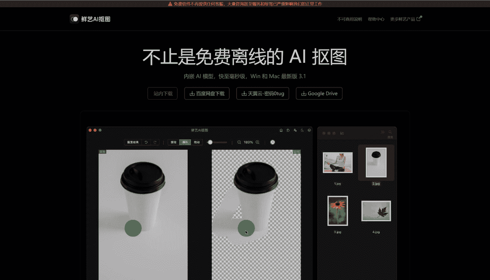

**工具介绍：**鲜艺 AI 抠图是由 兰州新区鲜艺网络科技有限公司 开发的免费离线 AI 图像处理工具，基于 `RMBG-1.4` 模型 实现毫秒级智能抠图，支持批量处理和复杂细节优化（如发丝、透明材质）。

**工具优点：**

> **一键智能抠图**

> 本地化运行，无需联网，上传图片后 3 秒内自动分离主体与背景，支持批量处理（单次最多 50 张）。

> 新增 `AI 擦除` 工具，可手动优化误识别区域（如屏幕内容、复杂边缘）。

> **多格式兼容**

> 支持 `JPG`、`PNG`、`GIF`、`WEBP`、`BMP` 等格式输入，默认输出为 `PNG` 透明背景（分辨率最高 `4096×4096` 像素）。

> **二次创作集成**

> 生成 `PSD` 文件并自动调用 `Photoshop` 编辑，保留原图与抠图结果双图层。

> 提供 `背景替换模板库`（如证件照纯色、电商白底、节日促销场景）。

**是否免费：**免费体验

**网络条件：**不需要特殊网络

**体验地址：**`https://kt.94xy.com/?utm_source=ai-bot.cn`

## 三、AI 图片无损放大

### 1）美图无损放大

**工具介绍：**美图无损放大是美图设计室推出的 AI 图像增强工具，基于深度学习技术对图片进行智能修复与放大，可在放大至 8 倍的同时保留细节，避免模糊或失真。主要面向设计师、摄影师、电商卖家等需要高清图片处理的用户群体，支持多种格式（如 `JPG`、`PNG`、`HEIC` 等），并提供云端处理服务

**工具优点：**

> **高倍率无损放大：**支持 2 倍、4 倍及 8 倍放大，其中 2 倍完全免费，4 倍可免费体验两次，适合不同清晰度需求。

> **智能细节修复：**通过深度学习算法重建图像细节，尤其擅长修复老旧照片或低分辨率图片。

> **操作便捷性：**支持自定义尺寸设置（如指定宽高），云端处理无需本地高性能设备，界面友好适合新手

**是否免费：**免费体验

**网络条件：**不需要特殊网络

**体验地址：**`https://www.designkit.com/upscale/?channel=100101`

### 2) upscayl

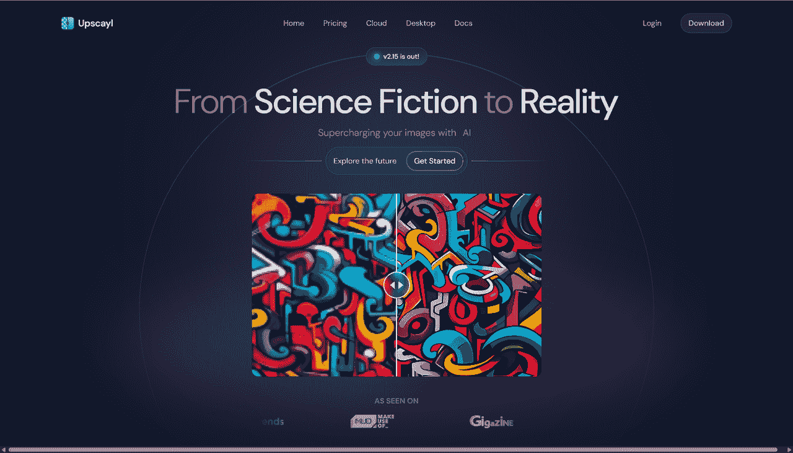

**工具介绍：**`Upscayl` 是一款基于深度学习的开源免费 AI 图像无损放大工具，通过神经网络技术智能修复低分辨率图像，支持将图片放大至 4-16 倍并增强细节。其核心功能包括智能降噪、细节重建、色彩优化，适用于老照片修复、设计素材优化、医学影像增强等场景

**工具优点：**

> **多模型选择：**提供 `Real-ESRGAN`、`UltraSharp`、`Digital Art` 等预设模型，针对自然风景、数字艺术、人像等场景优化。

> **本地化处理：**无需联网，所有计算在本地完成，保障数据隐私安全。

> **批量处理与高效运算：**支持批量导入图片，并利用多 `GPU` 加速处理，提升工作效率

**是否免费：**免费体验

**网络条件：**不需要特殊网络

**体验地址：**`https://upscayl.org/`

### 3) Bigjpg

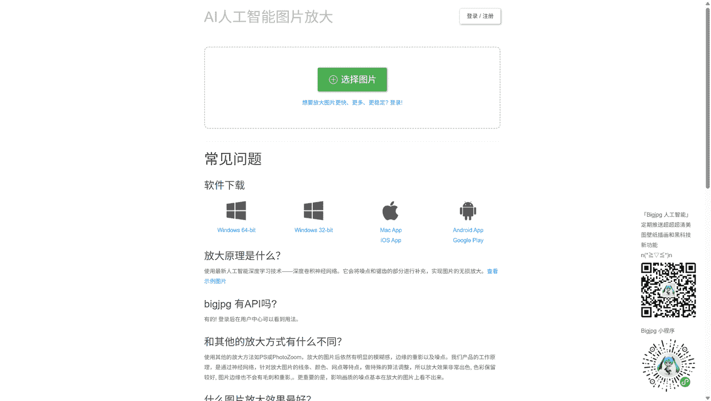

**工具介绍：**Bigjpg 是一款基于深度卷积神经网络（CNN）的 AI 图像无损放大工具，专为提升低分辨率图像的清晰度设计。其核心技术源自开源项目 `waifu2x`，并针对动漫、插画类图片优化算法，可智能修复噪点和锯齿，实现最高 16 倍的无损放大。支持 JPG、PNG、TIFF 等格式

**工具优点：**

> **高倍率无损放大**

> 免费用户支持 4 倍放大，付费用户最高 16 倍，尤其适合动漫、插画类图片，放大后线条细腻、色彩保留精准。

> **智能算法优化**

> 针对不同图片类型（如照片/插画）采用专用模型，自动降噪并补充细节，效果优于传统工具如 PhotoZoom。

> **多平台与便捷操作**

> 提供网页版、桌面客户端、手机 App 及🛰️小程序，操作界面简洁无广告，支持拖拽上传和离线处理（需登录）

**是否免费：免费体验**

**网络条件：不需要特殊网络**

**体验地址：**`https://bigjpg.com/`

# 四、AI 图片优化修复

## 1) Relight

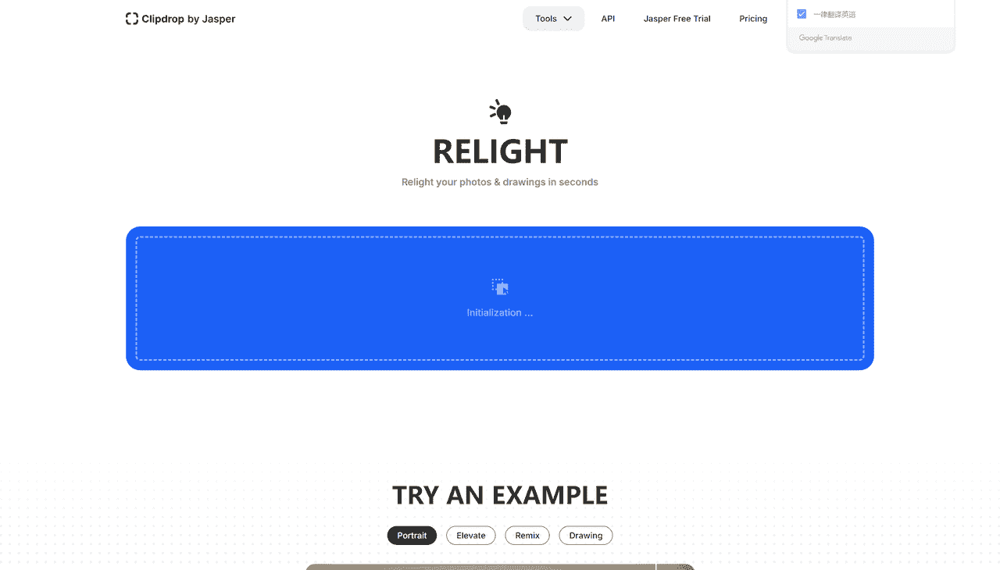

**工具介绍：**Relight 是由 Clipdrop 推出的 AI 智能打光工具，基于深度学习模型分析图像的光影信息，模拟真实立体光源效果。用户可在图片任意位置添加或调整光源，改变灯光的颜色、强度、距离和范围，适用于人像摄影修复、艺术创作、广告设计等场景。其核心技术通过计算图像深度和表面法线，预测新光源下的光影变化，从而生成自然的光照效果

**工具优点：**

> **高自由度光源调整**

> 可添加多个点光源，实时拖动光源位置并调节参数（颜色、强度、距离、半径），模拟背光、侧光等复杂布光效果。

> **智能算法适配多场景**

> 针对人像、油画、动漫等不同内容优化，尤其擅长修复低光照片、增强立体感和氛围。

> **专业级预设与批量处理**

> 部分版本（如 `ComfyUI` 插件）内置 8 种预设光源（如自然光、日落光晕），支持批量图片处理和 3D 灯光模拟。

**是否免费：免费体验**

**网络条件：无特殊网络条件**

**体验地址：**`https://clipdrop.co/relight`

## 2) Remini

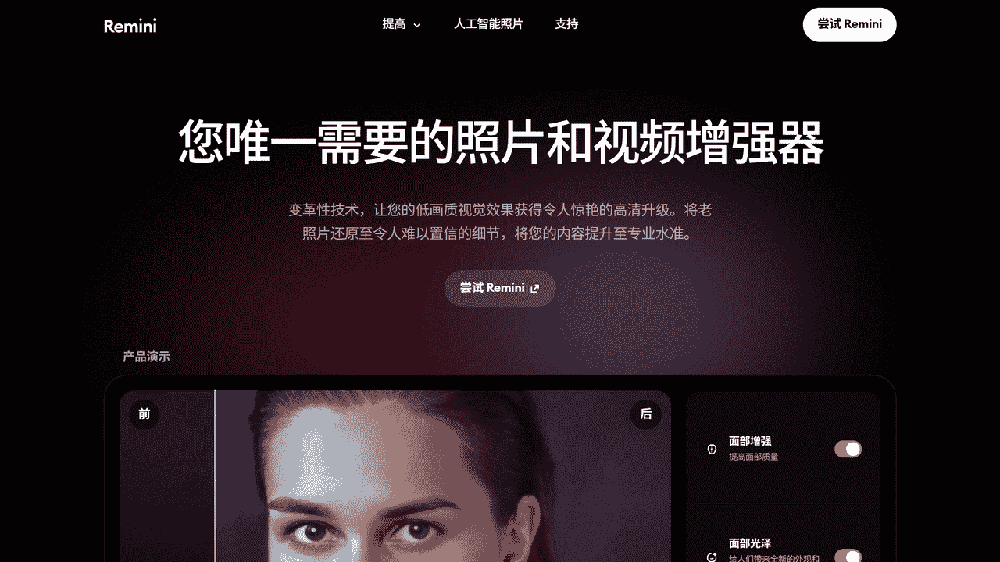

**工具介绍：**Remini 是一款由意大利公司 Bending Spoons 开发的 AI 图像处理工具，前身源自北京大觥科技有限公司。其核心功能包括老照片修复、面部增强、视频增强、颜色修复等，通过深度学习技术实现图像细节重建与风格转换

**工具优点：**

> **高精度修复能力**

> 可修复模糊、破损、低分辨率的老照片，通过 AI 生成原始图像缺失的细节（如皱纹、纹理），并保留人物神态。例如，黑白照片可智能上色并还原色彩层次。

> **创意风格滤镜**

> 提供黏土滤镜、玉滤镜、电影滤镜等 10 余种风格，支持一键生成艺术化效果。黏土滤镜因丑萌风格和故事感设计成为社交传播爆点

**是否免费：**免费体验

**网络条件：**无特殊网络条件

**体验地址：**`https://remini.ai/?ref=ai-bot.cn`

## 3) restorephotos

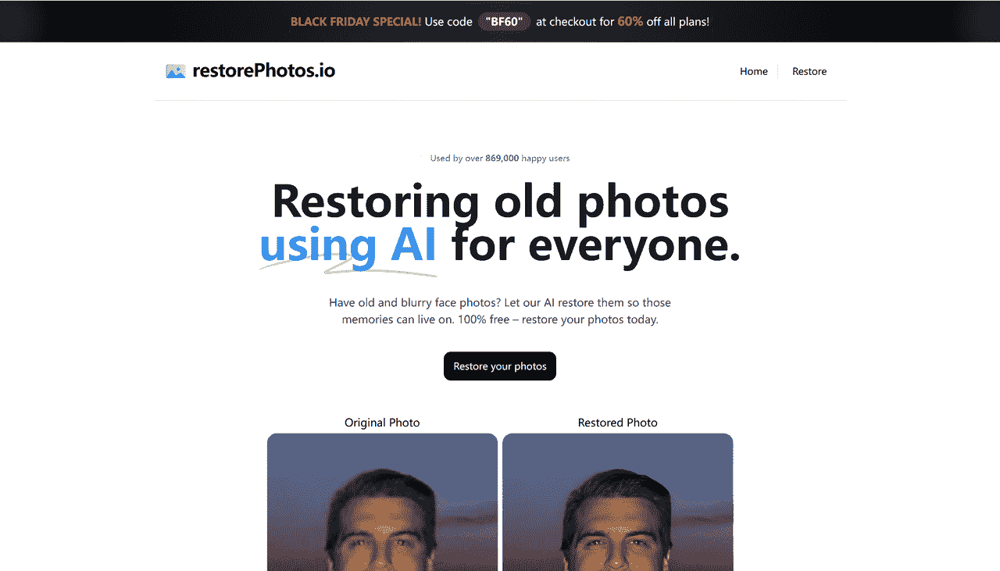

**工具介绍：**`restorephotos.io` 是一个基于人工智能的开源项目，专注于修复老旧、模糊或破损的人脸照片。其核心技术采用 `GFPGAN`（Generative Facial Prior GAN）模型，通过深度学习算法智能重建面部细节，例如修复皱纹、模糊轮廓，甚至为黑白照片智能上色。

**工具优点：**

> **高精度修复能力**

> 针对人脸细节优化，修复后线条细腻、色彩自然，尤其擅长处理低分辨率或黑白照片。

> 支持 批量处理，可同时修复多张照片，提升效率。

> **开源与隐私保护**

> 代码开源（`GitHub` 仓库公开），允许用户本地部署或自定义功能，确保数据在本地处理，无需上传至服务器

**是否免费：**免费体验

**网络条件：**无特殊网络条件

**体验地址：**`https://www.restorephotos.io/`

# 五、AI3D 模型生成

## 1) TripoAI

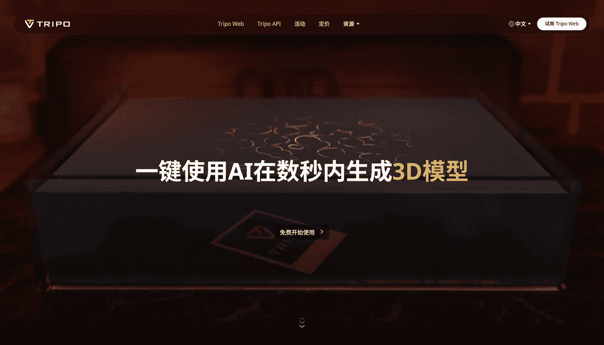

**工具介绍：**Tripo AI 是由硅谷初创公司 VAST 开发的 AI 驱动 3D 建模工具，基于深度学习技术实现文本或图像快速生成高质量 3D 模型

**工具优点：**

> **多模态输入：**支持文字描述、单张/多张图片输入生成模型，适用于游戏角色、工业设计、影视场景等。

> **高效建模：**最快可在 8 秒内生成带纹理的 3D 模型，优化后质量接近人工制作。

> **专业适配：**支持导出 `GLB`、`FBX`、`OBJ` 等主流格式，兼容 Blender、Maya、Unity 等开发工具。

> **动态功能：**提供骨骼绑定、动画预设（如行走、奔跑）及风格化处理（乐高、体素化等）

**是否免费：**免费体验

**网络条件：**无特殊网络条件

**体验地址：**`https://www.tripo3d.ai/?utm_source=ai-bot.cn`

## 2) 腾讯混元 3D

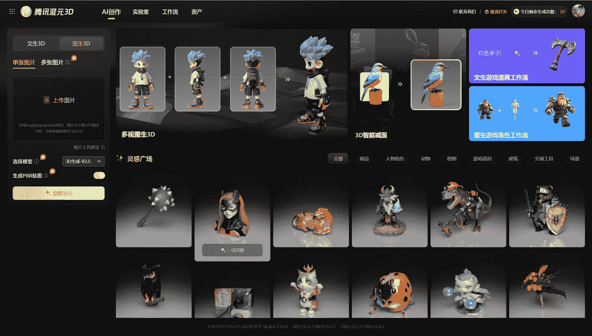

**工具介绍：**腾讯混元 3D 是腾讯基于 混元大模型 开发的一站式 3D 内容 AI 创作平台，专注于通过文本或图像快速生成高质量 3D 模型。其核心技术采用 双阶段生成框架

**工具优点：**

> **几何生成：**通过多视图扩散模型捕捉物体的形状与结构，生成无纹理的几何模型（如 4 秒完成草稿生成）；

> **纹理生成：**结合物理渲染（`PBR`）技术，为几何模型添加高精度材质与色彩（支持 4K 超清纹理和凹凸贴图）

**是否免费：**免费体验

**网络条件：**无特殊网络条件

**体验地址：**`https://3d.hunyuan.tencent.com/?utm_source=ai-bot.cn`

---

# 学习交流社群

1. 持续关注并更新 AI 的**相关资讯动态，研究报告，赚钱案例**，常见问题，永久免费在线查看，无收费内容，目标是成为最大的免费 AI 学习社群。

2. 已建立社群聊聊 **AI** 发展及应用，**没进群的可以扫码加入，群满可加 AI 研究爱好者大国🛰️ ID：`zyg90s`（备注：AI），已经在社群内的无需重复加入，开源知识库及社群学习全部为公开免费分享。

3. **关于文档负责人大国**：高帆文化 CEO，曾就职于教培大厂，目前创业，主攻研究 AI 落地应用、企业流量增长及达人 IP 孵化。

**飞书学习群**

**飞书扫码进群学习**

好友（ID：`zhangyuguo94s`）

**扫码加🛰️入🛰️群**
