# AI 艺术码绘画实操手册

> 来源：[https://yunyinghui.feishu.cn/docx/GuAud0pjNoKq4kxzVzgc1Kx9nmc](https://yunyinghui.feishu.cn/docx/GuAud0pjNoKq4kxzVzgc1Kx9nmc)

> **适用人群：****关注 AI 艺术码绘画应用人群**

> 首发时间：2024 年 3 月 19 日

> 更新时间：2024 年 3 月 19 日

> **内容出品人：**

> **内容出品方：**[Mix AI Lab](https://yunyinghui.feishu.cn/wiki/WhelwZnxQi55mpkOzatc3Xran5b?from=from_copylink)

> **使用建议：**如果需要快速定位到精确内容，可以使用快捷键 Ctrl +F/Command +F 的形式，搜索关键字/词，查找你想要的内容。

> **持续更新 AI 绘画艺术码的****实战案例，使用场景，变现玩法等内容**，本内容永久免费在线查看，欢迎收藏转发支持，文末有惊喜，大国出品，必属精品。

# 一、概念说明

艺术二维码是一种结合了 AI 绘画艺术设计元素的二维码，它在保持传统二维码功能的基础上，通过视觉设计上的创新，使得二维码本身成为一种视觉艺术作品。与传统的黑白二维码相比，艺术二维码通常具有以下特点和区别：

## 艺术二维码的特点

1.  **视觉吸引力**：艺术二维码通过颜色、形状、图案等设计元素的运用，提高了二维码的视觉吸引力，使其更加美观和引人注目。

1.  **品牌个性化**：企业或个人可以根据自身品牌特色和形象，定制独特的艺术二维码，从而在众多二维码中脱颖而出，增强品牌识别度。

1.  **互动性增强**：艺术二维码往往设计得更加有趣和互动，可以激发用户的好奇心和参与感，从而提高扫描率。

1.  **信息丰富**：除了基本的信息传递功能，艺术二维码还可以包含更多的信息层次，如故事性、情感表达等，为用户提供更丰富的体验。

## 与传统二维码的区别

1.  **外观**：传统二维码通常是纯黑白的，而艺术二维码则拥有丰富的颜色和图案设计，更具艺术感。

1.  **设计复杂度**：艺术二维码的设计通常更为复杂和精细，需要考虑如何在不干扰扫描功能的前提下，融入艺术元素。

1.  **功能性与美观的平衡**：艺术二维码需要在保持二维码基本扫描功能的同时，实现美观的设计，这要求在功能性和美观性之间找到平衡点。

1.  **应用场景**：艺术二维码更适用于需要强调品牌形象、提升视觉体验的场合，如营销活动、艺术展览、个性化产品包装等。

总的来说，艺术二维码是一种创新的二维码形式，它不仅提供了传统二维码的信息传递功能，还通过艺术设计增强了视觉吸引力和品牌个性化表达，为用户提供了更加丰富和有趣的互动体验。

## 艺术二维码示例

给咱们知识库做了一个

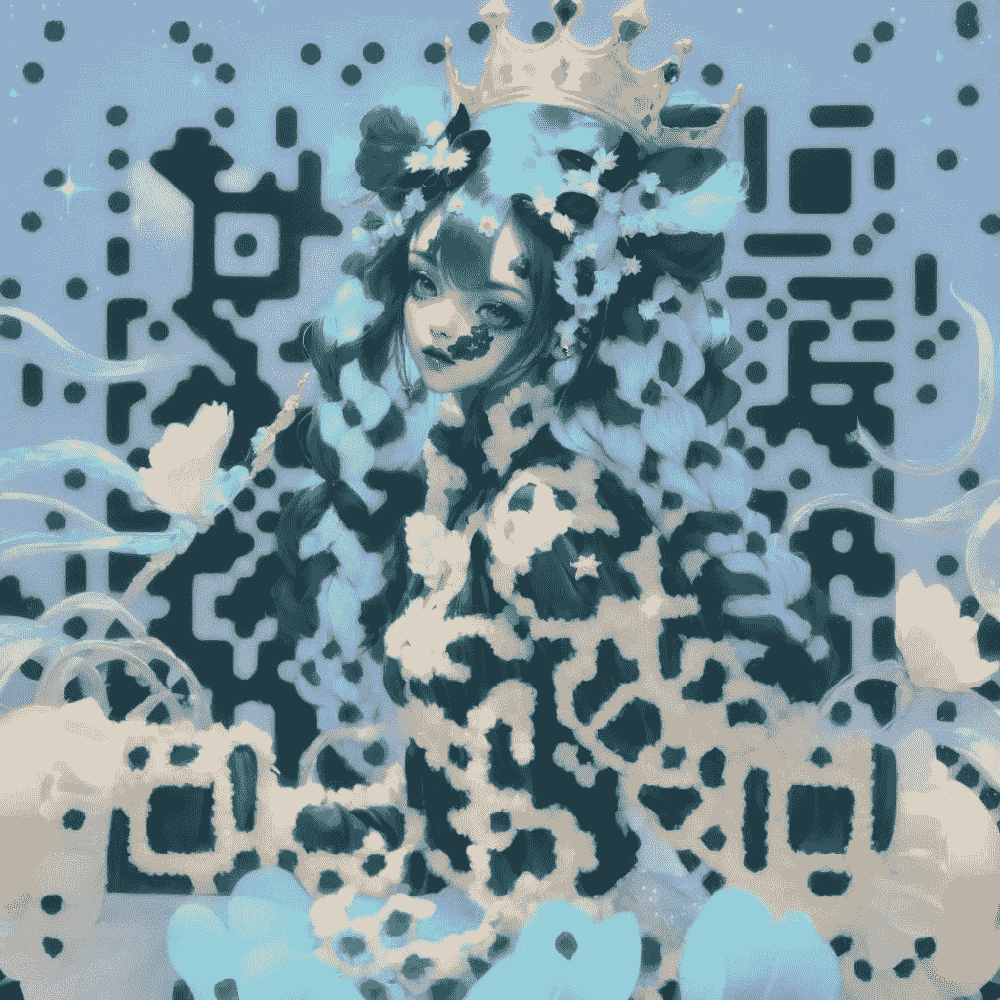

# 二、使用场景

二维码目前已经广泛应用于各行各业，不管在网上冲浪，或是在线下各种场合，我们都随处可见二维码的应用。

但是现在当人们已经看腻千篇一律的黑白二维码，是时候把你的二维码更换为结合 AI 的艺术二维码，彻底颠覆二维码体验，重新定义个人与品牌形象，留下令人深刻的印象！

以下是艺术二维码的一些实用场景：

| **应用场景** | **描述** |
| --- | --- |
| 商品销售 | 商家在产品包装上放置艺术二维码，消费者扫描后可获取商品详细信息、价格、促销活动等。 |
| 支付方式 | 用户通过扫描商家提供的艺术二维码完成支付，无需携带现金或银行卡。 |
| 各种验证 | 在演出、展览、体育赛事等活动中，门票上的艺术二维码用于验证入场身份，防止假票。 |
| 电子名片 | 个人或企业将联系信息制作成艺术二维码，方便他人扫描获取联系方式。 |
| 网络链接 | 艺术二维码包含网址信息，用户扫描后可直接访问网页，无需手动输入网址。 |
| 广告宣传 | 艺术二维码的美观和独特性使其成为广告中吸引注意力的有效工具。 |
| 包装设计 | 在产品包装上使用艺术二维码，提升产品外观的同时，增加互动性和信息传递。 |
| 展览与艺术品 | 艺术二维码可以与艺术品结合，为参观者提供更多关于作品的信息。 |
| 品牌形象提升 | 通过独特的艺术二维码设计，传递品牌的形象、特色和价值观，增强品牌认知度。 |
| 互动体验增强 | 结合互动技术，如扫码后触发音频、视频、动画等内容，提升用户的参与度和体验。 |

# 三、制作教程

## 1）Stable Diffusion 工具教程

**特点：**比较吃配置，但是自由度高，完全自己掌控。

自从 AI 绘画及 ControlNet 爆火后， 有人就受到启发，思考能不能在 Stable Diffusion 中生成看起来很像图像的二维码，从而实现二维码在形式上的“隐身”。有了相关的想法后，他们就开始自己动手训练相关的 ControlNet，最终成功开发出 2 款新的 ControlNet 模型：Brightness 和 Illumination，分别可以控制画面的灰度和光影。

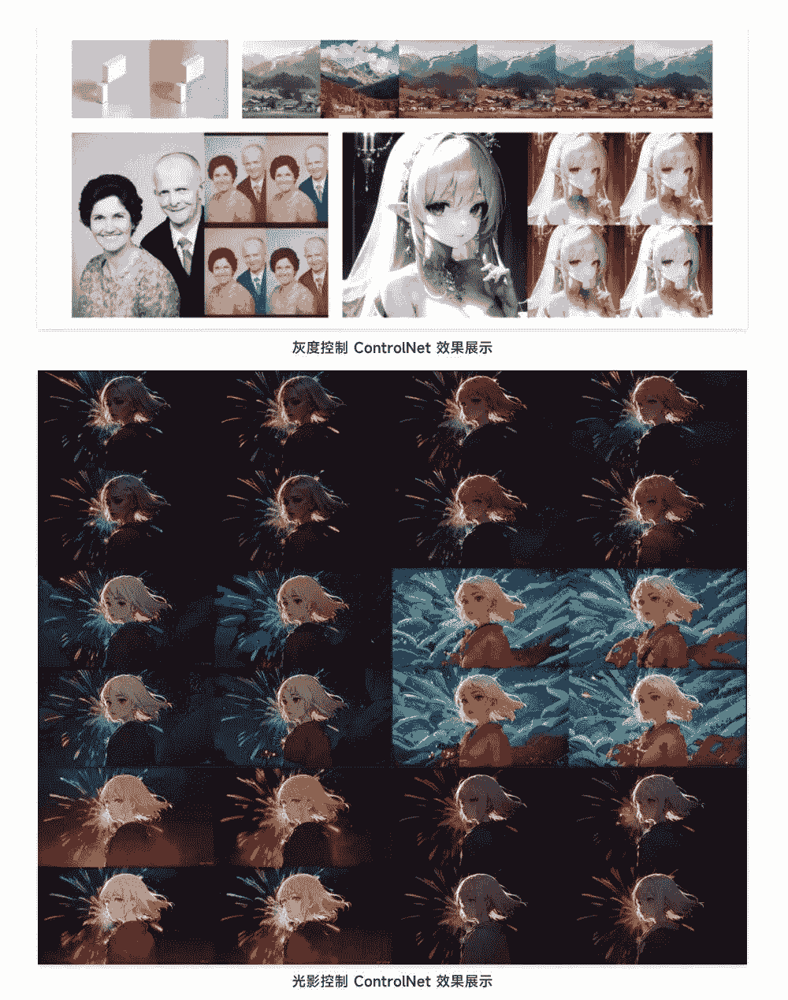

相关 Controlnet 模型训练完成后，倪豪他们尝试与不同的大模型（checkpoint）、LoRA、以及 ControlNet 模型组合使用，获得了风格各异、且非常具有艺术性的二维码图像。

St**able Diffusi**on 的「AI 图生图」功能，加上自己训练定制的 ControlNet Brightness 和 Illumination 模型，在普通二维码的基础上，成功让 AI 生成了几乎和画面融入的二维码。并且通过进一步和不同的大模型组合使用（Checkpoint、LoRA 等），获得了风格各异、且非常具有艺术性的二维码图片。

**这里详细介绍一下 SD 的玩法，具体的 S**[Stable Diffusion 学习手册](https://yunyinghui.feishu.cn/wiki/W2KHwvkDii23o3kQi3KcmgHRnYg?from=from_copylink) 的安装教程请参考知识库的 SD 手册

### 1.安装/打开 **QR Toolkit **

QR Toolkit是一个生成二维码的工具，提供两种使用方式：

1.  可以直接在SD中安装 QR Toolkit 插件，并通过web UI直接打开操作界面；

1.  通过在线版本直接使用，QR Toolkit 网页版：https://qrcode.antfu.me/

#### 1.1 **SD插件安装方式：**

打开web ui中的扩展，点击可下载—加载扩展列表，按键盘上的ctrl+f搜索功能，输入QR Toolkit 进行安装。

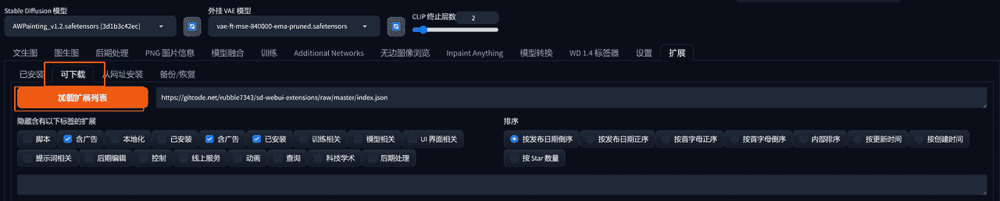

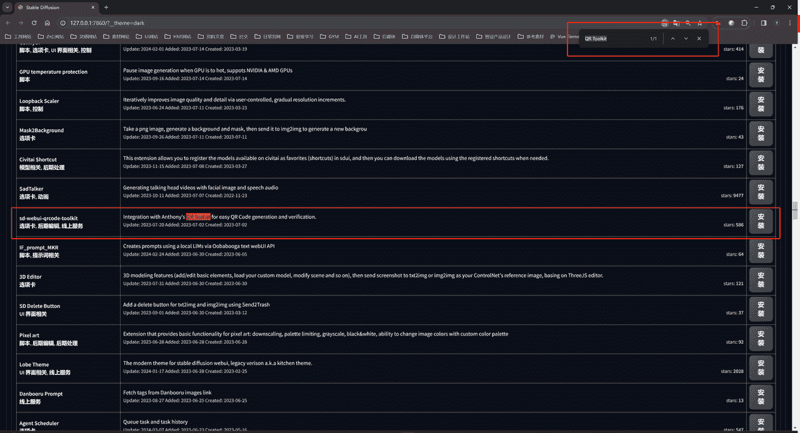

或者是点击【从网址安装】，输入 [https://github.com/antfu/sd-](https://link.uisdc.com/?redirect=https%3A%2F%2Fgithub.com%2Fantfu%2Fsd-webui-qrcode-toolkit)webui-qrcode-toolkit 进行安装

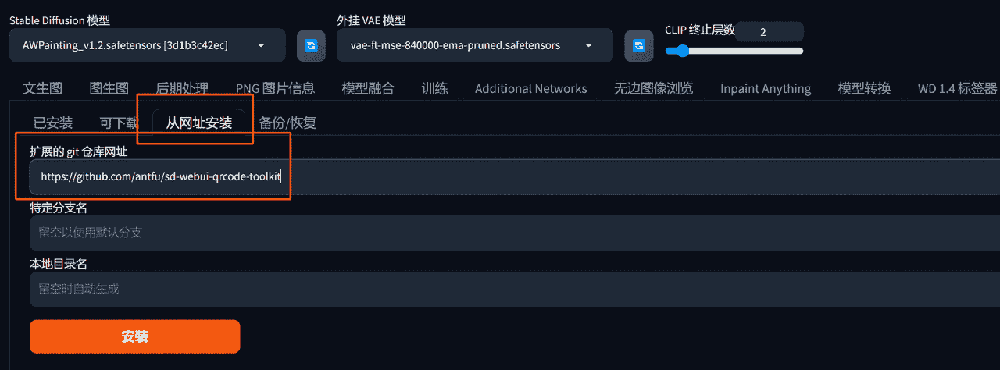

#### 1.2 在线使用方式**：**

如果你安装失败这个插件，也可以通过第二种方式，直接打开网址进行二维码生成：https://qrcode.antfu.me/

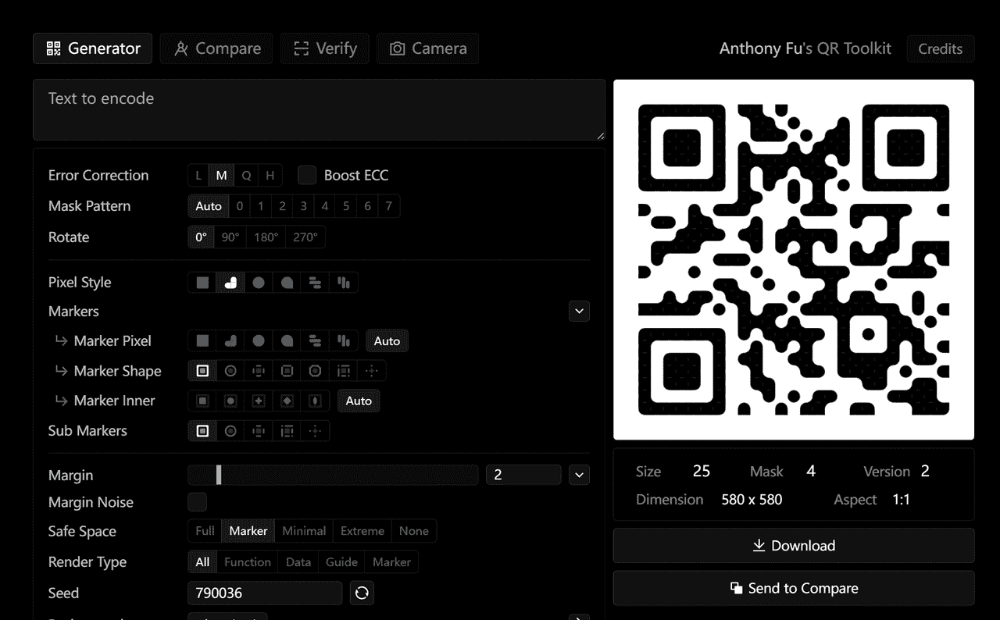

### 2.链接生成二维码

这[玩赚 AI 实验室](https://yunyinghui.feishu.cn/wiki/WhelwZnxQi55mpkOzatc3Xran5b?from=from_copylink)步也是非常简单，我们直接打开这个插件，在底部输入框中输入二维码的跳转网址，比如我们的【玩转AI实验室】文档链接：

输入链接后，右侧的二维码会直接生成，我们点击 Download 下载即可：

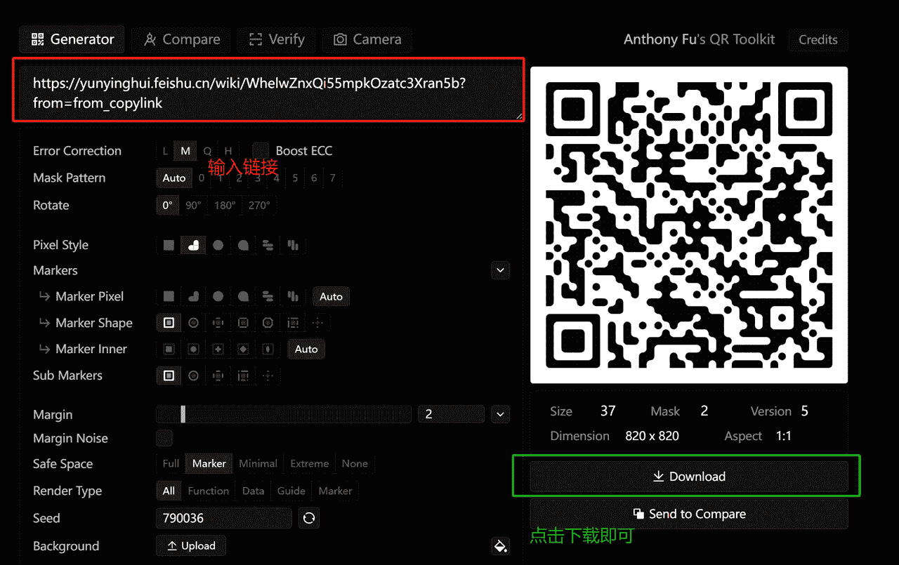

这个网站其他的操作功能基本上都是调整二维码图案的形状，大家可自行尝试。

### 3.SD生图操作

#### 3.1 出图参数设置

+   **大模型设置：**AWPainting_v1.2.safetensors

+   **正向关键词：**

(( upper body of dynamic dance movement, A girl is happy and laughing:1)) ((pure red background))  possibly in her early teens,in a surreal,She's dressed in a very long sleeves Chinese Dragon whimsical,Dragon-like very long sleeves costume with a Chinese color palette,as eerie dolls float around her.,

> ((上半身动感的舞蹈动作，一个女孩开心的笑着)((纯红色的背景))可能是她十几岁的时候，在一个超现实的世界里，她穿着一件中国龙的长袖奇装异服，像龙一样的长袖服装，配上中国的调色板，怪异的玩偶在她周围漂浮。

+   **反向关键词：**

ng_deepnegative_v1_75t,(badhandv4:1.2),(worst quality:2),(low quality:2),(normal quality:2),lowres,bad anatomy,bad hands,((monochrome)),((grayscale)) watermark,moles,large breast,big breast,long fingers:1 bad hand:1,many legs,many shoes,hands,

**迭代步数：40**

采样方法：DPM++2M Karras

**尺寸：512*512**

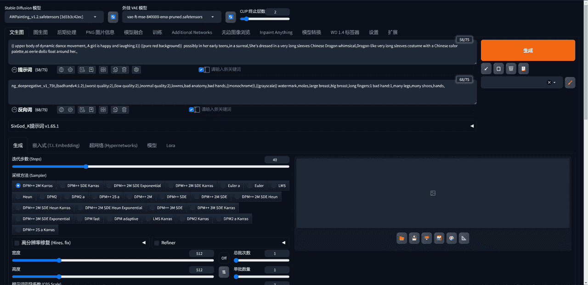

#### 3.2 controlnet模型下载/安装

这里我们需要使用controlnet上传二维码图并进行控制，我们还需要下载一下这个为二维码量身定制的controlnet模型，模型下载地址：https://huggingface.co/monster-labs/control_v1p_sd15_qrcode_monster/tree/main

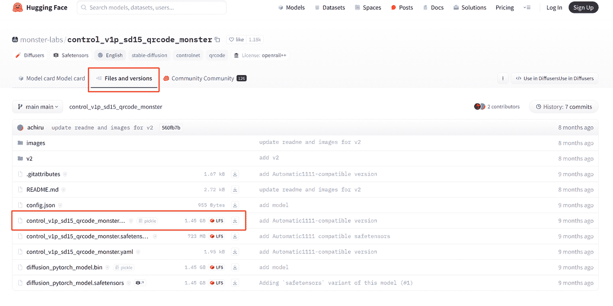

安装到controlnet的models文件夹即可，下面是文件路径：

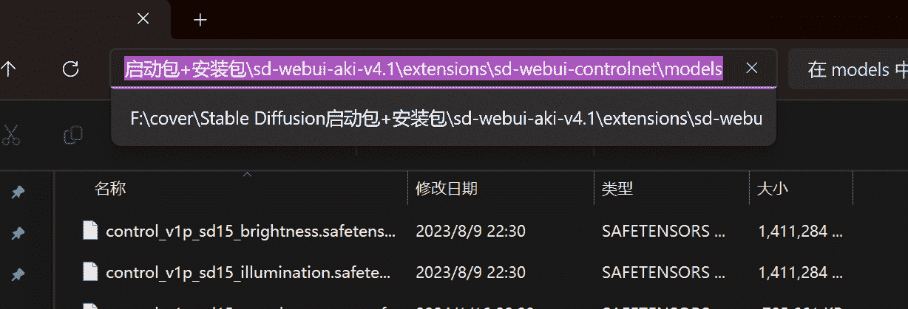

#### 3.3 controlnet设置出图

先简单的设置下基本参数：

上传图片，点击启用——完美像素——预处理器无——qrcode模型，然后点击生成我们就得到了一张图：

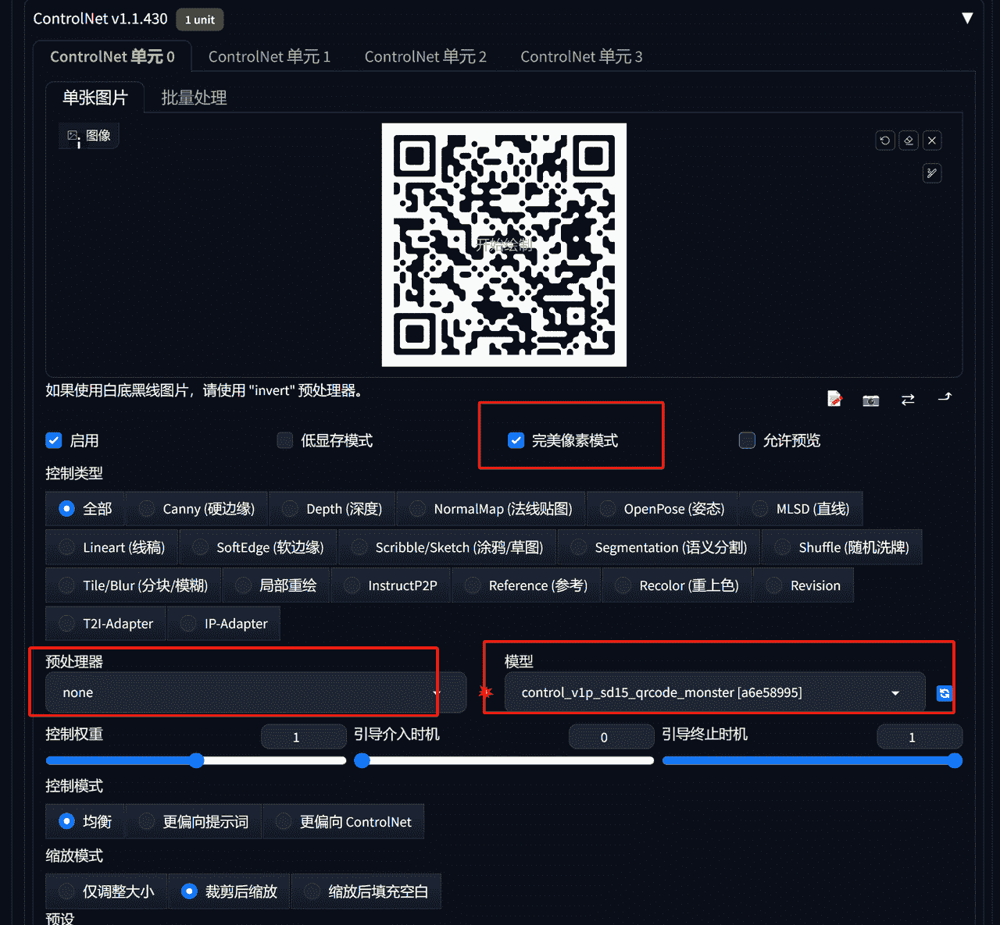

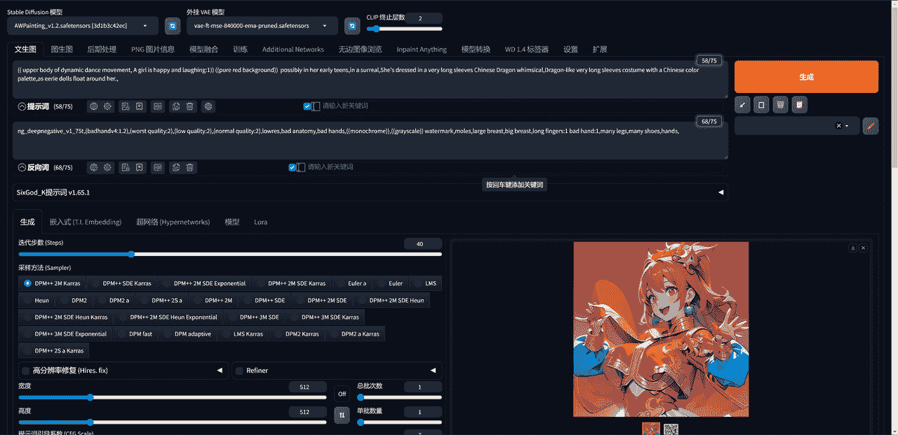

但是你会发现生成的图片没有二维码的形状，也扫描不出来，那是因为controlnet权重太低了，我们需要调整controlnet权重，大概是1.5~2（权重越大，二维码越明显）：

设置为1.75点击生成，你会发现这个二维码还是扫不出来，那是因为现在生成图片的质量很低，形状也随着质量问题变得混乱。

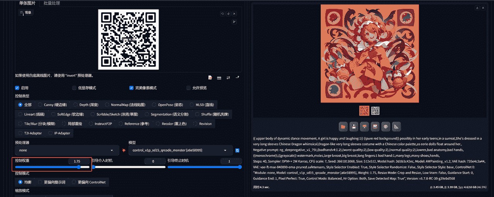

所以我们现在就需要对图片的质量进行提升，打开高清修复，安装图中的参数进行调整，那么你就可以生成一张能扫出链接的二维码了，不信你扫一下看看：

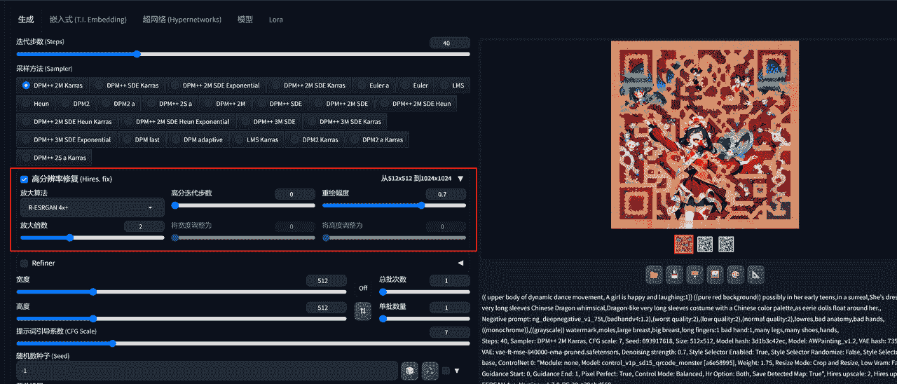

### 3.3 二维码优化

到上面这一步，我们是已经能成功的生成一张可以扫描的二维码了，但是这个二维码的效果不好。所以我们现在要调整参数，让二维码既能扫出来，视觉效果也非常好。

很简单，控制引导介入时机和引导终止时机即可。那这两个参数是什么意思：

**举个例子：**

> 介入时机0.1，表示AI在生图过程中，0-10%，是由AI随机跑图，剩下的90%，controlnet开始控制图片形状；

> 终止时机0.9，表示AI在生图过程中，0-90%，由controlnet控制图片形状，剩下的90%-100%由AI随机跑图；

> 那么两个参数同时设置，就是前10%由AI随机生成，最后的10%由AI生成，10%-90%由controlnet控制图片形状。

最后下面这张图我设置的是 介入时机0，终止时机0.9，这样既能扫出二维码，图片视觉效果也比较丰富：

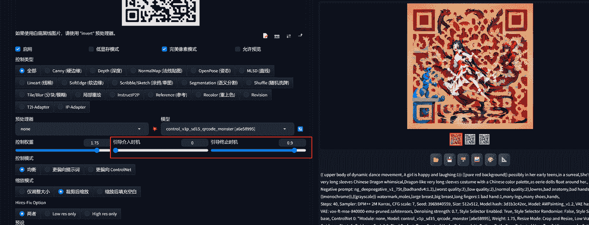

总结：使用SD生成二维码，只需要控制三个controlnet参数即可，控制权重、引导介入时机、引导终止时机。

最后附上2张二维码：

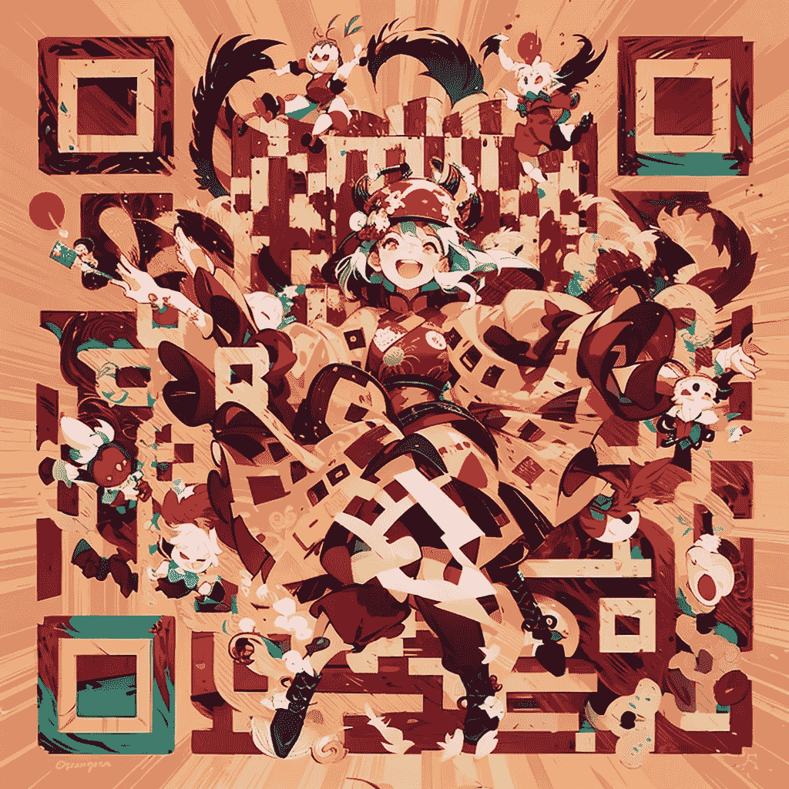

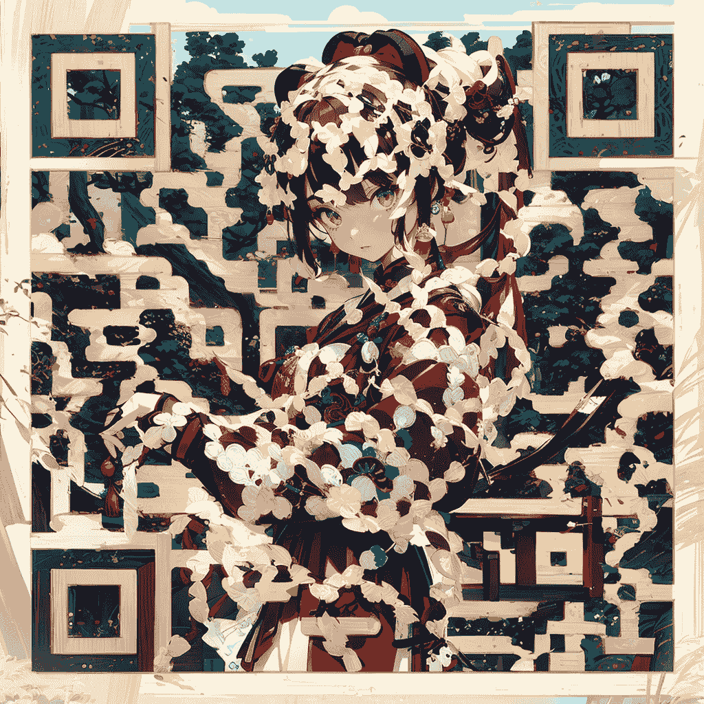

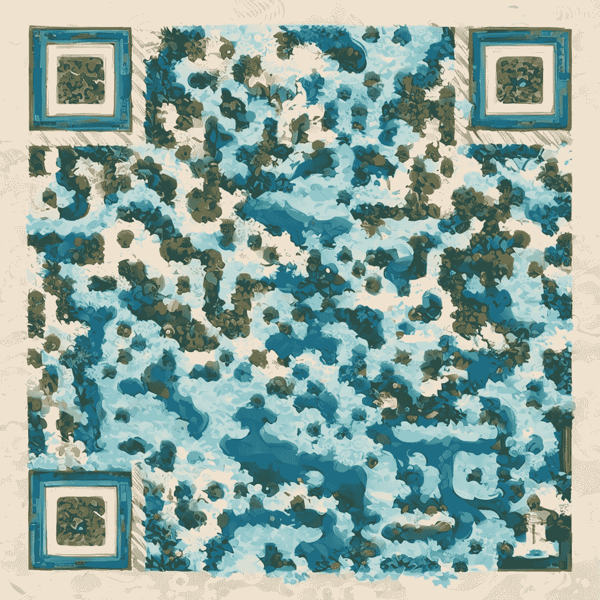

> **延伸阅读**

> **阿里官方教程**【收藏】制作艺术二维码，用 Stable Diffusion 就行！

> **亚马逊云：** [借](https://mp.weixin.qq.com/s/ffCeRRb77fE2EBsUaQlYsQ)助 ControlNet 生成艺术二维码 – 基于 Stable Diffusion 的 AI 绘画方案

## 2) QR Code AI Art Generator

一个使用 Hugging Face（抱脸）部署的免费 Stable Diffusion + ControlNet 服务，大大简化了本地操作。

地址：https://huggingface.co/spaces/huggingface-projects/QR-code-AI-art-generator

仅需你填入二维码内容，在填入正负面 prompt，然后点击 Run 运行即可（如果遇到生成失败，可以尝试重新点击 Run 生成）

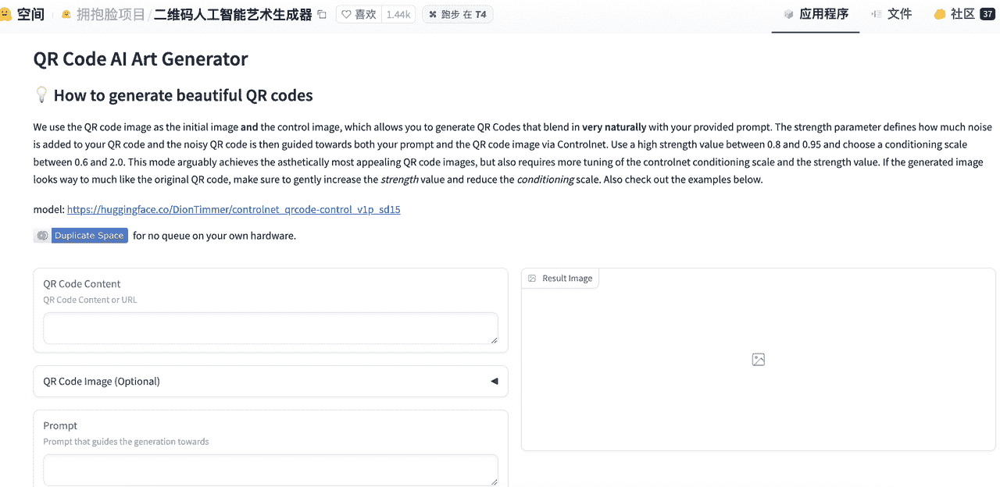

但**注意**你需要知道的是：AI 绘图生成的二维码并不是 100%能成功扫码的，就算是本地使用 Stable diffusion 来生成，其实也是抽卡行为。

除了二维码内容和提示词，这个网站上你还可以修改一些高级参数来调整二维码的生成效果，具体的话网站均有在置顶区域说明，简单翻译总结一下，主要是修改下面两个参数：

+   Controlnet Conditioning Scale（调节范围）：0.6－2.0

+   **Strength（强度）**：0.8－0.95

如果生成的图像看起来与原始二维码非常相似，请确保轻轻增加强度值并减少调节范围

## 3）Quickqrart 工具教程

如果你的电脑配置玩不转 SD，可以来看看这个简易版本，十分钟上手，从此二维码不求人。

现在 QuickQR.Art 已经迭代更新出了网页版，更加小白化易懂：https://beta.quickqr.art/generate

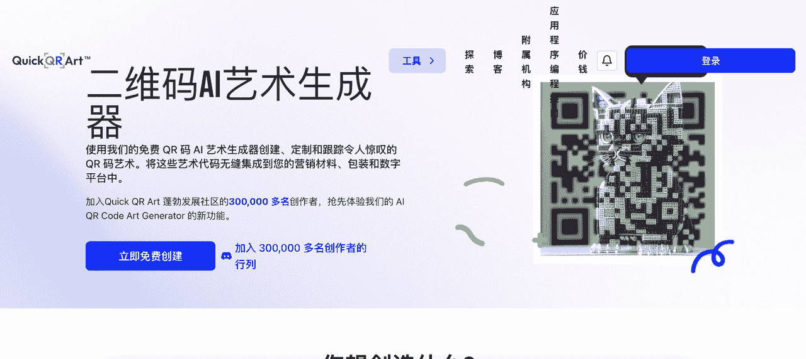

你可以在网页的 Explore 页面根据公开案例快速使用别人的 Prompt 描述来生成相同风格的二维码，也可以自行尝试不同的 Prompt 描述生成。

## 4）艺术二维码免费生成的小程序

比较简单，小白操作，自己找合适的就行，一般有可选的范围，质量好的也得挑选，这里就不多说了，大家自行研究。

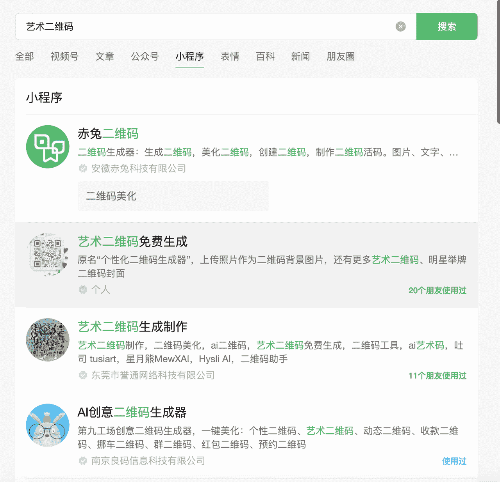

## 5）艺术二维码第三方网站

不用🪜，但是得充钱，质量还行。

**星月熊：**[qr.mewx.art](https://qr.mewx.art/?invite_code=hom23YjZ)

# 四、获客方式

搞定了艺术二维码的制作渠道，剩下的就是找到想做艺术二维码的人，如果只是简单的利用我们自己身边的熟人圈子，要做的人肯定不会太多，最重要的是我们要吸引，让那些想做艺术二维码的人主动联系你，这种的成交率能大大增加，具体怎么做，我总结了几个方法：

## **1、闲鱼**

闲鱼目前是一个热门的渠道，流量还是很厉害的，在闲鱼上架关于艺术二维码的闲置，有人咨询下单你帮制作就可以了。别人通过咸鱼下单，你把模板制作好，写上编号或者名称，用户需要做那种样式的，你做好发送给对方就可以，这里说一个关键点，任何玩法任何渠道，都有同行有竞争，如果我们做咸鱼，千万不要发一个闲置就结束了，同样的闲置帖子，我们可以发 10 个 甚至是 50 个，别人一个号发 我们可以 2 个号或者 5 个号发，这样曝光度一下就上来了。

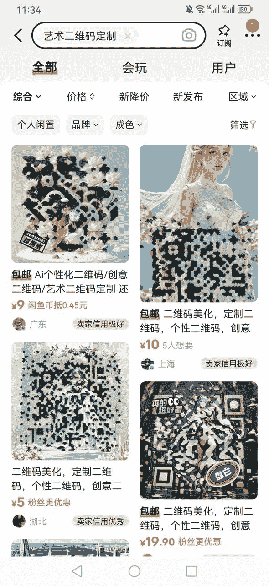

## **2、📕/抖音**

都是同样的逻辑，发布关于艺术二维码的内**容，有人看了感兴趣，自然会咨**询你怎么做，把用户转到私域，然后再做成交，内容的形式可以是直接二维码的图片或者是做出来聊天截图的形式，看了这种内容用户，再引导到私域里，成交的价值还是非常大的。

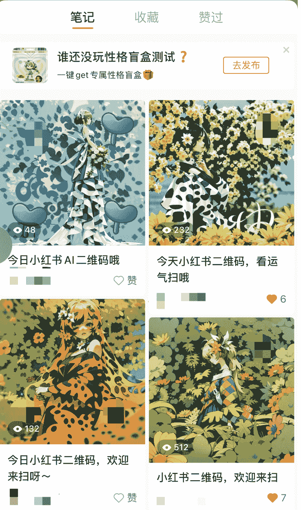

## **3、转介绍**

靠转介绍这个渠道获取的客户可能没有前面的多，但是成交率会高很多，基本上转介绍过来的用户，简单几句就能成交，因为这种已经是朋友给种草过的，很好成交。

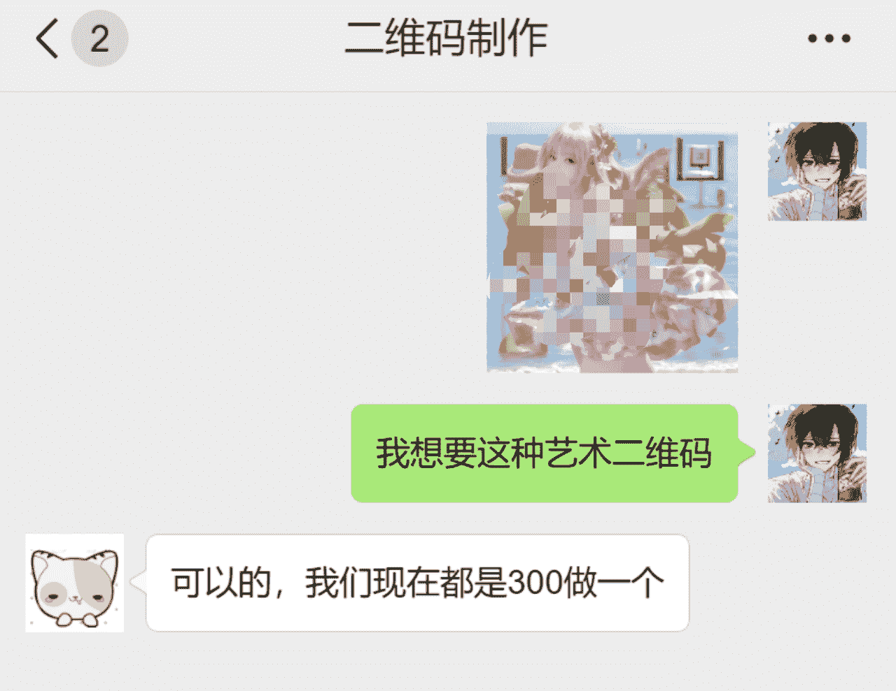

# 五、变现案例

## 1）淘宝上面卖定制服务

**做一个**艺术二维码的收费价格是 5-200 元不等，还有收费更高的，可以根据不同的需求，做出来不同的样式，然后收定制的费用，做艺术二维码是有门槛的，同时操作这个也有一定的信息差，很多人感觉是非常难制作。

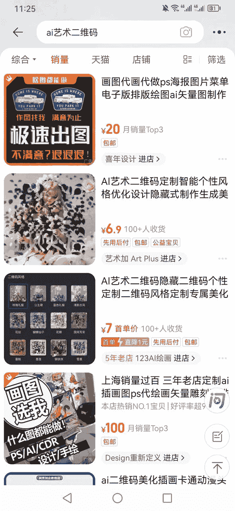

## 2）**收会员费**

定一个会员的价格，会员可以免费制作几个艺术二维码，相当于就是批量制作的价格，有了这个定价可能就有人买。

## 3）代理收徒

招募代理收徒，将自己的方法一对一传授给他人，包括公域平台引流推广的方法和二维码制作流程等，收费范围为 199-599，价格可以自行定价。

# 附：相关资源

1.  倪豪- QR Code ControlNet 2 款 ControlNet 模型的下载地址：https://huggingface.co/latentcat/latentcat-controlnet/tree/main/models

1.  二维码生成器 ①：https://qrbtf.com/

1.  二维码生成器 ②： https://cli.im/

1.  中国传统纹样 Lora： https://civitai.com/models/29858/chinese-traditional-pattern

1.  浮世绘风格 Lora： https://civitai.com/models/29858/chinese-traditional-pattern

1.  Ghostmix 大模型下载： https://civitai.com/models/36520/ghostmix

1.  QR Code AI Art 工具： https://huggingface.co/spaces/huggingface-projects/QR-code-AI-art-generator

1.  Controlnet v1.0 安装网址：https://github.com/lllyasviel/webui-controlnet-v1-archived

1.  适合 Controlnet v1.0 的艺术分风格二维码教程： https://twitter.com/rowancheung/status/1669402190757367809

1.  适合 Controlnet v1.1 的艺术分风格二维码教程：https://note.com/shingulari/n/n0441c26a0254

---

# AI 学习交流社群

1.持续关注并更新 AI 的**相关资讯动态，研究报告，赚钱案**例，常见问题，永久免费在线查看，无收费内容，目标是成为最大的免费 AI 学习社群。

2.已建立社群聊聊 **AI** 发展及应用，**没进群的可以扫码加入，群满可加 AI 研究爱好者大国🛰️ ID：zyg90s（备**注：AI），已经在社群内的无需重复加入，开源知识库及社群学习全部为公开免费分享。

3.**关于文档负责人大国**：高帆文化CEO，曾就职于教培大厂，目前创业，主攻研究AI落地应用、企业流量增长及达人IP孵化。

**飞书学习群**

**飞书扫码进群学习**

好友（ID：zhangyuguo94s）

**扫码加🛰️入🛰️群**

进群或者加好友了解更多 AI 绘画相关教程

**觉得有用欢迎留个赞**