# Nano-Banana Pro: 官方提示指南与策略

> 来源：[https://yunyinghui.feishu.cn/docx/TrpkdmDwooMvC1xTaR2cKrhunob](https://yunyinghui.feishu.cn/docx/TrpkdmDwooMvC1xTaR2cKrhunob)

---

Nano-Banana Pro is a significant leap forward from previous generation models,** moving from "fun" image generation to "functional" prof**essional asset production. It excels in text rendering, character consistency, visual synthesis, world knowledge (Search), and high-resolution (4K) output.

Nano-Banana Pro 与上一代模型相比是一个重大飞跃，从“有趣”的图像生成转向“功能性”的专业资产制作。它在文本渲染、字符一致性、视觉合成、世界知识（搜索）和高分辨率（4K）输出方面表现出色。

Following the [developer ](https://ai.studio/)guide on how to get started with AI Studio and the API, this guide covers the core capabilities and how to prompt them effectively.

继有关如何开始使用 AI Studio 和 API 的开发人员指南之后，本指南涵盖了核心功能以及如何有效地提示它们。

---

Here's what you'll find in this article:

您将在本文中找到以下内容：

+   0. The Golden Rules of Prompting 
0. 提示的黄金法则

+   1. Text Rendering, Infographics & Visual Synthesis 
1. 文本渲染、信息图表和视觉合成

+   2. Character Consistency & Viral Thumbnails 
2. 字符一致性和病毒式缩略图

+   3. Grounding with Google Search 
3. 扎根 Google 搜索

+   4. Advanced Editing, Restoration & Colorization 
4. 高级编辑、修复和着色

+   5. Dimensional Translation (2D ↔ 3D) 
5. 维度平移（2D ↔ 3D）

+   6. High-Resolution & Textures 
6. 高分辨率和纹理

+   7. Thinking & Reasoning 
7. 思考与推理

+   8. One-Shot Storyboarding & Concept Art 
8. 一次性故事板和概念艺术

+   9. Structural Control & Layout Guidance 
9. 结构控制和布局指导

+   10. What's Next? 10.下一步是什么？

---

## 🛑 Section 0: The Golden Rules of Prompting  🛑 第 0 节：提示的黄金法则

Nano-Banana Pro is a "Thinking" model. It doesn't just match keywords; it understands intent, physics, and composition. To get the best results, stop using "tag soups" (e.g., dog, park, 4k, realistic ) and start acting like a Creative Director.

Nano-Banana Pro 是一款“会思考”的机型。它不仅仅匹配关键词；它理解意图、物理和构图。为了获得最佳结果，请停止使用“标签汤”（例如， ）并开始像创意总监一样行事。

1. Edit, Don't Re-roll

1. 编辑，不要重新滚动

The model is exceptionally good at understanding conversational edits。 If an image is 80% correct, do not generate a new one from scratch. Instead, simply ask for the specific change you need.

该模型非常擅长理解对话编辑。如果图像的正确率是 80%，请勿从头开始生成新图像。相反，只需询问您需要的具体更改即可。

+   Example: "That's great, but change the lighting to sunset and make the text neon blue." 
示例：“那太好了，但是将照明更改为日落并将文本设置为霓虹蓝色。”

**2. Use Natural Langua**ge & Full Sentences

2. 使用自然语言和完整句子

Talk to the model as if you were briefing a human artist。 Use proper grammar and descriptive adjectives.

与模型交谈就像向人类艺术家介绍情况一样。使用正确的语法和描述性形容词。

+   ❌ **Bad: **"Cool car, neon, city, night, 8k." 
❌ 坏：“酷车、霓虹灯、城市、夜晚、8k。”

+   ✅ **Good: **"A cinematic wide shot of a futuristic sports car speeding through a rainy Tokyo street at night. The neon signs reflect off the wet pavement and the car's metallic chassis." 
✅ 好：“一辆未来派跑车在夜间下雨的东京街道上飞驰的电影广角镜头。霓虹灯标志反射在潮湿的路面和汽车的金属底盘上。”

3. Be Specific and Descriptive

3.具体且具有描述性

Vague prompts yield generic results。 Define the subject, the setting, the lighting, and the mood.

模糊的提示会产生一般的结果。定义主题、背景、灯光和情绪。

+   **Subject: **Instead of "a woman," say "a sophisticated elderly woman wearing a vintage chanel-style suit." 
主题：不要说“一位女士”，而说“一位穿着复古香奈儿风格西装的精致老妇人”。

+   **Materiality: **Describe textures. "Matte finish," "brushed steel," "soft velvet," "crumpled paper." 
物质性：描述纹理。 “哑光饰面”、“拉丝钢”、“柔软天鹅绒”、“皱巴巴的纸”。

**4. Provide Context (The "**Why" or "For whom")

4. 提供背景（“为什么”或“为谁”）

Because the model "thinks，" giving it context helps it make logical artistic decisions。

因为模型会“思考”，所以给它上下文有助于它做出合乎逻辑的艺术决策。

+   Example: **"Create an image of a **sandwich for a Brazilian high-end gourmet cookbook ." (The model will infer professional plating, shallow depth of field, and perfect lighting). 
示例：“为巴西高端美食食谱创建三明治图像。” （该模型将推断出专业的电镀、浅景深和完美的照明）。

---

## 1. Text Rendering, Infographics & Visual Synthesis  1. 文本渲染、信息图表和视觉合成

Nano-Banana Pro has SOTA capabilities for rendering legible, stylized text and synthesizing complex information into visual formats.

Nano-Banana Pro 具有 SOTA 功能，可渲染清晰、风格化的文本并将复杂信息合成为视觉格式。

Best Practices: 最佳实践：

+   **Compression: **Ask the model to "compress" dense text or PDFs into visual aids. 
压缩：要求模型将密集文本或 PDF“压缩”为视觉辅助工具。

+   **Style: **Specify if you want a "polished editorial," a "technical diagram," or a "hand-drawn whiteboard" look. 
风格：指定您想要“精美社论”、“技术图表”还是“手绘白板”外观。

+   **Quotes: **Clearly specify the text you want in quotes. 
引号：明确指定要在引号中包含的文本。

Example Prompts: 提示示例：

> **Earnings Report Infographi**c （Data Ingestion）:

> 收益报告信息图（数据摄取）：

> [Input PDF of Google's latest earnings report ]

> [输入 Google 最新财报 PDF]

> "Generate a clean， modern infographic summarizing the key financial highlights from this earnings report。 Include charts for 'Revenue Growth' and 'Net Income', and highlight the CEO's key quote in a stylized pull-quote box."

> “生成一个干净、现代的信息图表，总结本收益报告的主要财务亮点。包括‘收入增长’和‘净利润’的图表，并在风格化的引述框中突出显示首席执行官的关键引言。”

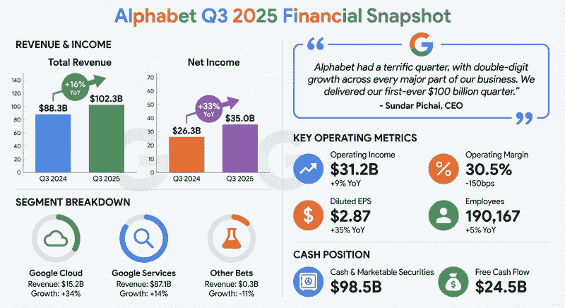

Try it in AI Studio

在 AI Studio 中尝试一下 （Note: Requires uploading a PDF）

（注：需要上传 PDF）

> Retro Infographic: 复古信息图：

> "Make a retro， 1950s-style infographic about the history of the American diner。 Include distinct sections for 'The Food,' 'The Jukebox,' and 'The Decor.' Ensure all text is legible and stylized to match the period."

> “制作一个关于美国餐馆历史的 1950 年代风格的复古信息图。包括“食物”、“点唱机”和“装饰”的不同部分。确保所有文本清晰易读且风格化以匹配句号。”

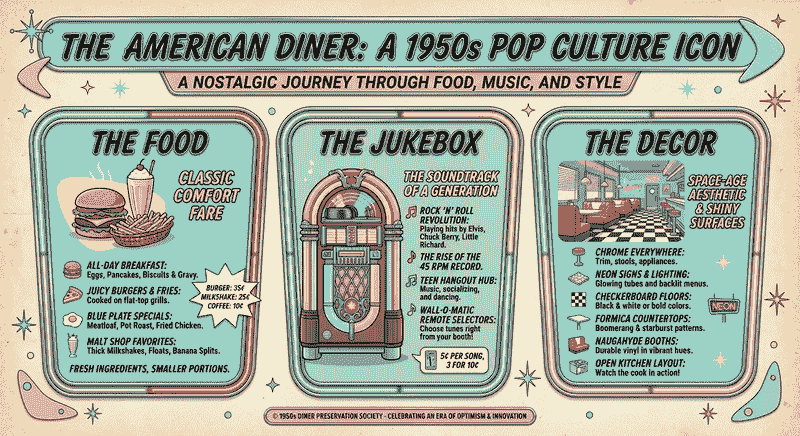

Try it in AI Studio

在 AI Studio 中尝试一下

> Technical Diagram: 技术图：

> "Create an orthographic blueprint that describes this building in plan， elevation， and section。 Label the 'North Elevation' and 'Main Entrance' clearly in technical architectural font. Format 16:9."

> “创建一个正交蓝图，在平面图、立面图和剖面图中描述这座建筑。用技术建筑字体清楚地标记“北立面”和“主入口”。格式 16:9。”

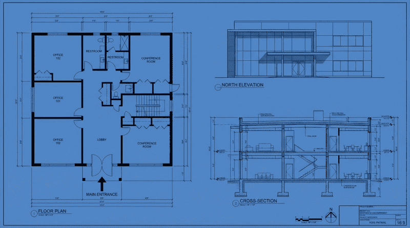

Try it in AI Studio

在 AI Studio 中尝试一下

> Whiteboard Summary （Educational）:

> 白板摘要（教育）：

> "Summarize the concept of 'Transformer Neural Network Architecture' as a hand-drawn whiteboard diagram suitable for a university lecture。 Use different colored markers for the Encoder and Decoder blocks, and include legible labels for 'Self-Attention' and 'Feed Forward'."

> “将‘变压器神经网络架构’的概念概括为适合大学讲座的手绘白板图。对编码器和解码器块使用不同颜色的标记，并为‘自注意力’和‘前馈’添加清晰的标签。”

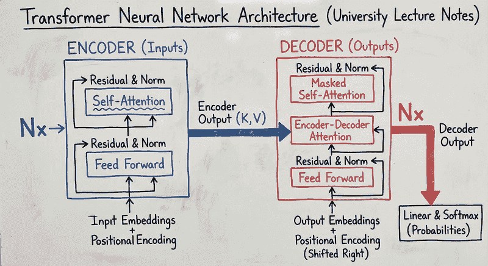

Try it in AI Studio

在 AI Studio 中尝试一下

---

## 2. Character Consistency & Viral Thumbnails  2. 字符一致性和病毒式缩略图

Nano-Banana Pro supports up to 14 reference images (6 with high fidelity). This allows for "Identity Locking"—placing a specific person or character into new scenarios without facial distortion.

Nano-Banana Pro 最多支持 14 个参考图像（其中 6 个具有高保真度）。这允许“身份锁定”——将特定的人或角色放置到新的场景中，而不会出现面部变形。

Best Practices: 最佳实践：

+   Identity Locking: Explicitly state: "Keep the person's facial features exactly the same as Image 1." 
身份锁定：明确说明：“保持该人的面部特征与图 1 完全相同。”

+   Expression/Action: Describe the change in emotion or pose while maintaining the identity. 
表情/动作：描述在保持身份的同时情绪或姿势的变化。

+   Viral Composition: Combine subjects with bold graphics and text in a single pass. 
病毒式构图：一次性将主题与粗体图形和文本结合起来。

Example Prompts: 提示示例：

> **T**he "Viral Thumbnail" （Identity + Text + Graphics）:

> “病毒式缩略图”（标识**+文本+图形) ** ：**

> "Design **a viral video thumbnail using the pe**rson from **I**mage 1**。 Face Consistency: Keep the person's facial features exact**ly the same **as Image 1, but change their expression to look excited and surprised. Action: Pose the person on the left side, pointing their finger towards the right side of the frame. Subject: On the right side, place a high-quality image of a delicious avocado toast. Graphics: Add a bold yellow arrow connecting the person's finger to the toast. Text: Overlay massive， pop-style text in the middle: '3 分钟搞定！' (Done in 3 mins!). Use a thick white outline and drop shadow. Background: A blurred, bright kitchen background. High saturation and contrast."

> “使用图 1 中的人物设计病毒视频缩略图。面部一致性：保持人物的面部特征与图 1 完全相同，但改变他们的表情，使其看起来兴奋和惊讶。动作：将人物置于左侧，将手指指向画面的右侧。主题：在右侧放置美味牛油果吐司的高质量图像。图形：添加粗体黄色箭头，将人物的手指连接到吐司.  文本：覆盖大量，中间流行风格的文字：“3 分钟搞定！” （3 分钟内完成！）。使用粗的白色轮廓和阴影。背景：模糊、明亮的厨房背景。高饱和度和对比度。”

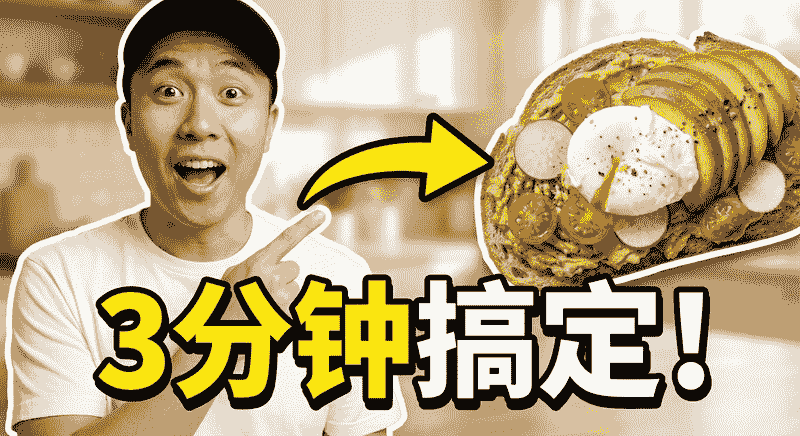

Try it in AI Studio

在 AI Studio 中尝试一下 （Note: Requires uploading a reference image）

（注：需要上传参考图片）

> **The "Fluffy Friends" Scenario （**Group Consistency）:

> “毛茸茸的朋友”场景（群体一致性）：

> [Input 3 images of different plush creat**u**res]

> [输入 3 张不同毛绒生物的图片]

> "Create a funny 10-part story with these 3 fluffy friends going on a tropical vacation。 The story is thrilling throughout with emotional highs and lows and ends in a happy moment. Keep the attire and identity consistent for all 3 characters , but their expressions and angles should vary throughout all 10 images. Make sure to only have one of each character in each image."

> “与这 3 个毛茸茸的朋友一起去热带度假，创作一个由 10 部分组成的有趣故事。这个故事自始至终都惊心动魄，情绪起伏不定，最终以幸福的时刻结束。所有 3 个角色的着装和身份保持一致，但他们的表情和角度在所有 10 个图像中应该有所不同。确保每个图像中每个角色只有一个。”

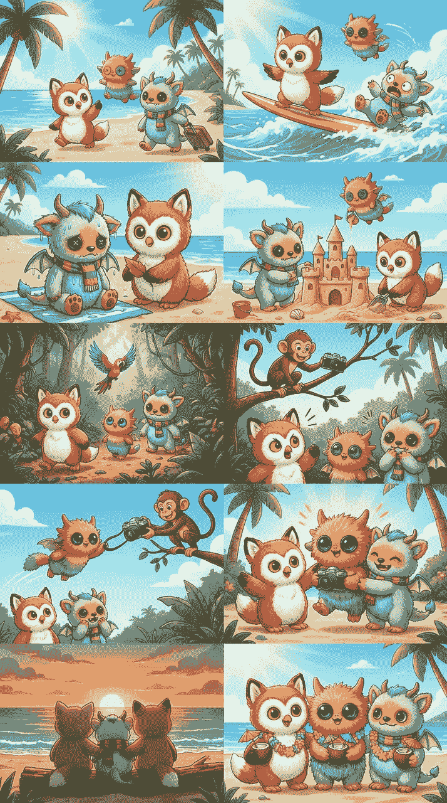

Try it in AI Studio

在 AI Studio 中尝试一下 （Note: Requires uploading reference images）

（注：需要上传参考图片）

> Brand Asset Generation: 品牌资产生成：

> [Input 1 image of a product]

> [输入 1 张产品图片]

> "Create 9 stunning fashion shots as if they’re from an award-winning fashion editorial。 Use this reference as the brand style but add nuance and variety to the range so they convey a professional design touch. Please generate nine images, one at a time."

> “创建 9 张令人惊叹的时尚照片，就像来自屡获殊荣的时尚社论一样。使用此参考作为品牌风格，但为该系列添加细微差别和多样性，以便它们传达专业的设计风格。请生成九张图像，一次一张。”

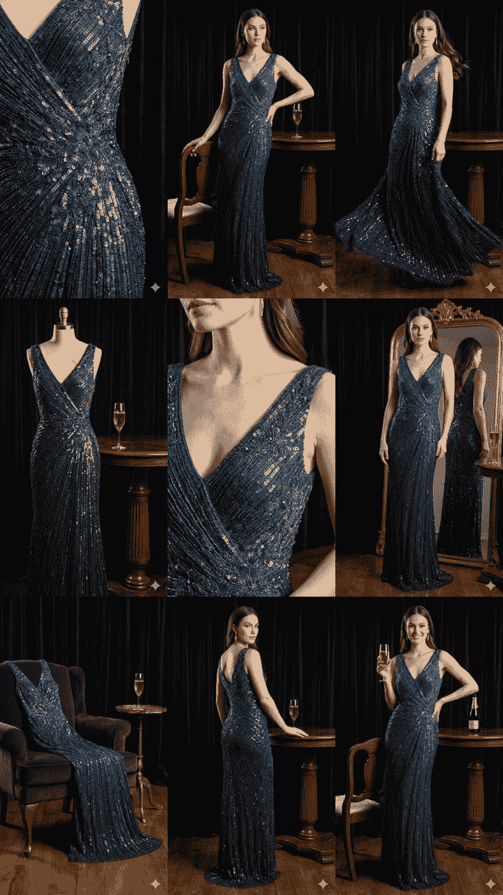

Try it in AI Studio

在 AI Studio 中尝试一下 （Note: Requires uploading a reference image）

（注：需要上传参考图片）

---

## 3. Grounding with Google Search  3. 扎根 Google 搜索

Nano-Banana Pro uses Google Search to generate imagery based on real-time data, current events, or factual verification, reducing hallucinations on timely topics.

Nano-Banana Pro 使用 Google 搜索根据实时数据、时事或事实验证生成图像，减少对及时主题的幻觉。

Best Practices: 最佳实践：

+   Ask for visualizations of dynamic data (weather, stocks, news). 
要求动态数据（天气、股票、新闻）的可视化。

+   The model will "Think" (reason) about the search results before generating the image. 
该模型将在生成图像之前“思考”（推理）搜索结果。

Example Prompts: 提示示例：

> Real-Time Data Visualization:

> 实时数据可视化：

> "Visualize the current stock value of the main tech companies and the current trends。 For each add some explanation on what happened recently which could explain that trend."

> “可视化主要科技公司当前的股票价值和当前趋势。为每一个添加一些最近发生的事情的解释，以解释该趋势。”

Try it in AI Studio

在 AI Studio 中尝试一下

> Event Visualization: 事件可视化：

> "Generate an infographic of the best times to visit the U.S。 National Parks in 2025 based on current travel trends."

> “根据当前的旅游趋势，生成 2025 年游览美国国家公园的最佳时间的信息图。”

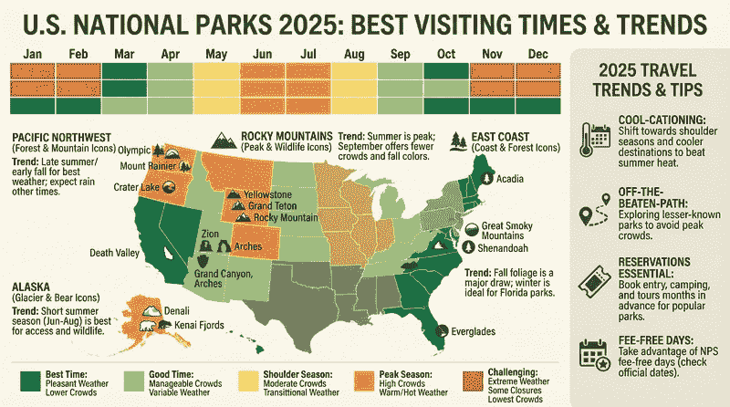

Try it in AI Studio

在 AI Studio 中尝试一下

Just be careful that it tend to mix a lot of information together, so as always with AI, double-check everything!

请注意，它往往会将大量信息混合在一起，因此与人工智能一样，请仔细检查所有内容！

---

## 4. Advanced Editing, Restoration & Colorization  4. 高级编辑、修复和着色

The model excels at complex edits via conversational prompting. This includes "In-painting" (removing/adding objects), "Restoration" (fixing old photos), "Colorization" (Manga/B&W photos), and "Style Swapping."

该模型擅长通过对话提示进行复杂的编辑。这包括“绘画”（删除/添加对象）、“恢复”（修复旧照片）、“着色”（漫画/黑白照片）和“风格交换”。

Best Practices: 最佳实践：

+   Semantic Instructions: You do not need to manually mask; simply tell the model what to change naturally. 
语义指示：不需要手动屏蔽；只需告诉模型自然地改变什么。

+   Physics Understanding: You can ask for complex changes like "fill this glass with liquid" to test physics generation. 
物理理解：您可以要求复杂的更改，例如“用液体填充这个玻璃杯”来测试物理生成。

Example Prompts: 提示示例：

> Object Removal & In-painting:

> 物体移除和修复：

> "Remove the tourists from the background of this photo and fill the space with logical textures （cobblestones and storefronts） that match the surrounding environment。"

> “将游客从这张照片的背景中移走，并用与周围环境相匹配的逻辑纹理（鹅卵石和店面）填充空间。”

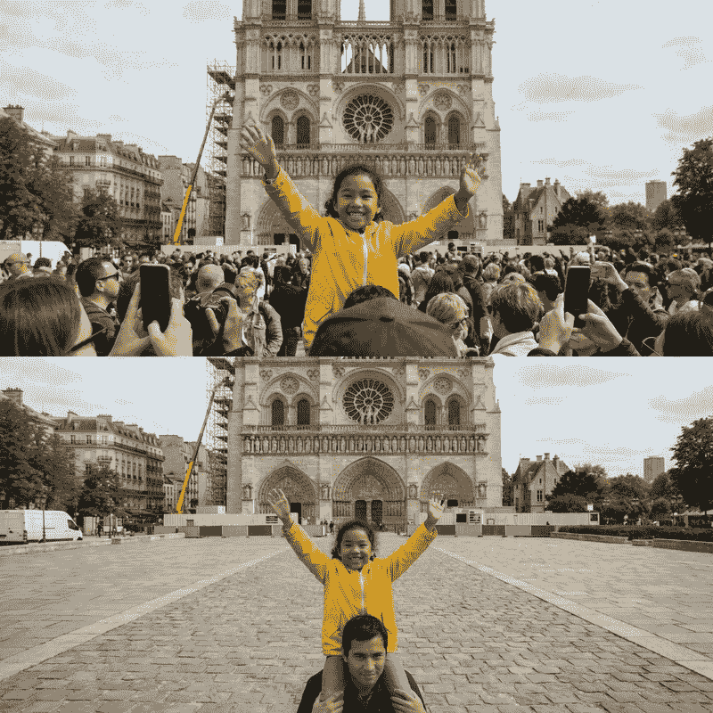

Try it in AI Studio

在 AI Studio 中尝试一下 （Note: Requires uploading a photo）

（注：需要上传照片）

> Manga/Comic Colorization:

> 漫画/漫画着色：

> [Input black and white manga panel]

> [输入黑白漫画面板]

> "Colorize this manga panel。 Use a vibrant anime style palette. Ensure the lighting effects on the energy beams are glowing neon blue and the character's outfit is consistent with their official colors."

> “为这个漫画面板着色。使用充满活力的动漫风格调色板。确保能量束上的灯光效果是发光的霓虹灯蓝色，并且角色的服装与其官方颜色一致。”

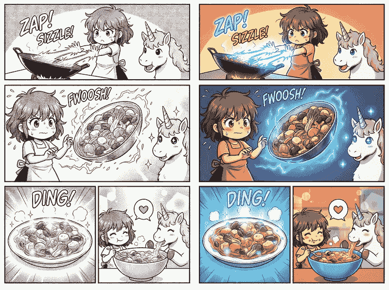

Try it in AI Studio

在 AI Studio 中尝试一下 （Note: Requires uploading an image）

（注：需要上传图片）

> **L**ocalization （Text Translation + Cultural Adaptation）:

> 本地化（文本翻译+文化适应）：

> [Input image of a London bus stop ad]

> [输入伦敦公交车站广告的图像]

> "Take this concept and localize it to a Tokyo setting， including translating the tagline into Japanese。 Change the background to a bustling Shibuya street at night."

> “采用这个概念并将其本地化到东京环境，包括将口号翻译成日语。将背景更改为夜间熙熙攘攘的涩谷街道。”

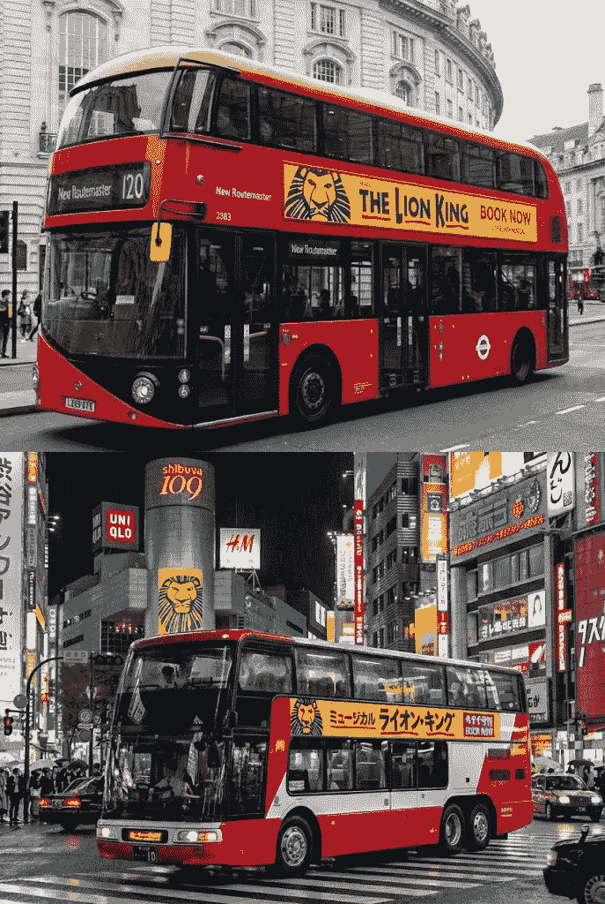

Try it in AI Studio

在 AI Studio 中尝试一下 （Note: Requires uploading an image）

（注：需要上传图片）

> Lighting/Seasonal Control:

> 照明/季节控制：

> [Input image of a house in summer]

> [输入夏天房子的图像]

> "Turn this scene into winter time。 Keep the house architecture exactly the same, but add snow to the roof and yard, and change the lighting to a cold, overcast afternoon."

> “将这个场景变成冬天。保持房屋建筑完全相同，但在屋顶和院子上添加雪，并将照明更改为寒冷、阴天的下午。”

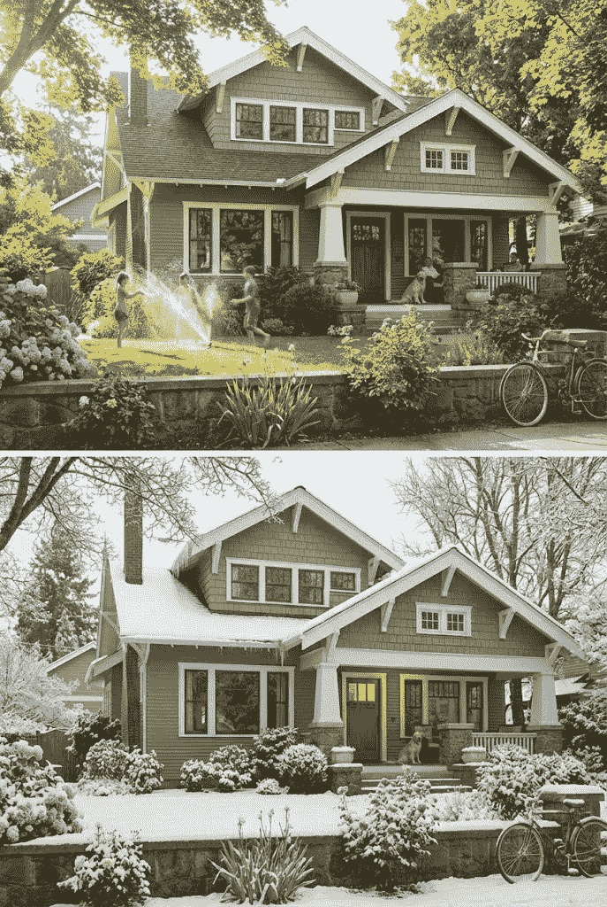

Try it in AI Studio

在 AI Studio 中尝试一下 （Note: Requires uploading an image）

（注：需要上传图片）

---

## 5. Dimensional Translation (2D ↔ 3D)  5. 维度平移（2D ↔ 3D）

A powerful new capability is translating 2D schematics into 3D visualizations, or vice versa. This is ideal for interior designers, architects, and meme creators.

一项强大的新功能是将 2D 原理图转换为 3D 可视化，反之亦然。这对于室内设计师、建筑师和表情包创作者来说是理想的选择。

Example Prompts: 提示示例：

> **2D Floor Plan to 3D Int**erior Design Board:

> 2D 平面图到 3D 室内设计板：

> "Based on the upl**oaded 2D** floor plan， generate a professional interior design presentation board in a single **image。 **La**yout: A c**ollage with one large main image at the top (wide-angle perspective of the living area), and three smaller images below (Master Bedroom, Home Office, and a 3D top-down floor plan). Style: Apply a Modern Minimalist style with warm oak wood flooring and off-white walls across ALL images. Quality: Photorealistic rendering, soft natural lighting."

> “根据上传的 2D 平面图，在单个图像中生成专业的室内设计演示板。布局：顶部有一张大主图像（起居区的广角视角）和下面三张较小图像（主卧室、家庭办公室和 3D 自上而下平面图）的拼贴画。风格：所有图像均采用现代简约风格，采用温暖的橡木地板和灰白色墙壁。质量：逼真的渲染，柔和的自然光线。”

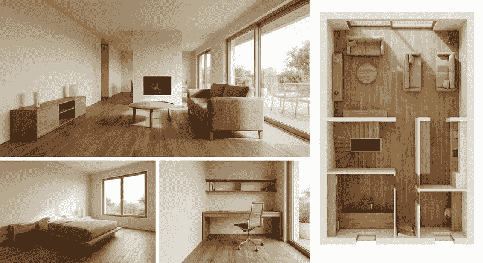

Try it in AI Studio

在 AI Studio 中尝试一下 （Note: Requires uploading a floor plan）

（注：需要上传平面图）

> 2D to 3D Meme Conversion:

> 2D 到 3D Meme 转换：

> "Turn the 'This is Fine' dog meme into a photorealistic 3D render。 Keep the composition identical but make the dog look like a plush toy and the fire look like realistic flames."

> “将‘This is Fine’狗模因变成逼真的 3D 渲染。保持构图相同，但使狗看起来像毛绒玩具，而火看起来像逼真的火焰。”

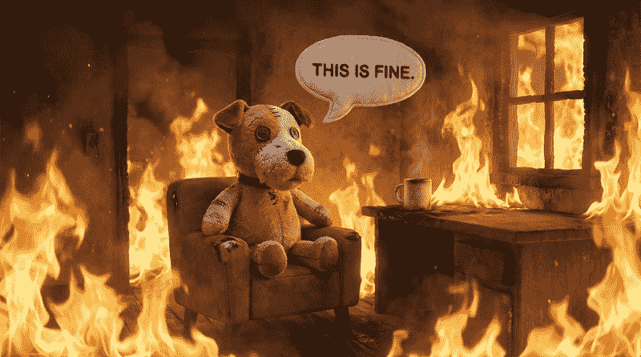

Try it in AI Studio

在 AI Studio 中尝试一下

---

## 6. High-Resolution & Textures  6. 高分辨率和纹理

Nano-Banana Pro supports native 1K to 4K image generation. This is particularly useful for detailed textures or large-format prints.

Nano-Banana Pro 支持原生 1K 到 4K 图像生成。这对于详细纹理或大幅面打印特别有用。

Best Practices: 最佳实践：

+   Explicitly request high resolutions (2K or 4K) if your API/Interface allows. 
如果您的 API/接口允许，请明确请求高分辨率（2K 或 4K）。

+   Describe high-fidelity details (imperfections, surface textures). 
描述高保真细节（缺陷、表面纹理）。

Example Prompts: 提示示例：

> 4K Texture Generation: 4K 纹理生成：

> "Harness native high-fidelity output to craft a breathtaking， atmospheric environment of a mossy forest floor。 Command complex lighting effects and delicate textures, ensuring every strand of moss and beam of light is rendered in pixel-perfect resolution suitable for a 4K wallpaper."

> “利用原生高保真输出，打造令人惊叹的苔藓森林地面大气环境。控制复杂的灯光效果和精致的纹理，确保每一缕苔藓和光束都以适合 4K 壁纸的像素完美分辨率渲染。”

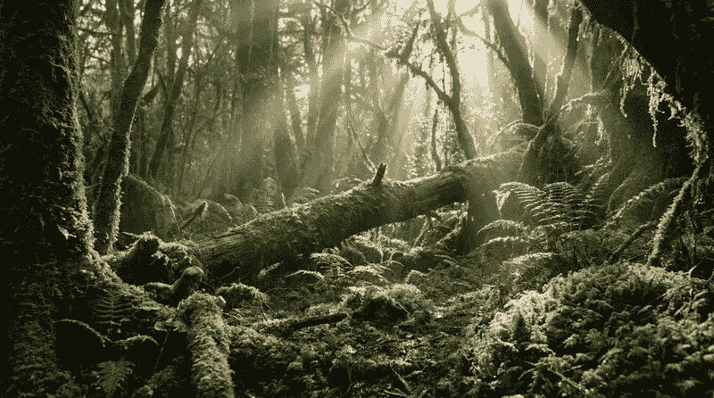

Try it in AI Studio

在 AI Studio 中尝试一下

> Complex Logic （Thinking Mode）:

> 复杂逻辑（思维模式）：

> "Create a hyper-realistic infographic of a gourmet cheeseburger， deconstructed to show the texture of the toasted brioche bun， the seared crust of the patty， and the glistening melt of the cheese。 Label each layer with its flavor profile."

> “创建一个超现实的美味芝士汉堡信息图，解构以显示烤奶油蛋卷面包的质地、煎饼的烤皮和闪闪发光的奶酪融化。在每一层上标记其风味特征。”

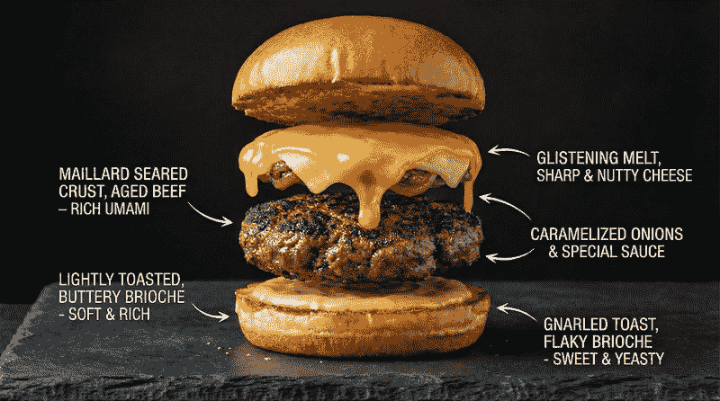

Try it in AI Studio

在 AI Studio 中尝试一下

---

## 7. Thinking & Reasoning  7. 思考与推理

Nano-Banana Pro defaults to a "Thinking" process where it generates interim thought images (not charged) to refine composition before rendering the final output. This allows for data analysis and solving visual problems.

Nano-Banana Pro 默认采用“思考”过程，在渲染最终输出之前，它会生成临时思考图像（未充电）以优化构图。这允许数据分析和解决视觉问题。

Example Prompts: 提示示例：

> Solve Equations: 解方程：

> "Solve log_{x^2+1}（x^4-1）=2 in C on a white board。 Show the steps clearly."

> “在白板上求解 C 中的 log_{x^2+1}（x^4-1）=2。清楚地显示步骤。”

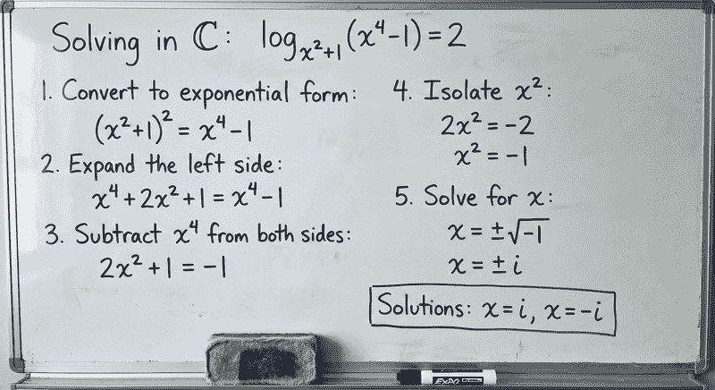

Try it in AI Studio

在 AI Studio 中尝试一下

> Visual Reasoning: 视觉推理：

> "Analyze this image of a room and generate a 'before' image that shows what the room might have looked like during construction， showing the framing and unfinished drywall。"

> “分析房间的图像并生成“之前”图像，显示房间在施工期间可能的样子，显示框架和未完成的干墙。”

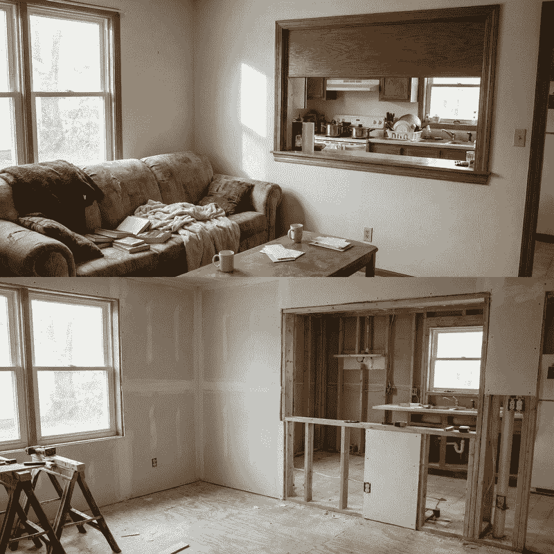

Try it in AI Studio

在 AI Studio 中尝试一下 （Note: Requires uploading an image）

（注：需要上传图片）

---

## 8. One-Shot Storyboarding & Concept Art  8. 一次性故事板和概念艺术

You can generate sequential art or storyboards without a grid, ensuring a cohesive narrative flow in a single session. This is also popular for "Movie Concept Art" (e.g., fake leaks of upcoming films).

您可以在没有网格的情况下生成连续的艺术作品或故事板，从而确保在单个会话中实现连贯的叙述流程。这在“电影概念艺术”中也很流行（例如，即将上映的电影的假泄露）。

Example Prompt: 提示示例：

> "Creat**e an addictively intriguing 9-part story wi**th 9 images featuring a woman and man in an award-winning luxury luggage commercial. The story should have emotional highs and lows, ending on an elegant shot of the woman with the logo. The identity of the woman and man and their attire must stay consistent throughout but they can and should be seen from different angles and distances. Please generate images one at a time. Make sure every image is in a 16:9 landscape format."

> “用 9 张图片创作一个引人入胜的 9 部分故事，其中包括获奖豪华箱包广告中的一位女士和一位男士。故事应该有情绪的高潮和低谷，以带有标志的女士的优雅镜头作为结尾。女士和男士的身份及其着装必须始终保持一致，但可以而且应该从不同的角度和距离看到。请一次生成一张图像。确保每张图像均为 16:9 横向格式。”

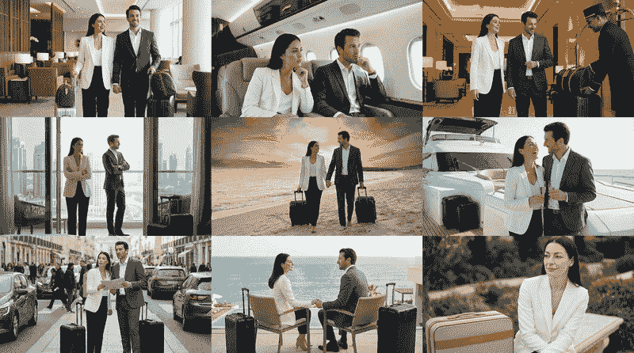

Try it in AI Studio

在 AI Studio 中尝试一下

---

## 9. Structural Control & Layout Guidance  9. 结构控制和布局指导

Input images aren't limited to character references or subjects to edit. You can use them to strictly control the composition and layout of the final output. This is a game-changer for designers who need to turn a napkin sketch, a wireframe, or a specific grid layout into a polished asset.

输入图像不限于字符参考或要编辑的主题。您可以使用它们来严格控制最终输出的组成和布局。对于需要将餐巾草图、线框或特定网格布局转变为精美资产的设计师来说，这是一个游戏规则改变者。

Best Practices: 最佳实践：

+   Drafts & Sketches: Upload a hand-drawn sketch to define exactly where the text and object should sit. 
草稿和草图：上传手绘草图以准确定义文本和对象的位置。

+   **Wireframes: **Use screenshots of existing layouts or wireframes to generate high-fidelity UI mockups. 
线框：使用现有布局或线框的屏幕截图来生成高保真 UI 模型。

+   **Grids: **Use grid images to force the model to generate assets for tile-based games or LED displays. 
网格：使用网格图像强制模型为基于图块的游戏或 LED 显示屏生成资产。

Example Prompts: 提示示例：

> Sketch to Final Ad:

> 最终广告草图：

> "Create a ad for a [product] following this sketch。"

> “按照此草图为[产品]制作广告。”

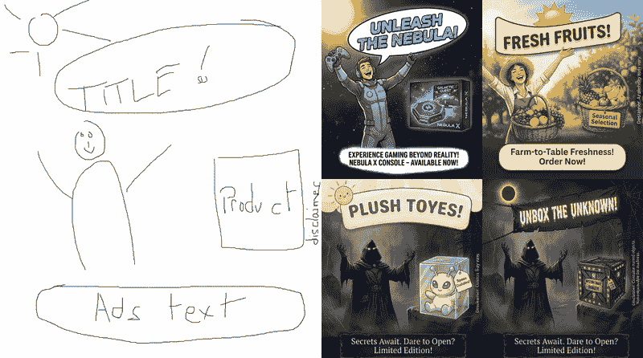

Try it in AI Studio

在 AI Studio 中尝试一下 （Note: Requires uploading a sketch）

（注：需要上传草图）

> UI Mockup from Wireframe:

> 线框图中的 UI 模型：

> "Create a mock-up for a [product] following these guidelines。"

> “遵循这些指南为[产品]创建模型。”

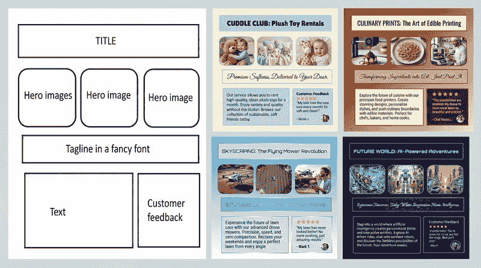

Try it in AI Studio

在 AI Studio 中尝试一下 （Note: Requires uploading a wireframe）

（注：需要上传线框图）

> Pixel Art & LED Displays:

> 像素艺术和 LED 显示屏：

> "Generate a pixel art sprite of a unicorn that fits perfectly into this 64x64 grid image。 Use high contrast colors."

> “生成一个完全适合这个 64x64 网格图像的独角兽像素艺术精灵。使用高对比度颜色。”

> (Tip: Developers can then programmatically extract the center color of each cell to drive a connected 64x64 LED matrix display).

> （提示：开发人员可以通过编程方式提取每个单元的中心颜色来驱动连接的 64x64 LED 矩阵显示器）。

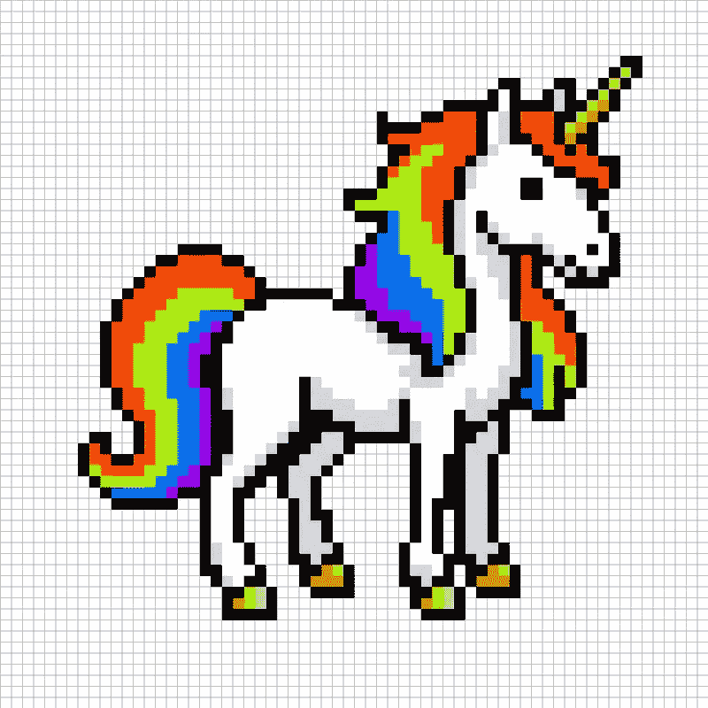

Try it in AI Studio

在 AI Studio 中尝试一下 （Note: Requires uploading a grid image）

（注：需要上传网格图片）

> **Sprites: **精灵：

> "Sprite sheet of a woman doing a backflip on a drone， 3x3 grid， sequence， frame by frame animation， square aspect ratio。 Follow the structure of the attached reference image exactly.."

> “一个女人在无人机上做后空翻的精灵图，3x3 网格，序列，逐帧动画，方形纵横比。完全遵循所附参考图像的结构......”

> （Tip: You can then extract each cell and make a gif）

> （提示：然后您可以提取每个单元格并制作 gif）

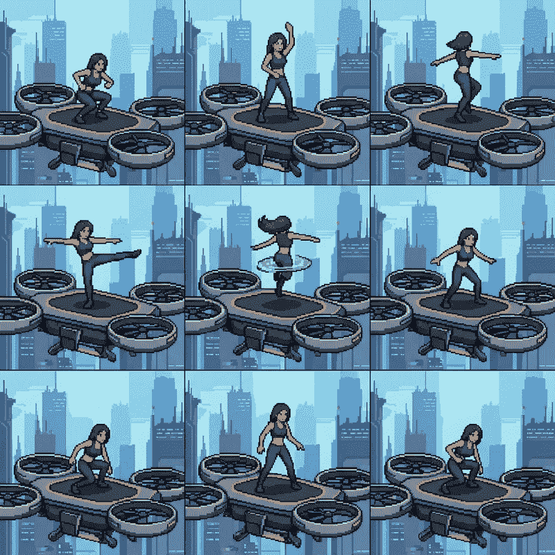

[

Try it in Co](https://colab.sandbox.google.com/github/google-gemini/cookbook/blob/main/quickstarts/Get_Started_Nano_Banana.ipynb#scrollTo=xuQeyK-teUf1)lab

在 Colab 中尝试一下

---

## 10. What's Next?  10.下一步是什么？

Now that you have mastered the basics of prompting， here is how you can start building:

现在您已经掌握了提示的基础知识，下面是开始构建的方法：

+   Experiment in the UI: Google AI Studio is the fastest way to test prompts and parameters. 
在 UI 中进行实验：Google AI Studio 是测试提示和参数的最快方法。

+   Check r[eally cool N](https://aistudio.google.com/apps?source=showcase&showcaseTag=nano-banana)ano-banana powered app in the App Gallery . 
在应用程序库中检查非常酷的 Nano-banana 支持的应用程序。

+   Vibe-code you dream app : Transform you best prompt into an app that you can easily share with your friends in AI Studio Build . 
Vibe 编码您梦想的应用程序：将您的最佳提示转换为可以在 AI Studio Build 中轻松与朋友分享的应用程序。

+   Build Applications: Ready to code? Check out the developer guide or the Gemini API Cookbook for guides and code snippets. 
构建应用程序：准备好编码了吗？查看开发人员指南或 Gemini API Cookbook 以获取指南和代码片段。

+   Technical Deep Dive: Read the full Gemini API Documentation for details on rate limits, pricing, and integration. 
技术深入探讨：阅读完整的 Gemini API 文档，了解有关速率限制、定价和集成的详细信息。

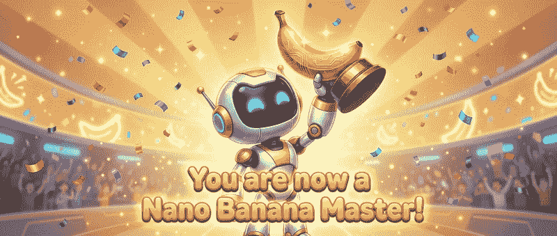

---

## Nano-Banana 学习交流社群

1**.持续关注并更新 Nan**o-Bana**na 的相关资讯动态，玩法案例，常见问题，永久免费在线查看，已建立社群聊聊 Na**no-Banana 发展及应用，没进群的可以扫码加入，群满可加 AI 研究爱好者大国🛰️ ID：zyg90s（备注：AI），已经在社群内的无需重复加入，开源知识库及社群学习全部为公开免费分享。

2.**关于文档负责人大国**：高帆文化 CEO，曾就职于教培大厂，目前创业，主攻研究 AI 落地应用、企业流量增长及达人 IP 孵化。

**5000 人飞书共学群**

**飞书扫码进群学习**

🛰️好友（ID：zhangyuguo94s）

**扫码加🛰️入🛰️**