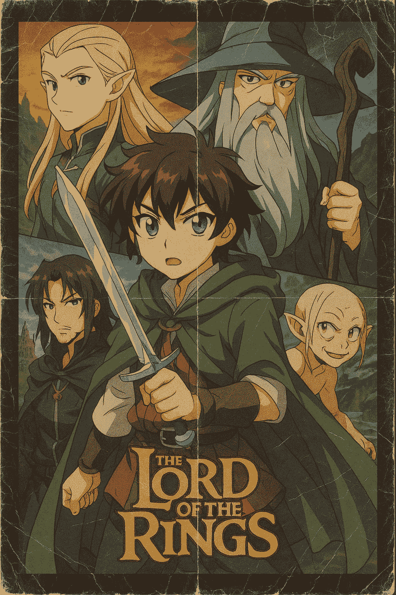
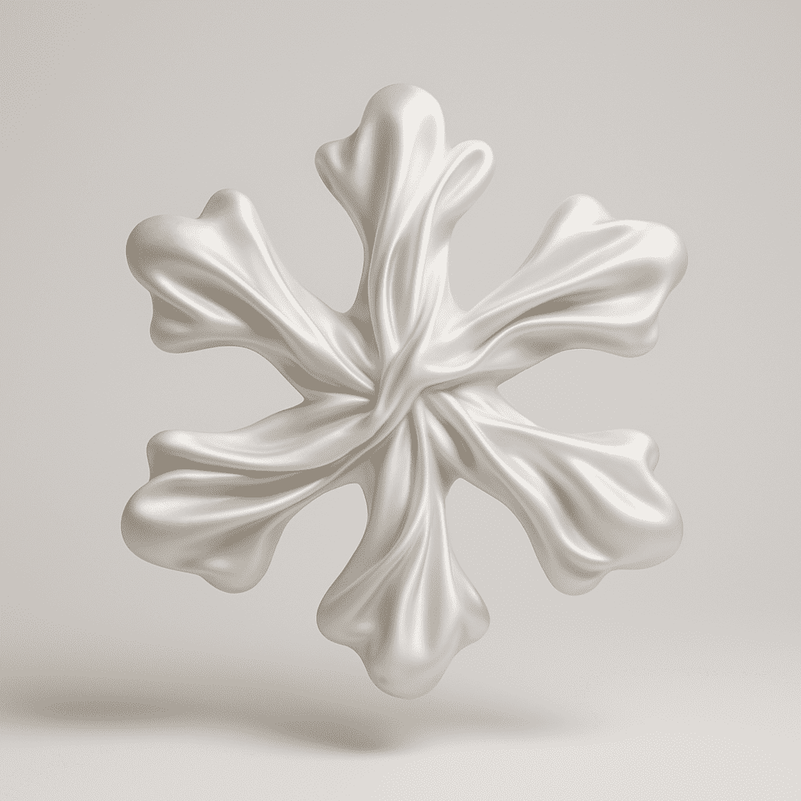
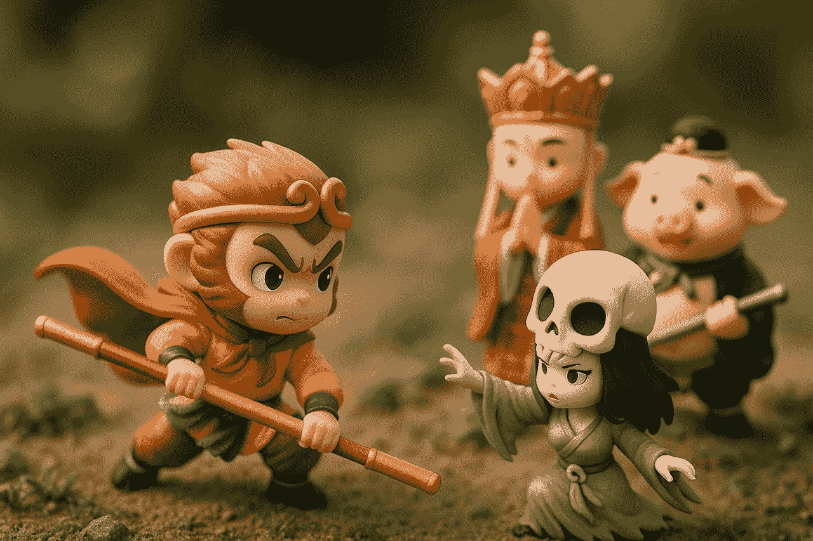

# Nano Banana 创意案例大集合

> 来源：[https://yunyinghui.feishu.cn/docx/DhtLdGgQco91YExwXQWc3yIinXb](https://yunyinghui.feishu.cn/docx/DhtLdGgQco91YExwXQWc3yIinXb)

---

##  **✨**前言

🎉 欢迎来到 🍌Nano Banana 图像集合！

这是一个由 Gemini-2.5-Flash-Image（也称为 Nano Banana）生成的图像和提示的精选集。利用 Google 的尖端图像生成模型，它全面展示了 Gemini 在 AI 图像生成和编辑方面的高级功能，同时不断探索创意表达的新可能性。

案例主要来自 Twitter/X 🐦和各种 AI 社区 🎬。

愿这些案例能激发你的灵感 💡并加速你的创造力 🚀。

**→ 原文地址：****Na****no Banana**** 案例大合集，由万**象 AI 实验室团队翻译及重新排版

---

---

## 🍌 什么是 Nano Banana

Nano Banana 是 Google 的革命性 AI 图像编辑模型，代表了从“AI 绘画工具”到“AI 创作伙伴”的范式转变。它不再被动地执行命令，而是深入理解现有图像的上下文、光线、物理逻辑和创作意图。

+   🎯 上**下文感知编辑 ：**真正理解人物与环境之间的关系，在背景替换后智能重新渲染灯光和反射

+   🔧 外**科手术精度 ：**以极高的精度添加或替换项目，完美处理遮挡关系和光照效果

+   🌐 深**度 3D 理解 ：**能够通过 2D 图像“看到”3D 结构，实现真正的空间感知编辑

+   🎬 风**格一致性 ：**基于单张参考图像构建完全统一的“视觉世界”

+    **✨ 协作创作 **：从“师徒对话”发展到创作者之间的“灵感交流”

## 🎨 GPT‑4o 是什么

GPT‑4o 是一种多模态模型，不仅能够将文本提示转换为高质量图像，还提供图像到图像的编辑——实现有针对性的修饰、风格迁移和多图像融合。

+   🧠 多模态理解：同时解析文本和图像，以精确捕捉创意意图

+   ✍️ 精准呈现：处理复杂的提示并快速生成高质量图像

+   🎨 多样的风格：吉卜力、绘画风格、像素艺术、3D 毛绒、等等——选择你最喜欢的一种

+   ___ 画作：现实主义构图：空间深度、透视和灯光感觉真实 ___

+   ✏️ 简单的后期编辑：更换背景，调整细节——为二次创作无缝进行

+   ⚡️ 雷电般的快速互动：缩短响应时间，实现实时创意和迭代

---

## 🧩 案例合集

### [案例 100：创意](https://x.com/azed_ai)广告与真实物体和手绘涂鸦（由 @azed_ai ）

[来源链接](https://x.com/azed_ai/status/1923016036120658122)

| 双子座 | GPT-4o |
| --- | --- |
|  |  |
| 图片 © 2025 [@jamez-bondos ](https://github.com/jamez-bondos)， [CC BY 4.0 ](https://creativecommons.org/licenses/by/4.0/)• 提示由 [@azed_ai](https://x.com/azed_ai) |  |

**提示**

```
A minimalist and creative advertisement set on a clean white background.
A real [Real Object] is integrated into a hand-drawn black ink doodle, using loose, playful lines. The [Doodle Concept] interacts with the object in a clever, imaginative way. Include bold black [Ad Copy] text at the top or center. Place the [Brand Logo] clearly at the bottom. The visual should be clean, fun, high-contrast, and conceptually smart.
```

注意：在提示中将 [真实物体]、[涂鸦概念]、[广告文案] 和 [品牌标志] 替换为具体细节。 例如： [真实物体]：咖啡豆 [涂鸦概念]：巨大的咖啡豆变成一个太空星球，上面有一个小宇航员插着国旗 [广告文案]：“探索浓郁风味” [品牌标志]：星巴克标志

> **翻译**

> 极简创意广告，以干净的白色背景为基底。一个真实的[真实物体]被融入到手绘的黑墨水涂鸦中，使用松散、有趣的线条。[涂鸦概念]以聪明、富有想象力的方式与物体互动。在顶部或中心加入大胆的黑色[广告文案]文字。将[品牌标志]清晰地放在底部。视觉效果应简洁、有趣、对比度高且概念上聪明。

---

### [案例 99: 黑白肖像艺术](https://x.com/ZHO_ZHO_ZHO) （由 @ZHO_ZHO_ZHO ）

[来源链接](https://x.com/ZHO_ZHO_ZHO/status/1922150692145283299)

| 双子座 | GPT-4o |
| --- | --- |
|  |  |
| 图片 © 2025 [@jamez-bondos ](https://github.com/jamez-bondos)， [CC BY 4.0 ](https://creativecommons.org/licenses/by/4.0/)• 提示由 [@ZHO_ZHO_ZHO](https://x.com/ZHO_ZHO_ZHO) |  |

**提示**

```
A high-resolution black and white portrait artwork, in an editorial and fine art photography style. The background features a soft gradient, transitioning from mid-gray to almost pure white, creating a sense of depth and tranquility. Fine film grain adds a tactile, analog-like softness to the image, reminiscent of classic black and white photography.

On the right side of the frame, a blurred yet striking face of Harry Potter subtly emerges from the shadows, not in a traditional pose, but as if caught in a moment of thought or breath. Only a part of his face is visible: perhaps an eye, a cheekbone, the contour of his lips, evoking a sense of mystery, intimacy, and elegance. His features are delicate yet profound, exuding a melancholic and poetic beauty without being overly dramatic.

A gentle, directional light, softly diffused, caresses the curve of his cheek or glints in his eye—this is the emotional core of the image. The rest of the composition is dominated by ample negative space, intentionally kept simple, allowing the image to breathe. There are no texts, no logos in the image—only an interplay of light, shadow, and emotion.

The overall atmosphere is abstract yet deeply human, like a fleeting glance or a half-remembered dream: intimate, timeless, and poignantly beautiful.
```

> **翻译**

> 一幅高分辨率的黑白肖像艺术作品，采用编辑性和精细艺术摄影风格。背景呈现出柔和的渐变效果，从中灰色过渡到近乎纯白色，营造出深度和宁静感。精细的胶片颗粒为图像增添了触觉般的柔软质感，让人联想到经典的黑色和白色摄影。

>

> 在画框的右侧，一个模糊但引人注目的哈利·波特面孔从阴影中微妙地浮现出来，不是传统的姿势，而是仿佛被捕捉到一个沉思或呼吸的瞬间。只露出他脸的一部分：也许是一只眼睛、一个颧骨、嘴唇的轮廓，唤起一种神秘、亲密和优雅的感觉。他的特征既细腻又深刻，散发出一种忧郁而富有诗意的美丽，不过分戏剧化。

>

> 柔和的方向性光线，柔和地扩散，轻抚着他的脸颊曲线或闪烁在他的眼中——这是图像的情感核心。构图的其余部分由丰富的负空间主导，有意保持简单，让图像能够呼吸。画面中没有文字、标志——只有光、影和情感的相互作用。

>

> 整体氛围抽象却充满人性，如同转瞬即逝的一瞥或记忆犹新的梦：亲密、永恒且感人至深的美。

---

### [案例 98: 磨砂玻](https://x.com/umesh_ai)璃后面的模糊剪影 （由 @umesh_ai ）

[来源链接](https://x.com/umesh_ai/status/1921487841634156999)

| 双子座 | GPT-4o |
| --- | --- |
|  |  |
| 图片 © 2025 [@jamez-bondos ](https://github.com/jamez-bondos)， [CC BY 4.0 ](https://creativecommons.org/licenses/by/4.0/)• 提示由 [@umesh_ai](https://x.com/umesh_ai) |  |

**提示**

```
A black and white photograph shows the blurred silhouette of a [SUBJECT] behind a frosted or translucent surface. The [PART] is sharply defined and pressed against the surface, creating a stark contrast with the rest of the hazy, indistinct figure. The background is a soft gradient of gray tones, enhancing the mysterious and artistic atmosphere.
```

注意：用生动、视觉冲击力强的细节替换 [SUBJECT] 和 [PART]，以强调“模糊的主题 + 清晰定义的部分”对比。 例如，将 [SUBJECT] 设为“一位手持红光光剑的西斯领主”，将 [PART] 设为“另一只手释放原力黑暗面。”

> **翻译**

> 一张黑白照片显示了一个[主题]在磨砂或半透明表面后的模糊轮廓。[部分]清晰地定义出来，紧贴着表面，与周围朦胧、模糊的形象形成了鲜明的对比。背景是一片柔和的灰色调渐变，增强了神秘和艺术氛围。

---

### [案例 97: 可爱又温馨的](https://x.com/ZHO_ZHO_ZHO)针织玩偶 （由 @ZHO_ZHO_ZHO ）

[来源链接](https://x.com/ZHO_ZHO_ZHO/status/1921148024861938077)

| 双子座 | GPT-4o |
| --- | --- |
|  |  |
| 图片 © 2025 [@jamez-bondos ](https://github.com/jamez-bondos)， [CC BY 4.0 ](https://creativecommons.org/licenses/by/4.0/)• 提示由 [@ZHO_ZHO_ZHO](https://x.com/ZHO_ZHO_ZHO) |  |

**提示**

```
A close-up, professionally composed photograph showcasing a hand-crocheted yarn doll gently cradled by two hands. The doll has a rounded shape, featuring the cute chibi image of the [upload image] character, with vivid contrasting colors and rich details. The hands holding the doll are natural and gentle, with clearly visible finger postures, and natural skin texture and light/shadow transitions, conveying a warm and realistic touch. The background is slightly blurred, depicting an indoor environment with a warm wooden tabletop and natural light streaming in from a window, creating a comfortable and intimate atmosphere. The overall image conveys a sense of exquisite craftsmanship and cherished warmth.
```

**需要参考图片： **上传一张照片作为参考，以生成其可爱的卡通针织玩偶图片。

> **翻译**

> 一张专业构图的特写照片，展示了一个手工钩针的毛线玩偶被两只手轻轻地捧着。玩偶呈圆形，以[上传图片]角色的可爱 chibi 形象为特色，色彩对比鲜明且细节丰富。握着玩偶的手自然柔和，手指姿势清晰可见，皮肤纹理和光线/阴影过渡自然，传达出一种温暖而真实的触感。背景稍显模糊，描绘出一个室内环境，温暖的木制桌面和从窗户洒进来的自然光营造出一种舒适而亲密的氛围。整张照片传达出一种精巧工艺和珍视的温暖感觉。

---

### [案例 96: ](https://x.com/dotey)定制动漫手办 （由 @dotey ）

[来源链接](https://x.com/dotey/status/1920851135516082246)

| 双子座 | GPT-4o |
| --- | --- |
|  |  |
| 图片 © 2025 [@jamez-bondos ](https://github.com/jamez-bondos)， [CC BY 4.0 ](https://creativecommons.org/licenses/by/4.0/)• 提示由 [@dotey](https://x.com/dotey) |  |

**提示**

```
Generate an anime-style figure photo placed on a desktop, presented from a casual, everyday snapshot perspective as if taken with a mobile phone. The figure model is based on the attached character photo, accurately reproducing the full body posture, facial expression, and clothing style of the person in the photo, ensuring the entire figure is fully rendered. The overall design is exquisite and detailed, with hair and clothing featuring natural, soft gradient colors and fine textures. The style leans towards Japanese anime, rich in detail, with realistic textures and a beautiful appearance.
```

> **翻译**

> 生成一张动漫风格的人物照片，置于桌面上，以一种随意的日常快照视角呈现，仿佛是用手机拍摄的。人物模型是基于附件中的角色照片制作的，准确地再现了照片中人物的全身体态、面部表情和服装样式，确保整个角色的完整呈现。整体设计精美细致，头发和衣服呈现出自然的柔和渐变色彩和精细的质感。风格偏向日本动漫，细节丰富，具有真实的质感和美丽的外观。

**需要参考图片： **请上传一张照片，展示人物的全身姿势、面部表情和服装风格，作为人体模型的基础。

---

### 案例 95：自拍生成头像帽（由 @thisdudelikesAI ）

[来源链接](https://x.com/thisdudelikesAI/status/1920433372243136730)

| 双子座 | GPT-4o |
| --- | --- |
|  |  |
| 图片 © 2025 [@jamez-bondos ](https://github.com/jamez-bondos)， [CC BY 4.0 ](https://creativecommons.org/licenses/by/4.0/)• 提示由 @thisdudelikesAI |  |

**提示**

```
Turn this photo into a bobblehead: enlarge the head slightly, keep the face accurate and cartoonify the body. [Place it on a bookshelf].
```

注意：请将“请将[Place it on a bookshelf]”在提示中替换为您的具体场景或背景，例如“Place it on a bookshelf”或“Place it on an office desk”，或“Place it on a neutral background”或“Generate with a transparent background”。

**需要参考图片： **需要上传自拍作为生成毛绒头像的基础。

> **翻译**

> 将这张照片变成一个弹头玩偶：稍微放大头部，保持面部准确，并将身体卡通化，[把它放在书架上]。

---

### [案例 94：三只动物在地标](https://x.com/berryxia_ai)自拍（由 @berryxia_ai ）

[来源链接](https://x.com/berryxia_ai/status/1920795648946782583)

| 双子座 | GPT-4o |
| --- | --- |
|  |  |
| 图片 © 2025 [@jamez-bondos ](https://github.com/jamez-bondos)， [CC BY 4.0 ](https://creativecommons.org/licenses/by/4.0/)• 提示由 [@berryxia_ai](https://x.com/berryxia_ai) |  |

**提示**

```
A close-up selfie of three [animal type] with different expressions in front of the iconic [landmark], taken at golden hour with cinematic lighting. The animals are positioned close to the camera with their heads touching, mimicking a selfie pose, showing joyful, surprised, and calm expressions. The background features the full architectural detail of [landmark], softly illuminated, with a warm ambient atmosphere. Shot in a photographic, realistic cartoon style, high detail, 1:1 aspect ratio.
```

注意：在提示中将 [动物类型] 和 [地标] 替换为具体的描述。

> **翻译**

> 一张三只（动物类型）的近景自拍，它们在标志性的（地标建筑）前表现出不同的表情，拍摄于黄金时段，采用电影式照明。这些动物紧挨着镜头，头碰着头，模仿自拍姿势，展现出喜悦、惊讶和冷静的表情。背景中是（地标建筑）的全景建筑细节，柔和地照亮，营造出温馨的氛围。以摄影、逼真的卡通风格拍摄，高清晰度，1:1 宽高比。

---

### [案例 93: 玻璃重新纹](https://x.com/egeberkina)理化 （由 @egeberkina ）

[来源链接](https://x.com/egeberkina/status/1920448389960909085)

| 双子座 | GPT-4o |
| --- | --- |
|  |  |
| 图片 © 2025 [@jamez-bondos ](https://github.com/jamez-bondos)， [CC BY 4.0 ](https://creativecommons.org/licenses/by/4.0/)• 提示由 [@egeberkina](https://x.com/egeberkina) |  |

**提示**

```
retexture the image attached based on the JSON aesthetic below
{
  &quot;style&quot;: &quot;photorealistic 3D render&quot;,
  &quot;material&quot;: &quot;glass with transparent and iridescent effects&quot;,
  &quot;surface_texture&quot;: &quot;smooth, polished with subtle reflections and refractive effects&quot;,
  &quot;lighting&quot;: {
    &quot;type&quot;: &quot;studio HDRI&quot;,
    &quot;intensity&quot;: &quot;high&quot;,
    &quot;direction&quot;: &quot;angled top-left key light and ambient fill&quot;,
    &quot;accent_colors&quot;: [&quot;blue&quot;, &quot;green&quot;, &quot;purple&quot;],
    &quot;reflections&quot;: true,
    &quot;refractions&quot;: true,
    &quot;dispersion_effects&quot;: true,
    &quot;bloom&quot;: true
  },
  &quot;color_scheme&quot;: {
    &quot;primary&quot;: &quot;transparent with iridescent blue, green, and purple hues&quot;,
    &quot;secondary&quot;: &quot;crystal-clear with subtle chromatic shifts&quot;,
    &quot;highlights&quot;: &quot;soft, glowing accents reflecting rainbow-like effects&quot;,
    &quot;rim_light&quot;: &quot;soft reflective light around edges&quot;
  },
  &quot;background&quot;: {
    &quot;color&quot;: &quot;black&quot;,
    &quot;vignette&quot;: true,
    &quot;texture&quot;: &quot;none&quot;
  },
  &quot;post_processing&quot;: {
    &quot;chromatic_aberration&quot;: true,
    &quot;glow&quot;: true,
    &quot;high_contrast&quot;: true,
    &quot;sharp_details&quot;: true
  }
}
```

注意：请使用 GPT-4o 从此提示生成图像；使用 Sora 可能不会产生正确的风格。

**需要参考图像： **需要上传一张作为重新纹理化的基础图像。

> **翻译**

>

> 根据下面的 JSON 美学重新纹理化附加的图像。

>

> 风格": 逼真的 3D 渲染，

> 材质": 具有透明和彩虹效果的玻璃，

> 表面纹理": 光滑，抛光，带有微妙的反射和折射效果，

> 照明":

> 类型": 工作室 HDRI，

> 强度": 高，

> 方向": 倾斜的左上角主光和环境填充，

> 强调颜色": [蓝色， 绿色， 紫色]，

> 反射": true，

> 折射": true，

> 色散效果": true，

> 光晕": true

>

> 配色方案":

> 主要": 透明带彩虹般蓝、绿、紫色调的虹彩效果，

> 次要": 水晶般清澈，带有微妙的色彩变化，

> 高亮": 柔和的发光点缀，反射出类似彩虹的效果，

> 边缘光": 边缘周围柔和的反光光

>

> 背景":

> 颜色": 黑色，

> 暗角": true，

> 纹理": 无

> 后期处理":

> 色差": true，

> 发光": true，

> 高对比度": true，

> 锐利细节": true

---

### [案例 92: 3D 透视弹](https://x.com/ZHO_ZHO_ZHO)出效果 （由 @ZHO_ZHO_ZHO ）

[来源链接](https://x.com/ZHO_ZHO_ZHO/status/1920355982703509588)

| 双子座 | GPT-4o |
| --- | --- |
|  |  |
| 图片 © 2025 [@jamez-bondos ](https://github.com/jamez-bondos)， [CC BY 4.0 ](https://creativecommons.org/licenses/by/4.0/)• 提示由 [@ZHO_ZHO_ZHO](https://x.com/ZHO_ZHO_ZHO) |  |

**提示**

```
Hyperrealistic, top-down bird&#x27;s-eye view shot, a beautiful Instagram model [Anne Hathaway / see reference image], with exquisite and beautiful makeup and fashionable styling, standing on the screen of a smartphone held up by someone. The image creates a strong perspective illusion. Emphasize the 3D effect of the girl standing out from the phone. She wears black-rimmed glasses, high-street fashion, and strikes a cute, playful pose. The phone screen is treated as a dark floor, like a small stage. The scene uses strong forced perspective to show the proportional difference between the hand, the phone, and the girl. The background is clean gray, using soft indoor light, shallow depth of field, and the overall style is surrealistic photorealistic compositing. Very strong perspective.
```

注意：您可以在提示中将[安妮·海瑟薇]替换为其他角色名称。或者，可以使用人的照片作为参考图像。

**需要参考图像： **[您可以使用人的照片作为](https://commons.wikimedia.org/w/index.php?curid=55017931)参考图像。此示例图像使用 "戴珍珠耳环的少女" 作为参考图像。

> **翻译**

> 超现实主义，顶视鸟瞰镜头，一位美丽的 Instagram 模特[安妮·海瑟薇/见参考图片]，妆容精致美丽，时尚造型，站在由某人举起的智能手机屏幕上。画面营造出强烈的透视错觉。强调女孩从手机中突出的 3D 效果。她戴着黑框眼镜，穿着街头时尚，摆出可爱俏皮的姿势。手机屏幕被当作深色地板处理，就像一个小舞台。场景运用强烈的强制透视来展示手、手机和女孩之间的比例差异。背景是干净的灰色，使用柔和的室内光线，浅景深，整体风格是超现实的逼真合成。非常强烈的透视感。

---

### [案例 91: Goo](https://x.com/umesh_ai)gle 地图到古代宝藏图 （由 @umesh_ai ）

[来源链接](https://x.com/umesh_ai/status/1919701229363466328)

| 双子座 | GPT-4o |
| --- | --- |
|  |  |
| 图片 © 2025 [@jamez-bondos ](https://github.com/jamez-bondos)， [CC BY 4.0 ](https://creativecommons.org/licenses/by/4.0/)• 提示由 [@umesh_ai](https://x.com/umesh_ai) |  |

**提示**

```
Transform the image to an ancient treasure map drawn on aged parchment. The map includes detailed elements like sailing ships on the ocean, old ports or castles on the coastline, a dotted path leading to a large &#x27;X&#x27; marking the treasure spot, mountains, palm trees, and a decorative compass rose. The overall style is reminiscent of old pirate adventure films.
```

**需要参考图像： **需要上传谷歌地图截图或其他地图图像作为转换的基础。

> **翻译**

> 将图像转换为一张绘制在古老羊皮纸上的古董宝藏地图。地图包括详细的元素，如海洋上的帆船、海岸线上的旧港口或城堡、通往一个大 X 标记的宝藏地点的虚线路径、山脉、棕榈树和一个装饰性的罗盘玫瑰。整体风格让人想起老式的海盗冒险电影。

---

### [案例 90: 品牌机械键盘键](https://x.com/egeberkina)帽 （由 @eorgeouskina ）

[来源链接](https://x.com/egeberkina/status/1918291652210311278)

| 双子座 | GPT-4o |
| --- | --- |
|  |  |
| 图片 © 2025 [@jamez-bondos ](https://github.com/jamez-bondos)， [CC BY 4.0 ](https://creativecommons.org/licenses/by/4.0/)• 提示由 [@egeberkina](https://x.com/egeberkina) |  |

**提示**

```
ultra-realistic 3D render of four mechanical keyboard keycaps in a tight 2x2 grid, all keys touching. View from an isometric angle. One key is transparent with the word “{just}” printed in {white}. The other three colors are: {black, purple, and white}. One key features the {Github} logo. The other two say &quot;{fork}&quot; and &quot;{it}&quot;. Realistic plastic texture, rounded sculpted keycaps, soft shadows, clean light-gray background.
```

注意：替换品牌名称、口号、键帽颜色

> **翻译**

> 超真实的 3D 渲染，四个机械键盘按键以紧密的 2x2 网格排列，所有按键都相互接触。从等角视角观看。其中一个按键是透明的，上面印有{just}字样，字体为{白色}。其他三个颜色分别为：{黑色，紫色和白色}。一个按键上带有{Github}标志。另外两个分别写着{fork}和{it}。逼真的塑料质感，圆润雕刻的键帽，柔和的阴影，干净的浅灰色背景。

---

### [案例 89: Chrom](https://x.com/egeberkina)e 表情符号别针 （由 @egeberkina ）

[来源链接](https://x.com/egeberkina/status/1919398870867440124)

| 双子座 | GPT-4o |
| --- | --- |
|  |  |
| 图片 © 2025 [@jamez-bondos ](https://github.com/jamez-bondos)， [CC BY 4.0 ](https://creativecommons.org/licenses/by/4.0/)• 提示由 [@egeberkina](https://x.com/egeberkina) |  |

**提示**

```
highly detailed 3D render of a single metallic {👍} emoji pin attached to a vertical product card, ultra-glossy chrome finish, smooth rounded 3D icon, stylized futuristic design, soft reflections, clean shadows, paper card has a die-cut euro hole at the top center, bold title “{Awesome}” above the pin, fun tagline “{Smash that ⭐ if you like it!}” below, soft gray background, soft studio lighting, minimal aesthetic
```

注意：将 {👍} 表情符号替换为你的表情图标；替换标题和标语。

> **翻译**

> 高度详细的 3D 渲染，单个金属{👍}表情符号图钉附着在垂直产品卡上，超亮光铬表面处理，光滑圆润的 3D 图标，风格化的未来主义设计，柔和的反光，清晰的阴影，纸卡片顶部中心有一个冲压的欧元孔洞，图钉上方是一个大胆的标题{Awesome}，下方是一个有趣的标语{如果你喜欢它就砸那个⭐！}，浅灰色背景，柔和的影棚灯光，极简美学。

---

### [案例 88: ](https://x.com/dotey)儿童涂色页插图（附颜色参考）（作者 @dotey ）

[来源链接](https://x.com/dotey/status/1919522110395080838)

| 双子座 | GPT-4o |
| --- | --- |
|  |  |
| 图片 © 2025 [@jamez-bondos ](https://github.com/jamez-bondos)， [CC BY 4.0 ](https://creativecommons.org/licenses/by/4.0/)• 提示由 [@dotey](https://x.com/dotey) |  |

**提示**

```
A black and white line drawing coloring illustration, suitable for direct printing on standard size (8.5x11 inch) paper, without paper borders. The overall illustration style is fresh and simple, using clear and smooth black outline lines, without shadows, grayscale, or color filling, with a pure white background for easy coloring.
[At the same time, for the convenience of users who are not good at coloring, please generate a complete colored version in the lower right corner as a small image for reference]
Suitable for: [6-9 year old children]
Scene description:
[A unicorn is walking on the grass in the forest, with bright sunshine, blue sky and white clouds]
```

注意：提示中的方括号[]内内容可以替换，例如目标受众和场景描述。

> **翻译**

> 一幅黑白线条画着色插图，适合直接打印在标准尺寸（8.5x11 英寸）的纸张上，无需留出纸边。整体插图风格清新简约，使用清晰流畅的黑线轮廓，没有阴影、灰度或颜色填充，以纯白色背景便于上色。同时，为不擅长涂色的用户考虑，右下角生成了一个完整着色的版本作为小图像参考。适用于：[6-9 岁儿童]场景描述：[独角兽在森林中的草地上漫步，阳光明媚，蓝天白云]

---

### [案例 87: ](https://x.com/dotey)将词义整合到信件中 （作者 @dotey ）

[来源链接](https://x.com/dotey/status/1918529055340576812)

| 双子座 | GPT-4o |
| --- | --- |
|  |  |
| 图片 © 2025 [@jamez-bondos ](https://github.com/jamez-bondos)， [CC BY 4.0 ](https://creativecommons.org/licenses/by/4.0/)• 提示由 [@dotey](https://x.com/dotey) |  |

**提示**

```
Integrate the meaning of the word into the letters, cleverly blending graphics and letters.
Word: {beautify}
Add a brief explanation of the word below.
```

注意：将{ beautify }一词替换为您希望集成的词。

> **翻译**

> 将单词的含义融入字母中，巧妙地将图形和字母融合在一起。

> 单词：{beautify }

> 在单词下方添加一个简短的说明。

---

### 案例 86: 双重曝光 （由 rezzycheck （Sora） ）

[来源链接](https://sora.com/g/gen_01jtc9btfzef080z31v8w9rtbw)

| 双子座 | GPT-4o |
| --- | --- |
|  |  |
| 图片 © 2025 [@jamez-bondos ](https://github.com/jamez-bondos)， [CC BY 4.0 ](https://creativecommons.org/licenses/by/4.0/)• 提示由 rezzycheck （Sora） |  |

**提示**

```
Double exposure, Midjourney style, merging, blending, overlay double exposure image, Double Exposure style, An exceptional masterpiece by Yukisakura revealing a fantastic double exposure composition of Aragorn son of Arathorn&#x27;s silhouette harmoniously intertwined with the visually striking, rugged landscapes of Middle Earth during a lively spring season. Sun-bathed pine forests, mountain peaks, and a lone horse cutting through the trail echo outward through the fabric of his figure, adding layers of narrative and solitude. Beautiful tension builds as the stark monochrome background maintains razor-sharp contrast, drawing all focus to the richly layered double exposure. Characterized by its vibrant full-color scheme within Aragorn&#x27;s silhouette and crisp, deliberate lines that trace every contour with emotional precision. (Detailed:1.45). (Detailed background:1.4).
```

> **翻译**

> 双重曝光，Midjourney 风格，融合，混合，叠加双重曝光图像，双重曝光风格，Yukisakura 的杰作揭示了阿拉贡·阿塔洪之子轮廓与中土世界生机勃勃的春季壮丽景观和谐交织的非凡双重曝光构图。沐浴在阳光下的松林、山峰以及独马穿越小径的回响透过他的身形向外扩散，增添了叙述层次和孤独感。随着鲜明的单色背景保持锐利的对比度，所有焦点都集中在丰富层次的双重曝光上。特点在于阿拉贡轮廓内的鲜艳全彩方案和清晰、精确地勾勒出每个轮廓的情感线条。（详细：1.45）。（详细背景：1.4）。

---

### [案例 85: 超现实](https://x.com/umesh_ai)互动场景 （由 @umesh_ai ）

[来源链接](https://x.com/umesh_ai/status/1917444534239191544)

| 双子座 | GPT-4o |
| --- | --- |
|  |  |
| 图片 © 2025 [@jamez-bondos ](https://github.com/jamez-bondos)， [CC BY 4.0 ](https://creativecommons.org/licenses/by/4.0/)• 提示由 [@umesh_ai](https://x.com/umesh_ai) |  |

**提示**

```
A pencil sketch of [Subject 1] interacting with [Subject 2], where [Subject 2] is rendered as a realistic, full-color object, creating a surreal contrast against the hand-drawn style of [Subject 1] and the background
```

注意：将提示中的[Subject 1]和[Subject 2]替换为具体的主题描述，例如“一只手”和“一朵玫瑰”。

> **翻译**

> [主体 1]与[主体 2]互动的铅笔素描，其中[主体 2]被描绘成一个逼真的全彩物体，与[主体 1]和背景的手绘风格形成超现实的对比。

---

### [案例 84: 动物硅胶腕托](https://x.com/ZHO_ZHO_ZHO) （由 @ZHO_ZHO_ZHO ）

[来源链接](https://x.com/ZHO_ZHO_ZHO/status/1918525296577327574)

| 双子座 | GPT-4o |
| --- | --- |
|  |  |
| 图片 © 2025 [@jamez-bondos ](https://github.com/jamez-bondos)， [CC BY 4.0 ](https://creativecommons.org/licenses/by/4.0/)• 提示由 [@ZHO_ZHO_ZHO](https://x.com/ZHO_ZHO_ZHO) |  |

**提示**

```
Create an image of a cute chibi-style silicone wrist rest based on the {🐼} emoji. The wrist rest is made of soft, food-grade silicone with a skin-friendly matte surface. The interior is filled with slow-rebound foam. Designed in a personified cartoon style, the expression is lively, with both arms stretched out as if hugging the user’s wrist while lying on a desk. The overall shape is round, soft, and adorable, featuring the classic {🐼} color scheme. The design is comforting and cute, suitable for office use. The background is a solid white color with soft lighting. Rendered in a product photography style, the angle is either front-facing or at a 45-degree top-down view, showcasing high-definition details and emphasizing the silicone texture and comfort functionality.
```

注意：将提示中的{🐼}表情符号替换为其他动物表情符号。

> **翻译**

> 创建一个基于{熊猫}表情符号的可爱日式小圆形象硅胶腕托。腕托采用柔软、食品级硅胶制成，表面为亲肤哑光质感。内部填充慢回弹泡沫。设计为拟人卡通风格，表情生动，双臂伸展，仿佛拥抱用户的腕部，躺在桌面上。整体形状圆润、柔软、可爱，采用经典的{熊猫}配色方案。设计舒适且可爱，适合办公室使用。背景为纯白色，带有柔和的光线。以产品摄影风格渲染，角度为正面或 45 度顶视图，展示高清细节，强调硅胶质感和舒适功能。

---

### [案例 83: 发光线](https://x.com/umesh_ai)条解剖图 （由 @umesh_ai 提供）

[来源链接](https://x.com/umesh_ai/status/1914644426334314545)

| 双子座 | GPT-4o |
| --- | --- |
|  |  |
| 图片 © 2025 [@jamez-bondos ](https://github.com/jamez-bondos)， [CC BY 4.0 ](https://creativecommons.org/licenses/by/4.0/)• 提示由 [@umesh_ai](https://x.com/umesh_ai) |  |

**提示**

```
A digital illustration of a [SUBJECT], portrayed with a network of glowing clean pristine blue lines outlining its anatomy. The image is set against a dark background, highlighting the [SUBJECT] form and features. A specific area such as [PART] is emphasized with a red glow to indicate a point of interest or significance. The style is both educational and visually captivating, designed to resemble an advanced imaging technique
```

注意：替换 [SUBJECT] 和 [PART] 在提示中。

> **翻译**

> 一幅数字插画，描绘了一个[主题]，其解剖结构由发光的纯净蓝色线条勾勒出来。图像的背景为深色，突显了[主题]的形式和特征。特定区域如[部分]以红色光芒突出显示，以指示兴趣点或重要性。这种风格既具有教育意义又视觉上引人入胜，旨在模仿先进的成像技术。

---

### [案例 82: ](https://x.com/dotey)签名城市天气预报 （由 @dotey ）

[来源链接](https://x.com/dotey/status/1917988595228438771)

| 双子座 | GPT-4o |
| --- | --- |
|  |  |
| 图片 © 2025 [@jamez-bondos ](https://github.com/jamez-bondos)， [CC BY 4.0 ](https://creativecommons.org/licenses/by/4.0/)• 提示由 [@dotey](https://x.com/dotey) |  |

**提示**

```
Show a clear 45-degree bird’s-eye view of an isometric miniature city scene featuring Shanghai’s iconic buildings, such as the Oriental Pearl Tower and the Bund. The weather effect—cloudy—blends softly into the city, interacting gently with the architecture. Use physically based rendering (PBR) and realistic lighting. Solid color background, crisp and clean. Centered composition to highlight the precision and detail of the 3D model. Display “Shanghai Cloudy 20°C” and a cloudy weather icon at the top of the image.
```

注意：城市、天气、温度和建筑名称可以用方括号中的内容替换。由 sora 生成。

**提交者： **[luoshui-coder](https://github.com/luoshui-coder)

> **翻译**

> 展示一个 45 度俯视的鸟瞰视角，呈现上海标志性建筑的等轴测微型城市场景，如东方明珠塔和外滩。天气效果为多云，柔和地融入城市，与建筑轻柔互动。使用基于物理的渲染（PBR）和真实的照明。背景为纯色，清晰干净。中心构图以突出 3D 模型的精确和细节。在图像顶部显示“上海 多云 20°C”和一个多云天气图标。

---

### [案例 81: 3D](https://x.com/azed_ai) 半透明玻璃转换 （由 @azed_ai ）

[来源链接](https://x.com/azed_ai/status/1917948899098243407)

| 双子座 | GPT-4o |
| --- | --- |
|  |  |
| 图片 © 2025 [@jamez-bondos ](https://github.com/jamez-bondos)， [CC BY 4.0 ](https://creativecommons.org/licenses/by/4.0/)• 提示由 [@azed_ai](https://x.com/azed_ai) |  |

**提示**

```
A soft, 3D translucent glass of the attached image with a frosty matte finish and detailed texture, original colors, centered on a light gray background, floats gently in space, soft shadows, natural lighting
```

**需要参考图像： **需要上传一个物理对象的参考图像

**提交者： **[luoshui-coder](https://github.com/luoshui-coder)

> **翻译**

> 一张附图展示了一种柔软的 3D 半透明玻璃，具有霜状哑光质感和细致的纹理，保留了原始颜色，位于浅灰色背景的中央，在太空中轻柔漂浮，柔和阴影，自然光线

---

### [案例 80: 代码风](https://x.com/umesh_ai)格名片 （由 @umesh_ai ）

[来源链接 1 ](https://x.com/umesh_ai/status/1915696926596415492)| [来源链接 2 ](https://x.com/fr0gger_/status/1916743281339498760)| [来源链接 3](https://x.com/dotey/status/1917412535130563006)

| 双子座 | GPT-4o |
| --- | --- |
|  |  |
| 图片 © 2025 [@jamez-bondos ](https://github.com/jamez-bondos)， [CC BY 4.0 ](https://creativecommons.org/licenses/by/4.0/)• 提示由 [@umesh_ai](https://x.com/umesh_ai) |  |

**提示**

```
A close-up shot of a hand holding a business card designed to look like a JSON file opened in VS Code. The card shows code formatted in realistic syntax-highlighted JSON code. The window includes typical toolbar icons and a title bar labeled Business Card.json, styled exactly like the interface of VS Code. Background is slightly blurred, keeping the focus on the card.
The card displays the following code formatted in JSON:
{
  &quot;name&quot;: &quot;Jamez Bondos&quot;,
  &quot;title&quot;: &quot;Your Title&quot;,
  &quot;email&quot;: &quot;your@email.com&quot;,
  &quot;link&quot;: &quot;yourwebsite&quot;
}
```

注意：在最终的 JSON 代码中替换 name、title、email 和 link 的值。提示是源自原始链接的简化版本。

**提交者： **[Kong-F](https://github.com/Kong-F)

> **翻译**

> 一张特写镜头，一只手拿着一张设计成像在 VS Code 中打开的 JSON 文件的名片。名片上显示了以现实语法高亮的 JSON 代码格式化的代码。窗口包括典型的工具栏图标和标题栏，标题为 Business Card.json，样式完全模仿 VS Code 的界面。背景稍微模糊，以保持对名片的聚焦。名片上显示以下格式化的 JSON 代码：

> {

> "name": "Jamez Bondos",

> "title": "Your Title",

> "email": "your@email.com",

> "link": "yourwebsite"

> }

---

### [案例 79: ](https://x.com/dotey)Lego 城市景观（上海外滩）（作者 @dotey ）

[来源链接](https://x.com/dotey/status/1917713810346872902)

| 双子座 | GPT-4o |
| --- | --- |
|  |  |
| 图片 © 2025 [@jamez-bondos ](https://github.com/jamez-bondos)， [CC BY 4.0 ](https://creativecommons.org/licenses/by/4.0/)• 提示由 [@dotey](https://x.com/dotey) |  |

**提示**

```
Create a highly detailed and vividly colored LEGO-style scene of the Shanghai Bund. The foreground features the iconic historical buildings of the Bund, meticulously recreated with LEGO bricks in Western and neoclassical architectural styles — including clock towers, domes, and colonnades. LEGO minifigures are seen strolling along the riverfront, taking photos, and sightseeing, with classic LEGO-style cars parked along the street.
In the background lies the spectacular Huangpu River, assembled with translucent blue LEGO bricks. On the water, LEGO ferries and tour boats sail along. Across the river stands the skyline of Lujiazui in Pudong, including the Oriental Pearl Tower, Shanghai Tower, Jin Mao Tower, and Shanghai World Financial Center — all rendered as vibrant, lifelike LEGO skyscrapers.
The sky is LEGO’s signature bright blue, adorned with a few white LEGO brick clouds, creating a visual full of energy and modernity.
```

注意：您可以根据此示例让 AI 生成其他城市景观的类似提示。原始图像由 Sora 生成。

> **翻译**

> 创建一个高度详细且色彩鲜艳的乐高风格场景，展现上海外滩。前景中是外滩标志性的历史建筑，用乐高积木精心再现，采用西方和新古典主义建筑风格——包括钟楼、圆顶和柱廊。乐高小人偶在河畔漫步，拍照观光，经典的乐高风格汽车停在街道旁。背景是壮观的黄浦江，用透明蓝色的乐高积木拼成。水面上，乐高渡轮和游船航行。对岸是浦东陆家嘴的天际线，包括东方明珠塔、上海中心大厦、金茂大厦和上海环球金融中心——所有都呈现为充满活力、栩栩如生的乐高摩天大楼。天空是乐高的标志性明亮蓝色，点缀着几朵白色乐高积木云，营造出充满活力和现代感的视觉效果。

---

### [案例 78: 玻璃重新纹](https://x.com/egeberkina)理化 （由 @egeberkina ）

[来源链接](https://x.com/egeberkina/status/1917631056980721743)

| 双子座 | GPT-4o |
| --- | --- |
|  |  |
| 图片 © 2025 [@jamez-bondos ](https://github.com/jamez-bondos)， [CC BY 4.0 ](https://creativecommons.org/licenses/by/4.0/)• 提示由 [@egeberkina](https://x.com/egeberkina) |  |

**提示**

```
retexture the image attached based on the json below:

{
  &quot;style&quot;: &quot;photorealistic&quot;,
  &quot;material&quot;: &quot;glass&quot;,
  &quot;background&quot;: &quot;plain white&quot;,
  &quot;object_position&quot;: &quot;centered&quot;,
  &quot;lighting&quot;: &quot;soft, diffused studio lighting&quot;,
  &quot;camera_angle&quot;: &quot;eye-level, straight-on&quot;,
  &quot;resolution&quot;: &quot;high&quot;,
  &quot;aspect_ratio&quot;: &quot;2:3&quot;,
  &quot;details&quot;: {
    &quot;reflections&quot;: true,
    &quot;shadows&quot;: false,
    &quot;transparency&quot;: true
  }
}
```

注意：此提示使用 JSON 结构来精确控制输出样式。

**需要参考图像： **是的，需要目标物体的图像进行重新纹理化。

> **翻译**

> 根据下面的 json 重新处理附上的图片。

> {

> \"风格\": \"照片般逼真\"，

> \"材质\": \"玻璃\"，

> \"背景\": \"纯白色\"，

> \"物体位置\": \"居中\"，

> \"光照\": \"柔和的漫射工作室灯光\"，

> \"相机角度\": \"眼平直对\"，

> \"分辨率\": \"高\"，

> \"宽高比\": \"2:3\"，

> \"细节\": {

> \"反射\": true，

> \"阴影\": false，

> \"透明度\": true

> }

> }

---

### [案例 77：水](https://x.com/dotey)晶球中的故事场景 （作者： @dotey ）

[来源链接](https://x.com/dotey/status/1916530529324699858)

| 双子座 | GPT-4o |
| --- | --- |
|  |  |
| 图片 © 2025 [@jamez-bondos ](https://github.com/jamez-bondos)， [CC BY 4.0 ](https://creativecommons.org/licenses/by/4.0/)• 提示由 [@dotey](https://x.com/dotey) |  |

**提示**

```
A delicate crystal ball rests quietly on a warm, softly lit tabletop by the window. The background is blurred and hazy, with warm-toned sunlight gently passing through the crystal ball, refracting specks of golden light that softly illuminate the dim surroundings.
Inside the crystal ball, a miniature three-dimensional world themed around {Chang’e Flying to the Moon} is naturally displayed — a finely detailed, dreamlike 3D scene. All characters and objects are rendered in adorable chibi style, exquisitely crafted and visually charming, with vivid emotional interactions between them.
The overall atmosphere is rich with East Asian fantasy elements, full of intricate details and a surreal magical realism texture. The entire scene feels poetic and dreamy, luxurious yet elegant, radiating a gentle, comforting glow — as if imbued with life through the warm play of light and shadow.
```

注意：将提示中的方括号 {} 中的文本替换为故事场景的描述（习语、故事、短篇故事都可以）。

> **翻译**

> 一个精致的水晶球静静地放在窗边温暖柔和的桌面上。背景模糊朦胧，暖色调的阳光透过水晶球，折射出点点金色光芒，柔和地照亮昏暗的环境。水晶球内部自然展示了一个以嫦娥奔月为主题的微型三维世界——一个精美的梦幻 3D 场景。所有角色和物体都以可爱的 Q 版风格呈现，精致细腻，视觉上极具吸引力，彼此之间有着生动的情感互动。整体氛围充满了东亚幻想元素，细节丰富，具有超现实的魔幻现实主义质感。整个场景感觉诗意梦幻，奢华而优雅，散发着温柔舒适的光芒，仿佛通过光影的温暖交织而充满生机。

---

### [案例 76：怀旧动漫电影海报](https://sora.com/explore?user=user-sydD5ZkXZsDaL0BriQa010dQ) （由 photis （Sora） ）

[来源链接](https://sora.com/g/gen_01jsfxrdpjfpebnyed8yaz42nf)



图片 © 2025[ @jamez-bondos](https://github.com/jamez-bondos) ，[ CC BY 4.0](https://creativecommons.org/licenses/by/4.0/) • 提示由[ photis （Sora](https://sora.com/explore?user=user-sydD5ZkXZsDaL0BriQa010dQ)）

**提示**

```
{The Lord of the Rings} anime film poster, the anime is in the style of High School DXD. Visible even folds are seen across the poster as it’s been folded over time, and due to some creases over damaging the poster has caused some physical damage scuffing along the creases and the color has partially faded. Indiscriminate flaps and folds and scratches all around simply from moving back and forth causing subtle yet incremental damage with the ever expanding of entropy we cannot escape, but the loving memories in our hearts will forever be whole. Making the objects we collect along the way priceless is the essence you feel when looking at this nostalgic poster.
```

注意：您可以在提示中将电影标题“{指环王}”替换为其他内容。请注意，一些电影标题可能会触发内容审核。所引用的动漫风格也可以进行修改。

> **翻译**

> 《指环王》动画电影海报，该动画采用《高校 D×D》的风格。由于多次折叠，海报上可见明显的折痕，部分折痕导致海报物理损坏，出现磨损和颜色部分褪色。随意的折叠、翘起和划痕遍布四周，仅仅是因为来回移动而造成的细微且逐渐的损坏，我们无法逃避熵的不断扩展，但心中珍藏的美好回忆将永远完好无损。当你凝视这张怀旧的海报时，你会感受到收集这些物品的本质价值。

---

### [案例 75: ](https://x.com/dotey)社交媒体框架整合 （由 @dotey ）

[来源链接](https://x.com/dotey/status/1917042797506662560)

| 双子座 | GPT-4o |
| --- | --- |
|  |  |
| 图片 © 2025 [@jamez-bondos ](https://github.com/jamez-bondos)， [CC BY 4.0 ](https://creativecommons.org/licenses/by/4.0/)• 提示由 [@dotey](https://x.com/dotey) |  |

**提示**

```
Create a stylized 3D chibi character based on the attached photo, accurately preserving the subject’s facial features and clothing details. The character is making a finger heart with the left hand (with a red heart element above the fingers) and playfully sitting on the edge of a giant Instagram frame, with both legs hanging outside the frame. The top of the frame displays the username “Beauty,” and various social media icons (like, comment, share) float around the scene.
```

注意：用户名“Beauty”和提示中的图标可以被替换。原始图像由 Sora 生成。

**需要参考图像： **是的，需要上传一张参考图像。

> **翻译**

> 根据附带的照片创建一个风格化的 3D 小胖次角色，准确保留人物的面部特征和服装细节。角色用左手做爱心手势（手指上方有一个红色的心形元素），并调皮地坐在一个巨大的 Instagram 相框边缘，双腿悬挂在相框外。相框顶部显示用户名“Beauty”，各种社交媒体图标（点赞、评论、分享）在场景中漂浮。

---

### [案例 74: 创意标](https://x.com/umesh_ai)志形状的书架 （由 @umesh_ai ）

[来源链接](https://x.com/umesh_ai/status/1916517976414495161)

| 双子座 | GPT-4o |
| --- | --- |
|  |  |
| 图片 © 2025 [@jamez-bondos ](https://github.com/jamez-bondos)， [CC BY 4.0 ](https://creativecommons.org/licenses/by/4.0/)• 提示由 [@umesh_ai](https://x.com/umesh_ai) |  |

**提示**

```
Create a photograph of a modern bookshelf inspired by the shape of [LOGO]. The bookshelf features flowing, interconnected curves forming multiple sections of varying sizes. It is made of sleek matte black metal with wooden shelves inside the loops. Soft, warm LED lighting outlines the inner curves. The bookshelf is mounted on a neutral-toned wall and holds a mix of colorful books, small plants, and minimalistic art pieces. The overall vibe is creative, elegant, and slightly futuristic
```

注意： [LOGO] 将提示中的占位符替换为具体的品牌标志描述（例如，“Apple 标志”，“麦当劳标志”）。

> **翻译**

> 设计一张现代书架，灵感来自[LOGO]的形状。书架由流畅的、相互连接的曲线组成，形成多个大小不一的部分。它采用光滑的哑光黑色金属制成，内部的环形部分配有木质搁板。柔和的暖色 LED 灯勾勒出内部曲线。书架安装在中性色调的墙上，摆放着各种颜色的书籍、小型植物和极简艺术作品。整体氛围是创意、优雅且略带未来感的。

---

### [案例 73: 可爱](https://x.com/azed_ai)的 Chibi 钥匙扣 （由 @azed_ai ）

[来源链接](https://x.com/azed_ai/status/1916521742052503804)

| 双子座 | GPT-4o |
| --- | --- |
|  |  |
| 图片 © 2025 [@jamez-bondos ](https://github.com/jamez-bondos)， [CC BY 4.0 ](https://creativecommons.org/licenses/by/4.0/)• 提示由 [@azed_ai](https://x.com/azed_ai) |  |

**提示**

```
A close-up photo of a cute, colorful keychain held by person&#x27;s hand. The keychain features a chibi-style of the [attached image ]. The keychain is made of soft rubber with bold black outlines and attached to a small silver keyring, neutral background
```

注意： [attached image] 提示中的部分需要与上传的图像一起使用。

**需要参考图像： **用于钥匙链设计的人或物的照片。

**提交者： **[Kong-F](https://github.com/Kong-F)

> **翻译**

> 一张特写照片，展示了一只可爱多彩的钥匙扣，由某人的手拿着。钥匙扣采用了 Q 版风格的[附图]形象，由柔软的橡胶制成，具有粗黑轮廓，并附有一个小银色钥匙圈，背景为中性色。

---

### [案例 72: 金吊](https://x.com/azed_ai)坠项链 （由 @azed_ai ）

[来源链接](https://x.com/azed_ai/status/1915770501705925106)

| 双子座 | GPT-4o |
| --- | --- |
|  |  |
| 图片 © 2025 [@jamez-bondos ](https://github.com/jamez-bondos)， [CC BY 4.0 ](https://creativecommons.org/licenses/by/4.0/)• 提示由 [@azed_ai](https://x.com/azed_ai) |  |

**提示**

```
A photorealistic close-up of a gold pendant necklace held by female hand. The pendant features a bas-relief engraving of [image /emoji]. The pendant hangs from a polished gold chain. The background is softly blurred with neutral beige tones, and natural lighting, realistic skin tones, Product photography, 16:9 aspect ratio.
```

注意： [image /emoji] 在提示中替换

**需要参考图像： **（可选）可以上传一张图像作为浮雕图案。

> **翻译**

> 一张女性手握金吊坠项链的逼真特写照片。吊坠上刻有浮雕图案[图片/表情符号]。吊坠悬挂在抛光的金链上。背景柔和模糊，呈中性米色，光线自然，肤色真实，产品摄影，16:9 宽高比。

---

### [案例 71：微型赛](https://github.com/terry623)博朋克倾斜视角风景（由 terry623 ）

| 双子座 | GPT-4o |
| --- | --- |
|  |  |
| 图片 © 2025 [terry623 ](https://github.com/terry623)， [CC BY 4.0 ](https://creativecommons.org/licenses/by/4.0/)• 提示由 [terry623](https://github.com/terry623) |  |

**提示**

```
A highly detailed miniature [Cyberpunk] landscape viewed from above, using a tilt-shift lens effect. The scene is filled with toy-like elements, all rendered in high-resolution CG. Dramatic lighting creates a cinematic atmosphere, with vivid colors and strong contrast, emphasizing depth of field and a realistic micro-perspective, making the viewer feel as if overlooking a toy world. The image contains many visual jokes and details worth repeated viewing.
```

注意：您可以在提示中将 [赛博朋克] 替换为其他风格或场景，例如 "未来城市"、"蒸汽朋克"、"中世纪村庄" 等。

**提交者： **[terry623](https://github.com/terry623)

> **翻译**

> 从上方俯瞰的一幅高度细致的微型[赛博朋克]景观，使用了倾斜移轴镜头效果。场景充满了玩具般的元素，所有内容都以高分辨率的计算机生成图像呈现。戏剧性的照明营造出电影般的氛围，鲜艳的颜色和强烈的对比突出了景深和逼真的微观视角，使观众感觉像是在俯视一个玩具世界。图片包含许多值得反复观看的视觉幽默和细节。

---

### [案例 70: 原创宝可梦](https://x.com/Anima_Labs)创作 （由 @Anima_Labs ）

[来源链接](https://x.com/Anima_Labs/status/1915044265895379166)

| 双子座 | GPT-4o |
| --- | --- |
|  |  |
| 图片 © 2025 [@jamez-bondos ](https://github.com/jamez-bondos)， [CC BY 4.0 ](https://creativecommons.org/licenses/by/4.0/)• 提示由 [@Anima_Labs](https://x.com/Anima_Labs) |  |

**提示**

```
Create an original creature inspired by this object (photo provided). The creature should look like it belongs in a fantasy monster-catching universe, with a cute or cool design influenced by retro Japanese RPG monster art. The image must include:
– A full-body view of the creature, inspired by the shape, materials or purpose of the object.
– A small orb or capsule (similar an a pokeball) at its feet, designed with patterns and colors matching the object’s look — not a standard Pokéball, but a custom design.
– An invented name for the creature, displayed next to or below it. – Its elemental type (e.g., Fire, Water, Metal, Nature, Electric…), based on the object’s core properties. The illustration should look like it comes from a fantasy creature encyclopedia, with clean lines, soft shadows, and an expressive, character-driven design.
```

注意：如果提示第一次不生效，请尝试新的对话或请他绕过该问题。

**需要参考图像： **需要提供一个物体、食物等的图片作为灵感。

> **翻译**

> 创造一个受此物体（照片提供）启发的原创生物。该生物应看起来像是属于幻想抓怪兽宇宙，具有受复古日本 RPG 怪物艺术影响的可爱或酷炫设计。图像必须包括：

+   该生物的全身视图，灵感来自物体的形状、材料或用途。

+   它脚下有一个小球或胶囊（类似于精灵球），设计有与物体外观匹配的图案和颜色——不是标准的精灵球，而是定制设计。

+   显示在它旁边或下面的生物发明名称。

+   基于物体的核心属性的元素类型（例如，火、水、金属、自然、电……）。插图应看起来像是来自幻想生物百科全书，具有干净的线条、柔和的阴影和富有表现力、以角色为中心的设计。

---

### 案例 69: 轮廓艺术 （由 [@umesh_ai ](https://x.com/umesh_ai)）

[来源链接](https://x.com/umesh_ai/status/1915417277953962048)

| 双子座 | GPT-4o |
| --- | --- |
|  |  |
| 图片 © 2025 [@jamez-bondos ](https://github.com/jamez-bondos)， [CC BY 4.0 ](https://creativecommons.org/licenses/by/4.0/)• 提示由 [@umesh_ai](https://x.com/umesh_ai) |  |

**提示**

```
The silhouette of a basic outline of a [PROMPT]. The background is bright yellow, and the silhouette is solid black.
```

注意： [PROMPT] 用具体的主题替换，例如，“城堡上的龙”，“女人的侧面”，等等。

> **翻译**

> 一个[PROMPT]的基本轮廓。背景是明亮的黄色，轮廓是纯黑色。

---

### [案例 68: 未来主义标](https://x.com/hewarsaber)志交易卡 （由 @hewarsaber 创作）

[来源链接](https://x.com/hewarsaber/status/1912933875166171515)

| 双子座 | GPT-4o |
| --- | --- |
|  |  |
| 图片 © 2025 [@jamez-bondos ](https://github.com/jamez-bondos)， [CC BY 4.0 ](https://creativecommons.org/licenses/by/4.0/)• 提示由 [@hewarsaber](https://x.com/hewarsaber) |  |

**提示**

```
{
    &quot;prompt&quot;: &quot;A futuristic trading card with a dark, moody neon aesthetic and soft sci-fi lighting. The card features a semi-transparent, rounded rectangle with slightly muted glowing edges, appearing as if made of holographic glass. At the center is a large glowing logo of {{logo}}, with no additional text or label, illuminated with a smooth gradient of {{colors}}, but not overly bright. The reflections on the card surface should be subtle, with a slight glossy finish catching ambient light. The background is a dark carbon fiber texture or deep gradient with soft ambient glows bleeding into the edges. Add subtle light rays streaming down diagonally from the top, giving the scene a soft cinematic glow. Apply light motion blur to the edges and reflections to give the scene a sense of depth and energy, as if it&#x27;s part of a high-end tech animation still. Below the card, include realistic floor reflections that mirror the neon edges and logo—slightly diffused for a grounded, futuristic look. Text elements are minimal and softly lit: top-left shows &#x27;{{ticker}}&#x27;, top-right has a stylized signature, and the bottom displays &#x27;{{company_name}}&#x27; with a serial number &#x27;{{card_number}}&#x27;, a revenue badge reading &#x27;{{revenue}}&#x27;, and the year &#x27;{{year}}&#x27;. Typography should have a faint glow with slight blurring, and all elements should feel premium, elegant, and softly illuminated—like a high-end cyberpunk collectible card.&quot;,
    &quot;style&quot;: {
        &quot;lighting&quot;: &quot;Neon glow, soft reflections&quot;,
        &quot;font&quot;: &quot;Modern sans-serif, clean and minimal&quot;,
        &quot;layout&quot;: &quot;Centered, structured like a digital collectible card&quot;,
        &quot;materials&quot;: &quot;Glass, holographic plastic, glowing metal edges&quot;
    },
    &quot;parameters&quot;: {
        &quot;logo&quot;: &quot;Tesla logo&quot;,
        &quot;ticker&quot;: &quot;TSLA&quot;,
        &quot;company_name&quot;: &quot;Tesla Inc.&quot;,
        &quot;card_number&quot;: &quot;#0006&quot;,
        &quot;revenue&quot;: &quot;$96.8B&quot;,
        &quot;year&quot;: &quot;2025&quot;,
        &quot;colors&quot;: [
            &quot;red&quot;,
            &quot;white&quot;,
            &quot;dark gray&quot;
        ]
    },
    &quot;medium&quot;: &quot;3D render, high-resolution digital art&quot;,
    &quot;size&quot;: &quot;1080px by 1080px&quot;
}
```

注意：提示使用类似 JSON 的结构来描述卡片元素。修改 parameters 对象中的值（如徽标、滚动条、公司名称、颜色等）以自定义卡片。对于自定义徽标，请在 parameters.logo 中指定（例如，“Framer 徽标（附加图像）”）并上传图像。

**需要参考图像： **（可选）上传自定义徽标图像。

> **翻译**

> 一张未来感十足的交易卡，具有暗黑、忧郁的霓虹美学和柔和的科幻灯光效果。卡片为半透明的圆角矩形，边缘微微发光，看起来像是由全息玻璃制成。中央是一个大大的{{logo}}发光标志，没有额外的文字或标签，以{{colors}}的平滑渐变照亮，但不过于明亮。卡片表面的反射应微妙，带有轻微的光泽，能捕捉环境光。背景为深色碳纤维纹理或深渐变，边缘有柔和的环境光晕。从顶部斜向添加微妙的光线，使场景具有柔和的电影般光辉。对边缘和反射应用轻微的运动模糊，以赋予场景深度和能量，仿佛是高端科技动画的静止画面。卡片下方包括真实的地板反射，镜像霓虹边缘和标志——略微扩散，呈现出真实而未来感的外观。文字元素最少且柔和照明：左上角显示 '{{ticker}}'，右上角有一个风格化的签名，底部显示 '{{company_name}}'，带有序列号 '{{card_number}}'，收入徽章显示 '{{revenue}}'，以及年份 '{{year}}'。字体应有微弱的光辉和轻微的模糊，所有元素都应感觉高端、优雅且柔和照明——就像一张高端赛博朋克收藏卡。

---

### [案例 67: 超现实 3D](https://x.com/ZHO_ZHO_ZHO) 游戏 （由 @ZHO_ZHO_ZHO ）

[来源链接](https://x.com/ZHO_ZHO_ZHO/status/1913648013144137840)

| 双子座 | GPT-4o |
| --- | --- |
|  |  |
| 图片 © 2025 [@jamez-bondos ](https://github.com/jamez-bondos)， [CC BY 4.0 ](https://creativecommons.org/licenses/by/4.0/)• 提示由 [@ZHO_ZHO_ZHO](https://x.com/ZHO_ZHO_ZHO) |  |

**提示**

```
Ultra-realistic 3D rendered image that replicates the character design of Natasha from Command &amp; Conquer: Red Alert 3 in 2008, following the original model exactly. The scene is set in a dim and cluttered bedroom from the year 2008. The character is sitting on the carpet, facing an old-fashioned television that is playing Command &amp; Conquer: Red Alert 3 and a game console controller.
The entire room is filled with a nostalgic atmosphere of the year 2008: snack packaging bags, soda cans, posters, and tangled wires are everywhere. Natasha Volkova is captured in the moment of turning her head, looking back at the camera over her shoulder. There is an innocent smile on her iconic ethereally beautiful face. Her upper body is slightly twisted, with a natural dynamic, as if she is reacting to being startled by the flash.
The flash slightly overexposes her face and clothes, making her silhouette stand out more prominently in the dimly lit room. The whole photo appears raw and natural. The strong contrast between light and dark casts deep shadows behind her. The image is full of tactile feel, with a simulated texture that resembles an authentic film snapshot from 2008.
```

**提交者： **[wowmarcomei](https://github.com/wowmarcomei)

> **翻译**

> 超现实的 3D 渲染图像，再现了 2008 年《命令与征服：红色警戒 3》中娜塔莎的角色设计，完全遵循原模型。场景设定在一个昏暗杂乱的 2008 年卧室里。角色坐在地毯上，面对一台播放《命令与征服：红色警戒 3》的老式电视机和一个游戏手柄。整个房间充满了 2008 年的怀旧氛围：零食包装袋、汽水罐、海报和缠绕的电线随处可见。娜塔莎·沃尔科娃在转头看向镜头的瞬间被捕捉到，她那标志性的天真美丽的脸上带着一丝微笑。她的上半身稍微扭动，呈现出自然的动态，仿佛被闪光灯惊到了。闪光灯稍微过曝了她的脸和衣服，使她在昏暗的房间里显得更加突出。整张照片看起来原始而自然。强烈的明暗对比在她身后投下深邃的阴影。图像充满了触感，模拟的纹理类似于 2008 年的真实胶片快照。

---

### [案例 66: 创意丝绸宇宙](https://x.com/ZHO_ZHO_ZHO) （作者 @ZHO_ZHO_ZHO ）

[来源链接](https://x.com/ZHO_ZHO_ZHO/status/1914864217867608175)



图片 © 2025[ @jamez-bondos](https://github.com/jamez-bondos) ，[ CC BY 4.0](https://creativecommons.org/licenses/by/4.0/) • 提示由[ @ZHO_ZHO_ZH](https://x.com/ZHO_ZHO_ZHO)O

**提示**

```
Transform the {❄️} into a soft 3D object with a silk texture. The entire surface of the object is wrapped in smooth and flowing silk fabric, featuring surreal wrinkle details, soft highlights, and shadows. The object gently floats in the center of a clean light gray background, creating a light and elegant atmosphere. The overall style is surreal, tactile, and modern, conveying a sense of comfort and refined playfulness. Studio lighting, high-resolution rendering.
```

注意：您可以在提示词中将{❄️}替换为您的目标值

**提交者： **[wowmarcomei](https://github.com/wowmarcomei)

> **翻译**

> 将{❄️}转化为一个柔软的 3D 物体，具有丝绸质感。整个物体表面包裹着光滑流动的丝绸布料，呈现出超现实的褶皱细节、柔和的高光和阴影。物体轻轻地漂浮在一个干净的浅灰色背景的中心，营造出轻盈优雅的氛围。整体风格超现实、触感丰富且现代，传达出舒适和精致玩趣的感觉。采用工作室照明，高分辨率渲染。

---

### [案例 65：超现实的水下](https://x.com/madpencil_)场景冰棒 （由 @madpencil_ ）

[来源链接](https://x.com/madpencil_/status/1920037538372128998)

| 双子座 | GPT-4o |
| --- | --- |
|  |  |
| 图片 © 2025 [@jamez-bondos ](https://github.com/jamez-bondos)， [CC BY 4.0 ](https://creativecommons.org/licenses/by/4.0/)• 提示由 [@madpencil_](https://x.com/madpencil_) |  |

**提示**

```
Tilt POV shot of a hand holding a surreal popsicle with a transparent blue exterior, revealing an underwater scene inside: a tiny scuba diver with tiny fish floating with bubbles, ocean waves crashing, and a green popsicle stick running through the center. The popsicle is melting slightly, with a wooden stick at the bottom, hand is holding it by the wooden stick, soft focus new york street background, premium product photography
```

> **翻译**

> 倾斜视角拍摄的一只手拿着一个超现实的冰棍，透明的蓝色外壳内展示出水下场景：一个小潜水员和小鱼在气泡中漂浮，海浪拍打着，一根绿色的冰棍棒穿过中心。冰棍稍微融化了，底部是一根木棍，手握着木棍，背景是柔和焦距的纽约街道，高端产品摄影

---

### [案例 64: 蒸](https://github.com/f-is-h)汽朋克机械鱼 （由 @f-is-h ）

[来源链接](https://github.com/f-is-h/f-is-h/blob/main/images/streampank-fish-4.png)

| 双子座 | GPT-4o |
| --- | --- |
|  |  |
| 图片 © 2025 [@f-is-h ](https://github.com/f-is-h)， [CC BY 4.0 ](https://creativecommons.org/licenses/by/4.0/)• 提示由 [@f-is-h](https://github.com/f-is-h) |  |

**提示**

```
A steampunk-style mechanical fish with a brass body and clearly visible gear mechanisms when in motion.
Its mechanical teeth can be slightly seen, neatly arranged and closed, with both upper and lower teeth visible. Each tooth is triangular in shape and made of diamond material.
The tail fin has a metal wire mesh structure, while other fins are made of semi-transparent amber-colored glass with some subtle bubbles inside.
The eyes are multi-faceted rubies, with clearly visible reflective shine.
The fish has &quot;f-is-h&quot; text clearly visible on its body, with all lowercase letters and careful attention to the hyphen placement.
The image is square, showing the entire fish in the center of the frame, with its head pointing to the right. There is adequate white space around the fish, with more space on the left and right sides. The background has subtle steampunk-style gear patterns.
The entire fish looks very cool. This is a high-definition image with extremely rich details and unique texture and aesthetics. The image should not be too dark.
```

注意：此图像展示了蒸汽朋克风格和金属质感的完美结合，呈现出复杂的机械细节和复古未来主义的美学。

**提交者： **[f-is-h](https://github.com/f-is-h)

> **翻译**

> 一个蒸汽朋克风格的机械鱼，身体由黄铜制成，运动时内部齿轮机制清晰可见。它的机械牙齿部分可见，整齐排列并闭合，上下牙齿都可见。每个牙齿呈三角形，由钻石材料制成。尾鳍具有金属网状结构，而其他鳍则由半透明琥珀色玻璃制成，内部有一些微妙的气泡。眼睛是多面红宝石，反射光泽清晰可见。鱼身上有“f-is-h”字样，全部小写字母，连字符位置注意精确。图片为正方形，鱼位于画面中央，头部朝右。鱼周围有足够的空白空间，左右两侧空间更多。背景有微妙的蒸汽朋克风格齿轮图案。整条鱼看起来非常酷。这是一张高分辨率图像，细节丰富，纹理和美学独特，图片不应太暗。

---

### [案例 63: 表情符号奶油](https://x.com/ZHO_ZHO_ZHO)棒冰 （由 @ZHO_ZHO_ZHO ）

[来源链接](https://x.com/ZHO_ZHO_ZHO/status/1914574278911000967)

| 双子座 | GPT-4o |
| --- | --- |
|  |  |
| 图片 © 2025 [@jamez-bondos ](https://github.com/jamez-bondos)， [CC BY 4.0 ](https://creativecommons.org/licenses/by/4.0/)• 提示由 [@ZHO_ZHO_ZHO](https://x.com/ZHO_ZHO_ZHO) |  |

**提示**

```
Generate an image: Transform the [🍓] into a creamy ice cream bar, with cream flowing in curved swirls on top, making it look delicious and tempting. The ice cream is floating at a 45-degree angle in mid-air, rendered in a cute chibi-style 3D aesthetic, set against a solid color background with a unified color palette.
```

注意：提示中的【🍓】表情符号可以替换为其他表情符号。

> **翻译**

> 生成一张图片：将[🍓]变成一个奶油冰淇淋棒，顶部有奶油以弯曲的漩涡状流动，看起来美味诱人。冰淇淋以 45 度角悬浮在空中，采用可爱的 Q 版 3D 风格，背景为单一颜色，使用统一的配色方案。

---

### [案例 62: 可爱珐](https://x.com/gnrlyxyz)琅别针 （由 @gnrlyxyz ）

[来源链接](https://x.com/gnrlyxyz/status/1914303110853583302)

| 双子座 | GPT-4o |
| --- | --- |
|  |  |
| 图片 © 2025 [@jamez-bondos ](https://github.com/jamez-bondos)， [CC BY 4.0 ](https://creativecommons.org/licenses/by/4.0/)• 提示由 [@gnrlyxyz](https://x.com/gnrlyxyz) |  |

**提示**

```
Turn the subject in the attached image into a kawaii enamel pin. Use glossy metal outlines and vibrant enamel fill. No extra added features. Square mockup format. White background.
```

**需要参考图像： **需要一张人或物的图片作为转换的主体。

**提交者： **[StevenSong-sTs](https://github.com/StevenSong-sTs)

> **翻译**

> 将附带图片中的主题制作成可爱的搪胶徽章。使用光泽金属轮廓和鲜艳的搪胶填充。不添加任何额外功能。采用方形样机格式。白色背景。

---

### [案例 61: 假造推文截](https://x.com/egeberkina)图 （爱因斯坦） （由 @egeberkina ）

[来源链接](https://x.com/egeberkina/status/1914299716394778713)

| 双子座 | GPT-4o |
| --- | --- |
|  |  |
| 图片 © 2025 [@jamez-bondos ](https://github.com/jamez-bondos)， [CC BY 4.0 ](https://creativecommons.org/licenses/by/4.0/)• 提示由 [@egeberkina](https://x.com/egeberkina) |  |

**提示**

```
a hyper realistic twitter post by Albert Einstein right after finishing the theory of relativity. include a selfie where you can clearly see scribbled equations and a chalkboard in the background. have it visible that the post was liked by Nikola Tesla
```

> **翻译**

> 阿尔伯特·爱因斯坦在完成相对论后发布的一条超现实的推文。包含一张自拍，照片中可以清晰地看到涂鸦的方程式和背景中的黑板。可见这条推文被尼古拉·特斯拉点赞了。

---

### [案例 60: 表情符](https://x.com/gizakdag)号簇绒地毯 （由 @gizakdag 设计）

[来源链接](https://x.com/gizakdag/status/1913925062568144924)

| 双子座 | GPT-4o |
| --- | --- |
|  |  |
| 图片 © 2025 [@jamez-bondos ](https://github.com/jamez-bondos)， [CC BY 4.0 ](https://creativecommons.org/licenses/by/4.0/)• 提示由 [@gizakdag](https://x.com/gizakdag) |  |

**提示**

```
Create an image of a colorful, hand-tufted rug in the shape of 🦖 emoji, placed on a simple floor background. The rug has a bold, playful design with soft, fluffy texture and thick yarn details. Shot from above, in natural daylight, with a slightly quirky, DIY aesthetic. Vibrant colors, cartoonish outlines, and tactile, cozy material—similar to handmade tufted art rugs.
```

注意：提示中的🦾表情符号可以替换为其他表情符号。

> **翻译**

> 制作一张色彩斑斓的手工扎毛地毯，形状为恐龙 emoji，放置在简单的地板背景上。地毯具有大胆、有趣的图案，柔软、蓬松的质感和厚实的纱线细节。从上方拍摄，在自然日光下，带有略微古怪、DIY 的美学风格。鲜艳的颜色、卡通式的轮廓和触感舒适的材料，类似于手工扎毛艺术品地毯。

---

### [案例 59: 五彩斑斓的矢量艺](https://x.com/michaelrabone)术海报 （由 @michaelrabone ）

[来源链接](https://x.com/michaelrabone/status/1913865394139316291)

| 双子座 | GPT-4o |
| --- | --- |
|  |  |
| 图片 © 2025 [@jamez-bondos ](https://github.com/jamez-bondos)， [CC BY 4.0 ](https://creativecommons.org/licenses/by/4.0/)• 提示由 [@michaelrabone](https://x.com/michaelrabone) |  |

**提示**

```
Barcelona Spain colourful summer vector art poster with big &quot;BARCELONA&quot; title at the top and smaller &quot;SPAIN&quot; title under
```

注意：在提示中替换城市和国家名称（例如，将“巴塞罗那 西班牙”和标题替换为“伦敦 英国联合王国”以生成示例图像）。此风格提示也适用于食物、电影、音乐等。

> **翻译**

> 巴塞罗那西班牙彩色夏季矢量艺术海报，顶部有大大的“巴塞罗那”标题，下面有较小的“西班牙”标题

---

### 案例 58: 云艺术 （由 [@umesh_ai ](https://x.com/umesh_ai)）

[来源链接](https://x.com/umesh_ai/status/1913628737872027805)

| 双子座 | GPT-4o |
| --- | --- |
|  |  |
| 图片 © 2025 [@jamez-bondos ](https://github.com/jamez-bondos)， [CC BY 4.0 ](https://creativecommons.org/licenses/by/4.0/)• 提示由 [@umesh_ai](https://x.com/umesh_ai) |  |

**提示**

```
Generate image: A photograph captures a daytime scene with a [SUBJECT/OBJECT] formed by scattered clouds in the sky, positioned above a [LOCATION]
```

注意： [SUBJECT/OBJECT] （由云形成的形状）和 [LOCATION] 提示中的占位符可以被替换。示例图像使用“中国龙”作为主题，“长城”作为地点。

> **翻译**

> 生成图像：一张照片捕捉了一天中的场景，天空中散落的云朵形成了一个[主题/物体]，位于[地点]上方。

---

### [案例 57: 8 位像素](https://x.com/egeberkina)图标 （由 @egeberkina ）

[来源链接](https://x.com/egeberkina/status/1913654508330058064)

| 双子座 | GPT-4o |
| --- | --- |
|  |  |
| 图片 © 2025 [@jamez-bondos ](https://github.com/jamez-bondos)， [CC BY 4.0 ](https://creativecommons.org/licenses/by/4.0/)• 提示由 [@egeberkina](https://x.com/egeberkina) |  |

**提示**

```
Create a minimalist 8-bit pixel logo of [🍔], centered on a pure white background. Use a limited retro color palette with pixelated detailing, sharp edges, and clean blocky forms. The logo should be simple, iconic, and clearly recognizable in pixel art style — inspired by classic arcade game aesthetics.
```

注意： [🍔] 提示中的表情符号可以替换为其他表情符号或主题。

> **翻译**

> 创建一个极简的 8 位像素汉堡标志，位于纯白色背景的中心。使用有限的复古色板，带有像素细节、锐利边缘和干净的块状形式。该标志应简单、标志性，并且在像素艺术风格中清晰可辨，灵感来自经典街机游戏美学。

---

### [案例 56: ](https://x.com/dotey)微型 3D 建筑 （由 @dotey ）

[来源链接](https://x.com/dotey/status/1913759515700285569)

| 双子座 | GPT-4o |
| --- | --- |
|  |  |
| 图片 © 2025 [@jamez-bondos ](https://github.com/jamez-bondos)， [CC BY 4.0 ](https://creativecommons.org/licenses/by/4.0/)• 提示由 [@dotey](https://x.com/dotey) |  |

**提示**

```
3D chibi-style miniature design of a whimsical Starbucks café, shaped like an oversized takeaway coffee cup complete with a lid and straw. The building has two floors, with large glass windows that clearly reveal a cozy and refined interior: wooden furniture, warm lighting, and busy baristas at work. On the street, cute little figurines are strolling or sitting, surrounded by benches, street lamps, and potted plants, creating a charming corner of the city. The overall aesthetic follows a detailed and realistic miniature cityscape style, with soft lighting that evokes a relaxing afternoon atmosphere.
```

注意：您可以参考上面的提示，让 AI 为其他建筑生成类似的提示。例如：“参考上面的提示，为[Dunkin' Donuts]，形状像一个[甜甜圈]，写一个类似的提示。”

> **翻译**

> 一个 3D 小清新风格的迷你星巴克咖啡馆设计，形状像一个超大的外带咖啡杯，配有盖子和吸管。建筑有两层楼，大玻璃窗清晰地展示出温馨精致的内部：木质家具、温暖的灯光和忙碌的咖啡师。街道上，可爱的小人偶在散步或坐着，周围有长椅、街灯和盆栽植物，营造出城市一角的迷人景象。整体美学遵循详细逼真的微型城市景观风格，柔和的灯光营造出轻松的下午氛围。

---

### [案例 55: 可爱](https://x.com/azed_ai)的植物花盆 （由 @azed_ai ）

[来源链接](https://x.com/azed_ai/status/1923739813414568075)

| 双子座 | GPT-4o |
| --- | --- |
|  |  |
| 图片 © 2025 [@jamez-bondos ](https://github.com/jamez-bondos)， [CC BY 4.0 ](https://creativecommons.org/licenses/by/4.0/)• 提示由 [@azed_ai](https://x.com/azed_ai) |  |

**提示**

```
A high-quality photo of a cute ceramic [object/animal]-shaped planter with a glossy finish, filled with a variety of vibrant succulents and greenery including a spiky Haworthia, a rosette-shaped Echeveria, and delicate white flowers. The planter has a friendly face and sits on a soft, neutral background with diffused natural lighting, showcasing fine textures and color contrast in a clean, minimalistic composition
```

注意：将提示中的 [物体/动物] 换成具体的物体、动物名称或表情符号。

> **翻译**

> 一张高质量的照片，展示了一个可爱的陶瓷形状的花盆，带有光泽的表面，里面装满了各种色彩鲜艳的多肉植物和绿植，包括带刺的虎尾兰、呈玫瑰状的瓦松和精致的白色花朵。花盆有一个友好的表情，放在一个柔软、中性的背景上，有柔和的自然光线，展示了细腻的纹理和色彩对比，呈现出简洁、极简主义的构图。

---

### [案例 54: 极其普通的 iP](https://x.com/jiamimaodashu)hone 自拍 （由 @jiamimaodashu ）

[来源链接](https://x.com/jiamimaodashu/status/1912653073190879410)

| 双子座 | GPT-4o |
| --- | --- |
|  |  |
| 图片 © 2025 [@jamez-bondos ](https://github.com/jamez-bondos)， [CC BY 4.0 ](https://creativecommons.org/licenses/by/4.0/)• 提示由 [@jiamimaodashu](https://x.com/jiamimaodashu) |  |

**提示**

```
Please draw an extremely ordinary and unremarkable iPhone selfie, with no clear subject or sense of composition — just like a random snapshot taken casually. The photo should include slight motion blur, with uneven lighting caused by sunlight or indoor lights resulting in mild overexposure. The angle is awkward, the composition is messy, and the overall aesthetic is deliberately plain — as if it was accidentally taken while pulling the phone out of a pocket.
The subjects are Eason Chan and Nicholas Tse, taken at night, next to the Hong Kong Convention and Exhibition Centre, by Victoria Harbour in Hong Kong.
```

注意：这个提示旨在生成一张看起来非常随意的照片，甚至有点像偶然拍摄的快照。

> **翻译**

> 请画一张极其普通且毫不起眼的 iPhone 自拍，没有明确的主题或构图——就像随意拍下的随机快照。照片应包含轻微的运动模糊，由于阳光或室内灯光造成的不均匀照明导致轻微过曝。角度尴尬，构图凌乱，整体审美刻意平淡——仿佛是在从口袋里掏出手机时不小心拍下的。拍摄对象是陈奕迅和张智霖，晚上在香港会议展览中心旁的维多利亚港拍摄。

---

### [案例 53: 情绪充](https://x.com/gizakdag)气坐垫 （由 @gizakdag ）

[来源链接](https://x.com/gizakdag/status/1912858535643197927)

| 双子座 | GPT-4o |
| --- | --- |
|  |  |
| 图片 © 2025 [@jamez-bondos ](https://github.com/jamez-bondos)， [CC BY 4.0 ](https://creativecommons.org/licenses/by/4.0/)• 提示由 [@gizakdag](https://x.com/gizakdag) |  |

**提示**

```
Create a high-resolution 3D render of [🥹] designed as an inflatable, puffy object. The shape should appear soft, rounded, and air-filled — like a plush balloon or blow-up toy. Use a smooth, matte texture with subtle fabric creases and stitching to emphasize the inflatable look. The form should be slightly irregular and squishy, with gentle shadows and soft lighting that highlight volume and realism. Place it on a clean, minimal background (light gray or pale blue), and maintain a playful, sculptural aesthetic.
```

注意：提示中的[🥹]表情符号可以替换为其他表情符号。

> **翻译**

> 创建一个高分辨率的 3D 渲染，设计为一个充气的、蓬松的对象。形状应显得柔软、圆润、充满空气——像一个毛绒气球或充气玩具。使用光滑的哑光纹理，带有微妙的织物褶皱和缝线，以强调充气外观。形状应略显不规则且柔软，带有柔和的阴影和柔和的照明，突出体积和现实感。将其放置在一个干净、极简的背景（浅灰色或浅蓝色）上，并保持一种玩味的雕塑美学。

---

### [案例 52: 纸艺风格表](https://x.com/egeberkina)情符号图标 （作者 @ebebarkina ）

[来源链接](https://x.com/egeberkina/status/1912521263085482464)

| 双子座 | GPT-4o |
| --- | --- |
|  |  |
| 图片 © 2025 [@jamez-bondos ](https://github.com/jamez-bondos)， [CC BY 4.0 ](https://creativecommons.org/licenses/by/4.0/)• 提示由 [@egeberkina](https://x.com/egeberkina) |  |

**提示**

```
A paper craft-style &quot;🔥&quot; floating on a pure white background. The emoji is handcrafted from colorful cut paper with visible textures, creases, and layered shapes. It casts a soft drop shadow beneath, giving a sense of lightness and depth. The design is minimal, playful, and clean — centered in the frame with lots of negative space. Use soft studio lighting to highlight the paper texture and edges.
```

注意：提示中的"🔥"表情符号可以替换为其他表情符号。

> **翻译**

> 一张纸艺风格的“🔥”图标，漂浮在纯白色背景上。这个表情符号由彩色剪纸手工制作，可以看到明显的纹理、折痕和层叠形状。它下方投射出柔和的阴影，给人一种轻盈和深度的感觉。设计简洁、有趣且干净——位于框架中央，留有大量负空间。使用柔和的影棚灯光来突出纸张的纹理和边缘。

---

### [案例 51: 护](https://x.com/M_w14_)照入境章 （由 @M_w14_ ）

[来源链接 1 ](https://x.com/M_w14_/status/1912146666410459618)| [来源链接 2](https://x.com/ZHO_ZHO_ZHO/status/1912188562944250035)

| 双子座 | GPT-4o |
| --- | --- |
|  |  |
| 图片 © 2025 [@jamez-bondos ](https://github.com/jamez-bondos)， [CC BY 4.0 ](https://creativecommons.org/licenses/by/4.0/)• 提示由 [@M_w14_](https://x.com/M_w14_) |  |

**提示**

```
Create a realistic passport page with an entry stamp for [{City}, {Country}]. The stamp should say &quot;Welcome to {City}&quot; in bold English, designed in a round or oval shape with decorative borders. Include the word &quot;ARRIVAL&quot; and a fictional date like &quot;15 APR 2025&quot; Incorporate a subtle silhouette of {Main Landmark} as a background detail within the stamp. Use deep blue or red ink with light smudges for added realism. The stamp should appear slightly angled, as if hand-pressed. The passport page should show visible paper texture and security patterns.
```

注意：您可以替换城市、国家、地标和日期占位符。示例图像使用了“罗马”，“意大利”，“斗兽[场”和“202](https://x.com/M_w14_)5 年 4 月 13 日”（日期与基础提示结构略有不同）。提示由 @M_w14_

> **翻译**

> 创建一个真实的护照页面，带有[{城市}， {国家}]的入境章。印章应以粗体英文显示“欢迎来到{城市}”，设计成圆形或椭圆形，带有装饰性边框。包括“抵达”字样和一个虚构的日期，如“2025 年 4 月 15 日”。在印章背景中融入{主要地标}的微妙剪影。使用深蓝色或红色墨水，并带有轻微的晕染，以增加真实性。印章应略显倾斜，仿佛是手工按压的。护照页面应显示可见的纸张纹理和安全图案。

---

### [案例 50: 物](https://x.com/op7418)理破坏效果卡 （劳拉·克劳馥） （作者 @op7418 ）

[来源链接 1 ](https://x.com/op7418/status/1912782048160542886)| [来源链接 2](https://x.com/hc_dsn/status/1912367201476309396)

| 双子座 | GPT-4o |
| --- | --- |
|  |  |
| 图片 © 2025 [@jamez-bondos ](https://github.com/jamez-bondos)， [CC BY 4.0 ](https://creativecommons.org/licenses/by/4.0/)• 提示由 [@op7418](https://x.com/op7418) |  |

**提示**

```
An ultra-photorealistic, cinematic-style illustration depicting Lara Croft dynamically bursting through the frame of an “Archaeological Adventure” trading card. She is caught mid-jump or swinging on a rope, wearing her iconic adventurer outfit and possibly firing dual pistols. The muzzle flashes help shatter the card’s ancient stone-carved border, creating a visible dimensional rupture with energy cracks and spatial distortions, scattering dust and debris outward.

Her body lunges forward with powerful momentum, breaking through the card’s flat plane, emphasizing strong motion depth. Inside the card (the background) is a depiction of dense jungle ruins or a trap-filled ancient tomb. The shattered card fragments mix with crumbling stone, flying vines, broken ancient coins, and spent shell casings.

The title “Archaeological Adventure” and the name “Lara Croft” (accompanied by a stylized artifact icon) remain visible on the remaining cracked and weathered parts of the card. The scene is lit with adventurous, dynamic lighting that emphasizes her agility and the perilous environment.
```

注意：原始推文提到的关键术语是“维度破裂效应”和“运动深度”。上述提示是基于描述重构的。

> **翻译**

> 一幅超逼真、电影风格的插画，描绘劳拉·克劳馥在一张“考古冒险”交易卡的框架中动态地冲破画面。她正处于跳跃或荡绳的瞬间，穿着标志性的探险者服装，可能还在发射双枪。枪口的闪光帮助打破卡片古老的石雕边框，创造出明显的维度破裂，伴随着能量裂缝和空间扭曲，向外散落灰尘和碎片。

> 她的身体向前猛冲，凭借强大的冲力突破卡片的平面，强调强烈的运动深度。卡片内部（背景）描绘了密集的丛林废墟或布满陷阱的古老坟墓。破碎的卡片碎片与碎石、飞舞的藤蔓、破碎的古代硬币和用过的弹壳混合在一起。

> 标题“考古冒险”和名字“劳拉·克劳馥”（附带一个风格化的文物图标）仍然可见于卡片剩余的裂纹和风化部分。场景以冒险的动态照明照亮，强调她的敏捷性和危险的环境。

---

### [案例 49: ](https://x.com/dotey)时尚杂志封面风格 （作者 @dotey ）

[来源链接](https://x.com/dotey/status/1912536019905233194)

| 双子座 | GPT-4o |
| --- | --- |
|  |  |
| 图片 © 2025 [@jamez-bondos ](https://github.com/jamez-bondos)， [CC BY 4.0 ](https://creativecommons.org/licenses/by/4.0/)• 提示由 [@dotey](https://x.com/dotey) |  |

**提示**

```
A beautiful woman wearing a pink qipao, adorned with delicate floral accessories on her head and colorful blossoms woven into her hair. Around her neck is an elegant white lace collar. One of her hands gently holds several large butterflies. The overall photography style features high-definition detail and texture, resembling a fashion magazine cover. The word “FASHION DESIGN” is placed at the top center of the image. The background is a minimalist light gray, designed to highlight the subject.
```

> **翻译**

> 一位穿着粉色旗袍的美丽女子，头上戴着精致的花卉饰品，发间编织着五彩缤纷的花朵。她脖子上系着优雅的白色蕾丝领子。一只手轻柔地托着几只大蝴蝶。整体摄影风格细节丰富，质感逼真，宛如时尚杂志封面。图片顶部中央写着“时尚设计”字样。背景采用极简的浅灰色，以突出主体。

---

### [案例 48: 体素风格 3](https://x.com/BrettFromDJ)D 图标转换 （由 @BrettFromDJ ）

[来源链接 1 ](https://x.com/BrettFromDJ/status/1910387413404234076)| [来源链接 2](https://x.com/ZHO_ZHO_ZHO/status/1910671581962985788)

| 双子座 | GPT-4o |
| --- | --- |
|  |  |
| 图片 © 2025 [@jamez-bondos ](https://github.com/jamez-bondos)， [CC BY 4.0 ](https://creativecommons.org/licenses/by/4.0/)• 提示由 [@BrettFromDJ](https://x.com/BrettFromDJ) |  |

**提示**

```
Take the icon on the right and transform it into a voxel 3d icon like the icons in the left image. Octane render. 8k.
```

注意：推文作者提供了一个参考图像以获得最佳效果，建议下载并使用它。上传时，先上传参考图像，然后上传要转换的图标。

**需要参考图像： **体素风格图标的参考图像来源于原始链接 1；以及一个需要转换的原始图标。

> **翻译**

> 将右侧的图标转换为像左侧图像中的图标一样的体素 3D 图标。使用 Octane 渲染，分辨率为 8K。

---

### [案例 47: ESC 键](https://x.com/egeberkina)帽微型场景 （由 @egeberkina ）

[来源链接](https://x.com/egeberkina/status/1911368319212408926)

| 双子座 | GPT-4o |
| --- | --- |
|  |  |
| 图片 © 2025 [@jamez-bondos ](https://github.com/jamez-bondos)， [CC BY 4.0 ](https://creativecommons.org/licenses/by/4.0/)• 提示由 [@egeberkina](https://x.com/egeberkina) |  |

**提示**

```
A hyper-realistic isometric 3D render of a miniature computer setup inside a translucent mechanical keyboard keycap, specifically placed on the ESC key of a real matte-finished mechanical keyboard. Inside the keycap, a tiny figure sits in a modern ergonomic chair, wearing a cozy textured hoodie, working at a glowing ultra-realistic computer screen. The environment is packed with lifelike miniature tech accessories: real-material desk lamps, monitors with reflections, tiny speaker grills, tangled cables, and ceramic mugs. The base of the scene is made of soil, rocks, and moss, with photorealistic textures and imperfections. The lighting inside the cap mimics natural morning sun, casting soft shadows and warm tones, while the outside has cold ambient reflections from the surrounding keyboard. The word “ESC” is subtly etched onto the top of the translucent keycap with a faint frosted glass effect — just barely visible depending on the angle. The surrounding keyboard keys like F1, Q, Shift, and CTRL are crisp, textured, and photorealistically lit. Shot as if taken with a high-end mobile phone camera, with shallow depth of field, perfect white balance, and cinematic detail.
```

> **翻译**

> 一个超现实的等轴 3D 渲染，展示了一个微型电脑设置，位于透明机械键盘键帽内，特别放置在真实哑光表面机械键盘的 ESC 键上。在键帽内部，一个小人物坐在现代人体工学椅上，穿着舒适的纹理连帽衫，正在一个发光的超现实电脑屏幕上工作。环境中充满了逼真的微型科技配件：真实的材料台灯、带有反射的显示器、小扬声器格栅、缠绕的电缆和陶瓷杯。场景的基础由土壤、岩石和苔藓组成，具有照片级的真实纹理和瑕疵。键帽内的照明模仿自然晨光，投射出柔和的阴影和温暖的色调，而外部则有周围键盘的冷环境反射。单词“ESC”微妙地刻在透明键帽的顶部，带有淡淡的磨砂玻璃效果——根据角度的不同，几乎看不见。周围的键盘键如 F1、Q、Shift 和 CTRL 都清晰、有纹理，并且具有照片级的照明。拍摄效果如同使用高端手机摄像头拍摄，具有浅景深、完美的白平衡和电影级的细节。

---

### [案例 46: 快乐胶囊创作](https://x.com/ZHO_ZHO_ZHO) （由 @ZHO_ZHO_ZHO ）

[来源链接](https://x.com/ZHO_ZHO_ZHO/status/1911724629460455896)

| 双子座 | GPT-4o |
| --- | --- |
|  |  |
| 图片 © 2025 [@jamez-bondos ](https://github.com/jamez-bondos)， [CC BY 4.0 ](https://creativecommons.org/licenses/by/4.0/)• 提示由 [@ZHO_ZHO_ZHO](https://x.com/ZHO_ZHO_ZHO) |  |

**提示**

```
Title (large text): Fast-Acting Happiness Capsule
A capsule pill with a green top in Starbucks green and a transparent bottom, printed with the Starbucks logo. Inside the capsule are numerous coffee beans.
Description (small text): Take when feeling sad or down. Three times a day, two capsules per dose.
Buy button: Same color as the capsule.
Below the button, display the price: $9.
Please follow medical advice and purchase as needed.
```

> **翻译**

> 快速见效的幸福胶囊：一颗胶囊药丸，顶部为星巴克绿色，底部透明，印有星巴克标志。胶囊内装有许多咖啡豆。描述：感到悲伤或情绪低落时服用，每天三次，每次两颗。购买按钮：与胶囊颜色相同。按钮下方显示价格：9 美元。请遵循医疗建议，按需购买。

---

### [案例 45: ](https://x.com/dotey)3D Q 版大学拟人化吉祥物 （作者 @dotey ）

[来源链接](https://x.com/dotey/status/1911988003729203648)

| 双子座 | GPT-4o |
| --- | --- |
|  |  |
| 图片 © 2025 [@jamez-bondos ](https://github.com/jamez-bondos)， [CC BY 4.0 ](https://creativecommons.org/licenses/by/4.0/)• 提示由 [@dotey](https://x.com/dotey) |  |

**提示**

```
Create a personified 3D chibi-style anime girl character representing {Northwestern Polytechnical University}, embodying the school’s distinctive strengths in {aeronautics, astronautics, and marine engineering}.
```

注意：将大学名称{西北工业大学}和特点描述{航空、航天和海洋技术——“三航”}替换到方括号内，以生成不同大学的拟人化吉祥物。

> **翻译**

> 创建一个拟人化的 3D 小清新风格的动漫女孩角色，代表西北工业大学，体现学校在航空、航天和海洋工程方面的独特优势。

---

### [案例 44: 角色卡片的 ](https://x.com/berryxia_ai)RPG 风格创建 （由 @berryxia_ai ）

[来源链接](https://x.com/berryxia_ai/status/1911334046724165905)

| 双子座 | GPT-4o |
| --- | --- |
|  |  |
| 图片 © 2025 [@jamez-bondos ](https://github.com/jamez-bondos)， [CC BY 4.0 ](https://creativecommons.org/licenses/by/4.0/)• 提示由 [@berryxia_ai](https://x.com/berryxia_ai) |  |

**提示**

```
Create a digital character card in RPG collectible style.
The subject is a {Programmer}, standing confidently with tools or symbols relevant to their job.
Render it in 3D cartoon style, soft lighting, vivid personality.
Include skill bars or stats like [Skill1 +x], [Skill2 +x, e.g., Creativity +10, UI/UX +8].
Add a title banner on top and a nameplate on the bottom.
Frame the card with clean edges like a real figure box.
Make the background fit the profession&#x27;s theme.
Colors: warm highlights, profession-matching hues.
```

注意：将提示中的{Programmer}占位符替换为具体的词汇，例如“Designer”、“Doctor”等。

**需要参考图片： **可选。可以根据职业/角色描述生成，或者使用上传的照片作为参考。

> **翻译**

> 创建一张 RPG 收藏风格的数字角色卡。主题是一个程序员，自信地站立，手中拿着与工作相关的工具或符号。以 3D 卡通风格渲染，柔和的灯光，鲜明的个性。包括技能条或统计数据，如[技能 1 +x]，[技能 2 +x，例如创造力 +10，UI/UX +8]。在顶部添加标题横幅，在底部添加姓名牌。用干净的边缘框住卡片，就像真正的角色盒一样。背景要符合职业的主题。颜色：温暖的高光，职业匹配的色调。

---

### [案例 43: 可爱的 Ch](https://x.com/ZHO_ZHO_ZHO)ibi 套娃（戴珍珠耳环的少女）（作者 @ZHO_ZHO_ZHO ）

[来源链接](https://x.com/ZHO_ZHO_ZHO/status/1911669883315818497)

| 双子座 | GPT-4o |
| --- | --- |
|  |  |
| 图片 © 2025 [@jamez-bondos ](https://github.com/jamez-bondos)， [CC BY 4.0 ](https://creativecommons.org/licenses/by/4.0/)• 提示由 [@ZHO_ZHO_ZHO](https://x.com/ZHO_ZHO_ZHO) |  |

**提示**

```
Transform the person in the image into a set of cute chibi-style Russian nesting dolls (🪆), with a total of five dolls arranged from largest to smallest. Place them on an elegant wooden table. Horizontal aspect ratio: 3:2.
```

**需要参考图像： **[需要上传一个人的图像作](https://commons.wikimedia.org/w/index.php?curid=55017931)为转换的主体（原始帖子使用了 '戴珍珠耳环的少女' ）。

> **翻译**

> 将图片中的人物转换为一套五只可爱的俄罗斯套娃（🪆），从大到小排列。将它们放在一张优雅的木桌上。横屏比例：3:2。

---

### [案例 42: 3D Q ](https://x.com/balconychy)版情侣雪球 （由 @balconychy ）

[来源链接](https://x.com/balconychy/status/1909908568129655248)

| 双子座 | GPT-4o |
| --- | --- |
|  |  |
| 图片 © 2025 [@jamez-bondos ](https://github.com/jamez-bondos)， [CC BY 4.0 ](https://creativecommons.org/licenses/by/4.0/)• 提示由 [@balconychy](https://x.com/balconychy) |  |

**提示**

```
Transform the person in the attached image into a snow globe scene.
Overall environment: The snow globe is placed on a tabletop by the window, with a blurred, warm-toned background. Sunlight passes through the globe, casting golden sparkles that gently illuminate the surrounding darkness.
Inside the globe: The characters are in a cute chibi-style 3D design, gazing at each other with eyes full of love.
```

**需要参考图片： **一张情侣或另一位人的照片。

> **翻译**

> 将附带图片中的人物转换成雪球场景。整体环境：雪球放置在窗边的桌面上，背景模糊且温暖色调。阳光穿过雪球，投射出金色的闪光，柔和地照亮周围的黑暗。雪球内部：人物采用可爱的 Q 版 3D 设计，深情对视，眼中充满爱意。

---

### [案例 41：微](https://x.com/dotey)型三维场景展示 （由 @dotey ）

[来源链接](https://x.com/dotey/status/1911609122547449886)



图片 © 2025[ @jamez-bondos](https://github.com/jamez-bondos) ，[ CC BY 4.0](https://creativecommons.org/licenses/by/4.0/) • 提示由[ @dote](https://x.com/dotey)y

**提示**

```
Miniature three-dimensional scene presentation using tilt-shift photography techniques, depicting a chibi-style version of the scene {Sun Wukong’s Three Battles with the White Bone Demon}
```

注意：括号中的内容可以用西方场景替换，例如“赫拉克勒斯杀灭九头蛇”或“亚瑟王拔出石中剑”。

> **翻译**

> 利用倾斜移轴摄影技术展示的微型三维场景呈现，描绘了孙悟空三打白骨精的萌系版本。

---

### [案例 40：日式两格漫画](https://x.com/hellokaton)（愤怒的女孩总统）（作者 @hellokaton ）

[来源链接](https://x.com/hellokaton/status/1910900979194646959)

| 双子座 | GPT-4o |
| --- | --- |
|  |  |
| 图片 © 2025 [@jamez-bondos ](https://github.com/jamez-bondos)， [CC BY 4.0 ](https://creativecommons.org/licenses/by/4.0/)• 提示由 [@hellokaton](https://x.com/hellokaton) |  |

**提示**

```
Create a two-panel vertical manga in a cute Japanese anime style, theme: “The Daily Work Life of a Girl President.”

Character Design:
Transform the person in the uploaded image into a cute, moe-style anime girl while preserving all key details from the photo — including the outfit (a suit), hairstyle (bright golden-yellow), and facial features.

Panel 1:
- Expression: Pouting, disappointed, resting her cheek on one hand
- Text box: “What do I dooo?! He won’t take my call! (；´д｀)”
- Scene: Warm-toned office, with the U.S. flag in the background. On the desk: a pile of hamburgers and a vintage red rotary phone. The character is on the left side of the frame, the phone on the right.

Panel 2:
- Expression: Furious, face red with anger, gritting teeth
- Action: Slams the desk hard, making the hamburgers jump
- Speech bubble: “Hmph! Double the tariffs! Ignoring me is their loss! ( `д´ )”
- Scene: Same office, now a complete mess

Additional Notes:
- Use a cute, casual handwritten font for all text
- Keep the composition full and expressive, with adequate space for dialogue and intentional white space
- Aspect ratio: 2:3
- The overall visual tone should be colorful and energetic, with a distinctly cartoony style
```

**需要参考图片： **需要一张人的照片作为参考。

> **翻译**

> 创作一个两栏垂直漫画，采用可爱的日本动漫风格，主题：《女总统的日常工作生活》。

> 角色设计：

> 将上传的照片中的人物转化为一个可爱的，萌系风格的动漫女孩，同时保留照片中的所有关键细节——包括服装（一套西装）、发型（亮金色）和面部特征。

> 第一栏：

+   表情：嘟嘴，失望，一只手托着脸颊

+   文字框：“我该怎么办啊？他不接我的电话！(; ´д｀)”

+   场景：暖色调的办公室，背景有美国国旗。桌子上有一堆汉堡包和一部复古的红色旋转电话。角色在画面左侧，电话在右侧。

> 第二栏：

+   表情：愤怒，脸红，咬牙切齿

+   动作：用力拍桌子，使汉堡包跳起来

+   对话气泡：“哼！加倍关税！无视我算他们倒霉！( `д´ )”

+   场景：同一个办公室，现在一片狼藉

> 额外说明：

+   所有文字使用可爱的，随意的手写字体

+   保持构图饱满且富有表现力，有足够的空间用于对话和有意的空白

+   比例：2:3

+   整体视觉基调应为色彩丰富且充满活力，具有明显的卡通风格

---

### [案例 39: ](https://x.com/dotey)奇幻卡通插图 （作者 @dotey ）

[来源链接](https://x.com/dotey/status/1905103477879267823)

| 双子座 | GPT-4o |
| --- | --- |
|  |  |
| 图片 © 2025 [@jamez-bondos ](https://github.com/jamez-bondos)， [CC BY 4.0 ](https://creativecommons.org/licenses/by/4.0/)• 提示由 [@dotey](https://x.com/dotey) |  |

**提示**

```
A cartoon-style character with a smiling computer monitor as its head, wearing gloves and boots, happily jumping through a glowing, blue, circular portal in a lush, fantasy forest landscape. The forest is detailed with large trees, mushrooms, flowers, a serene river, floating islands, and an atmospheric starry night sky with multiple moons. Bright, vibrant colors with soft lighting, fantasy illustration style.
```

> **翻译**

> 一个卡通风格的角色，头部是一个微笑的电脑显示器，戴着手套和靴子，欢快地跳过一个发光的蓝色圆形传送门，背景是一片茂密的幻想森林。森林里有大树、蘑菇、花朵、宁静的河流、漂浮的岛屿和充满星星的夜空，还有多个月亮。明亮鲜艳的颜色，柔和的光线，幻想插画风格。

---

### [案例 38：手](https://x.com/dotey)绘信息图表卡（由 @dotey ）

[来源链接](https://x.com/dotey/status/1907870919852179850)

| 双子座 | GPT-4o |
| --- | --- |
|  |  |
| 图片 © 2025 [@jamez-bondos ](https://github.com/jamez-bondos)， [CC BY 4.0 ](https://creativecommons.org/licenses/by/4.0/)• 提示由 [@dotey](https://x.com/dotey) |  |

**提示**

```
Create a hand-drawn style infographic card in a 9:16 vertical format. The card should have a clear theme, with a beige or off-white paper-textured background. The overall design should reflect a simple, warm, and handmade aesthetic.

At the top of the card, use large, eye-catching brush-style Chinese cursive calligraphy in red and black for the title, creating strong visual contrast. All text should be in Chinese cursive script. The layout should be divided into 2 to 4 clear sections, each conveying a core idea through concise and refined Chinese phrases. The calligraphy should maintain a fluid, rhythmic style that is both legible and artistically expressive. Leave appropriate blank space around the text.

The card should be accented with simple and fun hand-drawn illustrations or icons — such as figures or symbolic elements — to enhance visual appeal and spark thought or emotional resonance. The overall layout should emphasize visual balance and include ample whitespace, ensuring the design is clean, clear, and easy to read.

“Building a personal brand (IP) is long-term compounding.
Keep updating daily, and results will come — because 99% of people can’t keep it up!”
```

> **翻译**

> 制作一张手绘风格的竖版信息图表卡片，比例为 9:16。卡片应有一个明确的主题，背景为米色或象牙白纸质感。整体设计应反映简单、温暖和手工制作的美学。

> 卡片顶部使用大而引人注目的红色和黑色毛笔书法标题，创造强烈的视觉对比。所有文字应为中文草书。布局应分为 2 到 4 个清晰的部分，每个部分通过简洁精炼的中文短语传达核心思想。书法应保持流畅、有节奏的风格，既可读又具艺术表现力。在文字周围留出适当的空白。

> 卡片应以简单的有趣手绘插图或图标——如人物或象征元素——来增强视觉吸引力并引发思考或情感共鸣。整体布局应强调视觉平衡，并包含充足的空白空间，确保设计干净、清晰且易于阅读。

> “建立个人品牌（IP）是长期复利。

> 每天更新，结果会显现——因为 99%的人坚持不下来！”

---

### [案例 37: Pa](https://x.com/aziz4ai)stel Power 3D ADS （由 @aziz4ai ）

[来源链接](https://x.com/aziz4ai/status/1925301120252924356)

| 双子座 | GPT-4o |
| --- | --- |
|  |  |
| 图片 © 2025 [@jamez-bondos ](https://github.com/jamez-bondos)， [CC BY 4.0 ](https://creativecommons.org/licenses/by/4.0/)• 提示由 [@op7418](https://x.com/op7418) |  |

**提示**

```
a soft 3D cartoon-style sculpture of [brand product], made of smooth clay-like textures and vibrant pastel colors, placed in a minimalist isometric scene that complements the product’s nature, clean composition, gentle lighting, subtle shadows, with the product’s logo and a 3-word slogan displayed clearly below
```

注意：在提示中将[品牌产品]替换为具体的产品描述。

> **翻译**

> 一个柔软的 3D 卡通风格雕塑，采用光滑的粘土质感和鲜艳的粉彩色调，放置在一个极简主义的等轴测场景中，与产品的性质相得益彰，干净的构图，柔和的照明，微妙的阴影，产品标志和一个三字标语清晰地显示在下方。

---

### [案例 36：极](https://x.com/dotey)简主义 3D 插图 （Markdown 格式） （作者 @dotey ）

[来源链接](https://x.com/dotey/status/1907131027253772399)

| 双子座 | GPT-4o |
| --- | --- |
|  |  |
| 图片 © 2025 [@jamez-bondos ](https://github.com/jamez-bondos)， [CC BY 4.0 ](https://creativecommons.org/licenses/by/4.0/)• 提示由 [@dotey](https://x.com/dotey) |  |

**提示**

```
Draw a Toilet

## 🎨 Art Style: Minimalist 3D Illustration

### 🟢 Shape Language
- Rounded edges and smooth, soft forms using simplified geometric shapes.

### 🎨 Colors
- **Primary palette:** soft beige, light gray, warm orange.  
- **Accent color:** warm orange for focal elements.  
- **Shading:** gentle gradients and smooth transitions, avoiding harsh shadows and highlights.

### 💡 Lighting
- **Type:** soft, diffuse lighting.  
- **Light source direction:** from above, slightly to the right.  
- **Shadow style:** subtle and diffused, without sharp or high-contrast shadows.

### 🧱 Materials
- **Surface texture:** matte and smooth with subtle light variation.  
- **Reflectivity:** low to none, avoiding noticeable gloss.

### 🖼️ Composition
- **Object presentation:** a single, centered object with generous negative space around it.  
- **Perspective:** slight tilt to suggest depth, but no strong depth-of-field effects.  
- **Background:** flat color, low saturation, harmonious with the subject and non-distracting.

### ✒️ Typography
- **Font style:** minimalist sans-serif.  
- **Text placement:** bottom left corner, small and unobtrusive.  
- **Font color:** gray, low contrast with the background.

### 🖥️ Rendering Style
- **Technique:** 3D rendering in a simplified low-poly style.  
- **Detail level:** medium — focus on shape and color, avoiding complex textures or fine details.

## 🎯 Style Goal
&gt; Create a clean and aesthetically pleasing visual that emphasizes simplicity, approachability, and modernity.
```

> **翻译**

> 绘制一个厕所

> 🎨 艺术风格：极简主义 3D 插图

> 🟢 形状语言

+   使用简化的几何形状，具有圆润的边缘和光滑、柔软的形态。

> 🎨 颜色

+   **主色调：** 柔和的米色，浅灰色，温暖的橙色。

+   **强调色：** 温暖的橙色用于焦点元素。

+   **阴影：** 温和的渐变和流畅的过渡，避免强烈的阴影和高光。

> 💡 灯光

+   **类型：** 柔和的漫射光。

+   **光源方向：** 从上方，稍微偏右。

+   **阴影风格：** 细腻且扩散，没有尖锐或高对比度的阴影。

> 🧱 材料

+   **表面纹理：** 雾面且光滑，有轻微的光线变化。

+   **反射性：** 低到无，避免明显的光泽。

> 🖼️ 构图

+   **物体呈现：** 单个居中的物体，周围有大量负空间。

+   **透视：** 略微倾斜以暗示深度，但没有强烈的景深效果。

+   **背景：** 平面颜色，低饱和度，与主体和谐且不分散注意力。

> ✒️ 字体

+   **字体风格：** 极简无衬线字体。

+   **文字位置：** 左下角，小而不起眼。

+   **字体颜色：** 灰色，与背景低对比度。

> 🖥️ 渲染风格

+   **技术：** 简化的低多边形风格的 3D 渲染。

+   **细节水平：** 中等——专注于形状和颜色，避免复杂的纹理或精细细节。

> 🎯 风格目标

> 创建一个干净且美观的视觉效果，强调简洁、易接近性和现代感。

---

### [案例 35: 毛茸](https://x.com/gizakdag)茸的南瓜灯 （由 gizakdag ）

[来源链接 1 ](https://x.com/gizakdag/status/1911075302941622512)| [来源链接 2](https://x.com/dotey/status/1912276883196039520)

| 双子座 | GPT-4o |
| --- | --- |
|  |  |
| 图片 © 2025 [@jamez-bondos ](https://github.com/jamez-bondos)， [CC BY 4.0 ](https://creativecommons.org/licenses/by/4.0/)• 提示由 [gizakdag](https://x.com/gizakdag) |  |

**提示**

```
Transform a simple flat vector icon of [🎃] into a soft, 3D fluffy object. The shape is fully covered in fur, with hyperrealistic hair texture and soft shadows. The object is centered on a clean, light gray background and floats gently in space. The style is surreal, tactile, and modern, evoking a sense of comfort and playfulness. Studio lighting, high-resolution render.
```

> **翻译**

> 将简单的扁平南瓜图标[🎃]转换为柔软的 3D 毛茸茸物体。整个形状覆盖着毛皮，具有超现实的毛发纹理和柔和的阴影。该物体位于干净的浅灰色背景上，并在空间中轻轻漂浮。风格超现实、触感和现代，唤起舒适和玩乐的感觉。使用工作室照明，高分辨率渲染。

---

### [案例 34: ](https://x.com/dotey)手绘信息图表卡片 （认知） （作者 @dotey ）

[来源链接](https://x.com/dotey/status/1907903480678985784)

| 双子座 | GPT-4o |
| --- | --- |
|  |  |
| 图片 © 2025 [@jamez-bondos ](https://github.com/jamez-bondos)， [CC BY 4.0 ](https://creativecommons.org/licenses/by/4.0/)• 提示由 [@dotey](https://x.com/dotey) |  |

**提示**

```
Create a hand-drawn style infographic card in vertical 9:16 ratio. The card should have a clear theme, with a beige or off-white paper-textured background. The overall design should convey a rustic, friendly, and handmade aesthetic.

At the top of the card, feature a bold, eye-catching title in large Chinese cursive brush calligraphy using contrasting red and black colors. All text content should be in Chinese cursive script, and the layout should be divided into 2 to 4 clear sections. Each section expresses a core idea with brief and concise Chinese phrases. The cursive font should retain a smooth, rhythmic flow, remaining legible while carrying artistic appeal.

The card should include simple, playful hand-drawn illustrations or icons, such as figures or symbolic elements, to enhance visual interest and spark reader reflection or emotional resonance.

The overall layout should maintain visual balance, with ample white space reserved to ensure clarity, simplicity, and ease of reading and understanding.
&lt;h1&gt;&lt;span style=&quot;color:red&quot;&gt;“Cognition”&lt;/span&gt; defines your ceiling  
&lt;span style=&quot;color:red&quot;&gt;“Circle”&lt;/span&gt; defines your opportunities&lt;/h1&gt;  
– You can’t earn money beyond your level of cognition,  
– Nor encounter opportunities beyond your social circle.
```

> **翻译**

> 创建一张手绘风格的信息图表卡片，比例为垂直 9:16。卡片应有一个明确的主题，背景为米色或象牙色纸质感。整体设计应传达出质朴、友好和手工制作的美学。

> 在卡片顶部，以醒目大胆的标题，使用大号中国草书，采用红黑对比色。所有文本内容应为中文草书，布局分为 2 到 4 个清晰的部分，每个部分用简短的中文短语表达一个核心思想。草书字体应保持流畅、有节奏的流动，同时保持可读性和艺术吸引力。

> 卡片应包括简单的、有趣的、手绘的插图或图标，如人物或象征性元素，以增强视觉兴趣并引发读者的思考或情感共鸣。

> 整体布局应保持视觉平衡，保留足够的空白空间，以确保清晰、简单和易于阅读和理解。

> <h1><span style=\"color:red\">“认知”</span>决定你的上限

> <span style=\"color:red\">“圈子”</span>决定你的机会</h1>

> – 你无法赚取超出你认知水平的钱，

> – 也无法遇到超出你社交圈的机会。

---

### [案例 33: 家庭婚礼照](https://x.com/balconychy)片 （Q 版） （由 @balconychy ）

[来源链接](https://x.com/balconychy/status/1909426314643222595)

| 双子座 | GPT-4o |
| --- | --- |
|  |  |
| 图片 © 2025 [@jamez-bondos ](https://github.com/jamez-bondos)， [CC BY 4.0 ](https://creativecommons.org/licenses/by/4.0/)• 提示由 [@balconychy](https://x.com/balconychy) |  |

**提示**

```
Transform the people in the photo into chibi-style 3D characters. The parents are dressed in Western wedding attire — the father in a formal suit, the mother in a wedding gown. The child is a beautiful flower girl holding a bouquet.

The background features a colorful floral arch.
The characters are in 3D chibi style, while the environment is photorealistic.
The entire scene is placed inside a photo frame.
```

**需要参考图片： **家庭照片。

> **翻译**

> 将照片中的人物转换为 3D 萌系角色。父母穿着西式婚纱，父亲穿着正式西装，母亲穿着婚纱。孩子是一个美丽的花童，手里拿着一束花束。

> 背景是一个五彩缤纷的花拱门。

> 角色采用 3D 萌系风格，而环境是逼真的。

> 整个场景被放置在一个相框内。

---

### [案例 32: ](https://x.com/dotey)3D 纸艺立体书 （由 @dotey ）

[来源链接](https://x.com/dotey/status/1923264349050675329)

| 双子座 | GPT-4o |
| --- | --- |
|  |  |
| 图片 © 2025 [@jamez-bondos ](https://github.com/jamez-bondos)， [CC BY 4.0 ](https://creativecommons.org/licenses/by/4.0/)• 提示由 [@dotey](https://x.com/dotey) |  |

**提示**

```
Multi-layered foldable paper sculpture pop-up book, placed on a desk, with a clean background highlighting the main subject. The book presents a 3D flip-book style, with a 2:3 vertical aspect ratio. The open pages display the scene of [Nezha Demon Child version battling Ao Bing]. All elements are finely foldable and assembled, showcasing a realistic and delicate texture of folded paper. The composition uniformly adopts a frontal perspective, with an overall dreamy and beautiful visual style, vibrant and gorgeous colors, full of a fantastical and lively story atmosphere.
```

注意：请根据实际情况修改方括号【】中的场景描述，并且可以添加更多细节。

> **翻译**

> 多层可折叠纸雕立体书，放置在桌面上，背景干净突出主要主题。这本书采用 3D 翻页风格，纵横比为 2:3。打开的页面展示的是[哪吒闹海版与敖丙战斗]的场景。所有元素都精细可折叠组装，展现出真实的折纸质感。构图统一采用正面视角，整体视觉风格梦幻美丽，色彩鲜艳华丽，充满奇幻生动的故事氛围。

---

### [案例 31: 动漫贴纸收藏 ](https://x.com/richardchang)（由 @richardchang ）

[来源链接](https://x.com/richardchang/status/1909086122959139312)

| 双子座 | GPT-4o |
| --- | --- |
|  |  |
| 图片 © 2025 [@jamez-bondos ](https://github.com/jamez-bondos)， [CC BY 4.0 ](https://creativecommons.org/licenses/by/4.0/)• 提示由 [@richardchang](https://x.com/richardchang) |  |

**提示**

```
Naruto stickers
```

> **翻译**

> 火影忍者贴纸

---

### [案例 30: ](https://x.com/dotey)35mm 胶片风格的飞岛 （由 @dotey ）

[来源链接](https://x.com/dotey/status/1905020833451348283)

| 双子座 | GPT-4o |
| --- | --- |
|  |  |
| 图片 © 2025 [@jamez-bondos ](https://github.com/jamez-bondos)， [CC BY 4.0 ](https://creativecommons.org/licenses/by/4.0/)• 提示由 [@dotey](https://x.com/dotey) |  |

**提示**

```
35 mm photo of Moscow floating in the sky on a flying islands.
```

> **翻译**

> 35 毫米的莫斯科照片漂浮在天空中的飞岛上。

---

### [案例 29: 著名画作角色](https://x.com/ZHO_ZHO_ZHO)每日一图 （由 @ZHO_ZHO_ZHO ）

[来源链接](https://x.com/ZHO_ZHO_ZHO/status/1909892294217781714)

| 双子座 | GPT-4o |
| --- | --- |
|  |  |
| 图片 © 2025 [@jamez-bondos ](https://github.com/jamez-bondos)， [CC BY 4.0 ](https://creativecommons.org/licenses/by/4.0/)• 提示由 [@ZHO_ZHO_ZHO](https://x.com/ZHO_ZHO_ZHO) |  |

**提示**

```
Generate a Q-style 3D C4D-rendered character based on the person in the photo, dressed in a fashion-forward “outfit of the day” (OOTD) inspired by a specific profession.
Profession: Fashion Designer
– Keep the original facial features and character pose
– Stylize the character with a cute, long-legged chibi proportion
– Outfit and accessories should reflect the profession, including trendy designer wear, glasses, sketchbook or tablet, and stylish shoes
– Match the outfit with fashion accessories to complete the look
– Use a solid background color that complements the character’s overall color palette (no gradients or textures)

Composition: Aspect ratio: 9:16
Top text: “OOTD”
Left side: the full-body chibi character wearing the complete outfit
Right side: individual clothing items and accessories laid out separately, as if in a style breakdown
```

**需要参考图像： **[《戴珍珠耳环的少女》的图像 ](https://commons.wikimedia.org/w/index.php?curid=55017931)。

> **翻译**

> 生成一个基于照片中人物的 Q 版 3D C4D 渲染角色，穿着时尚的“今日穿搭”（OOTD），灵感来自特定职业。职业：时装设计师。保留原始面部特征和角色姿势。以可爱的长腿 Q 版比例进行风格化。服装和配饰应反映职业，包括潮流设计师服装、眼镜、素描本或平板电脑和时尚鞋。搭配时尚配饰完成造型。使用与角色整体色调相匹配的纯色背景（无渐变或纹理）。构图：宽高比：9:16。顶部文字：“OOTD”。左侧：穿着完整服装的全身 Q 版角色。右侧：单独摆放的服装和配饰，仿佛是风格分解。

---

### [案例 28: 平面贴纸设计](https://x.com/ZHO_ZHO_ZHO) （由 @ZHO_ZHO_ZHO ）

[来源链接](https://x.com/ZHO_ZHO_ZHO/status/1908044836953108490)

| 双子座 | GPT-4o |
| --- | --- |
|  |  |
| 图片 © 2025 [@jamez-bondos ](https://github.com/jamez-bondos)， [CC BY 4.0 ](https://creativecommons.org/licenses/by/4.0/)• 提示由 [@ZHO_ZHO_ZHO](https://x.com/ZHO_ZHO_ZHO) |  |

**提示**

```
Turn this photo into a chibi-style sticker illustration in a minimalist flat design.
– Keep the character’s recognizable features
– Use a cute, simplified aesthetic
– The sticker should have a thick white border
– The character should break out of the circular frame, adding a playful touch
– The circular base should be a solid flat color (no 3D or gradients)
– Background should be transparent
The overall style should be clean, modern, and visually appealing for use as a fun Q-version sticker.
```

**需要参考图片： **清晰的个人照片。

> **翻译**

> 将这张照片转换为简约扁平设计风格的 Q 版贴纸插图。保留角色的可识别特征，使用可爱简化的美学风格。贴纸应具有厚实的白色边框，角色应突破圆形框架，增加趣味性。圆形底座应为纯色（无 3D 或渐变效果），背景应为透明。整体风格应干净、现代，视觉上吸引人，适合用作有趣的 Q 版贴纸。

---

### [案例 27: ](https://x.com/dotey)Q 版本表情贴纸包的创建 （由 @dotey ）

[来源链接](https://x.com/dotey/status/1909800530739679488)

| 双子座 | GPT-4o |
| --- | --- |
|  |  |
| 图片 © 2025 [@jamez-bondos ](https://github.com/jamez-bondos)， [CC BY 4.0 ](https://creativecommons.org/licenses/by/4.0/)• 提示由 [@dotey](https://x.com/dotey) |  |

**提示**

```
Create a brand-new set of chibi-style stickers featuring the user as the main character, with six unique poses:
  1.        Making a playful peace sign with both hands and winking.
  2.        Tearful eyes and slightly trembling lips, showing a cute crying expression.
  3.        Arms wide open in a warm, enthusiastic hug pose.
  4.        Lying on their side asleep, resting on a tiny pillow with a sweet smile.
  5.        Pointing forward with confidence, surrounded by shining visual effects.
  6.        Blowing a kiss, with heart symbols floating around.
Maintain the chibi aesthetic:
– Exaggerated, expressive big eyes
– Soft facial lines
– Playful, short black hairstyle
– A white outfit with a bold neckline design
Background: Vibrant red with star or colorful confetti elements for decoration. Leave some clean white space around each sticker.
Aspect ratio: 9:16
```

**需要参考图片： **清晰的个人照片。

> **翻译**

> 创建一套全新的日式小清新风格贴纸，以用户为主角，包含六个独特的姿势：

1.  双手做调皮的和平手势，眨眼。

1.  眼泪汪汪，嘴唇微微颤抖，展示可爱的哭泣表情。

1.  手臂张开，做出热情的拥抱姿势。

1.  侧卧睡着，头枕在小枕头上有甜美的微笑。

1.  信心满满地向前指，周围有闪耀的视觉效果。

1.  吹吻，周围漂浮着心形符号。

> 保持日式小清新的风格：

+   夸张的大眼睛

+   柔软的脸部线条

+   可爱的短黑发

+   白色衣服，带有大胆的领口设计

> 背景：鲜艳的红色，装饰有星星或彩色纸屑元素。每个贴纸周围留有一些干净的白色空间。

> 宽高比：9:16

---

### [案例 26: 著名绘画角色](https://x.com/ZHO_ZHO_ZHO)麦片广告 （由 @ZHO_ZHO_ZHO ）

[来源链接](https://x.com/ZHO_ZHO_ZHO/status/1909542765857587310)

| 双子座 | GPT-4o |
| --- | --- |
|  |  |
| 图片 © 2025 [@jamez-bondos ](https://github.com/jamez-bondos)， [CC BY 4.0 ](https://creativecommons.org/licenses/by/4.0/)• 提示由 [@ZHO_ZHO_ZHO](https://x.com/ZHO_ZHO_ZHO) |  |

**提示**

```
“Master Oats”: Based on the visual features of the person in the uploaded photo, generate a custom oatmeal mix that reflects their personality traits — for example, using vegetables, fruits, yogurt, whole grains, etc.

Design a unique cereal box and package aesthetic that aligns with this tailored mix.

Then, create an advertising cover featuring the person as the mascot on the cereal box. The character should retain their recognizable features but be transformed into a cute chibi-style 3D figure with a C4D-quality rendering.

The oatmeal and packaging should be presented in a setting that matches the mood — such as a minimalist kitchen, a sleek supermarket display, or a clean design counter.

The process includes:
– Character analysis and oat mix pairing
– Cereal box concept and design
– Display environment selection
– Final image with mascot figure, packaging, and styled scene composition

All visuals should be balanced, modern, and appealing, reflecting a premium and fun oat brand identity.
```

**需要参考图像： **[《戴珍珠耳环的少女》的图像 ](https://commons.wikimedia.org/w/index.php?curid=55017931)。

> **翻译**

> “麦师傅”：根据上传照片中人物的视觉特征，生成一款反映其个性特质的定制燕麦混合物——例如，使用蔬菜、水果、酸奶、全谷物等。

> 设计一个与这款定制混合物相匹配的独特麦片盒和包装美学。

> 然后，创建一个广告封面，将该人物作为麦片盒上的吉祥物。角色应保留其可识别的特征，但被转化为一个可爱的 Q 版 3D 形象，具有 C4D 质量的渲染效果。

> 燕麦和包装应在与氛围相匹配的环境中展示——例如，极简主义厨房、时尚超市展示区或干净的设计台面。

> 整个过程包括：

> – 角色分析和燕麦混合物配对

> – 麦片盒概念和设计

> – 展示环境选择

> – 最终图像，包含吉祥物形象、包装和风格化场景构图

> 所有视觉效果应平衡、现代且吸引人，反映一个高端且有趣的燕麦品牌身份。

---

### [案例 25: ](https://x.com/0xdlk)极简主义 3D 插图 （由 @0xdlk ）

[来源链接](https://x.com/0xdlk/status/1906843247432929642)

| 双子座 | GPT-4o |
| --- | --- |
|  |  |
| 图片 © 2025 [@jamez-bondos ](https://github.com/jamez-bondos)， [CC BY 4.0 ](https://creativecommons.org/licenses/by/4.0/)• 提示由 [@0xdlk](https://x.com/0xdlk) |  |

**提示**

```
Generate a toilet with the following JSON profile:
{
  &quot;art_style_profile&quot;: {
    &quot;style_name&quot;: &quot;Minimalist 3D Illustration&quot;,
    &quot;visual_elements&quot;: {
      &quot;shape_language&quot;: &quot;Rounded edges, smooth and soft forms with simplified geometry&quot;,
      &quot;colors&quot;: {
        &quot;primary_palette&quot;: [&quot;Soft beige, light gray, warm orange&quot;],
        &quot;accent_colors&quot;: [&quot;Warm orange for focal elements&quot;],
        &quot;shading&quot;: &quot;Soft gradients with smooth transitions, avoiding harsh shadows or highlights&quot;
      },
      &quot;lighting&quot;: {
        &quot;type&quot;: &quot;Soft, diffused lighting&quot;,
        &quot;source_direction&quot;: &quot;Above and slightly to the right&quot;,
        &quot;shadow_style&quot;: &quot;Subtle and diffused, no sharp or high-contrast shadows&quot;
      },
      &quot;materials&quot;: {
        &quot;surface_texture&quot;: &quot;Matte, smooth surfaces with subtle shading&quot;,
        &quot;reflectivity&quot;: &quot;Low to none, avoiding glossiness&quot;
      },
      &quot;composition&quot;: {
        &quot;object_presentation&quot;: &quot;Single, central object displayed in isolation with ample negative space&quot;,
        &quot;perspective&quot;: &quot;Slightly angled, giving a three-dimensional feel without extreme depth&quot;,
        &quot;background&quot;: &quot;Solid, muted color that complements the object without distraction&quot;
      },
      &quot;typography&quot;: {
        &quot;font_style&quot;: &quot;Minimalistic, sans-serif&quot;,
        &quot;text_placement&quot;: &quot;Bottom-left corner with small, subtle text&quot;,
        &quot;color&quot;: &quot;Gray, low-contrast against the background&quot;
      },
      &quot;rendering_style&quot;: {
        &quot;technique&quot;: &quot;3D render with simplified, low-poly aesthetics&quot;,
        &quot;detail_level&quot;: &quot;Medium detail, focusing on form and color over texture or intricacy&quot;
      }
    },
    &quot;purpose&quot;: &quot;To create clean, aesthetically pleasing visuals that emphasize simplicity, approachability, and modernity.&quot;
  }
}
```

> **翻译**

> 生成一个具有以下 JSON 配置的厕所：

> {

> \"艺术风格配置\": {

> \"风格名称\": \"极简主义 3D 插图\"，

> \"视觉元素\": {

> \"形状语言\": \"圆角，平滑和柔软的形式，简化了几何形状\"，

> \"颜色\": {

> \"主色调\": [\"柔和米色，浅灰色，温暖橙色\"]，

> \"强调色\": [\"温暖橙色用于焦点元素\"]，

> \"阴影\": \"柔和渐变，平滑过渡，避免强烈的阴影或高光\"

> },

> \"照明\": {

> \"类型\": \"柔和，散射照明\"，

> \"光源方向\": \"来自上方并稍微偏右\"，

> \"阴影风格\": \"微妙且扩散，没有尖锐或高对比度的阴影\"

> },

> \"材料\": {

> \"表面纹理\": \"哑光，平滑表面，带有微妙的阴影\"，

> \"反射性\": \"低到无，避免光泽\"

> },

> \"构图\": {

> \"物体呈现\": \"单个中央物体，以孤立方式显示，有充足的负空间\"，

> \"透视\": \"稍微倾斜，提供三维感觉，但不极端深度\"，

> \"背景\": \"实色，柔和的颜色，与物体相辅相成而不分散注意力\"

> },

> \"排版\": {

> \"字体风格\": \"极简主义，无衬线字体\"，

> \"文字位置\": \"左下角，小而微妙的文字\"，

> \"颜色\": \"灰色，与背景低对比度\"

> },

> \"渲染风格\": {

> \"技术\": \"3D 渲染，简化，低多边形美学\"，

> \"细节级别\": \"中等细节，专注于形式和颜色，而不是纹理或复杂性\"

> }

> },

> \"目的\": \"创造干净，美观的视觉效果，强调简洁，易接近性和现代感。\"

> }

> }

---

### [案例 24: ](https://x.com/dotey)Funko Pop 潮流玩偶创作 （由 @dotey ）

[来源链接](https://x.com/dotey/status/1909047283485671924)

| 双子座 | GPT-4o |
| --- | --- |
|  |  |
| 图片 © 2025 [@jamez-bondos ](https://github.com/jamez-bondos)， [CC BY 4.0 ](https://creativecommons.org/licenses/by/4.0/)• 提示由 [@dotey](https://x.com/dotey) |  |

**提示**

```
Transform the person in the photo into the style of a Funko Pop figure box, presented in isometric view.
The packaging is labeled with the title “JAMES BOND.”
Inside the box, display a chibi-style figure based on the person in the photo, along with their essential accessories: a pistol, a wristwatch, a suit, and other signature items.
Next to the box, show a realistic rendering of the actual figure outside the packaging, with detailed textures and lighting to achieve a lifelike product display.
```

**需要参考图片： **清晰的半身或全身照片。

> **翻译**

> 将照片中的人转化为 Funko Pop 风格的盒子，以等轴视角展示。包装上标有标题“詹姆斯·邦德”。在盒子内部，展示一个基于照片中人物的 Q 版小人，以及他们的必备配饰：一把手枪、一块腕表、一套西装和其他标志性物品。盒子旁边显示一个逼真的实际人偶渲染图，展示在包装外，具有详细的纹理和光照效果，以实现逼真的产品展示。

---

### [案例 23: "泰坦尼克](https://x.com/balconychy)号"姿势恶搞 （由 @balconychy ）

[来源链接](https://x.com/balconychy/status/1909916265067557299)


图片 © 2025 @jamez-bondos ， CC BY 4.0 • 提示由 @balconychy

**提示**

```
Transform the person in the attached image into a cute chibi-style 3D character.
Scene: On the pointed bow of a luxurious cruise ship.
The man stands behind the woman at the bow, holding her waist with both hands. The woman is wearing a dress, arms spread wide, facing the wind, with a joyful and liberated expression on her face—just like the iconic scene from Titanic.
The sky is painted in warm sunset tones, and the vast ocean stretches beneath the ship.
Only the characters should be in chibi 3D style; the rest of the environment should be realistic.
```

**需要参考图片： **夫妻的照片。

> **翻译**

> 将附带图片中的人物转换为可爱的 Q 版 3D 角色。场景：豪华游轮的尖形船头。男人站在女人身后，双手环抱着她的腰。女人穿着裙子，双臂张开，迎着风，脸上带着欢快和自由的表情，就像《泰坦尼克号》中的经典场景。天空被温暖的夕阳染色，广阔的海洋在船下延伸。只有角色采用 Q 版 3D 风格，其余环境保持真实。

---

### [案例 22：小红书封面图](https://x.com/balconychy)片 （由 @balconychy ）

[来源链接](https://x.com/balconychy/status/1905507936526627078)

| 双子座 | GPT-4o |
| --- | --- |
|  |  |
| 图片 © 2025 [@jamez-bondos ](https://github.com/jamez-bondos)， [CC BY 4.0 ](https://creativecommons.org/licenses/by/4.0/)• 提示由 [@balconychy](https://x.com/balconychy) |  |

**提示**

```
Draw an image: Create a cover for a Xiaohongshu (RED) post.

Requirements:
– It must be visually compelling enough to attract user clicks.
– Use bold, characterful fonts.
– Vary font sizes to reflect the hierarchy of information; emphasize the structure of the copy.
– The main title should be at least twice the size of regular text.
– Leave white space between text sections.
– Only use bright accent colors to highlight key words and draw attention.
– The background should feature an eye-catching pattern (such as paper texture, notebook, or a WeChat chat window—choose one).
– Add appropriate icons or illustrations to enhance visual layers, but avoid visual clutter.

Copy text:
BREAKING: ChatGPT just got even better!
– Superior multitasking ✨
– Stronger coding ability 💪
– Creativity off the charts 🎨
Try it now!

Image aspect ratio: 9:16
```

> **翻译**

> 绘制图像：为小红书（RED）帖子创建封面。

> 要求：

+   必须具有足够的视觉吸引力以吸引用户点击。

+   使用醒目、有特色的字体。

+   通过调整字体大小反映信息的层次结构，强调文案的结构；主标题至少是普通文本的两倍大。

+   在文本部分之间留出空白。

+   只使用明亮的强调色来突出关键字并吸引注意力。

+   背景应具有引人注目的图案（如纸张纹理、笔记本或微信聊天窗口，选择一个）。

+   添加适当的图标或插图以增强视觉层次，但避免视觉杂乱。

> 文案：

> 突发：ChatGPT 变得更强大了！

+   更出色的多任务处理 ✨

+   更强的编码能力 💪

+   创造力爆棚 🎨

> 立即尝试！

> 图像宽高比：9:16

---

### [案例 21：卡通人物贴纸包（由](https://x.com/leon_yuan2001) @leon_yuan2001 提供）

[来源链接](https://x.com/leon_yuan2001/status/1923712069209293014)

| 双子座 | GPT-4o |
| --- | --- |
|  |  |
| 图片 © 2025 [@jamez-bondos ](https://github.com/jamez-bondos)， [CC BY 4.0 ](https://creativecommons.org/licenses/by/4.0/)• 提示由 [@leon_yuan2001](https://x.com/leon_yuan2001) |  |

**提示**

```
Please create a set of 9 Chibi stickers featuring [the character in the reference image], arranged in a 3x3 grid.
Design requirements:
- Transparent background.
- 1:1 square aspect ratio.
- Consistent Chibi Ghibli cartoon style with vibrant colors.
- Each sticker must have a unique action, expression, and theme, reflecting diverse emotions like &quot;sassy, mischievous, cute, frantic&quot; (e.g., rolling eyes, laughing hysterically on the floor, soul leaving body, petrified, throwing money, foodie mode, social anxiety attack). Incorporate elements related to office workers and internet memes.
- Each character depiction must be complete, with no missing parts.
- Each sticker must have a uniform white outline, giving it a sticker-like appearance.
- No extraneous or detached elements in the image.
- Strictly no text, or ensure any text is 100% accurate (no text preferred).
```

注意：请将提示中的“[参考图像中的角色]”替换为对该角色特征的具体描述，或者直接上传参考图像。

**需要参考图像： **需要上传一个角色图像作为创建贴纸包的主要参考。

> **翻译**

> 请创建一组包含参考图像中角色的 9 个 Chibi 贴纸，排列成 3x3 网格。设计要求：

+   透明背景。

+   1:1 正方形比例。

+   一致的 Chibi 吉卜力卡通风格，色彩鲜艳。

+   每个贴纸必须具有独特的动作、表情和主题，反映多样化的感情如“傲慢、淘气、可爱、狂乱”（例如，翻白眼，地板上大笑，灵魂出窍，石化，扔钱，吃货模式，社交焦虑发作）。融入与办公室工作人员和网络梗相关的元素。

+   每个角色描绘必须完整，没有缺失的部分。

+   每个贴纸必须具有统一的白色轮廓，使其具有贴纸外观。

+   图像中不得有额外或分离的元素。

+   严格禁止文字，或确保任何文字完全准确（不建议使用文字）。

---

### [案例 20：动](https://x.com/dotey)作人物与真人同框 （由 @dotey ）

[来源链接](https://x.com/dotey/status/1920994118580183316)

| 双子座 | GPT-4o |
| --- | --- |
|  |  |
| 图片 © 2025 [@jamez-bondos ](https://github.com/jamez-bondos)， [CC BY 4.0 ](https://creativecommons.org/licenses/by/4.0/)• 提示由 [@dotey](https://x.com/dotey) |  |

**提示**

```
In a casual, everyday style as if shot on a mobile phone, an anime figure of [Jackie Chan] is placed on a desk, striking an exaggerated and cool pose, fully equipped. Simultaneously, the corresponding real-life person also appears in the frame, striking a similar pose to the figure, creating an interesting visual contrast with the figure and the real person in the same frame. The overall composition is harmonious and natural, delivering a warm and vibrant, true-to-life visual experience.
```

注意：提示中的[Jackie Chan]可以替换为任何你想要的小雕像角色名称，或其他类型的字符。

> **翻译**

> 以一种随意的日常风格，仿佛用手机拍摄，一张杰克·陈的动漫人偶被放在桌子上，摆出夸张而酷炫的姿势，装备齐全。同时，真人杰克·陈也出现在画面中，摆出与人偶相似的姿势，与人偶和真人同框形成了有趣的视觉对比。整体构图和谐自然，带来温暖、生动、逼真的视觉体验。

---

### [案例 19：玩具盒中的国家微型](https://x.com/TheRelianceAI)景观 （由 @TheRelianceAI ）

[来源链接](https://x.com/TheRelianceAI/status/1925223613055017251)

| 双子座 | GPT-4o |
| --- | --- |
|  |  |
| 图片 © 2025 [@jamez-bondos ](https://github.com/jamez-bondos)， [CC BY 4.0 ](https://creativecommons.org/licenses/by/4.0/)• 提示由 [@TheRelianceAI](https://x.com/TheRelianceAI) |  |

**提示**

```
An ultra-realistic top-down photograph of a 3D-printed diorama inside a beige cardboard box, with the lid being held open by two human hands. The interior of the box reveals a miniature landscape of [COUNTRY NAME], featuring iconic landmarks, terrain, buildings, rivers, vegetation, and crowds of tiny, detailed human figures. The diorama is filled with vibrant, geographically appropriate elements, all crafted in a tactile, toy-like style using matte 3D-printed textures with visible layer lines. At the top, the inside of the box lid displays the phrase “[COUNTRY NAME]” in large, colorful, raised plastic letters—each letter in a different bright color. The lighting is warm and cinematic, highlighting the textures and shadows to evoke a sense of realism and charm, as if the viewer is opening a magical miniature version of the nation
```

注意： [COUNTRY NAME] 请在提示中将 替换为具体的国家名称。

> **翻译**

> 一张超现实的俯视照片，展示了一个放在米色硬纸盒内的 3D 打印微缩景观。盒子的盖子由两只人类的手撑开。盒子内部揭示了一个微型的[COUNTRY NAME]景观，包括标志性地标、地形、建筑、河流、植被和成群的细致的人形小人。微缩景观充满了生动且地理上合适的元素，所有这些都以触感玩具般的风格制作，使用哑光 3D 打印纹理，可见分层线条。在顶部，盒子盖子的内侧用大而多彩的凸起塑料字母显示着“[COUNTRY NAME]”——每个字母都是不同的亮色。灯光温暖且具有电影感，突出纹理和阴影，营造出一种真实感和魅力，仿佛观众正在打开一个神奇的微型国家版本。

---

### [案例 18：皮克](https://animeai.online/)斯 3D 风格（由 AnimeAI ）

[来源链接](https://animeai.online/#demo-gallery)

| 双子座 | GPT-4o |
| --- | --- |
|  |  |
| 图片 © 2025 [@jamez-bondos ](https://github.com/jamez-bondos)， [CC BY 4.0 ](https://creativecommons.org/licenses/by/4.0/)• 提示由 [AnimeAI](https://animeai.online/) |  |

**提示**

```
Redraw this photo in Pixar 3D style
```

**需要参考图像： **一张人的照片或其他主题的照片。

> **翻译**

> 请用皮克斯 3D 风格重新绘制这张照片。

---

### [案例 17: 复古](https://x.com/Gdgtify) CRT 电脑启动画面 （由 @Gdgtify ）

[来源链接](https://x.com/Gdgtify/status/1925176250626159053)

| 双子座 | GPT-4o |
| --- | --- |
|  |  |
| 图片 © 2025 [@jamez-bondos ](https://github.com/jamez-bondos)， [CC BY 4.0 ](https://creativecommons.org/licenses/by/4.0/)• 提示由 [@Gdgtify](https://x.com/Gdgtify) |  |

**提示**

```
Retro CRT computer boot screen that resolves into ASCII-art of [shape or logo]
```

注意：在提示中将 [形状或标志] 替换为具体的形状或标志描述，例如上海天际线。

> **翻译**

> 复古 CRT 电脑启动屏幕，最终解析为 ASCII 艺术图案或标志。

---

### 案例 16: 动漫风格徽章 （由 @Alittlefatwhale 提供）

[来源链接](https://x.com/Alittlefatwhale/status/1922512847030124905)

| 双子座 | GPT-4o |
| --- | --- |
|  |  |
| 图片 © 2025 [@jamez-bondos ](https://github.com/jamez-bondos)， [CC BY 4.0 ](https://creativecommons.org/licenses/by/4.0/)• 提示由 @Alittlefatwhale |  |

**提示**

```
Based on the person in the attachment, generate a photo of an anime-style badge. Requirements:
Material: Tassel
Shape: Circular
Main subject: A hand holding the badge
```

**需要参考图像： **需要上传一张人的照片作为徽章设计的参考。

> **翻译**

> 根据附件中的人，生成一个动漫风格的徽章照片。要求：材质为流苏，形状为圆形，主要主题是一只手拿着徽章。

---

### [案例 15: 讽刺海报生成](https://x.com/ZHO_ZHO_ZHO) （由 @ZHO_ZHO_ZHO ）

[来源链接](https://x.com/ZHO_ZHO_ZHO/status/1905287637084274742)

| 双子座 | GPT-4o |
| --- | --- |
|  |  |
| 图片 © 2025 [@jamez-bondos ](https://github.com/jamez-bondos)， [CC BY 4.0 ](https://creativecommons.org/licenses/by/4.0/)• 提示由 [@ZHO_ZHO_ZHO](https://x.com/ZHO_ZHO_ZHO) |  |

**提示**

```
Satirical Poster Text (English):
GPT-4o is taking over.
Forget working in image AI
maybe it’s time to deliver takeout instead.
```

> **翻译**

> GPT-4o 正在接管。

> 别再从事图像 AI 的工作了，

> 也许现在送外卖更合适。

---

### [案例 14: ](https://x.com/dotey)海贼王主题人偶制作 （作者 @dotey ）

[来源链接](https://x.com/dotey/status/1909047547563213145)

| 双子座 | GPT-4o |
| --- | --- |
|  |  |
| 图片 © 2025 [@jamez-bondos ](https://github.com/jamez-bondos)， [CC BY 4.0 ](https://creativecommons.org/licenses/by/4.0/)• 提示由 [@dotey](https://x.com/dotey) |  |

**提示**

```
Transform the person in the photo into a One Piece-themed anime-style action figure, presented inside a collectible figure box designed in the visual style of the One Piece universe. The box is shown in an isometric view.
Inside the box, display the character reimagined in the One Piece anime art style, posed dynamically and accompanied by essential everyday items such as a pistol, a wristwatch, a suit, and leather shoes — all miniaturized and arranged like collectible accessories.
Next to the box, include a realistic, fully rendered version of the actual figure itself, outside of the packaging. This figure should be rendered with high detail and realism, showcasing the material textures and craftsmanship, as if it were a professionally photographed product.
```

注意：此处的必需品清单略有修改。请参考原始来源。

**需要参考图片： **半身照或全身照。

> **翻译**

> 将照片中的人物转化为《海贼王》主题的动漫风格动作人偶，展示在一个设计为《海贼王》宇宙视觉风格的收藏盒内。盒子以等轴视角展示。在盒子内部，展示重新想象为《海贼王》动画艺术风格的角色，动态姿势，并配有迷你化的日常必需品，如手枪、手表、西装和皮鞋——所有这些都像收藏配件一样排列。在盒子旁边，包括一个逼真的、完全渲染的实际人偶本身，未包装。这个人偶应以高细节和现实感渲染，展示材质纹理和工艺，就像专业拍摄的产品一样。

---

### [案例 13: ](https://x.com/dotey)照片转 3D Q 版风格 （作者 @dotey ）

[来源链接](https://x.com/dotey/status/1908194518345678865)

| 双子座 | GPT-4o |
| --- | --- |
|  |  |
| 图片 © 2025 [@jamez-bondos ](https://github.com/jamez-bondos)， [CC BY 4.0 ](https://creativecommons.org/licenses/by/4.0/)• 提示由 [@dotey](https://x.com/dotey) |  |

**提示**

```
Transform the characters in the scene into 3D chibi-style figures, while keeping the original scene layout and their clothing exactly the same.
```

**需要参考图片： **一张照片。

> **翻译**

> 将场景中的角色转换为 3D 萌系风格，同时保持原始场景布局和服装完全不变。

---

### [案例 12: ](https://x.com/dotey)3D 情侣珠宝盒雕像 （由 @dotey ）

[来源链接](https://x.com/dotey/status/1909332895115714835)

| 双子座 | GPT-4o |
| --- | --- |
|  |  |
| 图片 © 2025 [@jamez-bondos ](https://github.com/jamez-bondos)， [CC BY 4.0 ](https://creativecommons.org/licenses/by/4.0/)• 提示由 [@dotey](https://x.com/dotey) |  |

**提示**

```
Create a finely crafted, adorably charming 3D-rendered collectible figure based on the subjects in the photo, displayed inside a pastel-toned, warm and romantic presentation box. The box is designed in a soft cream color with gentle gold accents, resembling an elegant portable jewelry case.

When opened, the box reveals a heartwarming romantic scene: two chibi-style characters gazing sweetly at each other. The lid is engraved with the words “FOREVER TOGETHER,” surrounded by delicate star and heart motifs.

Inside the box stands the female from the photo, holding a small bouquet of white flowers. Beside her is her partner, the male from the photo. Both characters have large, expressive, sparkling eyes and soft, warm smiles that radiate affection and charm.

Behind them is a round window, through which a sunny skyline of a traditional Chinese town can be seen, along with gently drifting clouds. The interior is softly lit with warm ambient lighting, and petals float in the background to enhance the atmosphere.

The overall color scheme of both the display box and the characters is elegant and harmonious, creating a luxurious and dreamlike miniature keepsake.

Aspect ratio: 9:16
```

**需要参考图片： **夫妻的照片。

> **翻译**

> 制作一个精致迷人的 3D 渲染收藏品，基于照片中的主题，展示在一个柔和色调的温暖浪漫展示盒中。盒子设计为奶油色，带有柔和的金色点缀，类似于优雅的便携式珠宝盒。

> 打开盒子后，会看到一个温馨浪漫的场景：两个 Q 版角色甜蜜地对视。盒盖上刻有“永远在一起”的字样，周围环绕着精致的星星和心形图案。

> 盒子内部站立着照片中的女性，手中拿着一小束白花。她旁边是她的伴侣，照片中的男性。两个角色都有大而有表现力的闪亮眼睛和温暖的微笑，散发着爱意和魅力。

> 他们身后有一个圆形窗户，可以看到传统中国小镇的阳光天际线，以及缓缓飘动的云朵。内部以温暖的环境照明柔和照亮，背景中有花瓣漂浮，以增强氛围。

> 展示盒和角色的整体配色方案优雅和谐，创造出一个奢华梦幻的微型纪念品。

> 宽高比：9:16

---

### [案例 11: ](https://x.com/dotey)PS2 游戏封面 （GTA x Shrek） （作者 @dotey ）

[来源链接](https://x.com/dotey/status/1904978767090524372)

| 双子座 | GPT-4o |
| --- | --- |
|  |  |
| 图片 © 2025 [@jamez-bondos ](https://github.com/jamez-bondos)， [CC BY 4.0 ](https://creativecommons.org/licenses/by/4.0/)• 提示由 [@dotey](https://x.com/dotey) |  |

**提示**

```
Can you create a PS2 video game case of &quot;Grand Theft Auto: Far Far Away&quot; a GTA based in the Shrek Universe.
```

> **翻译**

> 你能制作一个关于《侠盗猎车手：遥远的遥远》的 PS2 游戏盒吗？这是一款基于《怪物史瑞克》宇宙的 GTA 游戏。

---

### [案例 10: ](https://x.com/dotey)讽刺性漫画生成 （由 @dotey ）

[来源链接](https://x.com/dotey/status/1910514811756065159)

| 双子座 | GPT-4o |
| --- | --- |
|  |  |
| 图片 © 2025 [@jamez-bondos ](https://github.com/jamez-bondos)， [CC BY 4.0 ](https://creativecommons.org/licenses/by/4.0/)• 提示由 [@dotey](https://x.com/dotey) |  |

**提示**

```
An illustration in satirical comic style, rendered in a vintage American comic aesthetic. The background features a multi-tiered shelf stocked entirely with identical red baseball caps. The caps have a bold slogan on the front: “MAKE AMERICA GREAT AGAIN,” while a white side tag on each reads “MADE IN CHINA.” The composition uses a close-up perspective focusing on one specific red cap.
At the bottom of the image, a price label is shown: the original price “$50.00” is crossed out with a thick black X and replaced with “$77.00.” The overall color palette uses nostalgic ochre and deep red tones, with shading that mimics the textured print style of 1990s retro comics.
The composition is exaggerated and satirical, carrying a strong critique of political consumerism.
```

> **翻译**

> 一幅讽刺漫画风格的插图，采用复古的美国漫画美学。背景是一个多层架子，上面整齐地摆放着一排相同的红色棒球帽。每顶帽子前面都有一个醒目的标语：“让美国再次伟大”，而每顶帽子的侧面标签上写着“中国制造”。画面采用特写视角，聚焦在其中一顶红色帽子上。在图片底部，显示了一个价格标签：原价“50.00 美元”被一条粗黑线划掉，改为“77.00 美元”。整体色调使用怀旧的赭石色和深红色，阴影效果模仿了 20 世纪 90 年代复古漫画的纹理印刷风格。构图夸张且具有讽刺意味，强烈批判了政治消费主义。

---

### 案例 9：极简未来海报（作者 [@ZHO_ZHO_ZHO ](https://x.com/ZHO_ZHO_ZHO)）

[来源链接](https://x.com/ZHO_ZHO_ZHO/status/1921906728763105394)

| 双子座 | GPT-4o |
| --- | --- |
|  |  |
| 图片 © 2025 [@jamez-bondos ](https://github.com/jamez-bondos)， [CC BY 4.0 ](https://creativecommons.org/licenses/by/4.0/)• 提示由 [@ZHO_ZHO_ZHO](https://x.com/ZHO_ZHO_ZHO) |  |

**提示**

```
A vertical (3:4) 4K-resolution minimalist futurist exhibition poster with an ultra-light cool gray background (#f4f4f4).

At the center of the poster is a fluid 3D metaball shaped like a classic Coca-Cola bottle in full form, rendered in frosted glass with delicate grainy noise.
The fluid gradient transitions from Coca-Cola Red (#E41C23) to Pearl White (#FFFFFF), giving it a silky glass-like appearance.

High-position softbox lighting casts long, soft colored shadows and a subtle halo.

The fluid overlaps with the text: letters obscured by the frosted glass appear with a gentle Gaussian blur.
•The main title, the classic red “Coca-Cola” logo, is centered and partially obscured by the fluid. The covered letters are slightly blurred through the frosted glass.
•The subtitle, in bold all-caps modern sans-serif pure black font, reads: “TASTE THE FEELING”, placed below the main title. It is also partially overlapped by the fluid and blurred in those areas, while the rest remains sharp.

The overall layout is clean with generous whitespace, balanced composition, sharp focus, and HDR high dynamic range.
```

注意：提示中的[经典 3D 可口可乐瓶]可以替换为其他物品的描述，以生成不同主题的海报。

> **翻译**

> 一个垂直（3:4）的 4K 分辨率极简未来主义展览海报，背景为超轻冷灰色（#f4f4f4）。

> 海报中央是一个流体 3D 元球，形状像经典的可口可乐瓶子，以磨砂玻璃渲染，带有细腻的颗粒噪点。

> 渐变从可口可乐红（#E41C23）过渡到珍珠白（#FFFFFF），呈现出丝滑的玻璃质感。

> 高位置软箱灯投射出长而柔和的彩色阴影和微妙的光环。

> 流体与文字重叠：被磨砂玻璃遮挡的字母呈现出柔和的高斯模糊。

> •主标题，经典的红色“可口可乐”标志，居中并部分被流体遮挡。被覆盖的字母通过磨砂玻璃略微模糊。

> •副标题，使用粗体全大写字体的现代无衬线纯黑色字体，内容为“感受滋味”，位于主标题下方。它也部分被流体重叠并在这些区域模糊，而其余部分保持清晰。

> 整体布局干净，留有大量空白，平衡构图，焦点锐利，HDR 高动态范围。

---

### [案例 8: Lego 收藏](https://x.com/ZHO_ZHO_ZHO)人物 （由 @ZHO_ZHO_ZHO ）

[来源链接](https://x.com/ZHO_ZHO_ZHO/status/1910644499354968091)

| 双子座 | GPT-4o |
| --- | --- |
|  |  |
| 图片 © 2025 [@jamez-bondos ](https://github.com/jamez-bondos)， [CC BY 4.0 ](https://creativecommons.org/licenses/by/4.0/)• 提示由 [@ZHO_ZHO_ZHO](https://x.com/ZHO_ZHO_ZHO) |  |

**提示**

```
Generate a vertically-oriented image based on my uploaded photo, using the following prompt:
Classic LEGO minifigure style in a miniature scene — an animal stands beside me. The color palette of the animal should match mine.
Please design the animal based on your understanding of me. You may choose any creature — real, surreal, or fantastical — that you feel best reflects my personality.
The entire scene is set within a transparent glass cube, with a minimalist interior design.
The base of the miniature is matte black with silver accents, following a clean and modern aesthetic.
On the base, there is an elegantly engraved nameplate in a refined serif font, displaying the name of the animal.
The lower part of the base subtly incorporates finely etched biological classification details, similar to a natural history museum display.
The overall composition should resemble a high-end collectible artwork: meticulously crafted, curated in style, and lit with refined lighting.
Balance is key to the layout. The background should feature a smooth gradient transition from dark to light tones, selected to match the dominant color theme.
```

**需要参考图片： **单人半身或全身照片。

> **翻译**

> 根据我上传的照片，生成一张垂直方向的图片，使用以下提示：经典乐高迷你人偶风格，在一个微型场景中——一只动物站在我旁边。动物的颜色调应与我的颜色调匹配。请根据你对我的理解来设计动物。你可以选择任何生物——真实的、超现实的或幻想的——你觉得最能反映我的个性。整个场景设置在一个透明玻璃立方体内，内部设计极简。底座为哑光黑色，带有银色点缀，遵循干净现代的美学。底座上有一个优雅雕刻的名字牌，采用精致的衬线字体，显示动物的名字。底座的下部微妙地融入了精细蚀刻的生物分类细节，类似于自然历史博物馆的展示。整体构图应类似于高端收藏艺术品：精心制作，风格化，配有精致的照明。布局的关键是平衡。背景应具有从深到浅色调的平滑渐变过渡，选择与主导色主题相匹配的色调。

---

### [案例 7: 个性化房间设计](https://x.com/ZHO_ZHO_ZHO) （由 @ZHO_ZHO_ZHO ）

[来源链接](https://x.com/ZHO_ZHO_ZHO/status/1910698005193515370)

| 双子座 | GPT-4o |
| --- | --- |
|  |  |
| 图片 © 2025 [@jamez-bondos ](https://github.com/jamez-bondos)， [CC BY 4.0 ](https://creativecommons.org/licenses/by/4.0/)• 提示由 [@ZHO_ZHO_ZHO](https://x.com/ZHO_ZHO_ZHO) |  |

**提示**

```
Design a cozy bedroom in a cute 3D style with C4D-quality rendering, presented in an isometric view. The room includes a bed, bookshelf, sofa, green plants, a computer desk, and a computer setup. A framed painting hangs on the wall. Outside the window, a nighttime cityscape is visible with glowing buildings and a dark sky. All furniture and objects should have a soft, rounded, stylized design to match the cute 3D aesthetic. Lighting should be warm and inviting, creating a comfortable nighttime indoor atmosphere.
```

注意：原始提示是基于 ChatGPT 对用户的记忆生成的房间。此版本略有修改。请参考原始来源。

> **翻译**

> 设计一个温馨的卧室，采用可爱的 3D 风格，具有 C4D 质量渲染，以等轴测视角呈现。房间内包括一张床、一个书架、一个沙发、一些绿色植物、一张电脑桌和一套电脑设备。墙上挂着一幅画框画。窗外可见夜晚的城市景观，建筑物发光，天空漆黑。所有家具和物品应具有柔软、圆润、风格化的设计，以匹配可爱的 3D 美学。灯光应温暖而诱人，营造出舒适的夜间室内氛围。

---

### [案例 6：角色](https://x.com/dotey)通过传送门移动（由 @dotey ）

[来源链接](https://x.com/dotey/status/1908910838636765204)

| 双子座 | GPT-4o |
| --- | --- |
|  |  |
| 图片 © 2025 [@jamez-bondos ](https://github.com/jamez-bondos)， [CC BY 4.0 ](https://creativecommons.org/licenses/by/4.0/)• 提示由 [@dotey](https://x.com/dotey) |  |

**提示**

```
A 3D chibi-style version of the person in the photo is stepping through a glowing portal, reaching out and holding the viewer’s hand. As the character pulls the viewer forward, they turn back with a dynamic glance, inviting the viewer into their world.
Behind the portal is the viewer’s real-life environment: a typical programmer’s study with a desk, monitor, and laptop, rendered in realistic detail. Inside the portal lies the character’s 3D chibi world, inspired by the photo, with a cool blue color scheme that sharply contrasts with the real-world surroundings.
The portal itself is a perfectly elliptical frame glowing with mysterious blue and purple light, positioned at the center of the image as a gateway between the two worlds.
The scene is captured from a third-person perspective, clearly showing the viewer’s hand being pulled into the character’s world. Use a 2:3 aspect ratio.
```

**需要参考图片： **清晰的半身或全身单人照片。

> **翻译**

> 照片中的人物以 3D 萌系风格，正通过一个发光的传送门，伸手握住观众的手。随着角色将观众拉向前方，他们回头投以动态的一瞥，邀请观众进入他们的世界。传送门后是观众的真实生活环境：一个典型的程序员书房，配有书桌、显示器和笔记本电脑，以逼真的细节呈现。在传送门内是角色的 3D 萌系世界，灵感来自照片，采用冷蓝色调，与现实世界的环境形成鲜明对比。传送门本身是一个完美的椭圆形框架，散发着神秘的蓝紫色光芒，位于图像中心，作为连接两个世界的门户。场景是从第三人称视角拍摄，清晰地展示了观众的手被拉入角色的世界。使用 2:3 的宽高比。

---

### [案例 5: Gh](https://animeai.online/)ibli 风格 （由 AnimeAI ）

[来源链接](https://animeai.online/#demo-gallery)

| 双子座 | GPT-4o |
| --- | --- |
|  |  |
| 图片 © 2025 [@jamez-bondos ](https://github.com/jamez-bondos)， [CC BY 4.0 ](https://creativecommons.org/licenses/by/4.0/)• 提示由 [AnimeAI](https://animeai.online/) |  |

**提示**

```
Redraw this photo in Ghibli style
```

注意：如果遇到内容政策违规情况，请在提示中添加此句：如果背景中有不适当（敏感）的内容，可以进行修改或删除。

**需要参考图像： **一张人的照片或其他主题的照片。

> **翻译**

> 请以吉卜力风格重新绘制这张照片。

---

### [案例 4: 3D Q 版](https://x.com/balconychy)中国婚礼场景 （由 @balconychy ）

[来源链接](https://x.com/balconychy/status/1909418699150237917)

| 双子座 | GPT-4o |
| --- | --- |
|  |  |
| 图片 © 2025 [@jamez-bondos ](https://github.com/jamez-bondos)， [CC BY 4.0 ](https://creativecommons.org/licenses/by/4.0/)• 提示由 [@balconychy](https://x.com/balconychy) |  |

**提示**

```
Transform the two people in the photo into chibi-style 3D cartoon characters, dressed in traditional Chinese wedding attire. The overall theme is a festive red Chinese-style wedding. The background features a decorative “囍” (double happiness) paper-cut pattern in a classic folk style. 
Clothing (realistic texture, traditional details):
Male: Wearing a red changpao and magua (traditional robe and jacket) embroidered with golden dragon motifs, symbolizing nobility and grandeur. A large red flower is tied on his chest, representing celebration and good fortune.
Female: Dressed in a red xiuhe wedding gown adorned with exquisite golden floral and phoenix embroidery, showcasing elegance and luxury. She wears delicate floral hair ornaments to enhance her gentle and graceful appearance.
Headwear:
Male: A traditional red zhuangyuan (scholar) hat with golden patterns and a refined golden ornament at the top, exuding classic scholarly dignity.
Female: A phoenix crown adorned with a central red flower, gold 3D decorative elements, and hanging tassels—luxurious and full of classical charm.
This image should reflect the joy and blessing of a traditional Chinese wedding, with realistic textures for costumes and accessories, combined with stylized 3D chibi characters.
```

**需要参考图片： **夫妻的照片。

> **翻译**

> 将照片中的人物转换为日式 Q 版 3D 卡通形象，穿着传统的中式婚礼服饰。整体主题为热闹的红色中式婚礼。背景采用经典的民间风格剪纸“囍”字图案。

> 服装（逼真的质感，传统细节）：

> 男性：穿着红色长袍和马褂，上面绣有金色龙纹，象征高贵和宏伟。胸前系着一朵大红花，代表庆祝和好运。

> 女性：穿着红色秀禾婚服，上面绣有精美的金色花卉和凤凰图案，展示优雅和奢华。她戴着精致的花卉发饰，以增强她温柔和优雅的外观。

> 头饰：

> 男性：戴着传统的红色状元帽，上面有金色图案和顶部精致的金色装饰，散发出经典的学者风范。

> 女性：戴着凤冠，中央有一朵红花，金色 3D 装饰元素和垂挂的流苏，奢华且充满古典魅力。

> 这幅图像应反映传统中式婚礼的喜悦和祝福，服装和配饰具有逼真的质感，结合了日式 Q 版 3D 角色的风格。

---

### [案例 3: 复](https://x.com/dotey)古风格宣传海报 （作者 @dotey ）

[来源链接](https://x.com/dotey/status/1905251524248248650)

| 双子座 | GPT-4o |
| --- | --- |
|  |  |
| 图片 © 2025 [@jamez-bondos ](https://github.com/jamez-bondos)， [CC BY 4.0 ](https://creativecommons.org/licenses/by/4.0/)• 提示由 [@dotey](https://x.com/dotey) |  |

**提示**

```
A retro-style promotional poster emphasizing bold Chinese text. The background features a red-and-yellow radial burst pattern. In the center of the composition is a beautiful young woman illustrated in a refined vintage art style—she smiles warmly with a graceful, approachable presence. The poster advertises GPT’s latest AI image generation service with key slogans in Chinese, such as: “Shocking price: 9.9 per image”, “Supports all scenes, image blending, partial redrawing”, “3 revisions per image”, and “Direct AI output with no need for manual edits”. At the bottom, prominently display the call-to-action: “If you’re interested, click ‘I want this’ in the bottom-right corner”. Illustrate a hand pressing a button in the bottom-right, and place the OpenAI logo in the bottom-left.
```

> **翻译**

> 一张复古风格的宣传海报，强调大胆的中文文字。背景是一个红黄相间的放射状图案。在构图中心，一位美丽的年轻女子以精致的复古艺术风格描绘，她面带温暖的微笑，具有优雅、亲切的存在感。海报宣传 GPT 最新的 AI 图像生成服务，关键口号用中文显示，如：“惊人的价格：每张图片 9.9 元”，“支持所有场景，图像融合，部分重绘”，“每张图片 3 次修改”，“直接 AI 输出，无需手动编辑”。在底部，突出显示号召性用语：“如果您感兴趣，请点击右下角的‘我要这个’”。在右下角绘制一只手按下按钮，并在左下角放置 OpenAI 标志。

---

### [案例 2: 3](https://x.com/dotey)D 立体宝丽来特效 （由 @dotey ）

[来源链接](https://x.com/dotey/status/1908238003169903060)

| 双子座 | GPT-4o |
| --- | --- |
|  |  |
| 图片 © 2025 [@jamez-bondos ](https://github.com/jamez-bondos)， [CC BY 4.0 ](https://creativecommons.org/licenses/by/4.0/)• 提示由 [@dotey](https://x.com/dotey) |  |

**提示**

```
Convert the character in the scene into a 3D chibi-style figure, placed inside a Polaroid photo. The photo paper is being held by a human hand. The character is stepping out of the Polaroid frame, creating a visual effect of breaking through the two-dimensional photo border and entering the real-world 3D space.
```

**需要参考图片： **单人半身或全身照片。

> **翻译**

> 将场景中的角色转换为 3D 萌系形象，放置在一张宝丽来照片内。照片纸被人类的手握住。角色正在走出宝丽来相框，产生一种突破二维照片边框并进入现实世界三维空间的视觉效果。

---

### [案例 1: 3D Chi](https://x.com/balconychy)bi 提议场景 （由 @balconychy ）

[来源链接](https://x.com/balconychy/status/1909417750587486469)

| 双子座 | GPT-4o |
| --- | --- |
|  |  |
| 图片 © 2025 [@jamez-bondos ](https://github.com/jamez-bondos)， [CC BY 4.0 ](https://creativecommons.org/licenses/by/4.0/)• 提示由 [@balconychy](https://x.com/balconychy) |  |

**提示**

```
Transform the two people in the photo into chibi-style 3D cartoon characters. Change the scene to a proposal setting, with a soft pastel-colored floral arch in the background. Use romantic tones for the overall background. Rose petals are scattered on the ground. While the characters are rendered in cute chibi 3D style, the environment—including the arch, lighting, and textures—should be realistic and photorealistic.
```

**需要参考图片： **夫妻的照片。

> **翻译**

> 将照片中的人物转换为可爱的 Q 版 3D 卡通形象。将场景改为求婚场景，背景是一道柔和的淡彩色花拱门。整体背景采用浪漫色调。地面上散落着玫瑰花瓣。虽然人物以可爱的 Q 版 3D 风格呈现，但环境包括拱门、光线和纹理都应是逼真的和照片级的。

---

## 🛠️ 工具介绍

以下是一些可以使用 GPT-4o 模型生成图像的应用程序：

+   **💬 C**[**hatGPT :**](https://chatgpt.com/)** 官**方 OpenAI 产品。使用 GPT-4o 生成高质量图像，支持多种风格和详细控制，适用于创意表达和内容创作。

+   **🎬 S**[**ora :**](https://sora.com/)** 官**方 OpenAI 产品。通过 GPT-4o 生成逼真的图像，支持文本-图像组合和场景重建，适用于电影和动画等视觉创意场景。 （注意：Sora 访问目前有限制）

+   **🤖 g****pt**-image-1 API ： 由 OpenAI 官方开发的最新图像生成模型可以通过 API 访问，并提供：

+   ✅ 更加准确、高保真度的图像

+   🎨 多样的视觉风格

+   ✏️ 精确图像编辑

+   🌎 富有的世界知识

+   🔤 一致的文本渲染

## 🙏 致谢

这个合集的内容在很大程度上依赖于 AI 社区在 Twitter/X 上分享的创意提示和精彩的视觉效果。我们对这些案例的所有贡献者表示衷心的感谢。😊

特别感谢以下用户分享他们的鼓舞人心的作品✨：

+   -Zho- (@ZHO_ZHO_ZHO)

+   吉泽姆·阿克达格 （@gizakdag）

+   [宝玉 （@dotey）](https://x.com/dotey)

+   balconychy（贝壳里奇） （@balconychy）

+   [丹尼尔 （@0xdlk）](https://x.com/0xdlk)

+   富查特 （@richardchang）

+   归藏（guizang.ai） （@op7418）

+   卡顿 （@hellokaton）

+   Berryxia.AI (@berryxia_ai)

+   爱琴海 （@egeberkina）

+   布雷特 （@BrettFromDJ）

+   [89 年代 （@M_w14_）](https://x.com/M_w14_)

+   猫叔 （@jiamimaoshu）

+   阿米拉·扎里 （@azed_ai）

+   [乌梅什 （@umesh_ai）](https://x.com/umesh_ai)

+   迈克尔·拉博恩 （@michaelrabone）

+   gnrly.xyz (@gnrlyxyz)

+   f-is-h (@f-is-h)

+   Madpencil (@madpencil_)

+   赫瓦尔 （@hewarsaber）

+   Anima (@Anima_Labs)

+   特里 623 （@terry623）

+   [photis（索拉档案）](https://sora.com/explore?user=user-sydD5ZkXZsDaL0BriQa010dQ)

+   瑞安·哈特 （@thisdudelikesAI）

+   Gadgetify (@Gdgtify)

+   伊利亚斯·萨拉乌伊 （@TheRelianceAI）

+   Leon (@leon_yuan2001)

+   AZIZ | 人工智能 （@aziz4ai）

+   小肥鲸 （@Alittlefatwhale）

+   还有其他创作者的提示可能通过转发或间接分享包含在内。

如果您在此作品中，并希望更改归因或将其移除，请随时与我们联系。✉️

---

# Nano-Banana 学习交流社群

1**.持续关注并更新 Nan**o-Bana**na 的相关资讯动态，玩法案例，常见问题，永久免费在线查看，已建立社群聊聊 Na**no-Banana 发展及应用，没进群的可以扫码加入，群满可加 AI 研究爱好者大国微信 ID：zyg90s（备注：AI），已经在社群内的无需重复加入，开源知识库及社群学习全部为公开免费分享。

2.**关于文档负责人大国**：高帆文化 CEO，曾就职于教培大厂，目前创业，主攻研究 AI 落地应用、企业流量增长及达人 IP 孵化。

**5000 人飞书共学群**


**飞书扫码进群学习**


微信好友（ID：zhangyuguo94s）

**扫码加微信入微信**

---

**觉得有用欢迎留个赞～**