# GPT-4o 风格提示词案例大全

> 来源：[https://yunyinghui.feishu.cn/docx/CL3rdMKReoojGgxEy9Pcrz7an9c](https://yunyinghui.feishu.cn/docx/CL3rdMKReoojGgxEy9Pcrz7an9c)

> 适用人群：学习前沿 AI 绘画技术的人

> 首发时间：2025 年 05 月 12 日

> 更新时间：2025 年 05 月 12 日

> **内容出品方：**[Mix AI Lab](https://yunyinghui.feishu.cn/wiki/WhelwZnxQi55mpkOzatc3Xran5b?from=from_copylink)

> **内容出品人：**** **

> **使用建议：****在电脑端学习，体验将更加丰富。若想快速定位**精确内容，你可以利用快捷键 Ctrl+F（Windows 用户）或 Command+F（Mac 用户）搜索关键词或短语，迅速找到你需要的信息。同时，你也可以直接点击学习导航的相关文字，便可一键直达学习板块。

> **持****续更新 GPT-4****o 绘画提示词风格案例大收集，**永久免费在线查看，欢迎收藏转发支持，文末有惊喜，大国出品，必属精品，原创内容禁止复制。

> **相关文档：**

> [GPT-4o 图像生成学习手册（持续更新ing...](https://yunyinghui.feishu.cn/wiki/KK1twJ149iYVPgkO3EscFrKNnTe)

> 🎯全**网最接地气 AI 知识库：「**[**AI 实验室」知识库（**](https://yunyinghui.feishu.cn/wiki/space/7340161844864598017?ccm_open_type=lark_wiki_spaceLink&open_tab_from=wiki_home)AI 绘画、AI 写作、AI 视频等应用技能）

## 吉卜力风格

**提示词：**

把图片变成吉卜力卡通风格，如果背景里有不合适（敏感）的内容，可以进行修改或删除。

**参考图片：**上传任意一张图片。

**技巧：**OpenAI 对吉卜力等风格进行了限制，所以后半句话一定要加；另外如果不规范图片比例，默认 1:1。

**原链接：**[https://x.com/dotey/status](https://x.com/dotey/status/1904773122953547825)/1904773122953547825

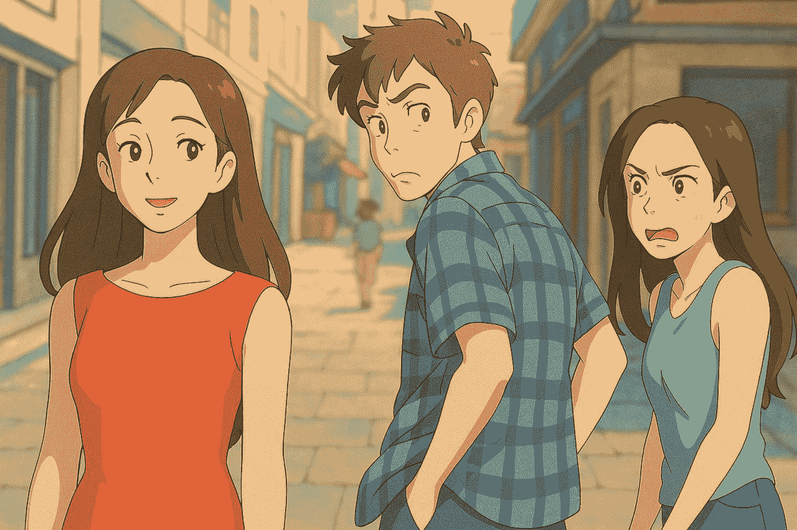

## 立体相框

**提示词：**

将场景中的角色转化为 3D Q 版风格，放在一张拍立得照片上，相纸被一只手拿着，照片中的角色正从拍立得照片中走出，呈现出突破二维相片边框、进入二维现实空间的视觉效果。

**参考图片：**上传任意一张图片。

**技巧：**如果不规范图片比例，默认 1:1。

**原链接：**[https://x.com/dotey/status](https://x.com/dotey/status/1908238003169903060)/1908238003169903060

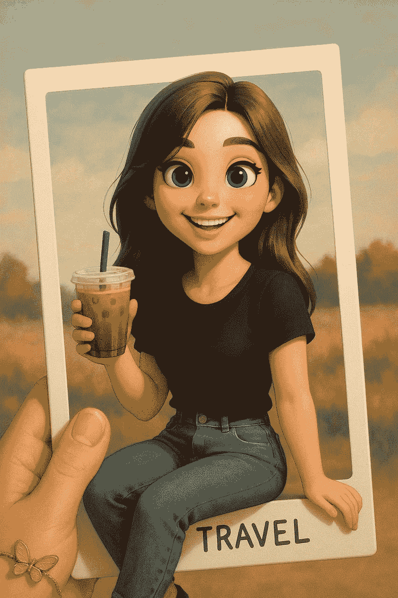

## iPhone 自拍

**提示词：**

请画一张极其平凡无奇的 iPhone 自拍照，没有明确的主体或构图感，就像是随手一拍的快照。照片略带运动模糊，阳光或店内灯光不均导致轻微曝光过度。角度尴尬、构图混乱，整体呈现出一种刻意的平庸感-就像是从口袋里拿手机时不小心拍到的一张自拍。主角是【陈奕迅和谢霆锋】，【晚上】，旁边是【香港会展中心，在香港维多利亚港旁边】。

**参考图片：**上传任意一张图片（也可以不上传图片）。

**技巧：**括号里的字可以修改；有意生成像真人的瑕疵照片；如果不规范图片比例，默认 1:1。

**原链接：**[https://x.com/dotey/status](https://x.com/dotey/status/1914710884523335680)/1914710884523335680

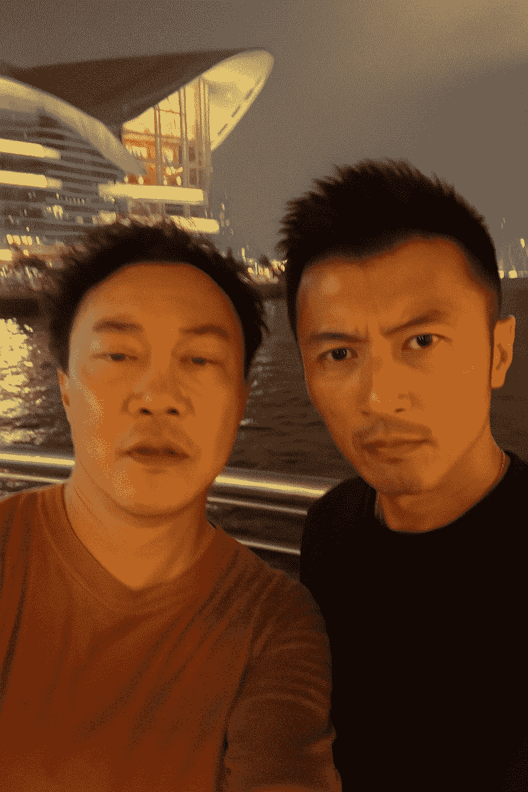

## **手绘信息图卡片**

**提示词：**

创作一张手绘风格的信息图卡片，比例为 9:16 竖版。卡片主题鲜明，背景为带有纸质肌理的米色或米白色，整体设计体现质朴、亲切的手绘美感。

卡片上方以红黑相间、对比鲜明的大号毛笔草书字体突出标题，吸引视觉焦点。文字内容均采用中文草书，整体布局分为 2 至 4 个清晰的小节，每节以简短、精炼的中文短语表达核心要点。字体保持草书流畅的韵律感，既清晰可读又富有艺术气息。周边适当留白。

卡片中点缀简单、有趣的手绘插画或图标，例如人物或象征符号，以增强视觉吸引力，引发读者思考与共鸣。整体布局注意视觉平衡，预留足够的空白空间，确保画面简洁明了，易于阅读和理解。

“做 IP 是长期复利

坚持每日更新，肯定会有结果，因为 99% 都坚持不了的！”

**参考图片：**无需上传图片。

**技巧：**最后两段文字可以按需修改；中文的话可以考虑即梦 3.0，用引号把文字给框起来就好。

**原链接：**[https://x.com/dotey/status](https://x.com/dotey/status/1907870919852179850)/1907870919852179850

## **复古宣传海报**

**提示词：**

复古宣传海报风格，突出中文文字，背景为红黄放射状图案。画面中心位置有一位美丽的年轻女性，以精致复古风格绘制，面带微笑，气质优雅，具有亲和力。主题是 GPT 最新 AI 绘画服务的广告促销，强调‘惊爆价 9.9/张’、‘适用各种场景、图像融合、局部重绘’、‘每张提交 3 次修改’、‘AI 直出效果，无需修改’，底部醒目标注‘有意向点右下“我想要”’，右下角绘制一个手指点击按钮动作，左下角展示 OpenAI 标志，图片比例 9:16。

**参考图片：**无需上传图片。

**技巧：**如果碰到安全审核，可以考虑加入【如果背景里有不合适（敏感）的内容，可以进行修改或删除。】; 中文的话可以考虑即梦 3.0；另外如果不规范图片比例，默认 1:1。

**原链接：**[https://x.com/dotey/status](https://x.com/dotey/status/1905251524248248650)/1905251524248248650

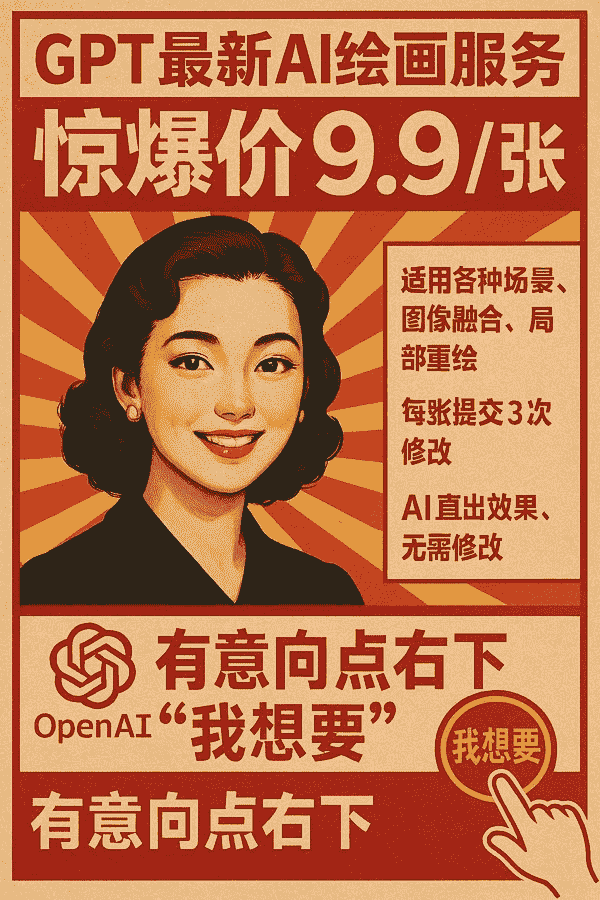

## **彩色矢量艺术海报**

**提示词：**

地点是【"英国伦敦"】，生成一张夏季的彩色矢量艺术海报，顶部有大的【"LONDON"】标题，下方有较小的【"UNITED KINGDOM"】标题

**技巧：**括号内可修改；这类风格提示词也适用于食物、电影、音乐；如果不规范图片比例，默认 1:1；

**原链接：**https://x.com/michaelrabone/status/1913865394139316291

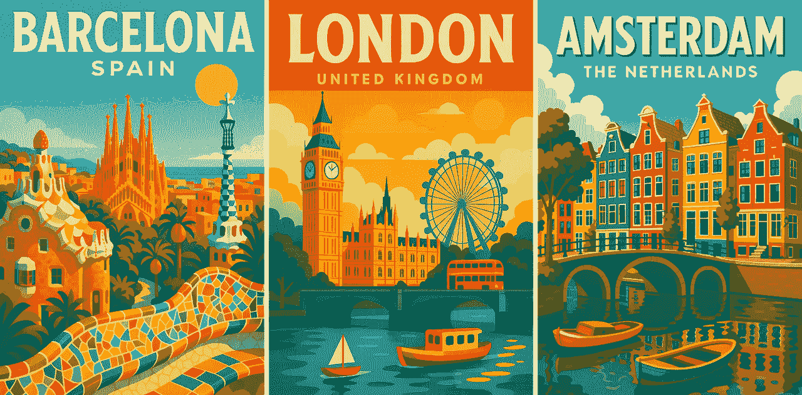

## Q 版 3D 风格

**提示词：**

将场景中的角色转化为 3D Q 版风格，同时保持原本的场景布置和服装造型不变。

**参考图片：**上传任意一张图片。

**技巧：**如果不规范图片比例，默认 1:1。

**原链接：**https://x.com/dotey/status/1908194518345678865

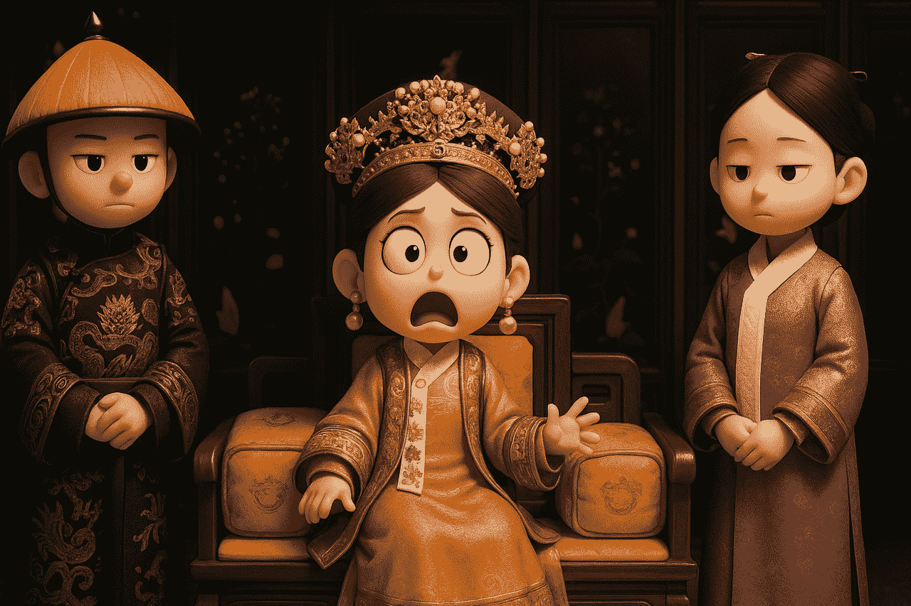

## **Q 版求婚场景**

**提示词：**

将照片里的两个人转换成 Q 版 3D 人物，场景换成求婚，背景换成淡雅五彩花瓣做的拱门，背景换成浪漫颜色，地上散落着玫瑰花瓣。除了人物采用 Q 版 3D 人物风格，其他环境采用真实写实风格。

**参考图片：**上传一张情侣照片。

**技巧：**如果不规范图片比例，默认 1:1。

**原链接：**https://x.com/balconychy/status/1909417750587486469

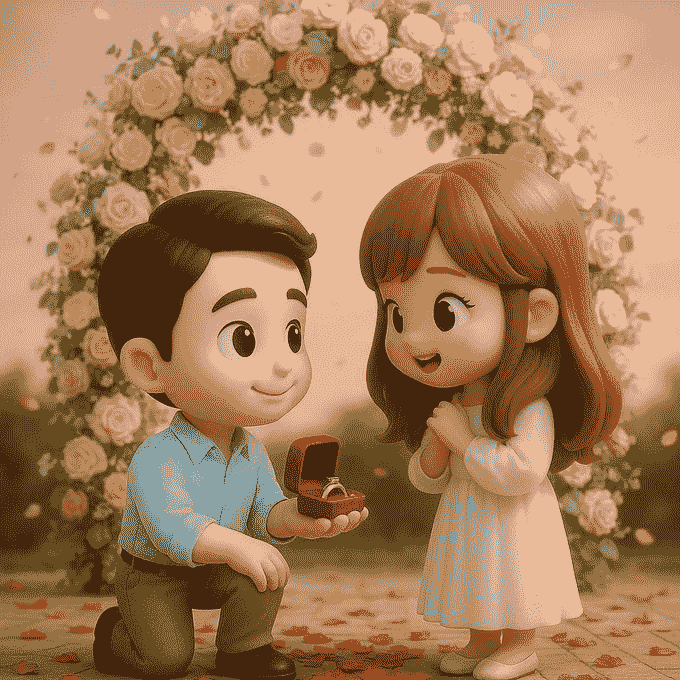

## Q 版情侣宝盒摆件

**提示词：**

根据照片上的内容打造一款细致精美、萌趣可爱的 3D 渲染收藏摆件，装置在柔和粉彩色调、温馨浪漫的展示盒中。展示盒为浅奶油色搭配柔和的金色装饰，形似精致的便携珠宝盒。打开盒盖，呈现出一幕温暖浪漫的场景：两位 Q 版角色正甜蜜相望。盒顶雕刻着“FOREVER TOGETHER”（永远在一起）的字样，周围点缀着小巧精致的星星与爱心图案。

盒内站着照片上的女性，手中捧着一束小巧的白色花束。她的身旁是她的伴侣，照片上的男性。两人都拥有大而闪亮、充满表现力的眼睛，以及柔和、温暖的微笑，传递出浓浓的爱意和迷人的气质。

他们身后有一扇圆形窗户，透过窗户能看到阳光明媚的中国古典小镇天际线和轻柔飘浮的云朵。盒内以温暖的柔和光线进行照明，背景中漂浮着花瓣点缀气氛。整个展示盒和角色的色调优雅和谐，营造出一个奢华而梦幻的迷你纪念品场景。图片尺寸为 9:16。

**参考图片：**上传一张情侣照片。

**技巧：**如果不规范图片比例，默认 1:1。

**原链接：**https://x.com/dotey/status/1909332895115714835

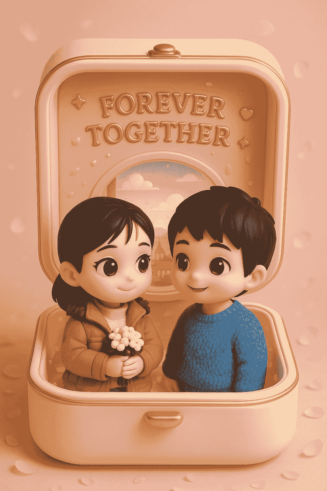

## Q 版表情包

**提示词：**

把图片变成吉卜力卡通风格，如果背景里有不合适（敏感）的内容，可以进行修改或删除。

创作一套全新的 chibi sticker，共六个独特姿势，以用户形象为主角：

1、双手比出剪刀手，俏皮地眨眼；

2、泪眼汪汪、嘴唇微微颤动，呈现可爱哭泣的表情；

3、张开双臂，做出热情的大大拥抱姿势；

4、侧卧入睡，靠着迷你枕头，带着甜甜的微笑；

5、自信满满地向前方伸手指，周围点缀闪亮特效；

6、手势飞吻，周围飘散出爱心表情。

保留 chibi 美学风格：夸张有神的大眼睛、柔和的面部线条、活泼俏皮的短款黑色发型、配以大胆领口设计的白色服饰，背景使用充满活力的红色，并搭配星星或彩色纸屑元素进行装饰。周边适当留白。尺寸为 9:16。

**参考图片：**上传一张清晰头像照片。

**技巧：**外如果不规范图片比例，默认 1:1。

**原链接：**https://x.com/dotey/status/1909800530739679488

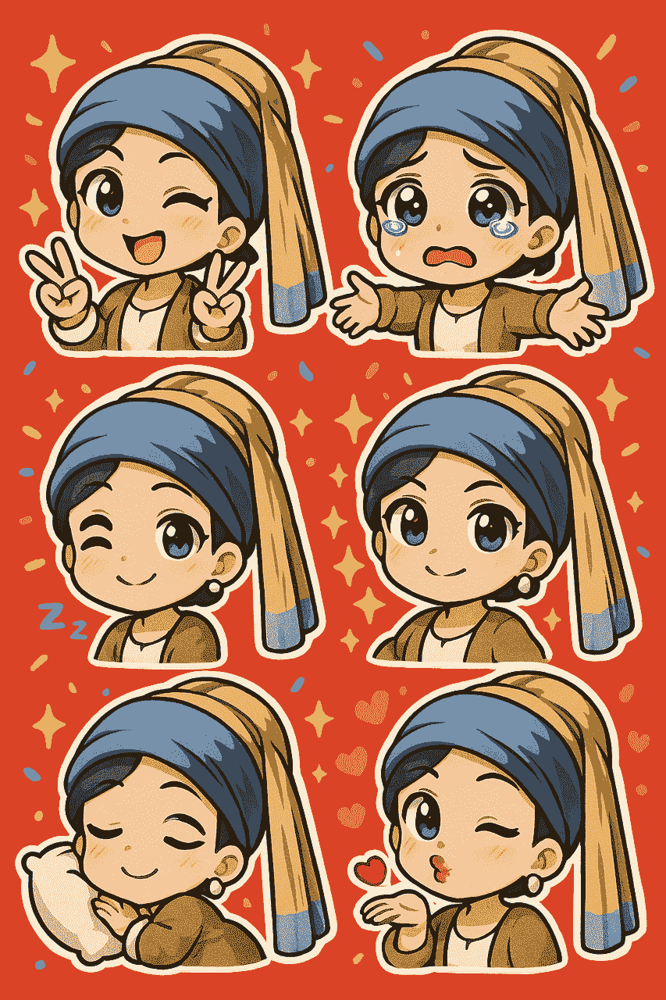

## 人物表情包

**提示词：**

先把图片人物变成手绘简笔画风格。

然后把简笔画按照吐舌头、微笑、皱眉、惊讶、思考、眨眼生成一系列表情包。

**参考图片：**上传任意一张图片。

**原链接：**https://x.com/ZHO_ZHO_ZHO/status/1909907741948399873

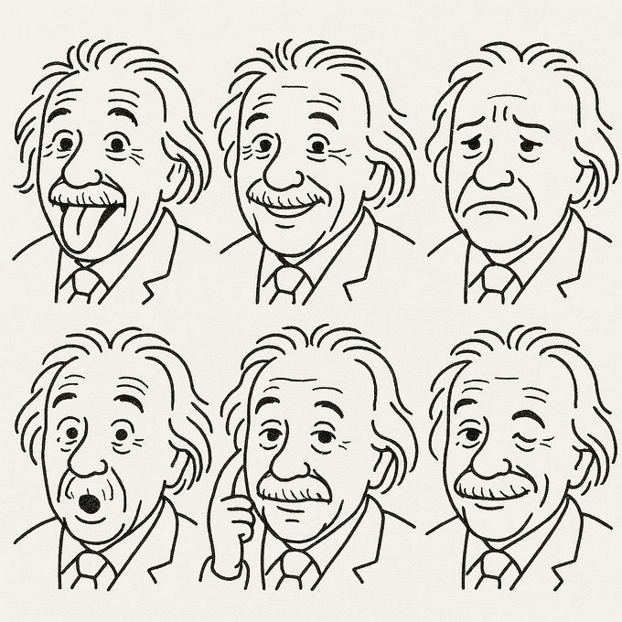

## 皮克斯风格

**提示词：**把图片变成吉卜力卡通风格，如果背景里有不合适（敏感）的内容，可以进行修改或删除。

**参考图片：**上传任意一张图片。

**技巧：**OpenAI 对部分版权风格进行了限制，所以后半句话一定要加；另外如果不规范图片比例，默认 1:1。

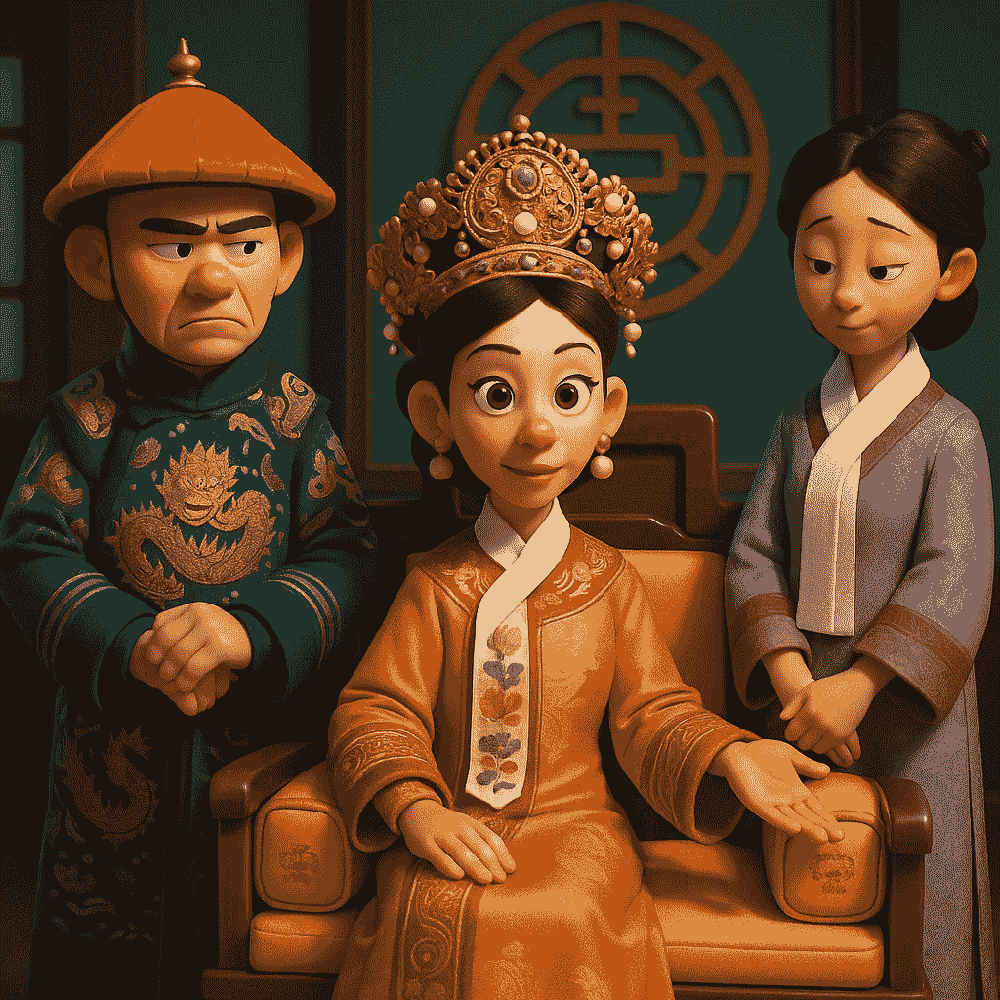

## Q 版角色卡

**提示词：**

画一张带有圆角和柔和投影的现代 UI 卡片 2:3 图片。卡片中央应展示一个上穿图片转换为的 3D 卡通风角色。姿势和服饰应该都是图片的 Q 版版本，在角色下方，包含一个加粗的黑色标题（“Reyna”）和一个字体更小、颜色更浅的副标题（“Valorant”）。使用干净、简约的白色或浅灰色背景。整体外观应感觉现代、有趣且富有科技感，适合创意应用或游戏界面。

**参考图片：**上传一张正面的角色图片。

**技巧：**如果不规范图片比例，默认 1:1。

**原链接：**https://x.com/op7418/status/1915739386278543766

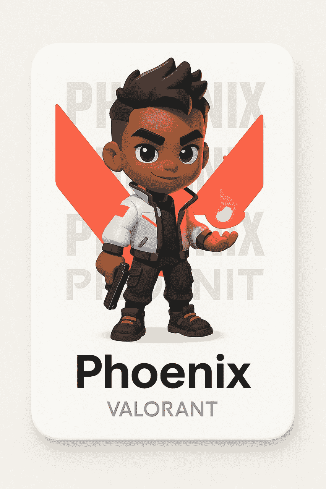

## 未来主义 logo 卡片

**提示词：**

{

"prompt": "A futuristic trading card with a dark, moody neon aesthetic and soft sci-fi lighting. The card features a semi-transparent, rounded rectangle with slightly muted glowing edges, appearing as if made of holographic glass. At the center is a large glowing logo of {{logo}}, with no additional text or label, illuminated with a smooth gradient of {{colors}}, but not overly bright. The reflections on the card surface should be subtle, with a slight glossy finish catching ambient light. The background is a dark carbon fiber texture or deep gradient with soft ambient glows bleeding into the edges. Add subtle light rays streaming down diagonally from the top, giving the scene a soft cinematic glow. Apply light motion blur to the edges and reflections to give the scene a sense of depth and energy, as if it's part of a high-end tech animation still. Below the card, include realistic floor reflections that mirror the neon edges and logo—slightly diffused for a grounded, futuristic look. Text elements are minimal and softly lit: top-left shows '{{ticker}}', top-right has a stylized signature, and the bottom displays '{{company_name}}' with a serial number '{{card_number}}', a revenue badge reading '{{revenue}}', and the year '{{year}}'. Typography should have a faint glow with slight blurring, and all elements should feel premium, elegant, and softly illuminated—like a high-end cyberpunk collectible card.",

"style": {

"lighting": "Neon glow, soft reflections",

"font": "Modern sans-serif, clean and minimal",

"layout": "Centered, structured like a digital collectible card",

"materials": "Glass, holographic plastic, glowing metal edges"

},

"parameters": {

"logo": "Tesla logo",

"ticker": "TSLA",

"company_name": "Tesla Inc.",

"card_number": "#0006",

"revenue": "$96.8B",

"year": "2025",

"colors": ["red", "white", "dark gray"]

},

"medium": "3D render, high-resolution digital art",

"size": "1080px by 1080px"

}

**参考图片：**可不上传图片，或上传一张 logo 图片但需要修改提示词。

**技巧：**这段提示词采用的是类 JSON 结构描述卡片元素，修改 parameters 对象中的值即可自定义卡片；如果需要用到上传的 logo 图，需要在 parameters 修改 logo 参数（类似上传的图片这样的话）。

**原链接：**https://x.com/hewarsaber/status/1912933879411052969

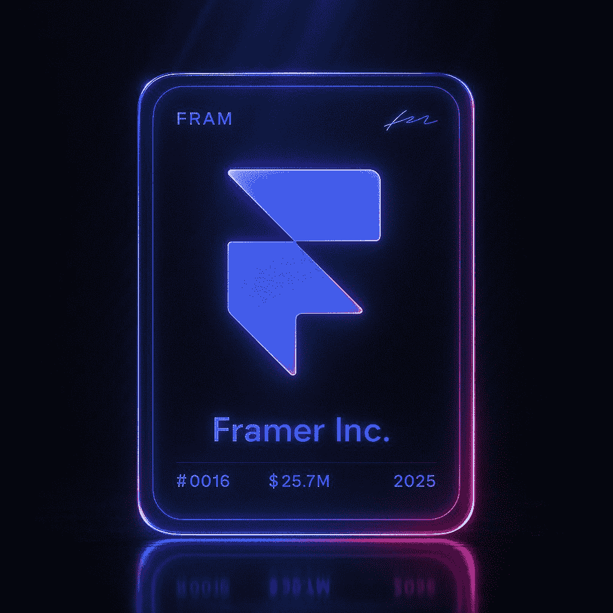

## 写实 3D 游戏角色

**提示词：**

超写实的 3D 渲染画面，重现了 2008 年【《命令与征服：红色警戒 3》中娜塔莎】的角色设计，完全依照原版建模。场景设定在一个昏暗杂乱的 2008 年代卧室里，角色正坐在地毯上，面对一台正在播放【《命令与征服：红色警戒 3》】的老式电视和游戏机手柄。

整个房间充满了 2008 年代的怀旧氛围：零食包装袋、汽水罐、海报以及纠缠在一起的电线。【娜塔莎·沃尔科娃】在画面中被抓拍到转头的一瞬，回眸看向镜头，她那标志性的空灵美丽面容上带着一抹纯真的微笑。她的上半身微微扭转，动态自然，仿佛刚刚被闪光灯惊到而做出的反应。

闪光灯轻微地过曝了她的脸和衣服，使她的轮廓在昏暗的房间中更加突出。整张照片显得原始而自然，强烈的明暗对比在她身后投下深邃的阴影，画面充满触感，带有一种真实的 2008 年胶片快照的模拟质感。

**参考图片：**无需上传图片。

**技巧：**括号内可修改，复刻不同的角色；如果不规范图片比例，默认 1:1。

**原链接：**https://x.com/ZHO_ZHO_ZHO/status/1913648013144137840

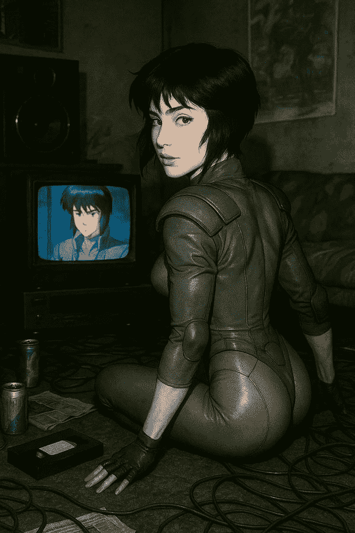

## 3D 磨砂玻璃质感 Emoji 图标

**提示词：**

生成一个 1:1 比例的图像：将扁平的矢量 【emoji】 转换为等距 3D 集合，具有逼真的半透明磨砂玻璃质感，并添加柔和的内部发光，颜色需要与 emoji 原来的相似，黑色背景，工作室灯光，锐利的边缘光。

**技巧：**括号里是对应的 emoji 图标。

**原链接：**https://x.com/op7418/status/1913781670286950516

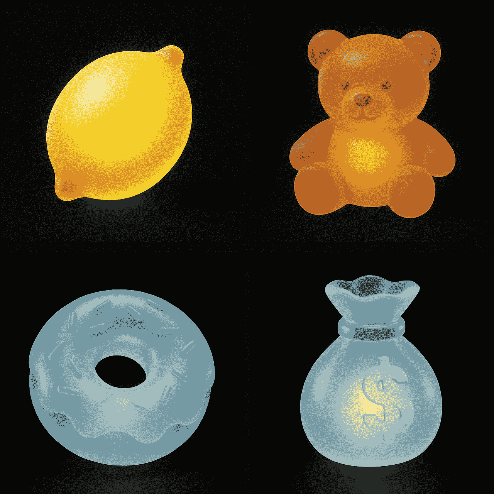

## Q 版 3D 风格 Emoji 图标（雪糕版）

**提示词：**

为我生成：将【emoji】变成变成一根奶油雪糕，奶油在雪糕顶上呈曲线流动状看起来美味可口，45 度悬浮在空中，q 版 3d 可爱风格，一致色系的纯色背景。

**技巧：**括号里是对应的 emoji 图标；另外如果不规范图片比例，默认 1:1。

**原链接：**https://x.com/ZHO_ZHO_ZHO/status/1914574278911000967

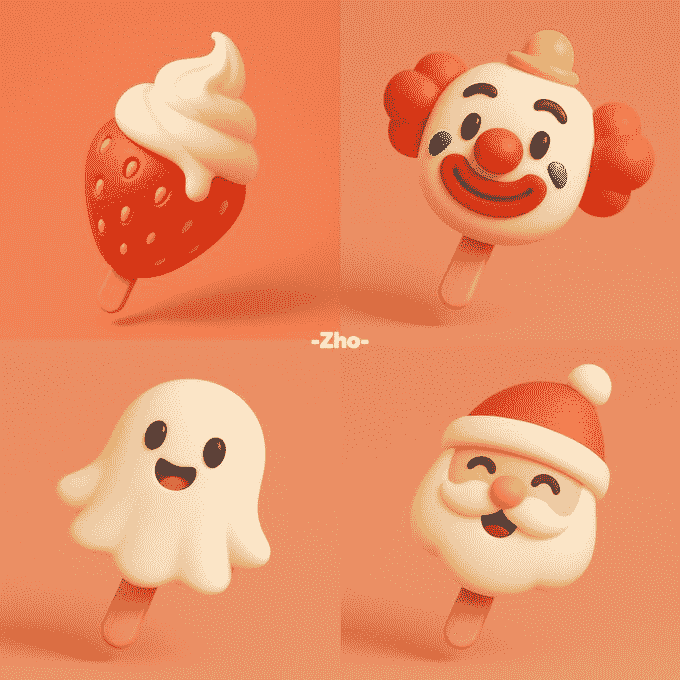

## 簇绒版 Emoji 图标（地毯版）

**提示词：**

创建一张色彩鲜艳的手工簇绒地毯图片，形状为【Emoji】表情符号，放置在简单的地板背景上。地毯设计大胆、有趣，具有柔软蓬松的质地和粗纱线细节。从上方拍摄，在自然日光下，带有略微古怪的 DIY 美学风格。色彩鲜艳、卡通轮廓、触感舒适的材料——类似于手工簇绒艺术地毯。

**技巧：**括号里是对应的 emoji 图标；如果不规范图片比例，默认 1:1。

**原链接：**https://x.com/gizakdag/status/1913925062568144924

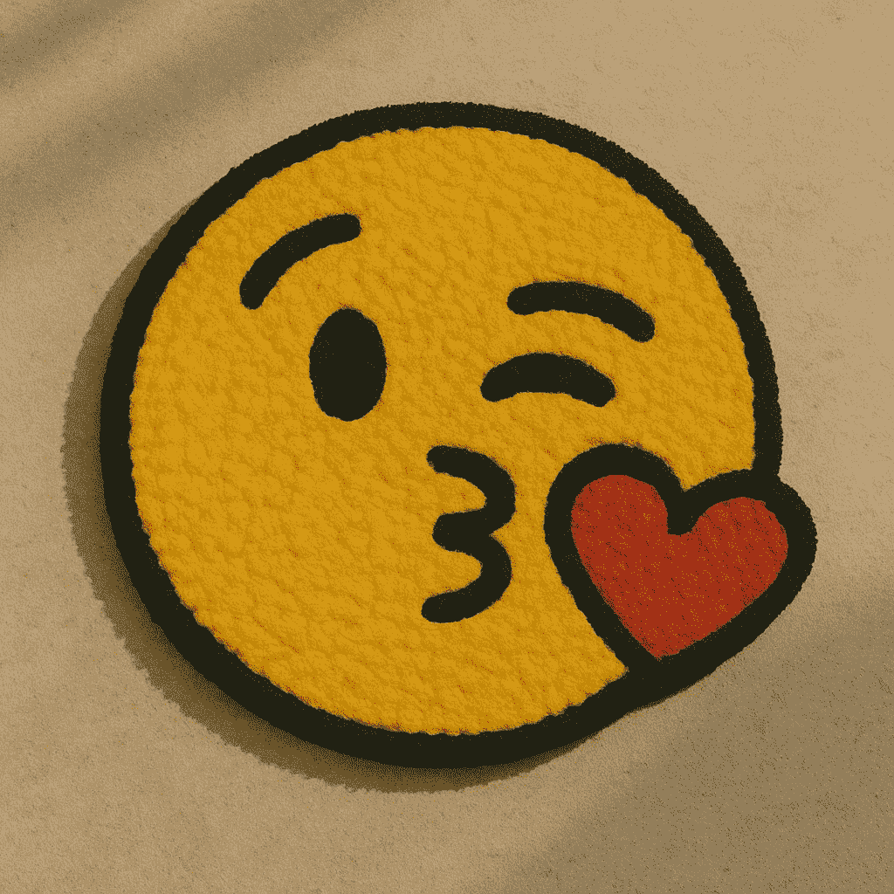

## 毛绒充气版 Emoji 图标（抱枕版）

**提示词：**

Create a high-resolution 3D render of 【Emoji】 designed as an inflatable, puffy object. The shape should appear soft, rounded, and air-filled — like a plush balloon or blow-up toy. Use a smooth, matte texture with subtle fabric creases and stitching to emphasize the inflatable look. The form should be slightly irregular and squishy, with gentle shadows and soft lighting that highlight volume and realism. Place it on a clean, minimal background (light gray or pale blue), and maintain a playful, sculptural aesthetic.

**技巧：**括号里是对应的 emoji 图标；如果不规范图片比例，默认 1:1。

**原链接：**https://x.com/gizakdag/status/1912858538252042428

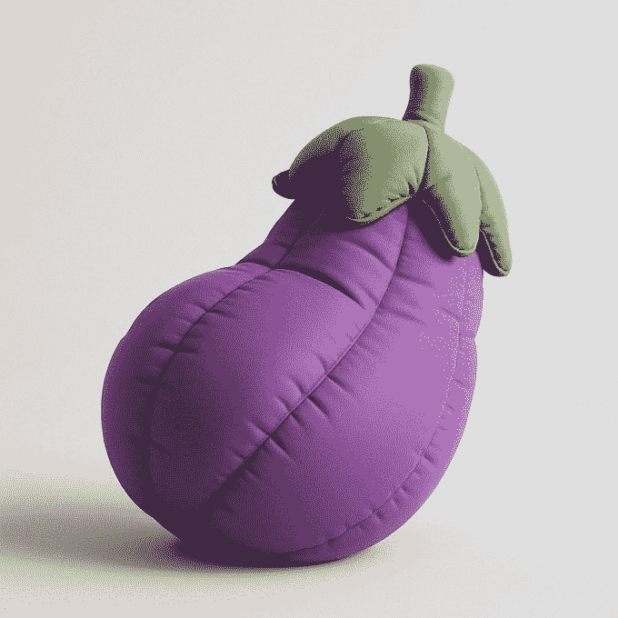

## **纸艺版 Emoji 图标**

**提示词：**

A paper craft-style 【Emoji】 floating on a pure white background. The emoji is handcrafted from colorful cut paper with visible textures, creases, and layered shapes. It casts a soft drop shadow beneath, giving a sense of lightness and depth. The design is minimal, playful, and clean — centered in the frame with lots of negative space. Use soft studio lighting to highlight the paper texture and edges.

**技巧：**括号里是对应的 emoji 图标；如果不规范图片比例，默认 1:1。

**原链接：**https://x.com/egeberkina/status/1912521267543949568

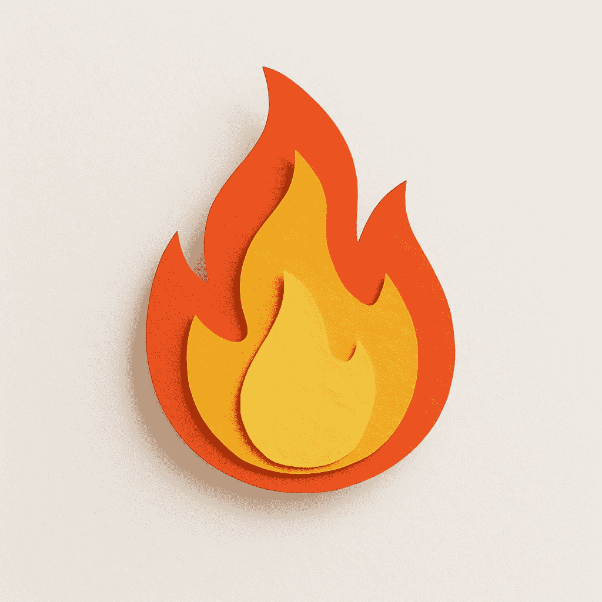

## 极简主义 8 位像素版 Emoji 图标

**提示词：**

创建一个【Emoji】的极简 8 位像素标志，居中放置在纯白背景上。使用有限的复古调色板，带有像素化细节、锐利边缘和干净的块状形态。该标志应简洁、具有标志性，并能在像素艺术风格中清晰识别——灵感来自经典街机游戏美学。

**技巧：**括号里是对应的 emoji 图标；如果不规范图片比例，默认 1:1。

**原链接：**https://x.com/egeberkina/status/1913654511870288136

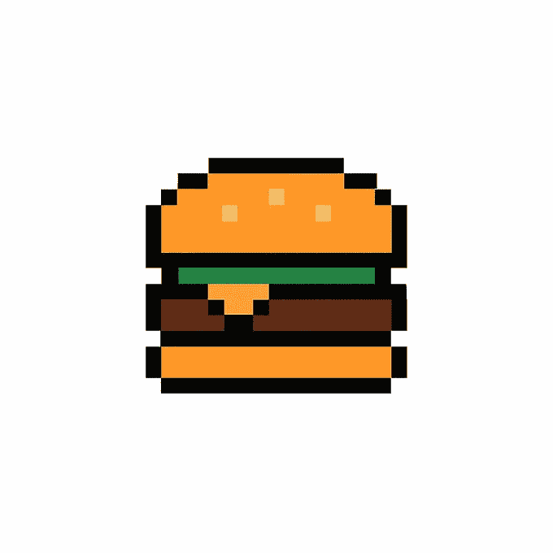

## 丝绸质感 Emoji 图标

**提示词：**

将【Emoji】变成一个柔软的 3D 丝绸质感物体。整个物体表面包裹着顺滑流动的丝绸面料，带有超现实的褶皱细节、柔和的高光与阴影。该物体轻轻漂浮在干净的浅灰色背景中央，营造出轻盈优雅的氛围。整体风格超现实、触感十足且现代，传递出舒适与精致趣味的感觉。工作室灯光，高分辨率渲染

**技巧：**括号里是对应的 emoji 图标；如果不规范图片比例，默认 1:1。

**原链接：**https://x.com/ZHO_ZHO_ZHO/status/1914864217867608175

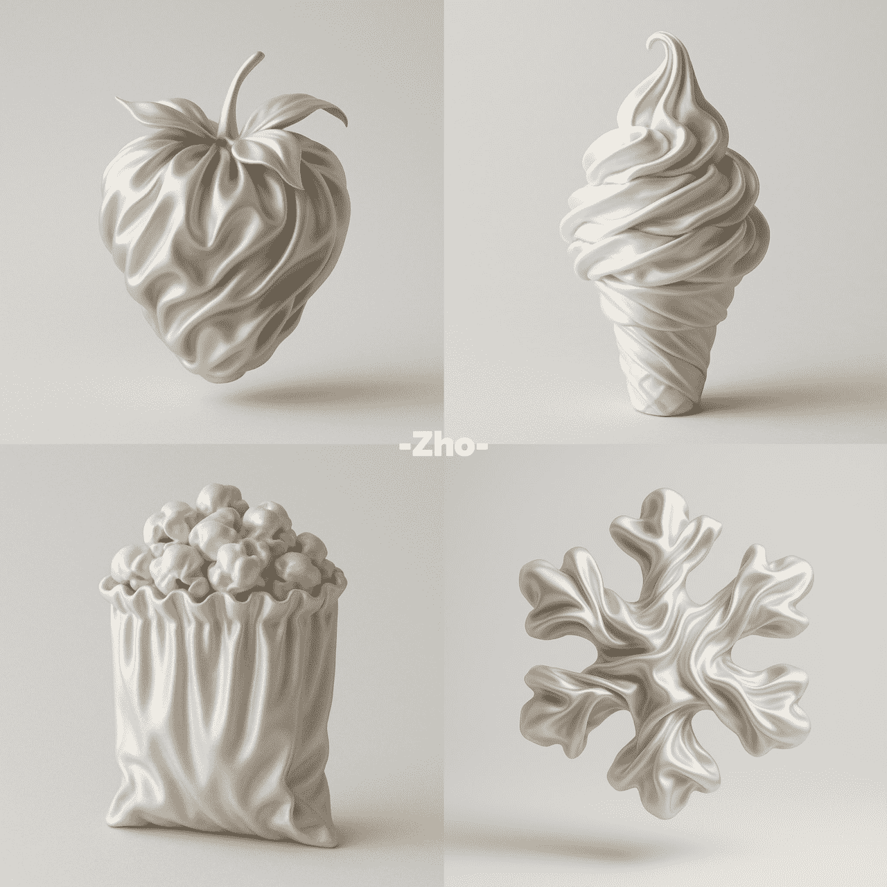

## **珐琅别针**

**提示词：**

将附图中的主题变成可爱的珐琅别针。使用光泽的金属轮廓和鲜艳的珐琅填充。无需额外添加任何功能。方形模型格式。白色背景。

**参考图片：**上传任意一张图片。

**技巧：**如果不规范图片比例，默认 1:1。

**原链接：**https://x.com/gnrlyxyz/status/1914303110853583302

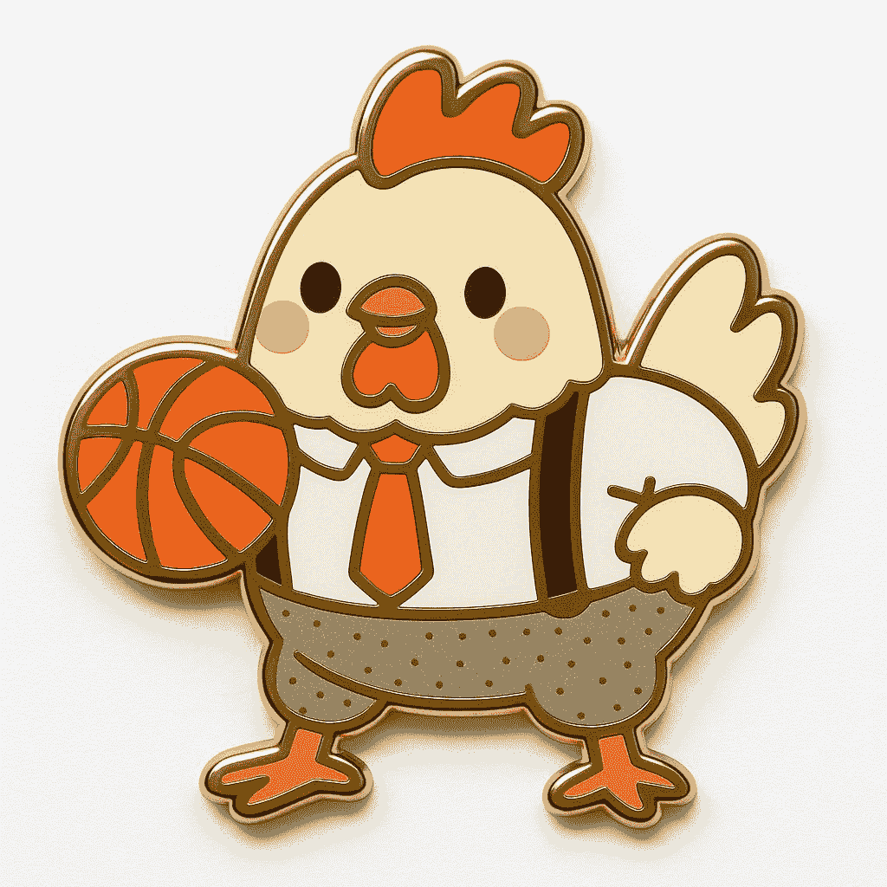

## **低多边形 3D 渲染风格**

**提示词：**

英：A low-poly 3D render of a skeleton warrior， built from clean triangular facets with flat bone white and charcoal grey surfaces。 The environment is a stylized digital desert with minimal geometry and ambient occlusion.

中：一个低多边形 3D 渲染的【骷髅战士】，由干净的三角形面片组成，表面是平坦的【骨白色】和【炭灰色】。环境是一个风格化的【数字沙漠】，几何体和环境光遮蔽都很少。

**技巧：**括号内可修改；如果不规范图片比例，默认 1:1。

**原链接：**https://x.com/azed_ai/status/1912084257918595342

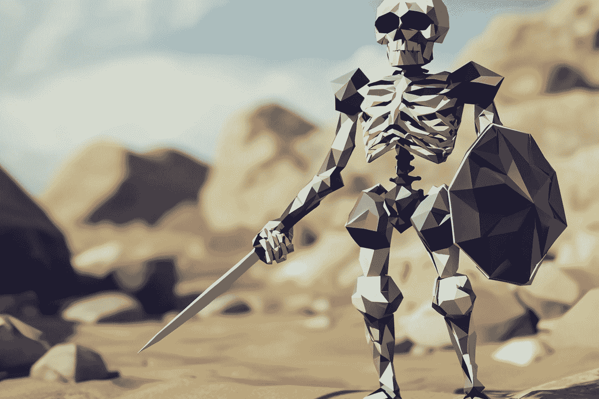

## 护照风格印章（特定城市）

**提示词：**

创建一个逼真的护照页，并盖上【城市， 国家】的入境章。章面应以粗体英文写明“欢迎来到【城市】”，并设计成圆形或椭圆形，并带有装饰性边框。章面应包含“ARRIVAL”字样和一个虚构的日期，例如“2025 年 4 月 16 日”。在章面中加入【主要地标】的微妙轮廓作为背景细节。使用深蓝色或红色墨水并略加晕染，以增强真实感。章面应略微倾斜，如同手工压印。护照页应清晰可见纸张纹理和安全图案

**技巧：**括号内可修改；如果不规范图片比例，默认 1:1。

**原链接：**https://x.com/ZHO_ZHO_ZHO/status/1912188562944250035

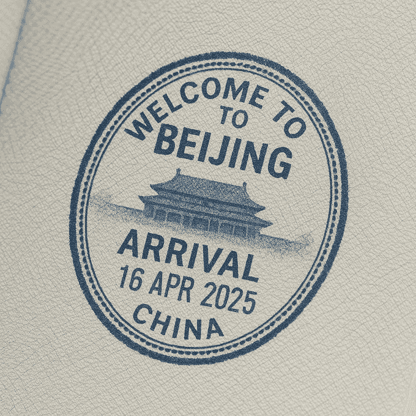

## 立体像素风格 3D 图标

**提示词：**

将【图片/Emoji】转换为参考图一样的体素 3D 图标，Octane 渲染，8k

**参考图片：**上传一张或两张图片。

**技巧：**

如果是** **Emoji 图标转换，只需要上传一张图片，括号内替换成 Emoji 图标；

如果是需要上传的待转换图标，则上传两张图（先参考图，再待转换图）；

如果不规范图片比例，默认 1:1。

**原链接：**https://x.com/BrettFromDJ/status/1910387418563568084

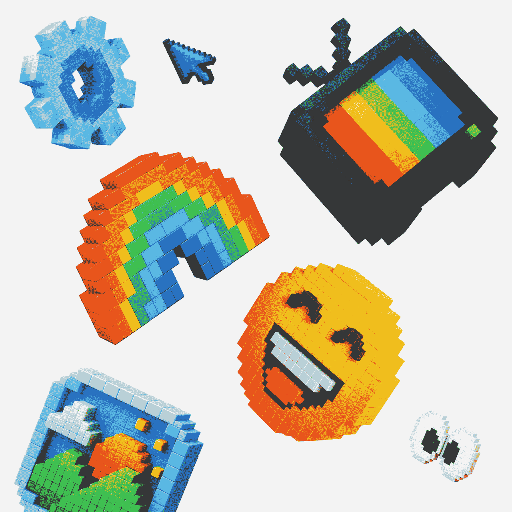

## 动漫贴纸

**提示词：**

【动漫名】 stickers

**技巧：**括号内要修改，英文名最好；如果不规范图片比例，默认 1:1。

**原链接：**https://x.com/richardchang/status/1909086122959139312

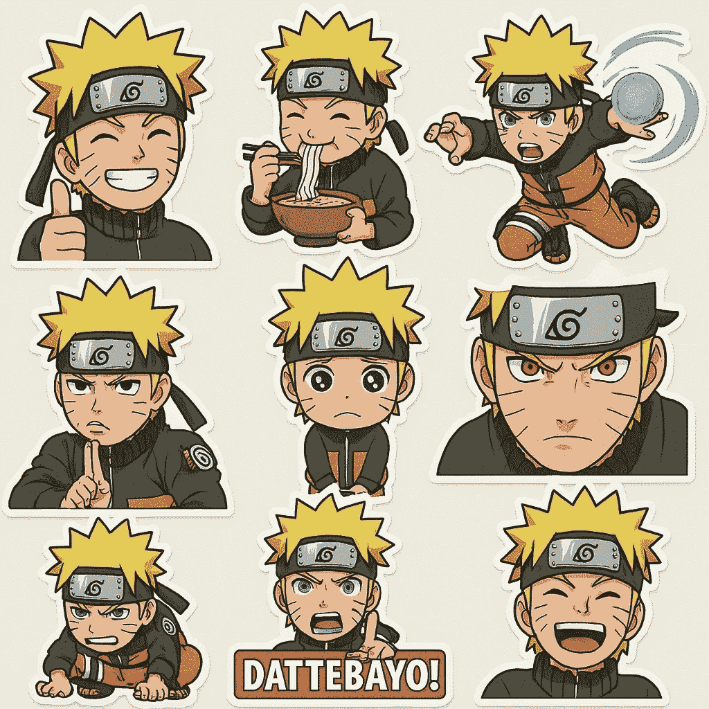

## Q 版扁平风格贴纸

**提示词：**

把这张照片设计成一个极简扁平插画风格的 Q 版贴纸，厚白边，保留人物特征，风格要可爱一些，人物要超出圆形区域边框，圆形区域要为纯色不要 3D 感，透明背景。

**参考图片：**上传任意一张图片。

**技巧：**如果不规范图片比例，默认 1:1。

**原链接：**https://x.com/ZHO_ZHO_ZHO/status/1908044836953108490

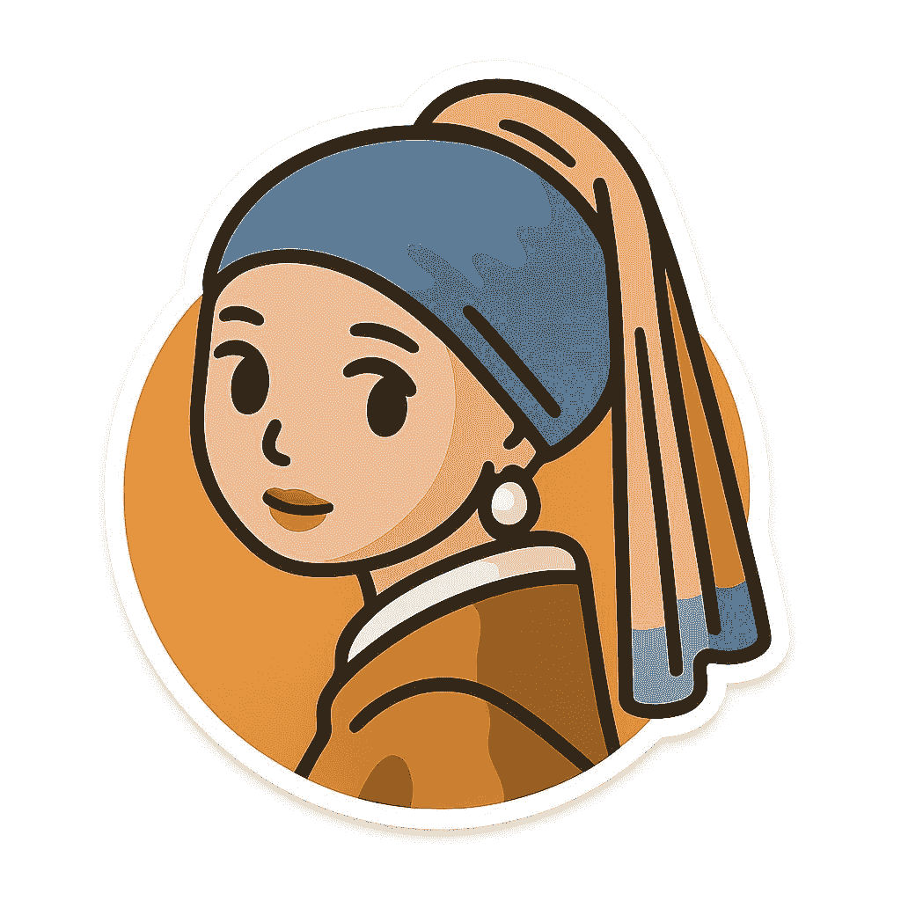

## Q 版 3D 风格人物 OOTD 图

**提示词：**

为图片人物生成【时尚设计师】的 OOTD，时尚穿搭和配饰，和人物色系一致的纯色背景，Q 版 3d，c4d 渲染，保持人脸特征，姿势都要保持一致，人物的比例腿很修长

构图：4:3 竖幅

顶部文字：OOTD

左侧为人物 ootd q 版形象，右侧为穿搭的单件展示。

**参考图片：**上传任意一张人物图片。

**技巧：**括号内可修改；如果不规范图片比例，默认 1:1。

**原链接：**https://x.com/ZHO_ZHO_ZHO/status/1909892294217781714

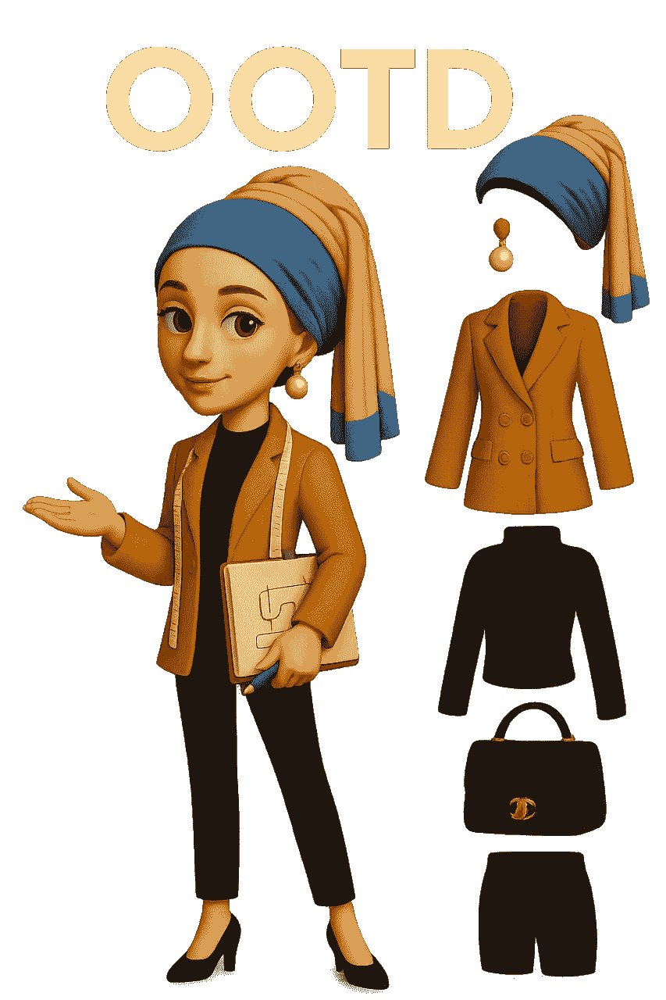

## 错视风格图片

**提示词：**

中：

一幅错视风格的画面：【人物描述】从显示着 xyz 社交媒体界面的大屏幕中迈步而出。屏幕上可见用户名为“@【名字】”，显示 1 千次点赞、12-20 条评论，周围漂浮着【爱心眼、笑脸】表情符号，纯色背景。

英：

Trompe l'oeil illusion of A (subject) (attire) steps out of a large screen displaying xyz social media interface. The screen shows the username "@" 1K likes, and 12- 20 comments, with floating emojis (heart-eyes, smiley) around it. your preferred background."

**技巧：**括号内按需修改；英文效果更好；如果不规范图片比例，默认 1:1。

**原链接：**https://x.com/madpencil_/status/1915099250079469907

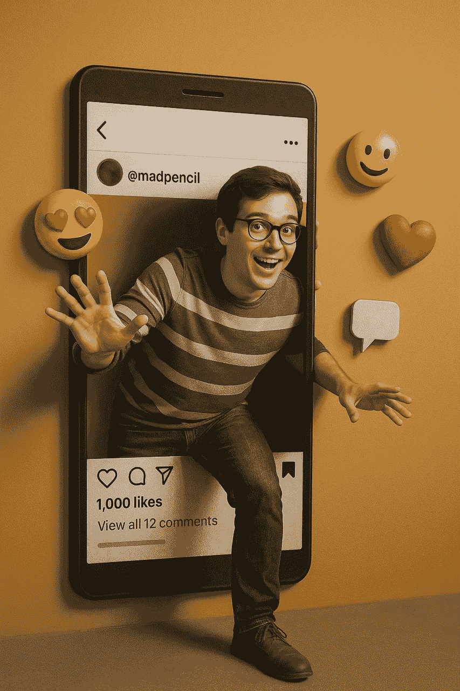

## 伪造截图

**提示词：**

中：

爱因斯坦在完成相对论后发布的超现实主义推特帖子。包括一张自拍照，你可以清楚地看到背景中潦草的方程式和黑板。并显示尼古拉·特斯拉点赞了该帖子。

英：

a hyper realistic twitter post by Albert Einstein right after finishing the theory of relativity. include a selfie where you can clearly see scribbled equations and a chalkboard in the background. have it visible that the post was liked by Nikola Tesla.

**原链接：**https://x.com/egeberkina/status/1914299716394778713

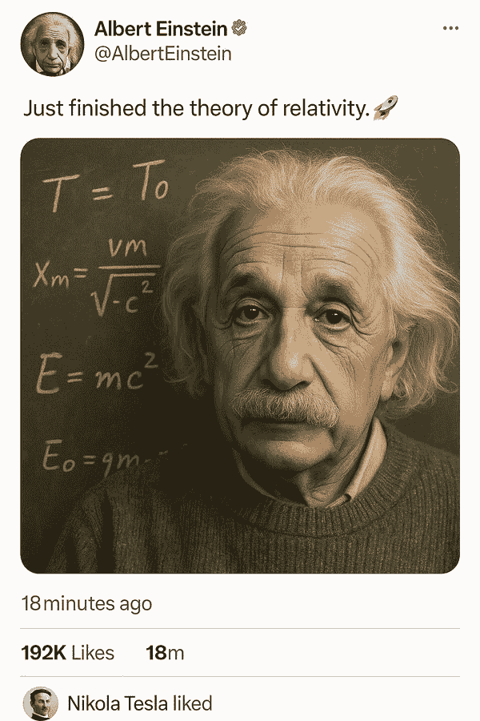

## 迷你 3D 风格建筑

**提示词：**

3D Q 版迷你风格，一个充满奇趣的迷你星巴克咖啡馆，外观就像一个巨大的外带咖啡杯，还有盖子和吸管。建筑共两层，大大的玻璃窗清晰地展示出内部温馨而精致的设计：木质的家具、温暖的灯光以及忙碌的咖啡师们。街道上有可爱的小人偶漫步或坐着，四周布置着长凳、街灯和植物盆栽，营造出迷人的城市一角。整体采用城市微缩景观风格，细节丰富、逼真，画面光线柔和、呈现出午后的惬意感受。

**技巧：**关于建筑细节的描述，可以让 AI 生成，提示词为：参考上面的提示词，写一个类似的提示词，针对 DunkinDonuts，甜甜圈造型如果不规范图片比例，默认 1:1。

**原链接：**https://x.com/dotey/status/1913759515700285569

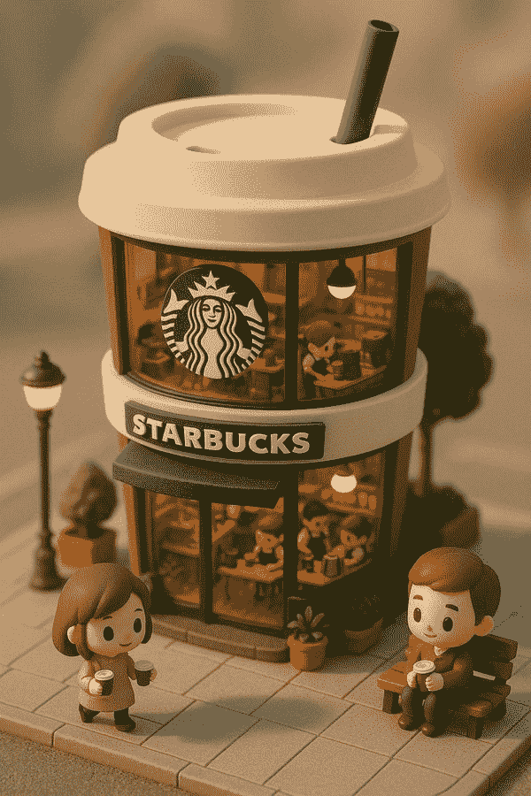

## 品牌胶囊风格

**提示词：**

创建 3:2 的图片，一个高高的、外观逼真且充满活力的胶囊体水平漂浮着。

它的左半边是标志性的星巴克绿色，标有“Starbucks – Uplifting the Everyday”字样以及经典的美人鱼（Siren）标志。

右半边是透明的，里面填充着漂浮的烘焙咖啡豆、细腻的奶泡漩涡、手绘咖啡杯图标以及代表社区连接的抽象暖色调线条，需要有背景色。

**技巧：**如果不规范图片比例，默认 1:1。

**原链接：**https://x.com/op7418/status/1913514945452405152

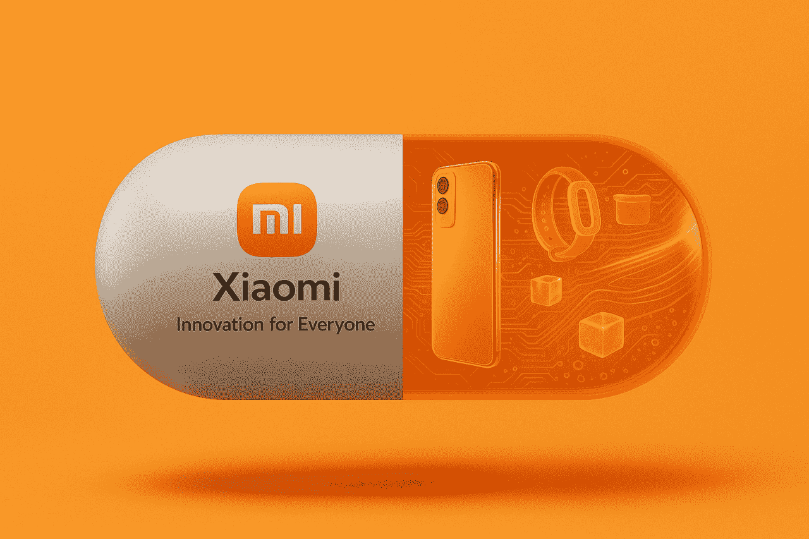

## Q 版 3D 风格情侣水晶球

**提示词：**

将附图中的人物转换成水晶球场景。 整体环境：水晶球放在窗户旁桌面上，背景模糊，暖色调。阳光透过球体，洒下点点金光，照亮了周围的黑暗。 水晶球内部：人物是可爱 Q 版 3D 造型，相互之间满眼的爱意。

**参考图片：**上传一张情侣照片。

**技巧：**如果不规范图片比例，默认 1:1。

**原链接：**https://x.com/balconychy/status/1909908568129655248

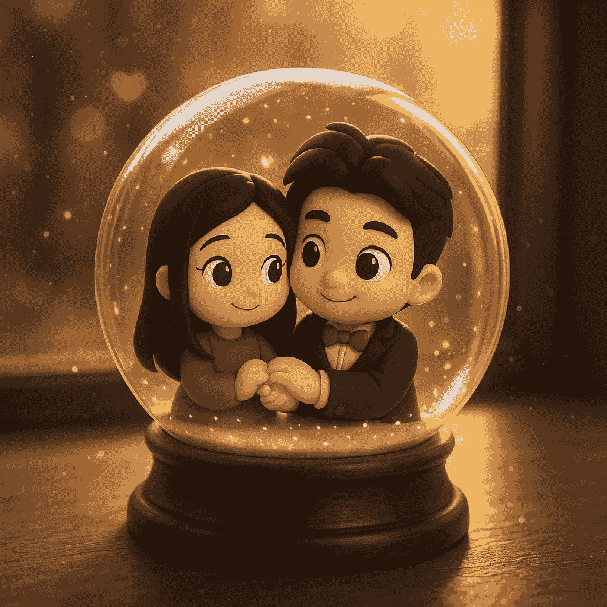

## Q 版立体微景观

**提示词：**

微型立体场景呈现，运用移轴摄影的技法，呈现出 Q 版【孙悟空大闹天宫】场景

**技巧：**括号内可以修改；如果不规范图片比例，默认 1:1。

**原链接：**https://x.com/dotey/status/1911609122547449886

## 双格漫画

**提示词：**

创建一张日系萌系双格漫画，上下排列，主题：少女总统的工作日常。

角色形象： 将上传的附件转换为日系萌系卡通女生形象的风格，保留原图所有细节，如服饰（西装）、发型（明亮的金黄色）、五官等。

第一格：

- 表情： 委屈巴巴，沮丧的表情，单手托腮

- 文字框： “肿么办嘛！他不跟我通话！(; ´д｀)”

- 场景： 暖色调办公室，背后美国国旗，桌上放着一堆汉堡，一个复古红色转盘电话，人物在画面左边，电话在右边。

第二格：

- 表情： 咬牙切齿，暴怒，脸涨红

- 动作： 猛拍桌子，汉堡震得跳起来

- 文字泡： “哼！关税加倍！不理我是他们的损失！（ `д´ ）” - 场景： 和第一格相同，但一片狼藉。

其他说明：

- 文字采用简洁可爱的手写体，整体风格可爱而有趣。

- 构图饱满生动，请保留足够空间用于文字显示，适当留白。

- 图片比例 2:3。

- 画面整体色彩鲜艳，突出卡通风格。

**参考图片：**上传一张人物照片。

**技巧：**如果不规范图片比例，默认 1:1。

**原链接：**https://x.com/hellokaton/status/1910902266481217928

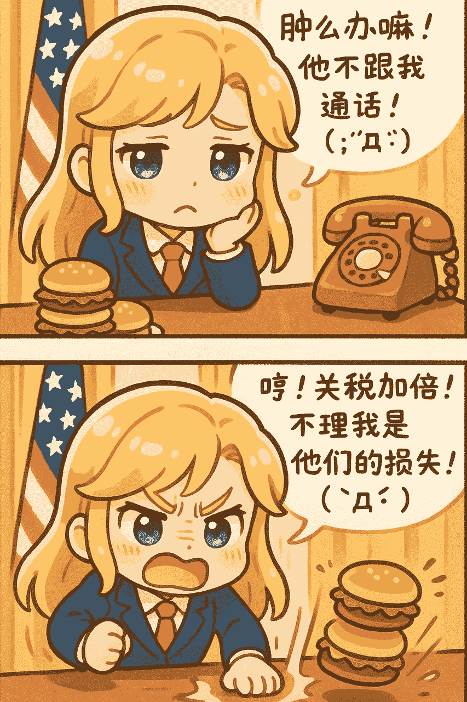

## 涂鸦社交媒体

**提示词：**

生成图片，把它打印出来，然后用红墨水疯狂地加上手写中文批注、涂鸦、乱画，如果你想的话，还可以加点小剪贴画

**参考图片：**直接生成不上传图片；也可以上传图片再涂鸦，提示词需要相应修改。

**原链接：**https://x.com/op7418/status/1906208691877253536

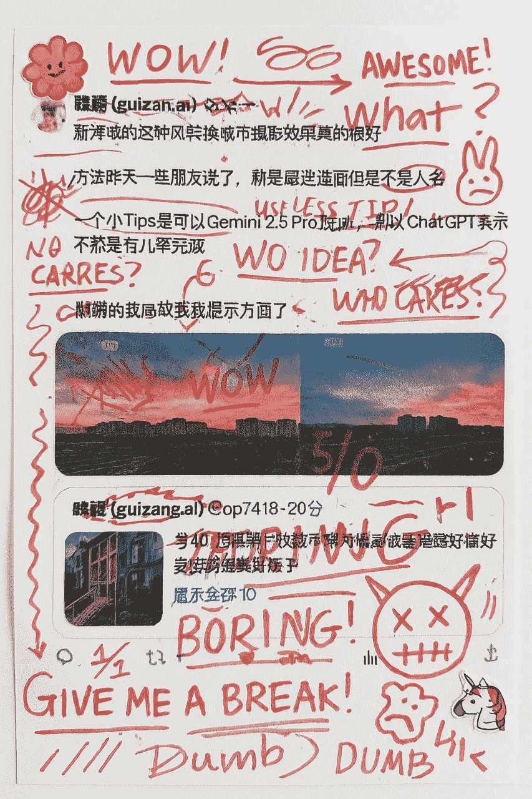

## 涂鸦照片穿搭分析

**提示词：**

生成图片，把它打印出来，然后用红墨水疯狂地加上手写中文的穿搭分析，要多找角度夸奖，线条指向位置要准确。

**参考图片：**上传一张人物照片。

**技巧：**如果不规范图片比例，默认 1:1。

**原链接：**https://x.com/coolish/status/1906331982067548581

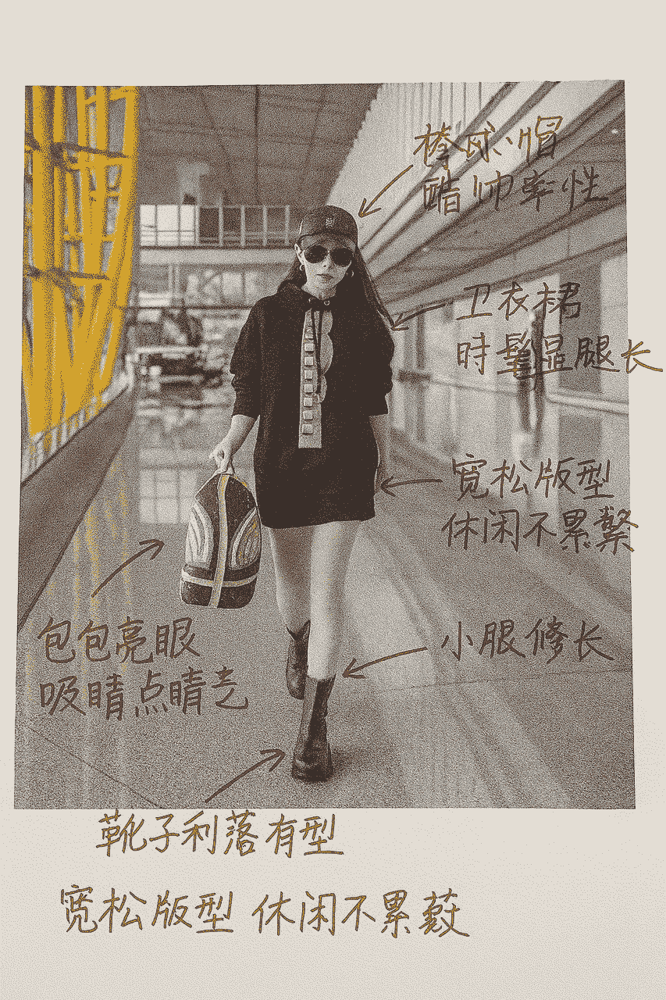

## 四格漫画

**提示词：**

经典的“Out the Window” Meme 四格漫画竖版布局，标题在漫画顶部居中，背景为现代办公会议室场景，风格简洁、幽默、清晰易懂，所有人物均以卡通风格表现，适合用于网络传播。

### 标题（居中）：

《如何借助 AI 提升开发效率？》（中文，加粗）

### 第一格（完整横格）：

- **场景**：公司会议室，老板站立在白板或投影幕前讲话，老板为分头发型、西装领带、严肃但略带疑惑的男性（参考图 1）。

- **动作**：老板张开双手，似在询问，下方桌前并排坐着三位员工（从左到右：小明、小红、小互）。

- **对话气泡（老板）**：“我们要如何借助 AI 提升开发效率？”

- **员工描述**：

- 小明（程序员）：男性，蓝色格子衬衫，戴眼镜，程序员气质。

- 小红（设计师）：女性，休闲时尚穿搭，显出设计师的个性气质。

- 小互（测试员）：女性，戴圆眼镜，职场休闲风（参考图 2）。

### 第二格（完整横格，画面中三个员工分别给出回答，表情认真自信）：

- **小明（左侧）对话气泡**：“我们用 AI 写单元测试。”

- **小红（中间）对话气泡**：“我们用 AI 做代码审查。”

- **小互（右侧）对话气泡**：“Vibe Coding。”

### 第三格（下半行左侧小格）：

- **老板特写镜头**，表情从严肃转为愤怒，面容阴沉，额头出现愤怒的青筋或“井”字符号。

### 第四格（下半行右侧小格）：

- **场景切换到大楼外景**，高层窗户打开，眼镜女性员工小互夸张地被老板扔出窗外，表现幽默的动态姿势，小互表情惊讶并带有喜剧效果，窗内老板依然维持愤怒的表情和姿势。

---

### 附加风格要求（可选但推荐）：

- 人物绘制：卡通化、线条清晰明快，颜色鲜明易辨，易于网络传播。

- 对话气泡：中文文字，字体清晰、大小适中且统一，采用黑色文字、白色背景的标准漫画气泡。

**原链接：**https://x.com/dotey/status/1905446352374395350

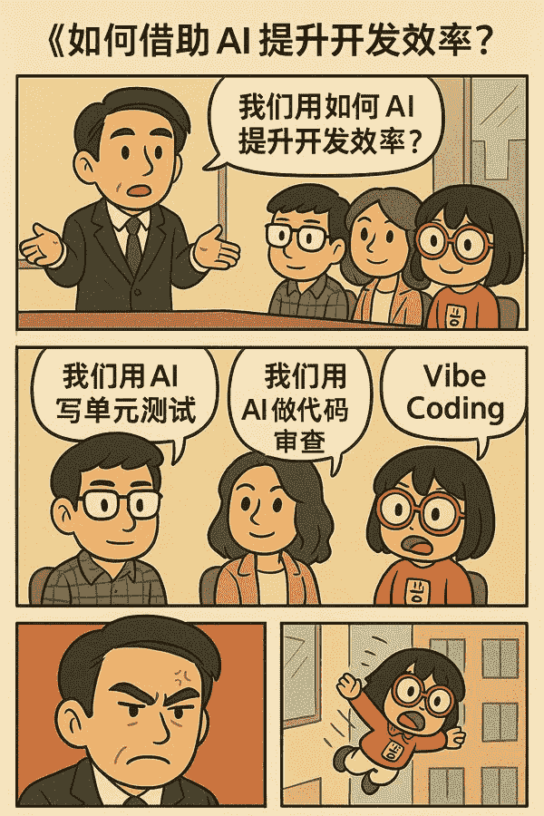

## **怀旧动漫风格电影海报**

**提示词：**

中：

【The Lord of the Rings】的动漫电影海报，这张动漫海报的风格参考了【恶魔高中 DXD（High School DXD）】。

海报上可以清晰看到折叠的痕迹，因为长时间以来被反复折叠，导致在褶皱处出现了物理性的损伤和擦痕，颜色也在部分区域出现了褪色。

由于来回搬动，海报表面散布着无规律的折痕、翻折痕迹和细微划痕，这些微小但不断累积的损耗，正如无法逃避的熵增过程一样，渐渐扩展。

然而，留存在我们心中的美好回忆却始终完整无缺。

当你凝视这张充满怀旧气息的海报时，所能感受到的，正是那些随着岁月积累、变得无比珍贵的点点收藏物所承载的情感本质。

英：

【Harry Potter anime film poster】, 【the anime is in the style of High School DXD】. Visible even folds are seen across the poster as it’s been folded over time, and due to some creases over damaging the poster has caused some physical damage scuffing along the creases and the color has partially faded. Indiscriminate flaps and folds and scratches all around simply from moving back and forth causing subtle yet incremental damage with the ever expanding of entropy we cannot escape, but the loving memories in our hearts will forever be whole. Making the objects we collect along the way priceless is the essence you feel when looking at this nostalgic poster.

**技巧：**括号内可按需修改；部分电影可能会触发版权审核，尝试在提示词最后加上下面这句话【如果背景里有不合适（敏感）的内容，可以进行修改或删除】。; 如果不规范图片比例，默认 1:1。

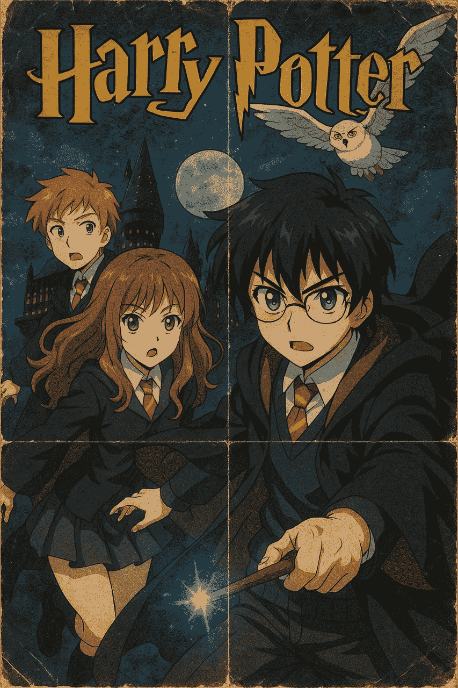

## 钥匙扣

**提示词：**

中：

一张特写照片，画面中一个人手里拿着一个可爱的、色彩鲜艳的钥匙扣。钥匙扣以 【参考图片】的 Q 版形象为主题，采用软橡胶材质，轮廓用粗黑线勾勒，并连接着一个小巧的银色钥匙圈，背景为中性色调。

英：

A close-up photo of a cute, colorful keychain held by person's hand. The keychain features a chibi-style of the 【attached image】. The keychain is made of soft rubber with bold black outlines and attached to a small silver keyring, neutral background

**参考图片：**上传任意一张图片。

**技巧：**如果不规范图片比例，默认 1:1。

**原链接：**https://x.com/azed_ai/status/1916521754413175059

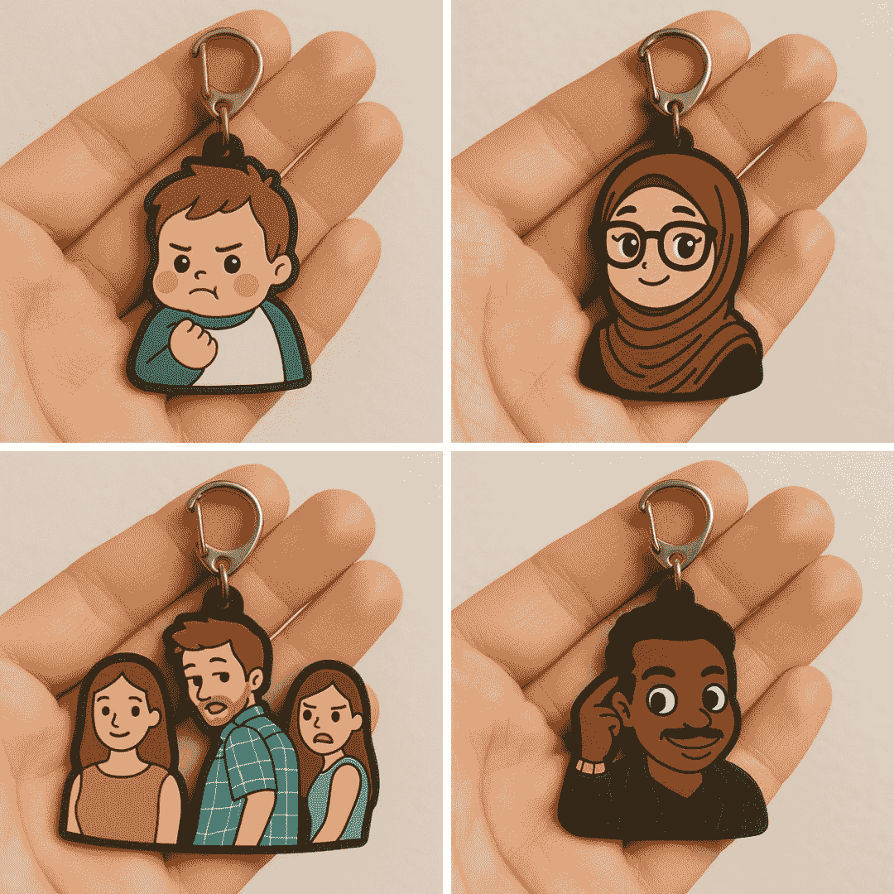

---

# 学习交流社群

1.持续关注并更新 AI 的**相关资讯动态，研究报告，赚钱案**例，常见问题，永久免费在线查看，无收费内容，目标是成为最大的免费 AI 学习社群。

2.已建立社群聊聊 **AI** 发展及应用，**没进群的可以扫码加入，群满可加 AI 研究爱好者大国🛰️ ID：zyg90s（备**注：AI），已经在社群内的无需重复加入，开源知识库及社群学习全部为公开免费分享。

3.**关于文档负责人大国**：高帆文化 CEO，曾就职于教培大厂，目前创业，主攻研究 AI 落地应用、企业流量增长及达人 IP 孵化。

**飞书学习群**

**飞书扫码进群学习**

🛰️好友（ID：zhangyuguo94s）

**扫码加🛰️入🛰️群**

---

**觉得有用欢迎留个赞～**