# MidJourney 学习手册

> 来源：[https://yunyinghui.feishu.cn/docx/A526dMVwWoOGWAxYzfecIGuinWg](https://yunyinghui.feishu.cn/docx/A526dMVwWoOGWAxYzfecIGuinWg)

> **适用人群：****互联网学习 MJ 绘画人群**

> 首发时间：2023 年 5 月 16 日

> 更新时间：2024 年 4 月 4 日

> **内容出品人：**

> **内容出品方：****万象 AI 实验室****×智设**

> **使用建议：**如果需要快速定位到精确内容，可以使用快捷键 Ctrl +F/Command +F 的形式，搜索关键字/词，查找你想要的内容，PC 端查看学习效果更好。

> **特别说明：**飞书手册内容花了大量心思做构思和整理，请勿直接抄袭复制。

> **持续更新 MidJ****ourney 绘画相关资讯动态****，研究报告，赚钱案例**，实用场景等板块内容，永久免费在线查看，欢迎收藏转发支持，文末有惊喜，大国出品，必属精品。

> 🎯全**网最接地气AI知识库：「**[**AI 实验室」知识库（**](https://yunyinghui.feishu.cn/wiki/space/7340161844864598017?ccm_open_type=lark_wiki_spaceLink&open_tab_from=wiki_home)AI绘画、AI写作、AI视频等应用技能）

# 一、基本介绍

## 平台介绍

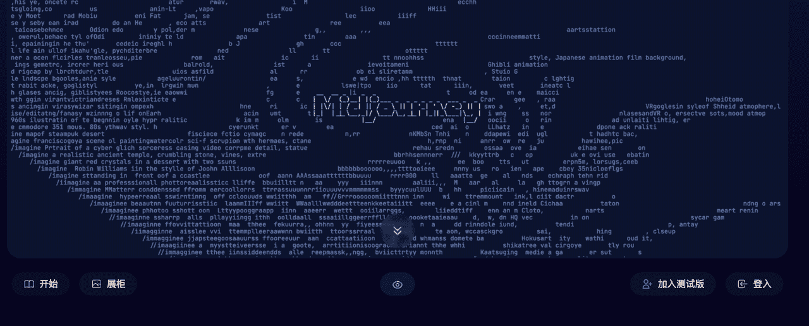

Midjourney 是一个由同名研究实验室开发的人工智能程式，只要输入想到的文字，就能通过人工智能产出相对应的图片，耗时只有大约一分钟，其于 2022 年 7 月 12 日进入公开测试阶段，使用者可透过 Discord 的机器人指令进行操作。该研究实验室由 Leap Motion 的创办人大卫·霍尔兹负责领导，2023 年 4 月，入选《福布斯 2023 年 AI 50 榜单：最有前途的人工智能公司》。

## **官方网站**

**传送门：**https://www.midjourney.com/home

## 版本迭代说明

> 【【V6 Midjourney 更新内容】

1.  独立网站开发 Midjourney 将从 Discord 中独立出来，推出自己的独立网站。并且会在自己的主页上集成用户友好的社交机制。

1.  移动应用程序开发 Midjourney 预计通过移动应用程序来扩大自己的影响力。已知 iOS 用户可以在本机上就获得应用程序，而 Android 用户将通过其他渠道进行下载。对于喜爱浏览网页的用户，Midjourney 网站将针对移动设备的使用网站页面进行优化。

1.  数据中心升级 Midjourney 将更新自己的数据中心，提供更快、更高效的用户体验。可以带来更快的图像生成，对于专业级和 SVIP 用户特别有利。但是由于计算资源有限，可能无法立即供所有用户级别使用。

1.  增加 Turbo 模式 Midjourney 提供了一项名为「Turbo Mode」的功能，目前可供各个级别的用户使用。该模式下的性能比标准模式快四倍。用户可以通过添加命令–turbo 或使用/turbo 激活 Turbo 模式。

> 【V5.1 Midjourney 已经发布】

> 

> 它更具主观性（如 V4），即使使用简短的提示也非常容易使用。此外，还有一个“无主观性”的 RAW 模式选项，供那些喜欢 V5.0 默认风格的人使用。

> 

> 与 V5.0 相比，您可以从 V5.1 中期待以下一些值得注意的增强功能：

> 

> 1、提高了连贯性

> 2、提高了对文本提示的准确性响应

> 3、减少了不需要的边框和文本伪像

> 4、图像质重更加清晰

> 

> 启用 V5.1 非常简单！首先，转到/设置，选择“V5.1”（在第二行），或在提示后输入- v 5.1。

> 

> 要激活 RAW 模式，请在/设置下点击 RAW 模式按钮（在选择 V51 后）或输入-styleraw。

>

### 【MJ 升级到 V5 发布的变化】

> 

> V5 基本型有什么新特点？

> - 风格范围更广，对提示的反应更灵敏

> - 图像质量高得多（分辨率提高 2 倍），动态范围得到改善

> - 图像更细致。细节更有可能是正确的。更少的不需要的文本。

> - 改进了图像提示的性能

> - 支持--tile 参数，用于无缝拼接（实验性的）。

> - 支持--ar 长宽比大于 2：1（试验性）。

> - 支持--iw，以权衡图像提示与文本提示的关系

> V5 的风格和提示

> - 今天的测试基本上是该模型的 "专业 "模式。

> - 它比 V3 和 V4 更 "无主见"，并被调整为提供多种多样的输出，对你的输入反应非常灵敏。

> - 这里的权衡是，它可能更难使用。短的提示语可能不那么好用。你应该尝试写更长、更明确的文字，说明你想要什么（即："具有戏剧性灯光的电影照片"）。

> - 请在提示聊天室里互相交流，以了解如何使用 v5。

> - 我们希望在将 v5 切换为默认样式之前，能有一个 "友好 "的默认样式。当这种情况发生时，我们仍然会让你把它关掉，回到像今天这种'原始'模式。

> 请注意：

> - 这是一个 alpha 测试，事情会发生变化。不要依赖这个确切的模式在未来可用。当我们把 V5 推向全面发布时，它将被大幅修改。

> - 现在还没有 V5 的升频器，V5 的默认分辨率与升频后的 V4 相同。如果你点击升尺度，它就会立即给你那张图片本身。

## 常见用途及使用场景

**主要用途：**可用于壁纸、插画、漫画、平面设计、logo、APP 图标、游戏 UI、建筑/室内、 服装设计/摄影、平面包装等的灵感创作。

**适合人群：****设计师 插画师** 美术指导 创意总监 自媒体人 创意行业 视觉行业 一切内容创作者 AI 爱好者 行业投资人

可以延伸职业：AI 图像生成师/ AI 视觉创意指导 /AI 艺术家

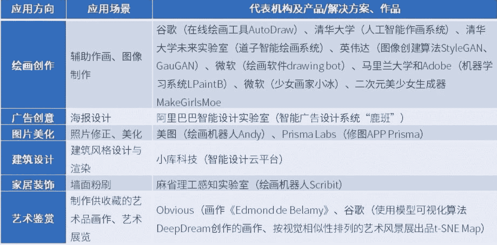

## 玩好 Midjourney 需要具备的能力

> **英语：**Midjourney 是纯英文操作，输入英文关键词进行 AI 绘图，需要你至少英语 4 级水平，能看懂基本的英语指令，输入英语关键词，进行 AI 绘画创作。

> **知识管理：** 关键词决定了你输图的质量，需要你具备知识管理能力，建立积累关键词资源库的能力，比如用印象笔记，EXCEL 表格 等工具建立自己的专属图库。

> **艺术鉴赏：** 你至少应该懂得基本的绘画风格，摄影参数， 光影效果，3D 技术，超现实主义，波普艺术，立体主义，达达主义，未来主义，现实主义，极简主义，抽象派，新艺术，超现实主义，表现主义，构成主义 各种等各种艺术风格流派

> **修图能力：****在 AI **绘画的基础上能修图改图，二次创作创新。青出于蓝而胜于蓝。

> 搜索能力：能够熟练使用 google wiki chatgtp 搜索，谷歌翻译等 创建关键词词库。

> **逻辑思维：**兵器是身体的延伸，AI 是思维的衍生，需要你具备逻辑树形思维创建图像

> **创意思维：**需要你脑洞打开，无远弗届，创意--创造--创世。

## MJ 中国市场

MJ 官方目前在和腾讯官方合作，MJ 官方 QQ 频道，QQ 扫码可以加，如果过期，可以自行去 QQ 频道搜索加入，目前已经满人了，何时开放等通知。

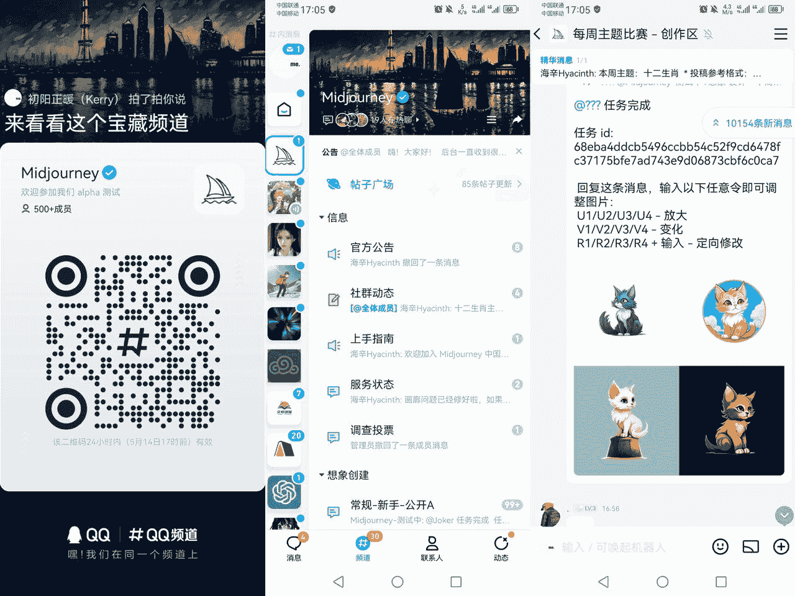

**传送门：**

MJCN 新手指南 · 快速上手

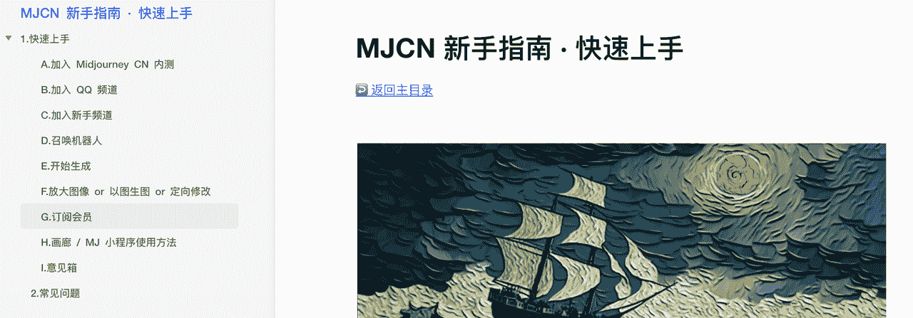

## 常见问题答疑

### Q1：Midjourney 国内能用吗？

A：Midjourney 官网国内是可以打开注册的，但是使用不是在官网，而是在 discord 频道，这个就需要魔法上网。

### Q2：Midjourney 免费版怎么用？怎么无限免费试用？

A：3 月底官方已经关闭了免费试用，以前新用户可以免费试画 25 张图，后面因为薅羊毛的太多，就关闭了。现在必须付费才能开始使用，当然官方不定期也会开放免费体验的活动。

# 二、注册方法

> 现在可以直接打开官网使用，以下方法是最早期的，已经不需要了，记得科学上网！

## 注册 Discord

这里首先要知道 Discord，这是一款专为社群设计的免费通讯社交软体，类似于 LINE 或 Slack，但功能更为强大，自带机器人与各种程式功能，能够在上面发开自己工具，有网页版与手机版 APP。由于 Midjourney 现在依托 discord 来完成图片生成功能，discord 就相当于微信，而 Midjourney 可以理解为微信小程序，所以我们可以把 Midjourney 看成是 discord 上的一个小程序。

+   第一步：下载 Discord，https://discord.com/ ，打开网址注册，或者下载 windonss/MAC 版本 Discord。

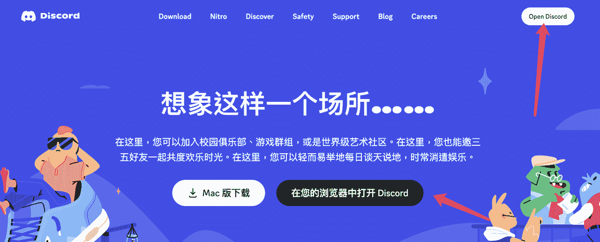

+   第二步：注册 Discord，下载安装之后，打开，选择注册账号，填写你的邮箱和密码这些资料，邮箱注册之后还要验证，我们点击左边的 +1 去选择号码，搜索中国，然后输入我们的号码进行验证，手机验证通过之后，还有一个邮箱要验证。

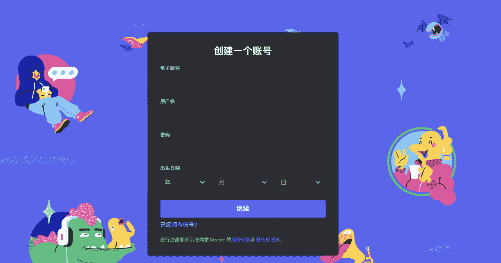

+   第三步：打开我们的邮箱，里面会有一封 Discord 的邮件，我们进行验证一下就完成注册了，创建完账号之后，需要验证邮箱和手机号，按提示操作就行了。

**附：**

[**Discord 新手指南**](https://support.discord.com/hc/zh-tw/articles/360045138571)

手机版 Discord 新手指南

## 注册 Midjourney

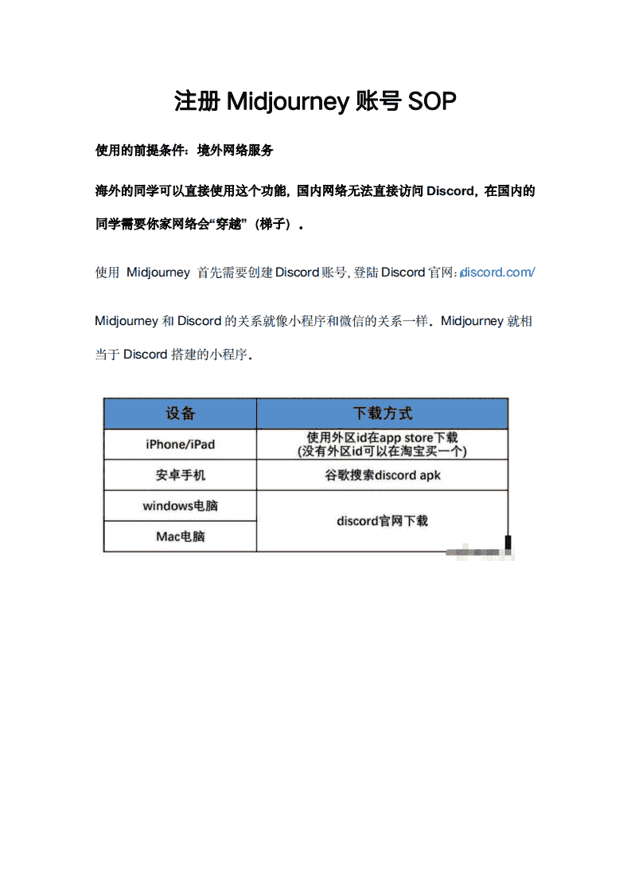

[注册Midjourney账号SOP.pdf](https://internal-api-drive-stream.feishu.cn/space/api/box/stream/download/all/GQxVbOXero5hg2x4R7FcAtNunOc)

## 创建自己的服务器

因为出图时间有快有慢，你的出图信息可能会被别人刷下去，这时要么就慢慢往上滑去找，要么右上角搜索自己的 ID 找图。

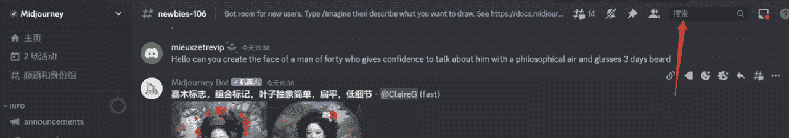

所以我更推荐大家创建自己的服务器，首先点击最左边的“+”，再点击“亲自创建”一点击“仅供我和我的朋友们使用”一一点击“创建”。

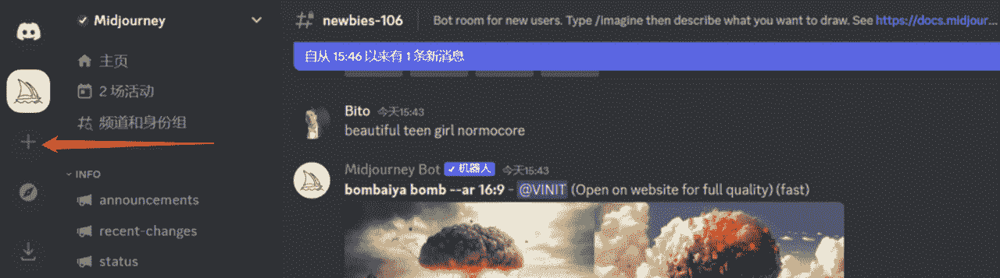

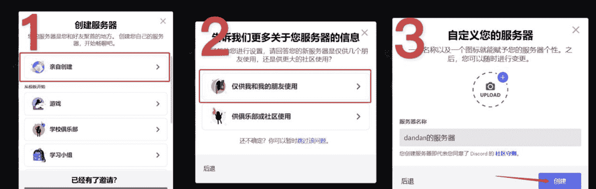

创建好服务器后，回到 Midjourney 本身的服务器，随便进入一个 newbies 频道，点击 Midjourney 机器人头像，邀请它进你的频道。

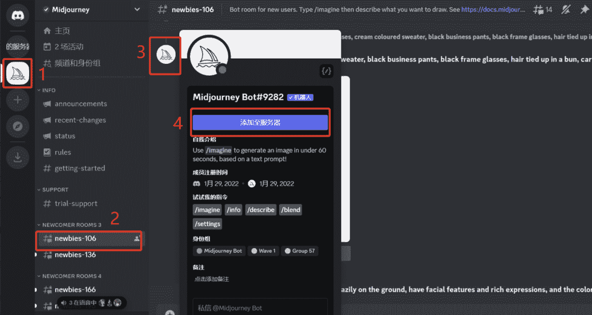

选择自己的服务器，点击“继续”，然后点击“授权”

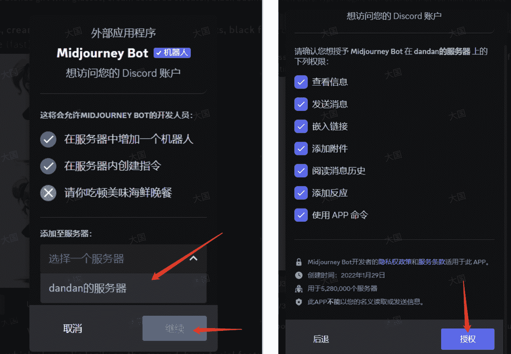

现在回到你的频道你就看到机器人加进来了，你就可以在你的频道里用 Midjourney，不用担心被刷屏了。

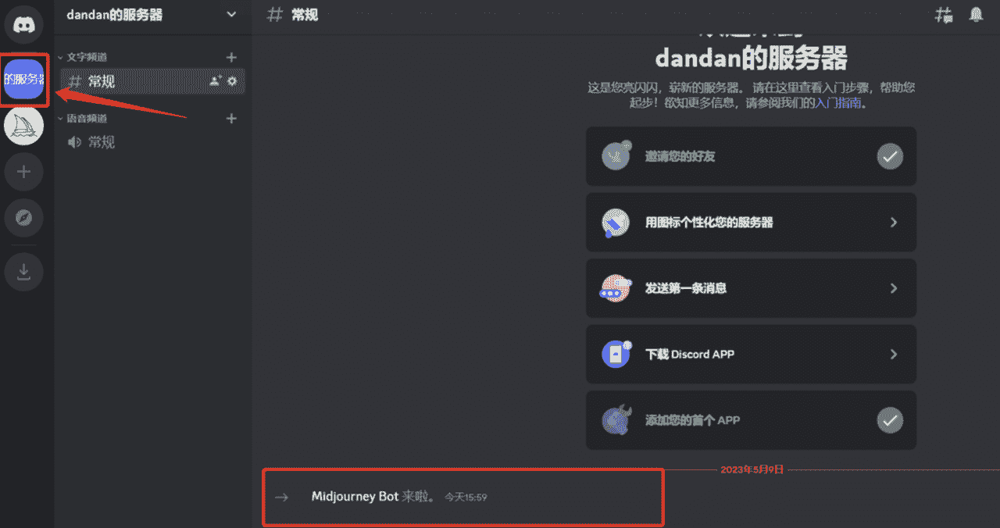

需要特别说明的是，这并不意味着你生成的图片别人不能看到，只是方便你不用在公屏上寻找而已，别人在 Midjourney 上依然是可以看到你生成的图片的，如果你想要隐私生成，需要充值会员。

## 视频版注册教程

这个 Midjourney 注册教程，我奶奶看完都会了！

## 开会员教程

1）系统提示不能白嫖了，那就点击”Open subscription page“按钮充点钱吧：

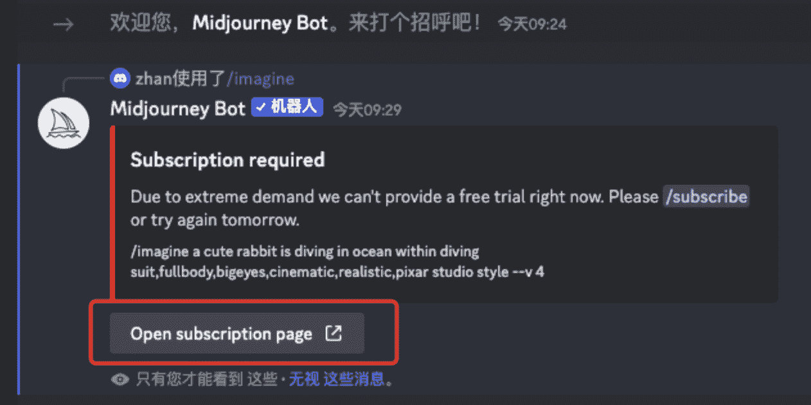

2）点击按钮后会跳到 Midjourney 的官网，我们点击右下角的”Sign in“登录：

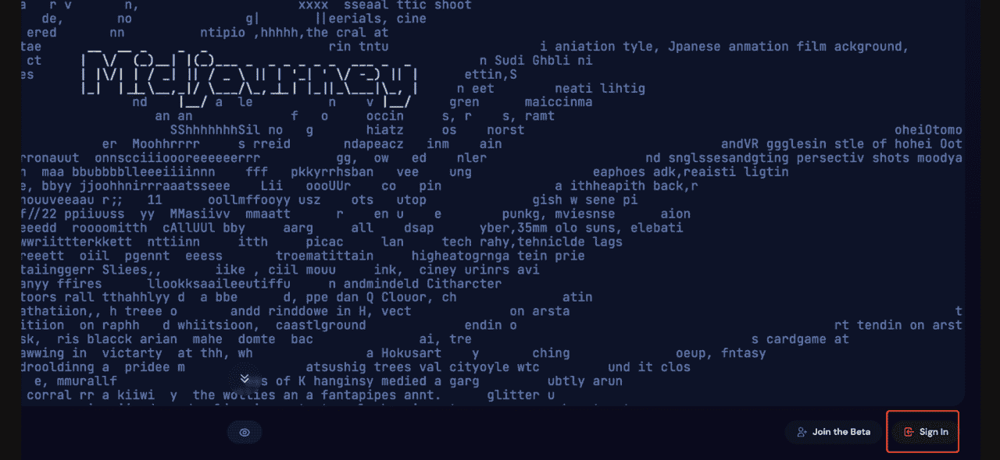

3）然后点击授权：

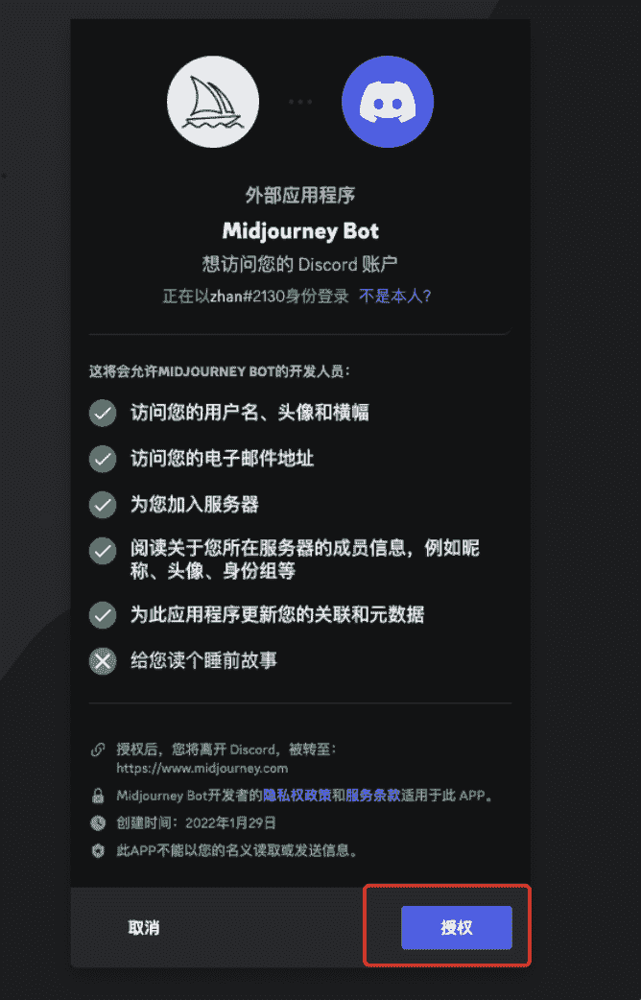

4）进入新页面之后点击底部的”View plans“按钮：

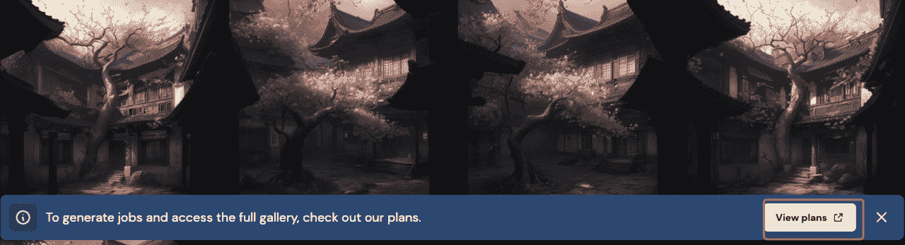

5）进入付款页面：

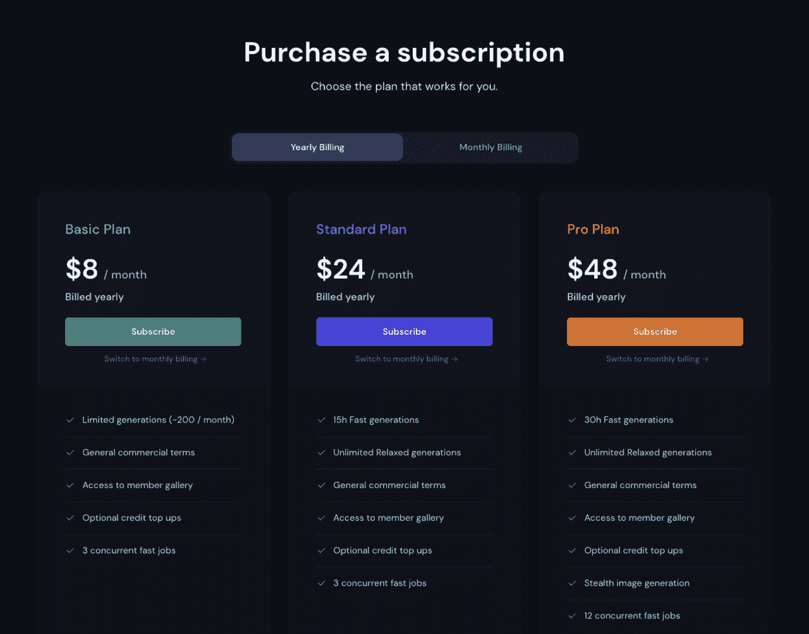

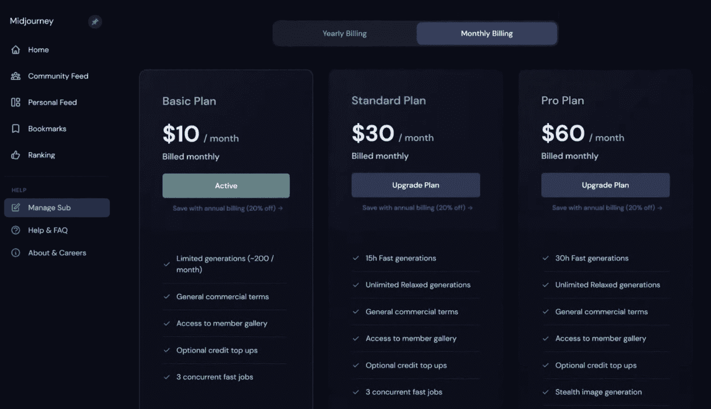

这里有三档：**基本、标准和高级**，每一档可以包年也可以包月，这里建议先选择包月的体验一下。

6）然后就是填信用卡信息付款了，国内的信用卡也可以用，按照提示付款就行了：

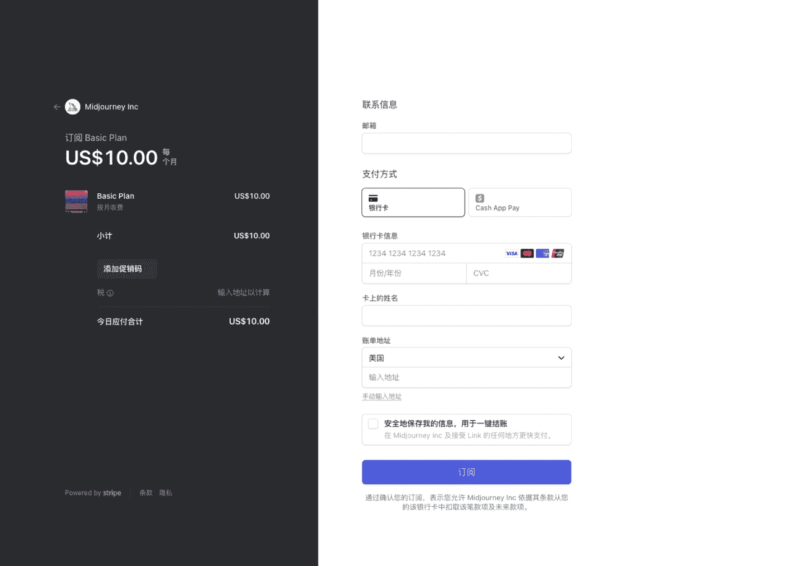

7）付完款后，显示这个页面就是成功了！

8）回到 discord 页面，在底部输入”/imagine“，然后输入提示符，终于可以画图了！

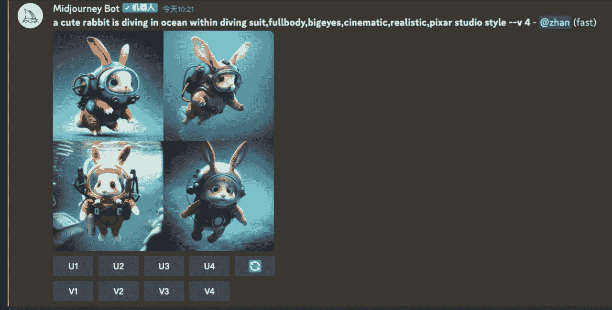

## 常见问题答疑

### Q1：Midjourney 生成图片是免费的吗？

A：一开始新用户有 25 次的免费使用额度，超过的需要开会员，后续注册用户增多已经取消免费体验。会员分 10 美刀和 30 美刀两种方式。

10 美刀：每月可以生成 200 张图片，适合轻度使用者。

30 美刀：每月生成的图片无限制，每月 15 小时的 fast 使用时长。

### Q2：fast 模式和 relax 模式有何区别？

A：在输入框输入/fast 或者/relax 即可切换模式，默认是快模式。

fast 模式：无需排队，一发送描述语到公屏上，立马生成。

relax 模式：需要在服务器排队，有时快有时慢，排队完成自动生成。

### Q3：Midjourney 有什么变现的方法？

A：条条大路通罗马，一个新生的行业，一般都是红利的开始，做壁纸下载广告收益、引流私域或者收徒都是不错的选择，我会另外写篇文章专门讲这个事，敬请关注。

### Q4：Midjourney 怎么充值会员？

A：Midjourney 目前只支持 VISA 信用卡，具体教程参考本飞书文档的会员开通教程，没有这些信用卡的小伙伴也无需担心，可以找淘宝。

### Q5：如何关闭 MJ 的自动续费？

A：见下图流程：

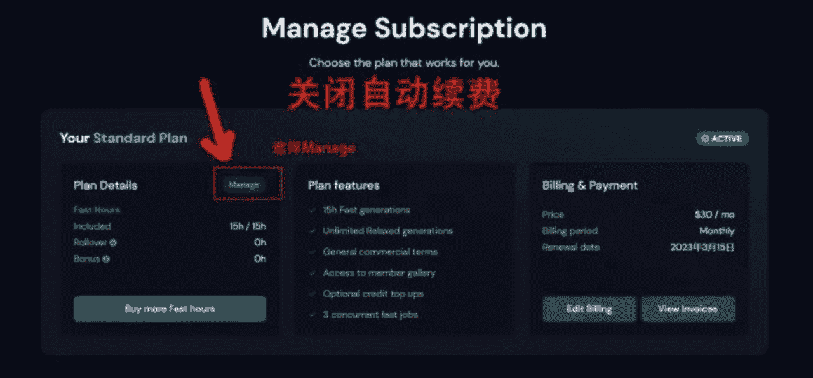

充值完成后在频道内发送/info 可查询会员到期日和余量，如果决定长期玩，可以以年为单位，八折购置 PRO 套餐，pro 带有隐私功能，且有双倍的 FAST 时间。

### Q6：Midjourney 官网苹果版和安卓版下载地址是？

A：idjourney 在网页上使用就好，不需要安装任何软件，所以苹果/windows/安卓所有系统直接用浏览器即可。

### Q7：Midjourney 中文版下载地址是？

A：Midjourney 默认是英文界面，如果希望界面是中文版，可以安装一个谷歌翻译插件，右键选择翻译成中文即可。或者下载 Discord 中文版本。

# 三、操作教程

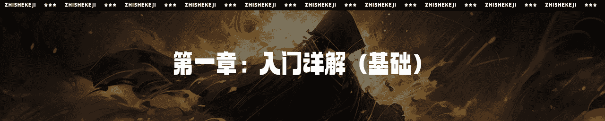

## 第一章：入门详解（基础）

### 出图操作流程

#### **关键词生成图片**

回到我们的服务器，然后在下面的输入框输入“/”，它会弹出一系列的命令（如果没弹窗，退出重新登录即可），我们先点击“/imagine”（这个参数我后面再做详细解释），然后会出现如下画面：

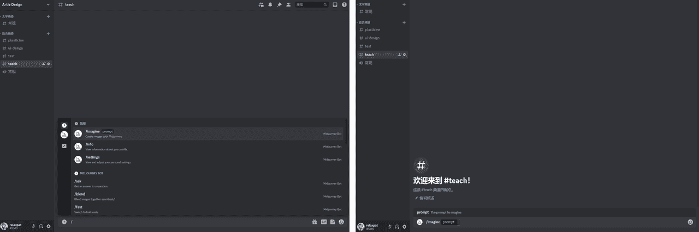

输入一组关键词，切记：一组关键词的后面需要加上英文的逗号“，”然后按空格键，空一格就行，看我下面这组关键词：

An mascot robot, smiling, modern robot, round robot, cartoon, flying, fist up, crypto coins background

（吉祥物机器人，微笑，现代机器人，圆形机器人，卡通，飞行，拳头，加密币背景）

然后我们接着上一步，在对话框内输入这组关键词，我建议大家不要直接复制，先用键盘敲，体验下这个操作。

点击回车发送，然后它会让我们进行授权，我们点击“Accept tos”授权就行了。

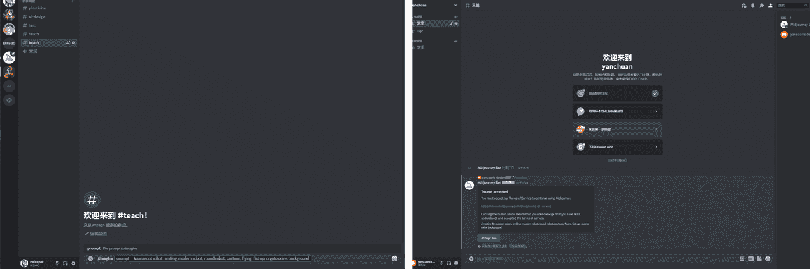

然后等待机器人的出图，在发送的关键词后面可以看到图片生成的进度，等一会就会出来图片了：

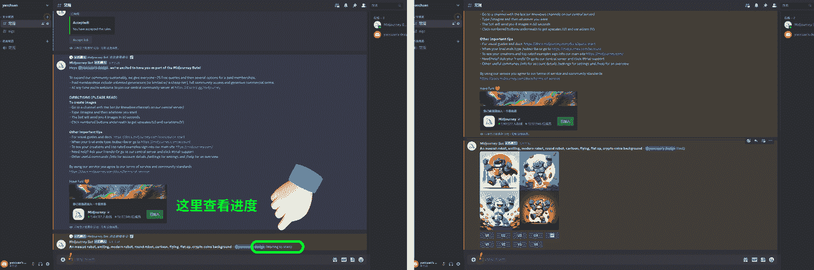

#### **图片指令及导出图片**

生成完成后，会出现两排按钮

U 的意思放大图片，U1/U2/U3/U4 分别指的是放大四张图片中的某一张

V 的意思采用图片的构图形式，重新生成一组类似的图片，V1/V2/V3/V4 的顺序与 U 的顺序一样，如图

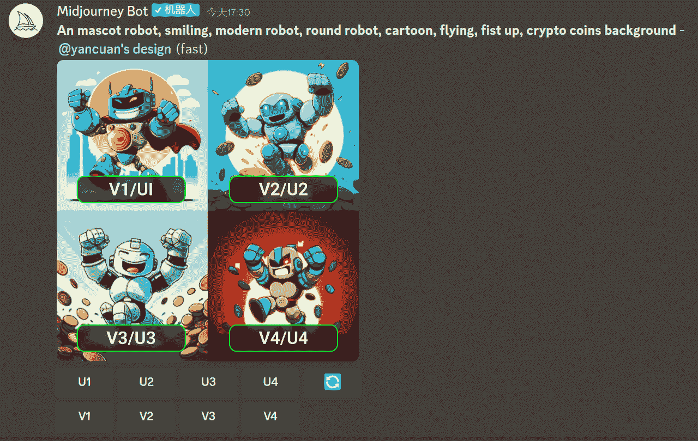

举个栗子，比如我想要导出第一张图片，那么我们点击 U1 就好了（等待机器出图）：

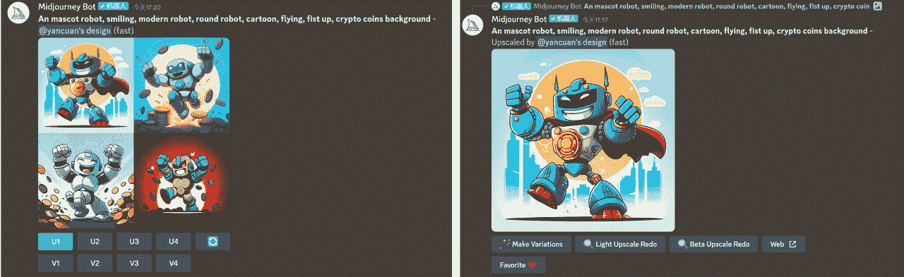

然后咱们点击图片，点击在浏览器中打开，然后保存图片，这张图片就被下载了（一定要用浏览器打开再保存图片，不然图片的尺寸会很小，会模糊的）

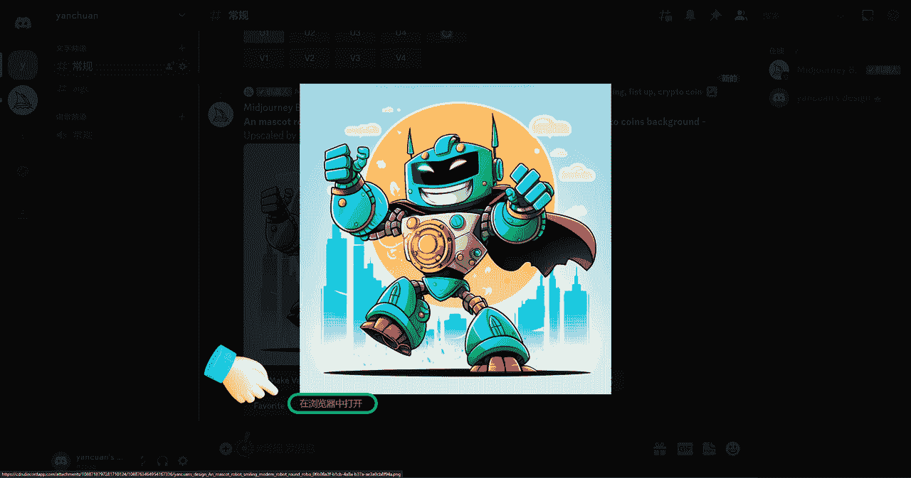

换个栗子，我觉得第一张图片还行，构图风格还不错，就是差点细节，想要再优化下，那我们就点击 V1，接下来的操作就与上面一样啦，是不是很简单。

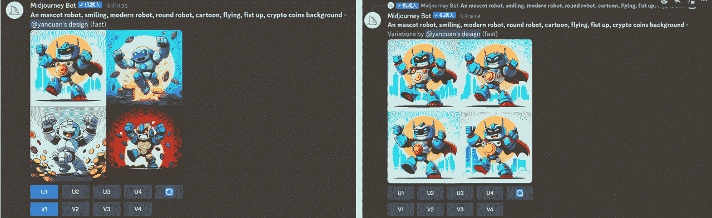

一般情况下，我们可以把同一组关键词多生成几组图片，这里可以点击“重复”按钮，然后你就会看见多条生成图片的消息，等待机器人作图，然后找到你喜欢的几张图片进行挑选即可。

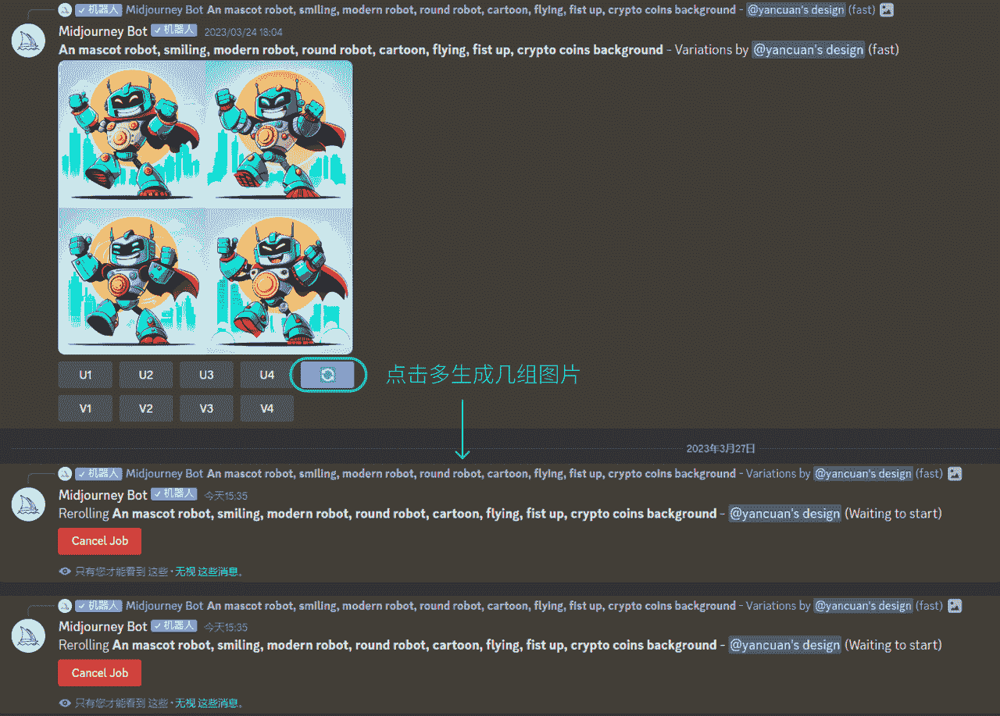

#### Midjourney 的尺寸和分辨率

所有尺寸均为正方形 1:1 的长宽比。

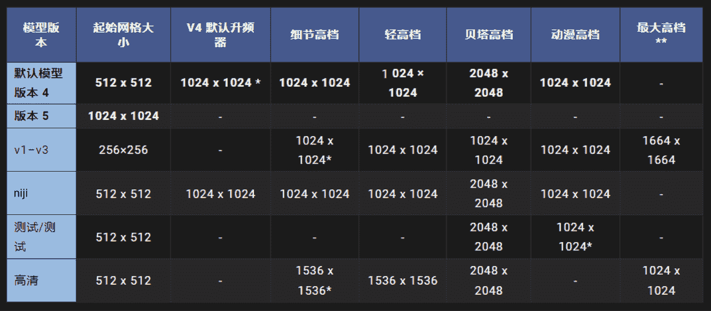

每个 Midjourney 版本模型的默认升频器。

#### 使用高档重做按钮

升级图像（U1、U2、U3、U4）后，你会在图像下方看到一行按钮，可让您使用不同的升级器模型重新进行升级。

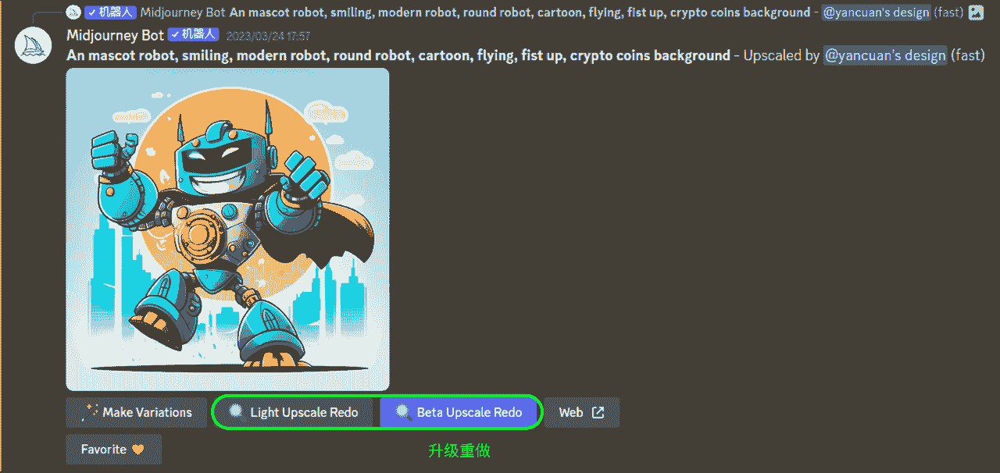

点击重做，Midjourney 会在原图的基础上优化和调整细节，有些情况重做的效果不如原效果，根据情况调整。

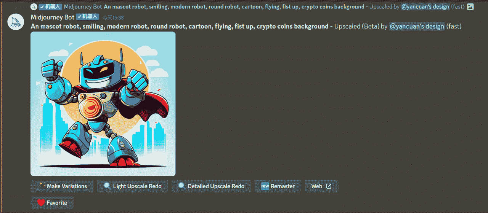

#### 命令后缀 settings 详解

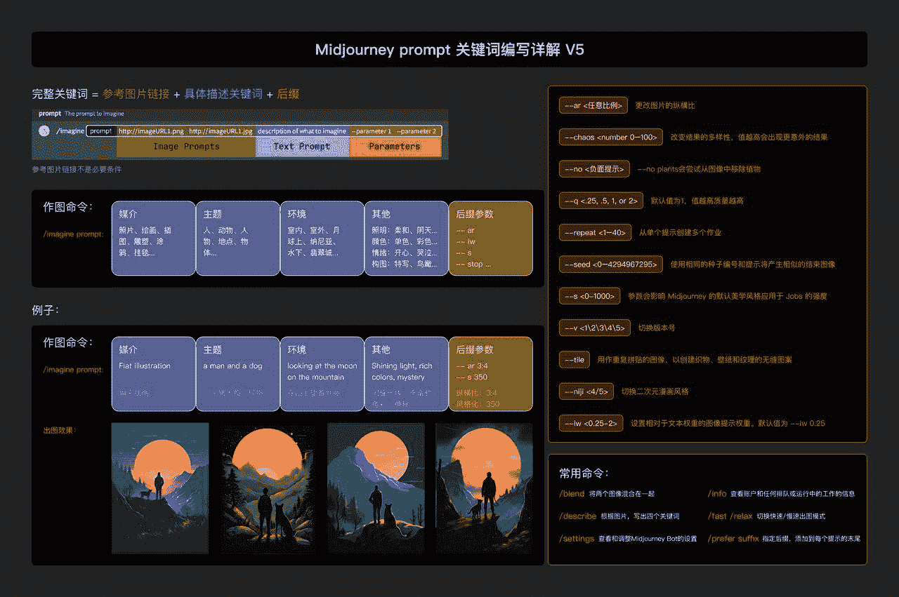

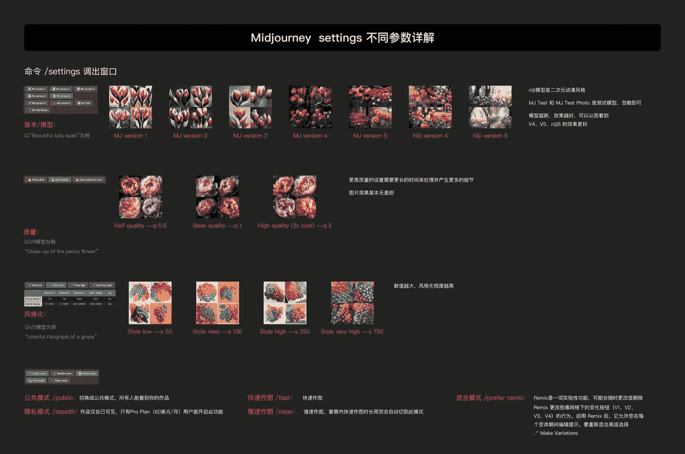

---

## 第二章：参数详解（基础）

### Imagine 关键词后缀参数

参数是添加到提示中的选项，可更改图像的生成方式。参数可以更改图像的纵横比、在 Midjourney 模型版本之间切换、更改使用的 Upscaler 等等。

参数总是添加到提示的末尾。您可以向每个提示添加多个参数。

#### 基本参数

---

+   **纵横比（a****spect ratios**）--aspect，或--ar调整图片的比例；

+   **混乱（chaos）**--chaos <number 0–100>改变结果的多样性。较高的值会产生更多不寻常和意外的世代；

+   **负面提示（no）****--no**负面提示，在提示词末尾加上 --no 可以让画面中不出现某些内容；

+   **生成质量（quality）**--quality <.25, .5, 1, or 2>，或--q <.25, .5, 1, or 2>您要花费多少渲染质量时间。默认值为 1。值越高渲染时间越高，值越渲染时间越低。

+   **种子（seed）****--seed <integer b**etween 0–4294967295>用过 Midjourney 的同学会发现在发送提示词后，MJ 最开始的图像里会有一个非常模糊的噪点团 ，然后逐渐变得具体清晰，而这个噪点团的起点就是“Seed” 种子编号是为每个图像随机生成的，但可以使用 --seed 或 --sameseed 参数指定。使用相同的种子编号和提示将产生相似的结束图像。

+   **停止（stop）**--**stop <**integer between 10–100>使用--stop参数在流程中途完成作业。以较早的百分比停止作业会产生更模糊、更不详细的结果。

+   **平铺（tile）**--tile参数生成可用作重复拼贴的图像，以创建织物、壁纸和纹理的无缝图案；

+   **版本（version）**用--version或--v参数或使用/settings命令并选择型号版本来使用其他型号。不同的模型擅长处理不同类型的图像。

+   **风格（style）**--style <4a, 4b or 4c>在 Midjourney 模型版本 4 的版本之间切换

+   **程序化（stylize）**--**stylize <num**ber>，或--s <number> 参数会影响 Midjourney 的默认美学风格应用于 Jobs 的强度。

+   **聚光灯（uplight）****--uplight**选择 U 按钮时使用替代的“轻型”升频器。结果更接近原始网格图像。放大后的图像细节更少，更平滑。

+   **乌贝塔（upbeta）****--upbeta**选择 U 按钮时使用替代的 beta 升频器。结果更接近原始网格图像。放大后的图像添加的细节明显更少。

**默认值（模型版本 4）**

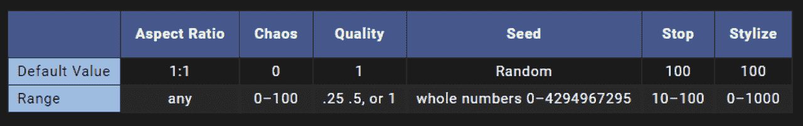

**默认值（模型版本 5）**

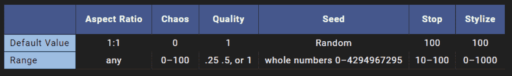

（大于 2:1 的宽高比是实验性的，可能会产生不可预测的结果）

#### 模型版本参数

---

+   **--niji**另一种模型专注于动漫风格的图像；

+   **--hd**使用早期的替代模型来生成更大、更不一致的图像。该算法可能适用于抽象和风景图像；

+   **--test**使用 Midjourney 特殊测试模型；

+   **--testp**使用 Midjourney 特殊的以摄影为重点的测试模型；

+   --version <1, 2, 3, 4, or 5>或者--v <1, 2, 3, 4, or 5> 使用不同版本的 Midjourney 算法。当前算法 （V4） 是默认设置。

#### 其他参数

+   **--creative**修改**test**和**testp**模型更加多样化和创造性；

+   **--iw**设置相对于文本权重的图像提示权重。默认值为 --iw 0.25；

+   **--sameseed**种子值创建一个大的随机噪声场，应用于初始网格中的所有图像。当指定 --sameseed 时，初始网格中的所有图像都使用相同的起始噪声，并将生成非常相似的生成图像；

+   **--video**保**存正在生成的初**始图像网格的进度视频。表情符号使用 ☉️ 对完成的图像网格做出反应，以触发将视频发送到您的直接消息。--video放大图像时不起作用。

#### 模型版本和参数兼容性

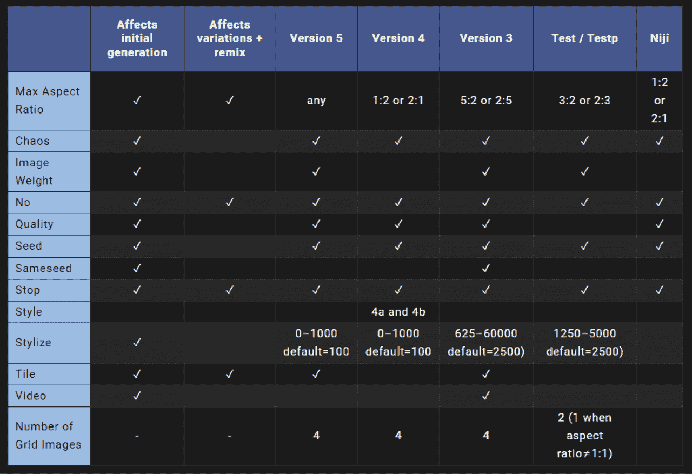

### 常用后缀参数详解

---

#### Aspect Ratios（纵横比）

--aspect参数--ar更改生成图像的纵横比。宽高比是图像的宽高比。它通常表示为用冒号分隔的两个数字，例如 7:4 或 4:3。

正方形图像具有相等的宽度和高度，描述为 1:1 的纵横比。图片可以是 1000px × 1000px，或者 1500px × 1500px，纵横比仍然是 1:1。计算机屏幕的比例可能为 16:10。宽度是高度的 1.6 倍。所以图像可以是 1600px × 1000px、4000px × 2000px、320px x 200px 等。

> **默认纵横比为 1**:1。

> --aspect必须使用整数。使用 139:100 而不是 1.39：1。

> 纵横比影响生成图像的形状和组成。

> 放大时，某些宽高比可能会略有变化。

**最大纵横比**

不同的 Midjourney 版本模型具有不同的最大纵横比。

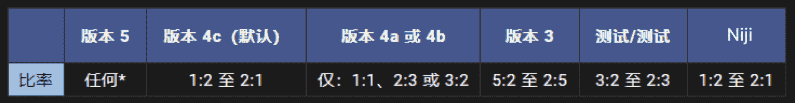

该**--ar**参**数将接受从 1:1**（正方形）到每个模型的**最大纵**横比的任何纵横比。但是，在图像生成或放大过程中，最终输出可能会略有修改。示例：提示使用--ar 16:9（1.78） 创建具有7:4（1.75） 纵横比的图像。

大于 2:1 的宽高比是实验性的，可能会产生不可预测的结果。

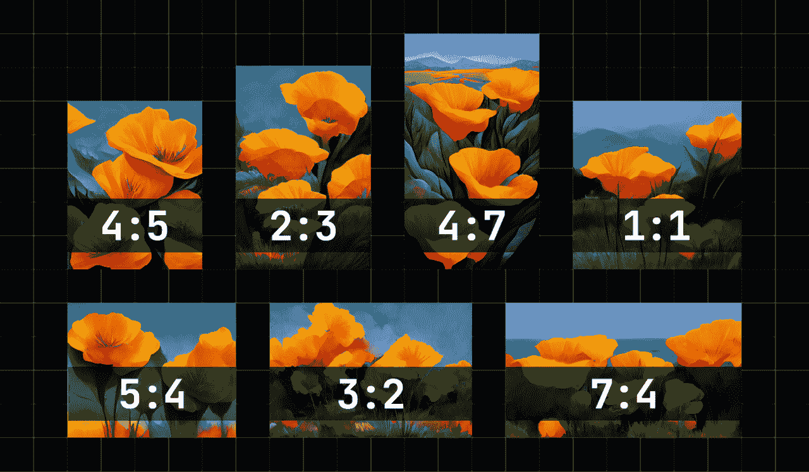

提示示例：**imagine/ prompt** vibrant california poppies --ar 5:4

**常见的纵横比**

**--aspect 1:1****默认纵横比。

--asp****ect 5:4常见的框架****和打印比例。

--asp**ect 3:2印刷摄影中常见。

--aspect 7:4靠近高清电视屏幕和智能手机屏幕。

**如何更改纵横比**

添加--aspect <value>:<value>， 或--ar <value>:<value>到提示的末尾。

#### **Chaos（混乱）**

参数影响初始图像网格--chaos的--c变化程度。高--chaos值将产生更多不寻常和意想不到的结果和组合。较低的--chaos值具有更可靠、可重复的结果。

> **--chaos**范围**值 0–100**。

> 默认--chaos值为 0。

**chaos 的生成的效果**

低值**--chaos**

使用较低的 **--chaos**值或不指定值将生成每次运行作业时略有不同的初始图像网格。

提示示例：**imagine/ prompt** watermelon owl hybrid

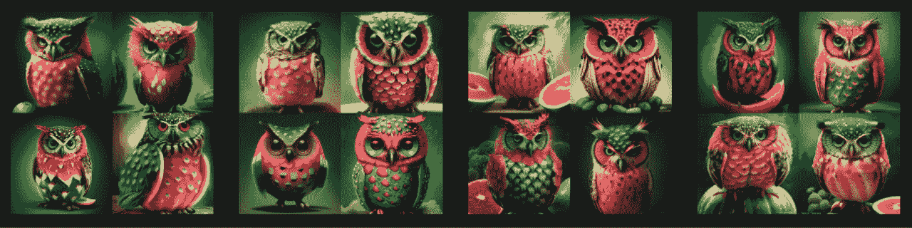

高值**--chaos**

**--chaos**每次运行作业时，使用较高的值将产生更多变化和意外的初始图像网格。

提示示例：**imagine/ prompt** watermelon owl hybrid --c 50

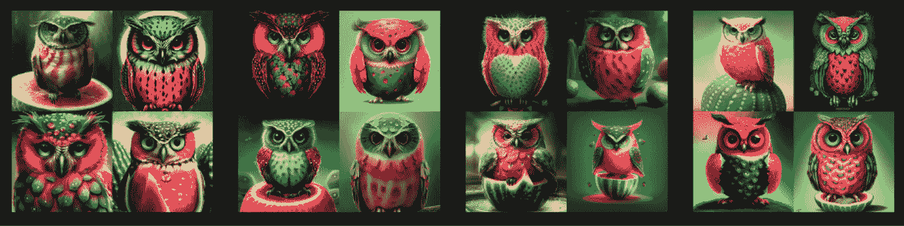

非常高的值**--chaos**

**--chaos**每次运行作业时，使用极高的值将产生不同的初始图像网格，并且具有意想不到的构图或艺术媒介。

提示示例：**imagine/ prompt** watermelon owl hybrid --c 100

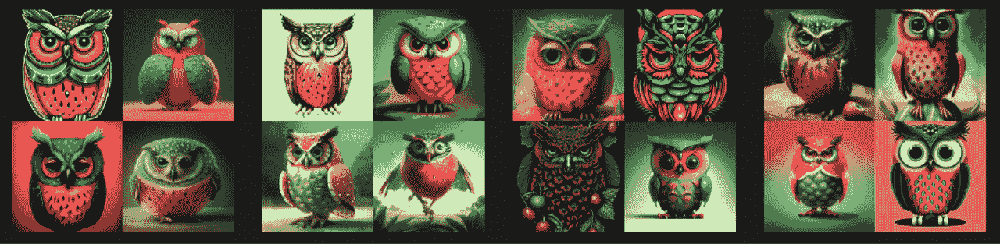

**如何改变 Chaos 值**

添加**--chaos <value>**或**--c <value>**到提示的末尾。

#### **Quality（质量）**

参数更改生成图像所花费--quality的--q时间。更高质量的设置需要更长的时间来处理并产生更多的细节。更高的值还意味着每个作业使用更多的 GPU 分钟数。质量设置不影响分辨率。

> 默认**--quality****值为 1。较高的值****会使用更多订阅的 ****GPU 时间。

> -**-quality接受以下值：默认模型的 。25、.5 和 1。较大的值将向下舍入为 1。

> --quality仅影响初始图像生成。

> --quality适用于模型版本 1、2、3、4、5 和 niji。

**质量设置**

更高的**--quality**设置并不总是更好。有时较低的**--quality****设置可以产生更好的****结果——这取决于您**尝试创建的图像。较低的--quality设置可能最适合手势抽象外观。较高的--quality值可以改善受益于许多细节的建筑图像的外观。选择与您希望创建的图像类型最匹配的设置。

提示示例：**/imagine prompt** woodcut birch forest --q .25

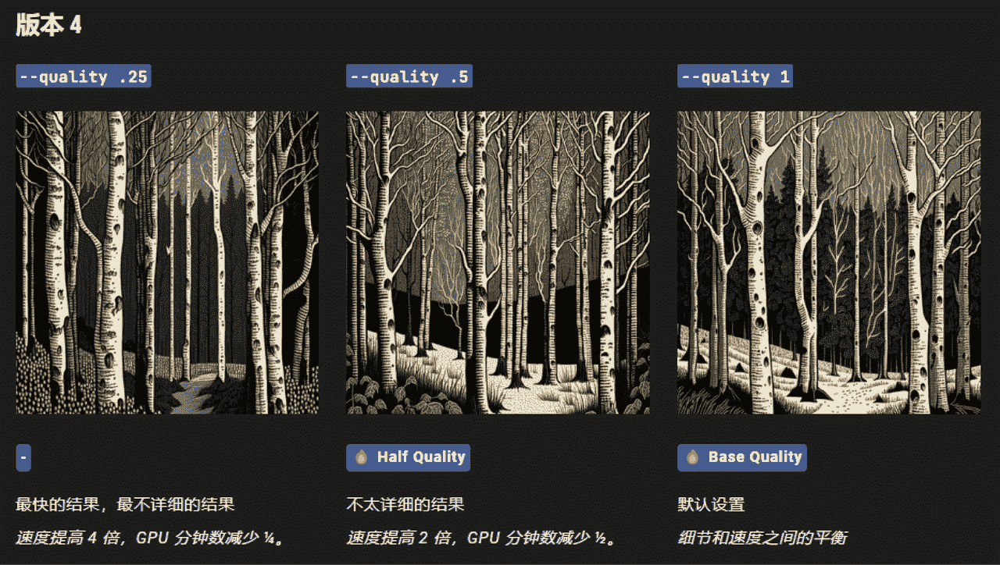

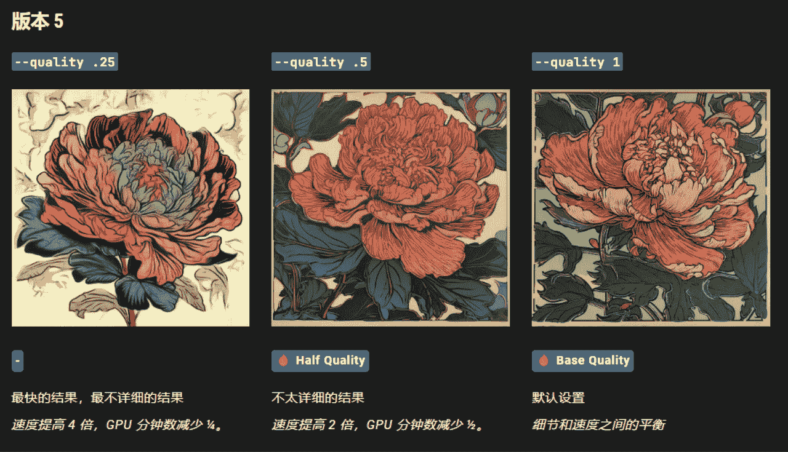

**版本质量兼容性**

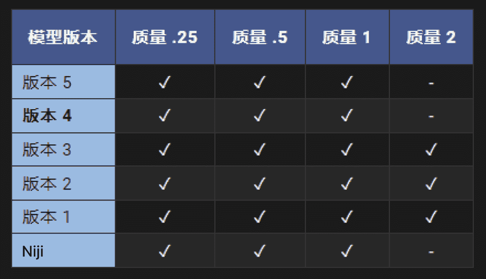

**使用****--quality****或****--q****参数**

添加-**-quality <v**alue>或--q <value>到提示的末尾。

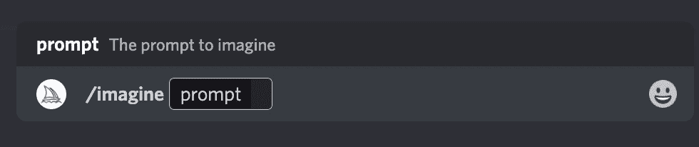

**使用设置命令**

从菜单中**/settings**选择您的首选值。**quality**

#### **Seed（种子）**

用过 Midjourney 的同学会发现在发送提示词后，MJ 最开始的图像里会有一个非常模糊的噪点团 ，然后逐渐变得具体清晰，而这个噪点团的起点就是“Seed” 种子编号是为每个图像随机生成的，但可以使用 --seed 或 --sameseed 参数指定。使用相同的种子编号和提示将产生相似的结束图像。

> **--seed**** 接受整数 ****0–4294**967295**。**

> **-**-**s**e**ed值仅**影**响初始图像**网格。

> -**-seed值**模型版本 1、2、3、test和testp是不确定的，将产生相似但不相同的图像。在模型版本

> 中使用相同的提示+种子+参数 ，将产生相同的图像。 45niji

**seed 参数**

如果未指定种子，Midjourney 将使用随机生成的种子编号，每次使用提示时都会生成多种选项。

**使用随机种子运行 3 次**

提示示例：**/imagine prompt** celadon owl pitcher

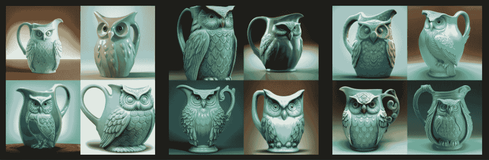

**使用指定种子运行 3 次**

提示示例：**/imagine prompt** celadon owl pitcher --seed 123

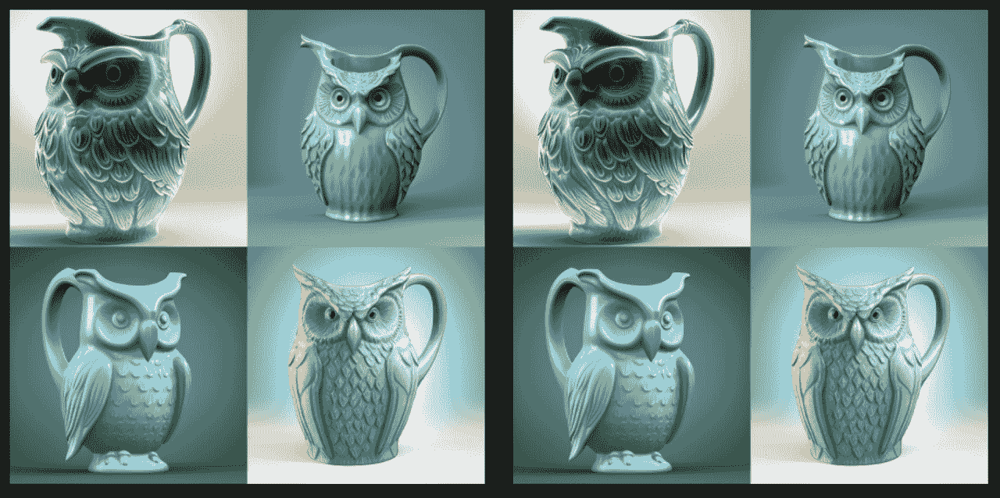

**同数值参数**

**--seed****值创建一个大的随机噪**声场，应用于初始网格中的所有图像。指定时--sameseed，初始网格中的所有图像都使用相同的起始噪声，并将生成非常相似的生成图像。

**如何查找工作的种子编号**

使用 Discord 表情符号反应，通过对工作使用 ☉️ 信封表情符号做出反应，在不和谐中找到工作的种子编号。

**如何更改种子编号**

使用 **--seed**或**--sameseed**参数，添加**--seed <value>**或--sameseed <value>到提示的末尾。

#### Shop（停止）

使用--stop参数在流程中途完成作业。以较早的百分比停止作业会产生更模糊、更不详细的结果。

> **--stop**接受**值：10–1****00。

> 默认**--stop值为 100。

> --stop时不起作用。

**不同 Shop 的对比**

**shop 和 ****Beta Upscale**

放大时，该**--stop**参数不会影响作业。但是，停止会产生更柔和、细节更少的初始图像，这将影响最终放大结果的细节水平。下面的放大图像使用了 Beta Upscaler。

**使用****--stop****参数**

添加**--stop <value>**到提示的末尾。

#### Stylize（程序化）

Midjourney Bot 经过训练可以生成有利于艺术色彩、构图和形式的图像。或参数影响该训练应用--stylize的--s强度。低程式化值生成的图像与提示非常匹配，但艺术性较差。高程式化值创建的图像非常具有艺术性，但与提示的联系较少。

> **--stylize**的默认值为 100，并且在使用默认 [V4 模型] 时接受 0-1000 的整数值。

不同的 Midjourney 版本模型具有不同的风格化范围。

**通用风格化设置**

V4 模型

提示示例：**/imagine prompt** illustrated figs --s 100

V5 模型

提示示例：**/imagine prompt** colorful risograph of a fig --s 100

**使用 stylize 参数**

添加-**-stylize <v**alue>或--s <value>到提示的末尾。

**使用设置命令**

**/settings**从菜单中键入并选择您喜欢的风格化值。

#### Tile（平铺）

--tile参数生成可用作重复拼贴的图像，以创建织物、壁纸和纹理的无缝图案。

> **--tile**适用于模型** 版本 1、**2、3、5

> --tile只生成一个 tile。使用像这种无缝模式检查器这样的模式制作工具来查看拼贴重复。

**Tile 示例**

使用 Midjourney 的模型测试/Testp

使用 Midjourney 模型 5

**如何使用 tile 参数**

添加**--tile**到提示的末尾。

#### Version（版本）

Midjourney 定期发布新模型版本以提高效率、一致性和质量。默认为最新型号，但可以使用--version或--v参数或使用/settings命令并选择型号版本来使用其他型号。不同的模型擅长处理不同类型的图像。

> **--version****接受值 1、2、3**、4 和** 5。**

> --version可以缩写--v

**最新模型（V5）**

M**idjou**rney V5 模**型是最新最先进的模**型，于 2023 年 3 月 15 日发布。要使用此模型，请将参数添加--v 5到提示末尾，或使用/settings命令并选择5️⃣ MJ Version 5

该模型具有非常高的 Coherency，擅长解释自然语言提示，**分辨率更高，**并支持高级功能，例如重复模式--tile

**V4 模型**

Midjourney V4 模型是由 Midjourney 设计并在新的 Midjourney AI 超级集群上训练的全新代码库和全新 AI 架构。最新的 Midjourney 模型拥有更多关于生物、地点、物体等的知识。它更擅长正确处理小细节，并且可以处理包含多个角色或对象的复杂提示。第 4 版模型支持图像提示和多提示等高级功能。

该模型具有非常高的 Coherency 并且在 Image Prompts 方面表现出色。

V4 的 样式 4a、4b 和 4c

M**idjourney **M**odel Versi**on 4 具有三种**略有不同的“风格”，**对模型的风格调整进行了细微调整。通过在 V4 提示末尾添加--style 4a、--style 4b或来试验这些版本。--style 4c

--v 4 --style 4c是当前默认值，不需要添加到提示末尾。

> 关于样式 4a 和 4b 的注释

> **--style 4a**且**--style 4b****仅支持 1:1、2:**3 和 3:2 纵横比。

> --style 4c支持高达 1:2 或 2:1 的纵横比。

**以前的模型**

您可以使用**--version**或**--v**参数或使用**/settings**命令并选择模型版本来访问更早的 midjourney 模型。不同的模型擅长处理不同类型的图像。

提示示例：**/imagine prompt** vibrant California poppies --v 1

**Niji 模型**

该模型是 Midjou**rney** 和 Spellbrushniji之间的合作，经过调整可以制作动画和插图风**格。该模型对**动漫、动漫风格和动漫美学有更多的了解。一般来说，它在动态和动作镜头以及以角色为中心的构图方面表现出色。--niji

提示示例：**/imagine prompt** vibrant California poppies --niji

**--niji**型号 说明

Niji 不支持**--stylize**参数。使用**/settings**命令并选择**Style Med**重置为所有**--niji**提示的默认样式设置。Niji 支持多提示或图像提示。

**Test 模型**

**偶尔会临时发**布**新模型以供社区**测试和反馈。**目前有两种可用的测试**模型：--test和--testp，它们可以与--creative参数结合使用以获得更多不同的成分。

提示示例：**/imagine prompt** **vibrant California poppie**s --testp --creative

> 当前测试模型的注释**--test**和**--testp**

> 测试模型仅支持**--stylize**1250–5000 之间的值。

> 测试模型不支持多提示或图像提示

> 测试模型的最大纵横比为 3:2 或 2:3。

> 当宽高比为 1:1 时，测试模型仅生成两个初始网格图像。

> 当纵横比不是 1:1 时，测试模型只生成一张初始网格图像。

> 靠近提示前面的词可能比靠近后面的词更重要。

**使用版本或测试参数**

将**--v 1**， **--v 2**， **--v 3**， **--v 4**， --**v 4 --style 4a，** **--v4 -**-s**tyle 4b** --tes**t， --t**estp， --test --creative，--testp --creative或添加--niji到提示的末尾。

**使用设置命令**

输入**/settings**并从菜单中选择您喜欢的版本。

#### Video（视频）

使用该--video参数创建正在生成的初始图像网格的短片。使用信封 ☉️ 表情符号对完成的工作做出反应，让 Midjourney Bot 将视频链接发送到您的直接消息。

> **--video****仅适用于图像网**格，不适用于高档**。**

> **-**-**v**i**deo适**用**于模型版本** 1、2、3、test和testp。

**视频示例**

**如何获取视频链接**

提示示例：**/imagine prompt** Vibrant California Poppies --video

1、 添加**--video**到提示的末尾；

2、作业完成后，单击添加反应；

3、选择 ☉️ 信封表情符号；

4、Midjourney 机器人会将视频链接发送到您的直接消息；

5、单击链接可在浏览器中查看您的视频。右键单击或长按以下载视频；

**如何使用视频参数**

添加**--video**到提示的末尾。

---

## 第三章：进阶操作篇（进阶）

### [零基础设计角色一致性](https://mp.weixin.qq.com/s/Ji4DixoLjQJHca2xd54_QQ)

#### **角色类型六大方向**

1.  Midjourney 角色万能公式

Midjourney 是一种 AI 扩散模型，它通过我们输入的书面提示词，从噪音中创建图像。

Midjourney 在创作人物角色万能公式：

**「角色描述」+「视角」+「距离」**+「情绪」+「服装」+「风格」+「光源」

1.  **角色类型六大方向**

可以看到上面的万能公式中，包括角色构图的视角、距离、光源、角色情绪、角色服饰、风格，这也就是接下来我们要聊的角色类型的六大方向。

其中三个方向是摄影方面的基础知识，后三个方向是角色情绪氛围感的营造。

**1）角色构图的视角**

人物构图的视角可以根据拍摄角度的高低和拍摄距离的远近来分类。

在我自己整理的「AIGC 关键词」库中选取几个有代表性的构图视角，来看一下 Midjounrney 的效果吧。

① 正视角

正视角是指在人像构图时，拍摄对象正对着相机的姿态，使人像呈现出正面的视角。

咒语关键词：Front view

② 后视角

从人物背后拍摄，突出人物的背影和轮廓，通常用于创造出一种神秘、不可知或者留有想象空间的感觉。

咒语关键词：Back View

③ 侧视角

侧面视角将人物的侧脸或侧身呈现出来，突出人物的轮廓和线条。这种视角常用于突出人物的特征、情绪或者用于展现人物的神秘感。

咒语关键词：Side view

④ 俯视视角

从较高的位置向下拍摄人物。这种视角可以使人物显得较为渺小或弱小，适用于表现人物的脆弱性、无助感或者用于突出人物在环境中的位置。

咒语关键词：High Angle

⑤ 仰视视角

从较低的位置向上拍摄人物。这种视角可以使人物显得更加强大、威严或者突出人物的自信和权威感。

咒语关键词：Low Angle

**2）角色镜头的距离**

① 全景人物

将整个人物的身体完整地包括在画面中。这种距离适用于需要展示人物的整体形象和服装风格的情况，例如时尚摄影或人物在特定环境中的定位。

咒语关键词：Full-length Shot

② 半身人物

将人物的腰部或大腿以上的部分包括在画面中。这种距离通常用于展示人物的上半身，突出人物的表情、动作和姿势。

咒语关键词：Half-length Shot

③ 大头照

将人物的头部和肩部包括在画面中。这种距离主要关注人物的面部特征、表情和眼神，常用于肖像摄影和艺术照。

咒语关键词：Headshot

④ 特写人物

将人物的面部或某个局部特写出来，如脸部、眼睛、嘴唇等。这种距离能够突出人物的细节和情感，强调人物的表情和眼神。

咒语关键词：Close-up Shot

⑤ 细节特写

将人物的局部细节或特定对象特写出来，如手部、鞋子、首饰等。这种距离可以突出细节和个性，用于强调人物的个人风格和特征。

咒语关键词：Detail Shot

**3）角色光源的氛围感**

摄影中的光源对于人物摄影起着至关重要的作用，它可以影响照片的氛围、表达情感以及突出人物的特征。

在选择光源时，要考虑到拍摄环境、主题和所需的效果。每种光源都有其独特的特点和应用场景，灵活运用不同的光源可以为人物摄影带来丰富的表现力和创意。

在 Midjourney 中，一般不写灯光的描述，出图的质感也是很棒的，所以灯光的参数很容易被忽略。

在我自己整理的「AIGC 关键词」库中选取几个有代表性的灯光参数，来观察一下对角色氛围感的影响。

① 暖光源

暖光源通常呈现出较低的色温，呈现橙色或黄色调。它可以营造出温暖、舒适的氛围，增加照片的情感和温馨感。暖光源适合用于人物肖像、情感表达和温暖场景的拍摄。

咒语关键词：Warm Light

② 柔光源

柔光源是一种能够产生柔和、均匀光线的灯光工具。它可以通过柔光箱、反射板或扩散器来实现，使光线更加柔和，减少阴影的硬度。柔光源适合用于人物肖像摄影，可以产生柔滑的肌肤效果和平滑的过渡。

咒语关键词：Soft Light

③ 冷光源

冷光源的颜色温度较高，通常呈现出蓝色或白色调。它可以营造冷静、现代的氛围，适合用于时尚、商业等类型的人物摄影。

咒语关键词：Cool Light

④ 霓虹光源

霓虹灯是一种具有鲜艳亮丽色彩的光源，常用于城市夜景或时尚摄影中。霓虹光源在人物摄影中可以产生独特的视觉效果和氛围，为照片增添了艺术感和时尚感。在 Midjourney 中使用较为广泛，让画面效果更加具有视觉冲击力。

咒语关键词：Neon Lights

⑤ 伦勃朗光

伦勃朗光是一种经典的照明技术，以 17 世纪荷兰画家伦勃朗的绘画作品而得名。这种照明技术在人物摄影中可以产生独特的效果，突出人物的面部轮廓和表情。

咒语关键词：Rembrandt light

**4）角色的情绪**

表情是拍摄人物时非常重要的一部分，它能够传达情感、故事和与观众的连接。

① 微笑

微笑是最常见和受欢迎的表情之一。它能够给人一种友善、亲切和开朗的感觉。

咒语关键词：Smile

② 内敛

内敛的表情可以传达出思考、沉思、冷静或者严肃的感觉。这种表情适合用于突出人物的深度、内在世界或者专注于某个任务的情境。

咒语关键词：Serious Expression

③ 悲伤

哀伤和忧郁的表情能够传达出悲伤、忧伤或者沉重的情感。这种表情适用于拍摄艺术作品、文化题材或者探索情感的摄影作品。

咒语关键词：Sad

④ 神秘

神秘和迷惑的表情可以激发观众的好奇心和探索欲望。这种表情适合用于艺术摄影、时尚摄影或者表达复杂情感的作品。

咒语关键词：Mysterious

⑤ 哭泣

咒语关键词：Cry

**5）角色的服装**

服装也是一个很专业的领域，需要学习很多服装相关的知识。

① 传统风格

传统风格的服饰通常是基于特定地区、文化或历史时期的传统服饰。它们可以是古代民族服饰、民俗服装或宗教仪式上的服饰，反映着传统价值观和身份认同。

咒语关键词：Chinese Traditional style

② 时尚风格

时尚风格的服饰追随当前的时尚潮流和流行趋势。它们可能来自于时尚设计师的最新系列，注重时尚、前卫和个性化，常常以创新的方式演绎经典元素。

咒语关键词：Fashionable style

③ 正装风格

正装风格的服饰适用于正式场合和商业环境，例如西装、套装和礼服。它们通常注重修身剪裁、优雅简约和专业形象。

咒语关键词：Formal style

④ 朋克风格

朋克风格的服饰具有叛逆、个性和反主流的特点。它们可能包括皮革、铆钉、鱼网袜、涂鸦等元素，表达个人独立和反叛的态度。

咒语关键词：Punk style

⑤ 街头风格

街头风格的服饰受到年轻人、街头文化和街头艺术的影响。它们常常包括休闲、运动和街舞风格的服装，注重舒适性和自由感。

咒语关键词：Street style

**6）角色的风格**

Midjourney 可以模仿不同的绘画风格，并生成与该风格相似的绘画作品。

这个时候，我们需要懂得基本的艺术家的风格和流派，提高创造性和审美决策来产生真正独特的 AI 艺术作品。

下面分享一些 Midjourney 上很火的风格：

① 写实人物

写实人物风格在绘画中的作用是追求对人物形象的高度还原和真实性，创造出具有强烈共鸣力和艺术感的作品。

咒语关键词：90s Hong Kong-style street

② 日本漫画风

日本漫画风格在绘画中具有独特的表现方式和艺术特点。它能够塑造出个性鲜明的角色形象，表达丰富的情感和情节，营造活泼有趣的画面，并推动创意和想象力的发挥。

咒语关键词：Japanese comics

③ 泡泡玛特

泡泡玛特风格是成立于 2010 年的潮流文化娱乐品牌。盲盒风格在 Midjourney 中特别火热。

咒语关键词：Popmart blind box

④ 中国风

中国风绘画注重表现自然景观和人文情怀。它常常通过描绘山水、花鸟、人物、建筑等元素，传达出对自然环境和人类生活的热爱与赞美，以及对和谐共生的追求。

咒语关键词：Tradition Chinese Ink Painting style

⑤ 赛博朋克

赛博朋克绘画强调科技和未来感的表现。它常常描绘高科技设备、虚拟现实、机械增强等元素，营造出充满科幻和未来主义氛围的画面。

咒语关键词：Cyberpunk

1.  **结语**

生成一张角色图片需要输入简洁精准的文字描述，这里总结复习一下 Midjourney 在创作人物角色万能公式：

**「角色描述」+「视角」+「距离」**+「情绪」+「服装」+「风格」+「光源」

你也可以只选取部分描述词，也会得到满意的图片，在输出图片时，不单单是一个段描述词就可以得到想要的效果，需要不断调整修改描述词，逐步完成效果。

#### **控制角色一致性五种方法**

接下来具体介绍五种利用 MIdjourney 输出统一性角色的方法，方法有简到繁，涉及到一些操作、后缀参数、prompt，适合有一定基础的同学查看。

[新](https://sspai.com/post/80640)手也可以点击我的主页查看我上一篇零基础的文章《Midjourney 从零基础到落地实践，速度学习一下再看下文会更加友好哦。

Midjourney 是一种 AI 扩散模型，从噪音中创建图像。随机性比较强，即使输入相同的命令，每次输出的结果都会不同。

我们可以通过垫图、控制提示词的方式调整它输出较为稳定的角色。如果要求训练模型并将其用于特定需求，Stable Diffusion 创建一致的角色要更加专业简单。

1.  **垫图法**

**1）第一步：关键词生成角色**

在 Midjourney 中输出关键词，创建一个自己喜欢的角色，选择自己喜欢的图片，选择 U3 。

> 描述词：Blind box style， Cute little girl with rabbit ears hat， Full body， Look at the camera， Pop mart， octane rendering， ultra details， edgelighting， chibi， The best quality， HD， C4D， chiaroscuro， 8K

**2）第二步：复制图片链接**

选择自己喜欢的图片，点击 U3 放大图像，右键获取网址（URL）复制链接。

3）第三步：记住万能公式：图片 URL+关键词+iw 2

在命令框中输入「/imagine」在描述词前面加上 URL，在结尾加上– iw2 。

> 描述词：图片链接 Blind box style， Cute little girl with rabbit ears hat， Full body， Look at the camera， Pop mart， octane rendering， ultra details， edgelighting， chibi， The best quality， HD， C4D， chiaroscuro， 8K –iw 2

**4）第四步：效果对比**

大家可以对比一下原图与本次生成的图像，我们可以看出该方法生出角色的一致性很高，风格和整体氛围基本一致。

1.  **Seed 值法**

这个方法可以利用一张图片，生成一系列图片。

**1）第一步：关键词生成角色**

这一步与前一个方法一样，在 Midjourney 中输出关键词，创建一个自己喜欢的角色，选择 U3 作为垫图生成相似的角色，复制 URL 。

> 描述词：Blind box style， Cute little girl with rabbit ears hat， Full body， Look at the camera， Pop mart， octane rendering， ultra details， edgelighting， chibi， The best quality， HD， C4D， chiaroscuro， 8K

2）第二步：找到图片 seed 值

在生成的四宫格界面右上角，点击表情图标。在搜索框中输入：envelope，找到信封图标，点击它。

**3）第三步：复制 seed 值**

这时候你就会收到 Midjourney Bot 的消息，在私信中，打开消息你就会获得 seed 值，复制图片的 seed 值。

4）第四步：记住万能公式：替换关键词+seed 值

修改你的关键词把「ears hat」改成「 ears hat 」，并且在最后加上 –seed 1668584462 。

> 描述词：Blind box style， Cute little girl with cat ears hat， Full body， Look at the camera， Pop mart， octane rendering， ultra details， edgelighting， chibi， The best quality， HD， C4D， chiaroscuro， 8K –seed 1668584462

**5）第五步：效果对比**

可以看到效果还是很好的，快来试一试吧。当然这也是初级方法，接下来还会分享一些高级技巧。

1.  **Panels 动作法**

这个方法可以帮助创建连续的动作。

**1）生成不同的动作：N panels **with different poses

我们输入 「 4 panels with different poses + 描述词 」得到不同动作的角色图。

> 描述词：4 panels with different poses，Blind box style， Cute little girl with cat ears hat， Full body， Look at the camera， Pop mart， octane rendering， ultra details， edgelighting， chibi， The best quality， HD， C4D， chiaroscuro， 8K

**2）生成连续的动作：N panels w**ith continuous doing

我们输入 「 4 panels with continuous dancing + 描述词 」可以得到跳舞的一系列动作角色图。

> 描述词：4 panels with continuous dancing，Blind box style， Cute little girl with cat ears hat， Full body， Look at the camera， Pop mart， octane rendering， ultra details， edgelighting， chibi， The best quality， HD， C4D， chiaroscuro， 8K

3）生成多视角动作：character sheet

当我们输入 「character sheet with multiful pose and expressions + 描述词 」可以得到多视角动作，多种姿势和表情的角色图。

> 描述词：character sheet with multiful pose and expressions，a super cute girl，dreamy cute hair accessories，pop mart，blind box，octane rendering，edgelighting，edgelighting， chibi， The best quality， HD， C4D， chiaroscuro， 8K

1.  **Emoji 表情法**

Emoji 代表着表情包，Express sheet 是各种表情的组合，通过 Midjourney 的 「emoji + expression sheet」，可以轻松制作角色一系列表情包。

> 描述词：3D emoji，expression sheet，Super cute girl，IP by popmart， Disney style，Pixar style，Scenesin spring，pastel color， surroundedby flowersfine luster， gentered composition，3D render， Soft focusoc， blender

> 描述词：3D emoji，expression sheet，a cute girl，furry clothes，full body，pop mart，chibi，C4D，octane rendering，edgelighting， depth，ultra details，The best quality， HD –ar 1:1

1.  **Shoot 镜头法**

这个方法可以一次出图，多张像电影分镜一样的连续画面。

介绍万能公式：

「 魔法前缀 + 关键词组 + 图像比例 9:16 」

**1）开头：描述词**

> 【children’s illustration 儿童插图】

> 【random film stills of dreamWorks animation 梦工厂动画随机电影剧照 】

> 【Cartoon animation charactor 卡通动画人物】

**2）中间：描述词**

> 中间任何位置加入【ContinuousShooting 连续性拍摄】或 【Sequence shot 序列镜头】或【front side back three view 前侧后三视图】或者三者全加，出分镜的概率 100%

**3）结尾：– ar 9:16**

> 描述词：animation style，Cartoon animation charactor，random film stills of dreamWorks animation，front side back three view，fantasy animeenvironment，the full body 3d artwok of cute chinese girl，chinese style，in the style of romantic soft focus and etherel light，sandara tang，oshare kei，study 3d game art， fisheye lens，syudio light the focal length of the backgrond is 35mm f1.4 –ar 9:16 –s 400

1.  **总结**

**方法一：垫图法**

【图片 URL】+ 关键词 +【 –iw 2】

**方法二：Seed 值法**

【替换关键词】 + 【–seed 值】

**方法三：Panels 动作法**

生成不同的动作：N panels with different poses 生成不同的动作生成连续的动作：N panels with continuous doing 生成多视角动作：character sheet

**方法四： Emoji 表情法**

【emoji】+【expression sheet 各种表情的组合】

**方法五： Shoot 镜头法**

【children’s illustration 儿童插图/random film stills of dreamWorks animation 梦工厂动画随机电影剧照/Cartoon animation charactor 卡通动画人物】+【ContinuousShooting 连续性拍摄/Sequence shot 序列镜头/front side back three view 前侧后三视图】+【–ar 9:16】

---

### Midjourney 控图四大招式

1.  **第一招：万能公式**

Midjourney 是一种 AI 扩散模型，它通过我们输入的书面提示词，从噪音中创建图像。记住并且掌握 Midjourney 万能公式的八大方向是控图的必杀技！「主体」+「媒介」+「环境」+「构图」+「灯光」+「风格」+「氛围」+「情绪」

①Prompt 提示词咒语

提示词是万能公式的呈现基础，对于零基础的朋友们，在作图之前，让我们先来了解一下 Prompt。如果把 Midjourney 比喻成魔法世界，那么 Prompt 就是魔法咒语。简单来说 Prompt 是 Midjourney Bot 解释以生成图像的文字描述。Midjourney Bot 将 Prompt 中的单词和短语分解成为 Token 的较小部分，然后用于生成图像。所以提示词越详细、纬度越多的话魔法更强，就可以得到更加有魔力的图片。

②提示词咒语的结构组成

初级咒语：一个基本的提示可以简单到一个单词、短语或表情符号。高级咒语：可以包括一个或多个图像链接、多个文本短语或单词，以及一个或多个后缀参数

接下来这部分主要讲解 Text Prompt 咒语部分。

主体：人、动物、人物、地点、物体等。person, animal, character, location, object,

媒介：照片、绘画、插图、雕塑、涂鸦、挂毯等。photo, painting, illustration, sculpture, doodle, tapestry

环境：室内、室外、月球上、纳尼亚、水下、翡翠城等。indoors, outdoors, on the moon, in Narnia, underwater, the Emerald City

构图：顶视、人像、爆头、特写、鸟瞰图等。Top view, Portrait, headshot, closeup, birds-eye view,

灯光：柔光、环境、阴天、霓虹灯、工作室灯等。soft light, ambient, overcast, neon, studio lights

氛围：充满活力、柔和、明亮、单色、彩色、黑白、柔和等。vibrant, muted, bright, monochromatic, colorful, black and white, pastel

情绪：稳重、平静、喧闹、精力充沛等。Sedate, calm, raucous, energetic

风格：东方山水画、浮世绘、日本漫画风格、皮克斯、蒸汽朋克、新海诚、宫崎骏风格。Tradition Chinese Ink Painting，Japanese Ukiyo-e，Japanese comics/manga，Pixar，Steampunk，Makoto Shinkai，Miyazaki Hayao style 等等等

1.  **第二招：万能工具**

在 Midjourney 的世界里，提示词就是沟通的媒介，重要性不言而喻，接下来，推荐一些好用的提示词工具。

①Midjourney 官方文档

官网：[https://docs.midjourney](https://link.uisdc.com/?redirect=https%3A%2F%2Fdocs.midjourney.com%2Fdocs%2Fvariations).com/docs/variations

官方文档，神器必备！划重点！提供了关于 Midjourney 所有功能介绍，史上最全。很多人会忽略官方文档，就喜欢找各种教程，其实，你如果把官方文档全部看一遍就没有问题能难倒你。

②OPS

官网： https://moonvy.com/apps/ops/

我一直在用的一款工具 ，Midjourney 提示词可视化并提供编辑功能的工具，方便好用提高效率。

可以显示英文提示词的中文翻译；可以随意拖动删除隐藏提示词；为提示词进行分类：普通、样式、质量、命令、画质等；可以导入自己的 Notion 提示词词典。

③MidJourney 提示助手

官网： [https://promptfolder.com/midjo](https://link.uisdc.com/?redirect=https%3A%2F%2Fpromptfolder.com%2Fmidjourney-prompt-helper%2F)urney-prompt-helper/

之前分享过 ，现在网站换了更加简洁浅色的 UI 啦。可以查看探索样式和复杂的 MidJourney 提示。在输入框中输入你的想法，自动转换成 Ai 生成的创意文本，通过选择不同的艺术风格、颜色、灯光、镜头等选项进行定制，上传图片参考，让你更快地获取灵感，创作出更具创意的作品。

1.  **第三招：无中生有**

抛开自己天马行空的创作之外，如何将 Midjourney 落地到工作项目中呢？在接到需求的时候，寻找合适的风格图片可以在提案阶段节省很多时间，并且让你的作品更加丰富和多样化。

接下来就让我们看看第三招无中生有——垫图大法！

第一步：需求关键词

下周计划去马尔代夫旅行浮潜摆烂，需要设计一组《夏日派对》运营海报。以上就是需求背景，提取出关键词：马尔代夫、两个女孩、泡泡玛特。

two Girls of sunshine trend, Blind box style, pop mart, playful character design,Maldives, Swimming pool, hyper-realistic water, uhd image, octane render, C4D, 8K --s 400

第二步：输入垫图

找到想做的风格，比如想做日漫二次元风格、想做中国风、想做新海诚风格？目前我想做中国风，所以收集一些风格图片，在命令框中放入找到的素材图。

第三步：垫图+关键词

在命令框中输入「/imagine」在描述词前面加上 URL1+URL2+…+URL4，关键词

描述词：图片链接 two Girls of sunshine trend， Blind box style， pop mart， playful character design，Maldives， Swimming pool， hyper-realistic water， uhd image， octane render， C4D， 8K

第四步：海报完成

无中生有垫图大法完成，快乐的马尔代夫夏日派对海报完成！效率提升 500%！

1.  **第四招：树上开花**

整体的关键词在上文中我们分为了八大类，当然不仅仅只有这些，还有包括，条我们大致的分为：材质、渲染、情绪等来控制我们的画面结果。

### Midjourney 零基础控图七大参数

1.  微调细节参数「 --chaos」

chaos 参数意为混乱，在 MJ 中使用 chaos 参数可以影响生成结果的变化程度。在提示词后添加 --chaos 或 --c 启用该功能，其数值选范围为 0-100，默认值为 0。chaos 数值越低，生成的结果在风格、构图上较相似；数值越高，风格、构图的差异会越大，会有让人意想不到的结果。

chaos 图片生成的效果

后缀描述：--chaos <值> 可以缩写为 --c <值>

范围：0-100，默认值为 0

举个例子：

我们先随意生成一张图，这里我输入了“two girls” ，得到以下图片。

然后我们试试先赋予其 chaos 值，分别在描述词后分别加上“--c 1”、“--c 25”、“--c 50”、“--c 100”来看看出图的对比结果。

我们得到五张图放在一起做一下对比，可以看到 chaos 1 下的女孩与原图有着相似的颜色、造型、站姿、容貌；而当 chaos 值越接近 100 时，其画面面容风格等细节都发生了更多样的变化。

因此，如果你想基于原图进行细微调整，那尽量保持 chaos 处于较小的数值下。

1.  **提示词权重参数【 :: 】**

：: 作为分隔符可以让 Midjourney 考虑两个或多个独立的概念，还可以为提示的各个部分指定相对重要的权重。

举个例子：

我输入一个“space ship ”太空船的关键词描述，我们得到一艘太空船。如果将提示分为两部分，即“space:: ship”，后得到以下图，可以看到这两个概念被分别考虑，从而创建一艘穿越太空的帆船。

接下来我还想让太空的元素更多，我同样通过该参数增加冰的权重，输入“ space::2 ship ”，我们就可以看到接下来的图，太空的元素变得更多了。

1.  **图片权重参数【--iw】**

--iw 图像权重的参数，常用于需要垫图的场景，数值会控制我们上传的垫图与提示此之间的比重。

Image Weight 图像权重

后缀描述：--iw <数值>

范围：0.5-2，默认值为 1

默认--iw 数值为 1，较高的 --iw 值意味着垫图的图片对生成的结果影响更大，数值范围为 0.5-2。

举个例子：

用上面“two girls”的图片垫图，分别基于这张图片生成了 0.5、1、2 权重的图片。放在一起对比后，我们可以看到权重为 2 的结果比权重为 0.5 的更加接近原始图片的效果。

1.  **负向权重参数【--no】**

提示词中使用 --no 负向权重参数，告诉 midjourney 哪些元素不要出现在画面中。比如我不想要花朵，不想要水果等。

--no 接受用逗号分隔的多个单词：--no item1，item2，item3，item4

举个例子：

我先输入“still life gouache painting”以生成一幅静物水粉画，但是我希望静物水画中不要出现任何水果！因此使用负向权重词输入“ still life gouache painting --no fruit ”得到没有水果的静物水彩画啦！

1.  风格化权重参数【 --stylize】

风格化参数可以让 Midjourney 生成更具有艺术色彩、构图和形式的图像。风格化数值较低时，生成的图像与提示词匹配较高，但艺术性较差。反正，风格化数值较高时，生成的图像非常具有艺术性，但与提示词的联系较少。不同的数值生成的图片在细节上有较大的区别，大家根据图片效果可以选择合适的数值。

风格低 = --s 50，风格中 = --s 100，风格高 = --s 250，风格非常高 = --s 750

后缀描述： --stylize <值> 可以简写为 --s <值>

数值范围：0-1000，默认数值 100

不同的 Midjourney 版本模型具有不同的风格化范围，只能在范围内输入数值。

举个例子：

先随意生成一张图 “two girls” ，然后我们试试先赋予其 stylize 值，分别在描述词后分别加上“--s 0”、“--s 50”、“--s 500”、“--s 750”、“--s 1000”来看看出图的对比结果。

我们得到六张图放在一起做一下对比，可以看到 s 0 的女孩风格更偏简洁，当 s 值越接近 1000 时，其画面质感细节更加丰富风格化更加突出。

1.  **种子值参数【--seed】**

Midjourney 使用种子编号创建视觉噪声场（扩散模型的起始图片），作为生成初始图片网格的起点。种子数是为每个图片随机生成的，但可以使用--seed 或 --sameseed 参数指定。使用相同的种子编号和提示词生成相似的图片，利用这点我们可以生成连贯一致的人物形象或者场景。

后缀描述：--seed <值> 还可以为 --sameseed <值>

数值范围：0–4294967295。

小技巧：如何获得 seed 种子？

1.  当生成一张图片后，点击图片右上角的表情符号（添加反应）。

1.  在弹窗中搜索“信封 Envelope"，点击第一个信封表情。

1.  在左侧菜单栏会收到 Midjourney bot 发送的私信消息，打开就可以看到该图片的 Seed 值，复制这个种子值，在下一次的描述词里面加入 --seed 数值，就可以看到生成出一样的图片。

有了 seed 值，我们其实就可以反向利用这个特性，来对已经确定的效果图进行微调了。举个例子：

修改关键词把「rabbit ears hat」改成「cat ears hat」，并且在最后加上 --seed 1668584462

描述词：Blind box style， Cute little girl with cat ears hat， Full body， Look at the camera， Pop mart， octane rendering， ultra details， edgelighting， chibi， The best quality， HD， C4D， chiaroscuro， 8K

利用相同的 seed 值，调整关键词，换上不同的帽子，得到以下结果。虽然还是有一定的随机性，但角色的一致性还是控制的很好。

更多控制角色一致性可以看我之前的文章《Midjourney 零基础设计角色一致性》。

1.  **混合模式【remix】**

Remix 模式下，你可以在每次变化中修改你的提示词，并基于原图进行新的关键词优化。所以，Remix 模式就能帮我们在设计中控制画面一致性，改变你希望改变的地方，比如图片的局部的颜色、背景、主题或构图。比 seed 值和垫图更加可控！

方式一：输入 /prefer remix 命令来打开或关闭合成模式，当 midjourney bot 提示你“Remix mode turned on”，就表示 remix 模式开启成功。

方式二：发送 /setting 命令到达设置面板，然后点击 「remix mode」按钮变成绿色混合模式开启。

当 Remix 处于开启状态时，点击 V 按钮，会变成绿色，通过修改弹出窗口中的提示词来基于原图片进行创作。

举个例子：

生成一张图“line-art stack of pumpkins”将关键词改为“line-art stack of pumpkins --test” 、“balloon-animal shaped stack of pumpkins"、“vibrant illustrated stack of fruit”，最后得到一副水果南瓜造型。

再举个例子：

生成一张月神女孩，点击 V 更改提示词“yellow”改变整个画面的颜色，得到一张暖光黄色衣服的月神小姐姐！

### Midjourney 控图王炸：局部重绘

你是不是也遇到过，明明想要一个白色的兔耳朵偏偏给我红色的兔耳朵，在尝试了修改权重后还是无果。

你是不是也遇到过，终于经过 28 次刷新发送生成了一张老板满意的图片，老板突然说能不能把这个沙发换个颜色？

恭喜你，这个时候不用打开 PS，直接继续 midjourney 冲吧！

不久前 Midjourney 官方正式上线了新功能 局部重绘 Vary Region，相信对于关注 AI 绘画的朋友们一定不陌生，在 stable diffusion 早有局部重绘的功能，且好用极了。

意思是小伙伴们今后可以在 Midjourney 中轻松地对生成后的图片局部进行修改、新增、删除，两个字真的太香了！

以下是官方的更新的公告和 ChatGPT 的翻译：

1.  **三步玩转局部重绘**

Vary Region 功能支持 v5 / v5.1/ v5.2 和 niji 5 这 4 个版本。Vary Region 和之前的 zoom out 和 pan 功能一样，是针对单张图片的操作。

第一步：

Blind box style, Cute little girl with rabbit ears hat, Full body, Look at the camera, Pop mart, octane rendering, ultra details, edgelighting, chibi, The best quality, HD, C4D, chiaroscuro, 8K --s 400

我们需要先使用 prompt 提示词生成四宫格图片后，选择一张喜欢的放大，才能看到对应的选项，Vary Region 按钮位置就在第一行。接下来，我想要修改她的帽子。

第二步：

会出现一个「局部重绘界面」，让我们来看看这个界面的功能介绍吧。

1.  选择工具：有两种选择工具，框选区域、套索自由选中（类似 PS）

1.  选中区域：在图片上选中需要修改的区域

1.  输入文字：在输入框中输入修改的 prompt 提示词：「rabbit ears hat」

1.  确定按钮：点击确定，等待生成图片

第三步：

二次修改，继续重复操作或者调整。对比效果真的是神奇魔法，指哪打哪，太好用啦！

1.  **小妙招：选择区域大小**

可以看到，我的测试结果，使用两种不同选择眼睛的区域，修改提示词同样是“glasses”

框选区域的不同，造成一种生成了眼镜，一种只是眼睛瞳孔颜色的形状的微小变化。

第一组我用套索工具精准的勾勒出眼睛的轮廓，但生成的图像中并没有出现眼镜元素；

第二组则是直接用矩形选框工具选择了整个眼睛，生成的图像中正确出现了眼镜。由此可见如果框选区域过小，的确不利于 Midjourney 正确地生成新的内容。

官方也给出解释：

① 此功能在图像的大区域（图像的 20%到 50%）上效果最好；（大区域绘制效果好）

② 这不是一个神奇的解决方案，就是说这个功能不咋地，不要有太多的期待，官方在发布这个新功能时，明确提到框选区域的大小会直接影响图像生成的结果。宽松的选取区域会给 midjourney 提供更多的参考信息，以及更多空间来生成新的创意和细节；精准的选取范围则会带来更小更细微的变化，但也可能会导致生成的内容与周围不太契合。官方建议在图像总面积的 20% 至 50% 的范围内使用 Vary Region，生成的效果会最好。

1.  **应用领域分享**

①电商换装

model wearing the monogram print coat, shorts and a bag, in the style of jacob hashimoto, white and red, women designers, dark red and light blue, intensely personal, high resolution, high quality --ar 1:2 --s 750

②创意广告

an animated air balloon filled with strawberries and grapes, in the style of dreamlike surrealism, photographically detailed portraitures, rococo realms, surrealism-inspired, airbrush art, children's book illustrations, light red and sky-blue --s 750 --ar 16:9

③动漫场景

Goddess of the moon and beauty,Japanese comics/manga,Castle in the Sky --s 750 --niji 5

④运营海报

two Girls of sunshine trend, Blind box style, pop mart, playful character design,Maldives, Swimming pool, hyper-realistic water, uhd image, octane render, C4D, 8K

⑤室内设计

a living room with a blue chair by giorgio lanzamagno, pictured alongside blue steps, in the style of light gold and light beige, suspended/hanging, mediterranean-inspired, lee broom, richard meier, neo-concrete, spot metering --ar 14:19 --s 750

以上就是对 Midjourney 最新的局部重绘功能的介绍，不要光收藏点赞，快来练习一下吧～

### [Midjourney 可以训练自己的模型](https://mp.weixin.qq.com/s/oKaIgdaCr1W5PdVM-C791w)啦！ Style Tuner 功能详解！

Midjourney 更新了新功能 Style Tuner。Midjourney 也可以训练自己的模型啦！类似 SD 的 Lora！简单、好玩、无限可能，还可以跟朋友分享融合你的 style 模型。

快收下这份使用指南。

#### **步骤一：生成自己的风格模型**

**（1）输入指令/tune：**

/tune，加上你喜欢的风格提示，如： Tradition Chinese Ink Painting style

**（2）选择风格方向：**

style directions 数量（16 / 32 /64/ 128 对），你将要在风格调谐器中看到的图像对数量，数量越多，选择越丰富，但耗时多。

**（3）选择默认模式：**

Default mode / Raw mode（默认或原始）

稍等片刻，Midjourney bot 给你发来 URL，点开就能看到你的 style tune 结果！

#### **步创造自己的风格模型**

**（1）选择喜欢图片：**

在每对中选择喜欢的图片，就是你自己模型的风格倾向～如果有不喜欢的也可以选中中间的空框。

**（2） 复制风格代码：**

这就是你的风格模型专属代码啦！可以使用 --style <code>  添加到提示词中啦～

还可以分享你的 Style Tuner 并生成新代码，重点是不用额外的 GPU 时间！

#### **开始生成图片**

输入指令：/imagine ，复制的提示和 --style <code> 完成！

#### **更多玩法**

**（1）随机码**

**随机 style ：**使用 --style random 将随机的 32 种基本样式 Style Tuner 代码应用到提示词中

**随机 style ：**或者 --style random-16、--style random-64 或 --style random-128 随机结果

**（2）组合代码**

**多个 style 可组合：**--style code1-code2

**配合 --stylize ：**调整风格强度

**⭐️ 以及生成的图  ⭐️**

---

### [Midjourney + Insig](https://mp.weixin.qq.com/s/p6UHsOdo7yT7SMGCvw4yJQ)htFaceSwap Al 换脸轻松实现

#### 认识 InsightFaceSwap 命令

InsightFace 是一个开源的 2D&3D 深度人脸分析工具箱，在 discord 服务器加入 InsightFaceSwap 机器人和 Midjourney 机器人，可以让它帮助我们进行 AI 换脸。

#### InsightFaceSwap 使用步骤

1、首先我们需要在 discord 添加 lnsightFaceswap 机器人，添加链接：

https://discord.com/oauth2/authorize?client_id=1090660574196674713&permissions=274877945856&scope=bot

保证服务器有 lnsightFaceswap 机器人和 Midjourney 机器人就可以了

2、输入命令/saveid，上传你的目标人脸，比如我这里上传的是彭于晏的脸，意思就是待会我要把彭于晏的脸换到别人身上

idname 的长度限制现在已增加到 10 个字符，并且可以保存的 idname 的最大数量已增加到 20。

3、出现“command sent”和“idname XXX created”字样就代表 id 已经创建成功

4、接着我们开始换脸操作，我需要把雷佳音的照片上传，然后用刚刚我们创建的彭于晏的脸替换，我们输入命令/swapid，在 idname 这里填写刚刚创建的 id 名，按回车等待出图就可以了

5、然后我们就得到了“彭佳音”，你也可以叫他“雷于晏”

🚫 使用 InsightFaceswap 注意事项：

可以使用/listid 来列出目前注册的所有 ID。总数不能超过 20 个。也可以用/delid 和 /delall 命令来删除 ID。

注册的 ID 名字只能用英文和数字，并且不超过 10 个字符。

你可以输入多个 idname，用逗号分割，用来实现多人脸替换的效果。

可以通过重新上传相同的 id 名字来覆盖旧的 ID 人脸。

尽量的 id 照片尽量保证 1）清晰；2）正脸；3） 无遮挡。不推荐上传带眼镜的照片、失去面部纹理的照片。

每个 Discord 账号每天可以执行 50 次命令。

不能保证每次生成的效果都很好。有时候生成的耳朵会奇奇怪怪。

注意肖像权问题，仅供自己娱乐使用。

---

> **以下商业教程均为长篇文章，大**家需点击链接跳转至原文地址查阅。

## 第四章：商业设计篇（实战）

### [【运营设计篇】爷爷都能看懂的 AI ](https://mp.weixin.qq.com/s/ElNXSWZqwV2B2kgcCz81JA)绘画商业篇！！Midjourney 教学

### [【运营设计篇】AIGC 落地](https://mp.weixin.qq.com/s/87AjP6QU4jB5syJuVvSlTA)[项目拆解之 UI 设计篇](https://mp.weixin.qq.com/s/87AjP6QU4jB5syJuVvSlTA)

### 【运营设计篇】爹爹都能看懂的 AI 绘画商业落地教程！

### 【运营设计篇】Midjourney 生成 APP 活动弹窗

### 【运营设计篇】Midjourney 生成 3D 运营活动弹窗

### 【运营设计篇】AI 商业落地案例-宝箱开启弹窗

### 【运营设计篇】Midjourney 生成 B 端运营海报

### 【运营设计篇】Midjourney 生成 3D 图标

### 【运营设计篇】Midjourney 生成福袋弹窗

### 【运营设计篇】Midjourney 生成活动主视觉

### 【运营设计篇】Midjourney 搞定扁平插画

### 【运营设计篇】用 AIGC 赋能角色设计丨潮流 IP 设计

### 【运营设计篇】Midjourney 生成活动专题页

### 【运营设计篇】Midjourney 生成徽章设计

### 【运营设计篇】AI 商业设计-端午出游页面

### 【运营设计篇】兔年活动主视觉设计流程拆解

### 【运营设计篇】B 端视觉设计全攻略-手把手教程

### 【运营设计篇】Midjourney 在多个设计场景中的探索与应用

### 【运营设计篇】AI 生成运营弹窗 -4 步轻松搞定运营弹窗教程

### 【运营设计篇】中秋节视觉设计全攻略-手把手教程

### 【运营设计篇】四招搞定运营系列设计

### 【平面设计篇】Midjourney 生成书籍封面设计

### 【电商设计篇】AI 电商模特换装详细教程

### 【电商设计篇】AIGC 在电商产品设计中的应用

---

> **以下扩展案例教程均为长篇文章**，大家需点击链接跳转至原文地址查阅。

## 第五章：案例应用篇（扩展）

### [Al 表情包超简单制作（教程）](https://mp.weixin.qq.com/s/le4MvoSheQVx6PpirpzymA)

### 用 AI 做的小雪海报，确实很效率

### Midjourney｜IP 形象多视图产出

### Midjourney 生成粗线条风格龙年插画

### Midjourney 微型食品摄影

### Midjourney 羊毛毡风格圣诞老人变装

### [KV 视觉海报丨关键词直出①](https://mp.weixin.qq.com/s/dWkOhTo7ARqtC8ecxiOyfA)

### [KV 视觉海报丨关键词直出②](https://mp.weixin.qq.com/s/qODf-B_YWgsTDYy4tkgqEg)

### [KV 视觉海报丨关键词直出③](https://mp.weixin.qq.com/s/logBau5XUan1v009l-gW0A)

### [龙年红包亮相，再也不用买封面了](https://mp.weixin.qq.com/s/93eQuktYhI53ZPagFEOnHQ)

---

# 四、绘画关键词

### 基础关键词

[基础关键词.xlsx](https://internal-api-drive-stream.feishu.cn/space/api/box/stream/download/all/ISrSbYCdUoJc28xz8Vvc1KFYnOh)

[🔮 关键词 - 通用.xlsx](https://internal-api-drive-stream.feishu.cn/space/api/box/stream/download/all/CcnobiTpfoEjLZxRxmDcCXMfn3b)

[🔮 关键词 - 扩展.xlsx](https://internal-api-drive-stream.feishu.cn/space/api/box/stream/download/all/JCMQbyR9Zo5mppxy7XecN7BTnjb)

[关键词表格.xlsx](https://internal-api-drive-stream.feishu.cn/space/api/box/stream/download/all/SkuSbipg2ohPTTxLMPUcYdponyd)

### 动物类提示词

[动物类-1可爱动物.xlsx](https://internal-api-drive-stream.feishu.cn/space/api/box/stream/download/all/Fj2ybfiDwo4rIoxpXVecvFNvnwd)

[动物类-3神兽.xlsx](https://internal-api-drive-stream.feishu.cn/space/api/box/stream/download/all/RxagbroFOov4nTxdGBlcmrkRngc)

[动物类-2写实3D.docx](https://internal-api-drive-stream.feishu.cn/space/api/box/stream/download/all/A4Y9bKNaRoAqk1x8JeFc7lmKnWc)

[关键词108.xlsx](https://internal-api-drive-stream.feishu.cn/space/api/box/stream/download/all/HN9VbAjepo5W1ixrMqYcW7Ihnkg)

[mid-神兽-妖狐（108）.xlsx](https://internal-api-drive-stream.feishu.cn/space/api/box/stream/download/all/M1IobzlqQobFLCxNkHechg5Qnxe)

[mid-最热（207）.xlsx](https://internal-api-drive-stream.feishu.cn/space/api/box/stream/download/all/D475bu3wEoFTb7xXo8OcvZlhnFd)

### 风景类提示词

[mid-风景-宫殿（290）.xlsx](https://internal-api-drive-stream.feishu.cn/space/api/box/stream/download/all/IX9Ab9im2o7GbExtAqgccA89njb)

[mid-星空-风景（188）.xlsx](https://internal-api-drive-stream.feishu.cn/space/api/box/stream/download/all/HdQ3bKHQgojGcTxEX31cr3KPntg)

[mid-玫瑰-城堡（148）.xlsx](https://internal-api-drive-stream.feishu.cn/space/api/box/stream/download/all/MU1CbNybRo1teLxOOEdckn40n7c)

[mid-星空-火烧云（152）.xlsx](https://internal-api-drive-stream.feishu.cn/space/api/box/stream/download/all/H0uFbmR6xoNl3Qx5nr0czqGsndg)

[热门狗熊岭系列9.xls](https://internal-api-drive-stream.feishu.cn/space/api/box/stream/download/all/W1yWbPdPNoOXotxG9LBcNFNMnKg)

[星空极光荧光海系列9.xls](https://internal-api-drive-stream.feishu.cn/space/api/box/stream/download/all/Kuv5bIgx0oDvYExi96ocoB6KnOb)

[风景关键词 (1).xls](https://internal-api-drive-stream.feishu.cn/space/api/box/stream/download/all/MvlabnydVoAvPKxUW7TcTVbyn3g)

[风景关键词 (1).xlsx](https://internal-api-drive-stream.feishu.cn/space/api/box/stream/download/all/H6wYbCnzOopFZVxfqn0c57lrnue)

[风景关键词 (2).xls](https://internal-api-drive-stream.feishu.cn/space/api/box/stream/download/all/IR9AbuP5UoeF8rxaj2KcFJLbnNh)

[风景关键词 (2).xlsx](https://internal-api-drive-stream.feishu.cn/space/api/box/stream/download/all/KcqdbfR5Qoy49qxUQtfcMn3inbh)

[风景关键词 (3).xls](https://internal-api-drive-stream.feishu.cn/space/api/box/stream/download/all/K1pYbKbcEo1lFKxY4FecaGOfnDb)

[风景关键词 (3).xlsx](https://internal-api-drive-stream.feishu.cn/space/api/box/stream/download/all/JZCabDg8FoTcGnxN7gIcnmImnrb)

[风景关键词 (4).xlsx](https://internal-api-drive-stream.feishu.cn/space/api/box/stream/download/all/VwnSbGQuVovnd4xrXtacxBJunuc)

[风景关键词 (5).xlsx](https://internal-api-drive-stream.feishu.cn/space/api/box/stream/download/all/GrCfbVk2No9cCHxa73nc4EZnn4e)

[风景关键词 (6).xlsx](https://internal-api-drive-stream.feishu.cn/space/api/box/stream/download/all/NJmdbBlYGoRycixiNsKckrh9nkc)

[风景关键词 (7).xlsx](https://internal-api-drive-stream.feishu.cn/space/api/box/stream/download/all/WKPpbeQYMom1Rbx00S6cyYtxngg)

[风景关键词 (1).docx](https://internal-api-drive-stream.feishu.cn/space/api/box/stream/download/all/JUpub0WjRo69FAx2CTFcfmWunse)

### 赛博朋克关键词

[mid-赛博朋克-人物（80）.xlsx](https://internal-api-drive-stream.feishu.cn/space/api/box/stream/download/all/HzlfbkoW5orjVrxtxU2cCBujnEe)

[mid-赛克朋格（75）.xlsx](https://internal-api-drive-stream.feishu.cn/space/api/box/stream/download/all/CvShbaqxUo0ae3xECr4ckr0nnnd)

### 艺术家关键词

[260个艺术家名字和风格展示对比.pdf](https://internal-api-drive-stream.feishu.cn/space/api/box/stream/download/all/PfmIbpGHkopK4nxz77Dcq5tVn6b)

### 案例关键词

### 140+关键词案例合集

[关键词大全.pdf](https://internal-api-drive-stream.feishu.cn/space/api/box/stream/download/all/FWjybriePorEAixkKNxcGkOJnNc)

### 头像关键词案例

> **精致漫画少女头像**

> https://s.mj.run/C-OAoUuyP34 a fashion painting with orange color and blues color, in the style of zbrush, oriental, soft - focused realism, hyper - realistic details, cyan and azure, wrapped, charming characters --s 50 --ar 3:4 --niji 5

> **彩虹少女风格头像**

> https://s.mj.run/SMbLHL-xt1M Dreamy portrait of 碇真嗣， Ikari Shinji from Evangelion， notice me sempai， waifu anime/ fashion illustrator， in the style of Wizyakuza， sam spratt， magenta and turqoise， martin rak， dima dmitriev， wrapped， uhd image， tondo --s 50 --ar 3:4 --niji 5

> **哥特式蒸汽波风格头像**

> https://s.mj.run/VDFHVn8VaGE A portrait of addams, Short-haired girl, celestial, in the style of bold outlines, flat colors, dark pink and dark aquamarine, gothic illustration, gemstone, cute cartoonish designs, pink and powder blue, naturalistic proportions --ar 3:4 --niji 5

> **花花蝴蝶仙女头像**

> https://s.mj.run/HvBn9UyUA1g A beautiful girl with long hair, soft eyes, There are many colorful flowers and butterfly in the background, Surrounded by flowers and butterfly, The flowers glow with a fantastical light, Rainbow color fluorescence, holographic, extremely beautifu Mysterious bright magic, by Yuumei art, by wlop and artgerm --ar 3:4 --niji 5

> **水晶质感女生头像**

> https://s.mj.run/DICo4tbSVro Subsurface scattering of sking and face of a woman with glittering shimmering luminous iridescent opalescent glowing sparkling gleaming scintillating kaleidoscopic shining crystlline diamond - hair, shamrock wind, by wlop and artgerm, strong glow --ar 3:4 --niji 5

### 3D 元素关键词

> 这份关键词可以作为固定模板使用：

> A 3D shield icon, Blue gradient, Frosted glass, Transparent sense of science and technology, Ultra-minimalist appearance, Bright color, Studio lighting, Blue and white background, Industrial design, A wealth of details, Ultra high definition, dribble, pinterest, Ray tracing, Isometric view, blender, c4d, Oc renderer, High quality, 16K --v 5.2

>

> 一个 3D 盾牌图标，蓝色梯度，磨砂玻璃，透明的科技感，超简约的外观，明亮的颜色，工作室照明，蓝色和白色的背景，工业设计，丰富的细节，超高清，dribble， pinterest，光线追踪，等长视图，blender， c4d， Oc 渲染器，高质量，16K -v 5.2

# 五、辅助工具大全

## 题词工具

+   词组起稿：Chatgtp ：https://chat.openai.com/auth/login

+   词库搭建：印象笔记 、幕布 、XMIND 、 Excel 表格

## 翻译工具

+   谷歌翻译：https://translate.google.com/

+   翻译器：https://betterdiscord.app/plugin/Translator（允许您在 Discord 中翻译消息和外发消息）

+   MJ 翻译插件： https://pan.baidu.com/s/1gjEcICAMCdLj_SAcgagZYw?pwd=ahp6 提取码： ahp6

[【安装前必看！】MJ自动翻译软件.pdf](https://internal-api-drive-stream.feishu.cn/space/api/box/stream/download/all/KzIVb2AFIoWFh9xdpIacOqgbn6b)

# 六、赚钱变现思路

## 出售图像设计技能赚钱

Fiverr 是一个国际化的自由职业者技能交易平台。使用 MJ 绘图可以在 Fiverr 出售图像设计技能赚钱，无论是 NFT 艺术品还是抽象艺术，近年来都是非常受欢迎的，而 midjourney 则可以帮助没有绘画基础的人快速生成令人惊叹的艺术品。

**传送门：**https://enterprise.fiverr.com/

**延展学习：**I Tried Selling AI Art For 30 Days（科学上网）

## 2.设计出定制的商品图片并上传网站交易

红色泡泡【Redbubble】于 2006 年時成立于澳大利亞的墨尔本。Redbubble 的赚钱方法是非常简单的，你只需把自己的设计上传并设计出各种样式的商品，例如服装、茶杯、购物袋、贴纸等。只要有顾客购买了你发布的商品，你就会获得 redbubble 的销售分成。Redbubble 的用户以追求个性化的年轻人为主，而 midjourney 可以快速创作出适合年轻人的作品，例如游戏、抽象科幻类的图像。以海报设计为例，我们可以在 midjourney 生成一些和未来科幻相关的海报，并在 Redbubble 进行出售。或者利用 AI 生成的图像设计个性化的服装，在 Redbubble 上进行销售。

**传送门：**https://www.redbubble.com/es/about/selling

## **3.图片小程序变现**

就是通过 AI 绘画软件去**生成**好**看的图片素**材，然后再将这些**图片素材发到**抖**音，快手，**小红书等**等这些平台，**获得流量。同时也将这些图片素材上传到某个小程序中，并且生成一个专属口令暗号。粉丝在刷到你发的视频之后，对你发的图片素材感兴趣，想将这些图片素材下载到自己的手机里。你就可以引导粉丝去某个小程序里，输入专属口令暗号下载原图。在下载前，粉丝需要先看一段广告，才能完成下载，你的收益是来自于粉丝观看广告的分成，同理快手小程序、QQ 小程序，典型的如神图君，一般也是在内容的评论区留下下载的方式。

## 4.MJ 绘画和小说推文结合变现

使用 AI 绘画根据小说内容生成对应的图片，再把配图和小说音频放在一起剪辑成推文视频，按照之前的小说推文玩法一样进行推广赚钱即可，通过 AI 生成的内容生产效率会变快很多，下面的视频就是典型的 AI 绘画和音频结合做的内容，在抖音获得了很不错的流量。（特别说明：本项目需要提前通过平台开通小说推文推广的权限）

[1516_1683998865.mp4](https://internal-api-drive-stream.feishu.cn/space/api/box/stream/download/all/NkLrbJ8kWom12sxeveOcqzn3nxd)

**延展学习：**AI 推文怎么玩？漫画解说全自动制作技巧分享，手把手教你变现！

## 5.MJ 绘画和网盘拉新结合变现

由于你的账号分享图片太好看了，肯定会有很多粉丝给你发信息要高清的原图，这时候你可以把提前放在网盘里面的图片发给粉丝，粉丝就可以通过下载网盘进而下载原图，此时，你就可以拿到了网盘的对应网盘推广佣金。（特别说明：本项目需要提前通过平台开通网盘拉新的权限。)

## 6.定制作图

一种是做账号，对应的有粉丝会有定制头像等需求，接这样的定制需求，价格肯定要更高一些，一个大概在几十块，如果要求高的话，价格也更高。

一种是挂拼多多咸鱼等平台，可以接受用户的一些个性化定制图片的需求。

---

# 学习交流社群

1.持续关注并更新 AI 的**相关资讯动态，研究报告，赚钱案**例，常见问题，永久免费在线查看，无收费内容，目标是成为最大的免费 AI 学习社群。

2.已建立社群聊聊 **AI** 发展及应用，**没进群的可以扫码加入，群满可加 AI 研究爱好者大国微信 ID：zyg90s（备**注：AI），已经在社群内的无需重复加入，开源知识库及社群学习全部为公开免费分享。

3.**关于文档负责人大国**：高帆文化CEO，曾就职于教培大厂，目前创业，主攻研究AI落地应用、企业流量增长及达人IP孵化。

**飞书学习群**

**飞书扫码进群学习**

好友（ID：zhangyuguo94s）

**扫码加微信入微信群**

**微信扫码加好友**

（微信 ID：yanchuan-ar）