# Stable Diffusion 学习手册

> 来源：[https://yunyinghui.feishu.cn/docx/GLRhd86eYoMwxLxpQzNcGhlMnJc](https://yunyinghui.feishu.cn/docx/GLRhd86eYoMwxLxpQzNcGhlMnJc)

> **适用人群：**互联网学习 SD 绘画人群

> 首发时间：2023 年 5 月 16 日

> 更新时间：2024 年 3 月 13 日

> **内容出品人：**

> **内容出品方：**万象 AI 实验室×智设AI

> **使用建议：**如果需要快速定位到精确内容，可以使用快捷键 Ctrl +F/Command +F 的形式，搜索关键字/词，查找你想要的内容，PC 端查看学习效果更好。

> **特别说明：**飞书手册内容花了大量心思做构思和整理，请勿直接抄袭复制。

> **为 AI 实验室持续更新 SD 的布局方法，关键提示词指南，学习教程，实用场景，实战案例，辅助工具等全套学习内容。**

> **持续更新 SD 绘画相关资讯动态，研究报告，赚钱案例，实用场景等板块内容，永久免费在线查看，欢迎收藏转发支持，文末有惊喜，大国出品，必属精品。**

> 🎯全网最接地气AI知识库：[AI 实验室知识库](https://yunyinghui.feishu.cn/wiki/space/7340161844864598017?ccm_open_type=lark_wiki_spaceLink&open_tab_from=wiki_home)，AI绘画、AI写作、AI视频等应用技能）

# 更新日志

---

## 一、基本介绍

### 平台介绍

Stable Diffusion 是一种基于 AI 的文本到图像生成模型，由 Stability AI 开发。它允许用户输入文本提示，然后根据这些提示生成相应的高质量图像。Stable Diffusion 使用了深度学习技术，尤其是称为扩散模型的特定类型，来逐步从随机噪声中生成图像细节，最终形成与文本描述相匹配的图像。

这种模型的一个关键特点是其能力在于理解和转化复杂的文本描述，将它们转换成视觉图像。它广泛应用于艺术创作、游戏开发、设计模拟等领域，因其创意无限和易于使用的特性而受到创作者的青睐。

Stable Diffusion 的开发标志着 AI 在图像生成方面的一个重大进步，尤其是在提升生成图像的质量、提高模型的访问性和可用性方面。它的设计使得即使是不具备专业图像处理或深度学习知识的用户也能轻松使用，从而开放了创造性表达的新途径。

### 官方网站

Stability AI 官网地址：https://stability.ai/

Stablediffusionweb 官网地址：https://stablediffusionweb.com

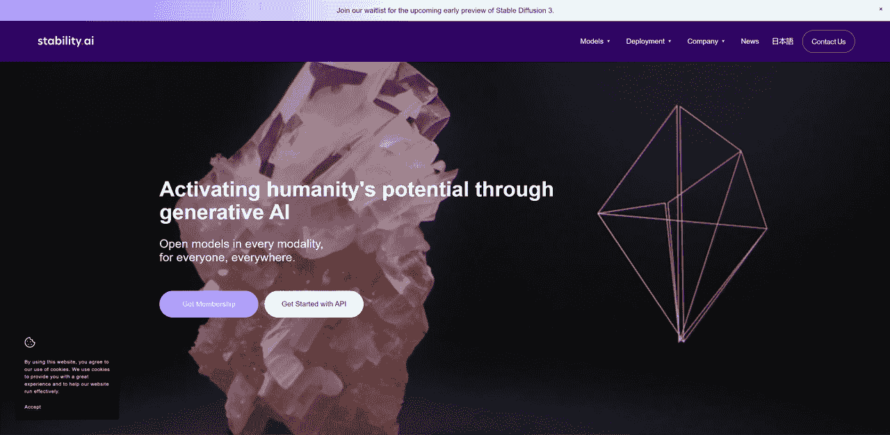

### 知识科普

> 【Stable Diffusion 和 Stable Diffusion Web UI 的简介】

> Stable Diffusion 是 2022 年发布的深度学习文本到图像生成模型。它主要用于根据文本的描述产生详细图像，也以应用于其他任务，如内补绘制、外补绘制，以及在提示词（英语）指导下产生图生图的翻译。它是一种潜在扩散模型，由慕尼黑大学的 CompVis 研究团体开发的各种生成性人工神经网络。它是由初创公司 StabilityAI、CompVis 与 Runway 合作开发的，并得到 EleutherAI 和 LAION（英语）的支持。Stable Diffusion 的代码和模型权重已公开发布，可以在大多数配备有适度 GPU 的电脑硬件上运行。而以前的专有文生图模型（如 DALL-E 和 Midjourney）只能通过云计算服务访问。Stable Diffusion 可以在本地计算机上使用，也可以在云服务器上运行。

> Stable Diffusion Web UI 是一个基于 Web 的用户界面，用于使用 Stable Diffusion 进行图像生成和其他任务。由 AUTOMATIC1111 开发，并开源上传至 Github，也是目前使用最多的 WebUI 版本。（Shout to AUTOMATIC1111）。WebUI 提供了易于使用的图形界面，可以帮助用户更直观的了解和使用 Stable Diffusion 的功能，并在基本不需要编写代码的情况下启动和监视训练过程。

> 对这些不感兴趣的朋友可以不管这些专业性术语直接跳过，对编程、算法感兴趣的朋友可以自行搜索去了解更多关于 Stable Diffusion 的专业信息。

### 使用场景

1. **艺术创作**：艺术家和设计师可以使用 Stable Diffusion 生成独特的视觉作品，探索新的艺术风格和概念。

1. **内容创作**：内容创作者，如作家、博客作者和社交媒体影响者，可以利用它为他们的故事或文章生成视觉插图，增加内容的吸引力。

1. **游戏和虚拟现实**：游戏开发者可以使用 Stable Diffusion 创造游戏资产，如角色、环境和物品，以及为虚拟现实世界创建视觉内容。

1. **设计和原型制作**：产品设计师和建筑师可以利用它快速生成设计概念和视觉化想法，加速迭代过程。

1. **广告和营销**：营销专业人员和广告代理可以使用 Stable Diffusion 生成创意广告素材和视觉内容，以吸引潜在客户。

1. **教育和研究**：教育工作者和研究人员可以使用它作为一个工具，以提高学习材料的可视化质量，或探索 AI 技术的前沿应用。

### 主要优点

#### (1) 免费开源

Midjourney 需要开魔法使用，免费额度用完之后付费才能继续，最低 10 美元/月。而 SD 在 B 站上有大神整理好的整合安装包，不用魔法，免费下载一键安装。安装到本地的 SD 随开随用，生成的图片只有自己能看到，保密性更强。

#### (2) 拥有强大的外接模型

由于开源属性，SD 有很多免费高质量的外接预训练模型（fine-tune）和插件，比如可以提取物体轮廓、人体姿势骨架、画面深度信息、进行语义分割的插件 Controlnet，使用它可以让我们在绘画过程中精准控制人物的动作姿势、手势和画面构图等细节；插件 Mov2Mov 可以将真人视频进行风格化转换；SD 还拥有 Inpainting 和 Outpainting 功能，可以对图像进行智能局部修改和外延，这些都是目前 Midjourney 无法做到的。

推特网友@Toyxyz3 通过分别渲染手部网格深度和开放姿势骨骼的方式，在 SD 内实现对人物手指和姿势的精准控制。

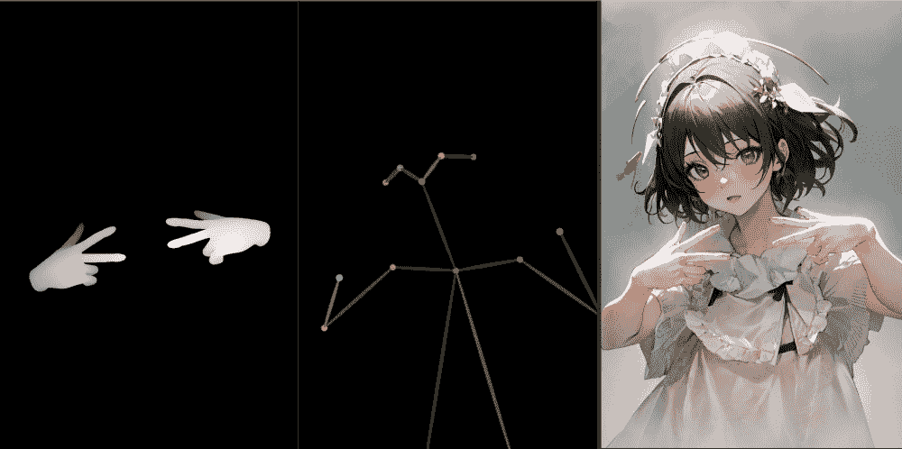

推特网友 @Claude 利用带有 controlnet 和 mov2mov 功能的 SD webUI，将真人视频转换为动画风格。

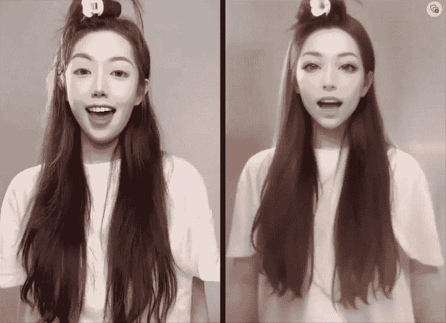

[uisdc-sd-20230328-1-1.mp4](https://internal-api-drive-stream.feishu.cn/space/api/box/stream/download/all/NkQBbgq96oMPrCxpZfQc2FSqnBg)

#### (3) 训练自己的模型

我们可以用 SD LORA 或者 Dreambooth 将自己喜欢的人物形象或者画风训练生成模型，打造自己的专属 AI 绘画工具，也有画师和设计师用自己的原创作品训练模型，之后有灵感了就之后用文字描述出来，让 SD 帮自己快速出各种概念草图。

### 主要缺点

#### (1) 对电脑配置有要求

在本地用 SD 生成图像和训练模型都需要显卡做支撑，所以 SD 对电脑显卡有要求。最好是 Nvidia 的显卡（N 卡），显存至少 4G，不然图像的生成速度非常非常非常慢（不是夸张），也容易出现报错或系统崩溃。如果你想自己训练模型，最好用高配置的台式机，显卡选 40 系列及以上，显存最低 12G，CPU 选 Intel i7 或者以上，内存越大越好。

> 检查电脑显存的方法（windows）：

> 鼠标放在工具栏，单击右键打开“任务管理器”，选择顶部的“性能”，进入后下拉查看 GPU 的部分，找到“专用 GPU 内存”，下面对应的数字就是电脑的显存。下图显示的电脑显存是 2G，生成一张最低配置的 512*512px 的图像需要 8 分钟，而 32G 显存的生成速度只需几秒，所以显存低的电脑不适合运行 Stable Diffusion。

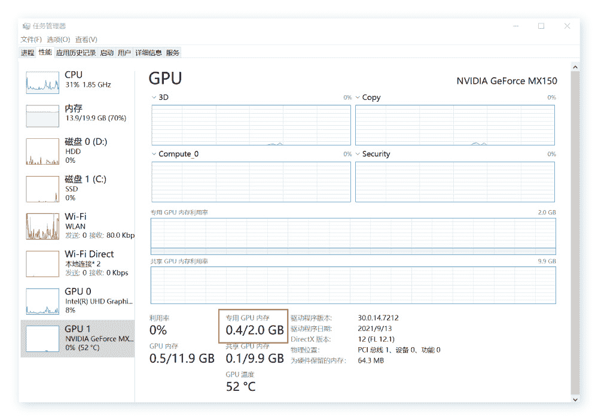

#### (2) 需要较大的硬盘空间

因为 SD 所有文件都是安装在本地电脑上，而且生成不同的风格图像需要下载不同的模型，一个大模型至少 2G，假设你想要尝试 10 种风格，那 10 个大模型可能就要 30G 的空间。一般要求装 SD 的那个盘要有 100G 的剩余空间，最低不小于 40G，且最好不要安装在 C 盘。

#### (3) 入门学习难度更高

SD WebUI 的各种参数比 Midjourney 要复杂，而且很多功能都需要通过额外安装插件和模型来实现，因此我们需要了解各种参数的含义，不同的模型插件的使用方法，可能还需要了解背后的原理知识，因此入门学习的难度比 Midjourney 高。

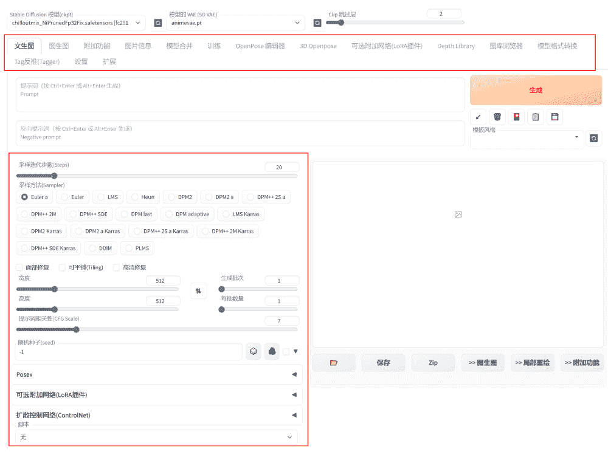

图：一个功能配置较完整的 SD webUI 汉化操作界面

#### (4) 高质量风格有局限性，不够灵活

SD 目前的高质量的图像生成模型多集中在真人、游戏和二次元插画方面，而且换一个风格就需要下载一种模型；而 Midjourney V5 可以仅通过文本提示词就快速生成各种类型和风格的高质量图像。

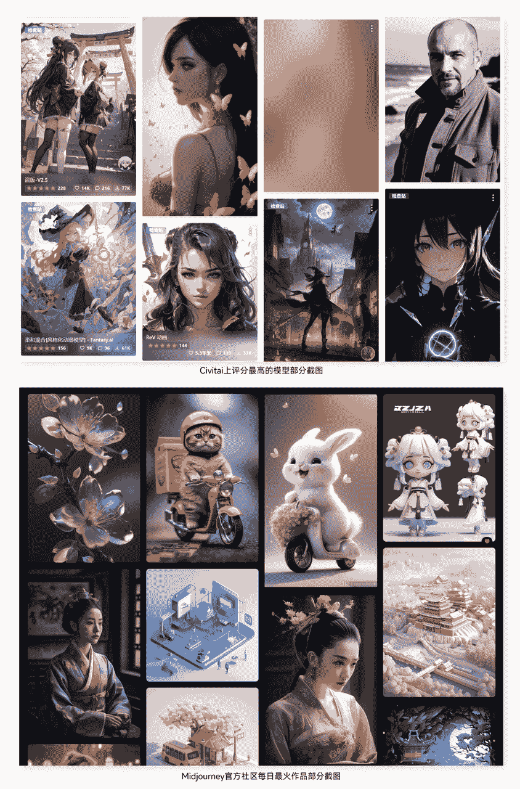

### 模型原理

Stable Diffusion 模型和 GAN 模型一样，是生成式模型，了解 GAN 模型的朋友都知道，生成式模型能够生成和训练集分布相似的输出结果（拟合数据分布），在计算机视觉领域是图片，在自然语言处理领域是文字。下面是主流生成式模型各自的生成逻辑：

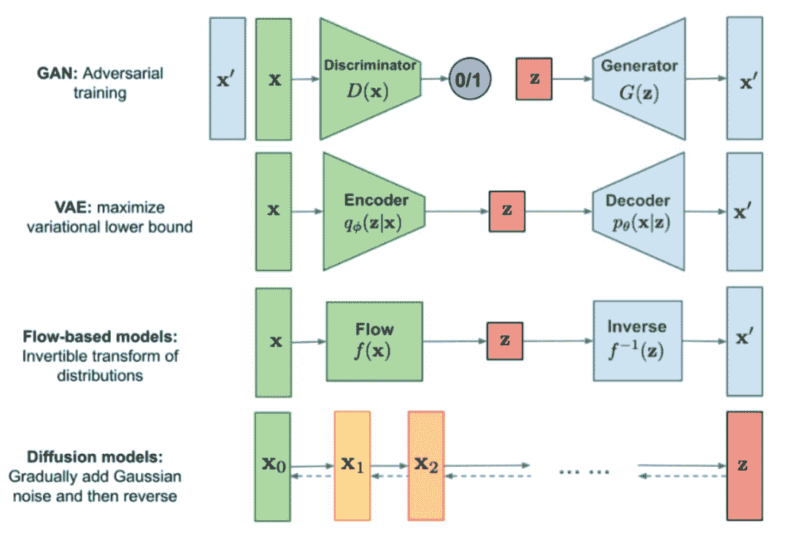

生成式模型的主流架构

在这里拿 GAN 详细展开讲讲，由于篇幅原因，VAE 和 Flow-based models 这里就不过多介绍。GAN 由生成器和判别器组成。其中，生成器主要负责生成相应的样本数据，输入一般是由高斯分布随机采样得到的噪声。而判别器的主要职责是区分生成器生成的样本与样本，输入一般是样本与相应的生成样本，我们想要的是对样本输出的置信度越接近越好，而对生成样本输出的置信度越接近越好。与一般神经网络不同的是，GAN 在训练时要同时训练生成器与判别器，所以其训练难度是比较大的。我们可以将 GAN 中的生成器比喻为印假钞票的犯罪分子，判别器则被当作警察。犯罪分子努力让印出的假钞看起来逼真，警察则不断提升对于假钞的辨识能力。二者互相博弈，随着时间的推移，都会越来越强。在图像生成任务中也是如此，生成器不断生成尽可能逼真的假图像。判别器则判断图像是图像，还是生成的图像。二者不断博弈优化，最终生成器生成的图像使得判别器完全无法判别真假。好的，讲完 GAN，让我们回到 SD 模型。SD 模型有两个最基本也是最经典的应用，分别是文生图（txt2pic）和图生图（pic2pic）。

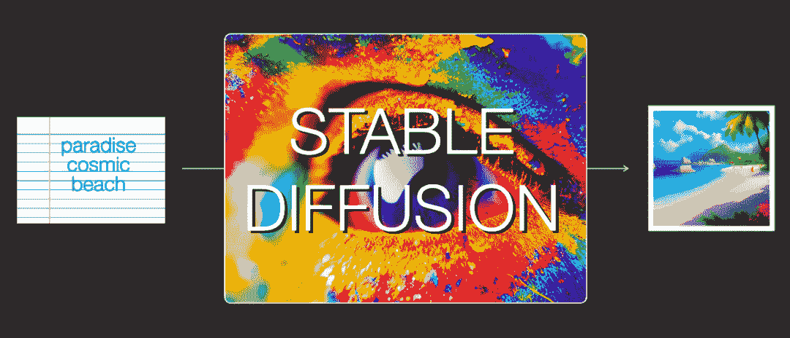

SD 文生图过程

文生图是指将一段文字输入到 SD 模型中，经过一定的迭代次数，SD 模型输出一张符合输入文字描述的图片。比如上图中输入了“天堂，巨大的，海滩”，于是生成了一个美丽沙滩的图片。

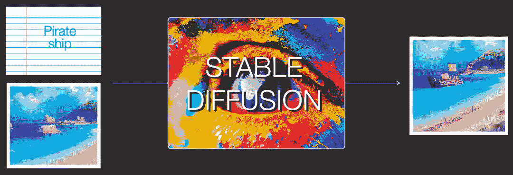

SD 图生图过程

而图生图在输入文字的基础上，再输入一张图片，SD 模型将根据文字的提示，将图片进行丰富，比如上图中，SD 模型将“海盗船”添加在之前那个美丽的沙滩上。在这里也分享一些朋友生成的图片，整体上都非常逼真：

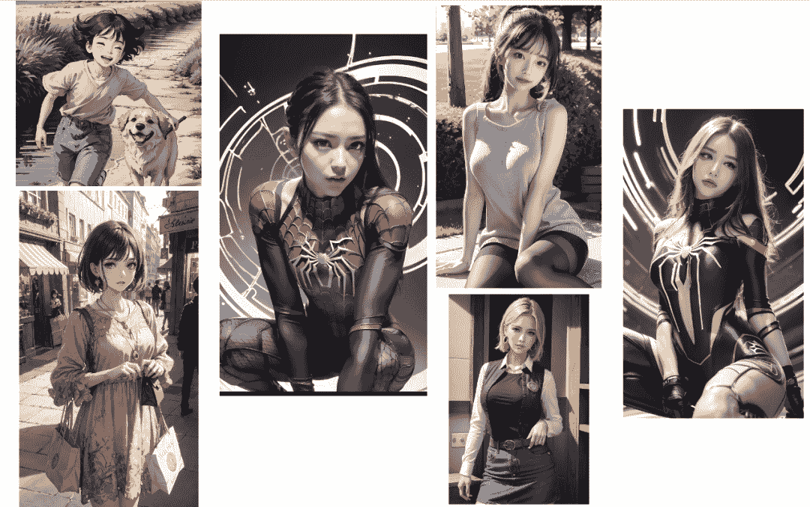

感受了 SD 模型强大的生成能力，大家可能会想到生成式领域上一个霸主模型 GAN，与 GAN 模型不同的是，SD 模型是属于扩散模型，并且是基于 latent 的扩散模型。什么是扩散模型呢？用通俗的话来讲，就是将图像的生成过程分多步进行，逐步完善图像内容，经过 20-50 次的“扩散”循环，最终输出精致的图像。下面是一个直观的例子，将随机高斯噪声矩阵通过 SD 模型的 Inference 过程，逐步去噪，最后生成一个小别墅的图片。

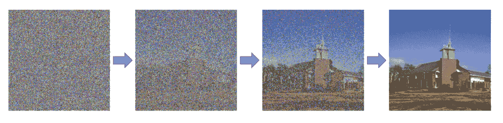

SD 模型的 Inference 过程

那 latent 又是什么呢？基于 latent 的扩散模型可以在低维度的隐空间上进行“扩散”过程而不是在实际 pixel 空间，这样一来大大降低了内存占用和计算复杂性，这是常规扩散模型和 latent 扩散模型之间的主要区别。同样的，在训练中，latent 扩散模型也将训练过程聚焦在 latent 空间中。举个例子，如果 SD 模型中将数据矩阵缩小的倍数设为，那么原本尺寸为的数据矩阵就会进入的 latent 隐空间中，内存和计算量直接缩小倍，整体效率大大提升。到这里，大家应该对 SD 模型的基本概念有一个清晰的认识了，总结一下：

1. SD 模型是生成式模型，与 GAN 模型有很多相似的地方，输入可以是图片，也可以是文字，输出是图片。

1. SD 模型属于扩散模型，扩散模型的整理逻辑是生成过程分步化与迭代化，这给整个生成过程引入更多约束与优化提供了可能。

1. SD 模型是基于 latent 的，将生成空间压缩到 latent 空间中，比起常规扩散模型，大大提高计算效率的同时，降低了内存占用，成为了 SD 模型爆发的关键一招。

1. 将维度拉到最高维，认为 SD 模型的整体流程是一个优化噪声的艺术。

**参考文章：**深入浅出解析 Stable Diffusion 完整核心基础知识

### 常见问题

主要是官网的内容：

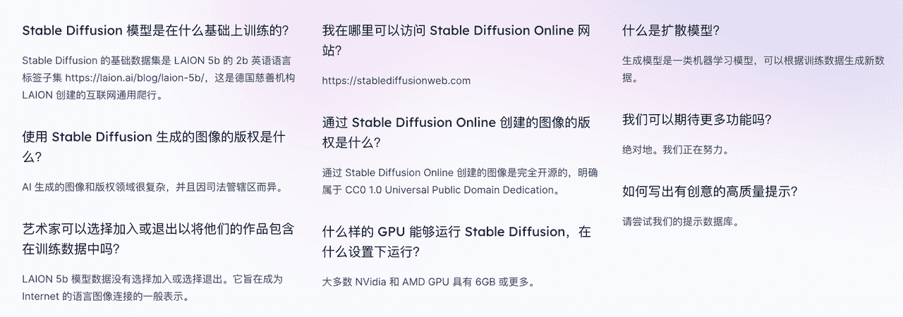

## 二、安装教程

### 本地部署

**电脑配置最核心的关键点：**看显卡、看内存、看硬盘、看 CPU。其中最重要的是看显卡。N 卡（英伟达 Nvida 独立显卡）首选，效率远超集显/AMD/Intel 显卡和 CPU 渲染，最低 10 系起步，体验感佳用 40 系，显存最低 4G，6G 及格，上不封顶；内存最低 8G，16G 及格，上不封顶；硬盘可用空间最好有个 500G 朝上，固态最佳。

**系统要求：**支持 Win10/Win11/macOS（仅限 Apple Silicon，Intel 版本的 Mac 无法调用 Radeon 显卡）和 Linux 系统，苹果版 SD 兼容的插件数量较少，功能性不及 Windows 与 Linux 电脑。

如果身边没有合适的电脑可以考虑购买云主机，比如腾讯 GPU 云服务器。若无法使用独立显卡和云服务，亦可修改启动配置，使用 CPU 渲染（兼容性强，出图速度慢，需要 16G 以上内存）。

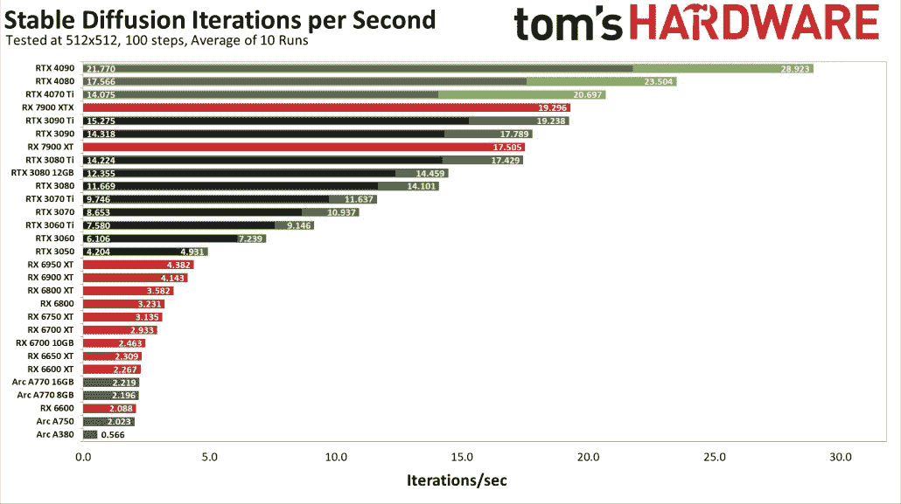

从图中可看出，与 AMD 或英特尔的任何产品相比，Nvidia 的 GPU 提供了卓越的性能--有时是以巨大的优势。随着 Torch 的 DLL 修复到位，RTX 4090 的性能比带有 xformers 的 RTX 3090 Ti 高出 50%，而没有 xformers 的性能则高出 43%。生成每张图片只需要三秒多。

**视频讲解：**5 分钟搞定 Stable Diffusion 环境配置

#### Stable Diffusion 电脑配置要求

**配置要求：**需要使用 N 卡（NVIDIA 显卡），显卡的显存至少需要 4GB 以上显存才能在本地运行。最低配置需要 4GB 显存，基本配置 6GB 显存，推荐配置 12GB 显存或者以上。（言川小知识：stable diffusion Ai 绘画主要是运行显卡，算力越强，出图越快。显存越大，所设置图片的分辨率越高）

“推荐使用 RTX4090 显卡哦，” -----来自一个 3080 显卡玩家

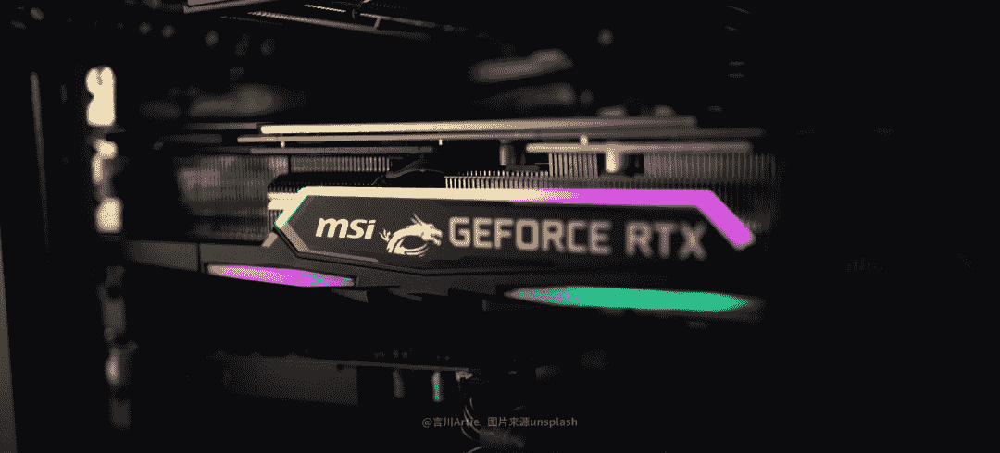

还有一点的就是硬盘空间要大，SD 出图主要依赖模型，网上下载的模型资源一般都很大（一个模型在 2G 以上）批量跑图也是很占内存的，这边建议 60GB 以上的硬盘空间。

**网络要求：**大家都懂哈，咱也不说。

**操作系统：**需要是 Win10 或 Win11。

满足以上条件基本上就可以用 SD 跑图啦。

#### Stable Diffusion 安装

SD 的安装我们就不要整的很复杂了，直接用大佬制作的一键安装/启动包就行，我们把时间用在刀刃上。

自己手动安装需要上 Github 下载文件，还要下载 Ptthon 等工具，一般第一次手动安装会出现各种奇怪的报错，总之很复杂，我之前自己安装过，真就花了一上午都还没安装好。所以我不建议也不教大家手动安装了。（如果你要硬上，可以在网上看看别的使用教程）

上黑科技！！！咱直接去使用@秋葉 aaaki 大佬的免费启动器和安装包。

注意：下载的文件一定要放在空间比较大的盘里。

**来看下具体操作：**

1. 安装一下这个“启动器运行依赖”。

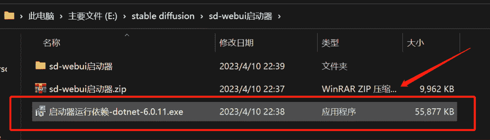

2. 打开“novelai-webui-aki-v3”文件夹。

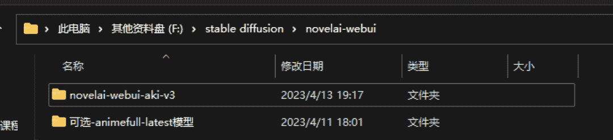

3. 然后下拉下拉...找到这个启动器，双击就完事了。

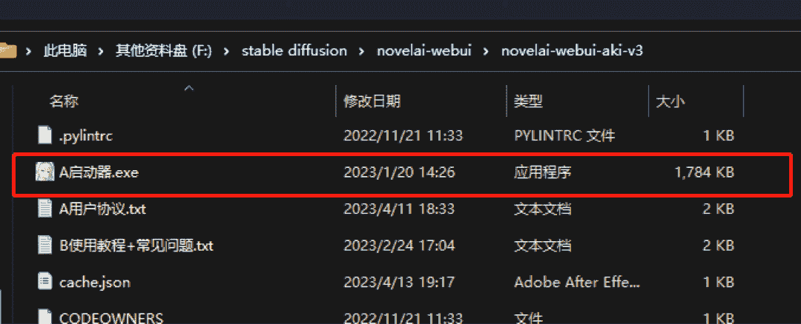

4. 然后就打开啦，一键启动就好了。

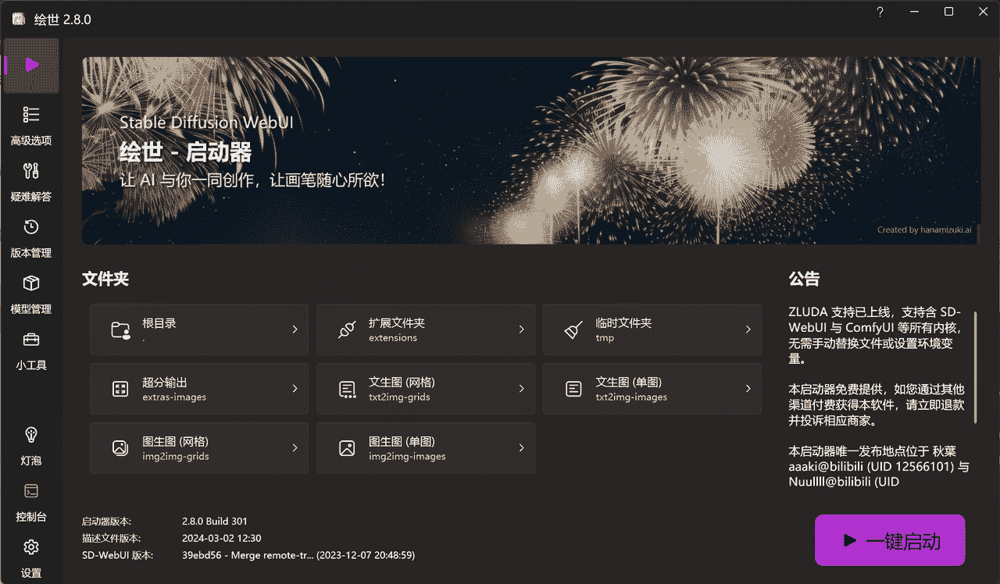

### Mac 版本

DiffusionBee 提供了一个基于 stable diffusion 的应用程序，无需复杂部署，正常安装就可以使用。完全免费

**官网地址：** `https://diffusionbee.com/`

**安装及使用流程参考：**

**硬件要求参考：**

1. 建议：8GB M1 MacBook Air 以上
2. DiffusionBee 适用于基于 Intel 的机器。如果你没有专用的图形芯片，它与 M1 机器相比非常慢。
3. DiffusionBee 需要更高版本的 macOS 12.5.1，推荐使用 Apple 芯片的机器

## 云端部署

1. 免费部署 Stable Diffusion 的云平台飞浆
2. 网页版（免安装，点击即用）

**点击访问：** `https://shorturl.at/kvyNY`

无需魔法，国内可用，注册后即可免费试用，非常适合新手尝鲜（没有任何设备要求和安装过程，登录即可使用）

100% 原版 stable diffusion webUI，目前网上有的插件，官方都会测试优化好后陆续添加进去，比如 openpose3d、mov2mov 等等，好处就是不需要自己部署和维护，随便到哪，甚至用手机和平板就可以畅享 A10 工业显卡级别的作图体验。里面已经有非常多的大模型和 LORA 模型，并且有程序员在进行 BUG 维护。

3. [stable diffusion 腾讯云部署](https://hcb97zmcrv.feishu.cn/docx/KHTedk3vVoP4Xvx0tmXc33aUn2f)

[全网最简单的 stable diffusion 腾讯云部署教程（视频版）](https://www.bilibili.com/video/BV1cV4y1Z7iw/?spm_id_from=333.337.search-card.all.click&vd_source=05604b6063f398633af513a2e9a7c804)

4. Stable Diffusion 阿里云云端部署教程（视频版）

5. [【AI 制图】5 分钟 Colab 云端部署 stable diffusion 教程](https://www.bilibili.com/video/BV15j411c7fE/?spm_id_from=333.337.search-card.all.click&vd_source=05604b6063f398633af513a2e9a7c804)

**附件：** [Colab 快速部署 Stable Diffusion](https://hesn0bipt0.feishu.cn/docx/VrTHdeIm5oKT9AxzI7CcRxqjnTh)

## 版本汉化

### Stable Diffusion WebUI 汉化

1. 安装中文扩展插件：点击 Extensions 选择 Install from URL，输入 `https://github.com/VinsonLaro/stable-diffusion-webui-chinese`，点击 Install，并重启 WebUI。
2. 切换到中文模式：在 Settings 面板中，将 User interface 中的 Localization 设置成 Chinese 中文模式，重启 WebUI 即可切换到中文界面。

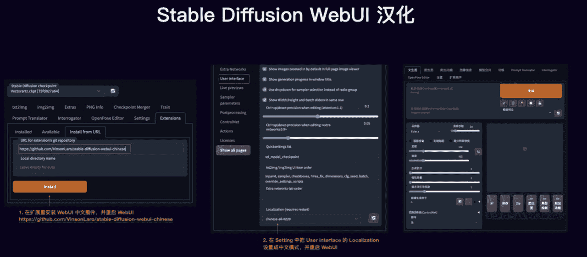

---

# 三、使用教程

> 以下文章教程均属于智设团队创作，点击链接蓝色标题可跳转原文

## 第一讲：基本功能及基础操作

### 大模型的切换

首先是这个界面左上角，在这里可以切换你所安装的模型。

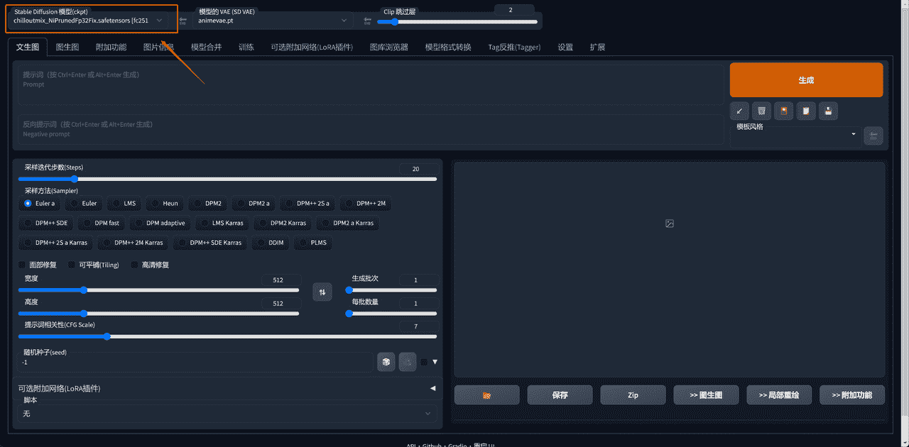

这里我先推荐一下我常用的模型网站：C 站：`https://civitai.com/`

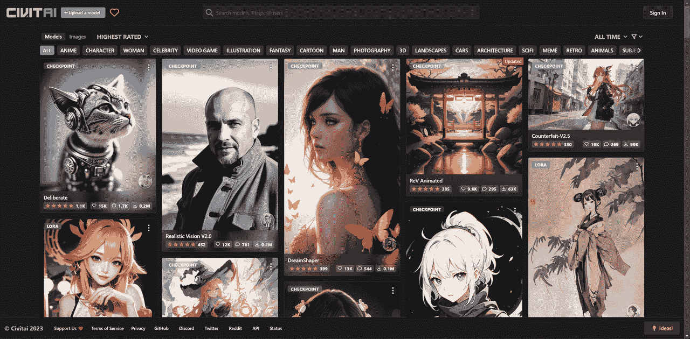

然后我们在 C 站上下载一些模型，下载需要网络哦。

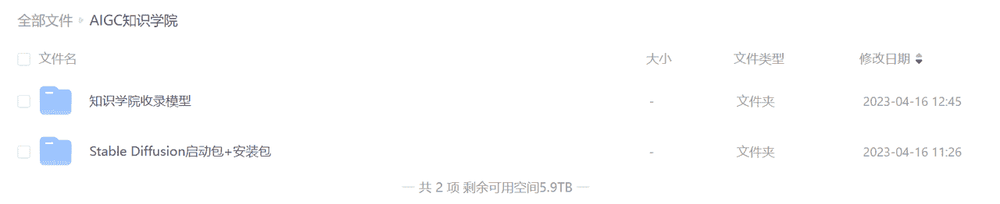

接下来就是安装了，很简单，把下载的模型放到这个路径文件夹中。然后刷新 web UI 界面（就是 SD 操作界面）

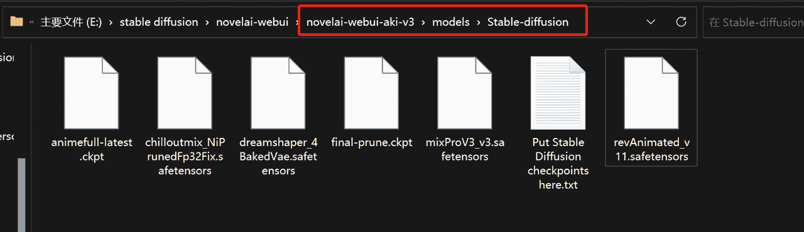

### 模型的 VAE（Sd 的 VAE）

VAE 的全称是 Variational Auto-Encoder，翻译过来是变分自动编码器，本质上是一种训练模型，Stable Diffusion 里的 VAE 主要是模型作者将训练好的模型“解压”的解码工具。

这里可以切换 VAE。一般情况下我们就选择第一个自动就行了。

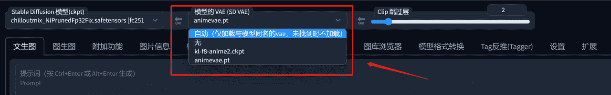

在 C 站（stable diffusion）下载模型，在下载页面会有文件显示，如图。

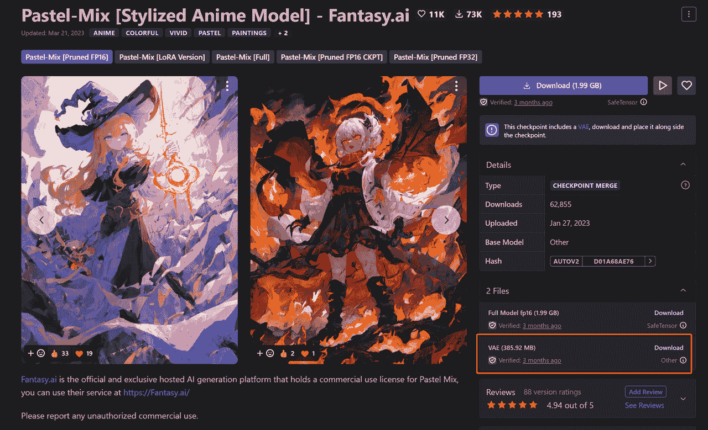

VAE 的安装路径看我这里，把下载的文件复制粘贴，然后把 web UI 界面刷新一下（就是 SD 操作界面）

**言川总结：**

1. 总的来说就是你在 C 站上下载的模型有些内置就有 VAE 的属性（不需要下载 VAE 文件），有些没有内置下载的时候我们就把 VAE 文件下载。（VAE 文件一般大小在几百兆左右）
2. VAE 的作用就是没有加载 VAE 的图片是灰灰的，加载之后就会产生一个润色的效果，色彩更加丰富。

### 功能选项

这里我挑选几个重要的功能讲解下。

**文生图：** 这里与 Midjourney 不同的是，SD 有一个反向关键词（意思是不要图片出现什么），文生图的关键词格式与 Midjourney 基本一致，不知道的朋友可以去看我的往期文章《奶奶看了都会的 Midjourney 入门教程！！》

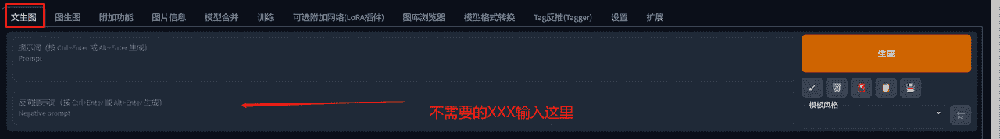

下面这块参数就是设置图片的一些基本参数，分辨率、尺寸等等，具体参数见下文。

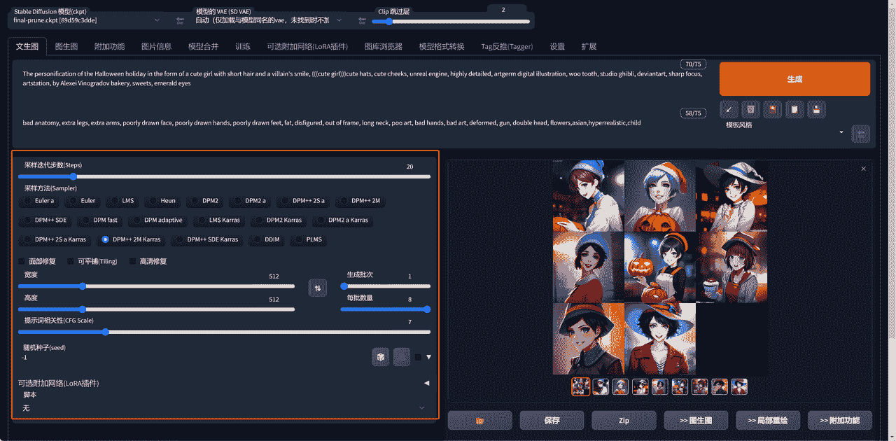

**图生图：** 这个也很好理解，放参考图然后输入提示词，与其他 AI 绘画软件一致。

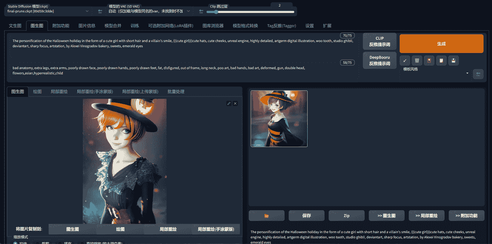

**图片信息：** 意思是你用 SD 画的图，放在这里来，右边会显示这个图片的一些参数，包括关键词。

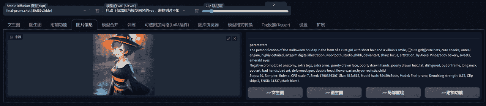

然后你可以选择右下角的一些功能，比如“文生图”。

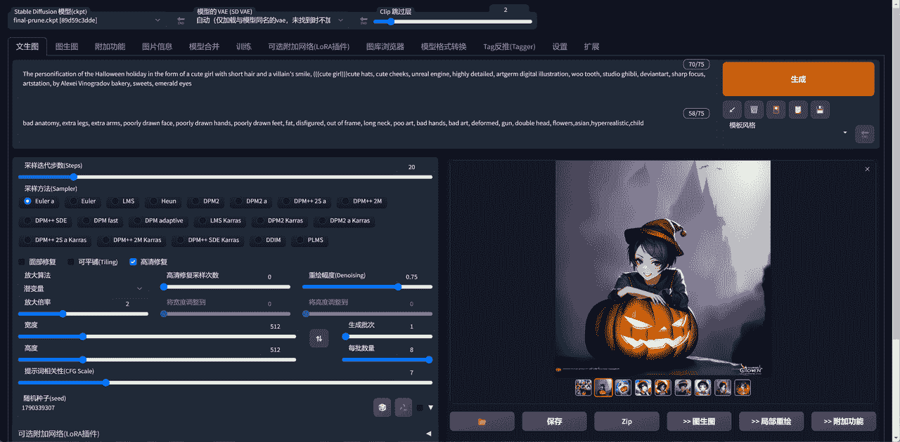

**模型合并：** 这个功能很厉害，后面我出一篇关于这个功能的教学，大致就是把多个模型混合起来。

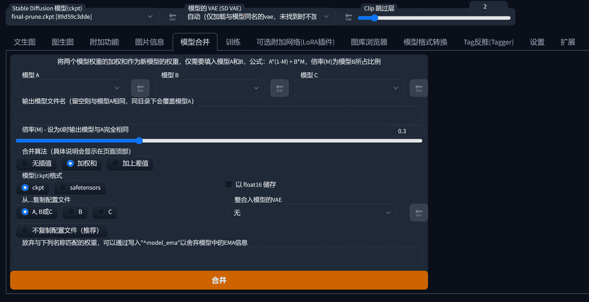

**训练：** 这个就是训练自己的模型，新手用的比较少，后面可用作工作流的部署。（这个才是我推荐的核心哦）

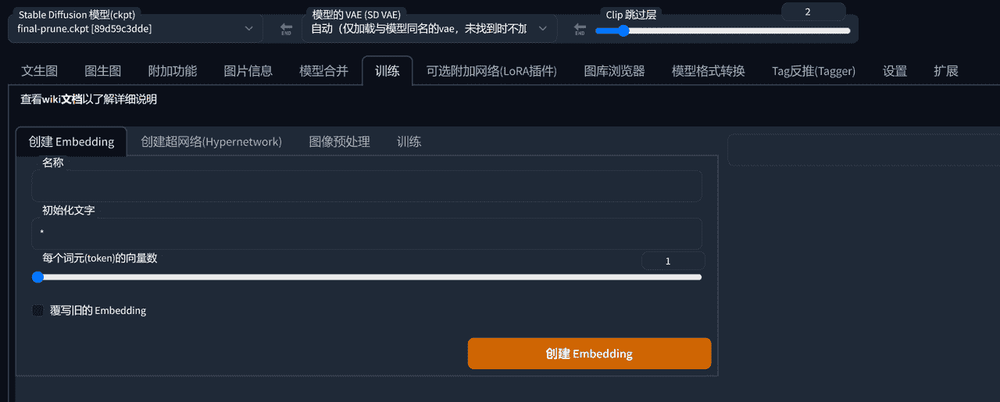

**设置：** 然后就是设置，大家自己去研究下就好了。

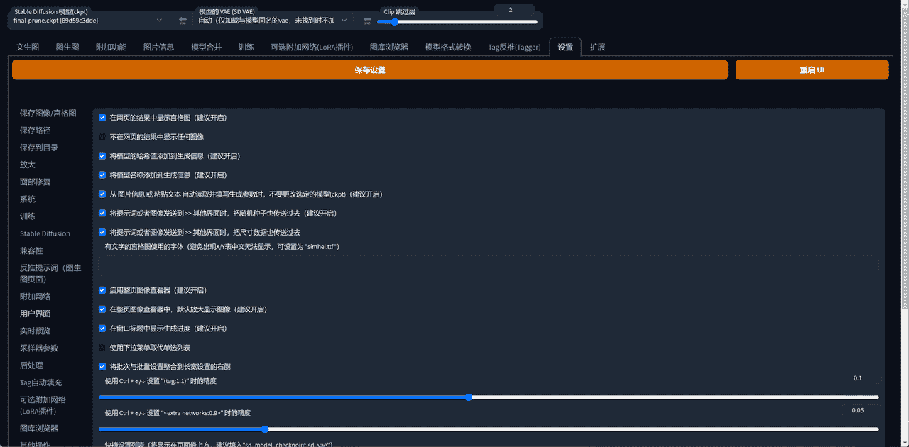

**扩展：** 这个就是跟插件扩展相关的了，后面再讲。

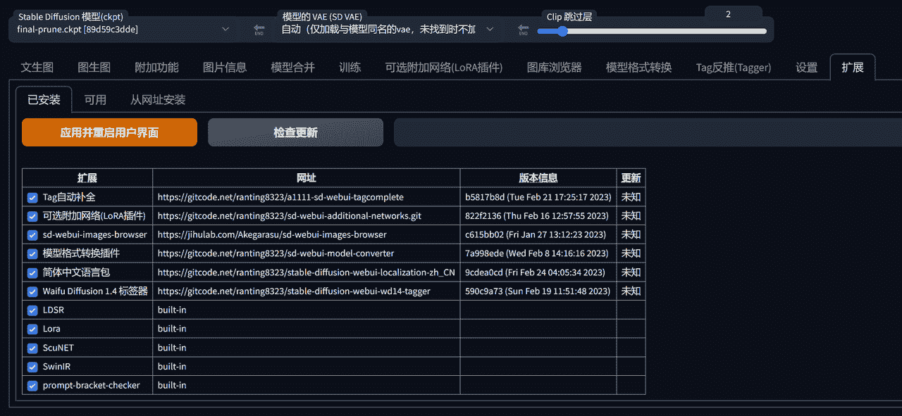

### 6.4 提示词和反向提示词

**言川提示：**

提示词内输入的东西就是你想要画的东西，反向提示词内输入的就是你不想要画的东西。

提示框内只能输入英文，所有符号都要使用英文半角，词语之间使用半角逗号隔开。

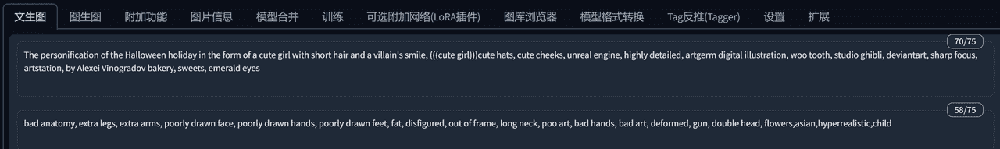

一般来说越靠前的词汇权重就会越高，比如我这张图的提示词：

The personification of the Halloween holiday in the form of a cute girl with short hair and a villain's smile, (((cute girl)))cute hats, cute cheeks, unreal engine, highly detailed, artgerm digital illustration, woo tooth, studio ghibli, deviantart, sharp focus, artstation, by Alexei Vinogradov bakery, sweets, emerald eyes.

> 万圣节假期的拟人化形式是一个留着短发和恶棍笑容的可爱女孩，可爱的帽子，可爱的脸颊，虚幻的引擎，高度详细，艺术种子数字插图，woo tooth，吉卜力工作室，deviantart，锐利的焦点，artstation，由 Alexei Vinogradov 面包店，糖果，绿宝石般的眼睛。

第一句关键词词组：万圣节假期的拟人化形式是一个留着短发和恶棍笑容的可爱女孩。那生成的图片主体画面就会是万圣节短发可爱笑容女孩

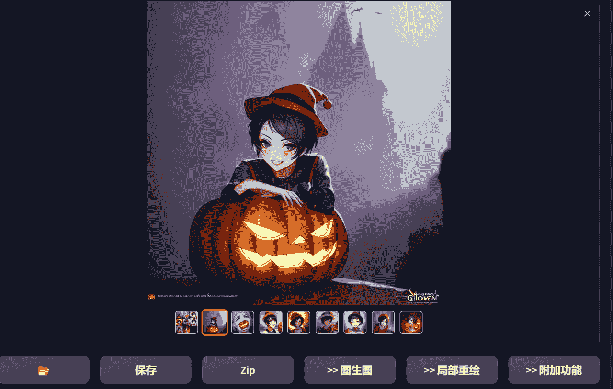

这里可能有用过 Midjourney 的小伙伴们就有疑问了，(((cute girl))) 是什么意思，为啥有这么多括号，我来为大家解答下，这个是权重调节，类似 Midjourney 的 ::

1. 最直接的权重调节就是调整词语顺序，越靠前权重越大，越靠后权重越低，上面说过。
2. 可以通过下面的语法来对关键词设置权重，一般权重设置在 0.5～2 之间，可以通过选中词汇，按 ctrl+↑↓ 来快速调节权重，每次调节为 0.1，也可以直接输入。

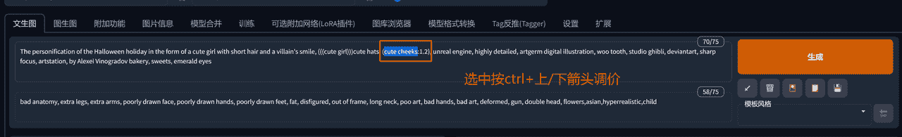

3. 加英文输入的（），一个括号代表这组关键词的权重是 1.1，两个括号是 1.1*1.1 的权重，不要加太多了哈。可以结合第二点固定权重，比如（（（cute girl:1.2））），那这个关键词的权重就很高了。

### 6.5 功能按钮

我们来介绍下右边这几个功能，生成就不说了，输入关键词生成就跑图了。

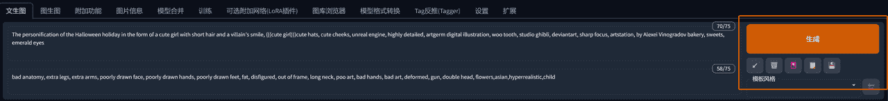

第一按钮的意思是读取你上一张图的所有参数信息（包括关键词），比如你画一张图之后，关掉了软件，再次启动点击这个就会把参数复制进来。

第二个按钮就是删除了，清空关键词；这里可以和第一个按钮结合用哦。

第三个按钮就是模型选择管理

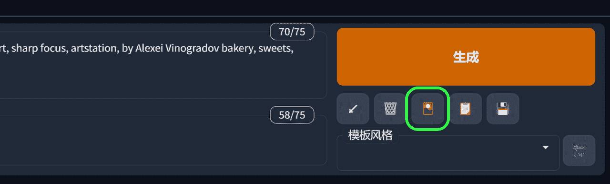

这个按钮就是点击就会出现这些功能，你安装的模型和 `Lora` 都可以在这边调整。

言川小知识：这里可以把你生成的图片添加到模型的封面上，方便你后面看这个模型的效果，看我怎么做：

找到这个模型的名称，然后我这里是跑出来一张图片的，点击这个按钮（`lora` 一样）

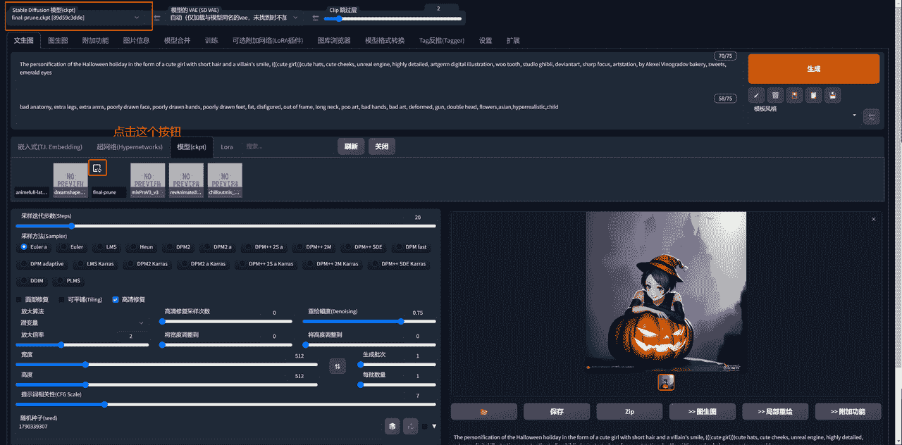

最终效果：

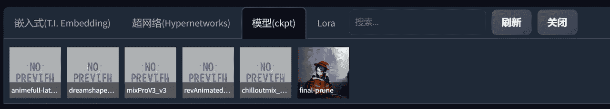

后面两个就是一个提示词模板功能：

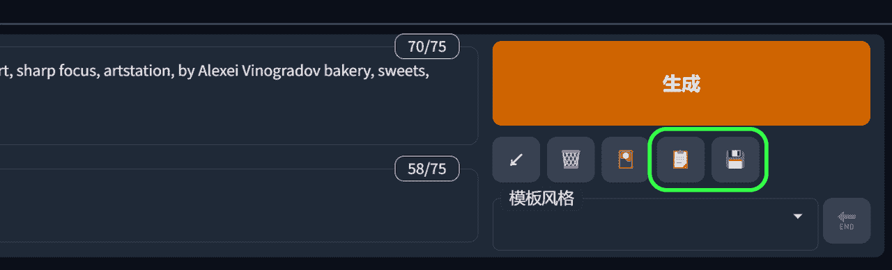

我们可以先点最后一个按钮，把现在的关键词创建一下，取个名字

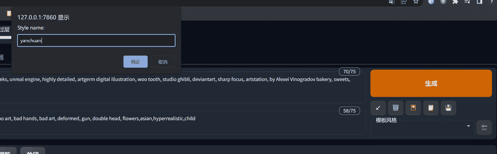

然后在模板风格这里选中我们刚刚创建的模板（可以多选）

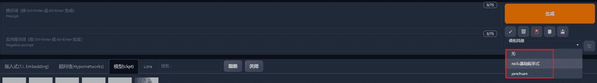

选中之后按一下第四个按钮，我们创建的关键词就被填入进去了，这块收工！

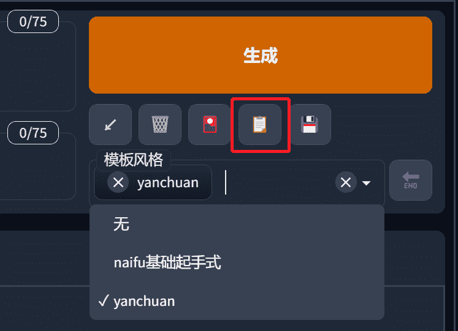

### 6.6 采样步数

一般来说大部分时候采样部署只需要保持在 20～30 之间即可，更低的采样部署可能会导致图片没有计算完全，更高的采样步数的细节收益也并不高，只有非常微弱的证据表明高步数可以小概率修复肢体错误，所以只有想要出一张穷尽细节可能的图的时候才会使用更高的步数。（加大这个会导致出图变慢）

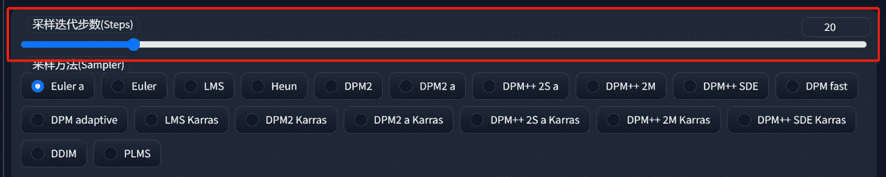

### 6.7 采样方法

Stable diffusion webui 是 Stable diffusion 的 GUI，是将 stable diffusion 实现可视化的图像用户操作界面，它本身还集成了很多其它有用的扩展脚本。

SD 的采样方法有很多，大家有兴趣了解的可以去知乎看看@刘登宇的一篇文章《stable diffusion webui 如何工作以及采样方法的对比》。这里我们只介绍两个常用的。

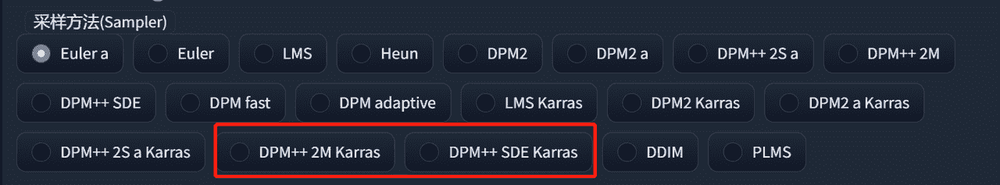

这里的采用方式有很多，但是我们常用的就那几个，我们可以去设置里面把不需要用到的关掉，不展示在这个界面中。然后点击右边的重启 UI 就好了。

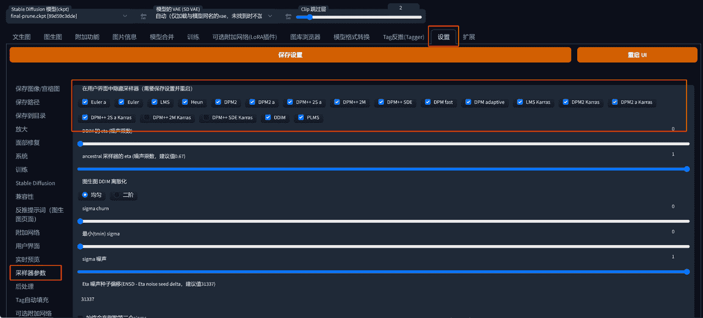

### 6.8 高清修复和图片尺寸参数

前面两个做个简单的介绍，面部修复对写实的风格有点效果，可平铺就不要用了，生成的图片很奇怪，可以自己试试。

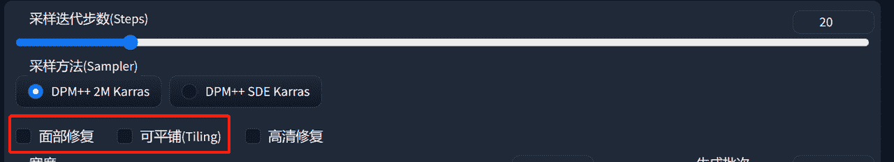

我们说说高清修复，高清修复的意思是把基础生成的图片，按照你选择放大的倍率放大到指定分辨率之后再重新绘制图片，受到你重复幅度调节的数值影响。

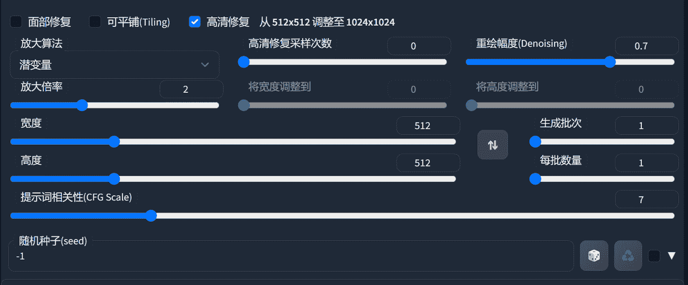

宽度、高度就是图片的长宽比，很容易理解，生成批次和数量就是几批，一批几张图，配置好的可以直接拉满，增加效率哦。

提示词相关性：图像与你的提示的匹配程度。增加这个值将导致图像更接近你的提示（根据模型），但它也在一定程度上降低了图像质量。可以用更多的采样步骤来抵消。

默认未选中高清修复是这样的，当前图片的参数。

### 6.9 随机种子（seed）

这个功能与 Midjourney 的 Seed 功能一样。

随机数的起点。保持这个值不变，可以多次生成相同（或几乎相同，如果启用了 `xformers`）的图像。没有什么种子天生就比其他的好，但如果你只是稍微改变你的输入参数，以前产生好结果的种子很可能仍然会产生好结果。

输入不同的种子，生成的图片不一样，`seed` 值一样，那生成的图片也是一样。

差异随机种子，需要勾选这个按钮

这个功能是固定一个种子，然后调整差异强度来生成图片，因为是固定的 `seed` 值，所以生成的图风格都是类似的。

直接看图吧。

这边的几个功能都很简单，大家尝试下就能理解了，那基础操作我们就先讲到这里，大家赶紧玩起来吧！！

---

> 以下插件教程均为长篇文章，大家需点击链接跳转至原文地址查阅。

## 第二讲：主流的插件介绍（进阶）

姥姥看了都会的 `Controlnet` 插件功能教程

`ControlNet` 模型的工作原理与应用场景（附案例解析）

模型管理插件 `Civitai Helper`

一键生成多种风格图片，自动填充关键词插件 `Dynamic Prompt`

脸部修复及一键生成表情包插件 `After Detailer`

[StableDiffusion 制作中文字效工作流揭秘与画质提升的多种方法](https://mp.weixin.qq.com/s/GNPDAfuFX9jGUKZf65_bXw)

如何在 PS 中使用 SD？一文带你走进 PS 的 AI 创作世界

---

> 以下商业设计教程均为长篇文章，大家需点击链接跳转至原文地址查阅。

## 第三讲：商业设计实战

[AI 商业教程-儿童节海报丨 Stable diffusion 线稿上色](https://mp.weixin.qq.com/s/oeiKWk3l4wU9iB39MT3d_Q)

StableDiffusion 在多个设计场景中的探索与应用

StableDiffusion 如何实现模特精准换装以及如何替换模特

# 四、绘画提示词

## 提示词网站

### Lexica

**简介：** Lexica 是一个专注于 Stable Diffusion 模型的 prompt 搜索引擎，其搜索方式非常简单，集搜索、绘图、关键词为一体 AI 的绘画工具。除此之外，lexica 还提供了 AI 图像生成功能，用户可以对图片的 prompt 进行重新编辑并生成新的图片，注：每月有 100 张免费可供作画。

**传送门：** `https://lexica.art/`

## Prompthero

**简介：**提示工程排名第一的网站。通过 `Stable Diffusion`、`Midjourney` 等模型搜索数百万 AI 艺术图像。

**传送门：**`https://prompthero.com/`

## PromptoMANIA

**简介：**人性化的提示生成器将为您提供帮助。您也可以尝试使用其他扩散模型，例如 `DALL-E 2`、`Disco Diffusion`、`WOMBO Dream` 或任何扩散模型。

**传送门：**`https://promptomania.com/stable-diffusion-prompt-builder/`

## Prompt 中文输入

1. 下载提示词中文扩展插件：`https://github.com/butaixianran/Stable-Diffusion-Webui-Prompt-Translator`，将项目作为 zip 文件下载，解压后放到 `stable-diffusion-webui/extensions` 目录中，重启 `WebUI`

2. 调用百度翻译 API：去 `api.fanyi.baidu.com` 申请一个免费 API Key，并将翻译服务开通。在管理控制台的开发者信息页中确认 `APP ID` 和 `密钥`

3. 在 `Stable Diffusion WebUI` 的 `Prompt Translator` 面板中，选择百度翻译引擎，并将申请的 `APP ID` 和 `密钥` 填写进去，点击保存

4. 使用：在 `Stable Diffusion WebUI` 页面顶部会出现一个翻译工具栏，我们在提示词输入框中输入中文，点击工具栏中的翻译就能自动把提示词替换成英文。

## 提示词类型

提示词也就是我们对 AI 的指令。

1. 正向提示词：即对画面的描述，例如，一个女孩，月亮，吉他，沙发等

2. 反向提示词：指你不想在画面中出现的元素或属性。例如，低质量，畸形的手等

## 提示词结构化

`Prompt` 提示词可以分为 4 段式结构：画质画风 + 画面主体 + 画面细节 + 风格参考

1. 画面画风：主要是大模型或 `LoRA` 模型的 `Tag`、正向画质词、画作类型等

2. 画面主体：画面核心内容、主体人/事/物/景、主体特征/动作等

3. 画面细节：场景细节、人物细节、环境灯光、画面构图等

4. 风格参考：艺术风格、渲染器、`Embedding Tag` 等

## 提示词语法

1. 提示词排序：越前面的词汇越受 AI 重视，重要事物的提示词放前面

2. 增强/减弱：（提示词：权重数值），默认 `1`，大于 `1` 加强，低于 `1` 减弱。如 `(doctor:1.3)`

3. 混合：提示词 | 提示词，实现多个要素混合，如 `[red|blue] hair` 红蓝色头发混合

4. `+` 和 `AND`：用于连接短提示词，`AND` 两端要加空格

5. 分步渲染：`[提示词 A:提示词 B:数值]`，先按提示词 `A` 生成，在设定的数值后朝提示词 `B` 变化。如 `[dog:cat:30]` 前 30 步画狗后面的画猫，`[dog:cat:0.9]` 前面 90%画狗后面 10%画猫

6. 正向提示词：`masterpiece`，`best quality` 等画质词，用于提升画面质量

7. 反向提示词：`nsfw`，`bad hands`，`missing fingers`，……，用于不想在画面中出现的内容

8. Emoji：支持 emoji，如 `😍` 形容表情，`🖐` 修饰手

## Prompt 规则细节

① 越靠前的 `Tag` 权重越大。

② 生成图片的大小会影响 `Prompt` 的效果，图片越大需要的 `Prompt` 越多，不然 `Prompt` 会相互污染。

③ `Stable-diffusion` 中，可以使用括号人工修改提示词的权重，方法如下：

`（word）` - 将权重提高 1.1 倍

`（（word））` - 将权重提高 1.21 倍（= `1.1 * 1.1`）

`[word]` - 将权重降低至原先的 90.91%

`（word:1.5）` - 将权重提高 1.5 倍

`（word:0.25）` - 将权重减少为原先的 25%

请注意，权重值最好不要超过 1.5

④ `Prompt` 支持使用 emoji，可通过添加 emoji 达到表现效果。如 `😍` 形容表情，`🖐` 可修手。

⑤ “`+`” ， “ `AND`” ， “`|`” 用法：“`+`”和“ `AND` ”都是用于连接短 `Tag`，但 `AND` 两端要加空格。"`+`"约等于" and "；“`|`” 为循环绘制符号（融合符号）（`Prompt A: w1`）|（`Prompt B: w2`）

以上表达适用于 `WebUI`，`w1`、`w2` 为权重。AI 会对 `A`、`B` 两 `Prompt` 进行循环绘制。可往后无限加入 `Prompt`。

⑥ `tag` 不一定是多么充满细节，只要模型稳定。小图 `+` 高分辨率重绘。`800*400` 的图变成 `1600*800`，初识小图减少崩坏概率。

⑦ 关键词最好具有特异性，譬如 `Anime`（动漫）一词就相对泛化，而 `JoJo` 一词就能清晰地指向 `JoJo` 动漫的画风。措辞越不抽象越好，尽可能避免留下解释空间的措辞。

## 学习文章

1. 手把手教你用 `Stable Diffusion` 写好提示词

2. 【`Stable Diffusion`】文生图怎么写提示词

3. 【炼丹秘籍】`Stable Diffusion` 咒语语法和参数介绍

## 提示词库

### 基础关键词

[`基础关键词.xlsx`](https://internal-api-drive-stream.feishu.cn/space/api/box/stream/download/all/FI3SbeiK6o1M56xSmmMcTY5Gndc)

[`🔮 关键词 - 通用.xlsx`](https://internal-api-drive-stream.feishu.cn/space/api/box/stream/download/all/Iys0bkXByoikhUxDLBIc26xXnmi)

[`🔮 关键词 - 扩展.xlsx`](https://internal-api-drive-stream.feishu.cn/space/api/box/stream/download/all/YIQlbEj7koXJaCxJblCcYSHgnmf)

[`关键词表格.xlsx`](https://internal-api-drive-stream.feishu.cn/space/api/box/stream/download/all/BbXybqiZPoViJgx316Mc7Hn5n1b)

### 动物类提示词

[`动物类-1可爱动物.xlsx`](https://internal-api-drive-stream.feishu.cn/space/api/box/stream/download/all/BfbubxwPgoBsLVxyTQWcYZNLnSb)

[`动物类-3神兽.xlsx`](https://internal-api-drive-stream.feishu.cn/space/api/box/stream/download/all/RwrgbVsGFo5ZIYxy0LQcoecxnGh)

[`动物类-2写实3D.docx`](https://internal-api-drive-stream.feishu.cn/space/api/box/stream/download/all/Xga2baJ0coei1VxDrYzcywlynbV)

[`关键词108.xlsx`](https://internal-api-drive-stream.feishu.cn/space/api/box/stream/download/all/U6FnbuQkaok4Pix9lUjcalY7nPc)

[`mid-神兽-妖狐（108）.xlsx`](https://internal-api-drive-stream.feishu.cn/space/api/box/stream/download/all/IkRpbqxcSovRqaxjezecsB4Pnjc)

[`mid-最热（207）.xlsx`](https://internal-api-drive-stream.feishu.cn/space/api/box/stream/download/all/Ae1Sb27rjoO5oxx5I5WcqwgVnEc)

### 风景类提示词

[`mid-风景-宫殿（290）.xlsx`](https://internal-api-drive-stream.feishu.cn/space/api/box/stream/download/all/F8qVbZXEmolhpAxgylxclvi8nRt)

[`mid-星空-风景（188）.xlsx`](https://internal-api-drive-stream.feishu.cn/space/api/box/stream/download/all/JIEab7cIroU2VQx4duacly8enNe)

[`mid-玫瑰-城堡（148）.xlsx`](https://internal-api-drive-stream.feishu.cn/space/api/box/stream/download/all/DbHRb04SYoLkuyxN7VUcYq8ynVc)

[`mid-星空-火烧云（152）.xlsx`](https://internal-api-drive-stream.feishu.cn/space/api/box/stream/download/all/OYQibRNQWooia6xZCKdcOCZ8nlh)

[`热门狗熊岭系列9.xls`](https://internal-api-drive-stream.feishu.cn/space/api/box/stream/download/all/W3p5bJbxaobK5wxp1h7cwakUn5A)

[`星空极光荧光海系列9.xls`](https://internal-api-drive-stream.feishu.cn/space/api/box/stream/download/all/YLq8b1APKo7vT9xAGJbcuMTQnRc)

[`风景关键词 (1).xls`](https://internal-api-drive-stream.feishu.cn/space/api/box/stream/download/all/X6UFbkw6poXDLsxx690csBlPnud)

[`风景关键词 (1).xlsx`](https://internal-api-drive-stream.feishu.cn/space/api/box/stream/download/all/AG3jbGfVJoNMq8xBc2zck1JenoV)

[`风景关键词 (2).xls`](https://internal-api-drive-stream.feishu.cn/space/api/box/stream/download/all/UBh6bUQeFog8tWxYTtRcVb9RnQf)

[`风景关键词 (2).xlsx`](https://internal-api-drive-stream.feishu.cn/space/api/box/stream/download/all/SNs2bOwiNociFyxqStyc5W9tnXe)

[`风景关键词 (3).xls`](https://internal-api-drive-stream.feishu.cn/space/api/box/stream/download/all/NcLBbzJbtot2sExJkIOcRrqFnTf)

[`风景关键词 (3).xlsx`](https://internal-api-drive-stream.feishu.cn/space/api/box/stream/download/all/OpSbbxe6ooXNa0x5vqOcVCzfnhd)

[`风景关键词 (4).xlsx`](https://internal-api-drive-stream.feishu.cn/space/api/box/stream/download/all/AJp7b6GY3o2r4fxxHBCcwV5knec)

[`风景关键词 (5).xlsx`](https://internal-api-drive-stream.feishu.cn/space/api/box/stream/download/all/WGtmbuPlcoSgOGxY7PicqQAUnKf)

[`风景关键词 (6).xlsx`](https://internal-api-drive-stream.feishu.cn/space/api/box/stream/download/all/CQVab0NsDo6JkdxDyoMcVikgnvb)

[`风景关键词 (7).xlsx`](https://internal-api-drive-stream.feishu.cn/space/api/box/stream/download/all/Cj4Gb6XnWoUjGbxGyzkcxO8rnvb)

[`风景关键词 (1).docx`](https://internal-api-drive-stream.feishu.cn/space/api/box/stream/download/all/PiXhbimsQoWdthx3FELcny6qnHe)

### 赛博朋克关键词

[`mid-赛博朋克-人物（80）.xlsx`](https://internal-api-drive-stream.feishu.cn/space/api/box/stream/download/all/WMv9bgc06oO4oxxErb3c3w0NnNL)

[`mid-赛克朋格（75）.xlsx`](https://internal-api-drive-stream.feishu.cn/space/api/box/stream/download/all/DL1ybcfLAoq3QqxC15Wc6PVjnob)

### 艺术家关键词

[`260个艺术家名字和风格展示对比.pdf`](https://internal-api-drive-stream.feishu.cn/space/api/box/stream/download/all/U84pbVyGwoXXdZxDG4Fca2r9nHf)

### 案例关键词

[Stable Diffusion Prompt Book From OpenArt 11-13.pdf](https://internal-api-drive-stream.feishu.cn/space/api/box/stream/download/all/ZWjPbqnh7o10ZmxkLuscshnjnue)

[Stable Diffusion 2.1 Prompt Book by USP.ai.pdf](https://internal-api-drive-stream.feishu.cn/space/api/box/stream/download/all/Rag5bm7Plo7ll1xnmmJcbO9unHc)

## 140+关键词案例合集

[关键词大全.pdf](https://internal-api-drive-stream.feishu.cn/space/api/box/stream/download/all/L2UebqW0Hoa8BHxhvG9cs110nid)

# 五、绘画模型

## 模型分类

AI 绘画最重要的是需要清楚自己的创作需求，即自己希望出来的图片是什么风格、什么场景、什么人物等等。那么根据需求将模型分为五种类型：

+ **官方模型：**由 Stable Diffusion 团队官方出的大模型，也叫底模；

`Stable Diffusion-V2` 官方模型下载链接：`https://github.com/Stability-AI/stablediffusion`

+ **二次元模型：**模型训练的数据以二次元的素材为主，对于二次元的场景和人物有着针对性的优化，出图效果好；

+ **真实系模型：**模型训练的数据以实际照片素材为主，对于真实感和人物细节的还原会比其他模型好非常多；

+ **2.5D 模型：**多为混合模型，出来的效果图在二次元的基础上带有真实效果，类似于 3D 建模；

+ **其他模型：**其他一些垂直领域的模型，如平面设计、魔幻场景、建筑风格等等。

**学习教程：**

[1.Stable diffusion 模型到底是什么？怎么区分？怎么用？模型到哪下载？](https://www.bilibili.com/video/BV1eL411176f/?spm_id_from=333.788&amp%3Bvd_source=7e86aff88430dc49c39de082d6a0f147&vd_source=05604b6063f398633af513a2e9a7c804)

[2.【AI 绘画】全部模型种类总结 / 使用方法 / 简易训练指导——魔导绪论](https://www.bilibili.com/read/cv21362202)

## 模型网站

### Hugging face

**简介：**是一个专注于构建、训练和部署先进开源机器学习模型的网站：`https://huggingface.co/`

### Civitai

**简介：**Civitai 是一个专为 Stable Diffusion AI 艺术模型设计的网站：`https://civitai.com/`

### 建筑类模型共享文档

**简介：**由 B 站 AI 建筑研究室创建的可共创模型资源文档，偏向于建筑类。

传送门：`https://docs.qq.com/sheet/DRXF5cXNlVUpKUnVL?tab=BB08J2`

## 模型推荐

如何选择合适模型是最重要的，从你想画的风格（写实、二次元、卡通盲盒等）来选择大模型，再搭配合适的 `lora`。常见模型如下：

### （1）官方模型

Stable Diffusion 开源后，生态能迅速发展，是离不开官方模型的帮助的。

官方提供的模型在 C 站中一共有 7 种可选，版本数字越大说明训练的数据集越大，成品图的效果就越好。但有一些细节需要注意，`SD2.0` 版本之前的模型是支持涩涩和绘制名人头像的，`SD2.0` 及以后的版本因为版权和安全考虑，官方是增加了很多限制，不能出现 `NSFW` 和名人的内容。但不代表着后面更新的版本就没有好处，`SD2.0` 以后的模型在出图速度，绘制手部等细节做了很大的优化，效果是要强于 1.5 模型的。

### （2）二次元模型

#### ① 万象熔炉 | Anything

最万能，适用性最广也是使用人数最多的二次元模型，作者的更新堪称劳模，在最新的 V5 版本中作者也是强调了该模型提示词更准确，同时也非常适合搭配各种动漫人物的 `lora` 模型使用，刚开始画二次元没有灵感的时候，选这个模型就对了！

#### ② Counterfeit

一个非常细腻精致的二次元模型，尤其是在一些复杂场景中，也是细节慢慢，属于一眼看过去就很精致的画风，强烈推荐大家尝试。

#### ③ Dreamlike Diffusion

主打一手欧美梦幻风格的二次元模型，色调饱和度很高，配色也很大胆，但就是莫名的好看，不过用在亚洲风格的内容上可能不搭，图片容易崩坏，但用在概念设计和魔幻风格时效果会出乎意料的好，比如赛博朋克风就很酷！

#### ④ MeinaMix

一款同样精致感满满的二次元模型，而且作者更新节奏简直疯狂，不需要其他模型辅助就可以直接通过提示词生成特定动漫角色，而且效果还很还原，需要二创动漫角色的推荐试试看。

#### ⑤ 更多二次元模型

二次元的模型实在是太多了，根本介绍不完，这里再补充几个风格比较特殊的模型：

+ `Cetus-Mix`：效果艳丽，色彩丰富的模型；

+ `AnyPastel`：更接近于动漫实际观感的模型；

+ `AbyssOrangeMix3`：著名的深渊橘模型，很适合可爱型的人物形象。

### （3）真实系模型

#### ① Deliberate

这个打开 C 站就名列前茅的模型，大家肯定是人手一个，不管是人物动物还是生活物品，还原得都非常到位，属于全面万能的真实系模型。

#### ② Realistic Vision

这款模型在图片真实性的还原度上，对比上一个模型甚至有过之而无不及，对于毛发的还原都是像素级别的，而且该模型不限于人像，对于真实场景和材质光影的还原也很优秀。出来的人像效果简直跟照片质感一样，说实话我自己都分不清楚了。

#### ③ LOFI

是一个偏重于人物肖像的模型，出来的人像非常惊喜且富有镜头感，支持各种相机摄影方式，有着精确的调色板，适用于亚洲和欧美女孩形象，需要绘制人物肖像的非常推荐使用这个模型。

都看到这了，相信你已经开始了解到模型的强大，坚持看下去，下面还有更多酷炫模型！

### （4）2.5D 模型

#### ① 国风 3

这个模型必须强推，国人训练的一款专属于国风的模型，文化输出了属于是。模型非常适用于东方人物形象，其中也包括了众多的中国特色服饰和建筑风格，在网络上看到的国风 AI 图片大概率都是起源于这个模型了，非常建议大家下载使用。

#### ② DreamShaper

在 2.5D 类型中也是属于最全面和万能的模型，出来的图片效果能让你一眼感觉出，超出二次元的层次感，又不输于真实场景的细腻感，也就是太过于精致让你感觉这不是一张真实画面。

#### ③ NeverEnding Dream (NED)

正如作者在模型简介里的一句描述："This is a dream that you will never want to wake up from。 A NeverEnding Dream."（“这是一个你永远不想从中醒来的梦。一个永无止境的梦。”）这款模型非常适合用来将幻想具象化，很适合 2 转 3 的内容生产中，二次元老婆走进现实不是梦！

#### ④ Protogen x3.4

该模型有好几种版本，其中 3.4 的版本是对更加贴近现实画面效果的，该模型的风格就是光影效果会比较浓重，类似于绘画时的写实风格。

### （5）更多模型

#### ① Cheese Daddy's Landscapes mix

该模型主打一个魔幻主义的风景效果，非常适合于插画设计或游戏的户外场景设计。

#### ② dvArch - Multi-Prompt Architecture Tuned Model

应该是最多人使用的现代建筑风格的模型，出来的效果图非常接近于专业软件绘制的设计图，这类模型注定会在专业设计师们的手中玩出花来。

#### ③ Graphic design_2.0

一款专门用于平面设计的模型，这类模型现在的问题就是成品图中的文字内容都是不可用的状态，但这些都不是问题，平面设计师们用 `PS` 改改就可以直接出图使用了。作为路人看效果图还是很赞的，不过大概率离商业图片还是有很大一段距离的，但应该能在某个环节中减少平面设计师们不少生产时间。

**学习教程：**

[1.出图效率倍增！47 个高质量的 Stable Diffusion 常用模型推荐](https://www.uisdc.com/47-stable-diffusion-models)

## 模型训练

1.【AI 绘画】最佳人物模型训练！保姆式 `LoRA` 模型训练教程

2.如何从零开始训练专属 `LoRA` 模型？4600 字总结送给你！

[3.【成本 1.3 元】定制你的 AI 画画大模型，dreambooth 训练风格/人物](https://www.bilibili.com/video/BV1LP411c7oZ/?vd_source=05604b6063f398633af513a2e9a7c804)

[4.【AI 绘画】定制属于你的大模型！保姆式 Dreambooth 训练教程](https://www.bilibili.com/video/BV1SR4y1y7Lv/?vd_source=05604b6063f398633af513a2e9a7c804)

[5.Stability AI 又出新模型 DeepFloyd！AI 设计海报指日可待了](https://www.uisdc.com/deepfloyd)

## 模型安装

点击 `civitAI`，`civitAI` 就是 C 站，这里可以下载安装 C 站里的模型，这里主要讲到 2 种方式，一种是直接按照排名进行筛选，另一种是按照关键词精准搜索，界面如下图所示：

①按照关键词精准搜索

按照关键词精准搜索，我们先要打开 C 站（地址：`https://civitai.com/`）在网站里找到自己喜欢的模型，比如这种效果：

我们只需要复制顶部的名称“`ReV Animated`”，到 `SD` 页面里，粘贴到搜索框，这里要注意一点，精致搜索，必须勾选前边的 `Search by term？`，然后点击下方的按钮 `Get List`

• 在下方的 `Model` 框里选择这个模型即可

• 选择以后，下一个选择框会自动加载，等加载成功，选择一个版本即可

• 选择版本以后，下一个选项也会自动加载，加载成功，进行选择

• 选择以后会自动加载下一个选择，这里是地址不用管他。

然后我们点击第 4 个，下载模型：

这里页面没什么变化，是后台正在下载这个模型，可以去代码运行页面看下载进度：

下载完成即可使用。安装成功以后可以在下方页面预览到模型的样式。

**举个例子**

下边我们来试一下效果，在网站里找一个图片关键词，跑一下图。

首先看看刚才安装的模型有没有在模型选款里，如果没有，就点击右侧的刷新按钮，出来了以后，选择即可。

在 C 站里，我们想要复制一个图片的关键词，可以这样操作：点击图片右侧的小图标，会出现这张图的关键词和参数，我们点击下方按钮 `copy` 即可，到 `SD` 里进行粘贴

粘贴到输入框，这里有个便捷操作，我们把所有关键词粘贴到输入框，然后点击左侧大按钮 `Generate` 下方的第一个小箭头图标，系统就会自动把各关键词和参数设置好，是不是很方便。

点击小箭头按钮后：

然后我们点击按钮 `Generate`，等待出图即可。

②按照排名进行筛选

那我们就选择第二个下载最多的，加载成功后，`model` 里会出现下载最多的模型，具体下载方式，请参考上一种方法的步骤。

## ③ 本地模型上传

首先我们要知道 stable diffusion 模型的文件在哪个目录下边：

`sd〉stable-diffusion-webui〉model〉各种模型的文件`

`model` 下边就是各种模型的文件，具体的模型在具体的文件夹下，例如 `lora`，找到 `lora` 的文件夹上传本地模型文件就可以了，这里我上传一个 `hanfu` 的来举例

上传好了之后，只要程序运行好了以后，模型就有了，这种方法比较省时间，免去了后期安装模型需要的大量时间。

我们可以在 `drive` 文件夹是查看，运行 stable diffusion 模型里也有 `hanfu` 选项。

## 模型分辨

如果我们下载了一个模型，但不知道它是哪个类型的，不知道要放到哪个文件夹我们就可以用到这个秋叶的模型解析工具 https://spell.novelai.dev

把模型拖动到空白处

接着就会自动弹出模型的信息，在模型种类里面就可以看到是什么模型啦！

## 模型解码

VAE 的全称是 Variational Auto-Encoder，翻译过来是变分自动编码器，本质上是一种训练模型，Stable Diffusion 里的 VAE 主要是模型作者将训练好的模型“解压”的解码工具。

这里可以切换 VAE。一般情况下我们就选择第一个自动就行了。

在 C 站下载模型，在下载页面会有文件显示，如图。

VAE 的安装路径看我这里，把下载的文件复制粘贴，然后把 web UI 界面刷新一下（就是 SD 操作界面）

总结：

1. 总的来说就是你在 C 站上下载的模型有些内置就有 VAE 的属性（不需要下载 VAE 文件），有些没有内置下载的时候我们就把 VAE 文件下载。（VAE 文件一般大小在几百兆左右）

2. VAE 的作用就是没有加载 VAE 的图片是灰灰的，加载之后就是会产生一个润色的效果，色彩更加丰富。

## 使用技巧

### （1）模型提示词使用

很多时候一款模型也是可以用在多种风格需求中的，这时我们就可以通过输入提示词来调整某种风格的权重，下面是不同风格对应的提示词：

+ 二次元模型：`illustration`，`painting`，`sketch`，`drawing`，`painting`，`comic`，`anime`，`catoon`；

+ 真实系模型：`photography`，`photo`，`realistic`，`photorealistic`，`RAW photo`

+ 2.5D 模型：`3D`，`render`，`chibi`，`digital art`，`concept art`，`realistic`

### （2）满速下载模型技巧

相信大家下载 C 站模型的方式都是用浏览器的默认下载方式，这种方式的问题就是不能跑满速，而且走的都是代理的流量，这里给大家介绍一下我的满速下载方式，下载 4G 的大模型只需要 2 分钟。

接着打开 C 站的一个模型介绍页，在开启代理的情况下，点击【`download`】下载，发现浏览器开始下载时，点击暂停并鼠标右键复制“下载链接”。

接着我们打开 IDM，点击【新建任务】，将刚才复制的链接粘贴进去，点击确定后就可以满速下载了。注意，下载的时候可以关闭代理🪜，C 站模型是支持不🪜就下载的。

我们看一下网速对比：

# 六、SD 资源下载区

---

## SD 图像分割色值表

[`SD图像分割色值表.xlsx`](https://internal-api-drive-stream.feishu.cn/space/api/box/stream/download/all/IbLEbCTqxow0rExrpeWcwd7snvd)

## 软件安装包

> 最新版本 Stable Diffusion 一键启动包
> 链接：https://pan.baidu.com/s/1emSds067ke_l7DinfUbloQ
> 提取码：n9py
>
> `Controlnet` 插件模型（含 1.1 和 XL 版本）
> 链接：https://pan.baidu.com/s/14ug7OdIW0TV9oWMnA7rnIQ?pwd=56js
> 提取码：56js
>
> `Controlnet` 模型官方文档：
> https://huggingface.co/lllyasviel/sd_control_collection/tree/main
>
> Photoshop+Stable Diffusion 插件安装包
> 链接：https://pan.baidu.com/s/1nBxpwPdT9Xb-N9Ug61Zi5w?pwd=3zzy
> 提取码：3zzy
>
> Adobe 软件安装包（推荐大家全家桶用同一个版本）：
> 链接：https://pan.baidu.com/s/1pvvRhzP36MX0BxtFG6Vm3w
> 提取码：hyls

# AI 绘画学习交流群

---

1. 持续关注并更新 AI 的相关资讯动态，研究报告，赚钱案例，常见问题，永久免费在线查看，无收费内容，目标是成为最大的免费 AI 学习社群。

2. 已建立社群聊聊 AI 发展及应用，没进群的可以扫码加入，群满可加 AI 研究爱好者大国🛰️ ID：`zyg90s`（备注：AI），已经在社群内的无需重复加入，开源知识库及社群学习全部为公开免费分享。

3. 关于文档负责人大国：高帆文化CEO，曾就职于教培大厂，目前创业，主攻研究AI落地应用、企业流量增长及达人IP孵化。

联合作者言川：站酷黑 Z 认证作者、被评为优设年度十大作者及 AIGC 领域达人。同时，也是视觉中国签约的资深设计师，拥有 6 年的设计背景。目前 AI 教程在全网累计阅读量超过 500 万，现在专注于研究 AI 设计工作流，并致力于让更多的互联网人用 AI 赋能职场，提升个人竞争力。

### 飞书学习群

### 飞书扫码进群学习

🛰️好友（ID：`zhangyuguo94s`）

扫码加🛰️入🛰️群

🛰️扫码加好友

（🛰️ ID：`yanchuan-ar`）

---

END，这个 AI 知识库不只是一个数据仓库，更是推动每个人进步的强大引擎。我们希望你能从中受益，并将其分享给更多的人，让更多的人获得这份力量。感谢你的支持和分享～

觉得有用欢迎留个赞～
