# Comfy UI 学习手册

> 来源：[https://yunyinghui.feishu.cn/docx/Z5o9djLrMoybEMxDabdcB2UsnMb](https://yunyinghui.feishu.cn/docx/Z5o9djLrMoybEMxDabdcB2UsnMb)

> 适用人群：关注 AI 绘画的人群

> 首发时间：2024 年 04 月 30 日

> 更新时间：2024 年 06 月 12 日

> **内容出品人：**** **** **** **

> **使用建议：****在电脑端学习，体验将更加丰富。若想快速定位**精确内容，你可以利用快捷键 Ctrl+F（Windows 用户）或 Command+F（Mac 用户）搜索关键词或短语，迅速找到你需要的信息。同时，你也可以直接点击学习导航的相关文字，便可一键直达学习板块。

> 持续更新**【Comfy UI 资讯、学习**资源、实战场景及相关资源】，所有内容均可永久免费在线访问，欢迎收藏转发支持，文末有惊喜。

> 🎯全**网最接地气 AI 知识库：「**[**AI 实验室」知识库（**](https://yunyinghui.feishu.cn/wiki/space/7340161844864598017?ccm_open_type=lark_wiki_spaceLink&open_tab_from=wiki_home)AI 绘画、AI 写作、AI 视频等应用技能）

# 更新日志

---

# 一、基本介绍

---

> **C**omfy UI 是一个为 Stable Diffusion 专门设计的基于节点的图形用户界面（GUI）。它使用户能够通过链接不同的块（称为节点）来构建复杂的图像生成工作流程。这些节点可以包括各种任务，如加载检查点模型、输入提示、指定采样器等。

>

> **它实际上就是一个比较专业的 St**able Diffusion 运行界面，只不过是节点式的。这种节点式界面其实广泛的存在于各种专业的生产力工具中，例如 Blender、虚幻引擎、达芬奇等。

>

> **官方介绍：**https://github.com/comfyanonymous/ComfyUI?tab=readme-ov-file

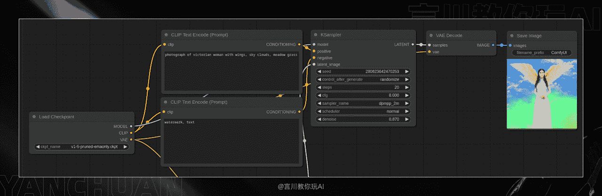

## **ComfyUl特点**

【节点式工作流】通过组合不同的节点来创建工作流

【高度可配置】用户可以根据自己的需求调整节点参数

【支持多种功能】包括文本到图像、图像修复、使用LORA等

【易于共享和重复使用】每个文件都是一个可重复的工作流程

【可控性强】这点很重要

【费用】免费，当然，这点也很重要

# 二、界面对比

---

> ComfyUI 提供了极高的自由度和灵活性，支持高度的定制化和工作流复用，同时对系统配置的要求较低，并且能够加快原始图像的生成速度。然而，由于它拥有众多的插件节点，以及较为复杂的操作流程，学习起来相对困难。

>

> 另一方面，WebUI 特点是拥有固定的操作界面，使得其易于学习和快速上手。经过一年多的发展，它已经建立了一个成熟且稳定的开源生态系统。但相比 ComfyUI，在性能方面可能稍逊一筹，且在工作流程复制方面存在局限性，用户需在每次操作时手动进行设置。

>

> 因此，建议初学者从 WebUI 开始入手，熟悉后再考虑转向 ComfyUI，以充分利用 AI 工作流程，实现效率的最大化。

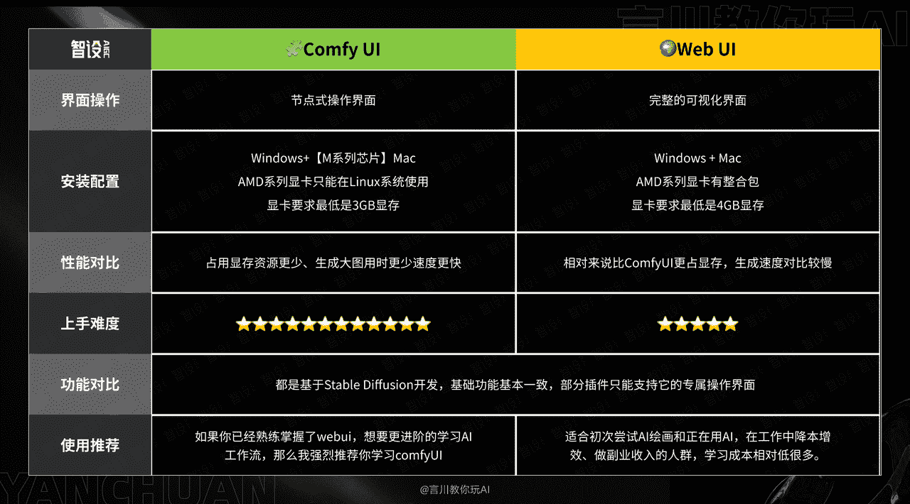

# 三、使用场景

---

1.  **图像生成与编辑**：数字艺术家、设计师和摄影师可以利用 ComfyUI 进行复杂图像生成和深度编辑。

1.  **AI 研究与实验**：AI 研究人员和开发者可用 ComfyUI 构建和测试图像生成模型和算法。

1.  **个性化内容创作**：视频制作者、博客作者和社交媒体影响者可以快速生成个性化的视觉内容。

1.  **教育与培训**：教育工作者可以利用 ComfyUI 帮助学生理解图像处理和生成的基本概念。

1.  **游戏开发与动画制作**：游戏和动画制作人员可以使用 ComfyUI 生成游戏素材和角色设计。

1.  **产品设计与模拟**：产品设计师可以利用 ComfyUI 快速生成设计原型和视觉效果图。

# 四、使用教程

---

## ComfyUI 两种常用安装方式

> 目前的有两种常用的安装方法，分别是使用官方提供的整合包以及使用秋叶的一键启动器。这两种安装方式都很简单，安装方法也差不多一样。

> 如果你担心使用官方整合包会出现各种奇怪的报错，那么可以安装一键启动器，他能规避一些报错。

> 秋叶的启动器会内置一些插件和模型，拥有专属的图形化界面，后续更新版本以及安装插件比较方便，下面我会把这两种安装方式都演示一遍，大家可选一种安装方式来完成 comfyUI 的本地部署。

### 官方整合包

+   **ComfyUI 官方下载地址：**https://github.com/comfyanonymous/ComfyUI/releases

+   **百度网盘下载地址：**https://pan.baidu.com/s/1En4GzyH4fpFliZFLdkaPCw?pwd=cadj 【提取码：cadj 】

+   进入 Github 下载或者是通过我们为大家准备好的百度网盘链接下载：

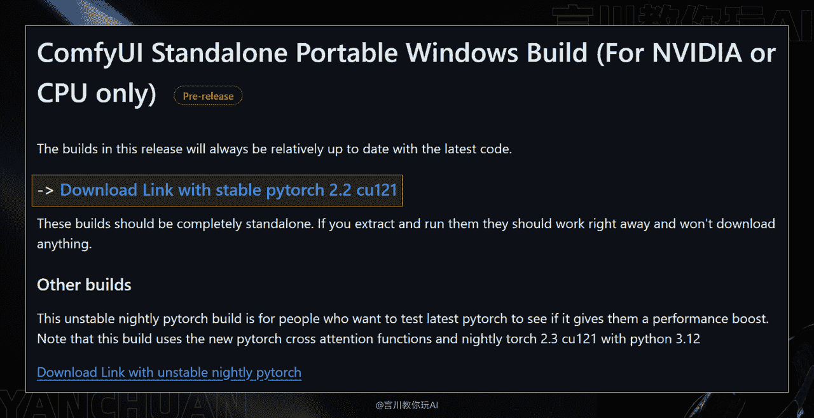

**下载完成后，我们点**击文件夹进入，你会看到这些**文件夹，其中【c**omfyui】文件夹是运行程序**的根目录。【update】**文件夹是版本升级文件夹，下面的【run_cpu.bat】文件指的是用 CPU 运行 ComfyUI，【run_nvidia_gpu.bat】那就是用 GPU 运行 ComfyUI 界面了。其他文件就不用管了，我们只需要知道这几个文件夹的作用即可：

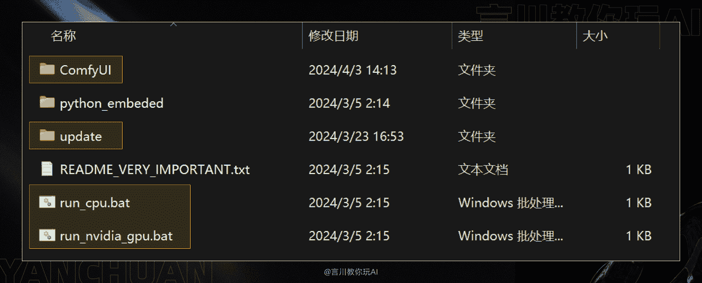

所以我们在完成安装包下载后，就可以直接运行 ComfyUI 了，双击【run_nvidia_gpu.bat】即可启动。

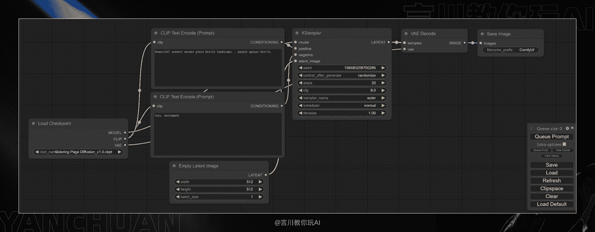

### 一键启动器

+   秋叶安装视频：【AI 绘画】ComfyUI 整合包发布！

+   网盘链接：https://pan.baidu.com/s/1VlaNtKWpmtrReR7X2QWCIg?pwd=nv0s 【提取码：nv0s 】

秋叶的一键启动器也比较无脑，直接下载安装包即可，它的优势之处就是能避免官方整合包出现的代码报错，以及他下载节点插件都会更方便一点。

打开 ComfyUI 的根目录，找到启动器文件，直接双击启动即可：

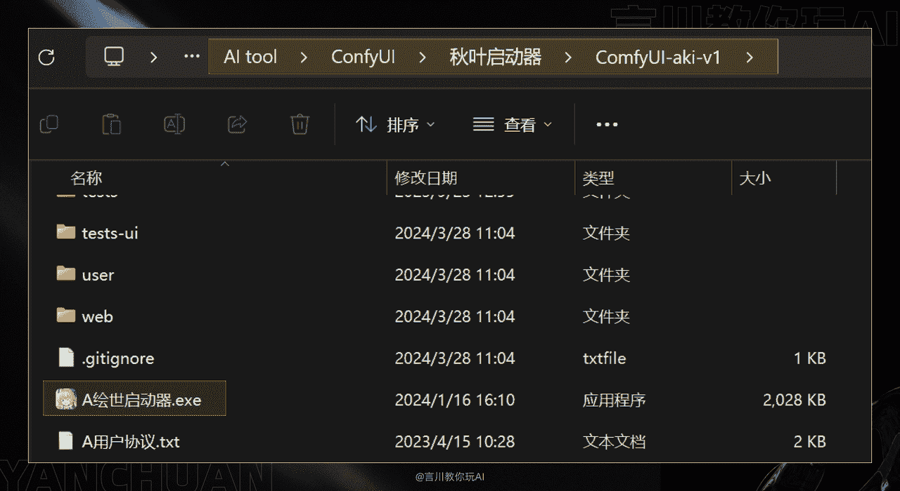

ComfyUI 启动器的 UI 界面与 WebUI 启动器界面一致，功能不同而已，所以插件安装、版本升级就不说了，直接点击【一键启动】即可。

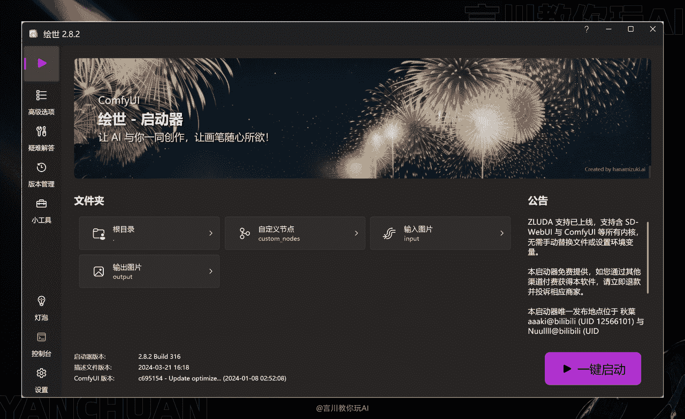

## 如何安装模型

注：官方整合包和一键启动器操作一样

### 独立模型安装

首先我们先来说下，在 ComfyUI 中如何安装大模型、Lora 等一系列模型。（以官方整合包为例）

进入到 ComfyUI 根目录，找到这个【Models】文件夹，双击进去。

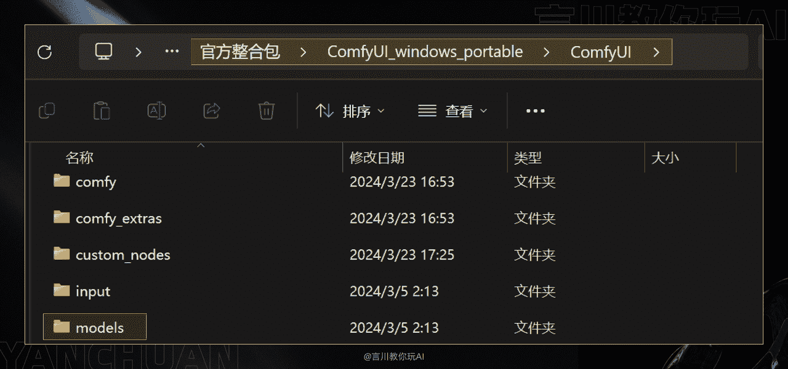

进来之后你就会看到以模型名称命名的文件夹，如 Checkpoints（大模型）、Loras、controlnet 等，我们只需要进入对应的文件夹，把正确的模型安装进去即可。

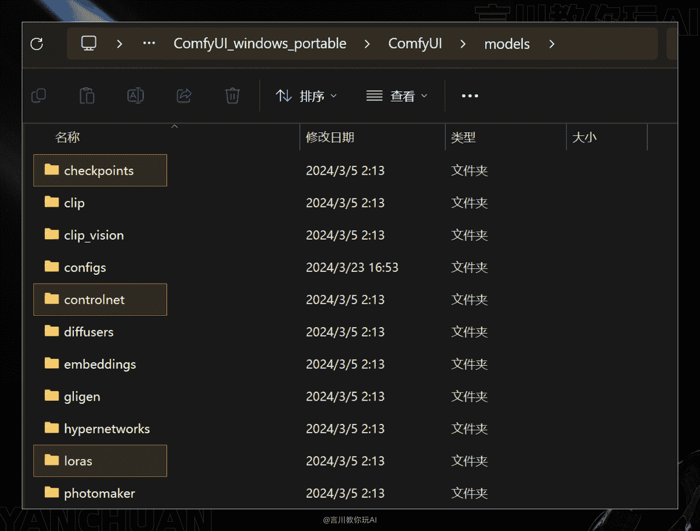

### 共享模型设置

除了 ComfyUI 独立安装模型以外，它还支持与 webUI 共享同个模型文件夹，好处是不用重新安装之前安装过的模型，同时也是避免占用硬盘空间，这步操作大家都应该学会。

同样，我们还是打开 ComfyUI 根目录，找到这个【extra_model_paths.yaml.example】文件夹：

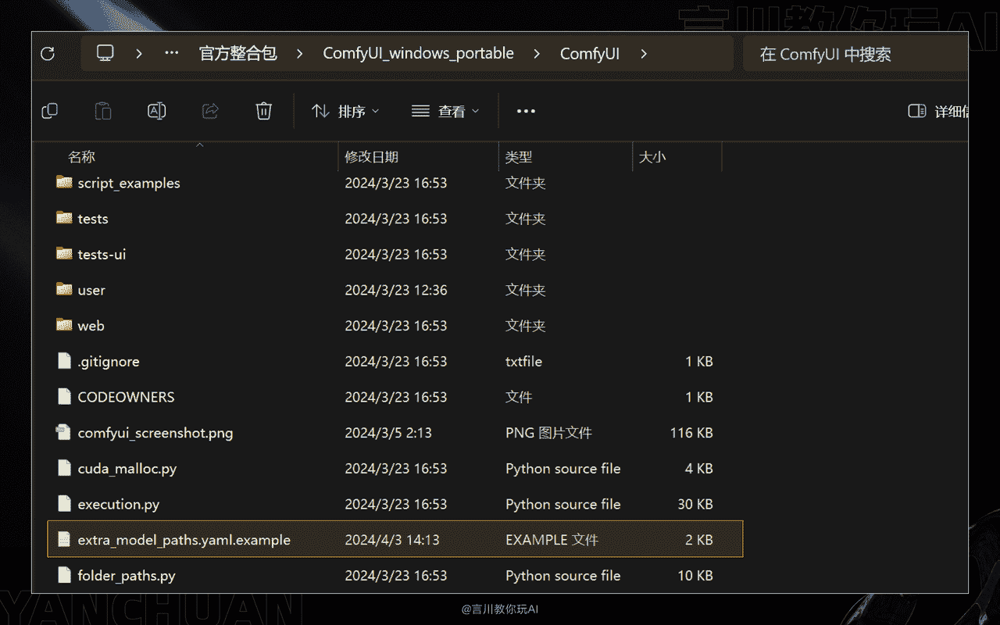

用记事本打开该文件，然后在记事本中，把【base_path】后面的路径换成 WebUI 的根目录：

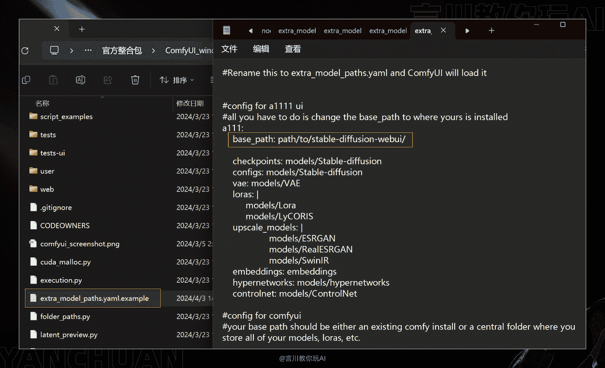

正确的文件路径是我这样的，然后我们只需要按【ctrl+s】保存该文件即可。

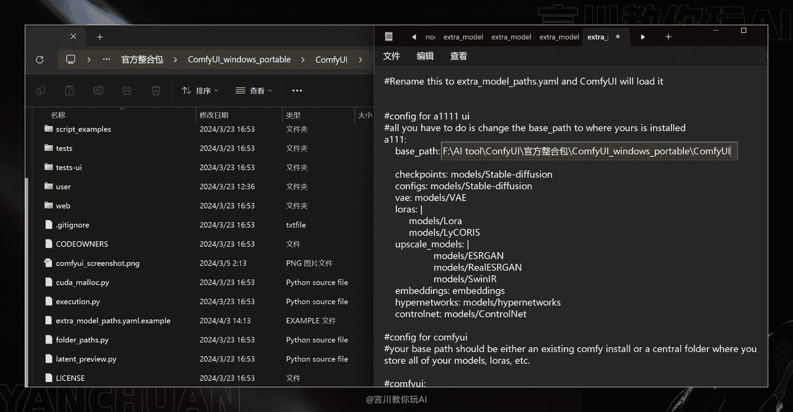

还没有结束，我们还需要把该文件的名称【extra_model_paths.yaml.example】改为【extra_model_paths.yaml】

也就是删除。example 后缀。

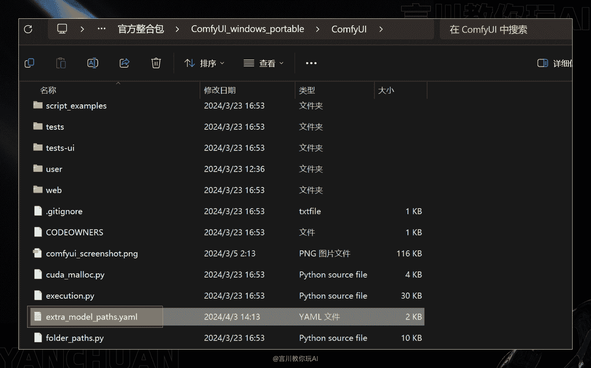

然后我们启动 ComfyUI，到模型节点检查下模型是否同步了，如果你是按照我的操作流程做下来的，那么你应该跟我一样模型同步成功了，

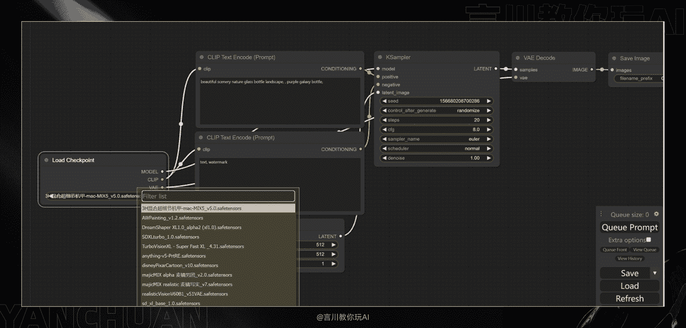

### ComfyUI 中的节点

节点是 ComfyUI 工作流中的核心组件（与 WebUI 中的插件类似），它们代表了不同的操作和功能。节点可以是采样器、模型、提示词等，通过节点之间的连接，我们可以构建出复杂的工作流程。节点的配置和连接方式直接影响最终的输出结果。

而节点有分为两种，分别是官方原生节点以及用户开发的自定义节点，这些节点共同构成了 ComfyUI 的节点工作流，使得用户可以设计和执行各种基于 Stable Diffusion 的复杂流程，接下来我为大家详细介绍下这两种节点。

**原生节点**

官方原生节点是 ComfyUI 开发团队提供的一系列基础节点，它们为用户提供了广泛的功能和工具，以支持图像生成和其他相关任务。比如采样器节点、模型节点、提示词节点、VAE 节点等

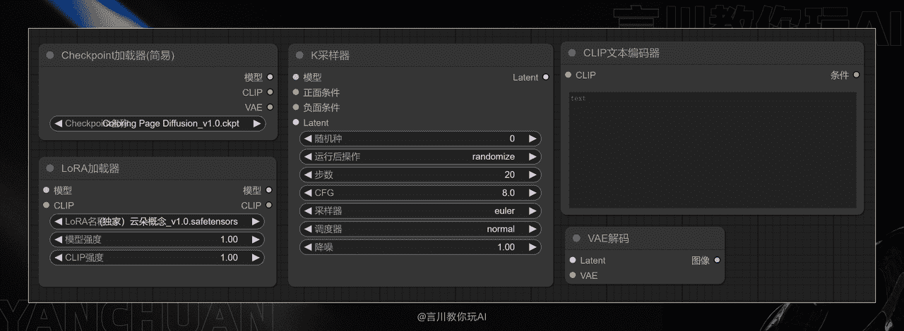

简单来说原生节点是不需要我们进行二次安装的，ComfyUI 安装成功后直接可以使用。

**自定义节点**

ComfyUI 的强大之处在于其可扩展性，用户可以根据自己的需求开发自定义节点。目前来自全世界各地的社区成员已经贡献了 600 多个自定义节点（截至本篇教程的已知数据），极大地丰富了工作流的设计和优化选择。

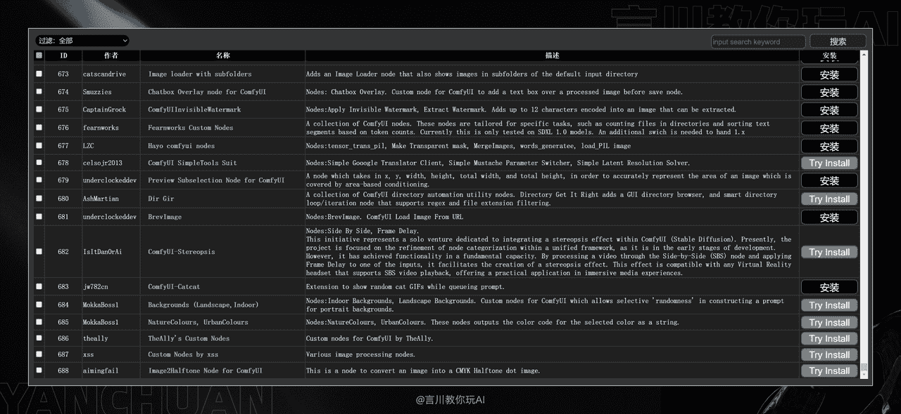

并且官方原生节点和用户开发的自定义节点可以结合使用，创建高度定制化的工作流。用户可以利用官方节点构建基础流程，然后通过自定义节点添加特定的功能或优化现有流程。

注：自定义节点与 WebUI 中的插件类似，与原生节点不同的是需要我们进行手动安装才能使用。下面我就给大家介绍下如何安装自定义节点。

## **自定义节点安装**

自定义节点的安装方式可以归纳为三种，分别是官方安装方式、启动器安装方式和节点管理器（Manager）安装。我就直接总结下：

+   官方版安装：安装步骤多，比较麻烦，不推荐使用；

+   启动器安装：简单快捷步骤少，但需要关掉运行后台才可安装，可作为备选安装方案；

+   节点管理器（Manager）安装：不需要重重启运行后台，安装即用，非常方便。

那么下面我会为大家介绍一下这三种安装方式，这些方法都是相辅相成的，可以不用但是需要了解。

注：不管是哪种安装方法，自定义节点文件都是放在 ComfyUI 的【custom_nodes】目录中。

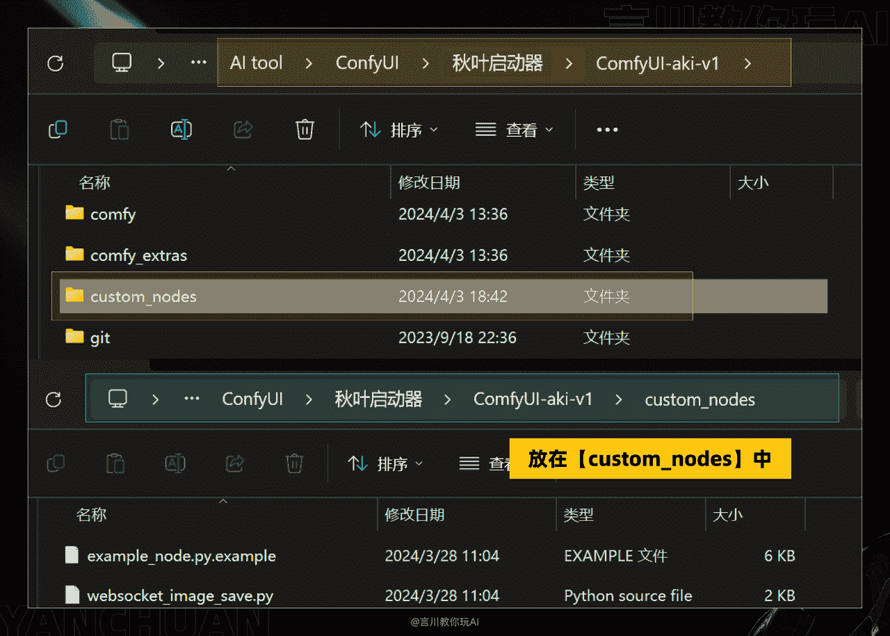

### 官方版安装

+   **在线安装**

首先需要下载一个叫 Git 配置管理的应用，这是官方下载地址：https://git-scm.com/download/win

同样也可通过我们为大家准备的网盘下载，下载之后安装即可。

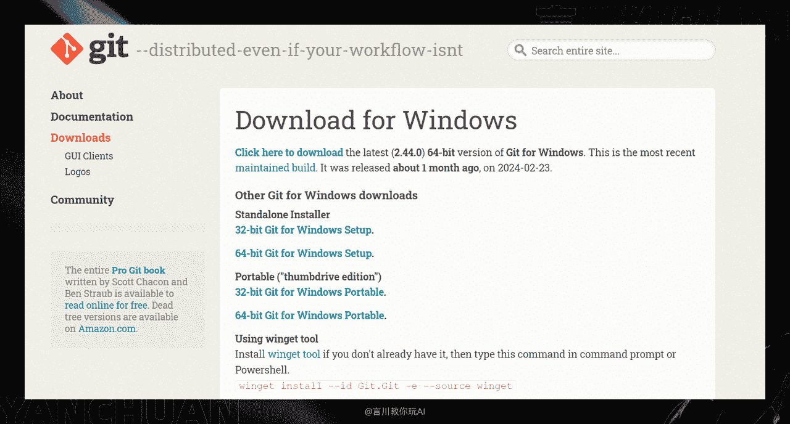

安装完成后进入【custom_nodes】目录中。在文件路径中输入【CMD】调出命令行，在文件路径后面输入“git clone+空格+节点”的代码仓库地址，比如图中演示的：【git clone https://github.com/ltdrdata/ComfyUI-Manager.git】，然后点击回车等待下载完成即可（需网络）。

安装完成后，你的【custom_nodes】文件中就会出现所安装的节点文件，如图所示：

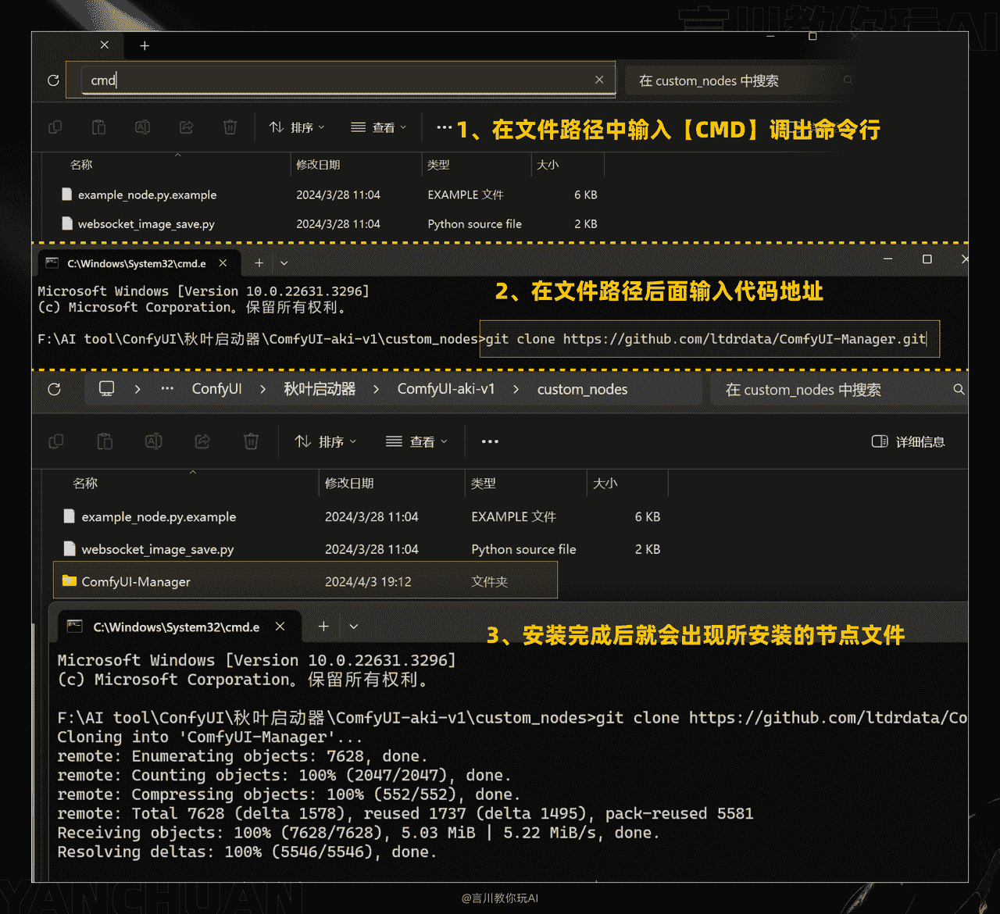

这样的安装方式不知道大家能不能接受，不难但是麻烦，你可能也会遇到报错，如果你使用这种方式报错了，那么不要着急，也可以用本地安装的方法。

+   **本地安装**

我们进入到节点的代码仓中，去到节点的代码仓中下载压缩包，解压后放到【custom_nodes】目录中即可，不过通过这种方式，我们无法通过在线更新的方式更新节点，慎用。

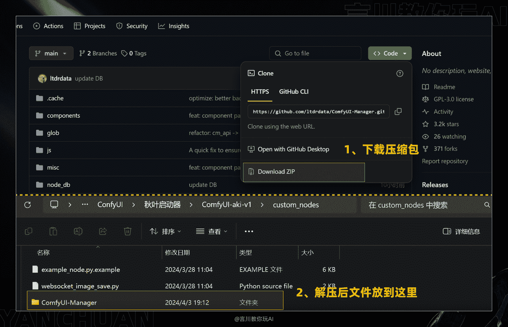

以上就是官方版的安装方式，如果你是官方原生整合包的玩家，可以通过上面两种方式进行安装。但是如果你用的是秋叶启动器，那么就不需要这么麻烦了。

### 启动器安装

启动器安装很简单无脑，【打开启动器——点击版本管理——点击安装新扩展——搜索节点名称——安装】简单几步就可以完成。

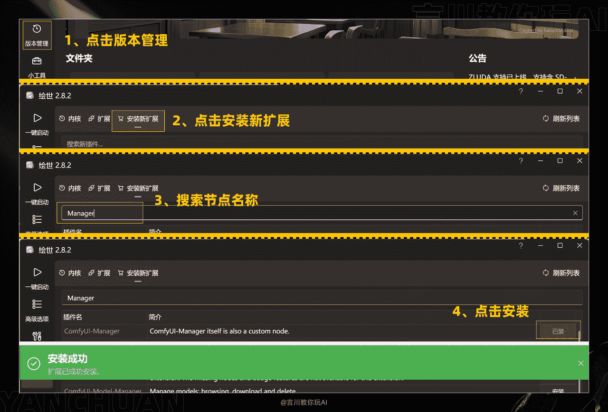

安装完成后进入到【扩展】中就可以看到安装的节点，后续更新节点点击一键更新，非常的方便。

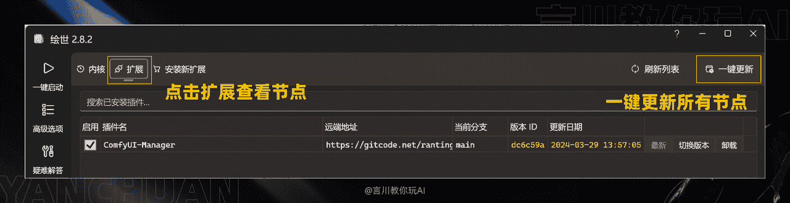

如果你是启动器玩家，那么恭喜你，该节点的安装方式就介绍完了，非常简单是不是，如果你不想把时间耗在无聊且痛苦的安装上，启动器运行 ComfyUI 是你的不二选择。

### 节点管理器

接下来，就是咖位最重的这位了，我也把它放在最后介绍，原因有两点：

1、它就是一个自定义节点，需要先使用前面任何一种安装节点的方式进行安装。

2、当你安装好这个节点后，前面两种安装节点的方式都可以淘汰。

那么这个节点管理器就是【ComfyUI Manager】

ComfyUI Manager 介绍：ComfyUI Manager 是一个自定义节点工具，它提供了一系列管理功能，包括安装、移除、禁用和启用 ComfyUI 的各种自定义节点。

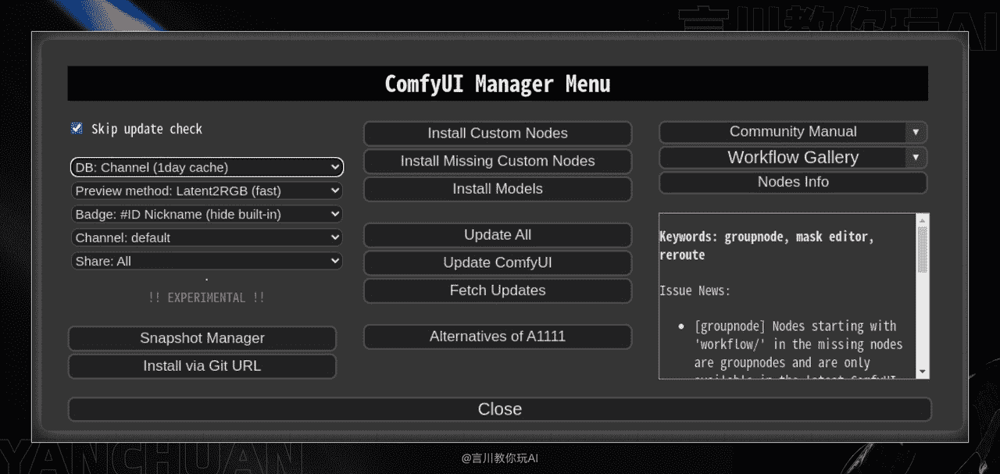

你可以理解为它是 webUI 中的【扩展】，安装【ComfyUI Manager】后，你就可以像在 webUI 扩展中安装和管理插件一样，非常便捷的安装各种自定义插件，无论你是使用“官方整合包”还是“启动器”，这个是必备的节点。

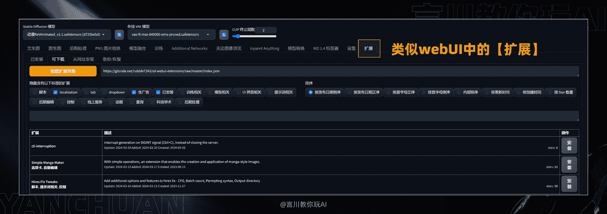

注：安装启动器的玩家，启动器已经安装了很多常用插件（包括 Manager），代表着你不需要重复安装 Manager。

那这个节点怎么安装呢？想一下.......

是不是前面两种安装方式演示的案例，都是这个【ComfyUI Manager】自定义节点，所以你就可以用到前两种安装方式的任意一种来安装【ComfyUI Manager】，这里就不重复讲解了，往前翻一下安装该插件即可。

那么安装完成之后，运行 ComfyUI，在工作区右下角就可以找到【Manager】位置。

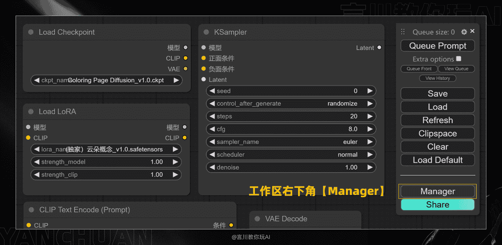

## 中文汉化节点安装

### **AIGODLIKE 介绍**

AIGODLIKE-ComfyUI-Translation 是一个为 ComfyUI 设计的多语言翻译插件，旨在将 ComfyUI 的界面和功能本地化到不同的语言环境中。这个插件实现了对常驻菜单栏、搜索栏、右键上下文菜单、节点等的翻译。

**节点官方地址：**https://github.com/AIGODLIKE/AIGODLIKE-ComfyUI-Translation

**目前支持的语言：**

简体中文 （zh-CN）、繁体中文 （zh-TW）、英语 （English）、日语 （Japanese）、韩语 （Korean）

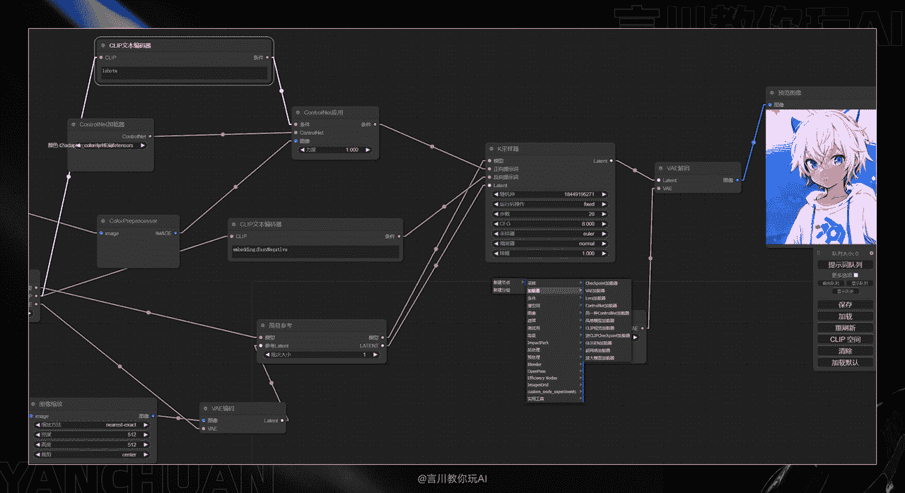

### **汉化节点安装**

打开 manager 界面，你就可以里面安装其他节点了，看着有点头疼是不是（全是英文），没关系，接下来我就教你如何使用【manager】安装汉化插件。

点击【Install Custom Nodes】按钮，这个按钮翻译过来就是【安装自定义节点】：

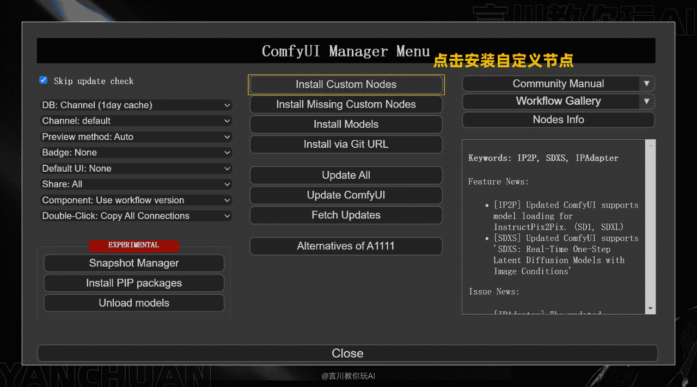

在右上角的搜索框中输入【AIGODLIKE】，点击【search】搜索。

下方会出现三个自定义节点，第一个【AIGODLIKE-COMFYUI-TRANSLATION】就是我们需要安装的汉化节点，点击最右边的【Install】安装即可（需网络）。

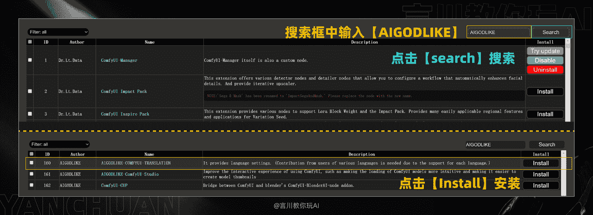

然后点击【Restart】重启 ComfyUI 即可，如果你出现安装失败的问题，那就需要检查你的网络了（小声 BB）。

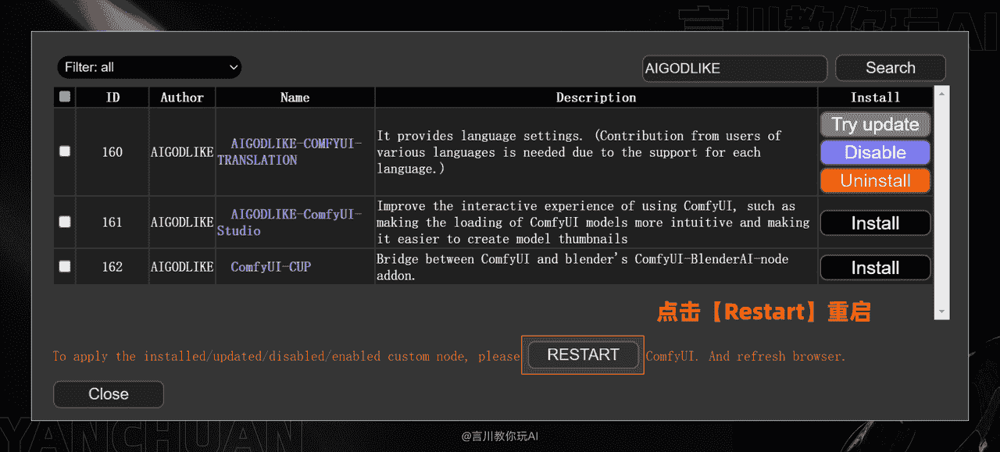

安装完【AIGODLIKE】节点后，第一步点击右下角的设置图标，第二步在弹出的设置界面找到【langualge】功能，第三步切换中文界面就可以了，不需要重启即可完成界面汉化。

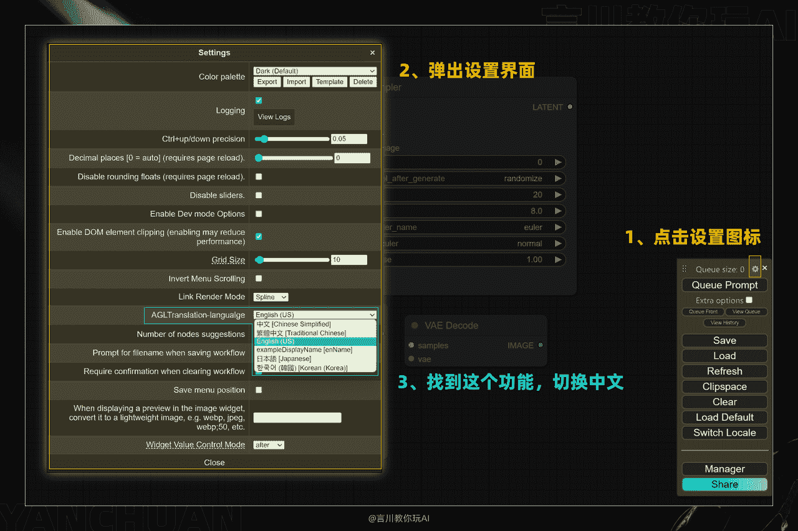

### **语言快速切换**

该**插件还支持快速切换，比如我们目前使**用的是简体中文，点击切换语言【Swich Locale】即可一键切换英文，再次点击就可切换中文。注：如果你上次切换的是繁体/韩语，一键切换就会从繁体/韩语到英文直接切换。

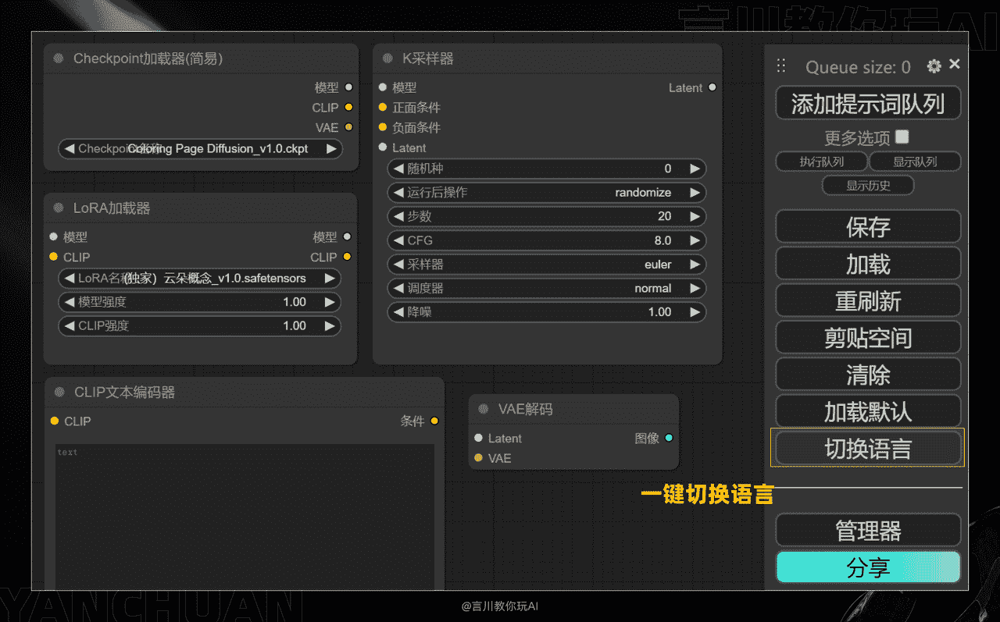

经过对 ComfyUI 的详细介绍，以及逐步完成节点汉化安装，现在一切准备就绪。

恭喜你，正式踏入 ComfyUI 的创作世界！

## 文生图工作流搭建

下面我们就开始 ComfyUI 工作流的搭建，我会教大家一步步完成文生图的工作流。

在此之前，我们需要先了解一下在 ComfyUI 界面中，如何使用快捷键来帮助我们便捷操作。

### 快捷键介绍

这里我们参考官方给到的快捷键，官方地址：https://github.com/comfyanonymous/ComfyUI?tab=readme-ov-file

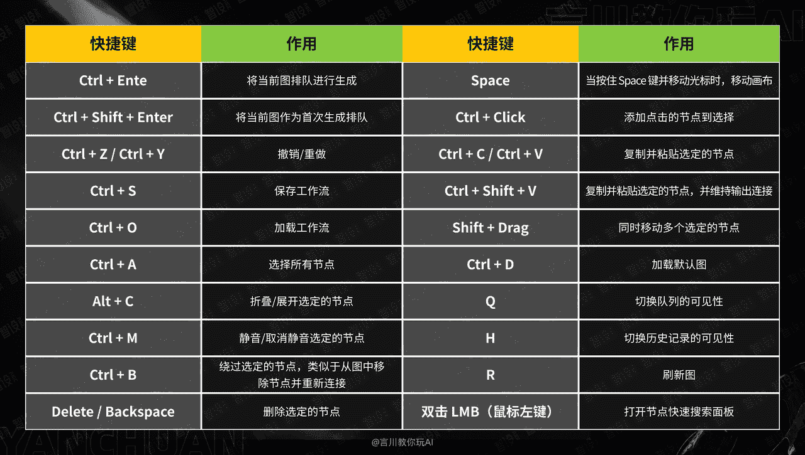

以上快捷键均为官方提供的 20 个快捷键（win），对于 macOS 用户，Ctrl 键可以替换为 Cmd 键。实际操作中会用到哪些快捷键我会在接下来的操作中给大家指明。

### 6 步文生图工作流搭建

接下来，我以实操的方式带你一步步搭建文生图的工作流，你不需要在刚入门的时候做笔记，去记那些枯燥乏味的功能，因为我认为只有实际的操作一遍，才能掌握那些功能，明白各个功能的作用，这也是我一贯的教学思维。

首先，如果你首次启动 ComfyUI 界面，那么你的界面中会有一套默认的文生图工作流（当然你之前使用过 ComfyUI，那么它会默认加载你上次关闭的工作流）。

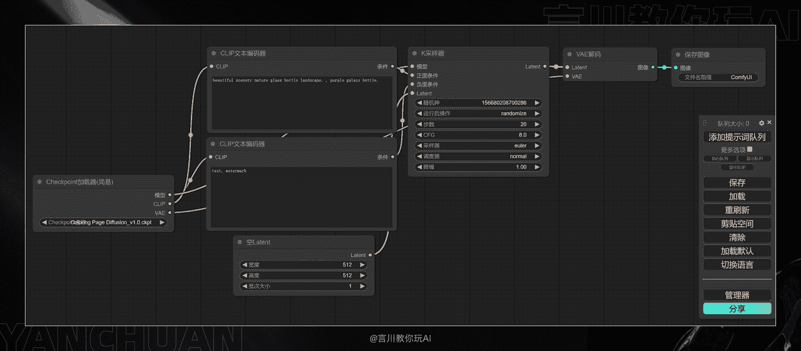

我们接下来要搭建的工作流就是这套默认的文生图，其目的就是让大家亲手搭建一下工作流，大家可以提前看看。

然后我们点击左下角功能区的【清除】，删掉界面中的工作流节点。

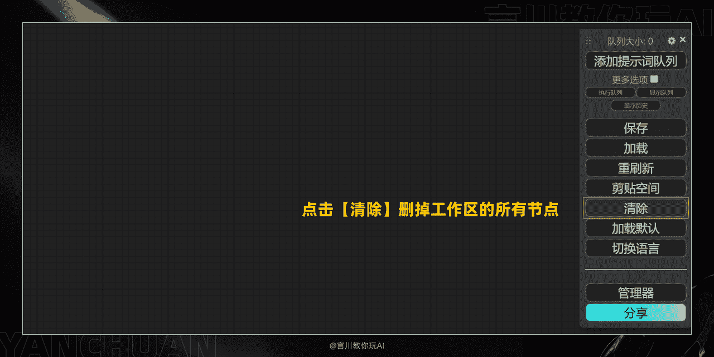

**第一步，添加【K 采样器】**

在工作区的空白处，单机鼠标右键调出节点功能区，选择采样——K 采样器，那么我们的工作区中就会添加了一个采样器节点。

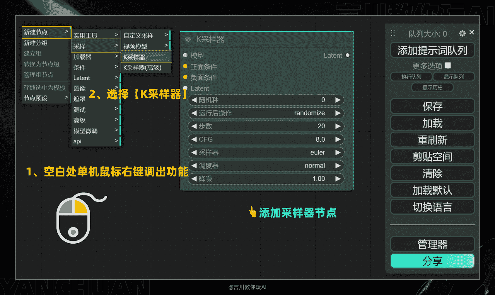

先来介绍下【K 采样器】中的几个参数设置：

第一个随机种，对应 webUI 中的 seed 值，每生成一张图就会显示该图的数值，默认为 0；

第二个运行后操作，里面有四个选项，固定、增加、减少、随机；

这两个参数是搭配使用的，固定代表着固定该张图片的数值，增加/减少为 +1 或 -1 数值，随机就代表着随机数值，熟悉 webUI 的同学应该很容易明白，一般我们就使用固定或随机即可。

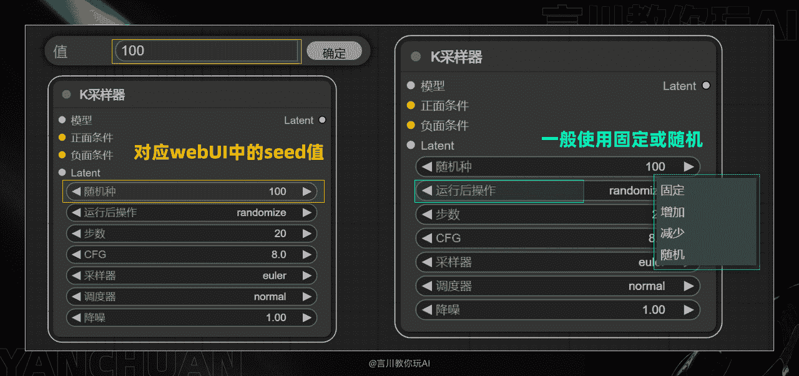

步数指的就是 webUI 中的迭代步数，一般设置为 30-40 左右；

CGF 对应 webUI 中的提示词相关性。参数越大，图片效果越接近提示词。参数越小，AI 发挥空间越大，图片效果与提示词差异越大。一般设置在 10 左右就好，默认为 8。

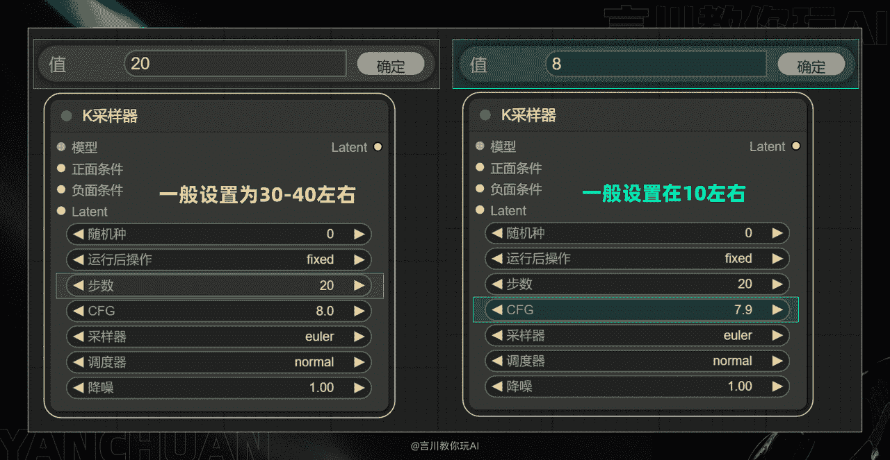

采样器是与调度器结合一起使用的，对应着 webUI 中的采样方法，比如我们常用的 dpm++_2m Karras

采样器一般使用优化后/最新的采样器：euler_ancestral （简称 euler a）、dpmpp_2m 系列、dpmpp_3m 系列

调度器一般使用 normal 或 karras，具体它们的原理大家有兴趣可以 GPT 一下。

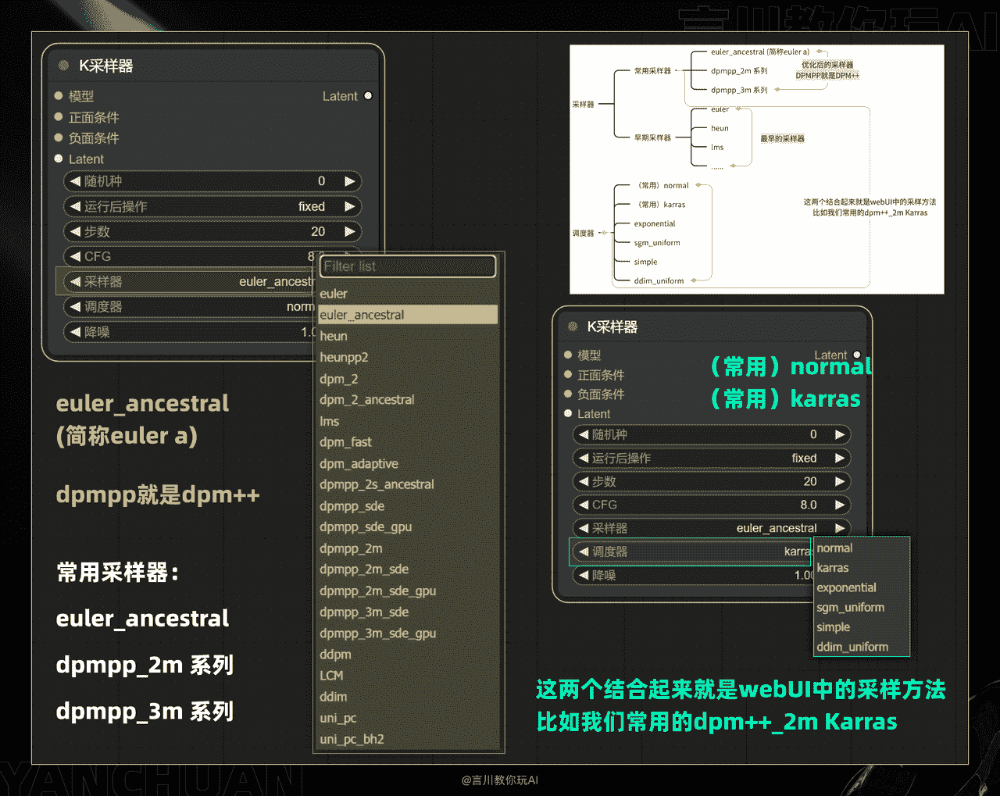

降噪这个参数基本上我们不用动，它是与迭代步数对应，默认 1 不动就行。

**第二步，添加【加载大模型】**

如图所示，直接拖动模型连接点即可调出功能区，并添加【Checkpoint 加载器】即可，后面添加节点的方式可以复用此操作，不重复演示该操作。

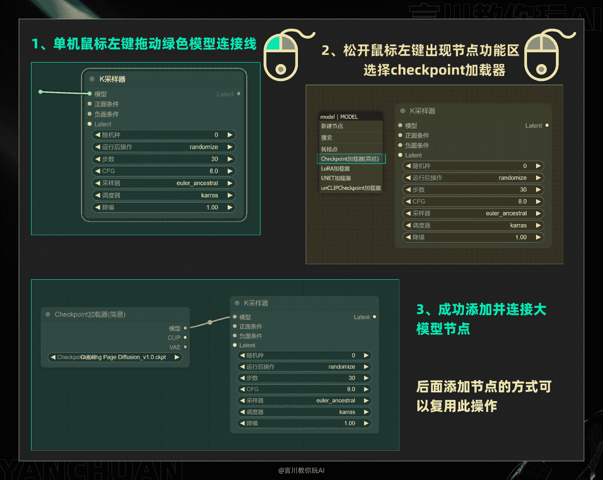

**第三步，添加【正反向提示词】**

用上述的方式添加正向提示词输入节点，如图所示：

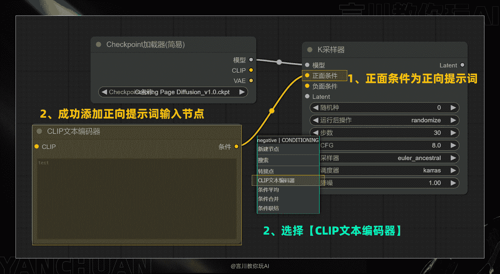

反向提示词输入区也可用同样的方式添加，即拖动【负面条件】的连接点。

不过这里我们演示复制粘贴的方式，选中【CLIP 文本编码器】节点，Ctrl+C 复制，然后 Ctrl+V 粘贴，再把两个颜色的节点连接起来即可：

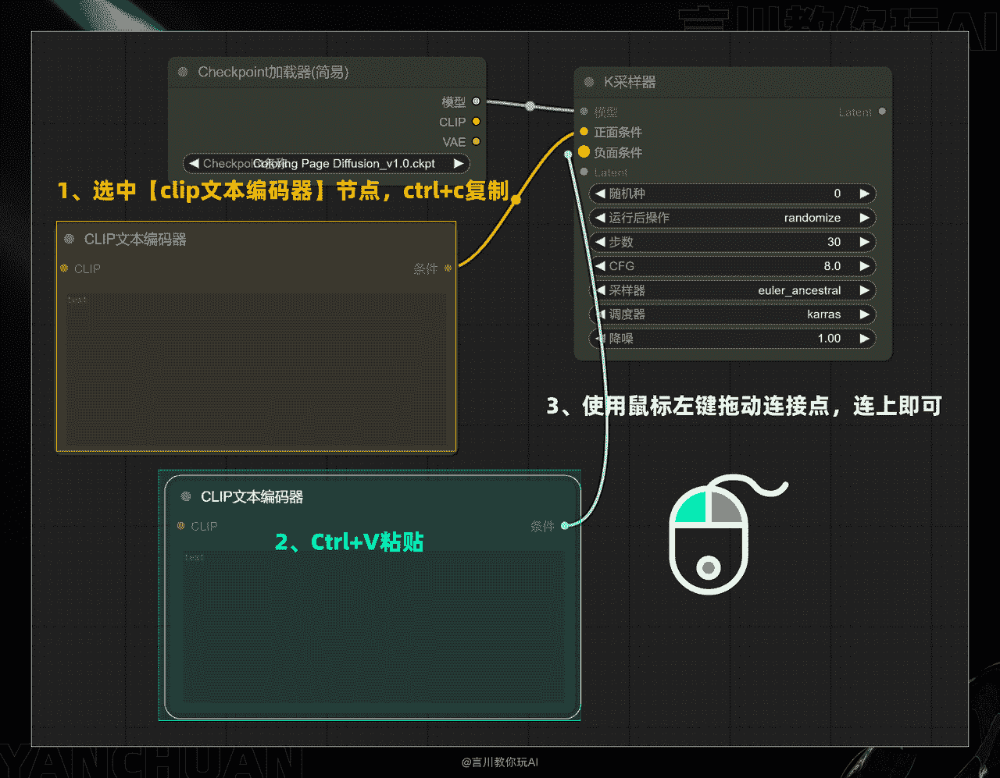

或者是选中【CLIP 文本编码器】节点，按住键盘的 alt+鼠标左键拖动也可以复制一份节点，大家可自行尝试。

**第四步，添加【图片尺寸/批次】**

**拖动【Latent**】连接点，选择【空 Latent】即可添加【图片尺寸/批次】节点，该节点有宽度、高度和批次大小参数调节，这几个参数不解释了，会 webUI 一看即懂。

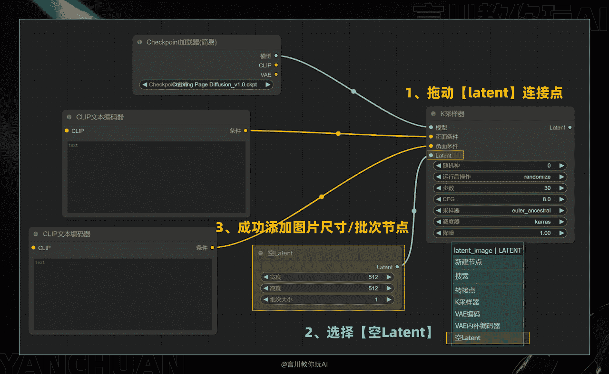

**第五步，添加【VAE 解码器】**

拖动【Latent】连接点，选择【VAE 编码】即可添加 VAE。

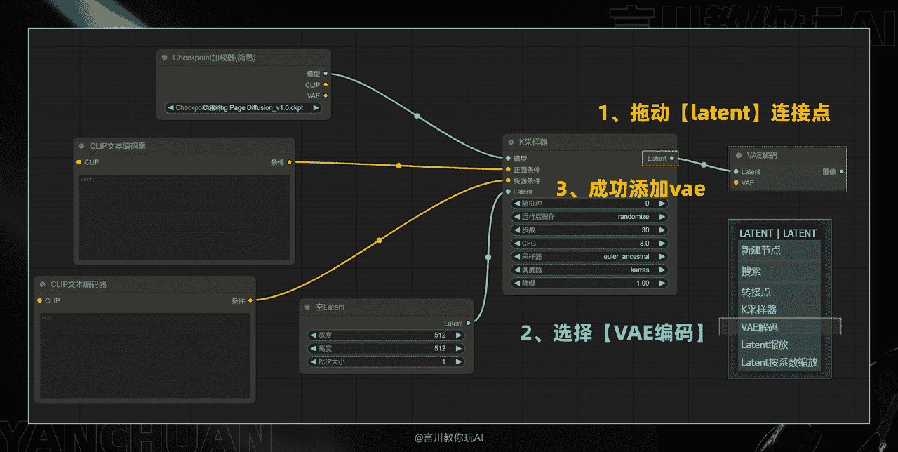

**第六步，添加【图片生成区】**

拖动【图像】连接点，选择【预览图像】即可成功添加图像生成区。

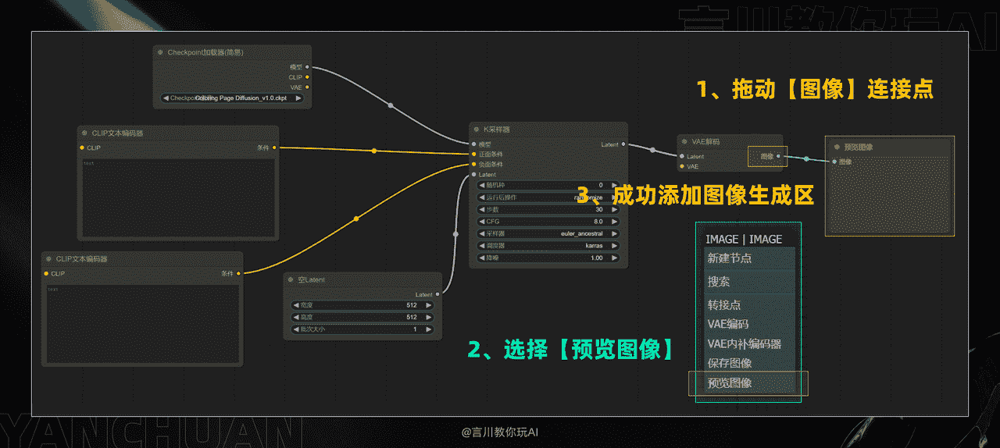

到这里，整个文生图所需的节点都已经成功添加了，此时我们可以点击【添加提示词队列】进行生图测试，在此之前我们在正向提示词中输入一个提示词（如 a girl）。

注：【添加提示词队列】就是生成图片的按钮。

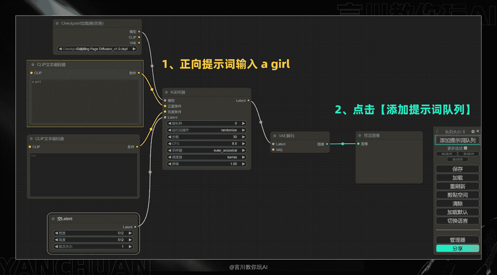

如果此时你跟我一样，点击生成，那么你会出现这样的报错，看图中的红色框中的提示以及节点上的红色标注。出现这样的原因是因为我们的这些标红的节点没有连接上。

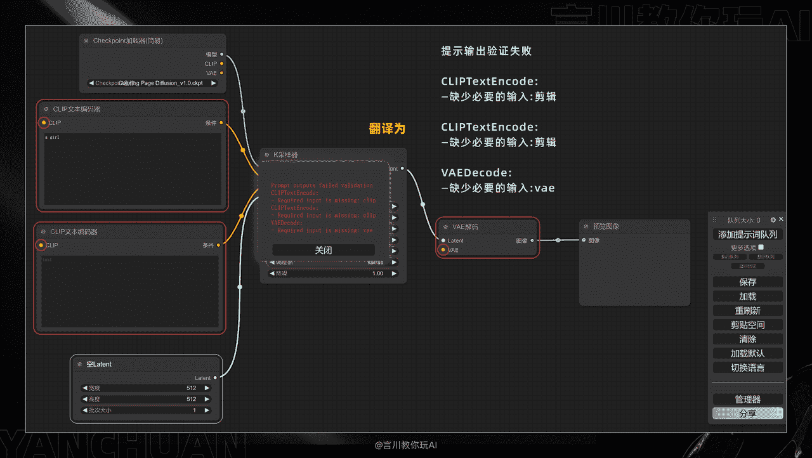

那么接下来我们就需要修正这些错误节点，把节点都连接上。注意连接点上的颜色，如果是黄色的连接点就需要与对应的黄色连接点相连（名称对应），如图所示：

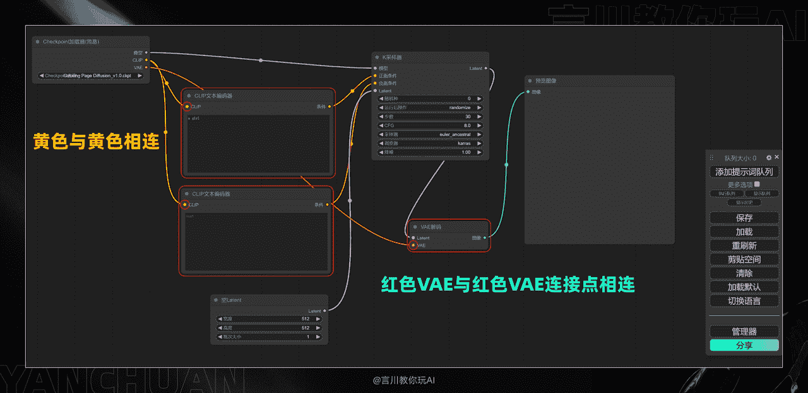

那么我们再次点击生成，恭喜你，这套文生图工作流就已经成功搭建完毕了。

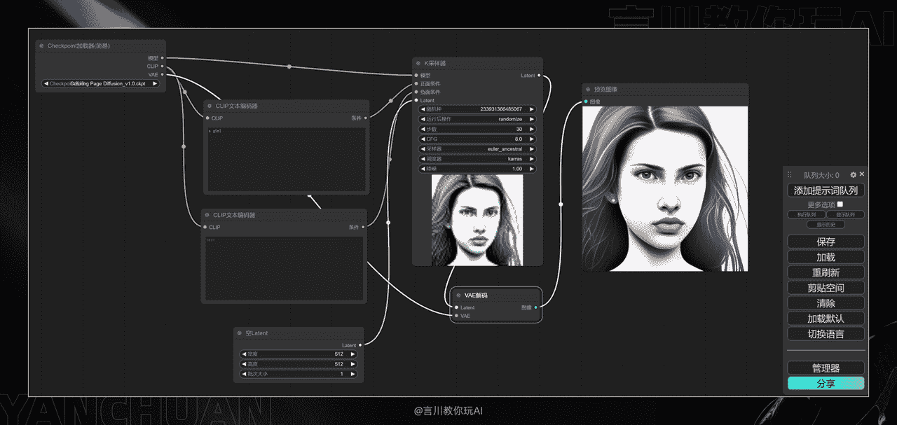

**下面再给大家补充几点：**

1、我们上面添加的图片生成区选择的是预览图像，预览图象顾名思义，就是生成的图片是预览状态，需要我们手动保存。在图片上单击鼠标右键，选择保存图像即可下载该图像。

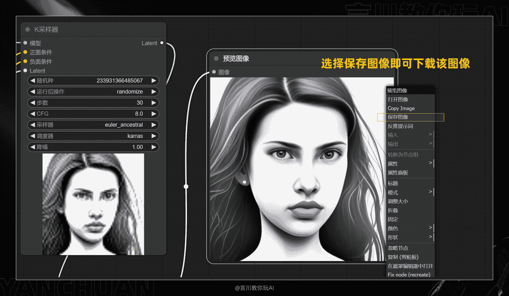

那么有没有像 webui 中生图那样自动保存到本地文件夹呢，是有的。

把预览图像删除，再次拖动【Latent】，选择【保存图像】节点即可。

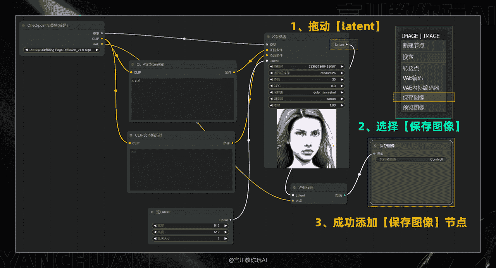

那么我们再次生成的图片，就会自动给我保存到本地。我们可以进入到 ComfyUI 的根目录文件夹中的【output】查看，如图所示：

2、目前我们添加的 VAE 节点是直接连接到大模型节点上的，有些大模型是自动 VAE 而有些没有，能不能与 webUI 中一样自己手动添加 VAE 呢，也是可以的。

删掉连接大模型的连接线，在 VAE 连接点处拖动，选择【VAE 加载器】，既可看到我们熟悉的 840000 VAE。

## 工作流复用

到这里你已经基本上学会如何操作 ComfyUI 出图了吧，那我们现在用学到的技巧在 comfyUI 中做一个超酷的工作流吧，如图所示：

不知道你看完是什么感受，是不是想卸载 ComfyUI 了？如此多且复杂的节点，看着头大。

莫慌，我可没说让你自己搭建这套工作流。ComfyUI 除了自由度和灵活性高，它还有最大一个特点就是可以直接复用别人分享的工作流，只需一个很小的文件或者是一张图片，上面这一套工作流就可以直接复用到我们的界面中。

所以下面我就会给大家分享如何操作，往下看：

### 保存工作流

首先，先来保存我们自己搭建的工作流。

以前面搭建的文生图工作流为例，首先点击功能区的【保存】，然后你的浏览器会出来一个弹窗，你可以进行文件命名，点击确定后浏览器会下载该文件，也就是带“json”后缀的文件，这样我们的工作流就打包成一份文件了。

### 加载工作流

那么我们如何加载工作流呢？这里分享两种常用方式：

1、我们点击功能区的【加载】，然后选中我们保存的 json 文件，点击打开，那么我们保存的文生图工作流就出来了，很简单。

2、图片加载。我们使用 ComfyUI 生成的图片，图片会带有该生成的工作流。这也就意味着，我们可以直接通过图片加载工作。

操作方法有两种，第一个方法就与上面一样，点击【加载】，选择生成的图片打开，工作流就出来了。

还有一种方法是直接把生成图拖进工作区中，那么也可以加载工作流。

请注意，图片加载工作流一定是 ComfyUI 生成的图片才可以，你别拖一张自己的自拍上去了🤣

以上就是两种常用的加载方式，当然还有一些别的方式，这里不展开将，这两种难道还不够你用吗？

### 复用其他工作流

当你明白了如何保存/加载工作流后，你是不是就清楚我接下来要讲什么了？没错，ComfyUI（SD）作为一款开源软件，有很多的大佬以及开发者会分享插件、节点等等，当然也包含了很多工作流。

比如下面这个网站 OpenArt Flow | Builder，就有很多套工作流，如模特换衣、风格写真、照片修复等等，而我们只需要去下载它的工作流，就可以直接使用了。我本人还收藏了很多工作流网站，可以分享给大家，三连一下（联系我给你）

下面我们就来下载一个工作流，加载看看。如图所示，出现报错了，出现这样的问题是因为缺失节点，

思考一下前面说的，节点是不是需要下载安装才能使用，而我们复用别人的工作流，他用的节点你不一定下载了，因为目前有 600 多个节点，你不可能全部下载了吧，所以我们日后使用别人的工作流，你会经常出现这样的问题。

问题不大，我们有解决办法，还记得前面教大家安装的【ComfyUI Manager】节点管理器吗，通过它我们就可以很方便的解决这个问题，下面跟着我操作一下即可。

启用管理器，然后你会看到有一个【安装缺失节点】，顾名思义就是它了。

点开后就可以看到我一个缺失 17 个节点，那么就需要把这些节点都安装（可多选同时安装）。

再装完 17 个节点之后，点击刷新或者是重新启动运用后台（如果节点还是报错），那么这套工作流我们就可以正常的使用了。

# 五、工作流网站

---

> 什么是 ComfyUI 的 Workflow？

> ComfyUI 的 Workflow（工作流）是一个通过连接不同功能节点来定制图像生成或处理流程的可视化操作方式，让用户能够灵活地控制和优化图像的生成过程。

## 官方工作流示例

> 包含使用 ComfyUI 可实现的示例。所有图像都包含元数据，这意味着可以使用“加载”按钮（或拖到窗口上）将它们加载到 ComfyUI 中，以获得用于创建图像的完整工作流程。

ComfyUI Example: https://comfyanonymous.github.io/ComfyUI_examples/

可根据需要检索不同分类下的工作流下载使用。包含作者撰写的各种工作流的应用说明。如果想一次性下载所有工作流，可以将这个项目下载/克隆到本地：https://github.com/comfyanonymous/ComfyUI_examples

## 工作流网站

# 六、AI 模型下载网站推荐

#

---

# 学习交流社群

1.持续关注并更新 AI 的**相关资讯动态，研究报告，赚钱案**例，常见问题，永久免费在线查看，无收费内容，目标是成为最大的免费 AI 学习社群。

2.已建立社群聊聊 **AI** 发展及应用，**没进群的可以扫码加入，群满可加 AI 研究爱好者大国微信 ID：zyg90s（备**注：AI），已经在社群内的无需重复加入，开源知识库及社群学习全部为公开免费分享。

3.**关于文档负责人大国**：高帆文化CEO，曾就职于教培大厂，目前创业，主攻研究A**I落地应用、企业流量增长及达人IP孵化。联合作**者言川，站酷/优设 AI 领域大 V，AI 教程全网累计阅读量超过 500 万。

**飞书学习群**

**飞书扫码进群学习**

好友（ID：zhangyuguo94s）

**扫码加微信入微信群**

**微信扫码加好友**

（微信 ID：yanchuan-ar）

**觉得有用欢迎留个赞～**