# AI 视频工具精选

> 来源：[https://yunyinghui.feishu.cn/docx/ZfL8dAf0ro0BhMxJGtDc3pvmnld](https://yunyinghui.feishu.cn/docx/ZfL8dAf0ro0BhMxJGtDc3pvmnld)

> **适用人群：****互联网学习 AI 视频人群**

> 首发时间：2024 年 6 月 13 日

> 更新时间：2025 年 5 月 12 日

> **内容出品人：**

> **使用建议：**如果需要快速定位到精确内容，可以使用快捷键 Ctrl +F/Command +F 的形式，搜索关键字/词，查找你想要的内容，PC 端查看学习效果更好。

> **特别说明：**飞书手册内容花了大量心思做构思和整理，请勿直接抄袭复制。

> **为** AI 实验室持续更新 AI 视频的学习工具等内容，欢迎收藏转发支持，文末有惊喜，大国出品，必属精品。

| ## 视频工具导航 |  |  |  |  |  |
| --- | --- | --- | --- | --- | --- |
| [**AI 生成视频**](https://yunyinghui.feishu.cn/wiki/DKVSwZKwIixbCckQHnTckOxGnHd?table=tblRJw89xA7ovdGt&amp;view=vewR9QwYga#MDiOd3P0fonJQ9x788xczIvLn1f) | [**AI 视频总结**](https://yunyinghui.feishu.cn/wiki/DKVSwZKwIixbCckQHnTckOxGnHd#part-TSb8d5HMTozYYxxdoJ9cch2bnyf) | [**AI 视频换脸**](https://yunyinghui.feishu.cn/wiki/DKVSwZKwIixbCckQHnTckOxGnHd#part-YJa3dj01ioR9PLx7Hk4c2CRonzc) | [**AI 视频翻译**](https://yunyinghui.feishu.cn/wiki/DKVSwZKwIixbCckQHnTckOxGnHd#part-VM8udeYxNoQt0yxpc1ocigdUndm) | [**AI 数字人视频**](https://yunyinghui.feishu.cn/wiki/DKVSwZKwIixbCckQHnTckOxGnHd?table=tblRJw89xA7ovdGt&amp;view=vewR9QwYga#Ez7tdrT97ol4v9xpjp2cc8GtnbF) | [**AI视频编辑**](https://yunyinghui.feishu.cn/wiki/DKVSwZKwIixbCckQHnTckOxGnHd?table=tblRJw89xA7ovdGt&amp;view=vewR9QwYga#OsEsdK23IoUSHSxAhzlcJeRFn2e) |

# AI 视频生成

## 1）即梦

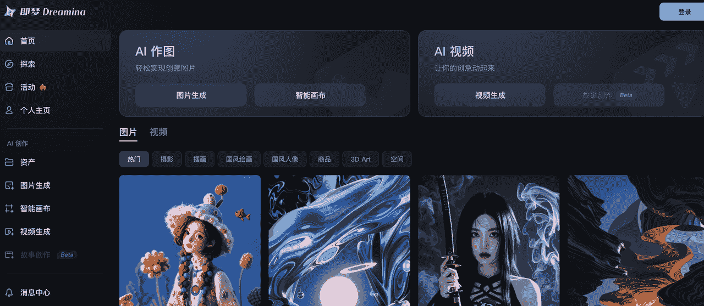

**工具介绍：**即梦Dreamina支持文字绘图、文字生成视频和图片生成视频,并提供创作灵感。

**工具优点：**

1.  界面操作友好，简单易上手

1.  动态效果表现优秀，动起来感觉明显

1.  对于图片内容的识别性高，在人物及动物的特色表情动态方向表现不错。

**是否免费：**免费体验，付费工具

**网络条件：**不需要特殊网络

**体验网址：**即梦Dreamina - 一站式AI创作平台

**使用建议：**

1.  会出现掉帧，在剧烈运动的时候会出现画面变化较大的情况

1.  图像输出分辨率有待提高

## 2）可灵

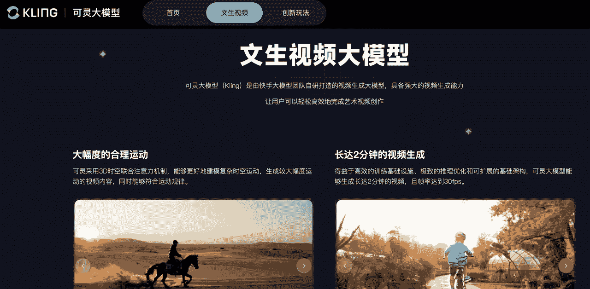

**工具介绍：**可灵是快手AI团队自研的视频生成大模型，具备强大的视频生成能力 让用户可以轻松高效地完成艺术视频创作。

**工具优点：**结合了快手自研的技术创新，可以生成长达2分钟、30fps、1080p分辨率的视频，并支持多种宽高比，据说是目前国内最好的视频工具。

**是否免费：**免费体验

**网络条件：**不需要特殊网络

**体验网址：**https://app.klingai.com/cn/

**使用建议：**目前（2024年6月）是开放邀测体验，旨在完善功能和性能，提升用户体验。

## 3）LuxReal

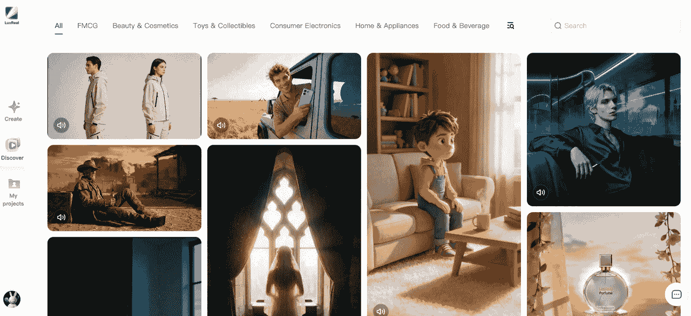

**工具介绍**

**LuxReal是****群**核科技基于3D技术所打造的AI内容创作工具。

在保证**时空一致性****的前提下，Lu**xReal提**供创作高效的Age**nt模式和精细编辑的Canvas模式，帮助视频分镜师、剪辑师等创作者快速生成叙事连贯、富有创意的AI短剧视频。

除此之外，LuxReal还为电商从业者提供商品视频创作功能，实现内容稳定性和灵活性的高度统一。

**工具优点**

1）连贯叙事：剧情生成具有一致性

LuxReal 不只是生成一张图，而是理解整个**剧本**。减少短剧**创作**的“抽卡”问题，从生成画面升级为生成剧情。

**2）创作中台：双模态自由切换**

**Agent模式****帮用户批量出图快**速验证叙事逻辑和效果；Canvas模式让用户精细修绘。把复杂的参数封装在简单的交互下。既有流水线的速度，又有手搓的精度。

3）资产复利：打造 可视化云端资产库

将每一个角色、每一个场景都变成可调用的“数字资产”。一次定义，全剧集复用，确保团队协作中核心视觉元素的一致性。

**是否免费**

新用户注册增送200credits

**网络条件**

需要特殊网络

**体验网址**

https://www.luxreal.ai/

**适用建议**

+   **关于语言**：LuxReal 目前仅上线英文版本，多语言适配正在开发中。建议您可使用浏览器的翻译功能（右键 → “翻译为中文”）查看中文内容，以便更顺畅地体验产品核心功能。

+   **关于输入**：所有涉及文字输入的字段（如描述、标签、搜索等）均支持直接输入中文，系统将正常识别并处理。

+   **反馈渠道**：如在使用过程中遇到问题、发现 Bug 或有功能建议，可加入下方LuxReal社群，或发送邮件至 support@luxreal.com。您的每一条反馈对我们都非常重要！

用户社群-AI短剧交流

## 4）Vidu AI

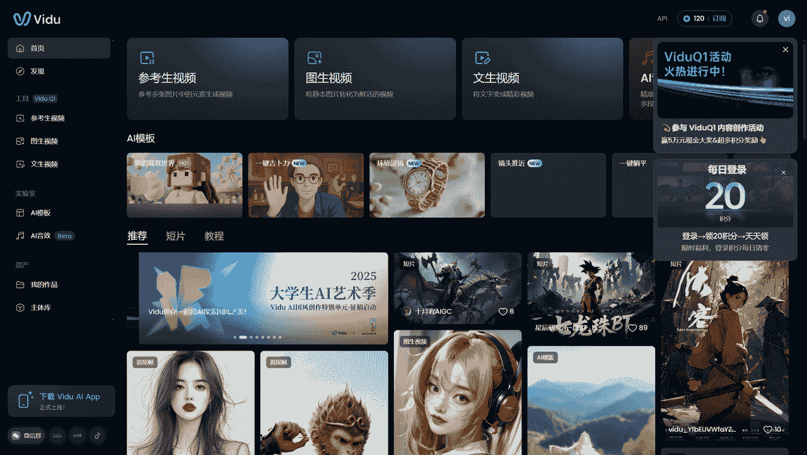

**工具介绍：**Vidu AI 是由生数科技与清华大学联合开发的 AI 视频生成工具，旨在通过人工智能技术将文本和图像转化为专业级的视频内容。它采用原创的 U-ViT 架构，结合 Diffusion 与 Transformer 技术，能够生成长达 32 秒、分辨率高达 1080P 的高清视频。Vidu AI 提供多种功能，如文本转视频、图片转视频、参考视频生成等，支持多主体一致性和多种视频风格

**工具优点：**支持文本转视频、图片转视频、参考视频生成等多种模式。可确保人物、物体、场景在视频中始终保持一致。生成的视频分辨率高达 1080P，适合多种专业场合。实测生成 4 秒视频片段只需约 30 秒。

**是否免费：**用户每天可获得 20 积分用于生成视频

**网络条件：**不需要特殊网络

**体验网址：**https://www.vidu.cn/create

**使用建议：**

优化输入描述：在使用文本转视频功能时，确保输入的文本描述清晰具体，以便 AI 更准确地生成视频。

尝试多种风格：Vidu AI 支持多种视频风格，可以根据需求选择合适的风格。

利用主体库功能：将常用的角色、道具和场景保存在主体库中，提升创作效率

## 5）智谱清影

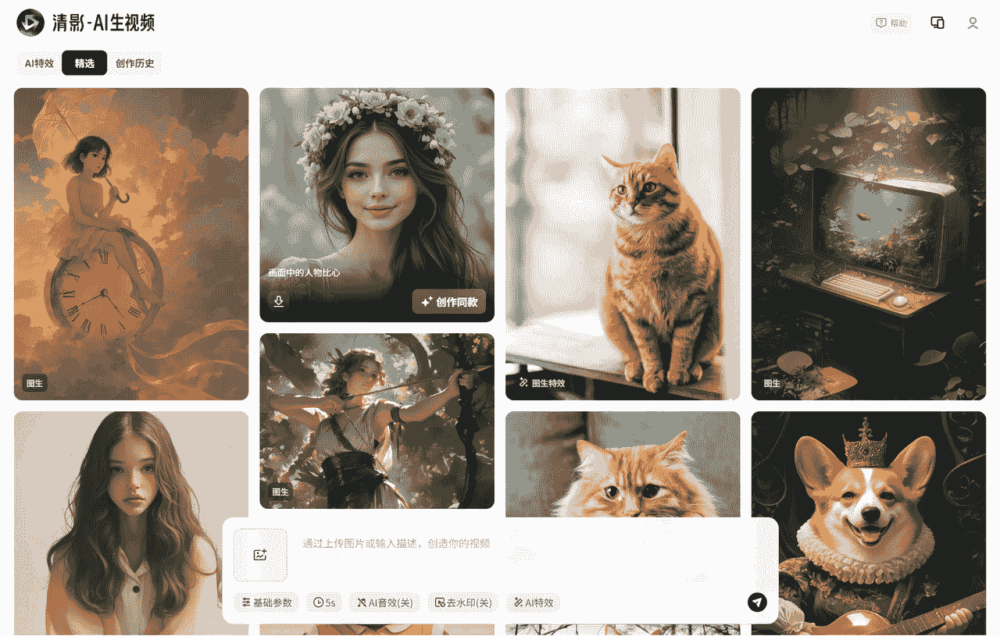

**工具介绍：**智谱清影是智谱AI推出的一款高效AI视频生成工具，输入文本或图片后，30秒内可生成10秒、4K分辨率、60帧的高质量视频。提供多种视频风格和背景音乐选项，适配个人创作（如社交媒体内容）和专业制作需求（如商业宣传）。基于CogVideoX模型，通过融合文本、时间、空间信息，显著提升视频的连贯性与逻辑一致性。

**工具优点：**

高效生成：30秒内可生成6秒高清视频（1440×960分辨率），支持4K/60帧升级版。

多模态输入：支持文本生成视频（文生视频）和图片生成视频（图生视频），适配广告、影视、短视频等场景。

高可控性：通过结构化提示词（如镜头语言、光影细节）提升生成质量，减少试错。

风格多样：提供卡通3D、电影感、油画等风格及多类背景音乐。

**是否免费：**免费体验

**网络条件：**不需要特殊网络

**体验网址：**https://chatglm.cn/video?lang=zh

**使用建议：**采用“镜头语言+主体描述+场景细节”结构化输入（如“低角度拍摄，猎豹微起伏睡觉”）。结合需求选择风格（如电影感、二次元）和配乐。开发者可通过大模型平台调用API

## 6）腾讯混元AI视频

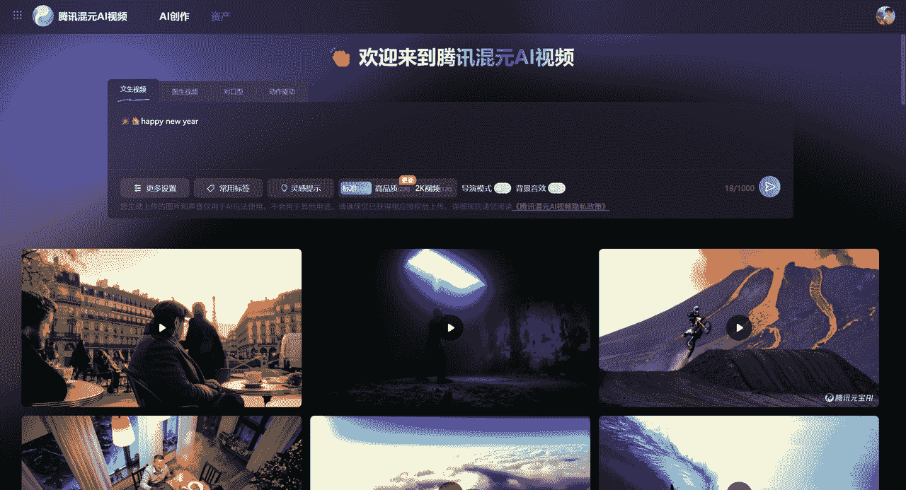

**工具介绍：**腾讯混元AI视频是基于腾讯自研混元大模型的多模态视频生成工具，支持文生视频、图生视频、音频驱动口型同步、动作模板动画及多镜头切换功能，可生成2K高清视频，最长支持5秒片段，适用于短视频创作、广告素材、虚拟人动画等场景。该工具结合超写实画质与精准语义理解，适配复杂提示词，并开放130亿参数模型权重供开发者定制，同时提供低门槛操作，无需专业剪辑技能即可使用。

**工具优点：**腾讯混元AI视频具备高质量2K分辨率输出，光影效果符合物理规律，并采用多模态大语言模型（MLLM）提升文本理解能力，确保复杂提示词的精准执行。其开源生态支持开发者自由训练专属模型，同时提供动作模板、音频驱动等易用功能，适合个人创作者与企业用户快速生成专业级视频内容。

**是否免费：**免费体验

**网络条件：**不需要特殊网络

**体验网址：****h**ttps://video.hunyuan.tencent.com/?utm_source=ai-bot.cn

**使用建议：**建议采用“主体+动作+场景+运镜”结构化提示词（如“特写镜头，芭蕾舞者旋转，光影若隐若现”）以优化生成效果，并通过多次生成筛选最佳结果。适用于短视频、广告、虚拟人动画等场景，开发者可结合开源模型训练专属插件以降低算力成本。具体功能可能随版本更新调整，建议以官网最新信息为准。

## 7）Runway

**工具介绍：**Runway是一款基于人工智能的多模态创意平台，专注于视频、图像、音频和3D内容的生成与编辑。它提供30+种AI工具，包括文生视频（Text-to-Video）、图生视频（Image-to-Video）、视频修复、动态追踪、智能抠图、风格迁移等功能，支持生成4K/60帧的高质量视频。最新模型Gen-3 Alpha和Gen-4在保真度、运动控制和多镜头叙事能力上表现突出，适用于影视制作、广告营销、社交媒体等内容创作场景

**工具优点：**Runway的核心优势在于其高质量输出和多功能性，能够生成电影级视频并支持复杂场景的精细动作控制（如头发飘动、物理模拟）。它提供多模态创作能力，支持文本、图像、音频、3D模型的联动生成与编辑，例如口型同步（Lip Sync）和动作笔刷（Motion Brush），大幅提升创作自由度。

**是否免费：**免费体验

**网络条件：**需要特殊网络

**体验网址：****https://runwayml.com/?**utm_source=ai-bot.cn

**使用建议：**为获得最佳效果，建议采用结构化提示词，如“主体+动作+场景+运镜”（例如“特写镜头，女孩在雨中奔跑，电影感光影”），以提升生成视频的精准度。对于复杂项目，可先分镜生成5-10秒片段，再通过后期剪辑拼接成完整视频。Runway尤其适合短视频创作、虚拟人动画、电商广告等场景，但需注意避免涉及多人物或高动态复杂场景，以防细节错误

## 8）Pika

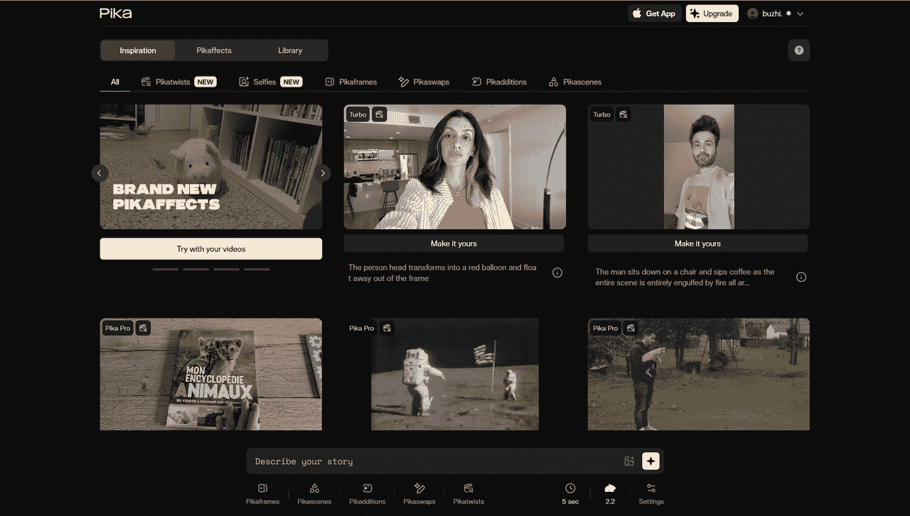

**工具介绍：**Pika是由Pika Labs开发的一款AI视频生成工具，支持通过文本、图像或现有视频快速生成高质量动态内容，涵盖3D动画、动漫、卡通、电影等多种风格。

**工具优点：**Pika的优势在于高质量输出与多功能性，生成的视频具有电影级画质和流畅动作（如头发飘动、物理模拟）。其多模态输入支持文本、图像、音频联动，并提供丰富的编辑功能（如镜头控制、负面提示词优化）。

**是否免费：**免费体验

**网络条件：**需要特殊网络

**体验网址：**https://pika.art/

**使用建议：**采用“主体+动作+场景+风格”结构（如“特写镜头，女孩在雨中奔跑，电影感光影”），结合负面提示词（如“-neg blur, distortion”）提升质量，适合短视频、广告素材、虚拟人动画等，开发者可结合API批量生成或训练专属模型

## 9）通义万相

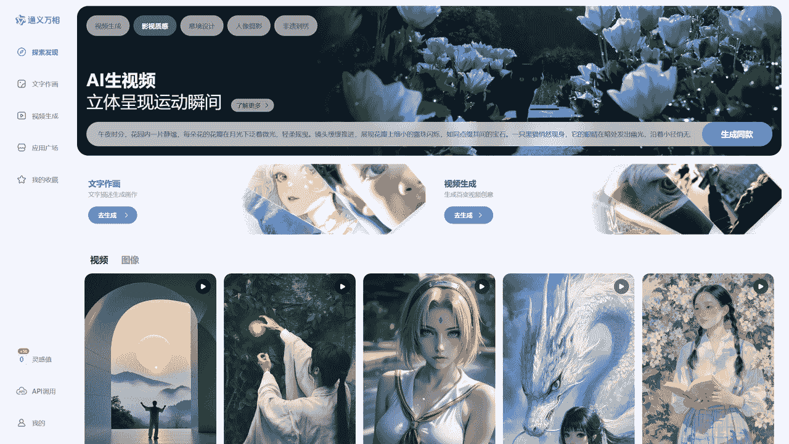

**工具介绍：**通义万相是阿里巴巴达摩院推出的AI内容生成平台，专注于图像和视频的智能创作，支持文生图、图生图、AI绘画、视频生成及编辑等功能。该工具基于自研的多模态大模型，能够根据文本描述生成高质量图像（如写实照片、插画、3D渲染等），并具备智能修图、风格迁移、超分辨率增强等后期处理能力。

**工具优点：**通义万相的核心优势在于其强大的多模态生成能力和丰富的创作功能，能够生成4K超高清图像和流畅的视频内容，支持多种艺术风格（如中国风、赛博朋克、水彩等）和细节控制。

**是否免费：**免费体验

**网络条件：**不需要特殊网络

**体验网址：**https://tongyi.aliyun.com/wanxiang/

**使用建议：**为获得最佳生成效果，建议使用具体、详细的提示词描述，如"夕阳下的江南水乡，白墙黑瓦，河面倒映着晚霞，中国水墨画风格"。对于复杂场景，可先生成基础内容再通过平台的编辑工具进行局部优化。

## 10）海螺AI

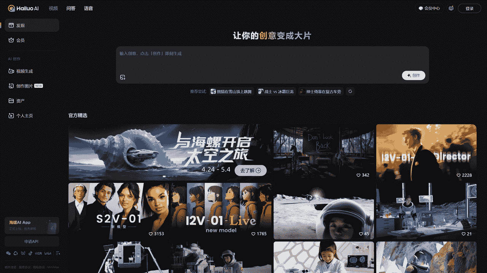

**工具介绍：**海螺AI是由MiniMax（上海稀宇科技有限公司）自主研发的多模态AI生产力工具，基于自研的万亿参数MoE大语言模型abab-6.5，支持文本、语音、图像和视频的多模态交互。

**工具优点：**海螺AI的优势在于其高质量的多模态生成能力，尤其在视频领域表现突出：支持生成1280×720分辨率、25帧率、最长6秒的流畅视频，人物一致性和情感表达接近真人水平。其语音交互自然度极高，可模拟多种情感音色，并支持英语口语陪练和模拟面试。

**是否免费：**免费体验

**网络条件：**不需要特殊网络

**体验网址：**https://hailuoai.com/

**使用建议：**

采用“主体+动作+场景+风格”结构化提示词（如“特写镜头，宇航员在月球漫步，科幻电影质感”），并上传参考图。录制10-60秒清晰音频样本，仅调整首个微调参数以保持音色自然。上传PDF/PPT等文件后，指定“总结关键点”或“生成大纲”以快速获取结构化内容

## 11）讯飞绘镜

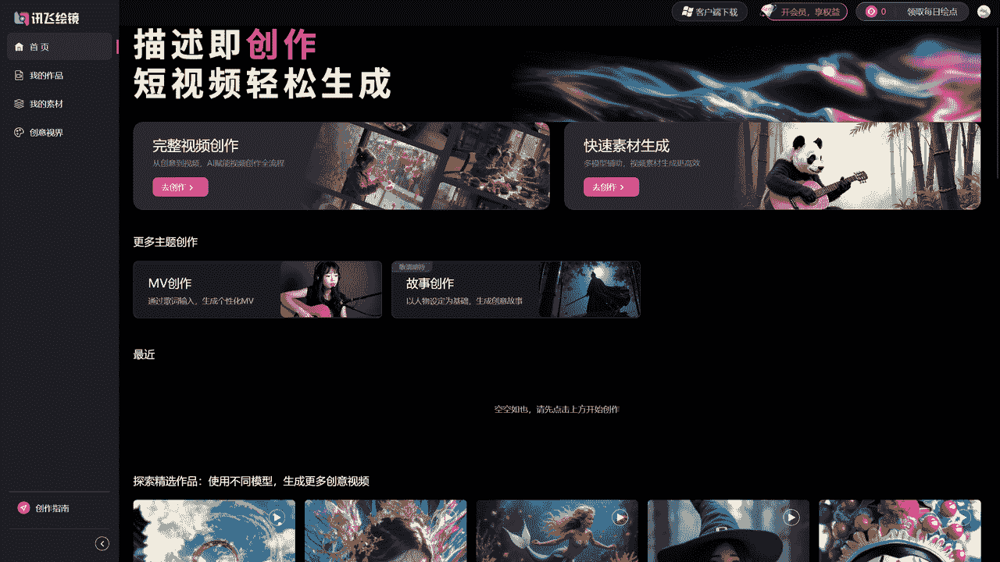

**工具介绍：**讯飞绘镜（原星火绘镜）是科大讯飞推出的一站式AI视频创作平台，基于讯飞星火大模型开发，支持从文本描述到完整视频的智能化生成。用户只需输入创意或故事，平台即可自动生成脚本、分镜画面（支持6种经典叙事模式和12种视觉风格），并通过7类视频模型将静态分镜转化为动态视频（最高支持4K分辨率）。

**工具优点：**讯飞绘镜的核心优势在于高效的全流程自动化与高质量输出，其AI生成的视频在人物细节（如发丝、纹理）和光影效果上表现优异，且支持分镜自动补充和对比预览模式，确保叙事流畅性。平台提供一站式编辑功能（文字/旁白/BGM集成），并适配垂类场景模板（如电商、教育），大幅降低创作门槛。

**是否免费：**免费体验

**网络条件：**不需要特殊网络

**体验网址：**https://typemovie.art/#/dashboard

**使用建议：**采用“场景+角色+动作+情感”结构化描述（如“黄昏的古道，断肠人牵瘦马凝望远方，眼神忧伤”），结合负面提示词避免细节错误；首先生成4-6个基础分镜，通过“换一换”功能微调画面，再逐步追加分镜以提升连贯性；

# AI视频总结

## 1）BiliNote

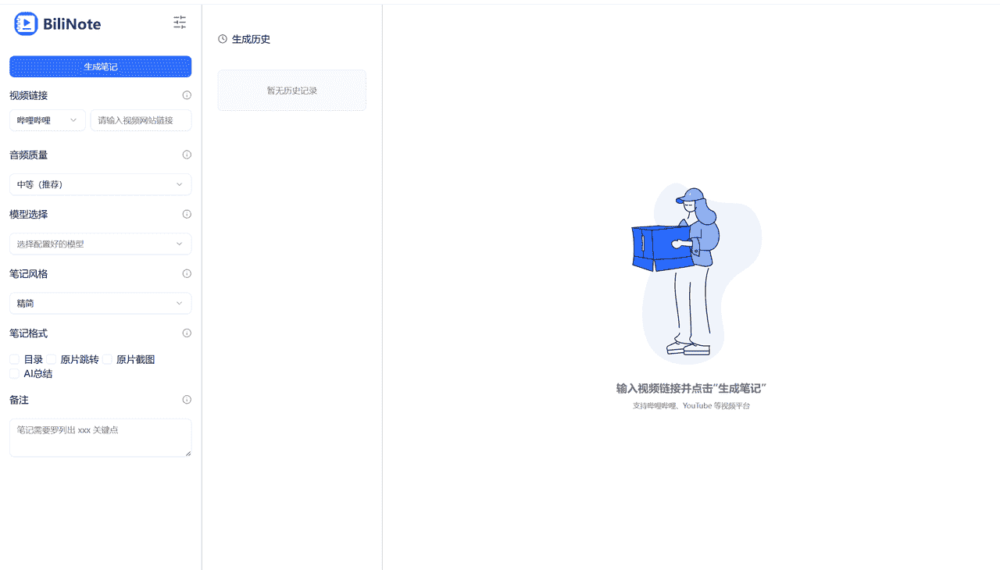

**工具介绍：**BiliNote是一款开源的AI视频笔记生成工具，能够自动将B站、YouTube等平台的视频内容转化为结构清晰的Markdown格式笔记。它通过先进的语音识别（如Fast-Whisper）和AI大模型（支持OpenAI、DeepSeek、Qwen等）分析视频，提取关键信息，并生成包含时间戳、截图、跳转链接的笔记。支持本地部署或在线使用，适用于教育学习、会议记录、内容创作等场景

**工具优点：**覆盖B站、YouTube，未来扩展至抖音、快手等。AI智能处理：结合语音转写与大模型总结，生成结构化笔记，自动插入关键帧截图

**是否免费：**免费体验

**网络条件：**不需要特殊网络

**体验网址：**https://www.bilinote.app/

## 2）BibiGPT

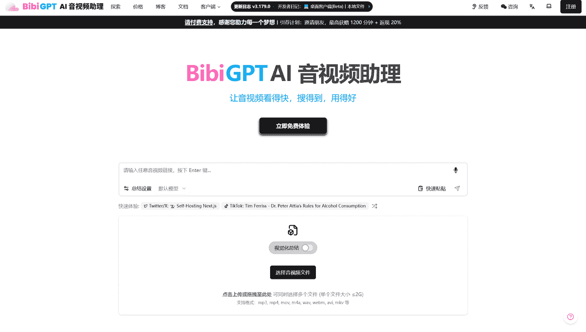

**工具介绍：**BibiGPT是一款基于AI的音视频内容总结工具，支持B站、YouTube、抖音、小红书、播客等20+平台的视频链接或本地文件输入，通过多模态大模型（如GPT-4o、Claude 3.5等）自动生成结构化摘要、思维导图、字幕列表及时间戳定位。其核心功能包括一键总结视频精华、AI对话追问细节、多语言翻译（中英日等），并支持将结果同步至Notion、Obsidian、飞书等10+笔记平台。适用于学生复习、自媒体创作、企业会议记录等场景，尤其擅长处理高信息密度的长视频或复杂内容

**工具优点：**

高效精准​：1小时视频仅需3秒生成摘要，支持智能时间戳跳转和关键帧截图

多模态输出​：提供摘要、思维导图、字幕列表、动态网页（可视化图表）等多样化形式

跨平台兼容​：覆盖主流音视频平台及本地文件，无需下载即可通过链接处理

深度集成​：与Notion、飞书等工具无缝同步，支持API调用和团队协作

**是否免费：**免费体验

**网络条件：**不需要特殊网络

**体验网址：**https://bibigpt.co/landing/v1

## 3）通义听悟

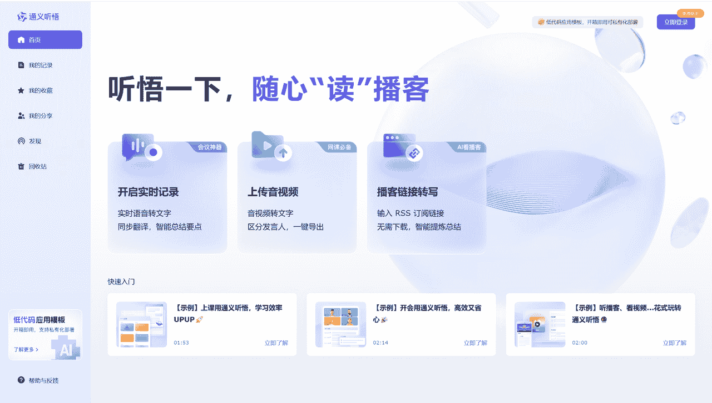

**工具介绍：**通义听悟是阿里云推出的AI音视频助手，基于通义千问大模型开发，专注于会议记录、学习笔记、访谈整理等场景。

**工具优点：**1小时音视频5分钟完成转写，准确率高达98%，支持10人以上会议的角色区分。自动提取视频中的PPT、生成思维导图，并支持中英自由说等复杂场景翻译

**是否免费：**免费体验，付费工具

**网络条件：**不需要特殊网络

**体验网址：**https://tingwu.aliyun.com/home

## 4）天工AI

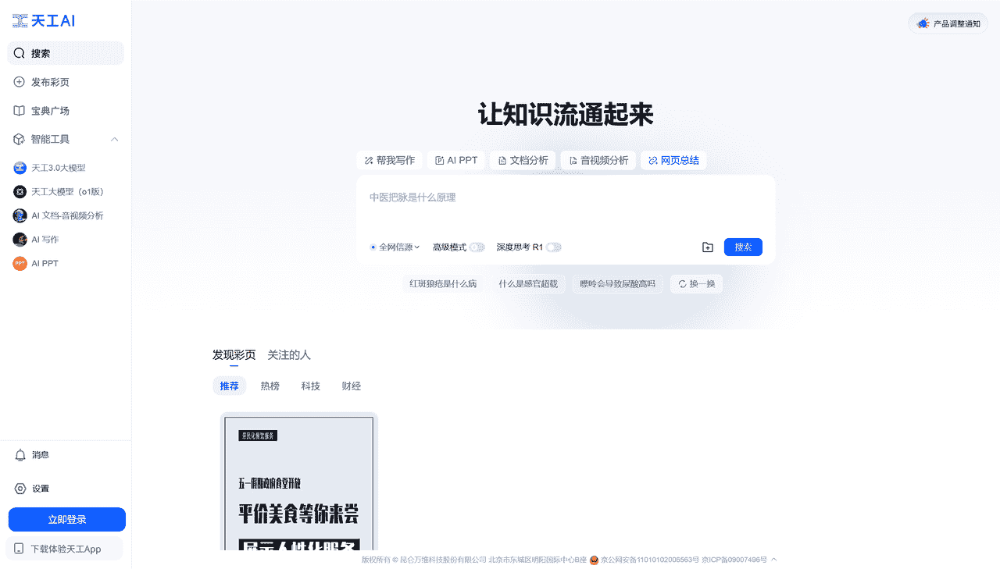

**工具介绍：**天工AI是昆仑万维推出的全能型AI智能助手，基于自研的双千亿级大语言模型开发，支持智能搜索、AI写作、代码生成、文档分析、多语言翻译、AI绘画、音乐生成等多种功能。它深度融合AI大模型能力，提供一站式解决方案，适用于职场人士、学生、内容创作者等不同用户群体。

**工具优点：**1小时音视频5分钟完成转写，学术搜索可生成带时间戳的思维导图和大纲

**是否免费：**免费体验

**网络条件：**不需要特殊网络

**体验网址：**https://www.tiangong.cn/

# AI视频换脸

## 1）FaceFusion

**工具介绍：**FaceFusion是一款开源的AI换脸工具，专注于图像和视频处理，支持高质量的人脸交换、增强和唇形同步功能。它基于深度学习技术，能够精准识别和处理人脸特征，适用于电影特效、虚拟主播、社交媒体娱乐等多种场景。最新版本（截至2025年4月）支持多模型选择（如InSwapper、SimSwap）、高清处理、遮挡修复及实时预览功能，并兼容NVIDIA和AMD显卡

**工具优点：**

多功能性：支持人脸替换、局部调整（如单独替换眼睛/嘴巴）、年龄修改及唇形同步。

高性能：利用CUDA加速，1小时视频可在数分钟内处理完成，支持4K分辨率输出。

**是否免费：**基础功能完全免费（生成结果可能带水印）；高级功能（如商用API、无水印输出）需付费订阅

**网络条件：**需要特殊网络

**体验网址：****https://github.com/f**acefusion/facefusion

## 2）DeepSwapper

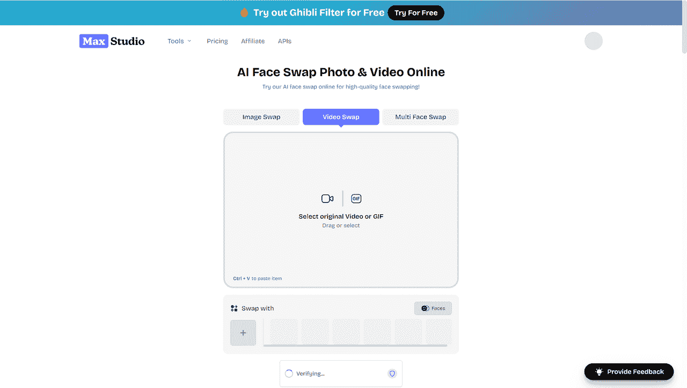

**工具介绍：**DeepSwapper是一款基于AI技术的在线换脸工具，专注于照片和视频中的人脸替换。它利用先进的深度学习算法，能够快速、精准地实现单人或多人脸部交换，并支持多种格式（如JPEG、PNG、MP4等）。用户无需专业技能即可通过简单操作生成逼真的换脸效果，适用于社交媒体娱乐、影视制作、广告创意等场景

**工具优点：**

高质量效果​：AI算法优化光影和表情融合，换脸效果自然逼真

多场景支持​：支持单人/多人换脸、视频换脸（需付费）及选择性替换特定人脸

**是否免费：**需付费订阅（如高清输出、商用API等）

**网络条件：不**需要特殊网络

**体验网址：**https://www.deepswapper.com/

## 3）[**AI Face Swap**](https://www.aigc.cn/sites/87839.html)

**工具介绍：**[AI Face Swap](https://www.aigc.cn/sites/87839.html)是一款基于[人工智能](https://www.aigc.cn/encyclopedia-of-artificial-intelligence)[技术](https://www.aigc.cn/favorites/ai-video-generation)的在线工具，能够快速且无缝地将照片或视频中的人脸进行替换。它通过先进的AI算法分析面部特征、表情和动作，实现自然逼真的替换效果。该工具完全免费，支持多种格式（如JPG、PNG和WebP），且注重用户隐私，所有上传的图像和视频在处理后会自动删除。

**工具优点：**

+   **快速且无缝的面部替换**：AI Face Swap能够快速处理照片和视频，提供逼真的替换效果。

+   **支持多种格式**：支持JPG、PNG和WebP等常见图像格式。

+   **隐私保护**：所有上传的图像和视频在处理后2天或3天内自动删除，确保用户数据安全。

+   **无水印输出**：生成的[图片](https://www.aigc.cn/ai-image-generation)或视频无水印，用户可以自由使用。

+   **用户友好**：界面简洁，操作简单，无需专业技能即可上手。

**是否免费：免费体验**

**网络条件：需要特殊网络**

**体验网址：****https://aifaceswa**p.ai/video-face-swap

## 4）泡咖AI

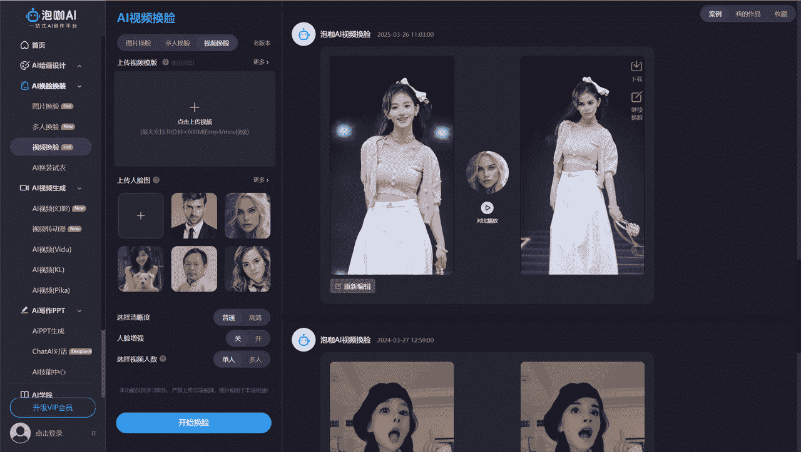

**工具介绍：**泡咖AI的视频换脸功能基于深度学习技术，支持将指定人脸替换到目标视频中，适用于娱乐、短视频创作等场景。用户可选择不同的换脸风格，并调整参数以获得更自然的效果

**工具优点：**

操作简单​：一键上传视频和照片即可完成换脸，无需复杂设置。

多风格支持​：提供多种换脸风格（如影视特效、动漫化等），满足不同需求

**是否免费：**免费使用，但生成视频可能带水印或限制清晰度

**网络条件：**不需要特殊网络条件

**体验网址：**https://ai.paoka.com/facevideo

# AI视频翻译

## 1）HeyGen

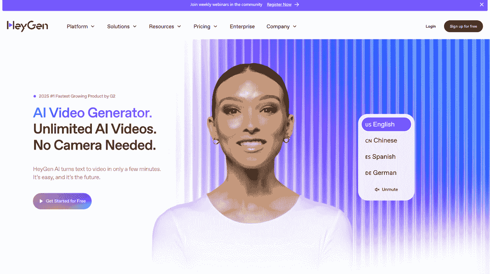

**工具介绍：**HeyGen是一款基于AI技术的视频翻译工具，由诗云科技（Surreal）开发，专注于多语言视频内容的自动翻译和口型同步。它支持将视频中的语音内容翻译成多种目标语言（如英语、中文、西班牙语等），并利用先进的语音克隆和口型同步技术，使翻译后的语音与视频中人物的口型完美匹配，呈现自然流畅的观看体验。HeyGen适用于跨境电商、教育、新闻传媒等领域，用户只需上传视频并选择目标语言，即可快速生成翻译版本

**工具优点：**HeyGen的核心优势在于其高度逼真的语音克隆和口型同步技术，能够保留原视频的音色和情感表达，使翻译后的视频看起来像原人物在说目标语言。它支持批量处理和多种语言输出（如300+音色和50+语言），操作简单，无需专业技能即可完成视频翻译。此外，HeyGen的AI算法能有效过滤背景噪音，适应不同语速和口音，确保翻译质量

**是否免费：免费试用**

**网络条件：**需要特殊网络

**体验网址：**https://www.heygen.com/

## 2）模力视频

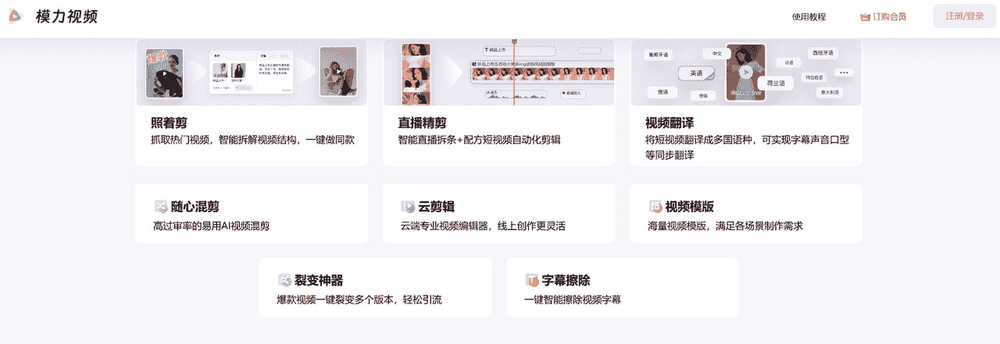

**工具介绍：**模力视频（Mooliv）是一款AI驱动的视频创作平台，其视频翻译功能支持多语种字幕、配音及口型同步，可将中文视频快速转化为英语、越南语、印尼语等目标语言版本，并保留原音色或切换AI音色（如英音女声Emily）。该功能集成字幕擦除、口型校准、背景音乐保留等AI技术，适用于电商带货、跨境营销等场景，按4点/20秒计费

**工具优点：**核心优势在于高效低门槛，用户无需复杂操作即可实现多语言视频本地化。AI自动匹配字幕与口型，支持音色克隆（如中英文音色复刻），并保留原视频背景音乐。结合批量处理和云剪辑功能，可同步分发至抖音、淘宝等平台，显著提升跨境内容创作效率

**是否免费：可免费体验**

**网络条件：**不需要特殊网络

**体验网址：**https://www.mooliv.com/

## 3）SoundView

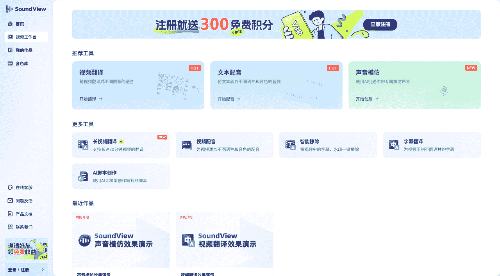

**工具介绍：**SoundView（声动视界）是一款专注于AI视频翻译、配音及本地化的工具，旨在通过多语种翻译（支持100+语言）和语音合成技术，帮助用户快速实现视频内容的全球化传播。其核心功能包括视频翻译（保留原音色）、智能字幕生成、音色模仿（支持克隆原声）、无声视频配音等，适用于跨境电商、国际营销、教育等领域。平台集成DeepSeek大模型优化翻译准确度，并支持批量处理，5分钟内可完成多语言视频制作

**工具优点：**SoundView以高效低成本著称，AI配音效果接近真人，节省90%以上翻译成本；支持音色库（100+音色）和方言适配，增强视频感染力；提供智能擦除（去水印）、字幕自动对齐等编辑功能，简化创作流程。其独特优势在于模仿原声配音，提升素材复用率5倍，并支持TikTok、YouTube等平台的无水印下载

**是否免费：**提供3分钟免费试用

**网络条件：**不需要特殊网络

**体验网址：****https://soundviewai**.com/video-workbench

# AI数字人视频

## 1）HeyGen

**工具介绍：**HeyGen是一款基于AI技术的数字人视频创作平台，支持通过文本、图片或视频快速生成高质量的数字人视频。用户可自定义虚拟形象，或使用平台提供的100+预制AI虚拟数字人，适用于广告、教育、企业宣传等多种场景

**工具优点：**

高质量数字人：精准克隆用户外貌和声音，支持口型同步、表情和肢体动作模拟。

多语言支持：提供175+语言配音和翻译功能，适合全球化内容创作。

操作简单：无需专业视频制作技能，通过模板或上传素材即可快速生成视频

**是否免费：**免费体验

**网络条件：**需要特殊网络

**体验网址：**https://www.heygen.com/

## 2）禅镜

**工具介绍：**禅镜是蝉妈妈（蝉羽网络科技）旗下的一款AI数字人视频创作平台，专注于帮助用户快速生成高质量的数字人视频内容。它依托母公司在大数据分析与短视频营销领域的经验，特别适合电商从业者、自媒体创作者等群体，可用于口播视频、直播带货、广告宣传等场景

**工具优点：**

操作简单​：无需专业视频制作技能，通过模板或上传素材即可快速生成视频

多风格数字人​：提供200+预制数字人形象（包括真人、卡通、3D风格），支持自定义克隆真人形象

AI文案辅助​：内置热点推荐和文案生成功能，提升视频爆款概率

**是否免费：**免费、付费都有

**网络条件：**不需要特殊网络

**体验网址：**https://www.chanjing.cc/home/

## 3）KreadoAI

**工具介绍：**KreadoAI是由易点天下推出的AIGC数字营销视频创作平台，专注于利用人工智能技术简化视频内容创作流程。它支持通过文本、图片、PPT或URL快速生成多语言数字人视频，适用于营销、教育、培训、医疗等多个领域。平台提供700+种数字人形象和1600+种语音选项，支持140+种语言，并具备AI脚本生成、语音克隆、视频换脸等高级功能，帮助用户高效制作专业级视频内容

**工具优点：**

高效创作​：1分钟即可生成专业视频，支持批量生产，大幅提升效率。

多语言适配​：覆盖140+语言和1600+种音色，适合全球化营销需求。

功能全面​：集成AI脚本生成、语音克隆、智能抠图、视频换脸等工具，满足多样化需求。

**是否免费：1分钟内免费**

**网络条件：**不需要特殊网络

**体验网址：****https://www.kread**oai.com/zh?via=aibot

## 4）飞影

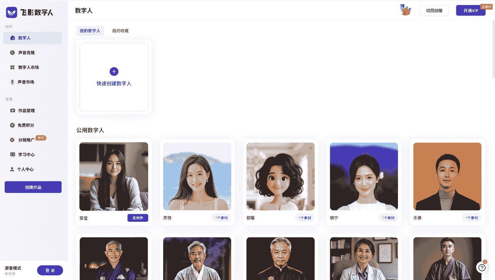

**工具介绍：**飞影是一款多功能AI数字人创作平台，由上海灵之宇技术开发，专注于数字人生成与虚拟偶像创作。它支持通过照片、视频或AI生成的方式快速创建数字人形象，并具备声音克隆、口型同步等功能，适用于电商直播、短视频制作、广告营销等场景。飞影提供丰富的数字人模板和AI工具，用户可轻松制作个性化视频内容，大幅提升创作效率

**工具优点：**

高效创作​：5秒克隆真人形象，30秒复刻声音，快速生成逼真数字人视频。

多场景适配​：支持跨境电商、自媒体、教育等领域，提供多样化的数字人模板和特效。

免费试用​：注册即送1000积分，可免费生成带水印视频，适合新手体验

**是否免费：**基础功能免费

**网络条件：**不需要特殊网络

**体验网址：**https://hifly.cc/

## 5）万兴播播

**工具介绍：**万兴播爆是万兴科技推出的AI数字人短视频营销工具，专注于为视频创作者和跨境电商从业者提供全链路AIGC创作体验。它支持通过文本输入或语音文件快速生成包含数字人角色、动态场景和精准背景的高清视频，适用于电商带货直播、短视频营销、产品介绍等多种场景。

**工具优点：**万兴播爆的突出优势在于降低视频制作门槛和成本，用户无需真人出镜或专业剪辑技能即可生成逼真营销视频。

**是否免费：**基础功能免费使用

**网络条件：**不需要特殊网络

**体验网址：**https://virbo.wondershare.cn/app/

# AI视频编辑

## 1）度加创作工具

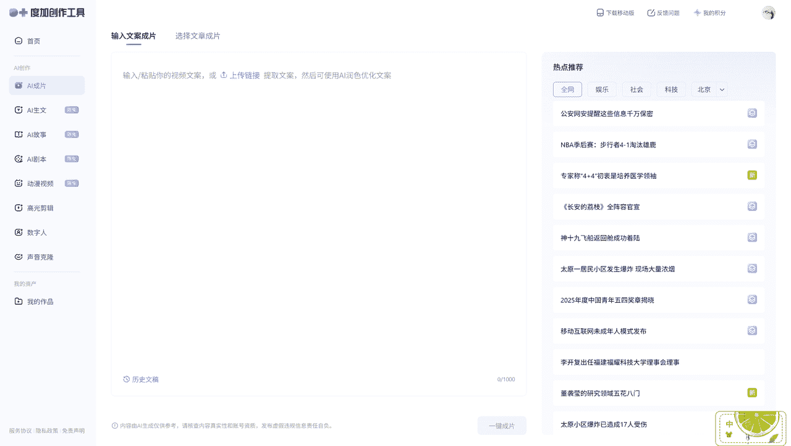

**工具介绍：**度加创作工具是百度推出的AI视频混剪平台，基于百度飞桨（PaddlePaddle）和文心大模型技术开发，主打“AI成片”功能，支持文字/图文一键生成视频，并集成数字人播报、智能字幕、多语言配音（中英文为主）等能力。用户可通过输入文案或导入百家号图文链接，自动匹配素材库中的视频/图片资源（含视觉中国授权内容），快速生成横竖版适配的短视频，适用于自媒体、电商带货、新闻资讯等场景。

**工具优点：**度加的核心优势在于高效低门槛，AI成片功能可在1分钟内完成从文案到视频的全流程，支持批量生成（每日免费额度10条）。其智能匹配系统能自动关联文案与素材，并允许自定义字幕、音色（含音色克隆）、背景音乐及数字人形象。

**是否免费：**免费体验

**网络条件：**不需要特殊网络

**体验网址：**https://aigc.baidu.com/make

## 2）剪映

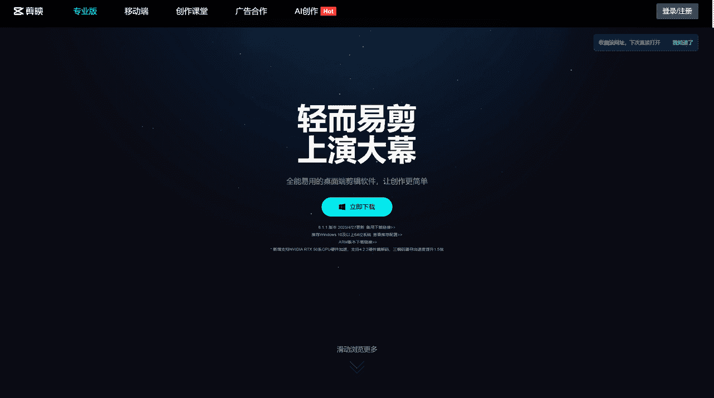

**工具介绍：**

作为抖音官方推荐的剪辑工具，它集成了AI智能字幕、语音转文字、智能抠图、曲线变速等先进功能，并提供海量音乐曲库（含抖音热门歌曲）和特效素材。2025年最新版本支持4K分辨率编辑、多轨道剪辑及数字人播报功能，适用于短视频创作、电商带货、教育培训等场景

**工具优点：**

低门槛高效剪辑​：AI自动生成字幕、智能踩点配乐，新手也能快速制作专业视频

全平台协同​：云空间同步草稿和素材，实现手机、电脑多端无缝衔接

丰富素材库​：内置百万级版权贴纸、滤镜、转场特效，支持一键套用热门模板

**是否免费：**免费体验

**网络条件：**不需要特殊网络

**体验网址：**https://www.capcut.cn/

---

#  学习交流社群

1.持续关注并更新 AI 的**相关资讯动态，研究报告，赚钱案**例，常见问题，永久免费在线查看，无收费内容，目标是成为最大的免费 AI 学习社群。

2.已建立社群聊聊 **AI** 发展及应用，**没进**群的可以扫码加入，群满可加 AI 研究爱好者大国微信 ID：zyg90s（备注：AI），已经在社群内的无需重复加入，暂无任何 AI 相关收费群、课程及服务，全部为公开公正免费整理汇总分享。

3.**关于文档负责人大国**：7 年项目操盘手，互联网流量观察家，曾就职于互联网大厂，现研究 AI 实战应用，努力成为最懂 AI 的运营人。

**飞书学习群**

**飞书扫码进群学习**

好友（ID：zhangyuguo94s）

**扫码加微信入微信群**

进群或者加好友了解更多 AI 相关信息

**觉得有用欢迎留个赞**