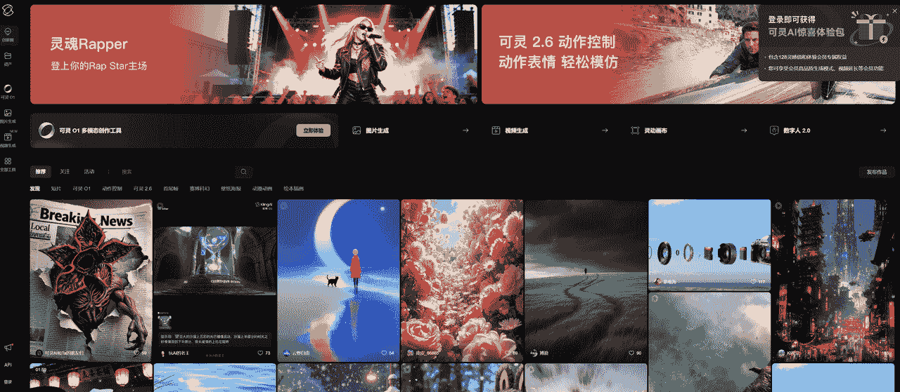

# 可灵学习手册（行业首发&持续更新ing...

> 来源：[https://yunyinghui.feishu.cn/docx/Av2pdq2dUoqQgUxNgp1cNs1Anqd](https://yunyinghui.feishu.cn/docx/Av2pdq2dUoqQgUxNgp1cNs1Anqd)

> **适用人群：****互联网关注 AI 视频发展人群**

> 首发时间：2024 年 6 月 13 日

> 更新时间：2026 年 1 月 23 日

> **内容出品人：**

> **使用建议：**如果需要快速定位到精确内容，可以使用快捷键 Ctrl +F/Command +F 的形式，搜索关键字/词，查找你想要的内容，PC 端查看学习效果更好。

> **持续更新 快手的可灵视频模型****相关资讯动态，研究****报告，赚钱案例，实用场景等板块**内容，永久免费在线查看，欢迎收藏转发支持，文末有惊喜，大国出品，必属精品，和 50W+读者共学。

> 🎯全**网最接地气 AI 知识库：「**[**AI 实验室」知识库（**](https://yunyinghui.feishu.cn/wiki/space/7340161844864598017?ccm_open_type=lark_wiki_spaceLink&open_tab_from=wiki_home)AI 绘画、AI 写作、AI 视频等应用技能）

# 更新日志

# 一、基本介绍

2024 年 6 月 6 日快手方面发布视**频生成大模型 " 可灵**** " ，**并通过旗下快影 App 开放邀测体验，可灵大模型目前开放的是 " 文生视频 "，后续还将开放 " 图生视频 " 功能。

据悉，可灵大模型为快手 AI 团队自研，采用了与 Sora **相似的技术路线，并结合多项自研技术创新，能够生成** 1080p 分辨率、时长 2 分钟（帧率 30fps）的视频，并支持自由宽高比，号称具有能够生成大幅度的合理运动，能够模拟物理世界特性、具备强大的概念组合能力和想象力等优势，效果对标 Sora。

**大模型官方网站：**kling.kuaishou.com

## **核心功能解析**

可灵的核心功能主要集中在以下几个方面：

1.  **文生视频**：用户只需输入文本描述，即可生成对应的视频内容。根据官网信息，可灵能够生成长达 2 分钟的视频，尽管目前大多数案例为 5 秒钟的短视频，但其稳定性和逼真度已备受好评。

1.  **动作捕捉与生成**：可灵可以通过上传图片生成动态视频，支持多种风格，包括写实和卡通。相比其他同类产品，可灵在动作的流畅性和自然度上有显著优势。

1.  **多样化创作**：可灵支持多种视频风格和创作形式，用户可以根据需求选择不同的创作模板和效果。

## 可灵的优势

快手的可灵视频生成大模型具有多项优势，以下是一些主要优势及其说明：

1.  **大幅度的合理运动生成能力**：可灵采用了 3D 时空联合注意力机制，能够更好地建模复杂时空运动，生成较大幅度运动的视频内容，同时符合运动规律。

1.  **模拟物理世界特性**：基于自研模型架构和 Scaling Law 的强大建模能力，可灵能够模拟真实世界的物理特性，生成符合物理规律的视频。

1.  **强大的概念组合能力和想象力**：可灵能够将用户丰富的想象力转化为具体的画面，虚构真实世界中不会出现的场景，具有强大的概念组合能力。

1.  **生成高分辨率、长时长的视频**：可灵支持生成长达 2 分钟的视频，帧率达到 30fps，并且具备 1080p 的分辨率。

1.  **电影级画面生成**：基于自研 3D VAE 技术，可灵能够生成电影级的视频，无论是宏大场景还是细腻特写，都能生动呈现。

1.  **支持自由的输出视频宽高比**：可灵采用了可变分辨率的训练策略，能够输出多种视频宽高比，满足不同场景的视频素材使用需求。

1.  **高效的训练和推理优化**：得益于高效的训练基础设施和极致的推理优化，可灵能够快速生成高质量的视频。

1.  **AI 技术迭代和商业化探索**：快手作为头部短视频公司，在 AI 大模型技术方面有深厚积累，展现出国产 AI 视频模型的技术能力，并积极探索商业化应用。

1.  **内容创作门槛降低**：AI 技术的发展和应用，使得内容创作的门槛降低，用户可以更轻松高效地完成艺术视频创作。

1.  **持续的 AI 技术加速追赶**：中国厂商在 AI 领域的技术加速追赶，预示着 AI 视频应用的快速发展。

这些优势展示了快手可灵在视频生成领域的创新能力和技术实力，为用户提供了高效、高质量的视频创作工具。

# 二、视频案例

## 官方演示

<https://v.qq.com/txp/iframe/player.html?origin=https%3A%2F%2Fmp.weixin.qq.com&containerId=js_tx_video_container_0.7204581689976597&vid=o35524tcr3v&width=677&height=380.8125&autoplay=false&allowFullScreen=true&chid=17&full=true&show1080p=false&isDebugIframe=false>

prompt：一名宇航员在月球表面奔跑，低角度镜头展现了月球的广阔背景，动作流畅且显得轻盈

<https://v.qq.com/txp/iframe/player.html?origin=https%3A%2F%2Fmp.weixin.qq.com&containerId=js_tx_video_container_0.3524109039121821&vid=k35520udcm4&width=677&height=380.8125&autoplay=false&allowFullScreen=true&chid=17&full=true&show1080p=false&isDebugIframe=false>

prompt：小男孩在花园里骑自行车经历秋冬春夏四季变换

<https://v.qq.com/txp/iframe/player.html?origin=https%3A%2F%2Fmp.weixin.qq.com&containerId=js_tx_video_container_0.27574726815210937&vid=i35522i3rw8&width=677&height=380.8125&autoplay=false&allowFullScreen=true&chid=17&full=true&show1080p=false&isDebugIframe=false>

prompt：一个戴眼镜的中国男孩在快餐店内闭眼享受美味的芝士汉堡

<https://v.qq.com/txp/iframe/player.html?origin=https%3A%2F%2Fmp.weixin.qq.com&containerId=js_tx_video_container_0.9420110061172433&vid=x3552280ttq&width=677&height=380.8125&autoplay=false&allowFullScreen=true&chid=17&full=true&show1080p=false&isDebugIframe=false>

prompt：一只大熊猫在湖边弹吉他

<https://v.qq.com/txp/iframe/player.html?origin=https%3A%2F%2Fmp.weixin.qq.com&containerId=js_tx_video_container_0.8573992775908061&vid=t355211t60w&width=677&height=380.8125&autoplay=false&allowFullScreen=true&chid=17&full=true&show1080p=false&isDebugIframe=false>

prompt：疯狂动物城预告片

## 网友作品

### 海军爱摄影作品：《告白气球》MV

用国产 sora 文生视频做了一部气球人版《告白气球》【AI 影像大赛-创想赛道】

<https://player.bilibili.com/player.html?bvid=1Ai421e7FN&spm_id_from=333.337.search-card.all.click&vd_source=05604b6063f398633af513a2e9a7c804>

# 三、提示词指南

## 提示词技巧

可灵视频生成大模型的提示词写作，即给 AI 模型的输入文本，是影响生成视频质量和创意的关键因素，以下是一些写作 AI 视频的提示词的技巧：

1.  **明确性**：确保你的提示词清晰明确，直接表达你想要生成的视频内容或场景。

1.  **细节丰富**：提供足够的细节来帮助 AI 理解视频的具体元素，如场景、角色、动作、情感等。

1.  **使用关键词**：在提示词中使用关键词，这有助于 AI 捕捉到视频的主要概念和主题。

1.  **情感表达**：如果视频需要表达特定的情感或氛围，确保在提示词中包含这些元素。

1.  **创意性**：鼓励创意思维，尝试使用新颖或不寻常的描述来激发 AI 的想象力。

1.  **逻辑连贯**：确保提示词中的描述在逻辑上是连贯的，这样 AI 可以生成更加流畅和合理的视频。

1.  **避免歧义**：尽量避免使用可能引起混淆的词汇或短语，以免 AI 生成不符合预期的视频。

1.  **考虑视觉元素**：思考视频中可能包含的视觉元素，如颜色、光线、角度等，并在提示词中体现。

1.  **简洁性**：尽管细节很重要，但也要尽量保持提示词的简洁性，避免过长或复杂的描述。

1.  **测试和迭代**：生成视频后，根据结果调整提示词，通过测试和迭代来优化视频生成的效果。

1.  **利用 AI 的特性**：了解可灵 AI 模型的特性和优势，比如它在模拟物理世界特性或大幅度运动方面的能力，并在提示词中加以利用。

1.  **参考示例**：参考快手提供的示例提示词，了解如何有效地与 AI 模型沟通。

通过这些技巧，你可以更有效地与可灵视频生成大模型交互，生成高质量的视频内容。

> **官方学习材料：**

> [可灵驯服指南](https://docs.qingque.cn/d/home/eZQDp092-vzqbhb02KUdurkwP?identityId=1oEG9JKKMFv#section=h.pb1svsc1zlfw)

> [ 视频 2.6 功能使用手册](https://docs.qingque.cn/d/home/eZQBMUXCmLjb57bpfsVk2jNvx?identityId=2NUucn9H0x1#section=h.hktoiw9wkqn4)

## 提示词风格归纳

AI 视频生成的提示词风格可以根据视频内容、目标受众和创作目的的不同而有所差异，以下是一些常见的提示词风格及其特点：

1.  **描述性风格**：

+   特点：使用详细的视觉和感官描述，帮助 AI 理解场景和元素。

+   例子："一个阳光明媚的下午，金色的阳光洒在波光粼粼的湖面上，微风吹拂着湖边的柳树。"

1.  **叙事性风格**：

+   特点：讲述一个故事或事件，强调情节和叙事流程。

+   例子："在古老的城堡中，一位勇敢的骑士手持宝剑，准备与恶龙进行决战。"

1.  **情感性风格**：

+   特点：强调情感表达，传达特定的情绪或氛围。

+   例子："在寂静的夜晚，一位孤独的小提琴手在街角演奏着忧伤的旋律。"

1.  **诗意风格**：

+   特点：使用比喻、象征和其他修辞手法，创造诗意和艺术性。

+   例子："月光如银，洒在静谧的森林中，精灵们在树梢间轻歌曼舞。"

1.  **技术性风格**：

+   特点：使用专业术语和精确的描述，适合需要特定技术细节的视频。

+   例子："一个宇航员在国际空间站外进行太空行走，展示太空服的先进功能和操作过程。"

1.  **幽默风格**：

+   特点：使用幽默和诙谐的语言，创造轻松愉快的氛围。

+   例子："一只穿着西装打领带的猫，正坐在老板椅上，用电脑处理着'猫星'的事务。"

1.  **悬疑风格**：

+   特点：创造神秘和紧张的氛围，引发观众的好奇心。

+   例子："在昏暗的房间里，一束光线透过窗户，照亮了一张布满灰尘的古老地图和一把生锈的钥匙。"

1.  **科幻风格**：

+   特点：描述未来世界或外太空的场景，强调想象力和创新。

+   例子："在遥远的星系，一艘宇宙飞船缓缓降落在一个充满奇异植物的外星球上。"

1.  **现实主义风格**：

+   特点：反映现实生活，注重细节的真实性和可信度。

+   例子："在繁忙的都市街道上，人们匆匆忙忙，各种声音交织在一起，构成了城市的交响乐。"

1.  **抽象风格**：

+   特点：不直接描述具体场景，而是通过抽象的概念或形式来表达思想。

+   例子："时间和空间在这一刻交织，形成一个无限循环的图案，象征着生命的永恒。"

每种风格都有其独特的魅力和适用场景，创作者可以根据视频的目的和内容选择最合适的提示词风格。

# 四、相关报道

## 量子位

[快手版 Sora「可灵」开放测试：生成超 120](https://mp.weixin.qq.com/s/-knHZA4AU47EkkzIO7O18A)s 视频，更懂物理，复杂运动也能精准建模

## 机器之心

快手「可灵」爆火：海外 AI 圈巨震，中国版 Sora 一号难求

## 数字生命卡兹克

实测完快手的 AI 视频「可灵」后，我觉得这才是第一个中国版 Sora

---

# AI 学习交流社群

1.持续关注并更新 AI 的**相关资讯动态，研究报告，赚钱案**例，常见问题，永久免费在线查看，无收费内容，目标是成为最大的免费 AI 学习社群。

2.已建立社群聊聊 **AI** 发展及应用，**没进群的可以扫码加入，群满可加 AI 研究爱好者大国🛰️ ID：zyg90s（备**注：AI），已经在社群内的无需重复加入，开源知识库及社群学习全部为公开免费分享。

3.**关于文档负责人大国**：高帆文化CEO，曾就职于教培大厂，目前创业，主攻研究AI落地应用、企业流量增长及达人IP孵化。联合作者德里克文，知乎 AI 领域大 V，同济大学毕业。

**飞书AI视频学习交流群**

好友（ID：zhangyuguo94s）

**扫码加🛰️入🛰️群**