# seedance2.0+飞书多维表格=爆款内容流水线

> 来源：[https://yunyinghui.feishu.cn/docx/PSyod8CGgoErByxkydackryvnVf](https://yunyinghui.feishu.cn/docx/PSyod8CGgoErByxkydackryvnVf)

---

> **原创公众号：** 镇涛 AI 实战笔记

> **发文时间：**2026-02-25 11:10:00

最近 seedance2.0 非常火，有很多朋友问我：“我不会写提示词，怎么用好 seedance2.0”

今天带大家一文讲透电商视频自动化思路拆解，如何做到只需要一张产品图，就可以在飞书上实现从画面分镜、脚本、文案到视频生成的全流程自动化

首先我们要新建一个多维表格，然后新建 2 个附件字段，一个命名为参考视频，上传我们想要参考的爆款视频，一个命名为产品图，上传我们自己的产品图，最好是实拍图，产品比较复杂的也可以上传多张图

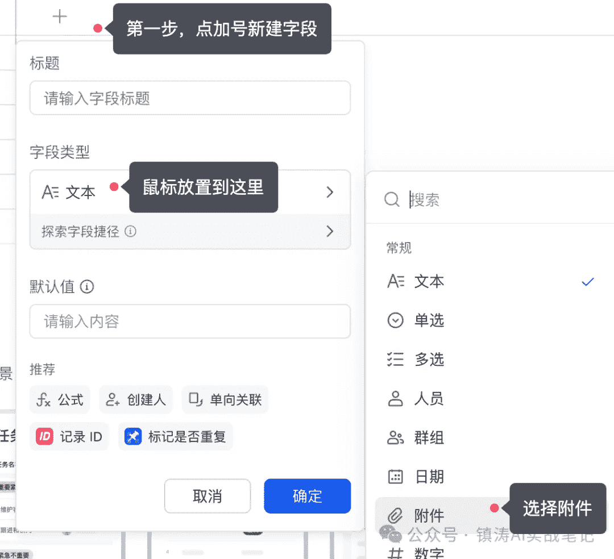

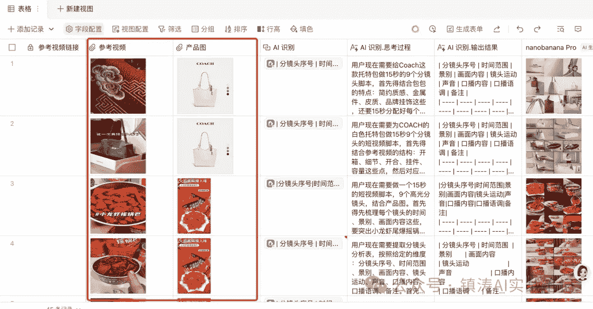

**第二步，我们调用飞书多维**表格的 豆包 1.8 字段捷径 ，使用豆包强大的视频理解能力，帮我们来分析拆解视频，字段新建好以后，在输入指令的输入框，填写我们的视频分析提示词（可以根据自己的分析逻辑去写，自然语言即可，简单的说就是教实习生如何分析视频），图片内容选择我们的产品图，视频内容选择参考视频，完成以上步骤以后点击关联账号，安装指引步骤完成账号关联即可

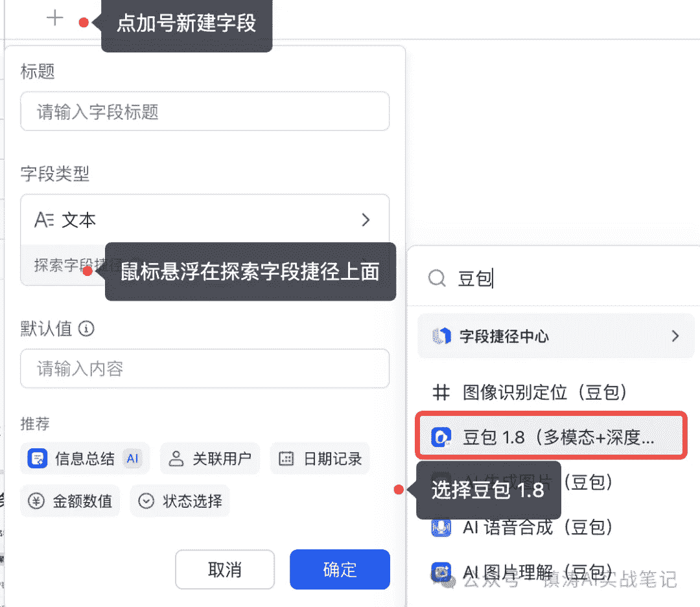

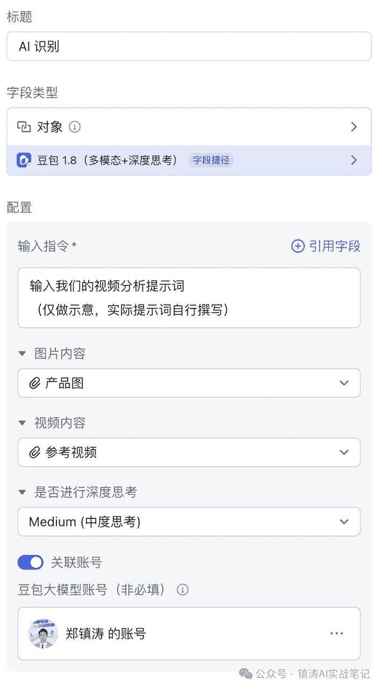

完成以后，就可以看到豆包帮我们拆解的爆款视频脚本了，豆包的视频拆解能力非常强，可以帮我们把每一个分镜头的细节全部拆解出来，到这一步，我们就完成是爆款视频的拆解。

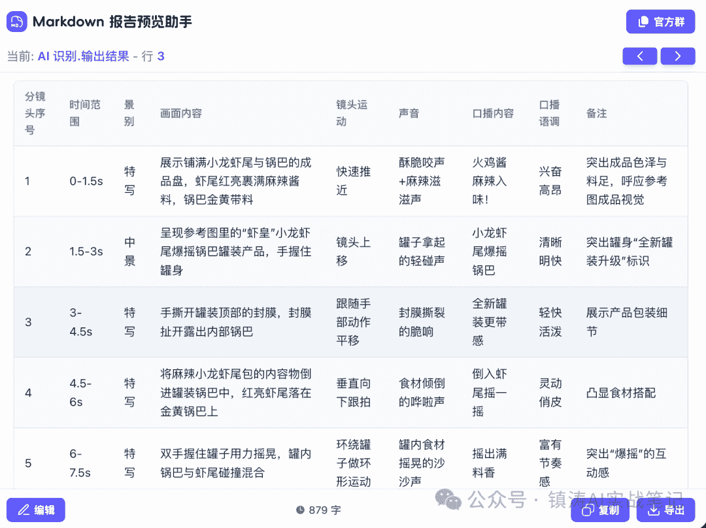

完成视频的分镜头拆解以后，我们就可以把这个拆解的结果作为提示词给到生图的 AI 字段捷径，这里我用的是 nanobanana pro，参考图选择我们上传的产品图，让 AI 根据我们的产品和脚本框架生成分镜头图片。

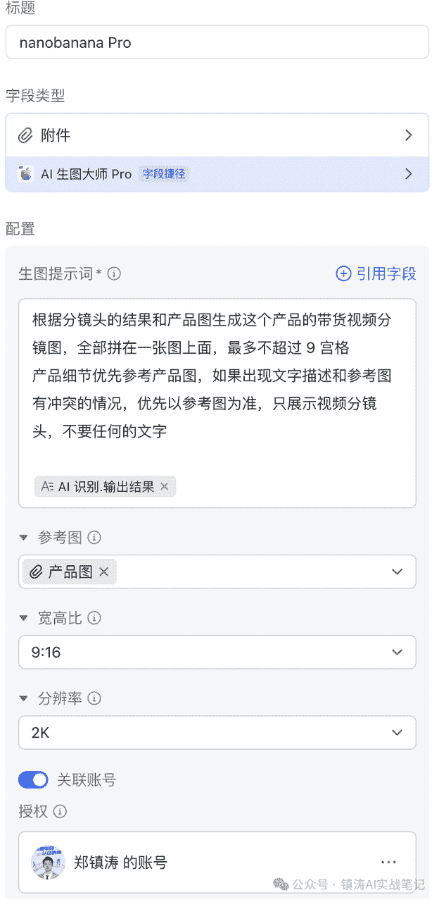

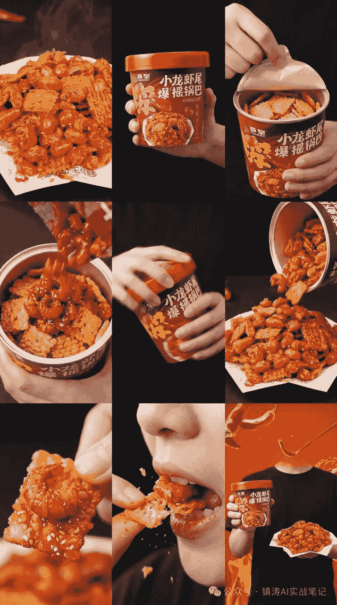

接下来，我们还是使用豆包 1.8 的字段捷径，识别分镜图的图片内容，把脚本转化为 AI 能看懂的提示词，识别完成以后把提示词和参考图复制到即梦就可以生成视频了。

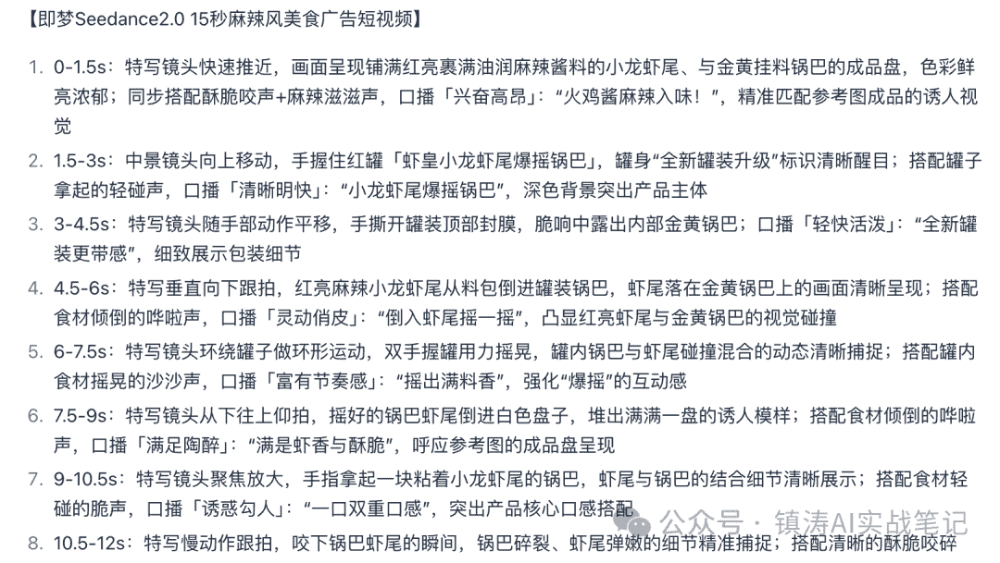

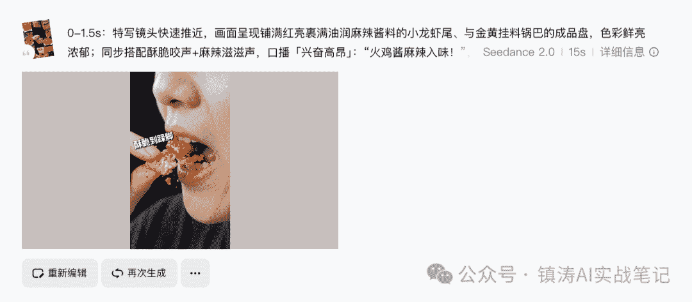

那么我们如何在多维表格里批量生成视频呢，这里就需要用到 AI 生成视频的字段捷径，由于 seedance2.0 还没有接入飞书多维表格，这里用 seedance1.5 做示例，等 seedance2.0 接入飞书多维表格以后，就可以在多维表格里自动化生成了。

还是向右新建一列，选择图生视频（seedance）的字段捷径，自定义指令的输入框，我们点击引用字段，引用刚刚豆包写的提示词即可，参考图则选择 nanobanana pro 生成的分镜头图片，视频比例选择 9:16，视频时长根据自己的需求选择，然后点击关联账号按照提示操作即可。

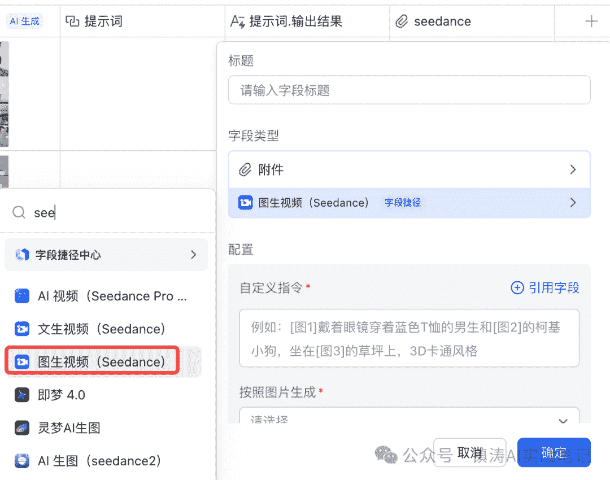

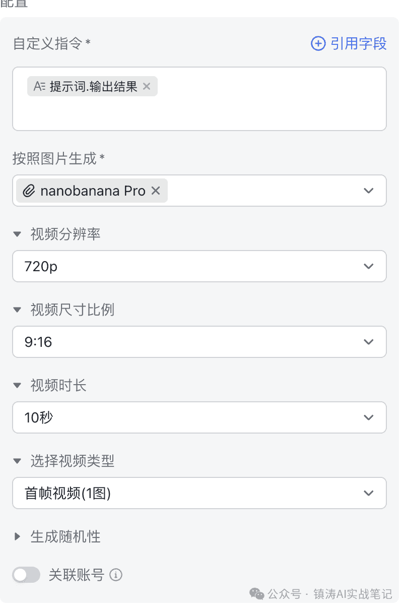

> **电商视频自动化制作思路总结 **：

+   **爆款视频拆解 **：上传想要参考的爆款视频，AI 会根据需求拆解出核心分镜脚本，每个分镜包含分镜时长、产品卖点、画面内容和脚本文案。

+   **分镜图生成 **：上传产品图或参考关键帧，结合拆解好的脚本框架，调用 nanobanana pro 生成一组全新的分镜图。

+   **AI 生成提示词 **：让 AI 识别分镜图，参考脚本框架生成一版视频生成提示词。

+   **视频生成操作 **：分镜图和视频提词没问题后，即可直接调模型生成视频

**（**目前 seedance2.0 API 暂未开放，本文内容仅展示飞书多维表格+seedance2.0 的使用思路，具体开放时间以官方通知为准）

#