# 智能多帧功能使用手册

> 来源：[https://yunyinghui.feishu.cn/docx/BJVSdcYmqopIqyxml40cr0non0e](https://yunyinghui.feishu.cn/docx/BJVSdcYmqopIqyxml40cr0non0e)

# **中文版**

> 智能多帧，让故事长一点，再长一点

> **「智能多帧」**是即梦最新推出的多图驱动视频生成能力，支持上传最多10帧图像，模型会自动识别图像内容，结合你提供的提示词和设定的停留时长，为你生成空间连续、运镜流畅、节奏合理的一镜到底视频

> 你可以：

+   上传多张关键帧图像，2-10张都可以，实现一镜到底的视觉效果；

+   自由设置每一帧之间的时长（可选择1-6s之间），调整节奏表达，让内容更符合剧情节拍；

+   配合运镜提示词使用，让镜头更自然更连贯；

+   支持空间运镜、产品展示、节奏驱动、角色动态、叙事等多种创作场景，尤其适合需要长镜头衔接、一镜到底的内容，如商业广告连续镜头、潮玩或新品展示、空间漫游运镜、舞蹈与动作延展等，让画面衔接自然流畅、节奏统一；

> 只需上传图 + 写提示词，一条自然衔接的连续长镜头就完成啦 🎉～

## 页面进入：

**主入口流程**

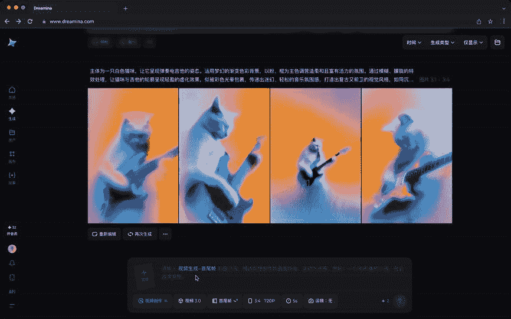

[一镜到底.mp4](https://internal-api-drive-stream.feishu.cn/space/api/box/stream/download/all/I9RobQXA7oljiqxQYKkcIyl2nIb)

**次入口（首尾帧）流程**

[首尾帧进入流程.mp4](https://internal-api-drive-stream.feishu.cn/space/api/box/stream/download/all/IGZWbs25GoETuwxrsfIcyZRanAe)

**操作页面**

# 基础参数：

| **参数项** | **说明** |
| --- | --- |
| 支持帧数 | 最多10帧（建议4-7帧，效果更稳） |
| 帧间时长 | 1-6s自己选择，视频总共最长可达到54s |
| 输入类型 | 图片 |
| 分辨率 | 720p |
| 提示词 | 跟首尾帧一样的逻辑，针对两帧中间过渡写提示词，而不单纯的描述图片的画面 |

# 适用场景建议：（可以拿来做啥呢？）

## 最大的优势是可以做一镜到底类的长视频

### 空间运镜类（空间穿梭）

指通过镜头的平移、推进、拉远、环绕、跟随等连续运镜方式，在同一空间内或不同空间之间实现自然衔接与无缝穿梭/切换，从而营造沉浸感、空间感和连续叙事效果

#### Case展示

| 效果 | 图片1 | 提示词1 | 图片2 | 提示词2 | 图片3 | 提示词3 | 图片4 | 提示词4 | 图片5 | 提示词5 | 图片6 | 提示词6 | 图片7 | 提示词7 | 图片8 | 提示词8 | 图片9 | 提示词9 | 图片10 |  |
| --- | --- | --- | --- | --- | --- | --- | --- | --- | --- | --- | --- | --- | --- | --- | --- | --- | --- | --- | --- | --- |
|  | 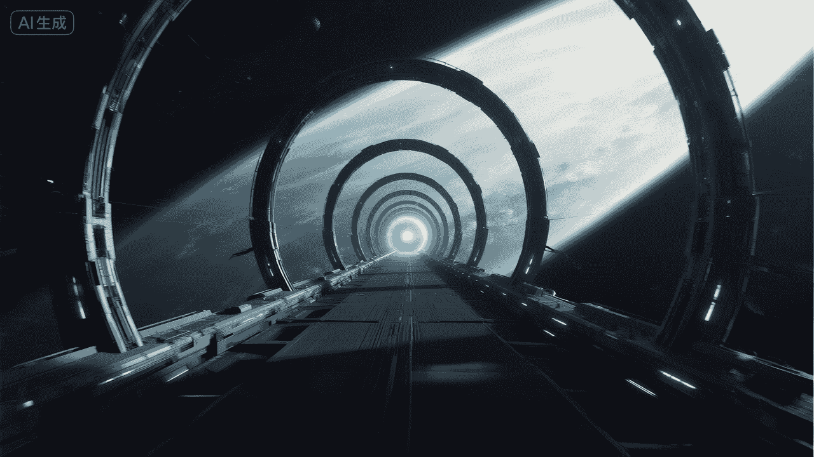 | POV视角，镜头无限推进，自然过渡到下一帧 |  | POV视角，镜头无限推进，自然过渡到下一帧 |  | POV视角，镜头无限推进，自然过渡到下一帧 | 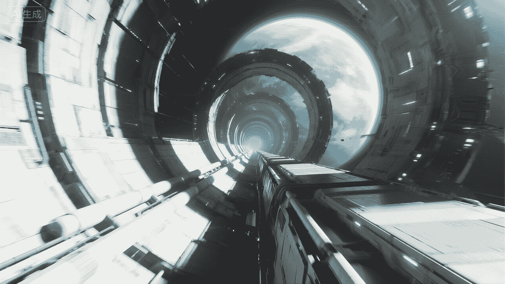 | POV视角，镜头无限推进，自然过渡到下一帧 |  |  |  |  |  |  |  |  |  |  |  |  |
|  |  | 镜头从星球上方快速俯冲，迅速拉近到巨型地球近景，周围漂浮着深海般的生物。 |  | 镜头从地球近景缓缓拉近绕行至侧面地面特写，露出地球上发光的巨型水下树叶，树叶边缘散发蓝色荧光，周围环绕着漂浮游动的异形水生生物。 |  | 镜头从地球近景缓缓拉近绕行至侧面地面特写，露出地球上发光的巨型水下树叶，树叶边缘散发蓝色荧光，周围环绕着漂浮游动的异形水生生物。 | 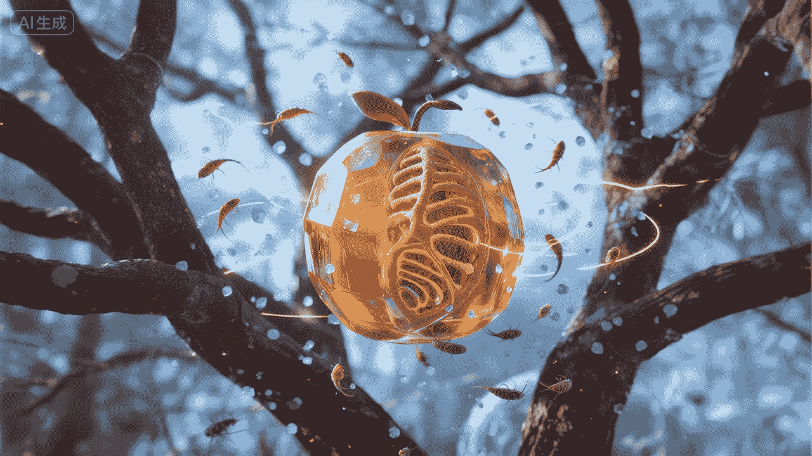 | 镜头推进到发光大树的一片叶子，叶面光芒凝聚成一个悬浮的晶体果实，近景聚焦到果实内部的有机结构，周围细小生物绕圈飞舞。 |  | 镜头拉远，果实变为悬挂在海面中央的大树，金色光流从枝叶倾泻而下，汇入水面，周围漂浮着巨型海洋生物与奇异植被。 |  | 镜头不升空变成卫星视觉看到地球上的巨树不断拉远最后看到远处悬浮的星球全景。 |  |  |  |  |  |  |  |  |

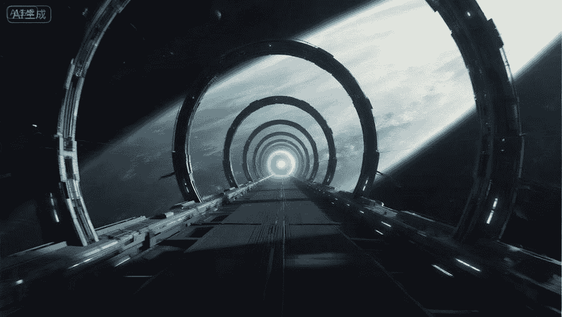

[测试.mp4](https://internal-api-drive-stream.feishu.cn/space/api/box/stream/download/all/RU69bA7TOo8AcFxq7opcf7vOnah)

[jimeng-2025-08-12-4632.mp4](https://internal-api-drive-stream.feishu.cn/space/api/box/stream/download/all/CDXTbZtqooPyfoxMsQlc0k5Hnoh)

#### **空间运镜类提示词编写技巧：**

+   **编写结构**

【镜头运动方式】+【下一张图片的空间元素】+【环境氛围】+（可选情绪/动作）

**ps：一定要加镜头运动方式！但如果图片之间的信息足够，甚至可以无**提示词；但是这对图片的要求极高，如果图片关联性比较少老老实实多写点过渡提示词吧～

+   **基础运镜（适合任何场景）**

+   镜头拉近 / 镜头拉远 / 固定镜头 / 镜头水平向右平移 / 镜头水平向左平移 / 镜头垂直向上移动 / 镜头垂直向下移动 / 镜头俯视拍摄（从高处向下看）/ 镜头仰视拍摄（从低处向上看）/ 镜头旋转进入下一场景 / 镜头高速穿越 / 镜头360度环绕 / 镜头俯冲 / 镜头拔升 / 镜头穿梭 / 镜头贴地飞行

+   **如果有主体**

+   镜头跟随主体向 + 方向运动 / 镜头360度环绕主体 / 镜头从主体背后穿越到正面 / 镜头缓慢推进并聚焦主体细节

+   **注意事项**

+   必须有镜头动作：如果要一镜到底，用“镜头+动作”开头，不要只描述场景，这样才能保持空间衔接

+   动作与秒数匹配：大幅运动 4-6s，小幅运动 1-3s，避免闪跳

+   镜头不要堆太多：一条提示词 1-2 种镜头动作即可

+   氛围词适量：简洁直观，不堆砌形容词

+   **示例提示词**

+   镜头缓慢推进，穿过雾气笼罩的走廊，环绕一圈后向上抬升至屋顶俯瞰城市

+   镜头高空俯视缓缓下降，顺着河道滑行，最终穿过一扇发光的拱门进入另一空间

+   镜头低角度仰视推进，掠过树梢与屋檐，镜头旋转后透过窗户进入昏暗室内

+   镜头匀速平移，跟随飘落的树叶，穿过长廊尽头的门缝，进入烛光摇曳的房间

+   镜头快速推进，越过桌面与书本，镜头环绕人物一周后缓缓拉远至夜色街道

### 角色动态类（复杂主体动态）

以角色的连续动作为核心，通过多帧展现人物在同一或不同场景中的动作变化。强调主体明确、动作连贯、与环境互动，常配合运镜实现自然衔接与沉浸感

#### Case展示

| 视频效果 | 图片1 | 提示词1 | 图片2 | 提示词2 | 图片3 | 提示词3 | 图片4 | 提示词4 | 图片5 | 提示词5 | 图片6 | 提示词6 | 图片7 | 提示词7 | 图片8 | 提示词8 | 图片9 | 提示词9 | 图片10 |  |
| --- | --- | --- | --- | --- | --- | --- | --- | --- | --- | --- | --- | --- | --- | --- | --- | --- | --- | --- | --- | --- |
|  | 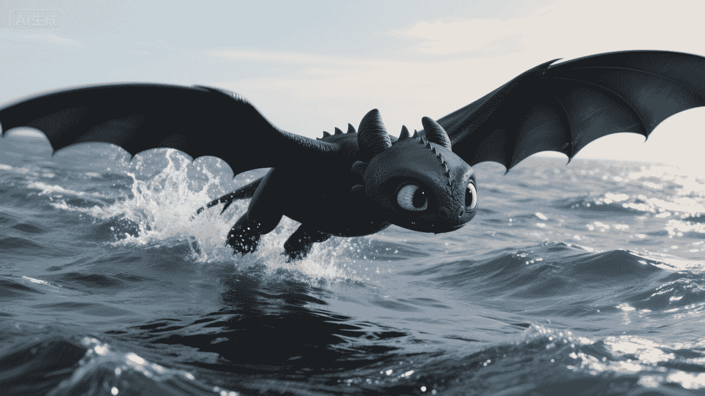 | 镜头跟随，无牙仔从海面上飞到高空上，镜头上升 |  | 镜头跟随，无牙仔从海面上飞到高空上，镜头上升 | 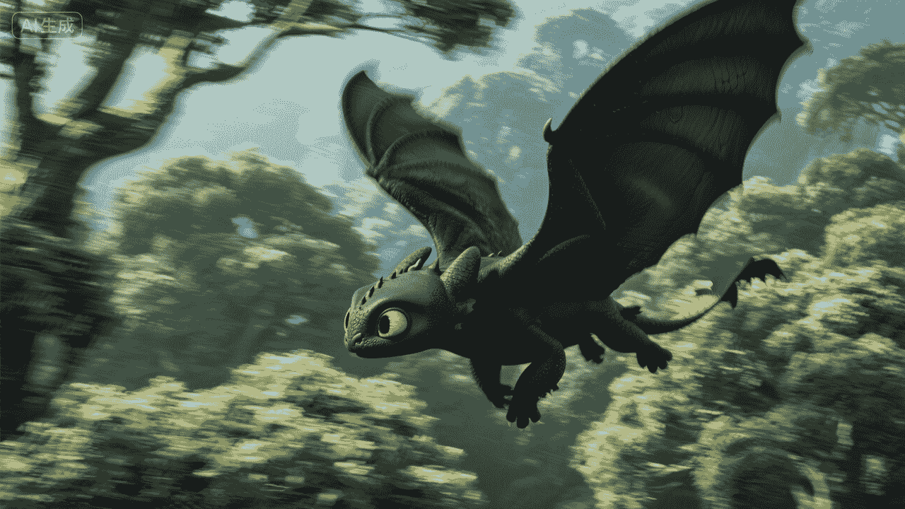 | 镜头跟随无牙仔飞翔 | 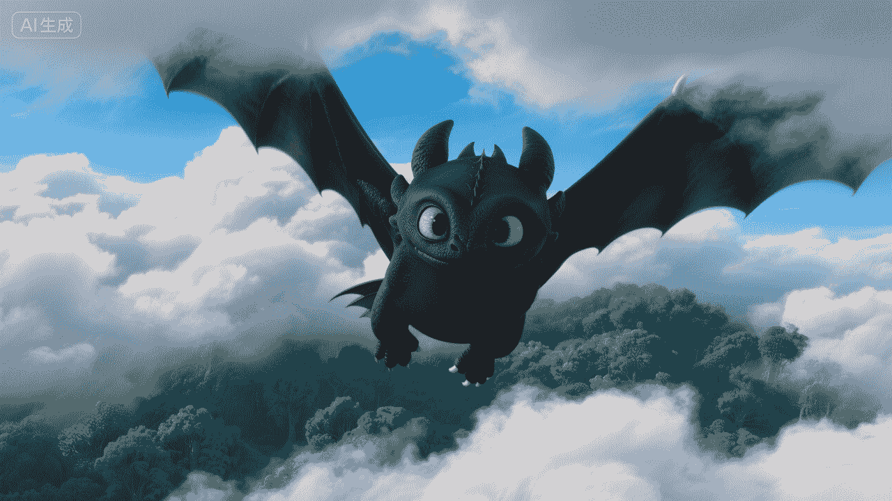 | 无牙仔穿过云层，飞到石头上停下来 |  |  |  |  |  |  |  |  |  |  |  |  |
|  |  | 红色奔驰车在公路上快速行驶，环境从开满樱花的春天变成绿树成荫的夏天，镜头跟随汽车 | 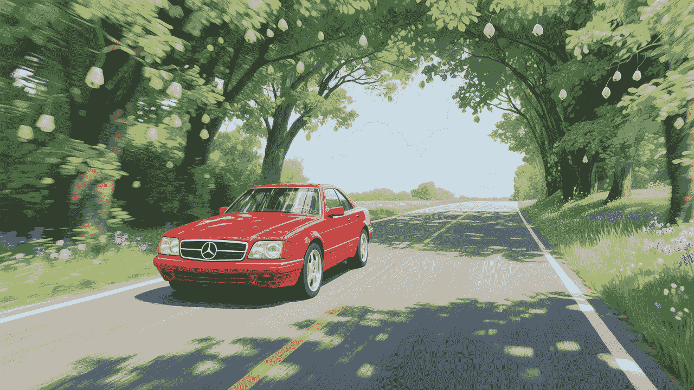 | 红色奔驰车在公路上快速行驶，环境从绿树成荫的夏天变成黄色枫叶的秋天，镜头跟随汽车 | 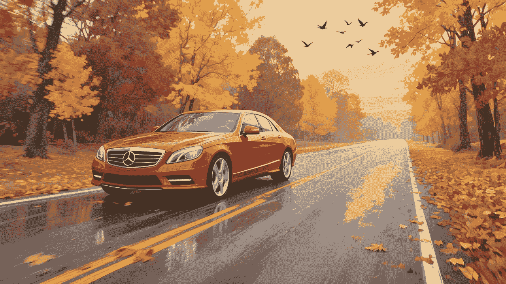 | 红色奔驰车在公路上快速行驶，环境从黄色枫叶的秋天变成大雪纷飞的冬天，镜头跟随汽车 | 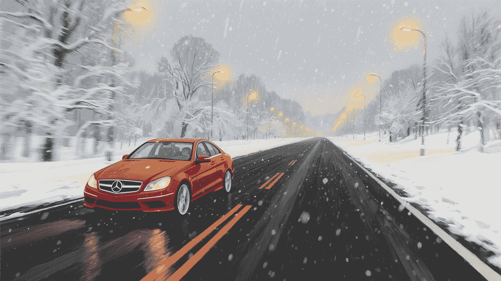 |  |  |  |  |  |  |  |  |  |  |  |  |  |
|  | 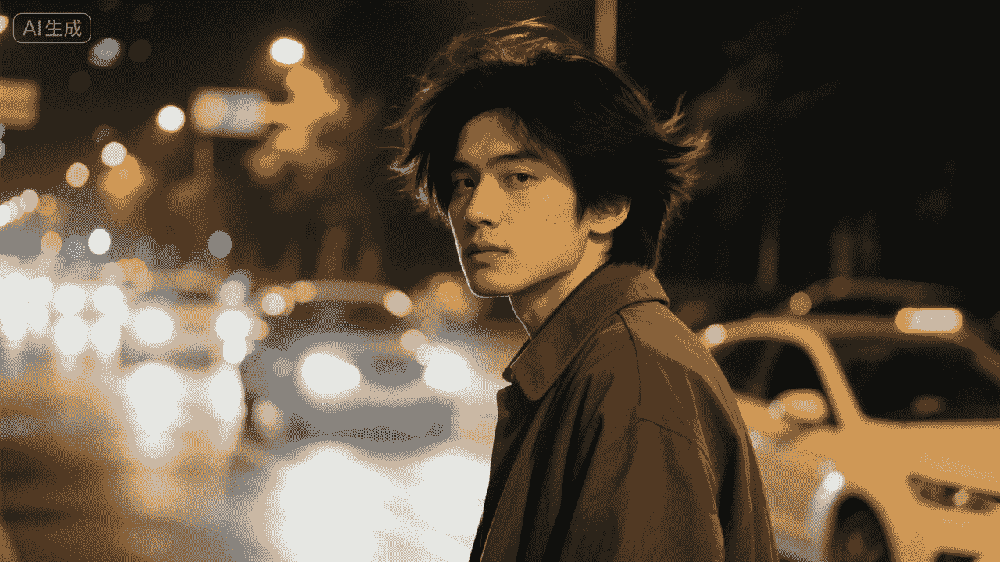 | 镜头跟随，男人左右看了看，然后向左边走去 | 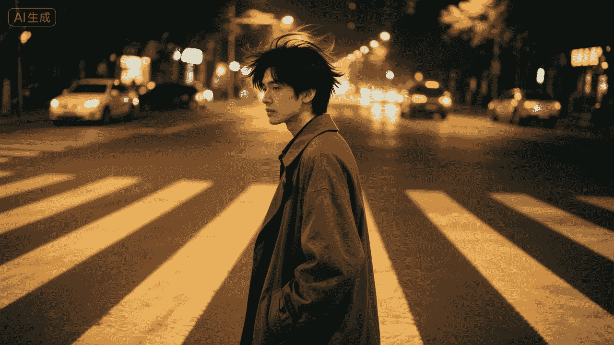 | 镜头跟随，男人向左边走去，走到一个便利店门口 | 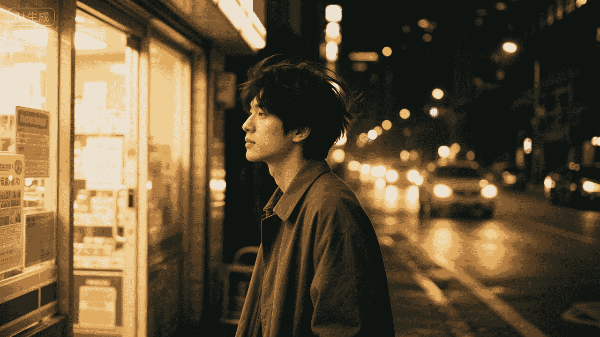 | 镜头环绕到男子背后，男人从门口走进了便利店，拿起了一瓶水 |  |  |  |  |  |  |  |  |  |  |  |  |  |  |
|  |  | 棕色的卡通熊变成了一只穿着红色外袍的狐狸，周身飘着云朵 |  | 全身镜头推进至狐狸脸部特写，狐狸面向镜头 | 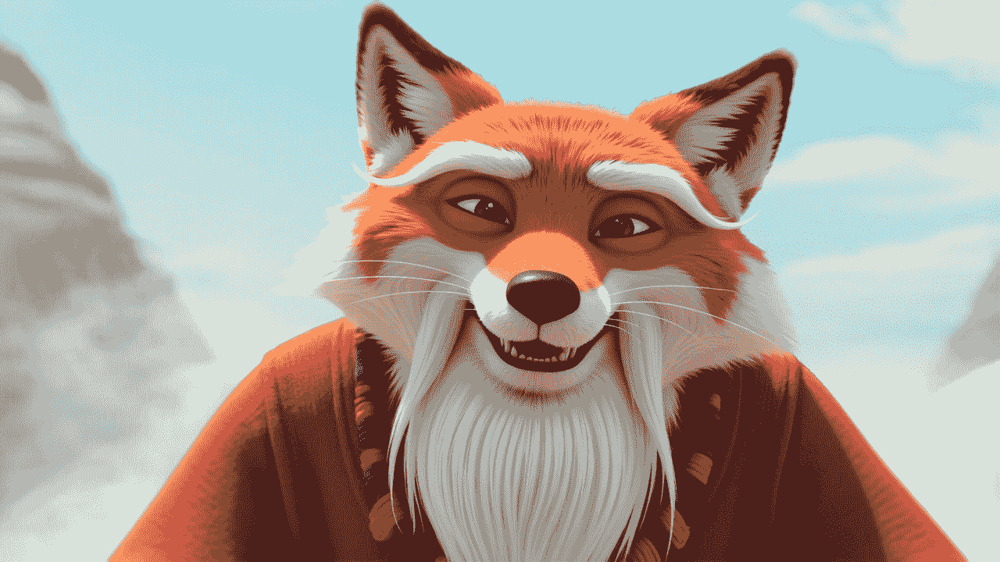 | 镜头从狐狸面部特写拉远，狐狸张口说话，说话时抬手捋胡子 |  |  |  |  |  |  |  |  |  |  |  |  |  |  |

[jimeng-2025-08-12-4728.mp4](https://internal-api-drive-stream.feishu.cn/space/api/box/stream/download/all/ZQaxbqndfoukj9xF6VucYkhtnae)

[jimeng-2025-08-12-4108.mp4](https://internal-api-drive-stream.feishu.cn/space/api/box/stream/download/all/CuQab9izaofE4JxqNF3c7I33nab)

[jimeng-2025-08-12-3704.mp4](https://internal-api-drive-stream.feishu.cn/space/api/box/stream/download/all/PCzobiKzOoDYGAxbbiPcznqonKs)

[output_20250808_181100.mp4](https://internal-api-drive-stream.feishu.cn/space/api/box/stream/download/all/ZEBabZk1KoRJJBxIi8Nc4CM9nmd)

#### **角色运动类提示词编写技巧：**

+   **编写结构**

【角色身份/外观】 + 【关键动作】 + 【环境元素】 + 【镜头运动方式】 + （可选情绪 / 氛围）

**ps：建议每一帧也加上运镜提示词过渡，运**镜提示词撰写可看「运镜空间类」下方的内容

+   **注意事项**

+   动作连贯：角色在相邻帧中动作最好有延续性（例如：奔跑 - 跃起 - 落地，有逻辑的动作）

+   与环境互动：让角色动作与背景元素产生关联（跳在车顶上、推开门等）

+   动作和镜头匹配：快节奏动作配快速运镜，慢节奏动作配缓慢推进或环绕

+   主体清晰：确保角色是画面视觉中心，避免与背景杂乱元素抢夺注意力

+   秒数合理：大动作 3-6s，小动作 1-3s

+   **常见 Badcase**

+   动作无连接：第一帧奔跑，第二帧突然坐下无过渡

+   缺少镜头运动：只写“男子挥剑”而无“镜头拉近”或“镜头环绕”

+   角色不突出：背景细节过多导致主体被淹没

+   **示例提示词：**

+   身披黑袍的剑客猛然拔剑，镜头低角度跟随疾冲穿过昏暗长廊

+   红衣女子缓缓抬手推开木门，镜头贴近手部细节后顺势拉远至全景

+   少年跃上屋顶，镜头360度环绕其身影，背景夜色中烟火绽放

+   戴面具的舞者旋转挥舞丝带，镜头平移穿过丝带缠绕的空气进入下一个场景

### 产品展示类（商业产品广告）

以突出产品为核心，通过多帧呈现产品的外观细节、功能特点及使用场景

#### Case展示

| 视频效果 | 图片1 | 提示词1 | 图片2 | 提示词2 | 图片3 | 提示词3 | 图片4 | 提示词4 | 图片5 | 提示词5 | 图片6 | 提示词6 | 图片7 | 提示词7 | 图片8 | 提示词8 | 图片9 | 提示词9 | 图片10 |  |
| --- | --- | --- | --- | --- | --- | --- | --- | --- | --- | --- | --- | --- | --- | --- | --- | --- | --- | --- | --- | --- |
|  |  | 镜头快速推进，可乐旋转，从可乐罐整体推到特写局部 |  | 镜头往后拉，可乐罐往杯子中倒可乐 |  | 头围绕装着可乐的玻璃杯翻转一周，可乐在杯中鼓起气泡，玻璃杯在镜头翻转过程中变成一罐可乐 |  | 头向下，一瓶可乐罐落地，镜头向后拉，变成3罐可乐，展示产品 |  | 运镜快速推近到人物面部，人物突然举起手中的甜甜圈，运镜迅速拉远展示广角镜头下的人物动作 |  |  |  |  |  |  |  |  |  |  |
|  |  | 镜头推进，女人把口红放到嘴唇中间 |  | 镜头拉远，丝滑过渡 |  | 镜头右移到花瓣的场景 |  | 镜头往上环绕到花瓣中心 |  | 镜头拉远，口红从上到下掉落到花瓣面前 |  | 丝滑过渡 |  |  |  |  |  |  |  |  |

[20250812-184247.mp4](https://internal-api-drive-stream.feishu.cn/space/api/box/stream/download/all/Os60bKQcIoaRwbxQV92c0ZmQnSd)

[jimeng-2025-08-13-1105.mp4](https://internal-api-drive-stream.feishu.cn/space/api/box/stream/download/all/SX64bMIzsoRVhfxde9pcp9sdn3z)

#### **产品展示类提示词编写技巧：**

+   **编写结构**

【镜头运动方式】 + 【产品部位/特征】 + 【展示细节/功能】 + 【环境氛围/质感】

**ps：建议每一帧也加上运镜提示词过渡，运**镜提示词撰写可看「运镜空间类」下方的内容

+   常见镜头运动方式（补充产品展示类的，详情还是看空间运动类的内容）

镜头360度环绕产品 / 镜头沿产品边缘滑动 / 镜头推进聚焦Logo or 关键部位 / 镜头穿过产品表面元素切换至另一部分

+   **注意事项**

+   产品的细节和比例：注意在做图的时候尽可能保持产品的细节和比例是一样的，否则会出现跳变、变形、logo消失这样的情况

+   物理变化循序渐进：产品展示里经常会出现液体流动、质地变化等，可以用“缓慢”“逐渐”等描述，避免瞬间变形

+   用运镜制造变化：建议用基础运镜提示词去过渡画面到新视角而不是直接去变化场景

+   **示例提示词**

+   镜头缓慢推进，沿着金属外壳的弧线滑动，切入到LOGO的特写，金属质感在柔和灯光下闪耀

+   固定镜头，侧拍花朵，花朵慢慢绽放，花朵慢慢扭转为正，产品展示出来

+   镜头缓慢拉近至手表表盘，数字刻度发光渐变成下一场景

+   镜头绕着咖啡杯旋转一圈，杯中咖啡液面化作金色波浪延伸至下个画面

+   镜头推进至红酒瓶瓶口，红酒液体在空中变为流动的丝绸画面

### 节奏驱动类（卡点视频）

利用智能多帧可自定义 0–6 秒帧间间隔的特性，通过画面切换速度与视觉变化，配合节拍或情绪节奏，形成强烈的节奏感与氛围场景（可以略过剪辑变速，直接控制速度）

#### Case展示

| 视频效果 | 图片1 | 提示词1 | 图片2 | 提示词2 | 图片3 | 提示词3 | 图片4 | 提示词4 | 图片5 | 提示词5 | 图片6 | 提示词6 | 图片7 | 提示词7 | 图片8 | 提示词8 | 图片9 | 提示词9 | 图片10 |  |
| --- | --- | --- | --- | --- | --- | --- | --- | --- | --- | --- | --- | --- | --- | --- | --- | --- | --- | --- | --- | --- |
|  | 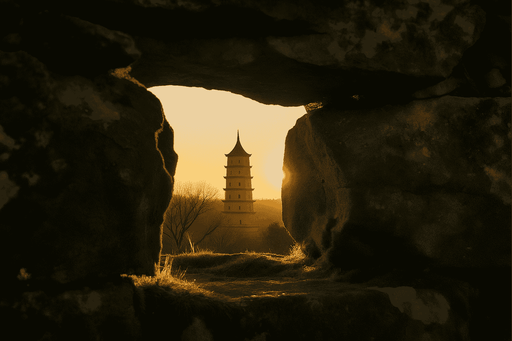 | 镜头快速拉近到塔身 |  | 镜头向右快速环绕并同步螺旋上升 |  | 镜头快速向左环绕聚焦于塔的风铃，然后画面安静，有呼吸感，风吹铃铛摇曳 |  | 镜头向上环绕变为竖直向下的顶视俯拍视角，并且开始缓慢水平旋转运镜 | 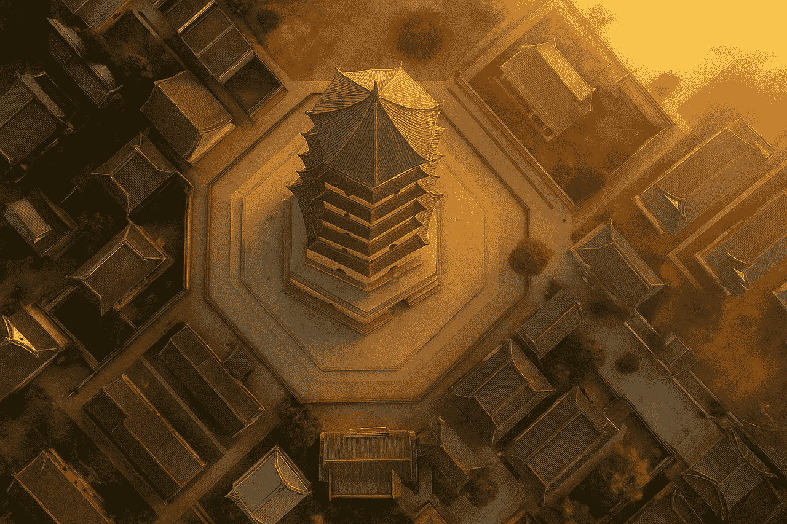 |  |  |  |  |  |  |  |  |  |  |  |

[jimeng-2025-08-13-6021.mp4](https://internal-api-drive-stream.feishu.cn/space/api/box/stream/download/all/DZE7bKfWTo2vLpx2MvTcX6QXnXg)

#### **节奏驱动类提示词编写技巧：**

+   **编写结构：**

【镜头运动方式/画面变化方式】 + 【变化元素/主体动作】 + 【节奏感修饰词】 + 【环境氛围】

**镜头运动方式/画面变化方式**：

镜头快速推进 / 镜头急速拉远 / 镜头闪切 / 画面快速转换 / 镜头快速旋转

### 叙事类

以长镜头贯穿故事，将空间运镜、角色动态、节奏变化等多种镜头语言融合成一体，让画面在时间与空间上连续推进，完整呈现情节发展

#### Case展示

| 视频效果 | 图片1 | 提示词1 | 图片2 | 提示词2 | 图片3 | 提示词3 | 图片4 | 提示词4 | 图片5 | 提示词5 | 图片6 | 提示词6 | 图片7 | 提示词7 | 图片8 | 提示词8 | 图片9 | 提示词9 | 图片10 |  |
| --- | --- | --- | --- | --- | --- | --- | --- | --- | --- | --- | --- | --- | --- | --- | --- | --- | --- | --- | --- | --- |
|  | 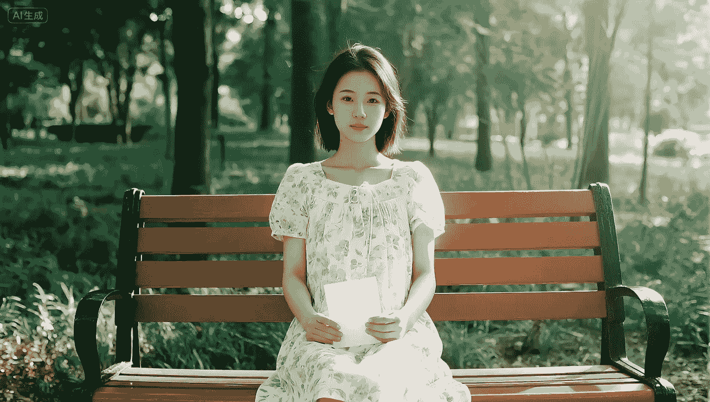 | 女子将头转向左边表情犹豫，呼吸紧张感 |  | 女子将头转回来并拿起手里的纸，开始阅读 |  | 女子看着纸上的内容表情开始变化 |  | 女子看着纸上的内容表情开始变化 |  | 女子看完纸上的内容将纸抱在胸前，情感变化，开始哭泣。伤心难过 |  | 在女子哭的时候镜头的左边走过来一个男人摸女人的头，女人哭着回头看然后丢掉纸张，开始惊喜的笑并抱在一起 | 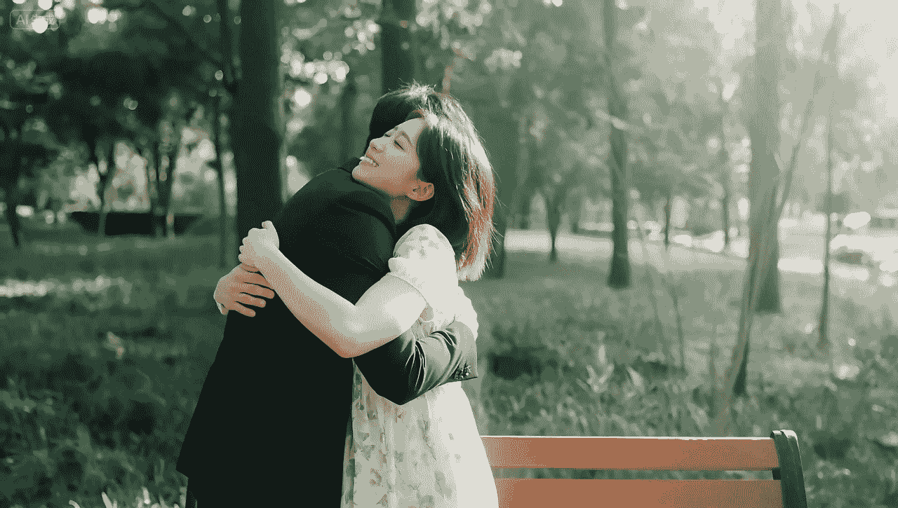 |  |  |  |  |  |  |  |
|  |  | 穿着深色西装的哪吒手提公文包，走在人行道上，神情专注而略带急切，镜头跟随，哪吒走到路口时，他停下脚步，把公文包换到另一只手，抬手看了看手表，眉头微皱 |  | 固定镜头，哪吒停下脚步，这时候左边走出一位老奶奶，哪吒注意到老奶奶 |  | 哪吒把公文包放到另一只手，看到老奶奶面带微笑，空着的手伸出手扶着老奶奶走在马路上 |  | 镜头跟随，哪吒扶着老奶奶走过马路，走到路口，老奶奶张嘴向哪吒道谢 | 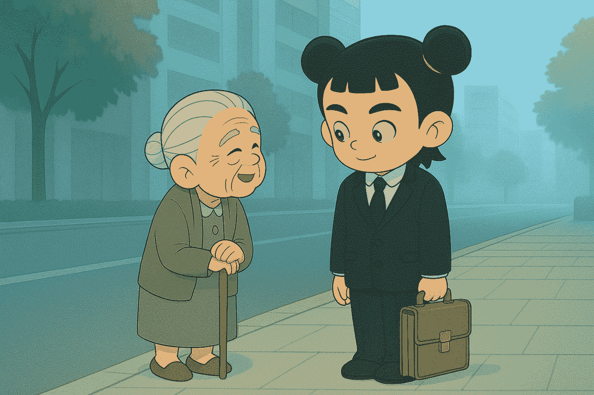 | 老奶奶走出画面，哪吒把公文包换到另一只手，继续狂奔赶路，镜头跟随哪吒，环绕到哪吒背后 | 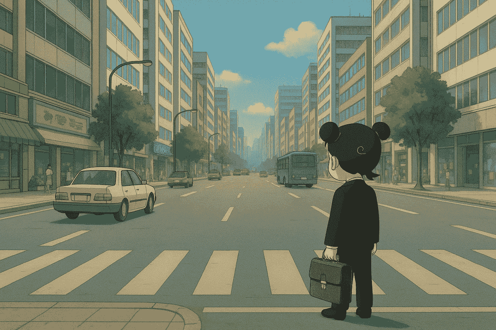 |  |  |  |  |  |  |  |  |  |

[jimeng-2025-08-13-2839.mp4](https://internal-api-drive-stream.feishu.cn/space/api/box/stream/download/all/NNlYbwDUYoRXxJxR55Lc70F2nV2)

[jimeng-2025-08-11-4765.mp4](https://internal-api-drive-stream.feishu.cn/space/api/box/stream/download/all/HsYcbvk3Mo1C5IxWCGucP0GPnNb)

首先！再重点强调一下，什么是叙事类的长视频：

叙事类**是一种以长镜头推动情节发展的多**帧视频创作方式，在一镜到底的连贯运动中，将角色动态、空间运镜、节奏变化等多种元素融合，呈现完整的故事走向。它常用于电影、广告、短片等需要沉浸感与情绪递进的场景，通过镜头的连续性与画面细节的变化，引导观众自然地进入故事。所以它其实是以上场景的结合版本

#### **叙事类提示词编写技巧：**

+   **编写结构：**

【镜头运动方式】 + 【当前画面内容】 + 【过渡方式/动作】 + 【下一画面内容】 + 【氛围/情绪】

+   **编写要点：**

+   故事主线先定好：先明确“这个长镜头的故事逻辑”，按节奏顺序去排帧，顺序很重要

+   多类别融合：在不同帧用不同的镜头语言（运镜 / 动态 / 节奏 / 产品特写等）

+   过渡自然：帧与帧的连接要有空间或动作的合理性，避免“突变”

+   情绪递进：前后帧的情绪最好逐步加强或缓和，制造观感节奏

+   **注意事项**

+   不要没有故事逻辑：只是随机拼接几个画面，用户会觉得割裂

+   过渡无空间 / 动作衔接：比如室内画面突然硬切到室外，缺少镜头运动承接

+   情绪跳跃太猛：平静场景瞬间切到极端激烈的动作，没有铺垫会显得突兀

### 循环动画：

首帧和尾帧保证图片一样就可以了，可以成为循环壁纸

| 视频效果 | 方式 |
| --- | --- |
|  |  |
|  |  |

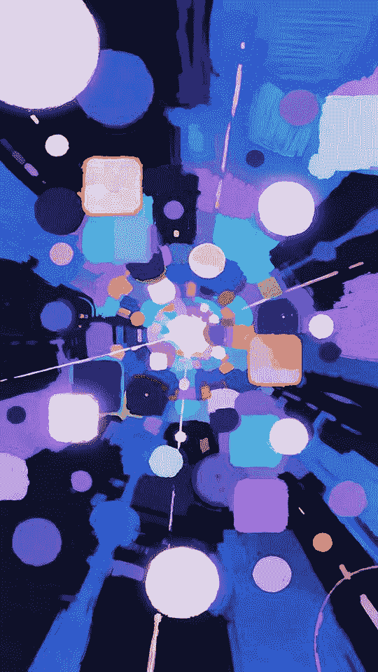

[jimeng-2025-08-12-6742.mp4](https://internal-api-drive-stream.feishu.cn/space/api/box/stream/download/all/QvdobG1xNoFtSfxTstUcPXeqnbd)

[jimeng-2025-08-12-4717.mp4](https://internal-api-drive-stream.feishu.cn/space/api/box/stream/download/all/DzYWbrvp3o1q6hxzNOxcPpHtn3d)

### 写提示词总结（非常重要）

#### **编写提示词的关键要素：**

+   **明确镜头运动方式：**
在写提示词时，始终要明确镜头的运动方式（如：拉近、拉远、平移、旋转等）。镜头运动方式是智能多帧生成的基础，能够影响的流畅性以及视觉效果

+   **简洁且有针对性的描述：**
重点描述场景中的关键元素（如：人物、物品、背景等），避免过度细化无关细节，尤其是对于背景和环境的描述要简洁、清晰。确保每个镜头的提示词都有明确的指引，而不是冗余的描述。但是不能啥也不写，目前模型还是需要清晰提示词的引导

+   **注重情感和动作的衔接：**
在动态场景（如角色动态、节奏驱动）中，要精确地描写人物的动作与情感，避免模糊的描述。运镜的提示词应当配合情节进展，确保视觉语言的连贯性

+   **根据场景类型调整提示词：**
每种场景类型（如空间运镜、产品展示、叙事等）都有不同的提示词要求。对于空间运镜类，着重描述镜头的空间穿梭和过渡；对于产品展示类，则更注重产品细节的呈现和光影的变化；对于叙事类，需注重人物的情感、动作及场景变化的流畅度

+   **不建议不写提示词：**

此项能力对关键帧要求比较高，关键帧越好视频效果就越好，建议用户一定要打磨好图片，不写提示词前提在于图片信息连续足够；如果没有足够的信息，一定要写精准的提示词！！！

## 小提示

虽然我们提供了几种场景和方法，但实际上，独特的创造力才是最重要的部分。不要局限于以上提到的这些，尽情发挥，去探索更多可能性。长镜头的魅力就在于它能够带来无尽的创意空间，给你带来更丰富的表现形式。无论是叙事、动效，还是虚拟与现实的结合，只要你想，任何创意都可以通过智能多帧来实现。现在，尽情去挑战更多场景吧～

---

---

---

---

---

# **English ****V****ersion**

**Intelligent Multi-frame, Let t**he Story Last Longer

"Intelligent Multi-frame" is the latest multi-image-driven video generation feature launched by Jimeng. It supports uploading up to 10 images (key frame) . The model will automatically recognize the image content. Combined with your prompts and the per-frame duration you set, it generates a continuous one-take video with smooth camera movement and natural pacing.

You can:

+   Upload 2–10 key frames to achieve a seamless one-take visual effect.

+   Freely set the per-frame duration (1–6s) to control rhythm and better match story beats.

+   Use camera-movement prompts to make shots more natural and coherent.

+   Support multiple creative scenarios such as spatial walkthroughs, product showcases, rhythm-driven clips, character dynamics, and storytelling. It is especially suitable for long-take or one-take content — for example, continuous shots in commercials, trendy-toy or new-product showcases, roaming camera moves, or dance/action sequences—ensuring smooth transitions and consistent pacing.

Just upload images and add prompts — and your continuous long take is done! 🎉

## Page Entry:

**Main Entry****:**

[一镜到底.mp4](https://internal-api-drive-stream.feishu.cn/space/api/box/stream/download/all/PPMObpNWwoq702x2h0xcmLp9n5H)

**Other Entry:**

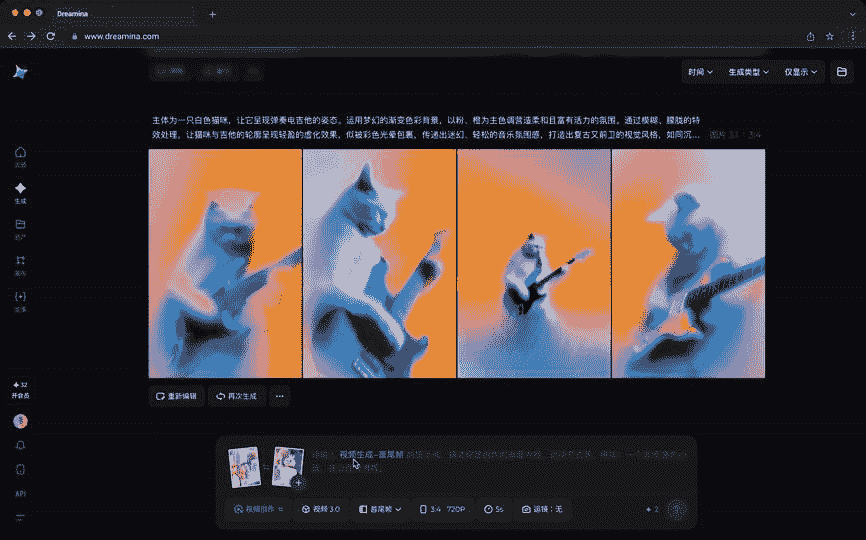

[首尾帧进入流程.mp4](https://internal-api-drive-stream.feishu.cn/space/api/box/stream/download/all/HIdkbAQ3dofWBWx7UNxcn3JNn5b)

** Interface:**

# Basic Parameters:

| **Parameter Item** | **Description** |
| --- | --- |
| Supported Frames | Up to 10 frames (it is recommended to use 4 - 7 frames for a more stable effect) |
| Inter-frame Duration | You can choose between 1 - 6 seconds. The total length of the video can reach up to 54 seconds |
| Input Type | Images |
| Resolution | 720p |
| Prompts | Similar to the logic of the first and last frames(Another controllable feature), write prompts for the transition between two frames, rather than simply describing the picture on the image |

# Suggested Applicable Scenarios: (What can it be used for?)

## The biggest advantage is that it can create long videos in a one-take style

### Spatial Camera Movement Category (Spatial Shuttling)

It refers to the continuous camera movement methods such as panning, zooming in, zooming out, circling, and following the camera to achieve natural connections and seamless shuttling/switching within the same space or between different spaces, thereby creating an immersive, spatial, and continuous storytelling effect.

#### Case Display

| Effect | Picture 1 | Prompt 1 | Picture 2 | Prompt 2 | Picture 3 | Prompt 3 | Picture 4 | Prompt 4 | Picture 5 | Prompt 5 | Picture 6 | Prompt 6 | Picture 7 | Prompt 7 | Picture 8 | Prompt 8 | Picture 9 | Prompt 9 | Picture 10 |  |
| --- | --- | --- | --- | --- | --- | --- | --- | --- | --- | --- | --- | --- | --- | --- | --- | --- | --- | --- | --- | --- |
|  |  | POV perspective, the camera zooms in infinitely and naturally transitions to the next frame. | 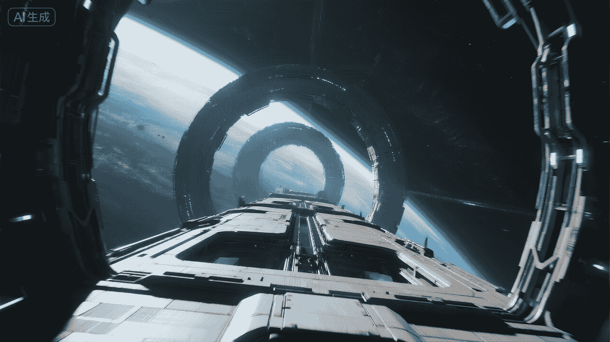 | POV perspective, the camera zooms in infinitely and naturally transitions to the next frame. | 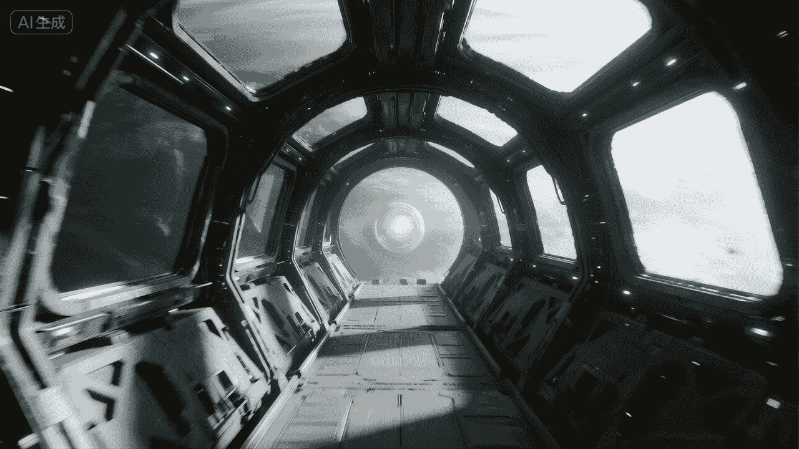 | POV perspective, the camera zooms in infinitely and naturally transitions to the next frame. |  | POV perspective, the camera zooms in infinitely and naturally transitions to the next frame. | 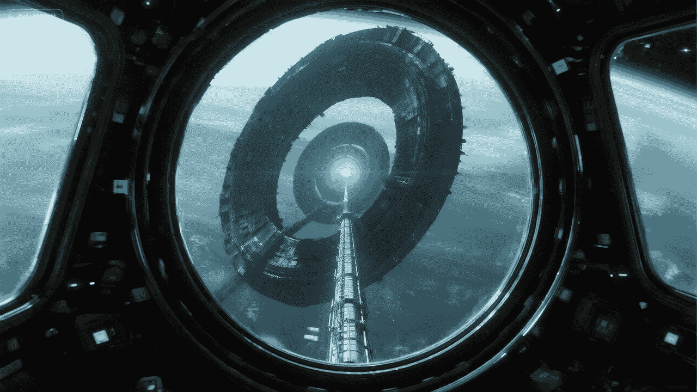 |  |  |  |  |  |  |  |  |  |  |  |
|  | 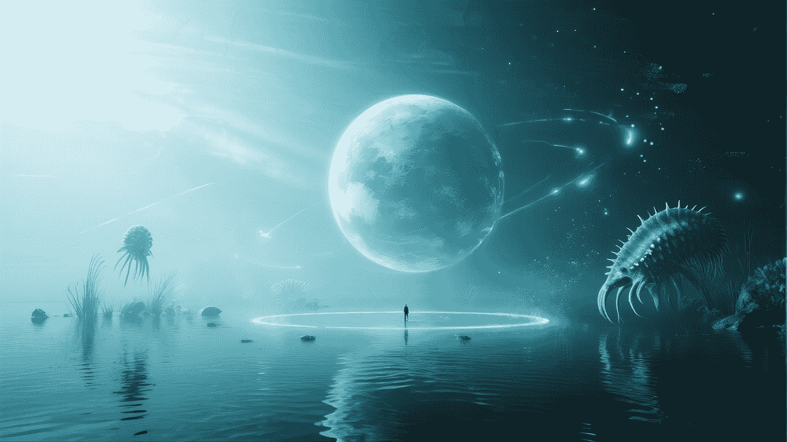 | The camera quickly dives from above the planet and rapidly zooms in to a close-up of the giant Earth, with creatures like those in the deep sea floating around. |  | The camera slowly zooms in from the close-up of the Earth, circles around to a close-up of the side ground, revealing giant glowing underwater leaves on the Earth. The edges of the leaves emit blue fluorescent light, and strange aquatic creatures are floating and swimming around. |  | The camera slowly zooms in from the close-up of the Earth, circles around to a close-up of the side ground, revealing giant glowing underwater leaves on the Earth. The edges of the leaves emit blue fluorescent light, and strange aquatic creatures are floating and swimming around. |  | The camera zooms in to a leaf of the glowing tree. The light on the leaf surface condenses into a floating crystal fruit. The close-up focuses on the organic structure inside the fruit, and small creatures are flying around in circles. |  | The camera zooms out. The fruit turns into a big tree hanging in the middle of the sea. Golden light flows down from the branches and leaves and merges into the water surface. Giant marine creatures and strange vegetation are floating around. | 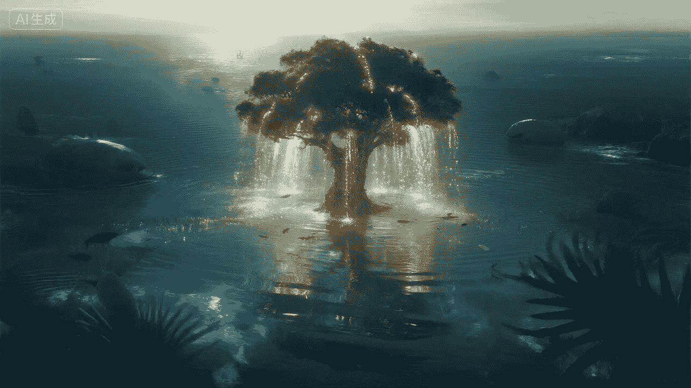 | The camera ascends and becomes a satellite view, seeing the giant tree on the Earth getting farther and farther away, and finally seeing the panoramic view of the floating planet in the distance. |  |  |  |  |  |  |  |  |

[测试.mp4](https://internal-api-drive-stream.feishu.cn/space/api/box/stream/download/all/OiWNbO7mronpu3x3wgjcBGl8nPq)

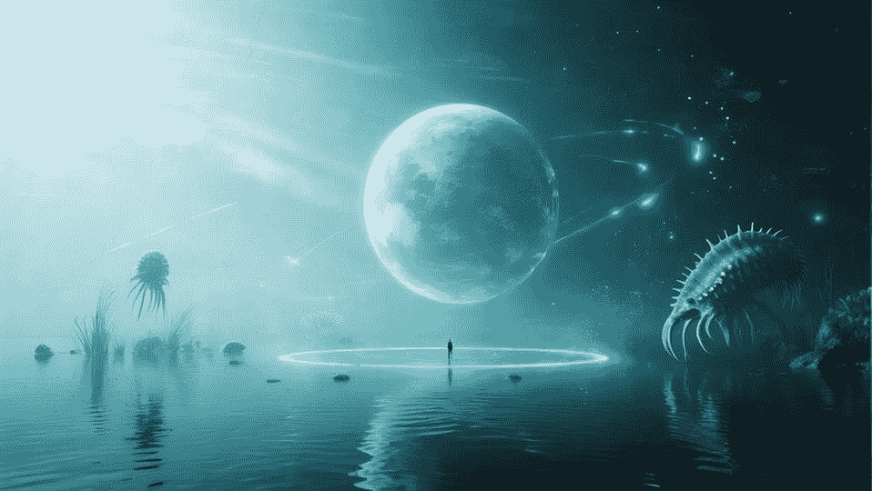

[jimeng-2025-08-12-4632.mp4](https://internal-api-drive-stream.feishu.cn/space/api/box/stream/download/all/DXL7bNoMVof688xxIVec6QDWnJf)

#### **Writing Skills for Spatial Came**ra Movement Prompts:

+   Writing Structure

[Camera Movement Method] + [Spatial Elements of the Next Picture] + [Environmental Atmosphere] + (Optional Emotion/Actions)

**PS: The** camera movement method must be added! However, if the information between the pictures is sufficient, you can even use no prompts. But this requires extremely high - quality pictures. If the pictures have little relevance, write more transitional prompts honestly.

+   **Basic Camera Movements (Suitab**le for Any Scenario)

+   Zoom in the camera / Zoom out the camera / Fixed camera / Pan the camera horizontally to the right / Pan the camera horizontally to the left / Move the camera vertically upwards / Move the camera vertically downwards / Shoot from a bird's - eye view (looking down from a high place) / Shoot from a low - angle view (looking up from a low place) / Rotate the camera to enter the next scene / The camera passes through at high speed / The camera circles 360 degrees / The camera dives / The camera ascends / The camera shuttles / The camera flies close to the ground

+   If There is a Subject

+   The camera follows the subject moving in the + direction / The camera circles the subject 360 degrees / The camera passes through from the back of the subject to the front / The camera slowly zooms in and focuses on the details of the subject

+   **Precautions**

+   There must be camera actions: If you want a one-take video, start with "camera + action" and don't just describe the scene to maintain spatial connection.

+   Match actions with seconds: For large - scale movements, 4 - 6 seconds; for small - scale movements, 1 - 3 seconds. Avoid sudden jumps.

+   Don't pile up too many camera actions: One prompt should have 1 - 2 types of camera actions.

+   Use an appropriate amount of atmosphere words: Be concise and intuitive, and don't pile up adjectives.

+   **Example Prompts**

+   The camera slowly zooms in, passes through the fog - covered corridor, circles around once, and then rises to the roof to overlook the city.

+   The camera looks down from a high altitude and slowly descends, slides along the river channel, and finally passes through a glowing archway to enter another space.

+   The camera advances from a low - angle view, skims over the treetops and eaves, rotates, and then enters the dim interior through the window.

+   The camera pans at a constant speed, follows the falling leaves, passes through the crack in the door at the end of the corridor, and enters the room with flickering candles.

+   The camera zooms in quickly, crosses over the table and books, circles around the person once, and then slowly zooms out to the night - time street.

### Character Dynamics Category (Complex Subject Movements)

Centered around the continuous movements of characters, it shows the action changes of characters in the same or different scenarios through multiple frames. It emphasizes a clear subject, coherent actions, and interaction with the environment, often combined with camera movements to achieve natural connections and immersion.

#### Case Display

| Video Effect | Picture 1 | Prompt 1 | Picture 2 | Prompt 2 | Picture 3 | Prompt 3 | Picture 4 | Prompt 4 | Picture 5 | Prompt 5 | Picture 6 | Prompt 6 | Picture 7 | Prompt 7 | Picture 8 | Prompt 8 | Picture 9 | Prompt 9 | Picture 10 |  |
| --- | --- | --- | --- | --- | --- | --- | --- | --- | --- | --- | --- | --- | --- | --- | --- | --- | --- | --- | --- | --- |
|  |  | The camera follows. Toothless flies from the sea to the sky, and the camera rises. | 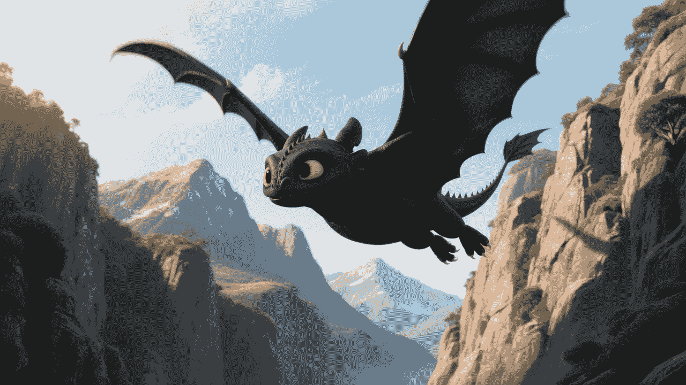 | The camera follows. Toothless flies from the sea to the sky, and the camera rises. |  | The camera follows Toothless flying. |  | Toothless passes through the clouds and flies to a rock to stop. | 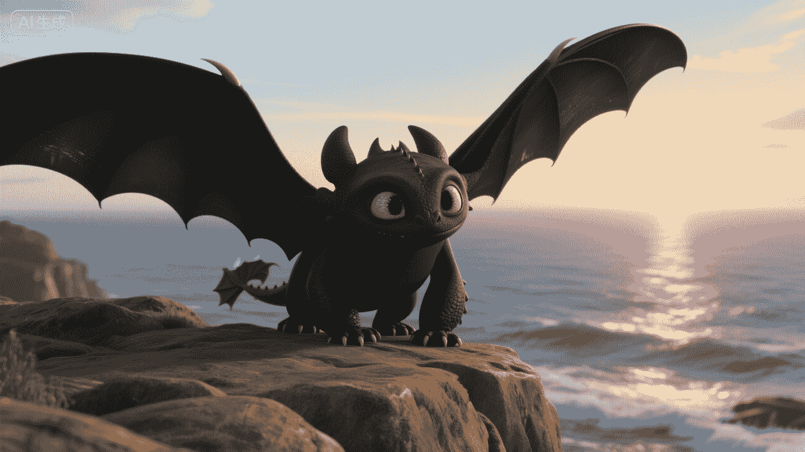 |  |  |  |  |  |  |  |  |  |  |  |
|  | 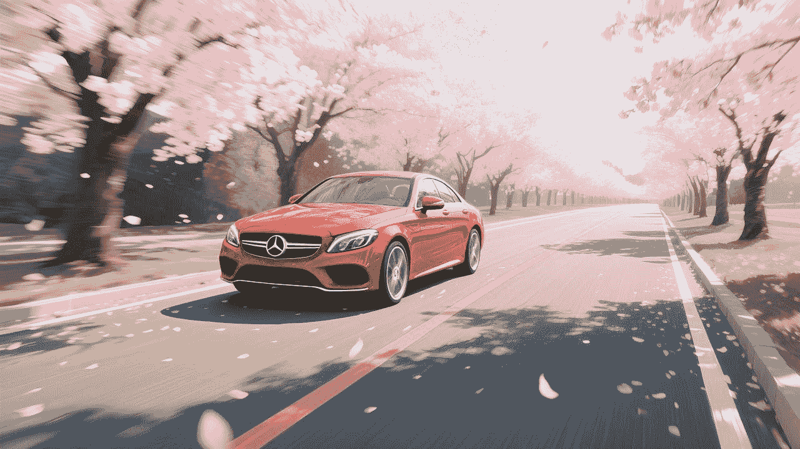 | A red Mercedes - Benz is speeding on the road. The environment changes from spring with cherry blossoms to summer with shady trees. The camera follows the car. |  | A red Mercedes - Benz is speeding on the road. The environment changes from summer with shady trees to autumn with yellow maple leaves. The camera follows the car. |  | A red Mercedes - Benz is speeding on the road. The environment changes from autumn with yellow maple leaves to winter with heavy snow. The camera follows the car. |  |  |  |  |  |  |  |  |  |  |  |  |  |  |
|  |  | The camera follows. The man looks around and then walks to the left. |  | The camera follows. The man walks to the left and reaches the door of a convenience store. |  | The camera circles around to the man&#x27;s back. The man walks into the convenience store from the door and picks up a bottle of water. | 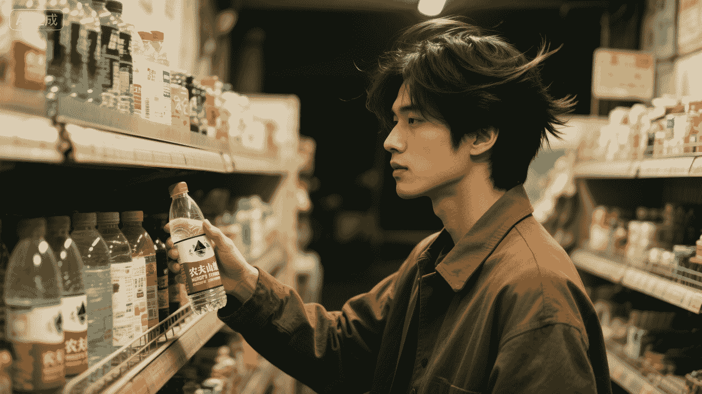 |  |  |  |  |  |  |  |  |  |  |  |  |  |
|  |  | A brown cartoon bear turns into a fox in a red robe, with clouds floating around. | 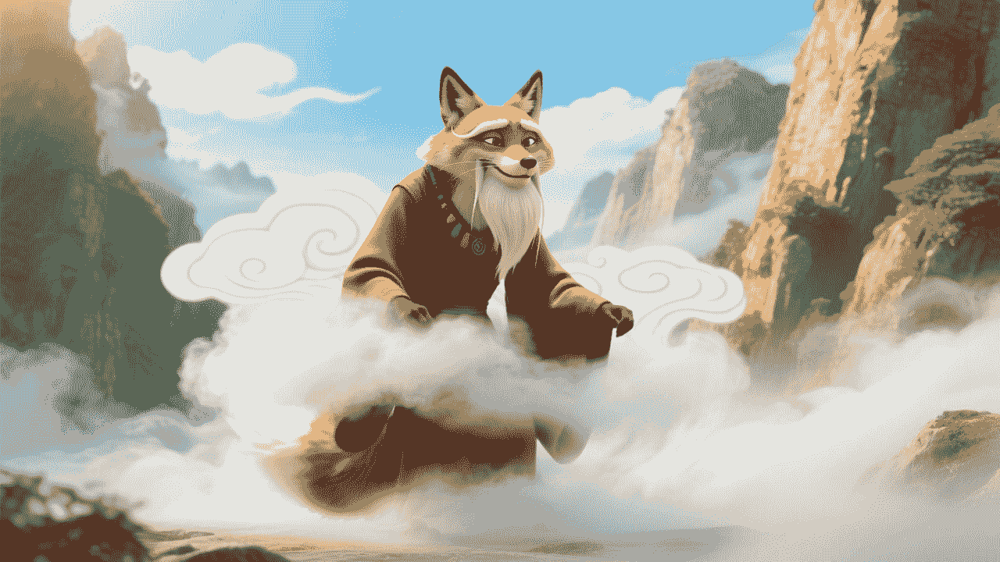 | The full - body shot zooms in to a close - up of the fox&#x27;s face. The fox faces the camera. |  | The camera zooms out from the close - up of the fox&#x27;s face. The fox opens its mouth to speak and raises its hand to stroke its beard when speaking. | 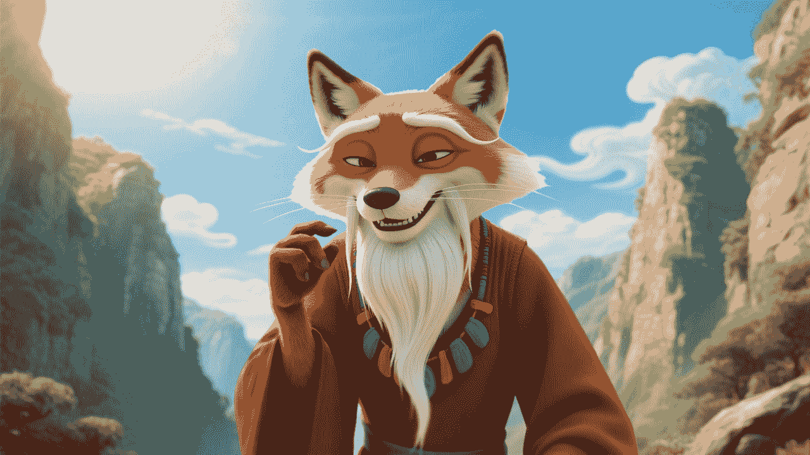 |  |  |  |  |  |  |  |  |  |  |  |  |  |

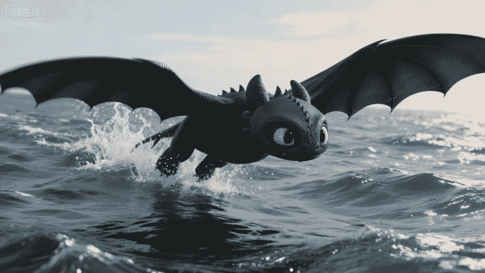

[jimeng-2025-08-12-4728.mp4](https://internal-api-drive-stream.feishu.cn/space/api/box/stream/download/all/SRtTbzoVXo0CDyxfAUHcKmETnOg)

[jimeng-2025-08-12-4108.mp4](https://internal-api-drive-stream.feishu.cn/space/api/box/stream/download/all/UzFdbSox9oOXIpxHBgLcw6kxnIg)

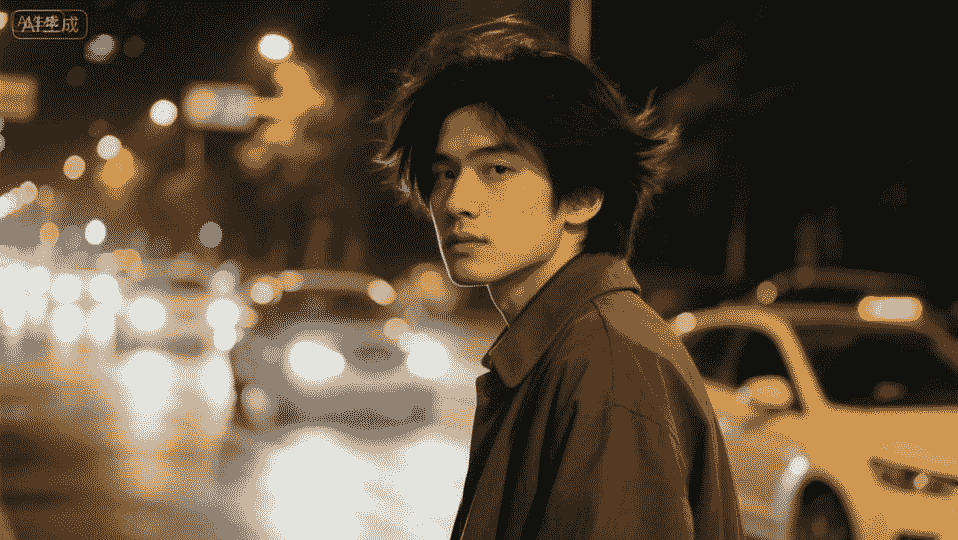

[jimeng-2025-08-12-3704.mp4](https://internal-api-drive-stream.feishu.cn/space/api/box/stream/download/all/Hv39bnPa6oCiupxltbgcx3YIn6g)

[output_20250808_181100.mp4](https://internal-api-drive-stream.feishu.cn/space/api/box/stream/download/all/QDfFblKGAoZ7HExqK7tcpE1rnHb)

#### **Writing Skills for Charact**er Movement Prompts:

+   Writing Structure

[Character Identity/Appearance] + [Key Actions] + [Environmental Elements] + [Camera Movement Method] + (Optional Emotion/Atmosphere)

**PS: It is recommended to add camera movement prompts for each frame for transitio**n. You can refer to the content under "Spatial Camera Movement" for writing camera movement prompts.

+   **Precautions**

+   Action continuity: The actions of the character in adjacent frames should preferably have continuity (for example, running - jumping - landing, logical actions).

+   Interaction with the environment: Let the character's actions be related to the background elements (jumping on the car roof, opening the door, etc.).

+   Match actions with the camera: Fast - paced actions should be paired with fast camera movements, and slow - paced actions should be paired with slow zooming in or circling.

+   Clear subject: Ensure that the character is the visual center of the picture and avoid competing for attention with cluttered background elements.

+   Reasonable seconds: For large actions, 3 - 6 seconds; for small actions, 1 - 3 seconds.

+   Common Bad Cases

+   No connection between actions: Running in the first frame and suddenly sitting down in the second frame without transition.

+   Lack of camera movement: Only writing "a man swings a sword" without "the camera zooms in" or "the camera circles".

+   The character is not prominent: Too many background details cause the subject to be submerged.

+   Example Prompts:

+   A swordsman in a black robe suddenly draws his sword. The camera follows from a low - angle view and rushes through the dim corridor.

+   A woman in red slowly raises her hand to open the wooden door. The camera gets close to the details of her hand and then zooms out to the full view.

+   A teenager jumps onto the roof. The camera circles around his figure 360 degrees, and fireworks bloom in the night - time background.

+   A masked dancer spins and waves the ribbon. The camera pans through the air wrapped by the ribbon to enter the next scene.

### Product Display Category (Commercial Product Advertisements)

Centered around highlighting the product, it presents the appearance details, functional features, and usage scenarios of the product through multiple frames.

#### Case Displayv

| Video Effect | Picture 1 | Prompt 1 | Picture 2 | Prompt 2 | Picture 3 | Prompt 3 | Picture 4 | Prompt 4 | Picture 5 | Prompt 5 | Picture 6 | Prompt 6 | Picture 7 | Prompt 7 | Picture 8 | Prompt 8 | Picture 9 | Prompt 9 | Picture 10 |  |
| --- | --- | --- | --- | --- | --- | --- | --- | --- | --- | --- | --- | --- | --- | --- | --- | --- | --- | --- | --- | --- |
|  |  | The camera zooms in quickly. The cola rotates, and the shot zooms in from the whole cola can to a close - up of a part. |  | The camera zooms out. The cola can pours cola into the cup. |  | The camera circles around the glass filled with cola for a week. The cola bubbles in the glass, and the glass turns into a can of cola during the camera rotation. |  | The camera points down. A can of cola falls to the ground. The camera zooms out and shows three cans of cola to display the product. |  | The camera quickly zooms in to the person&#x27;s face. The person suddenly raises the donut in his hand. The camera quickly zooms out to show the person&#x27;s action in a wide - angle shot. |  |  |  |  |  |  |  |  |  |  |
|  |  | The camera zooms in. The woman puts the lipstick in the middle of her lips. |  | The camera zooms out and has a smooth transition. |  | The camera moves to the right to the petal scene. |  | The camera circles up to the center of the petals. |  | The camera zooms out. The lipstick falls from top to bottom in front of the petals. |  | Smooth transition. |  |  |  |  |  |  |  |  |

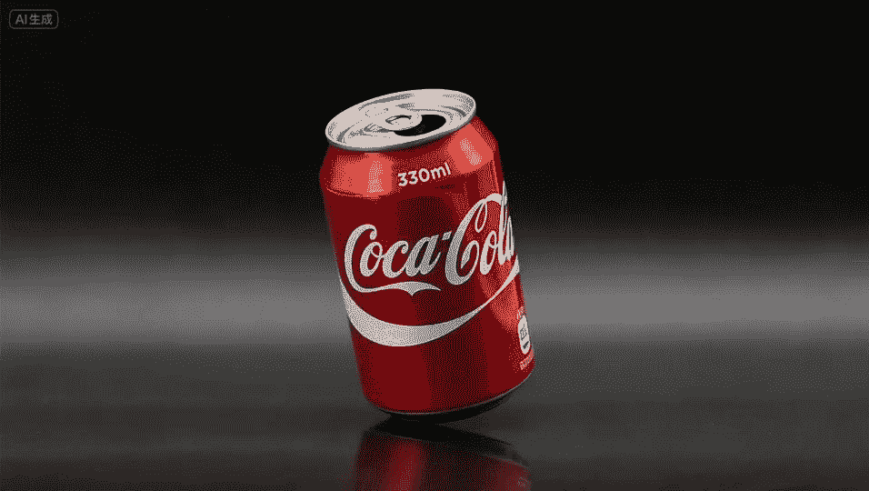

[20250812-184247.mp4](https://internal-api-drive-stream.feishu.cn/space/api/box/stream/download/all/FVihbGG4Porgacxk🐧PcJCE5nih)

[jimeng-2025-08-13-1105.mp4](https://internal-api-drive-stream.feishu.cn/space/api/box/stream/download/all/OFicbMrjfoS3Hqx1AvCciFJDnqc)

#### **Writing Skills for Prod**uct Display Prompts:

+   Writing Structure

[Camera Movement Method] + [Product Part/Feature] + [Display Details/Function] + [Environmental Atmosphere/Texture]

**PS: It is recommended to add camera movement prompts for each frame for transitio**n. You can refer to the content under "Spatial Camera Movement" for writing camera movement prompts.

+   **Common Camera Movement Methods (Supplement for Product Di**splay, refer to the content of Spatial Movement for details)

The camera circles the product 360 degrees / The camera slides along the edge of the product / The camera zooms in and focuses on the Logo or key part / The camera passes through the surface elements of the product to switch to another part

+   **Precautions**

+   Product details and proportions: Pay attention to keeping the details and proportions of the product as consistent as possible when creating the pictures. Otherwise, there will be jumps, deformations, and the disappearance of the logo.

+   Gradual physical changes: In product displays, there are often liquid flow, texture changes, etc. You can use descriptions such as "slowly" and "gradually" to avoid instant deformation.

+   Create changes with camera movements: It is recommended to use basic camera movement prompts to transition the picture to a new perspective instead of directly changing the scene.

+   **Example Prompts**

+   The camera slowly zooms in, slides along the arc of the metal shell, and cuts to a close-up of the LOGO. The metal texture shines under the soft light.

+   Fixed camera, shooting the flower from the side. The flower slowly blooms, turns to the front, and the product is displayed.

+   The camera slowly zooms into the watch dial. The

### Rhythm-Driven Category (Beat-Synced Videos)

Using the intelligent frame features with customizable frame intervals ranging from 0 to 6 seconds, you can create a strong sense of rhythm and atmospheric scenes by adjusting the speed of transitions and visual changes to match the beat or emotional rhythm (you can skip editing speed features and directly control the speed).

#### Case Display

| Video Effect | Picture 1 | Prompt 1 | Picture 2 | Prompt 2 | Picture 3 | Prompt 3 | Picture 4 | Prompt 4 | Picture 5 | Prompt 5 | Picture 6 | Prompt 6 | Picture 7 | Prompt 7 | Picture 8 | Prompt 8 | Picture 9 | Prompt 9 | Picture 10 |  |
| --- | --- | --- | --- | --- | --- | --- | --- | --- | --- | --- | --- | --- | --- | --- | --- | --- | --- | --- | --- | --- |
|  |  | The camera quickly zooms in on the tower. | 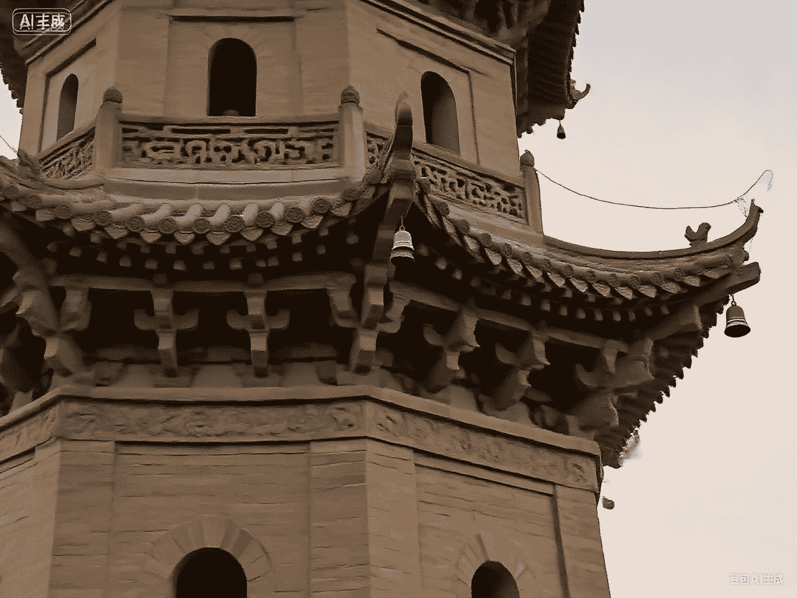 | The camera swings rapidly to the right while simultaneously spiraling upward. |  | The camera quickly circles to the left, focusing on the wind chime of the tower. The scene then falls silent with a sense of breathing, as the wind gently rocks the tinkling bells. |  | The camera swings upward transitions into a vertical top-down perspective, and then begins a slow horizontal rotation. |  |  |  |  |  |  |  |  |  |  |  |  |

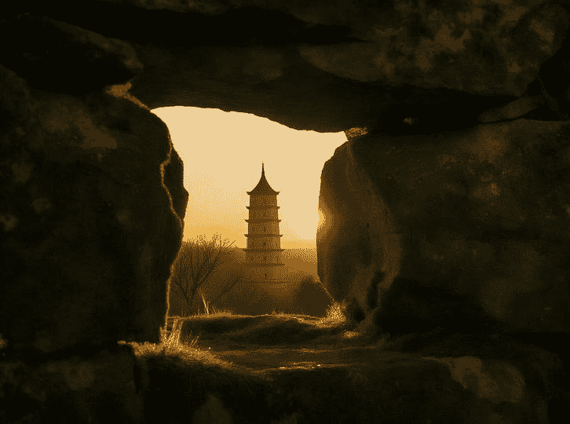

[jimeng-2025-08-13-6021.mp4](https://internal-api-drive-stream.feishu.cn/space/api/box/stream/download/all/U6zabwlC8oUrqTxj8DpcB97Zn0c)

#### **Techniques for Writing Rh**ythm-Driven Prompts:

+   Writing Structure：

[Camera Movement Techniques/Visual Transition Methods] + [Changing Elements/Primary Actions] + [Rhythmic Modifiers] + [Ambience]

**C**amera Movement Techniques/Visual Transition Methods：

Rapid camera zoom-out / Sudden zoom-out / Jump Cut / Rapid scene transition / Rapid camera rotation

### Narrative Category

Using a long take to carry the story, it integrates spatial camera movements, character dynamics, and rhythm variations into a unified visual language, allowing the scenes to progress continuously through time and space while fully presenting the narrative development.

#### Case Display

| Video Effect | Picture 1 | Prompt 1 | Picture 2 | Prompt 2 | Picture 3 | Prompt 3 | Picture 4 | Prompt 4 | Picture 5 | Prompt 5 | Picture 6 | Prompt 6 | Picture 7 | Prompt 7 | Picture 8 | Prompt 8 | Picture 9 | Prompt 9 | Picture 10 |  |
| --- | --- | --- | --- | --- | --- | --- | --- | --- | --- | --- | --- | --- | --- | --- | --- | --- | --- | --- | --- | --- |
|  |  | The woman turns her head to the left with a hesitant expression, her breathing tense. | 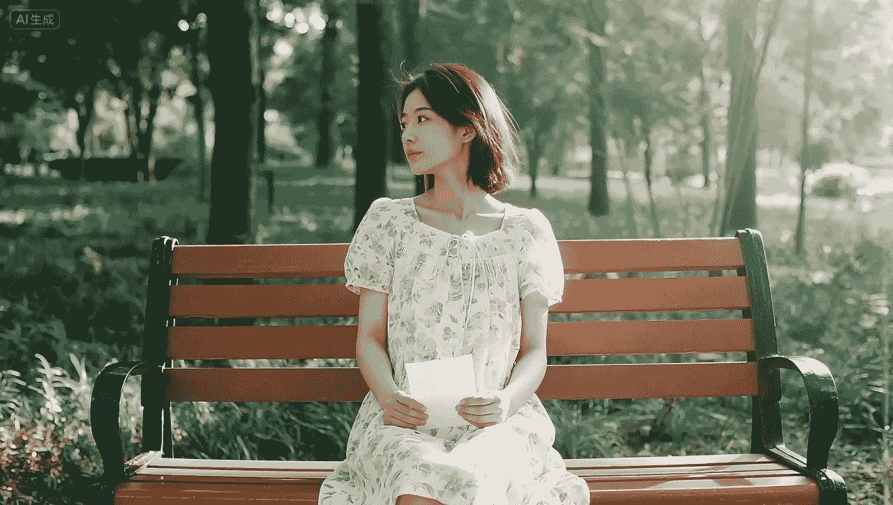 | The woman turned her head back and picked up the paper in her hand, beginning to read. | 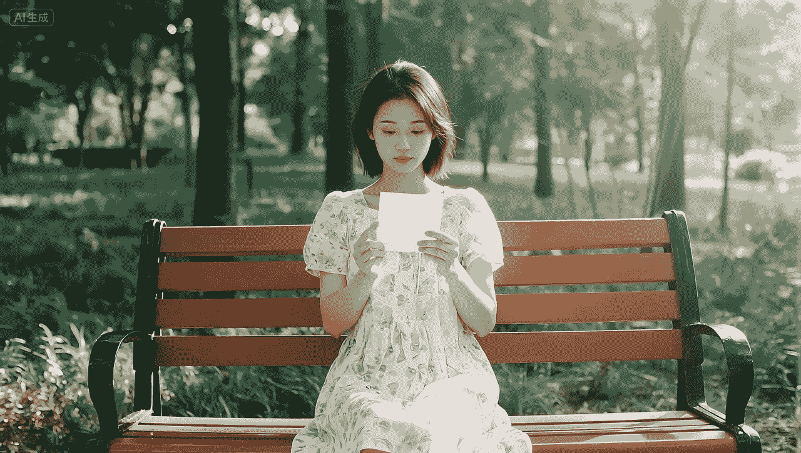 | The woman&#x27;s expression began to change as she read the contents on the paper. |  | The woman&#x27;s expression began to change as she read the contents on the paper. |  | After reading the content on the paper, the woman holds it to her chest. Her emotions shift, and she begins to cry, overcome with sadness. | 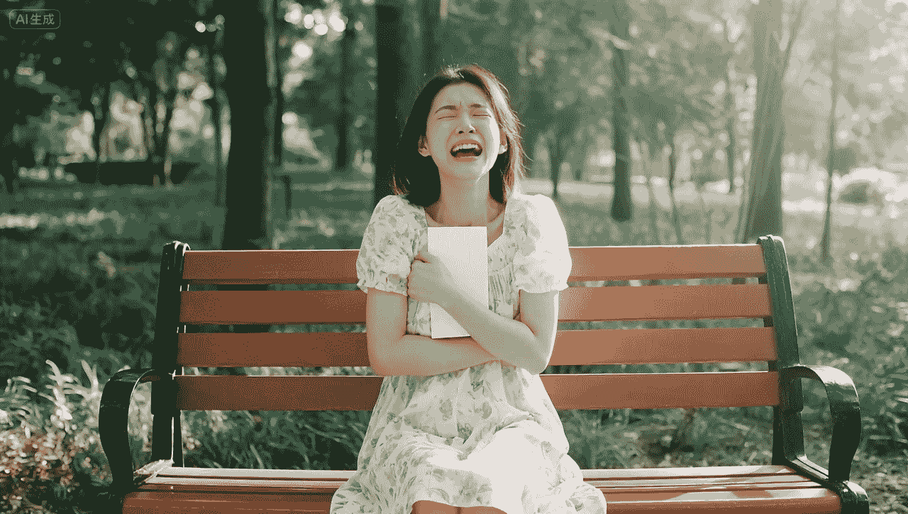 | As the woman cries, a man enters from the left side of the frame and gently touches her head. She turns back in tears, drops the paper, then breaks into a joyful smile and embraces him. |  |  |  |  |  |  |  |  |
|  | 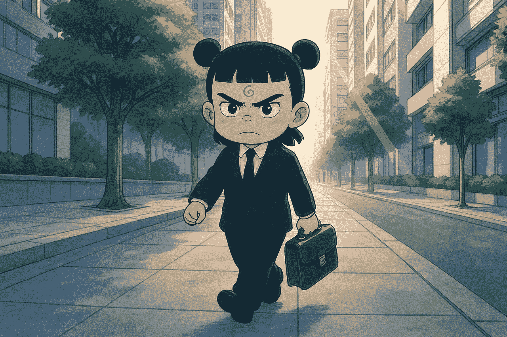 | Nezha, dressed in a dark suit and carrying a briefcase, walks along the sidewalk with a focused yet slightly anxious expression. The camera follows as he reaches an intersection, stops, shifts the briefcase to his other hand, raises his wrist to check the time on his watch, and furrows his brows. | 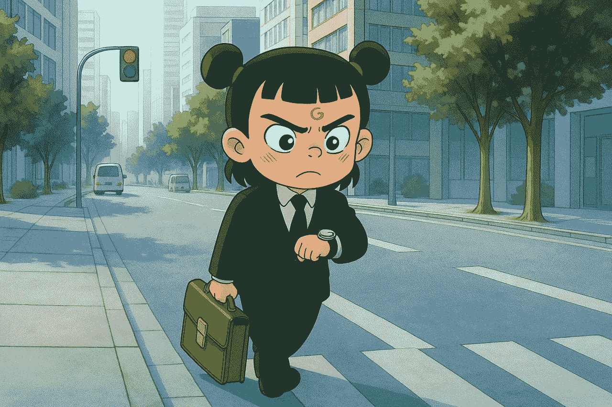 | With a fixed camera shot, Nezha stops walking. At this moment, an elderly woman appears from the left, catching Nezha’s attention. | 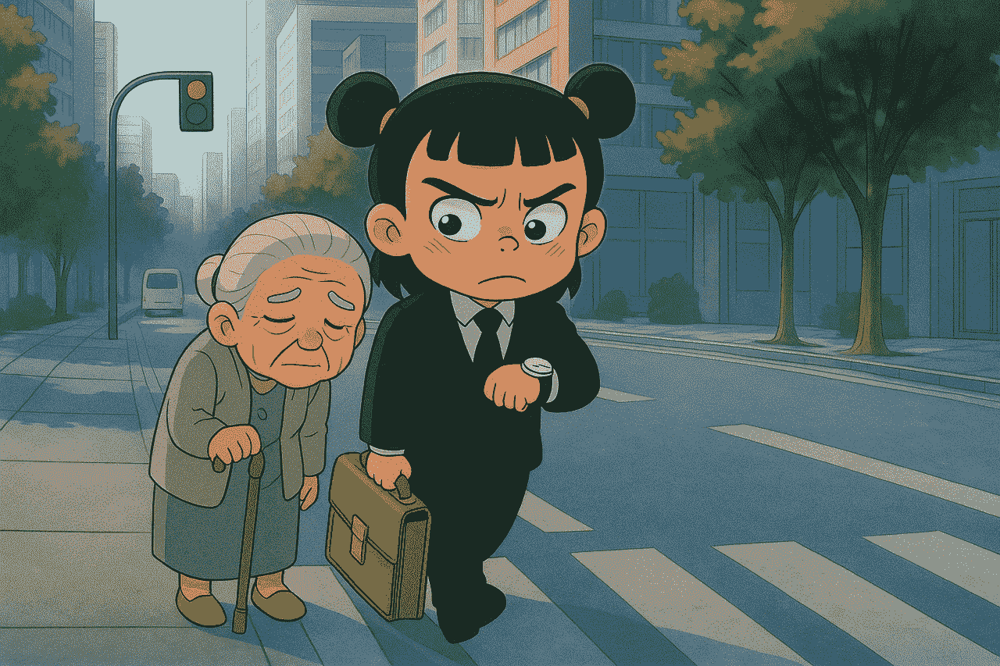 | Nezha switched his briefcase to his other hand. Seeing the old lady smiling, he reached out with his free hand to help her walk across the street. | 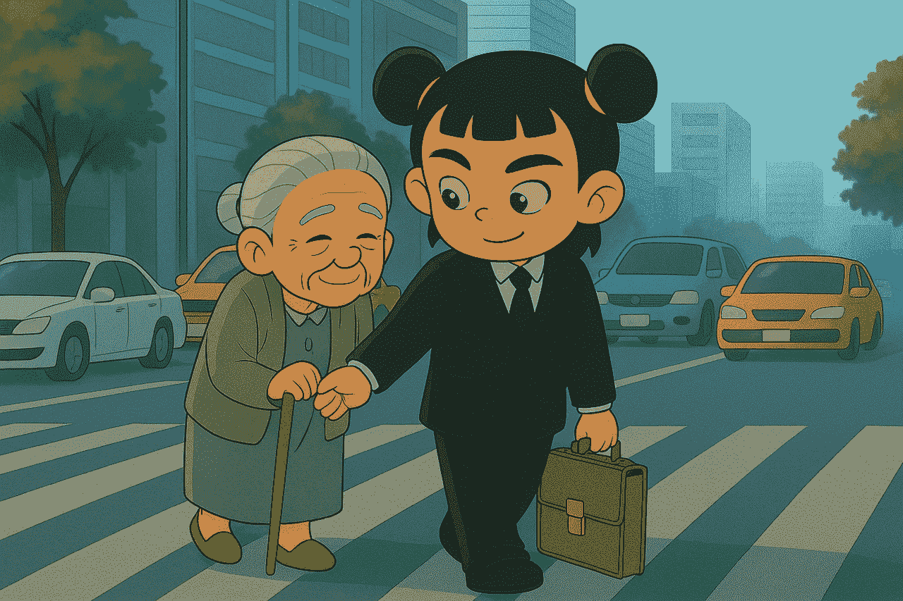 | The camera follows as Nezha helps the elderly woman cross the street. When they reach the intersection, she opens her mouth to thank Nezha. |  | The old woman exits the frame. Nezha switches the briefcase to his other hand and continues sprinting forward. The camera follows Nezha, circling around to his back. |  |  |  |  |  |  |  |  |  |  |

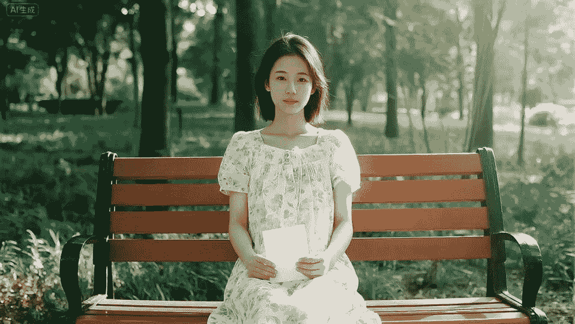

[jimeng-2025-08-13-2839.mp4](https://internal-api-drive-stream.feishu.cn/space/api/box/stream/download/all/ZxlWb9mfVoMq56xdzmHcveiDnH4)

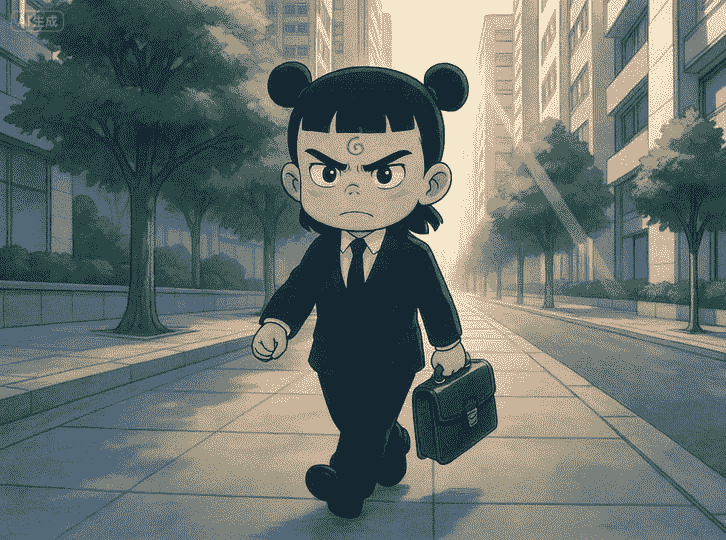

[jimeng-2025-08-11-4765.mp4](https://internal-api-drive-stream.feishu.cn/space/api/box/stream/download/all/Ry5gb6P4oom4l5xBX4XcfvqvnAe)

**F**irst, let’s emphasize again what a narrative long video is：

Narrative videos are a multi-frame creation style that drives plot development through long takes. Within the continuous movement of a one-take shot, they integrate elements such as character dynamics, spatial camera movements, and rhythm variations to present a complete storyline. This approach is often used in films, commercials, and short videos that require immersion and emotional progression. By leveraging continuity of the camera and changes in visual details, it guides viewers naturally into the story. In essence, it is a combined version of the scenarios described above.

#### **Techniques for writin**g narrative prompts：

+   Writing Structure：

[Camera Movement Techniques] + [Current screen content] + [Transition Method/Action] + [Next scene content] + [Atmosphere / Emotion]

+   Key Points for Writing：

+   Define the main storyline first: Clearly determine the logic of the long-take story, arrange the frames in rhythmic order — sequence matters.

+   Integrate multiple elements: Use different visual languages across frames (camera movements, character dynamics, rhythm, product close-ups, etc.).

+   Ensure natural transitions: Connections between frames should have spatial or action-based continuity to avoid abrupt changes.

+   Build emotional progression: Emotions between frames should gradually intensify or ease, creating a smooth viewing rhythm.

+   **Precautions**

+   Avoid lacking narrative logic: Simply stitching together random scenes will feel fragmented to the viewer.

+   **A**void transitions without spatial/action continuity: For example, a sudden hard cut from an indoor scene to an outdoor one without camera movement as a bridge.

+   Avoid excessive emotional jumps: Shifting abruptly from a calm scene to intense action without buildup will appear jarring.

### Loop Animation：

Make the first and last frames identical to create a looping wallpaper.

| Video Effect | Methods |
| --- | --- |
|  |  |
|  | 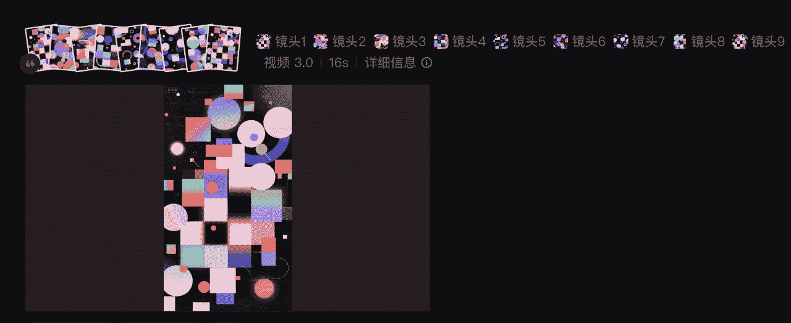 |

[jimeng-2025-08-12-6742.mp4](https://internal-api-drive-stream.feishu.cn/space/api/box/stream/download/all/TkbQbCOjxovVHBxRzQdcipd3nZf)

[jimeng-2025-08-12-4717.mp4](https://internal-api-drive-stream.feishu.cn/space/api/box/stream/download/all/PMbEbIXh4o3klfx45hUcVzDungb)

### Writing Prompt Summary (Very Important)

#### Key Elements of Writing Prompts:

+   Specify the camera movement:
When writing prompts, always make the camera movement explicit (e.g., zoom in, zoom out, pan, rotate). Camera movement is the foundation of Intelligent Multi-frame generation, directly influencing smoothness and visual quality.

+   **Keep descriptions c**oncise and targeted:
Focus on key elements in the scene (e.g., characters, objects, background), and avoid over-describing irrelevant details. Background and environment should be described simply and clearly. Each frame’s prompt should provide clear guidance rather than redundant wording. However, prompts should not be omitted entirely — the model still requires clear instructions.

+   **Emphasize emotional an**d action continuity:
In dynamic scenarios (e.g., character dynamics, rhythm-driven videos), describe characters’ actions and emotions precisely to avoid vague prompts. Camera-movement prompts should match the story’s progression to ensure visual consistency.

+   Adapt prompts to the scene type:
Each type of scene (e.g., spatial camera movements, product displays, narratives) requires different prompts. For spatial movements, emphasize transitions and spatial continuity; for product displays, highlight product details and lighting changes; for narratives, focus on characters’ emotions, actions, and smooth scene transitions.

+   Avoid leaving prompts blank:
This feature places high demands on key frames — the better the key frames, the better the video quality. Users are encouraged to refine their images carefully. Omitting prompts is only feasible when the images contain sufficient continuity. If the visual information is not enough, precise prompts are absolutely necessary!!!