# 即梦3.0&3.0pro视频模型创作指南

> 来源：[https://yunyinghui.feishu.cn/docx/NYuDdGFLjolSlqxQFAqc1bAsnCc](https://yunyinghui.feishu.cn/docx/NYuDdGFLjolSlqxQFAqc1bAsnCc)

## 即梦视频模型概述

> 即梦视频3.0 Pro 具有强大的语意遵循能力，写好prompt可以生成丰富多样的视频。

> 即梦视频Prompt写作的核心是“直观表达出你想要的效果”，可以使用自然语言自由书写出动作/运镜/风格/视角，从而有效的控制视频效果。如果遇见响应不好的情况，可尝试将prompt改得更加直白易懂。

## 提示词构建总结

文生视频：主体 + 动作 +场景 + 镜头 +风格 + （情绪演绎）+ （照明）

图生视频：动作 + 镜头 + （情绪/照明）

**写好Prompt的核心思路是：**

- 对于文生视频来说，提示词写得越明确、细节越多，画面还原度就越高。你可以指定主体、动作、运镜、光照、情绪等各类信息，模型会尽力还原你脑海中的构图、节奏与风格。

- 即使没有特别具体的画面构想，也可以给出一个简单的场景描述，让模型自动补充内容，快速探索创意方向。

- 而图生视频则更多依赖图像本身的信息，提示词主要用来引导人物动作、镜头语言或情绪变化。虽然风格大致由原图决定，但你仍然可以控制角色移动、镜头推进或光照变化等动态效果，实现静图到动态效果的自然过渡

## 如何控制单视频生成

### 动作指令

> 本指南将动作划分为**单一动作、时序组合动作**两种类型，且这两种动作类型涵盖简单和复杂两种不同难度。下方推荐了prompt的起手书写方式，关键在于简洁明了地描述动作，避免因prompt冗长或动作指令过于复杂而导致视频呈现的动作效果欠佳。

#### 单一动作（简单动作）

> 推荐I+T2V基础起手式：**"主体"+"单动作"**
> 推荐T2V基础起手式："清晰的主体描述"+"场景"+"单动作"
> 进阶：“动作”指令可添加如“快速”“平稳地”“用力地”“向前”等运动速度、运动方向和运动幅度方面的提示词，以增强动作表现力。
> **图+文生视频（I+T2V）：**
> ✅能够依据prompt和图片信息精确响应生成不同的动作类型，主体动作效果生动且准确。
> ❌对于高难度动作，需要谨慎对待！如跑酷、跳舞、打斗等动态幅度较大或需要交互的动作，仍存在打击感不足、肢体结构破坏严重等不稳定性。
> **文生视频（T2V）：**
> 上下限均较高，在能够输出逼真生动动作的同时，也容易出现动作指令遵循不准确和动作幅度不可控等问题。

---

**单一动作创作实例展示：**

| 模式 | 参考图 | prompt结构拆解 | 视频 |

| --- | --- | --- | --- |

|  | 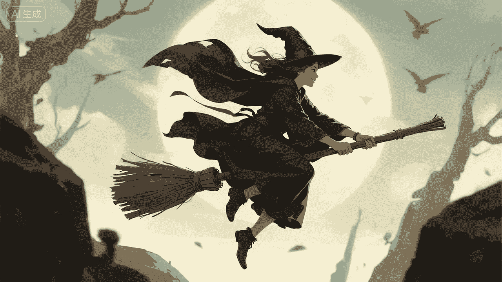 | 主体（巫师）+简单的单一动作（飞行），添加了运动方向（前） |  |

|  |  | 主体（船）+单一动作（行驶），附加了运动方向（前） |  |

|  | 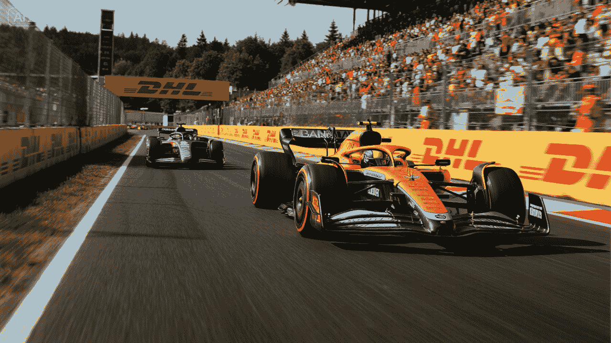 | 主体（蓝车）+进阶单一动作（逼近），附加了运动速度（极快） |  |

|  | 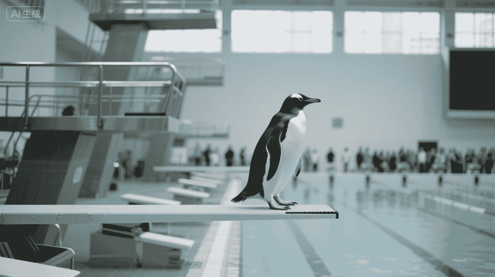 | 主体（企鹅）+进阶单一动作（跳水） |  |

|  | 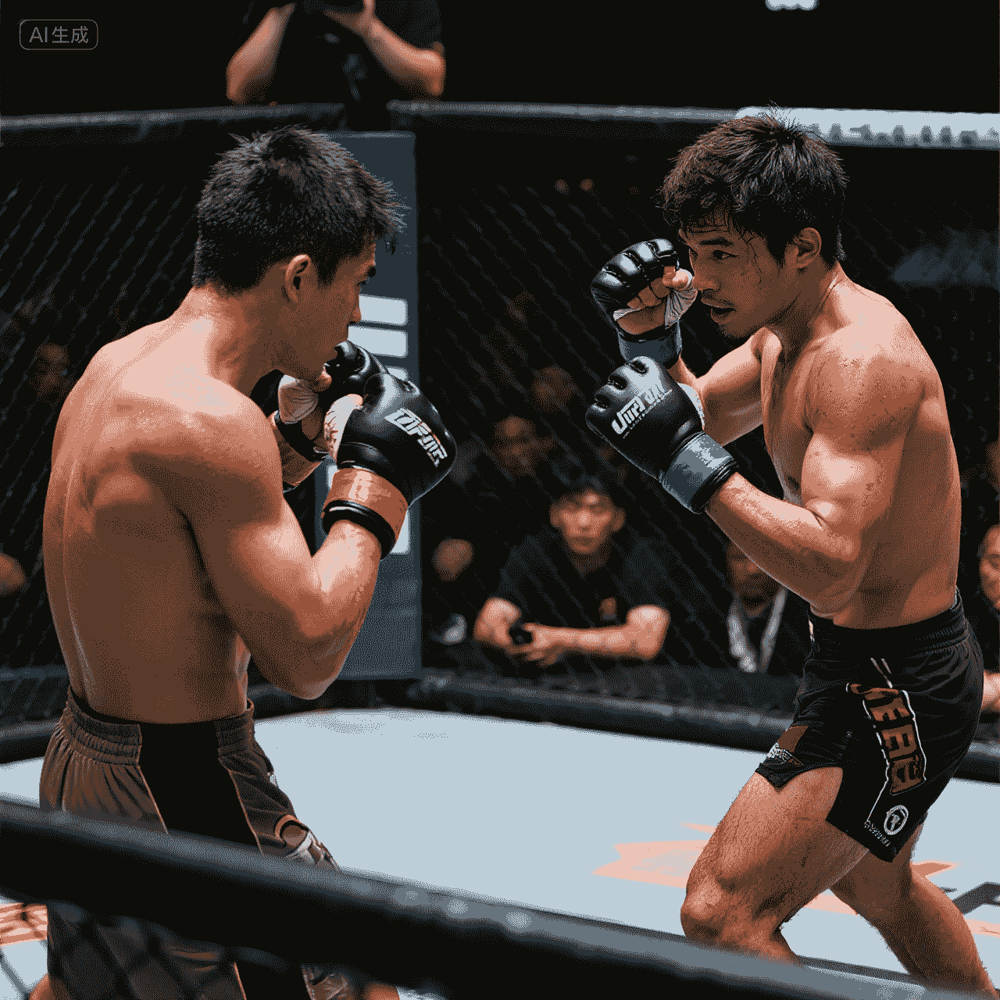 | 主体（拳击手）+进阶单一动作（格斗），添加了运动速度（快速）和运动幅度（有力地） |  |

| **文生视频** |  | 主体（小猫）+场景（地板上）+简单的单一动作（打哈欠） |  |

|  |  | 主体（白发老人）+场景（室内）+简单的单一动作（喝茶） |  |

|  |  | 主体（陨石）+场景（宇宙）+简单的单一动作（飞） |  |

|  |  | 主体（厨师）+场景（厨房）+进阶的单一动作（反复翻炒） |  |

|  |  | 主体（冲浪者）+场景（海上）+进阶的单一动作（冲浪） |  |

|  |  | 主体（运动员）+场景（雪山）+进阶的单一动作（滑雪） |  |

[jimeng-2025-08-15-1825-老虎向前走.mp4](https://internal-api-drive-stream.feishu.cn/space/api/box/stream/download/all/U83lbrqA6oIEuxxxqPJcftvKnLf)

[jimeng-2025-08-14-2254-机器人拿着盒子向前跑.mp4](https://internal-api-drive-stream.feishu.cn/space/api/box/stream/download/all/VfxNbEyGFoPktSxA5BRcpe5Nnqg)

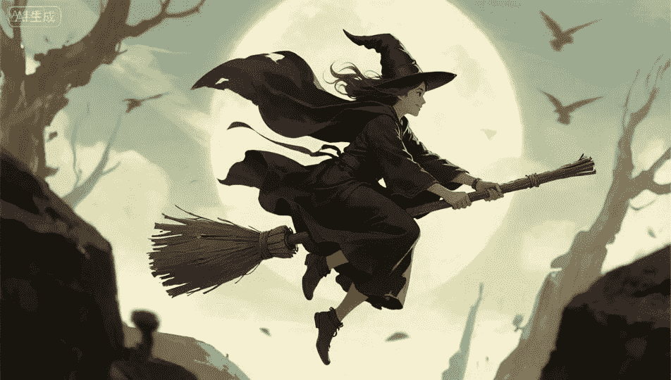

[jimeng-2025-08-16-6799-向右飞行.mp4](https://internal-api-drive-stream.feishu.cn/space/api/box/stream/download/all/OCUebHbjKoagqGxJc2EcTt2Onyb)

[jimeng-2025-08-21-3837-船向前行驶.mp4](https://internal-api-drive-stream.feishu.cn/space/api/box/stream/download/all/EBCEb9CRTo0UIYxe8Woc9mFbnzb)

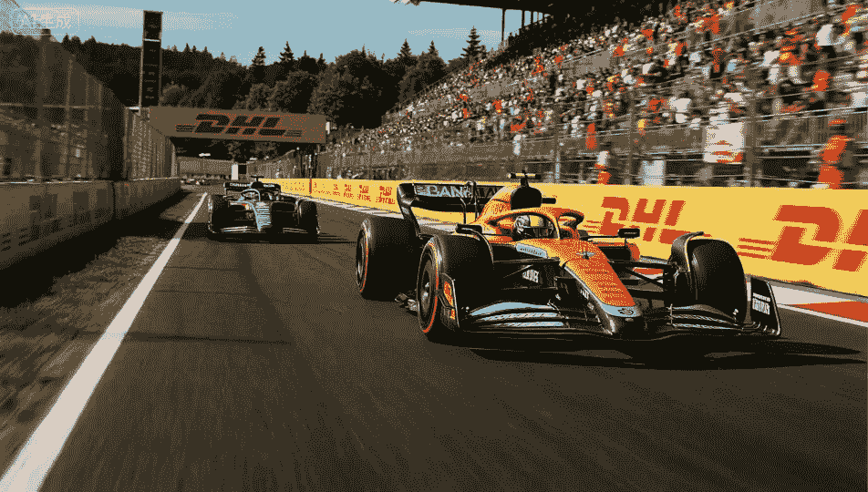

[jimeng-2025-08-14-3370-赛车比赛，镜头先拍领先红车，突然蓝车加速逼近，镜头甩向蓝车展现速度压迫感，模糊拖....mp4](https://internal-api-drive-stream.feishu.cn/space/api/box/stream/download/all/WPCsb6QyJoZC4kxXt68ceeVKnbg)

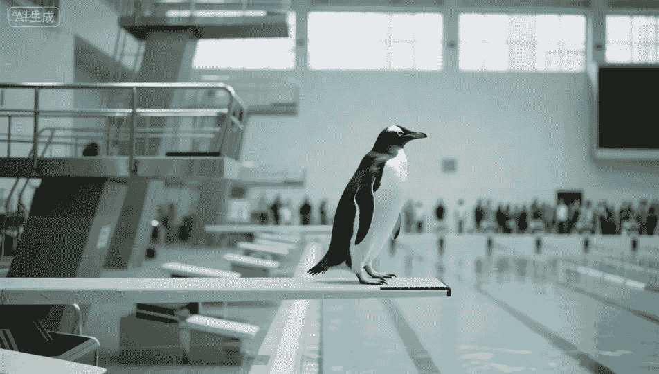

[jimeng-2025-08-13-2816-电视画面显示，一只企鹅在奥运会上表演了特技跳水，从跳板上旋转身体自然地跳入游泳池....mp4](https://internal-api-drive-stream.feishu.cn/space/api/box/stream/download/all/S3NGbuYtZoj37hxSAfDcYBHynnR)

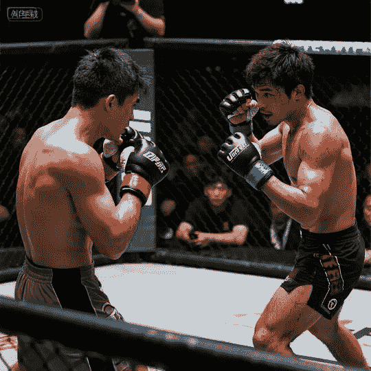

[jimeng-2025-08-14-3007-激烈拳击赛，两个拳击手出拳快速有力，身体被击中后仰，动作自然流畅，表情专注，少量....mp4](https://internal-api-drive-stream.feishu.cn/space/api/box/stream/download/all/XQ4xbUxWJoXh5Ox6X6hcNwzRnhg)

[jimeng-2025-08-12-2687-小猫对着镜头打哈欠。.mp4](https://internal-api-drive-stream.feishu.cn/space/api/box/stream/download/all/VT53bNcVroC0ZZxhUNZctKWan8g)

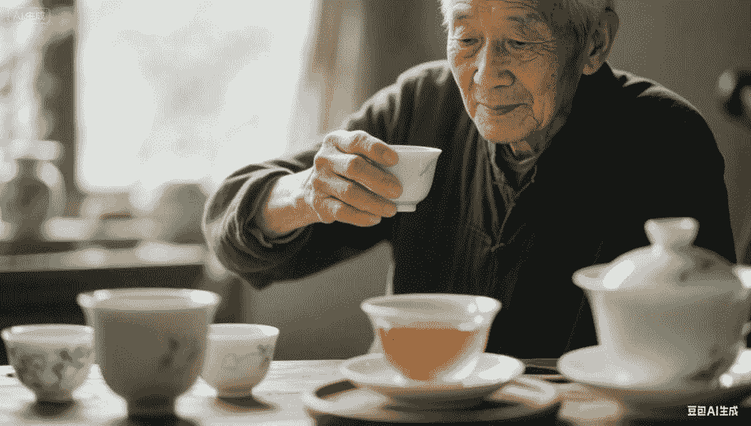

[jimeng-2025-08-15-6754-老人喝茶.mp4](https://internal-api-drive-stream.feishu.cn/space/api/box/stream/download/all/C5gAb1B6zoj9nsx8eR9cXA7Dn8b)

[jimeng-2025-08-21-6351-发光发烫的小型陨石从宇宙飞向地球，震撼感.mp4](https://internal-api-drive-stream.feishu.cn/space/api/box/stream/download/all/KEDebaaMnoPy64x3tNzcHZZ7nqc)

[jimeng-2025-08-15-2589-厨师颠勺翻炒锅里的菜肴.mp4](https://internal-api-drive-stream.feishu.cn/space/api/box/stream/download/all/HsZgbtA6coO19ax9lEAcWYYAnhd)

[jimeng-2025-08-14-2541-低角度跟拍冲浪者在巨浪管内蹲伏，慢动作展现浪花从板缘飞溅的动态轨迹.mp4](https://internal-api-drive-stream.feishu.cn/space/api/box/stream/download/all/IGBObR1VMop2dNxyc3vcDeOInHb)

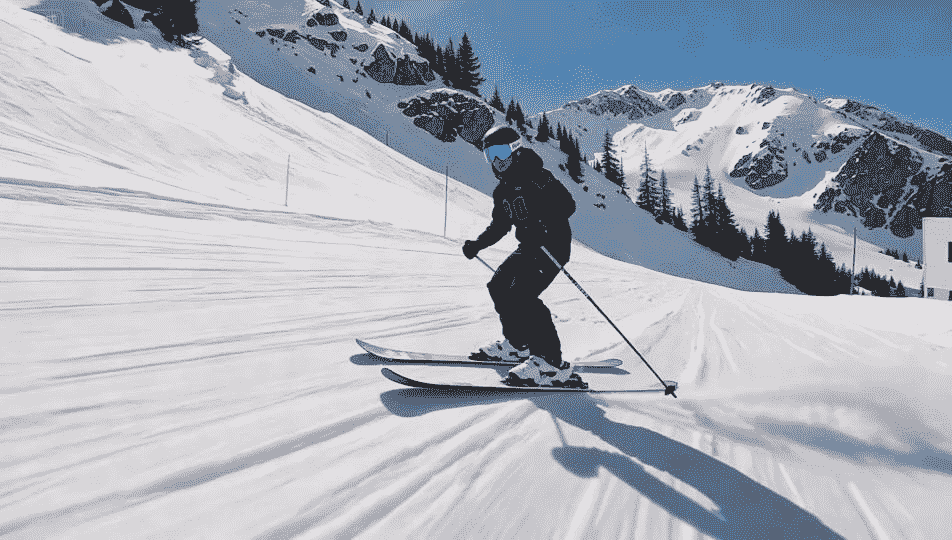

[jimeng-2025-08-14-3070-滑雪运动员从雪山上飞速滑下，灵活避开障碍物，镜头从侧面紧随其后.mp4](https://internal-api-drive-stream.feishu.cn/space/api/box/stream/download/all/TZvMbPfryoh9OAxa7tocwuRbnOf)

#### 时序组合动作（复杂动作）

> 按照动作发生的时序，清晰描述出多个动作，实现单人物多动作/多人物多动作。
> 注意：若需求的动作更多，则需要在每一个动作后添加对应的衔接词，起手式结构可根据个人需求稍作调整
> ✅模型能够流畅地生成各类运动，从细微表情到动态场景，均能保持较高水平的稳定性与物理真实感。
> ❌当输入超过三个动作时，模型对动作的响应程度会下降，可能需要多次尝试才有可能达成预期效果。同时，模型还存在交互感较弱以及不符合物理规律等问题

---

**复杂动作创作实例展示：**

| 模式 | **主体数量** | 参考图 | prompt | 视频 |

| --- | --- | --- | --- | --- |

| **图+文生视频** | **单主体** |  | 女子拿起面前的酒杯，喝了一口后放下，然后起身离开座位。 |  |

|  |  | 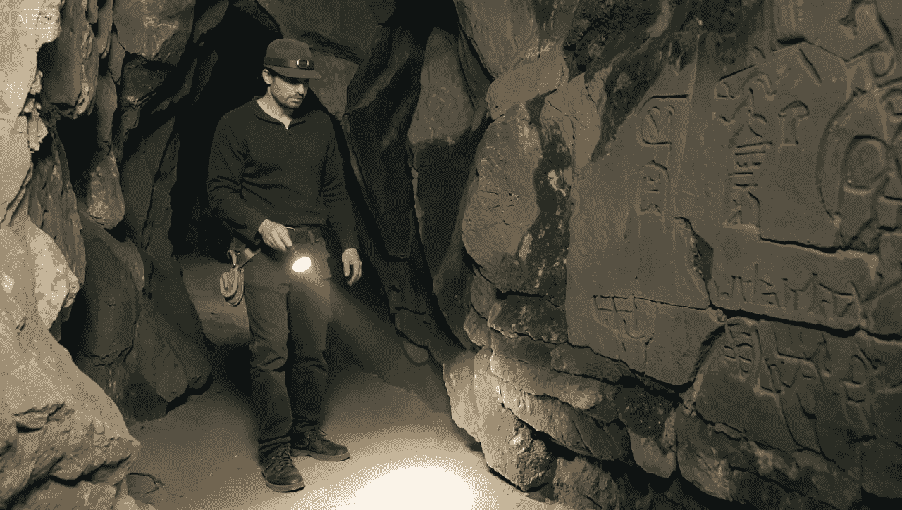 | 探险家用右手打开手电筒照亮前方的石壁，然后小心翼翼地伸出左手触摸壁上的古老符号 |  |

|  |  | 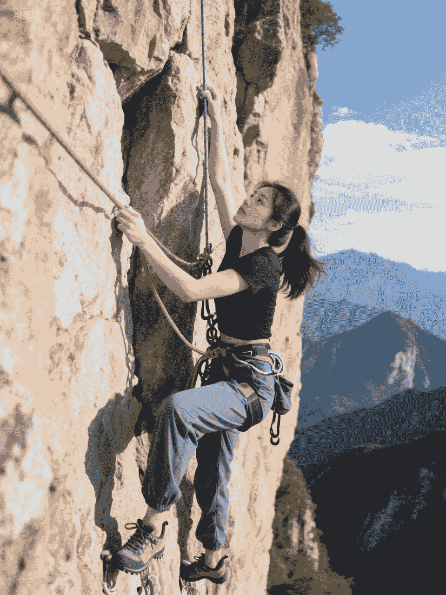 | 她先抬起手精准抠抓岩缝，然后身体灵活向上攀爬，跟随镜头 |  |

|  | **多主体** |  | 左边的狗狗拿起面前的鸡腿大口吃了起来，同时，右边的萨摩耶在乐呵呵地笑 |  |

|  | **一系列组合动作** |  | 探险者在潜水的过程中发现了藏在珊瑚礁里的宝箱 |  |

| **文生视频** |  | \ | 一个穿着运动服的年轻人在公园里慢跑，然后突然停下来，捡起地上的一个废弃的空塑料瓶，走向旁边的垃圾桶把它扔进去 |  |

|  |  | \ | 一名体操运动员在明亮的场馆内迅速助跑，然后用力踏板，身体腾空而起，在空中完成一个完美的360°空翻转体动作，随后稳稳落地 |  |

|  |  | \ | 一个摇滚乐队的演出现场，主唱拿着麦克风在台上唱歌，同时，吉他手在卖力弹吉他，贝斯手弹贝斯，鼓手在摇头晃脑的在敲鼓，键盘手在弹钢琴。 |  |

[jimeng-2025-06-11-634-女子拿起面前的酒杯，喝了一口后放下，然后起身离开座位。.mp4](https://internal-api-drive-stream.feishu.cn/space/api/box/stream/download/all/Xxt4bp3A1obq5yx57ErchjennGf)

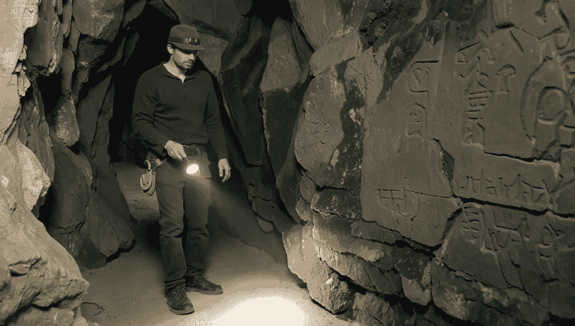

[jimeng-2025-08-15-3341-一个探险家深入幽暗的洞穴。他用右手打开手电筒照亮前方的石壁，然后小心翼翼地伸出左....mp4](https://internal-api-drive-stream.feishu.cn/space/api/box/stream/download/all/TewrbdMU2o3TRTxWIi1cKfDunIc)

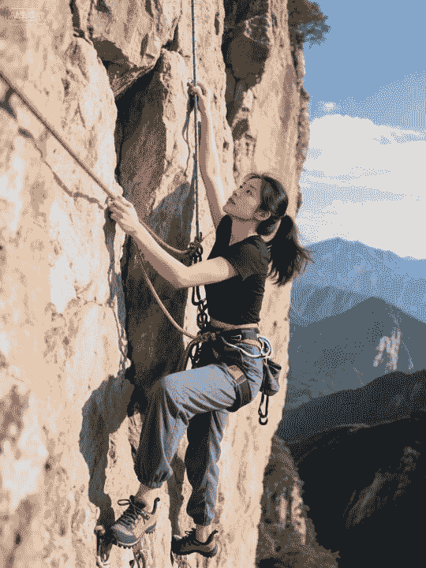

[jimeng-2025-08-13-9034-陡峭岩壁直插云霄,女人身穿黑色短袖,紫色运动长裤,挂着安全绳,手脚精准抠抓岩缝,....mp4](https://internal-api-drive-stream.feishu.cn/space/api/box/stream/download/all/OqdObdSeWoVVpKxA1ZRcAlq6ndd)

[jimeng-2025-08-13-1792-左边的狗狗拿起面前的鸡腿大口吃了起来，右边的萨摩耶在捂嘴笑，动态过渡，光效增强，....mp4](https://internal-api-drive-stream.feishu.cn/space/api/box/stream/download/all/VqavbYULqod8m2xHOVEcGNB9n8g)

[jimeng-2025-08-22-1728-探险者在潜水的过程中发现了藏在珊瑚礁里面的一个宝箱.mp4](https://internal-api-drive-stream.feishu.cn/space/api/box/stream/download/all/LxNObgvwXogdEBxaudhcoSpunAd)

[jimeng-2025-08-15-6956-一个穿着运动服的年轻人在公园里慢跑，然后突然停下来，弯腰捡起地上的一个废弃的空塑....mp4](https://internal-api-drive-stream.feishu.cn/space/api/box/stream/download/all/LtRxbur4Zovwuvx8DYVcL8qLnlh)

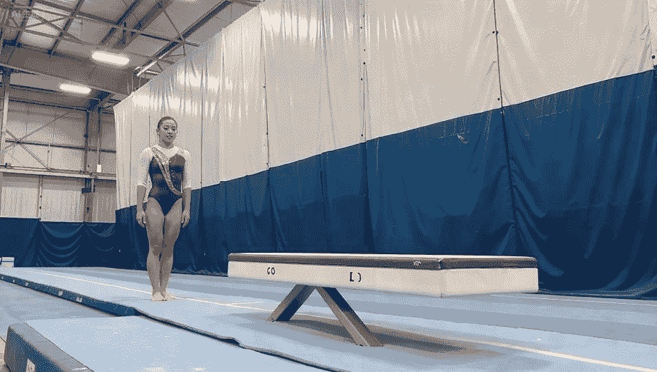

[jimeng-2025-08-13-3002-一名体操运动员在明亮的场馆内，身着紧身体操服，迅速助跑，用力踏板，身体腾空而起，....mp4](https://internal-api-drive-stream.feishu.cn/space/api/box/stream/download/all/XrEvbKQAjo5sLdxQuYicUUZjnBe)

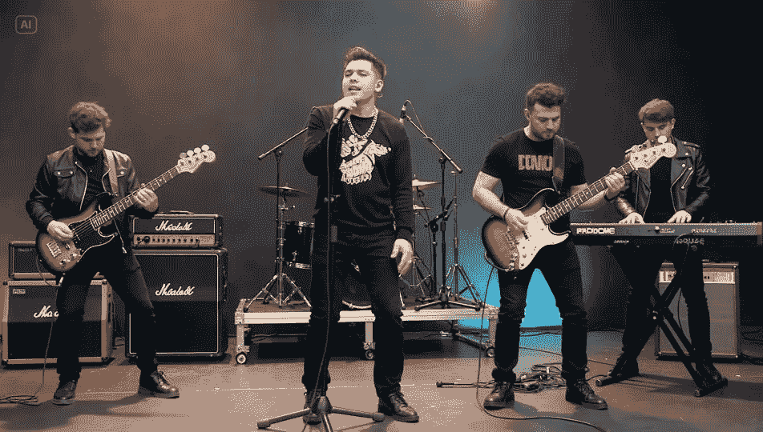

[jimeng-2025-06-11-637-一个摇滚乐队的演出现场，主唱拿着麦克风在台上唱歌，吉他手在卖力弹吉他，贝斯手弹贝斯，鼓手在摇头晃脑的在敲鼓，键盘手在弹钢琴。.mp4](https://internal-api-drive-stream.feishu.cn/space/api/box/stream/download/all/RlpzbuImFosTDqxFNEgcU1ndnAg)

### 情绪演绎

> 模型具备 “情绪演绎”的 能力，重点在于能够精准呈现微妙表情变化，像人物因情绪波动产生的细微挑眉、眼神颤动、嘴角轻抿等；还可还原接近真人的脸部细节反应，比如害羞时的面部泛红、紧张时的肌肉微颤等，助力生成更具真实情感表现力的内容，提升角色演绎的生动性与感染力 。

> 我们模型的能力优势&能力上限：

> ✅能力优势：

> 能够准确执行常见的情绪词所带来表情变化&肢体变化，画面流畅，交互动作自然，尤其在写实和简单动画场景中表现出色，符合基本的物理逻辑，即使简单的提示词也能匹配出比较完整的情绪反应

> ❌能力上限：

> 对于悲伤、忧郁等出现的眼泪或者汗水等提示词不敏感，对于极端和较为复杂的情绪词，如嫉妒、尴尬等需要较多的阐述；在真实的影视行业中，情绪不仅仅只有面部表情，也会伴随着身体上的驱动；但是目前模型没有办法很好的让肢体上的情绪语言呈现的非常完美

#### 基础提示词编写逻辑（适用于T2V）

1. 确定画面的**主体**&**所处环境**：（主体中的人物形象参考6.1中的人物外形）

> 举例：一个躲在衣柜中的小男孩

2. 确定简单的**情绪基调词**：以恐惧、悲伤、嘲讽、害羞等核心关键词为主

> 举例：一个躲在衣柜中的小男孩，面露恐惧的神色

3. 针对于基础的情绪基调辅以对应的**脸部表情动作＋动作控制**：使得情绪演绎的更完整和饱满

> 举例：一个躲在衣柜中的小男孩，面露恐惧的神色，紧紧的皱眉，眼睛在紧张地左右张望，蹲着用双臂在慢慢抱紧身体，身体在微微发抖

## 进阶玩法（试用针对于 `I+T2V`）

### 单情绪进阶构建

参考影视中对于人物情绪的演绎桥段，加上不同的镜头选择和运镜以及辅以光影的打光处理，整体构建完整的情绪饱满的剧情（但是注意镜头的和氛围词的叠加会削弱对于情绪的掌控力，要平衡好主要的侧重点）

> 举例：悲伤忧郁的情绪增加超长焦视角下的空间压缩，会让人物置于环境中显得极为无助；而轻松快乐的情绪需要明调、高饱和度、漏光效果则会给人愉悦的刺激，并且常用超大广角拍近景，让镜头畸变增加画面趣味性

### 多情绪递进串联

可以叠加基础的情绪词来多样的情绪转变，符合剧情中人物的情绪递进，但是注意情绪转换之间的逻辑性和转换次数上限

> 举例说明：眼露胆怯➡️放松欣慰、孤独发呆➡️抿嘴苦笑、偷看窃喜➡️害羞低头

| 模式 | 情绪词 | Prompt | 参考图 | 视频效果 | 进阶建议 |
| --- | --- | --- | --- | --- | --- |
| `图+文生视频` | 愤怒 | 男人愤怒的开始斥责旁边的人 |  |  | 基础 |
|  | 释然 | 教堂内穿着黑色长裙的女性独坐长椅，她开始释然，眉头舒展（由紧蹙转为平缓），长舒一口气，胸腔微微下沉，双肩自然放松，手臂打开摆了下手，镜头缓慢平推进行情绪的递进，运镜流畅，同时背后有光洒下，画面变得明亮 |  |  | 运镜＋光影加成 |
|  | 惊喜 | 女孩被惊喜的瞳孔放大、眼神如星火般亮起，眉毛迅速扬起呈拱形，双手不自觉抬起捂住嘴巴，同时身体挺直舒展，镜头从人物低垂的侧脸快速上摇至正面特写，辅以暖光打亮面部突出惊喜，背景中出现一束光突然洒下的特效氛围 | 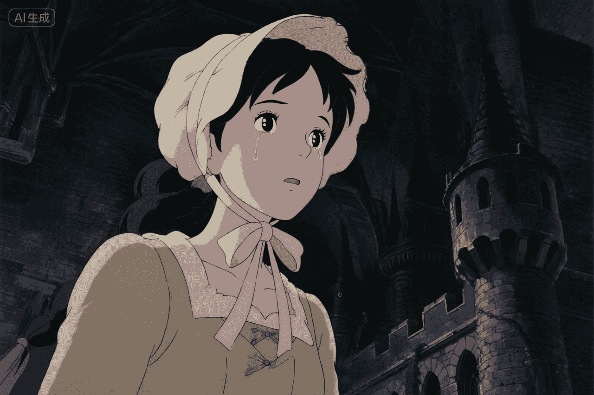 |  | 运镜+特效加成 |
|  | 开心兴奋➡️惊恐瑟缩 | 南瓜开心的等待别人，表面光影如笑容般明亮，在菜篮子里轻晃➡️突然伸出的手让它感觉惊恐瑟缩，眼睛处瞳孔收缩，南瓜整体往菜篮子边缘猛然后仰，表面纹理出现褶皱，蒂部蜷缩 |  |  | 情绪递进 |
|  | 面露惊讶➡️神情不屑 | 老头在对话中突然变得惊讶，瞳孔微扩，双眉迅速上扬➡️之后变为不屑，单侧眉毛挑起呈弧度，眼神从聚焦对方转为微微侧移并带不屑，同时配合轻微的头部侧倾，运镜从平视推近至特写，捕捉挑眉与嘴角肌肉变化，情绪过渡自然 |  |  | 情绪递进 |
| `文生视频` | 欢乐 | 一位身着褐色外套的老人坐在公园长椅上快乐地大笑 | \ |  | 基础 |
|  | 恐惧 | 一个躲在衣柜中的小男孩，面露恐惧的神色，紧紧的皱眉，眼睛在紧张地左右张望，蹲着用双臂在慢慢抱紧身体，身体在微微发抖 | \ |  | 基础+动作加成 |
|  | 痛苦 | 一位复古欧洲女性坐在医院中的长椅上，双手掩面、身体微微颤抖，她痛苦地蜷缩着滑向地面，面部肌肉扭曲 | \ |  | 基础+动作加成 |

[`jimeng-2025-08-22-7279-男人非常愤怒的开始痛骂旁边的人.mp4`](https://internal-api-drive-stream.feishu.cn/space/api/box/stream/download/all/KK4ibWkOIoOUGFxVN0Cc7Za1nwd)

[`jimeng-2025-08-22-5649-教堂内穿着黑色长裙的女性独坐长椅，她开始呈现释然的状态，眉头舒展（由紧蹙转为平缓....mp4`](https://internal-api-drive-stream.feishu.cn/space/api/box/stream/download/all/J4PobYE8uo1X0Lx8dFzcvK9cnJs)

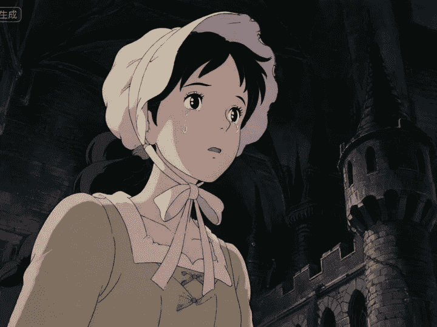

[`jimeng-2025-08-22-3894-女孩被惊喜的瞳孔放大、眼神如星火般亮起，眉毛迅速扬起呈拱形，双手不自觉抬起捂住嘴....mp4`](https://internal-api-drive-stream.feishu.cn/space/api/box/stream/download/all/XnLKbrYJXoHDfTxIs8Lc3En9nye)

[`jimeng-2025-08-22-2999-南瓜开心的等待别人，表面光影如笑容般明亮，在菜篮子里轻晃，之后缓缓向它伸来的手让....mp4`](https://internal-api-drive-stream.feishu.cn/space/api/box/stream/download/all/AAiPbOjQMotTz7xdmLYcFf9BnGT)

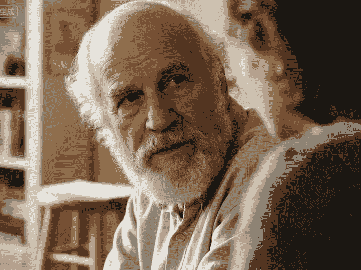

[`jimeng-2025-08-22-8508-人物在对话中突然惊讶，变得瞳孔微扩，双眉迅速上扬，上眼睑打开，身体短暂僵直，2秒....mp4`](https://internal-api-drive-stream.feishu.cn/space/api/box/stream/download/all/SQd2bms4roSSTKxW8yscgKUOnLa)

[`飞书20250822-174547.mp4`](https://internal-api-drive-stream.feishu.cn/space/api/box/stream/download/all/DSRzb5eslorPUPxNwsPc9KAXnaf)

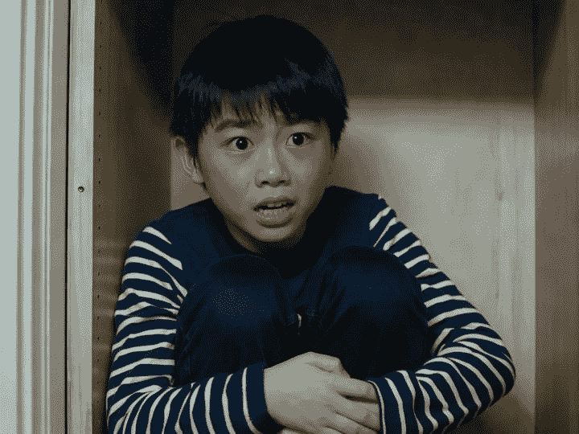

[`jimeng-2025-08-22-5437-一个躲在衣柜中的小男孩，面露恐惧的神色，紧紧的皱眉，眼睛在紧张地左右张望，蹲着用....mp4`](https://internal-api-drive-stream.feishu.cn/space/api/box/stream/download/all/EluYbeYv0oSjnnxRJQFcwVpJnkh)

[`jimeng-2025-08-22-7760-一位复古的欧洲女性坐在医院中的木制长椅上 ，双手掩面、身体微微颤抖，她痛苦地蜷缩....mp4`](https://internal-api-drive-stream.feishu.cn/space/api/box/stream/download/all/ABBfbsnjLo6PjBxXaR1c87XUnbe)

### ps:控制情绪演绎生成时的注意事项

+ 脸部需要清晰并且正面角度偏多，如果参考图不佳可以辅以运镜进行修正，且最好主体为人类，动物和其他生物的达成效果有限

+ 最好针对单人进行情绪的叙述，多人达成的效果不佳并会出现交互混乱

+ 如果情绪的表现力不够深入建议加入程度词：非常，极度，很，极端等

+ 对于不常见的 `2D` 和 `3D` 的动画风格需要提供较为简单的表情动作控制，并且有概率会丢失风格

## 场景描述

> 视频中的创作场景指的是角色所处的空间位置，同时建议包括确切的时间，比如出现在某个特殊时期或者一天中的具体时段等。氛围感受也是其重要组成部分，像营造出的欢快、悲伤、神秘等不同氛围，都会影响视频传达的情感体验。所以空间位置、时间和氛围感受，都是构建“这个画面发生在哪里并达成特定感觉”的核心，这些让视频画面有逻辑、有深度、有空间感；

> `T2V`（文生视频）:

+ 优势✅：可自由构建动态场景，灵活添加动作、镜头语言

+ 不足❌：需要更精确的描述，否则容易跑偏或空洞，光影表现较生硬，明暗度不易精准控制，特定调性的风格难以稳定复现

> `I+t2v`（图生视频）:

+ 优势✅：画面美感高，风格一致性好，光影层次分明，氛围突出

+ 不足❌：初始图片限制构图的自由度

> 应用建议：若以审美与氛围为重，建议使用 `I+T2V`；如果用 `T2V` 需要明确场景地点、发生时间、空间氛围，并辅以光影修正

---

### 场景构成要素表

| 构成要素 | 推荐度 | 原因 | 具体构成词举例 | 注意事项 |
| --- | --- | --- | --- | --- |
| 场景地点 | 必须 | 决定空间构图，明确“事件发生在哪里” | 街头、森林、操场、卧室、天台、古寺庙、胡同小巷、太空观测站... | 最好明确场景类型：室内/外，自然景观等；也可用组织“前-中-远景”增加层次感 |
| 发生时间 | （可选）较推荐 | 提供光影与时序的美学基础，增强视觉氛围，细化时间维度。例如写“黄昏”模型就更容易出来金黄色调，写“清晨的第一缕阳光”，画面会带上晨光感 | 清晨、傍晚、黄昏、深夜、落雪时、日落时分、黎明第一缕阳光 | 建议用具体时间点（如清晨、傍晚）来强化光影感，避免抽象的词，例如暴雨前 |
| 空间氛围 | （可选）较推荐 | 注入情绪、叙事感和氛围词，让画面更加“有感觉”、“有灵魂”，帮助强化视频的情感张力与主题表达 | 昏暗走廊里闪烁的警示灯；夕阳余晖下温暖的金色氛围；薄雾弥漫的森林，透出神秘感；霓虹闪烁的街头喧嚣氛围 | 写氛围时避免抽象词（如“孤独感很强”、“寂静”），可用色调+光影+环境状态 等看得见的细节可视化 |

### 🔑 空间氛围（抽象情绪词）优化思路

+ ❌ 不建议写：

+ “寂静氛围” / “孤独感很强” / “悲伤氛围”（这些词没有直观画面特征，模型难以对齐）

+ ✅ 推荐写：

+ “她一个人站立月光洒落的冷蓝色空间” → 把“孤独"变成 “空旷空间 + 单人主体 + 冷色调光影 ”

+ “黄昏的天台，夕阳余晖照在身上，空气里带着温暖的金色氛围” → 把“温暖”变成 “色调+时间”

### 构建完整文生视频场景步骤举例（同样适用于图生视频）

1. **最基础（只写场景地点）**：

> “她站在操场中央”

> 优点：空间明确

> 缺点：时间模糊、情绪缺失，容易生成不符预期的画面

1. **加入时间序列**：

> “暴雨刚停的黎明清晨，她站在操场中央”

> 优点：增加光影层次，画面出现柔和晨光，色调清新

> 缺点：氛围仍不足，情绪传递有限

1. **加入氛围营造**：

> “暴雨刚停的黎明清晨，她独自站在空荡荡的操场中央，四周一片寂静的氛围“

> 优点：有光、有空间、有情绪，画面更完整、更有“电影感”

### 场景创作实例展示

+ 提示词递进生成case

| `T2V` |  |  |  |
| --- | --- | --- | --- |
| 构成要素 | 目的 | `prompt` | 视频 |
| 地点 | 展示基础场景生成能力 | 欧洲中世纪风格的城市街道。古老的哥特式建筑矗立着 |  |
| 地点+时间 | 增加时间维度，展示光影的时序 | 清晨，被雾气笼罩的欧洲中世纪风格的城市街道。古老的哥特式建筑矗立着 |  |
| 地点+时间+空间氛围 | 加入空间氛围元素，让画面更生动 | 柔和色调，清晨，被雾气笼罩的欧洲中世纪风格的城市街道。古老的哥特式建筑矗立着，整体色调偏冷，以灰蓝色和浅灰色为主，营造出一种朦胧清冷的氛围。 |  |
| 地点+时间+空间氛围+（运镜/动态扩展） | 在氛围之上加入叙事或情感表达 | 柔和色调,清晨，被雾气笼罩的欧洲中世纪风格的城市街道。古老的哥特式建筑矗立着，整体色调偏冷，以灰蓝色和浅灰色为主，营造出一种朦胧清冷的氛围。潮湿的鹅卵石路、朦胧的光线呈现出冷色调的复古与静谧感。镜头从低角度上升，穿过个鸽群，行人悠闲地踱步。 |  |

> `ps`：虽然 `T2V` 视频生成具备一定的随机性，但是通过我们在 `prompt` 里逐步加入“时间”“氛围”等细节，可以让生成结果更加可控、更丰富，也贴近我们想要的画面。但是如果在没有想法的时候我们也可以不用具体描写，让模型自由发挥

[`4 (3).mp4`](https://internal-api-drive-stream.feishu.cn/space/api/box/stream/download/all/DhmOblJW2ocDZ1xECabcO82EnCf)

[`3.mp4`](https://internal-api-drive-stream.feishu.cn/space/api/box/stream/download/all/G508bhBrSoE6qLxDhdhcBsHKnLd)

[`2.mp4`](https://internal-api-drive-stream.feishu.cn/space/api/box/stream/download/all/J9E8btfoioyLTHxGw6AcuFhlnBd)

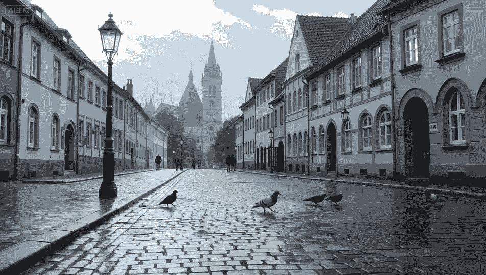

[`1 (2).mp4`](https://internal-api-drive-stream.feishu.cn/space/api/box/stream/download/all/He70bmwxpoiQY3xUQIwcsc3BnDd)

### I+T2Vcase举例

> 在实际工作流中，可以先用 `T2I`（图生图/文生图）基于 `T2V` 构成要素部分 生成氛围图，再用 `I2V`（图生视频）基本 `T2V` 动态部分 延展为动态画面。

| `T2I➡️I+T2V` |  |  |  |
| --- | --- | --- | --- |
| `T2I prompt` | 3.1 图片效果 | `I+T2V Prompt` | 视频效果 |
| 清晨的高山湖泊，薄雾缭绕，阳光穿透云层，高清写实，广角镜头，宁静氛围，柔和光影 | 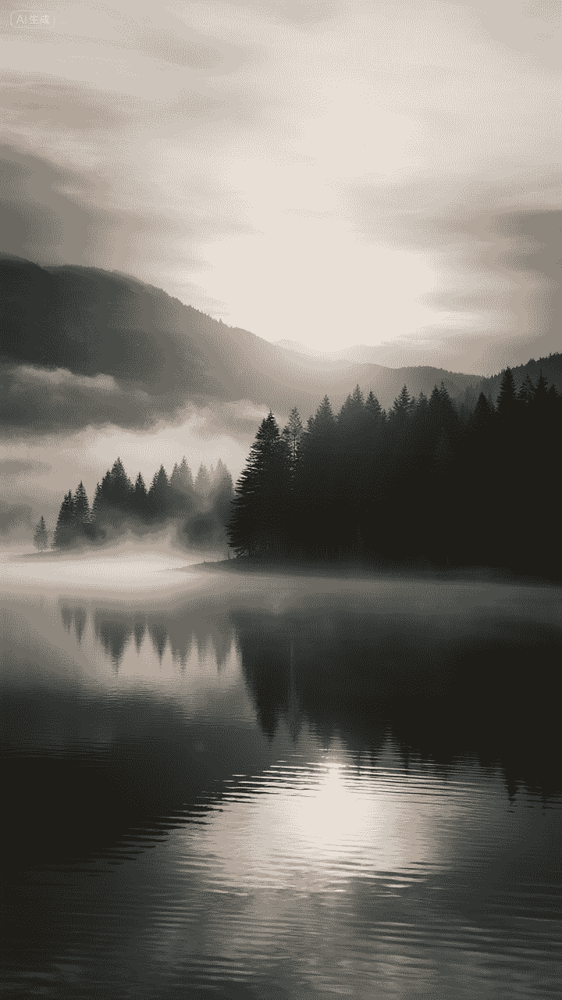 | 清晨高山湖泊，薄雾弥漫，阳光穿透云层，镜头从水面低角度缓慢推向山脉，前景水草微微晃动，背景山体渐进景深，湖面倒影波动，微风吹动湖面雾气粒子动态流动，光影随太阳移动，宁静写实风格 |  |
| 繁华都市夜景，高楼林立，霓虹灯闪烁，街道车流动感，赛博朋克风格，广角视角 | 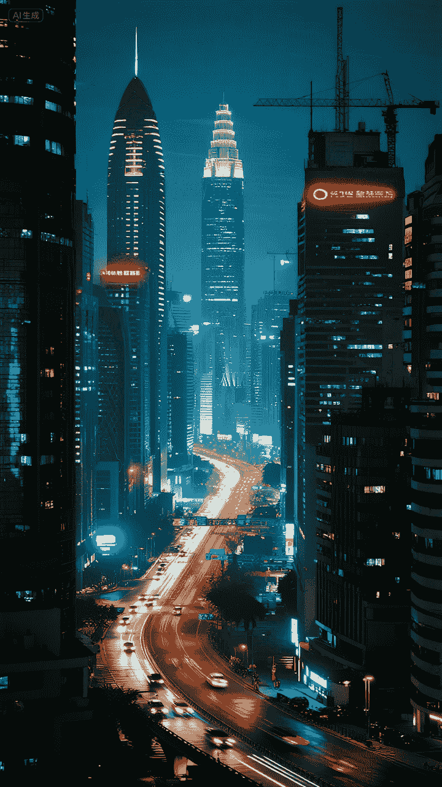 | 繁华都市夜景，霓虹灯闪烁，高楼林立，镜头俯拍从上空缓降穿过街区，车流灯光拉丝，远近建筑景深明显，轻微雾霾粒子随风飘动，赛博朋克风格 |  |
| 柔和光影，清晨，被雾气笼罩的欧洲古城广场，哥特式尖塔隐现，青石路湿润泛光，鸽群在空中飞过 | 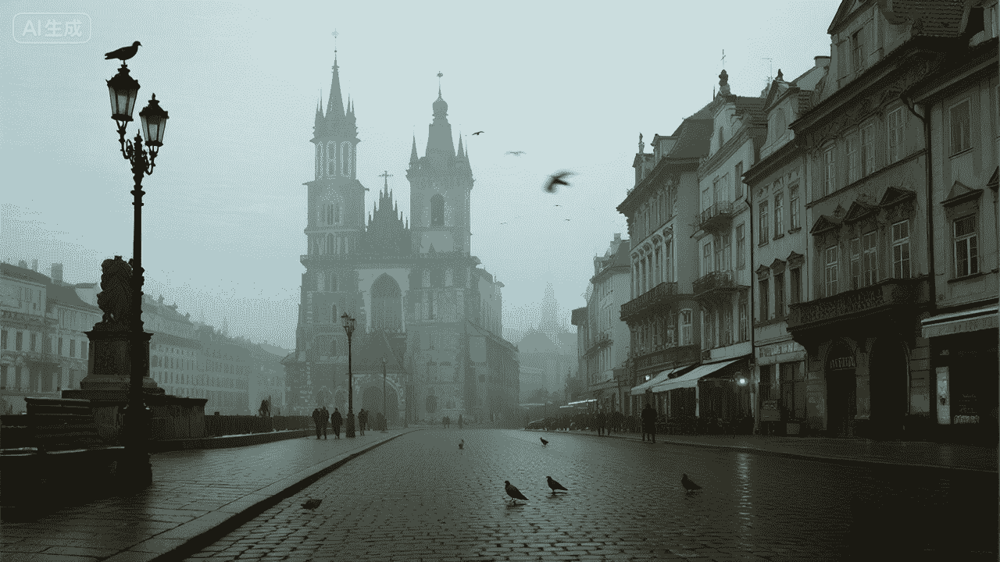 | 镜头从低角度上升，穿过鸽群，雾气在微弱的晨光照射下逐渐消散，柔和色调渲染宁静氛围 |  |
| 唐代长安夜市，红灯笼高挂，人群熙攘，摊位上摆满丝绸香料，金黄暖光映照 | 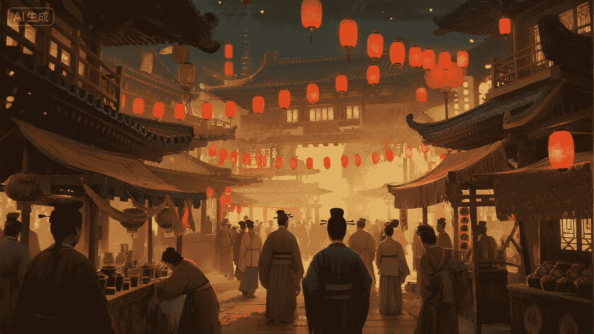 | 镜头穿行在人群中，灯笼轻轻摇曳，蒸汽从食肆飘出，歌舞喧嚣 |  |

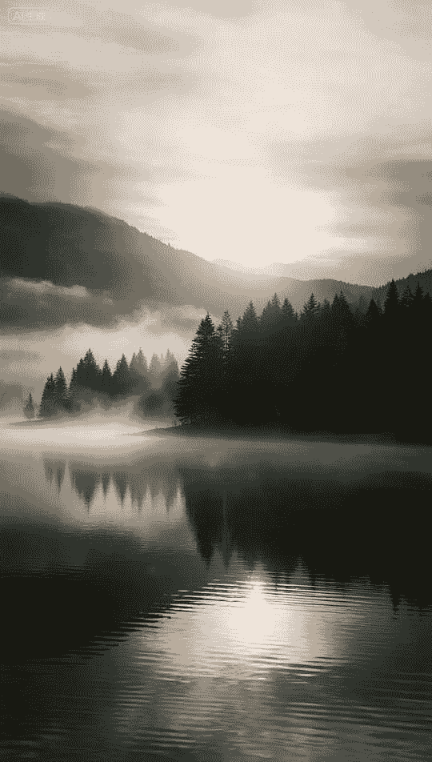

[`jimeng-2025-08-13-5150-清晨高山湖泊，薄雾弥漫，阳光穿透云层，镜头从水面低角度缓慢推向山脉，前景水草微微....mp4`](https://internal-api-drive-stream.feishu.cn/space/api/box/stream/download/all/P1X8bM06AoToSSx7iSMcHdx8nYb)

[`jimeng-2025-08-13-2585-繁华都市夜景，霓虹灯闪烁，高楼林立，镜头俯拍从上空缓降穿过街区，延时摄影，车流灯....mp4`](https://internal-api-drive-stream.feishu.cn/space/api/box/stream/download/all/FkzfbeL1ToatEtx36NlcF56dnPb)

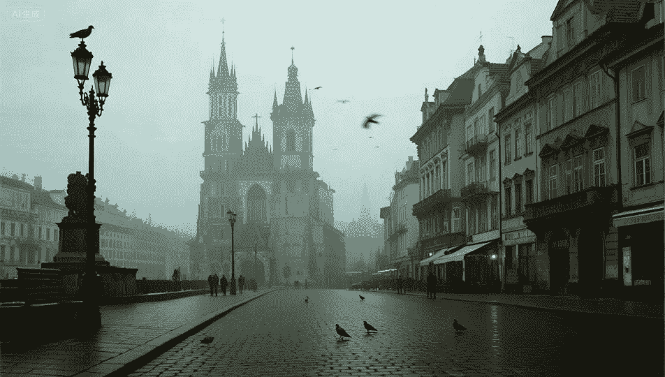

[`jimeng-2025-08-14-7009-镜头从低角度上升，穿过鸽群，雾气在微弱的晨光照射下逐渐消散，柔和色调渲染宁静氛围.mp4`](https://internal-api-drive-stream.feishu.cn/space/api/box/stream/download/all/CMAsbzqpNoErHbxHvKIcdhYUnCf)

[`jimeng-2025-08-14-2442-镜头穿行在人群中，灯笼轻轻摇曳，蒸汽从食肆飘出，背景乐器声伴随画面移动.mp4`](https://internal-api-drive-stream.feishu.cn/space/api/box/stream/download/all/FLX1buRHvoGq9dxY2bIcPBtQnod)

## 风格描述

## 风格直出（T2V）

即梦视频 3.0 的t2v具有直出多种风格的能力，包含2D/3D，以及更细分的线稿，像素，毛毡，粘土，插画

可兼容多类型风格，无论是写实摄影、赛博朋克，还是国风动画、黏土定格，即梦都能准确响应多样的风格指令，以支持各类创意需求：

+ **风格提示词展示：**

+ 写实风格提示词：真人写实、cg风格、胶片写实...

+ 手绘风格提示词：油画风格、水彩风格、粉笔画/蜡笔风、扁平插画风格、儿童绘本风格、黑白钢笔画 / 线稿...

+ 动漫/漫画风格：美式风格、日式动漫风格、国漫风格、插画半厚涂风格、线稿漫画风格...

+ 其他风格：像素风格、积木风格

（以上仅为一部分参考，如果想得到更多风格提示词可以去「即梦灵感」页面）

注意：直接把风格写在提示词里，不建议使用 “美美的”“风格酷酷的”“好看的”等词语，过于主观，会增加抽卡次数

---

### 多风格创作实例展示

| 分类 | 类型+prompt | 视频效果 | 类型+prompt | 视频效果 |
| --- | --- | --- | --- | --- |
| 平面2D风格 | **黑白线稿风格** |  | **美漫风格** |  |
|  | **日本平面漫画** |  | **2d韩漫风格** |  |
| 立体3D风格 | **3D动画** |  | **低多边形 3D 动画** |  |
|  | **MG 图形动画** |  | **毛毡动画** |  |
|  | **像素游戏风格** |  | **体素风格** |  |
|  | **故障艺术风** |  | **CG渲染风格** |  |

[jimeng-2025-08-22-3801-黑白线稿：一个黑白线稿的骑士跨马持剑，马鬃用排线表现，背景是线稿城堡剪影，线条刚....mp4](https://internal-api-drive-stream.feishu.cn/space/api/box/stream/download/all/I0nubf9gRoKAHOxgKM1ck3afnoh)

[jimeng-2025-08-22-9439-美漫风格：女警持枪侧身，风衣下摆扬起，眼神锐利带阴影，背景是倾斜的街道轮廓，线条....mp4](https://internal-api-drive-stream.feishu.cn/space/api/box/stream/download/all/K3sbbK8udojjG2xaWmvc8QMen0c)

[jimeng-2025-08-22-6671-日本平面漫画风格：少女侧坐窗边，黑直长发垂落，线条干净利落。.mp4](https://internal-api-drive-stream.feishu.cn/space/api/box/stream/download/all/IdWIbGc7JoxAoCxyL09czO7UnST)

[jimeng-2025-08-22-4325-2D 韩漫风格：校园走廊里，男生靠在墙边，单眼微眯，校服领带松散，阳光透过窗户形....mp4](https://internal-api-drive-stream.feishu.cn/space/api/box/stream/download/all/DqcZboY1CohyITx7TrCc19cqndc)

[jimeng-2025-08-13-5062-3D动画角色番茄（红衣绿冠）与玉米（黄身绿衣）坐于彩色桌前，桌上堆满纸张，背景房....mp4](https://internal-api-drive-stream.feishu.cn/space/api/box/stream/download/all/Y7S8bDHPIoW22ZxlAbqc9aeHnYb)

[jimeng-2025-08-14-6639-低多边形 3D 动画（Low Poly）：由几何面片和色块拼接组成的外星星球场景....mp4](https://internal-api-drive-stream.feishu.cn/space/api/box/stream/download/all/MJqobsNjDowBcdx8J64ctsomn8f)

[jimeng-2025-08-13-2979-MG 图形动画：画面以简约的线条和几何图形构建出一个科技园区。随着镜头推进，不同....mp4](https://internal-api-drive-stream.feishu.cn/space/api/box/stream/download/all/Jyr1bBq4vo6Q2sx5VdDcY34vnje)

[jimeng-2025-08-22-4204-毛毡风格：棕白小狗蹲坐，绒毛边缘毛茸茸，耳朵耷拉，黑纽扣眼睛，背景是浅粉毛毡云朵....mp4](https://internal-api-drive-stream.feishu.cn/space/api/box/stream/download/all/XwowbBzrooRqkUxHWAecDNqBnXb)

[jimeng-2025-08-14-8102-一个像素风格的人物在天空中的像素世界里借助各种浮空的像素块跳跃，破碎的像素碎片，....mp4](https://internal-api-drive-stream.feishu.cn/space/api/box/stream/download/all/ZevWbzmbUouBY5xy99ccZXgsn4f)

[jimeng-2025-08-22-9069-体素风格的小镇午后：彩色方块房子排列在街道两侧，黄色体素太阳悬在浅蓝色天空，几个....mp4](https://internal-api-drive-stream.feishu.cn/space/api/box/stream/download/all/GKJybkWLAo08xuxklyzctsg9ndc)

[jimeng-2025-08-14-9274-故障艺术风 信号干扰条纹，色彩随机错乱，像素化人物，数据代码流动特效，模拟电子故....mp4](https://internal-api-drive-stream.feishu.cn/space/api/box/stream/download/all/KNVUbxShPo4DSFxXBlzcRL1InKh)

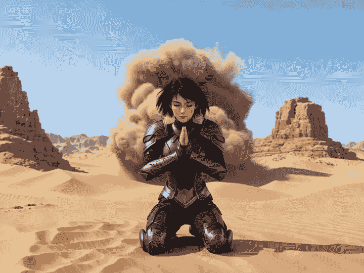

[jimeng-2025-08-13-2820-CG风格，高清渲染，人物皮肤纹理高透感，特效效果强烈，人物纹理清晰，身穿黑色盔甲....mp4](https://internal-api-drive-stream.feishu.cn/space/api/box/stream/download/all/VO27b1FpMo0MnHxDeiacZqQNn9d)

## 风格延续（I+T2V / I2V）

即梦视频模型在**风格一致性与美感延续性**方面表现出色，支持在图像或提示词设定的基础上，将图片美学风格延续

### 特定风格一致性控制

模型对**多种**风格的核心特征具备精准的识别与复现能力，具体表现为：

+ 风格元素高度统一：能稳定捕捉并延续目标风格的典型特征（如2D动漫的扁平化线条与高饱和度色彩、3D卡通的圆润建模与光影柔和度、木偶风格的关节轮廓与材质质感），避免因帧间变化导致风格偏移。

+ 智能补全：无中生有一些元素时，新的元素会自动和原本的画风匹配，不会突兀

---

### 多风格保持实例展示

| 类型 | prompt | 参考图 | 视频效果 |
| --- | --- | --- | --- |
| 3D CG风格 | 3D CG 渲染，超写实，东方奇幻与赛博朋克结合，周围环绕着淡蓝色的光环粒子和发光符文，清冷的月光照明，细节丰富，电影级打光 |  |  |
| 工笔画 | 青绿山水画，运用青绿色等矿物颜料渲染山水，色彩古朴典雅，层次丰富，注重营造悠远的空间意境，人物造型古朴，服饰、动作具有古典韵味，建筑描绘细致，体现传统界画技法，整体呈现出典雅、古朴的古典艺术风格，传递出浓厚的历史文化气息。 | 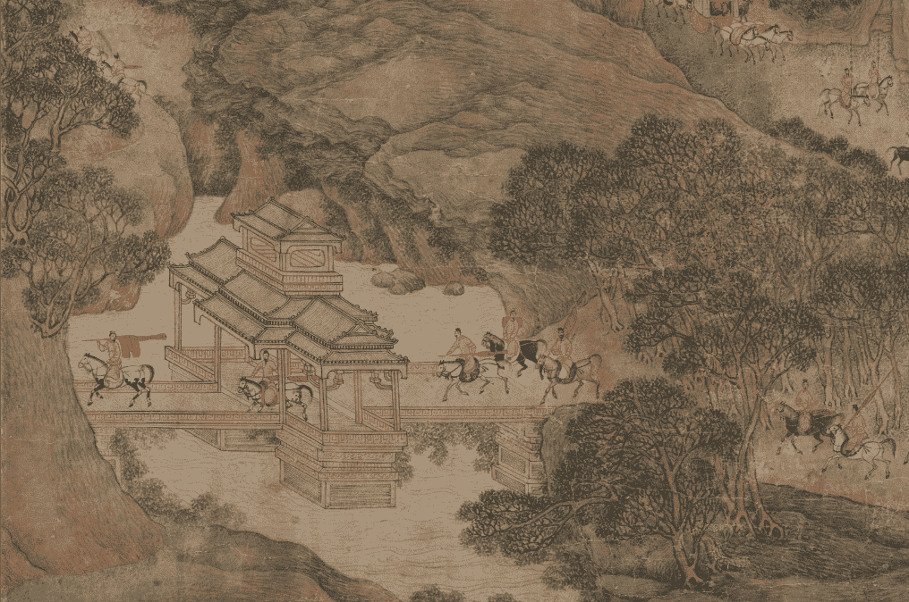 |  |
| 网点印刷 | 用黑白两色，通过不同密度和大小的网点来模拟灰度效果，营造出复古、独特的视觉氛围，带有强烈的艺术感和表现力。 | 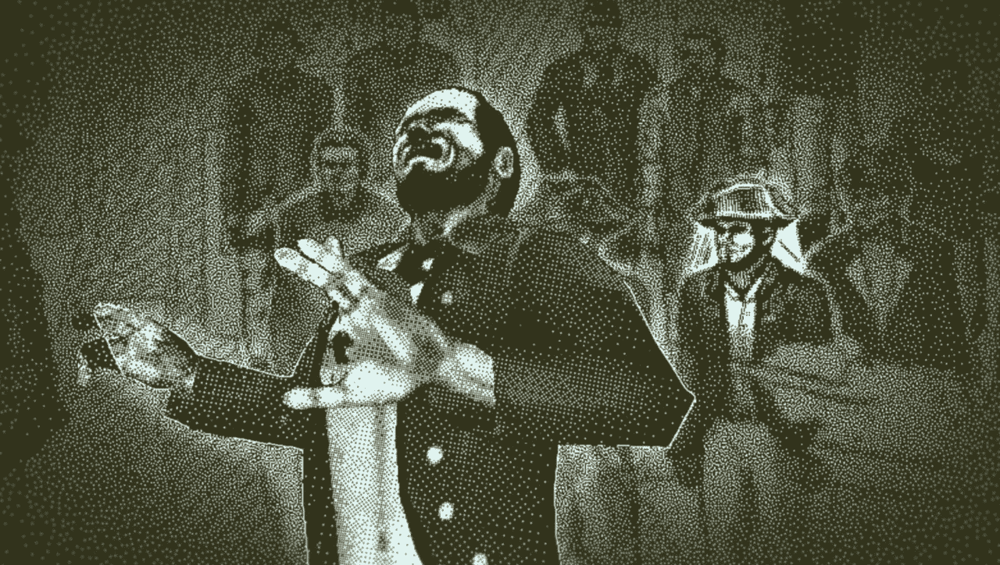 |  |
| 油画风格 | 现代油画，阿勒泰的夏天，画面暗，梦幻，唯美，纹理加深，肌理加深，层次感，空间感，厚涂，层次肌理厚涂，光影，光影纹理层次感加深。 | 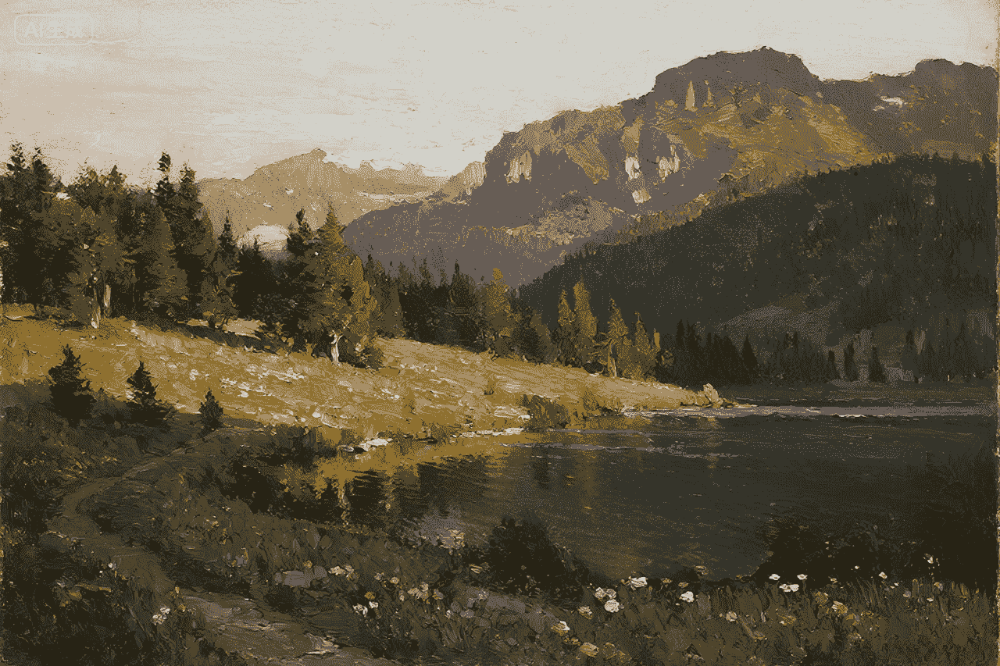 |  |
| 铅笔画风格 | 饱和度高的儿童插画风格，铅笔画风格 | 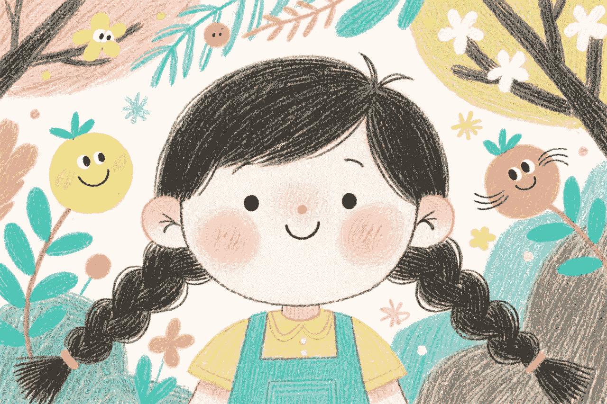 |  |
| 水彩风格 | 以水彩技法勾勒——荷叶边缘水渍晕染，叶面颗粒感似颜料堆叠，光影通透如清水叠色。莲花用淡彩轻扫，保留笔触灵动感。构图上疏密有致，荷叶脉络以细笔勾出，红鲤尾鳍如水彩拖曳。 |  |  |
| 黑白水墨风格 | 平面二维，黑白水墨风格，国画笔触。固定镜头聚焦书桌，孩童执笔，笔尖触宣纸，肩头随呼吸微颤，眼神凝注处，随微风用淡墨飞白表现摆动。 | 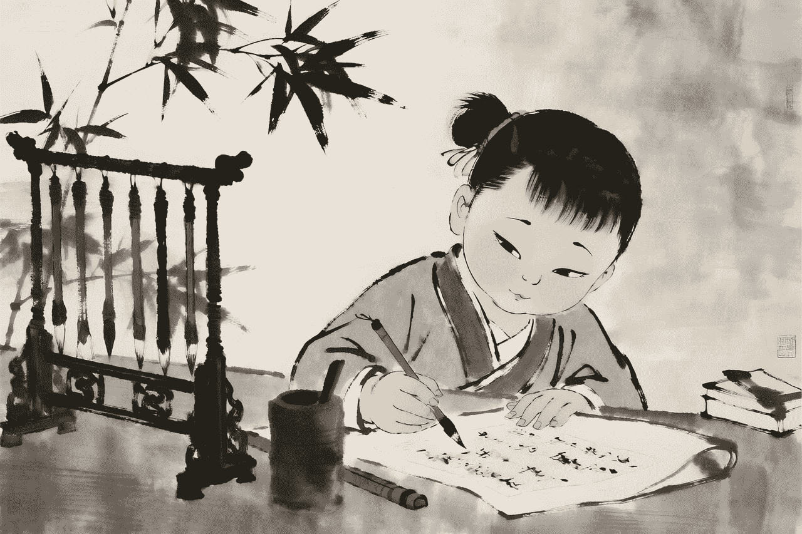 |  |
| 美漫风格 | 美国复古漫画风格，一个穿着白衬衫的金发男子抱着一只开心的金毛寻回犬，阳光明媚的小镇街道，有着复古的店面和霓虹灯招牌，色彩鲜艳，黑色线条醒目，温暖人心 | 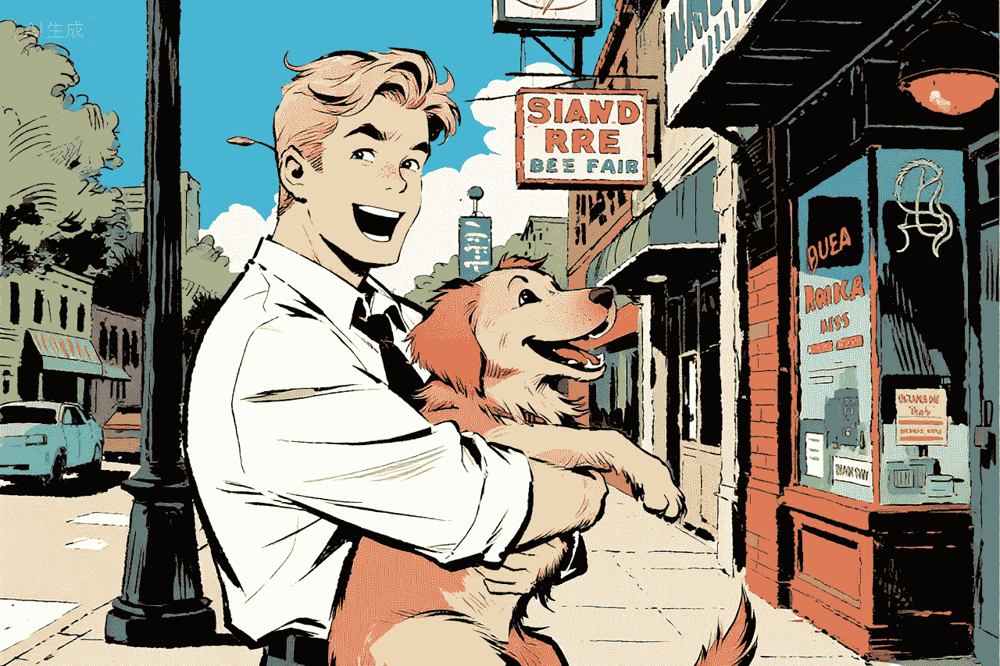 |  |
| 日式风格动漫 | 阳光洒满乡村小道，女孩带着小狗奔跑，然后停下来冲着镜头挥手，表情非常丰富充满惊喜，风拂过麦浪，一切温暖又治愈 | 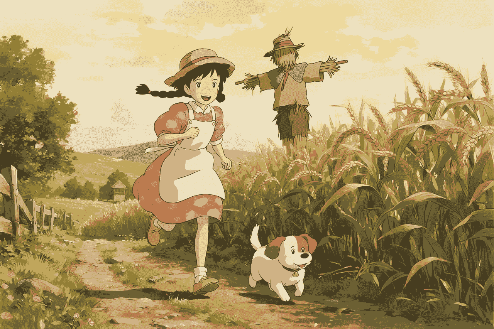 |  |
| 影偶动画 | 在平面光影下，一个古典造型的皮影人物站在宫殿场景中。 人物身着戏曲服饰，头戴精美头饰，肢体语言丰富，正在演绎一段传统故事。 | 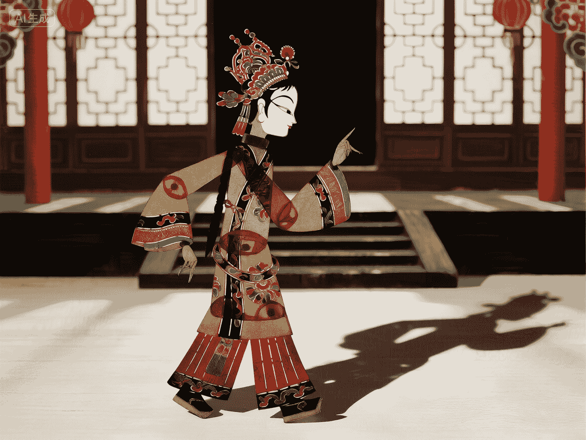 |  |
| 高定羊毛毡风格 | 高定羊毛毡艺术，32k,杰作，几米式叙事，留白式情绪铺垫，有张力，层次，动态定格风格 |  |  |

[jimeng-2025-08-13-5356-3D CG render, hyper-realistic, Eastern f....mp4](https://internal-api-drive-stream.feishu.cn/space/api/box/stream/download/all/E00HbMAhBoRyDqxPZw6ce9SKnY2)

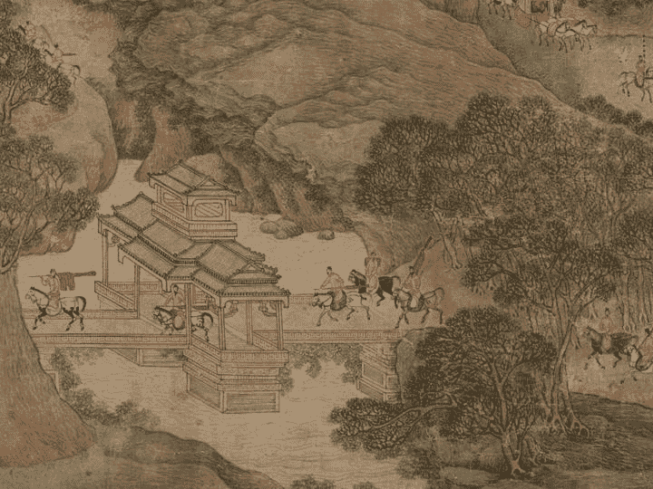

[Seedance_1.0_I2V_LLM (2).mp4](https://internal-api-drive-stream.feishu.cn/space/api/box/stream/download/all/LazXbJOcUoy8yWx2xNEcXnX0nmf)

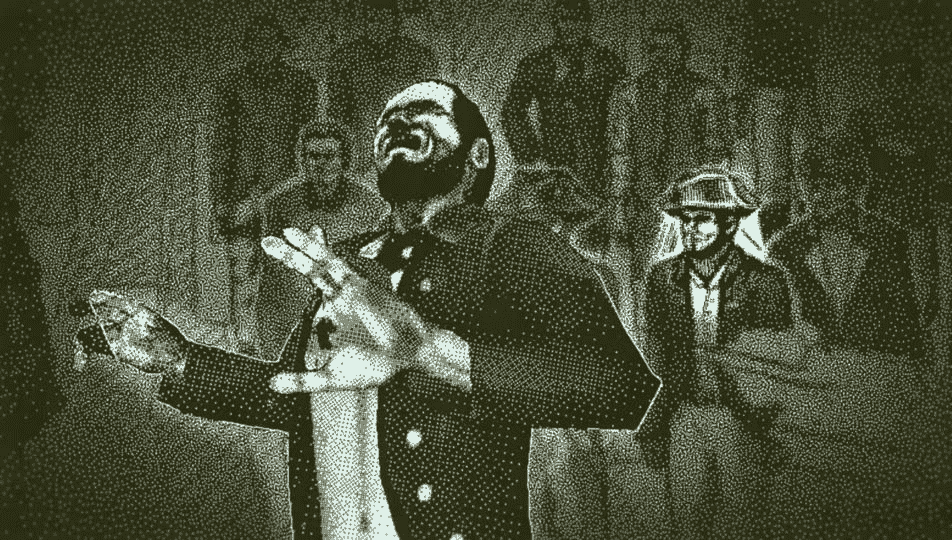

[Seedance_1.0_I2V_LLM_保持原风格.mp4](https://internal-api-drive-stream.feishu.cn/space/api/box/stream/download/all/GIwZbOhkwooINBxuFaacTnOjnCd)

[jimeng-2025-08-15-7881-阿勒泰的夏天，远山，草地，树木，花朵，湖水，阳光斑驳，湖面波光粼粼，一派欣欣向荣....mp4](https://internal-api-drive-stream.feishu.cn/space/api/box/stream/download/all/O6EnbvlsboRneKxXYxBcwEK1nde)

[jimeng-2025-08-14-5110-饱和度高的儿童插画风格，铅笔画风格，保持画风一致.mp4](https://internal-api-drive-stream.feishu.cn/space/api/box/stream/download/all/UZG1b0gK3oMe6kxZazHcS9NhnMd)

[jimeng-2025-08-13-6370-画面俯拍荷塘，红鲤悠游。以水彩技法勾勒——荷叶边缘水渍晕染，叶面颗粒感似颜料堆叠....mp4](https://internal-api-drive-stream.feishu.cn/space/api/box/stream/download/all/Usk6bqzFNo38AqxIWWJcnMWanrh)

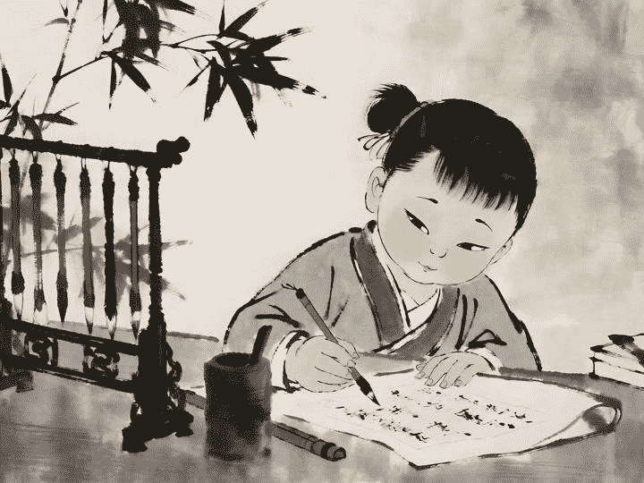

[jimeng-2025-08-13-2068-镜头内容：固定镜头聚焦书桌，孩童执笔，笔尖触宣纸（淡墨洇开）。肩头随呼吸微颤（衣....mp4](https://internal-api-drive-stream.feishu.cn/space/api/box/stream/download/all/VHl6bOa6koI69OxVZZ0cG9zenge)

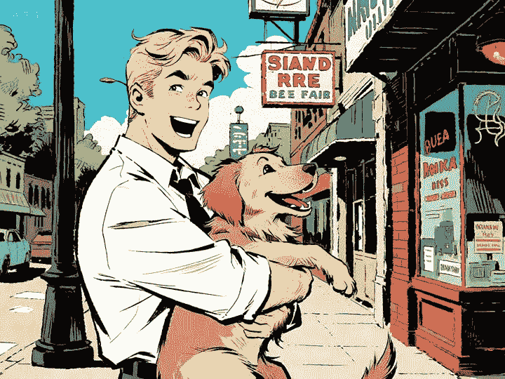

[jimeng-2025-08-14-1522-美国复古漫画，一个穿着白衬衫的金发男子抱着一只开心的金毛寻回犬，阳光明媚的小镇街....mp4](https://internal-api-drive-stream.feishu.cn/space/api/box/stream/download/all/UpQLbUdGgonRbFxIHKzcQaMwnUg)

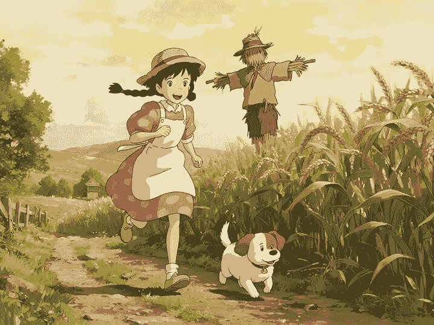

[jimeng-2025-08-14-7464-吉卜力风格动漫，阳光洒满乡村小道，女孩带着小狗奔跑，然后停下来冲着镜头挥手，表情....mp4](https://internal-api-drive-stream.feishu.cn/space/api/box/stream/download/all/GUqGbgZKio8Dnkxdtaqc0duSnle)

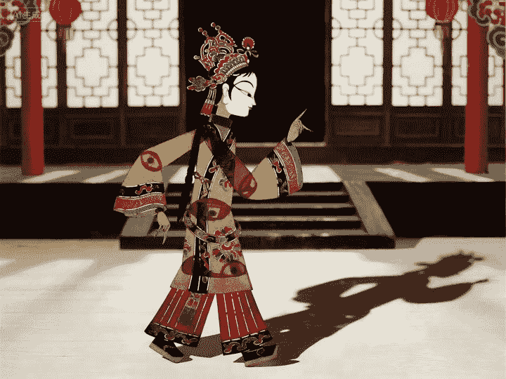

[jimeng-2025-08-14-7774-皮影动画（影偶动画）：在平面光影下，一个古典造型的皮影人物站在宫殿场景中。 人物....mp4](https://internal-api-drive-stream.feishu.cn/space/api/box/stream/download/all/VpzJbBNk9owwR0xx8QocpjoYnIb)

[jimeng-2025-08-14-3982-高定羊毛毡艺术，32k,杰作，几米式叙事，留白式情绪铺垫，有张力，层次，角度，水....mp4](https://internal-api-drive-stream.feishu.cn/space/api/box/stream/download/all/IYwabxkc9opCbZx3ZZScb1fPnDb)

### 智能补全一致性维持

即梦模型的智能补全功能出色，且新元素的风格能与原图保持高度一致性

### 智能补全创作示例

| 类型 | prompt | 图片 | 视频 |
| --- | --- | --- | --- |
| 油画风格 | 在一片色彩丰富的花田中，五彩斑斓的花朵随风轻轻摇曳，背景是朦胧的蓝天，几只蝴蝶飞舞在花间， | 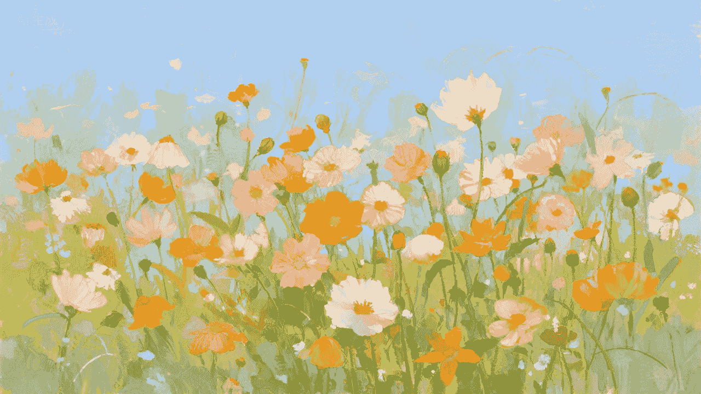 |  |

[jimeng-2025-08-22-8197-在这幅插画风格的画面中，加入一只橙色的小狗正跑向女孩，狗狗跳跃的动作和女孩周围的....mp4](https://internal-api-drive-stream.feishu.cn/space/api/box/stream/download/all/Ik03bZrFMo6lvdxOCYocFwm1nhf)

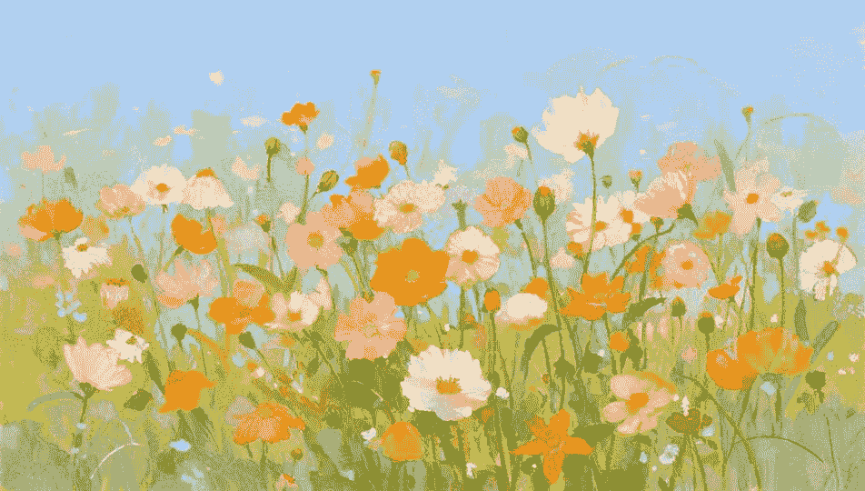

[jimeng-2025-08-22-9465-在一片色彩丰富的花田中，五彩斑斓的花朵随风轻轻摇曳，背景是朦胧的蓝天，几只蝴蝶飞....mp4](https://internal-api-drive-stream.feishu.cn/space/api/box/stream/download/all/KyTPbeKmDoJ7Ggx8R1Hceya8n4e)

## 镜头语言

### 基础运镜

# 即梦3.0pro模型运镜能力测试与实例展示

> 根据测试，即梦3.0pro模型在基础运镜方面表现卓越，能够精准理解并流畅执行推、拉、摇、移等基础运镜指令，完美呈现预设的镜头运动；但短板在于对特殊机位的处理能力不足，比如难以生成严格的垂直俯拍视角，另外在运镜的同时作一些复杂人物动作生成效果不大稳定。

## 基础运镜能力分析

### 基础运镜能力
精准理解并流畅执行推、拉、摇、移等基础运镜指令，完美呈现预设镜头运动。

### 特殊机位短板
对特殊机位的处理能力不足，比如难以生成严格的垂直俯拍视角。

### 复杂动作稳定性
在运镜的同时生成复杂人物动作时效果不稳定。

## 镜头创作实例展示（基础镜头）

|  | **镜头解析** | **参考图** | **prompt** | **视频** |
| --- | --- | --- | --- | --- |
| 推镜头 | 镜头逐渐向主体推进。这个动作能够将观众的注意力牢牢吸引到某个细节或人物身上，常用于强调重要线索、展现人物的内心世界或营造一种步步紧逼的紧张感。 |  | **镜头推进**，他的眼神开始坚定。 |  |
| 拉镜头 | 与推镜头相反，拉镜头是镜头逐渐远离主体。这个动作常用于揭示主体与环境的关系，表现人物的孤独、失落感，或者从细节过渡到宏大场景，带来一种豁然开朗的“揭晓”感。 |  | **镜头快速拉远**，展现他周围的环境。 |  |
| 摇镜头 | 镜头以固定支点为轴，做水平或垂直转动。视觉上，画面如同人眼转动观察，能引导观众的视线扫过场景中的多个元素，构建空间关联性。 |  | **镜头快速向右摇**，焦点落在缝隙中一只血迹斑斑的小手上。 |  |
| 移镜头 | 镜头沿水平方向（如左右、上下）平稳移动，与摇镜头的 “固定支点” 不同，移镜头的拍摄设备本身处于运动轨迹中。视觉上，画面能展现空间的纵深感与连续性。 |  | **镜头垂直上移**，展现行军队伍。 |  |
| 航拍镜头 | 通常指从空中（如无人机、直升机视角）进行拍摄。它能赋予画面一种上帝般的“全知视角”，常用于展现令人叹为观止的宏大景观或营造一种自由、开阔、史诗般的壮丽感。它也可以反过来，通过展现个体的渺小来表达孤独或疏离。 | 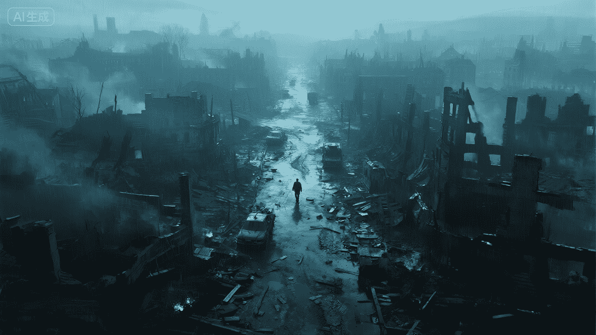 | **航拍镜头**，镜头高空向前航拍变成垂直俯视视角，展现宏大与渺小对比。 |  |
| 变焦镜头 | 变焦是摄像机机位固定不动，通过改变镜头的光学焦距来放大或缩小主体。变焦镜头能创造一种更强烈的戏剧性，甚至是带有侵入感和非自然感的效果。它常用于表现角色的突然惊觉，或者强调某个决定性的线索。 |  | **镜头焦点**由前景的士兵**转为**后景趴着的一排士兵。 |  |
| 主观镜头 | 也是第一人称视角，指摄像机完全模拟角色的双眼。观众看到的就是角色看到的，听到他听到的。这种镜头能让观众身临其境地体验角色的紧张、恐惧、专注或迷茫，常用于射击或极端情绪状态的表达。 |  | **第一人称视角**，人物快速匍匐前进。 |  |
| 固定镜头 | 是指摄像机机位完全不动的拍摄方式。这种镜头语言极具力量感，它能通过精准的构图、光影和人物调度来引导观众视线，制造出强烈的戏剧张力、宿命感或纪实感。 |  | **固定镜头，**机位完全不动，士兵们势如破竹往前冲。 |  |

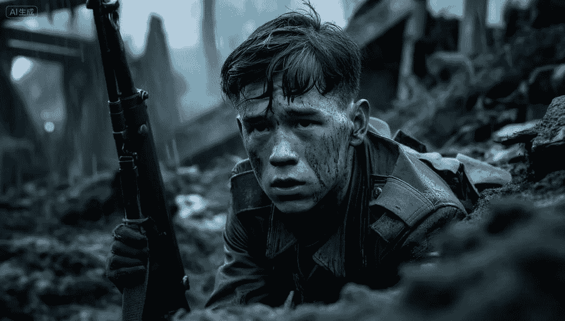

[jimeng-2025-08-15-4614-一名年轻的中国士兵蹲在战壕里，眼神警惕。镜头从他的半身像开始，缓慢、稳定地向前推....mp4](https://internal-api-drive-stream.feishu.cn/space/api/box/stream/download/all/MQGfbmflmoXuqpxaZfFciIvSnZf)

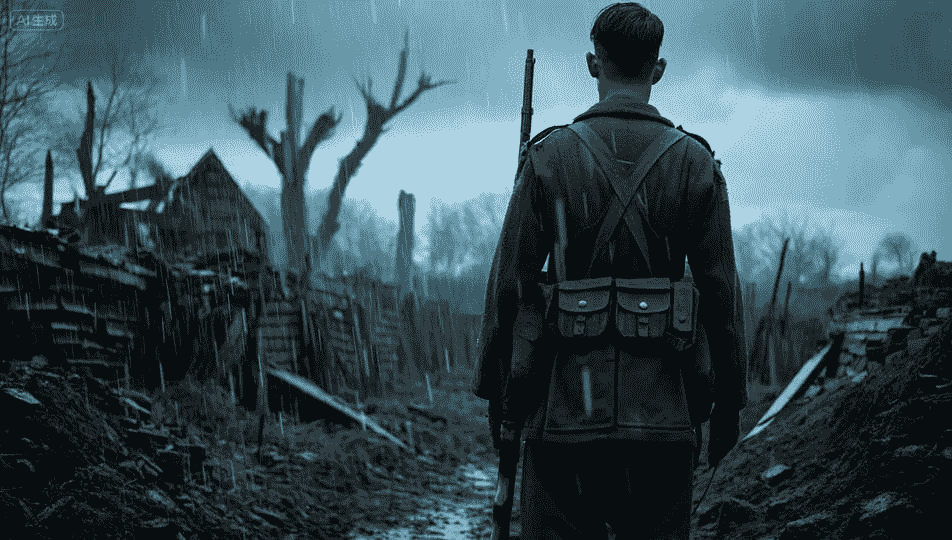

[jimeng-2025-08-15-7345-一名中国士兵的背影，镜头从他的背部开始，平滑地快速向后向上拉远， 逐渐展现出荒凉....mp4](https://internal-api-drive-stream.feishu.cn/space/api/box/stream/download/all/Z3dTb5sEqoF3KUxw67UcJuxfnHe)

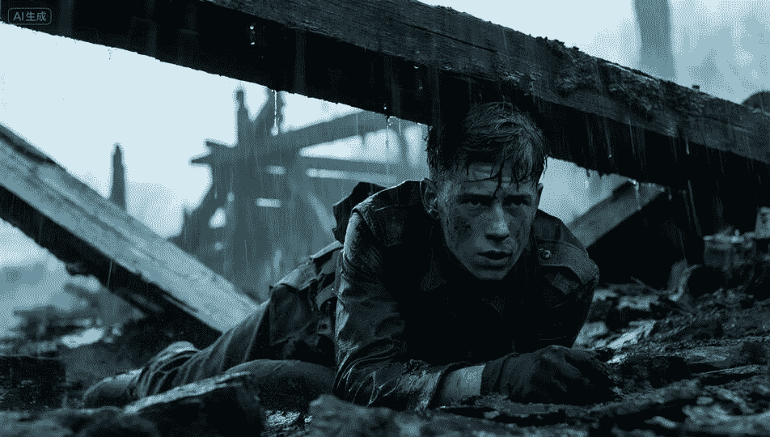

[jimeng-2025-08-13-2072-一个绝望的士兵中弹趴在废墟中，眼睛正在快速扫视周围环境 ，镜头向右快速摇摄（甩镜....mp4](https://internal-api-drive-stream.feishu.cn/space/api/box/stream/download/all/NJ29bGJUYokFHhxQPnvcmooGnE6)

[jimeng-2025-08-21-9597-从画面底部士兵队列脚边起，镜头大幅垂直上移，扫过行军队伍、废墟，直至天空的战斗机....mp4](https://internal-api-drive-stream.feishu.cn/space/api/box/stream/download/all/YOQlbpSbIoBzawxK61cczxfznMH)

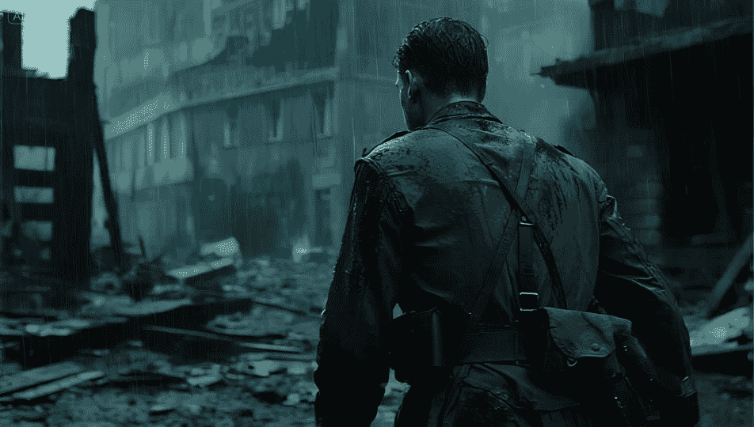

[jimeng-2025-08-13-9999-一个浑身是伤的年轻战士在雨中负伤前行，雨滴真实地落在他衣服上，他一瘸一拐地在断壁....mp4](https://internal-api-drive-stream.feishu.cn/space/api/box/stream/download/all/Vsw9bhNSCo7Dr4xRSOAcKO4hnQU)

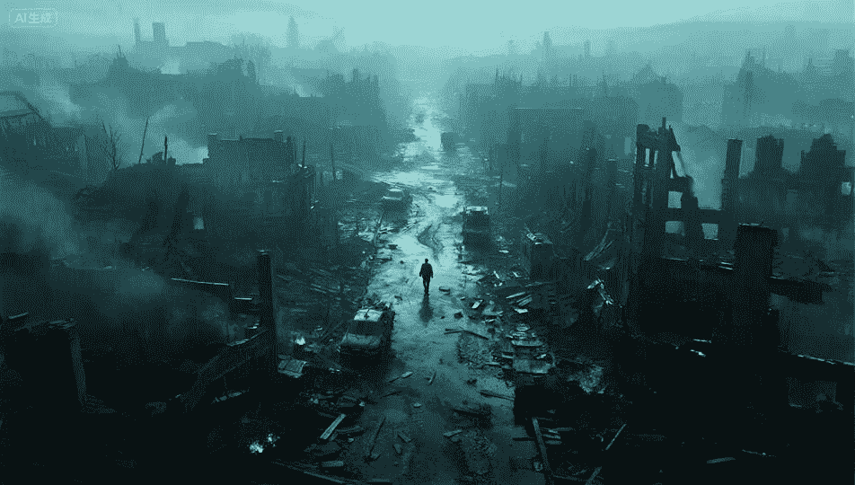

[jimeng-2025-08-13-1955-一个在战场废墟中负伤缓慢前行的士兵 ，航拍镜头，镜头高空向前航拍变成垂直俯视视角....mp4](https://internal-api-drive-stream.feishu.cn/space/api/box/stream/download/all/HOZqbBTYcoFTlRxGrVXccwYLncd)

[jimeng-2025-08-18-7609-镜头围绕士兵进行360度快速环绕拍摄，周围是燃烧的残骸.mp4](https://internal-api-drive-stream.feishu.cn/space/api/box/stream/download/all/GxURbh5cZo3QCZxZzXrcS76GnYd)

[jimeng-2025-08-18-9342-焦点转移镜头，镜头焦点由前景的士兵转为后景趴着的一排士兵。.mp4](https://internal-api-drive-stream.feishu.cn/space/api/box/stream/download/all/Vl6hbBFL6og61QxvEDjcwH9YnLh)

[jimeng-2025-08-15-6884-主体不动，镜头快速变焦向前推进，体现强烈的速度感，聚焦在高处楼上一个狙击手，狙击....mp4](https://internal-api-drive-stream.feishu.cn/space/api/box/stream/download/all/KHfMbpSQrotPTDxCrU8cDinanof)

[jimeng-2025-08-22-9428-固定镜头，机位完全不动，士兵们势如破竹往前冲，慢镜头表现，前景士兵跑走，远方背后....mp4](https://internal-api-drive-stream.feishu.cn/space/api/box/stream/download/all/UfV3bj2WoovDeVxB5Ujc9jJCnye)

## 进阶运镜

> 除了常见的推拉摇移等单一镜头动作，我们也可以将多个镜头串联组合，形成连续的镜头过渡。这类组合镜头能增强视觉节奏，提升叙事氛围，让画面更有“电影感”。我们展示的镜头组合案例，均源于大量影视片段与短视频作品中常见的镜头语言，这些组合在专业拍摄中用于表现情绪递进、视角转换、叙事节奏等，具有极高的表现力和实用性，可供参考

> 经过大量测试，我们总结出模型可以稳定实现的一些组合进阶运镜类型，这些类型同时具备以下特征：

+   合理的组合逻辑

+   **方向连续**：镜头动作的空间方向有合理的过渡，避免突然跳跃

+   **节奏稳定**：每个镜头在有限的时间内有足够的空间展开

> **提示：** 每次组合建议使用 2–3 个镜头动作最稳妥，复杂镜头建议逐句拆写，让模型逐步生成

> ✅操作建议：

+   建议从上方的基础镜头组合表中选择合适的动作搭配，直接套用写法即可。

+   如需做特殊测试，也建议每一步镜头写清楚起始/目标/方向，逐步尝试调优。

+   某些模型对 360° 镜头仍不稳定，建议谨慎尝试，仅用于非关键段落。

> ❌不推荐的写法：

+   提示词中写“炫酷”“复杂”“快速切换”等含糊词语，模型理解不了

+   连续镜头跨度太大（如从地面运镜到宇宙）容易失真或失败（这种情况用首尾帧）

+   同一个镜头中加入太多动作（如同时升起+转圈+推进+下落），模型容易失控或只执行一部分

+   不通过组合形式直接写复杂的镜头语言（如希区柯克、镜头时间停滞、鱼眼镜头），这些模型还没有办法做到，只能通过组合的形式去模仿

## 镜头创作实例展示（进阶镜头）

| **模式** | **镜头组合词** |  | **镜头组合词** |  | **镜头组合词** |  |
| --- | --- | --- | --- | --- | --- | --- |
| **文生视频（t2v）** | **跟随** |  | **下移** |  | **上升** |  |
|  | **跟随** |  | **环绕** |  | **后拉** |  |
| **图生视频（i+tv2）** | **360度环绕运镜** |  | **跟随** |  | **前推** |  |
|  |  |  |  |  | **后拉** |  |

[jimeng-2025-08-13-2723-非洲草原一只猎豹捕猎羚羊的场景，镜头先是在侧面跟随猎豹在奔跑，然后镜头快速前移并....mp4](https://internal-api-drive-stream.feishu.cn/space/api/box/stream/download/all/EE54brhv4o6TgDx2db0cx01qnrc)

[2025-08-14_15-47-57_ByteArtist.mp4](https://internal-api-drive-stream.feishu.cn/space/api/box/stream/download/all/Lz9SbF6rRoLy8hxWpBrcHujRnTh)

[jimeng-2025-08-13-6708-从一位穿着呢子大衣的外国军官背对镜头站在演讲台上的过肩视角看向下方排列整齐的军队....mp4](https://internal-api-drive-stream.feishu.cn/space/api/box/stream/download/all/GeztbI1lPoXkYrxYceWc97vCnwe)

[Seedance_1.0_mini_1080P_T2V_LLM_一个小女孩在客厅地毯上和她的小狗玩耍。镜头从地面与小狗视平线的角度开始，小狗欢快地跑向女孩，镜头平稳地跟随小狗，并在接近女孩时向上摇摄，展.mp4](https://internal-api-drive-stream.feishu.cn/space/api/box/stream/download/all/Xn7RbnmtHoBq6OxrDeRcQF8xnIf)

[Seedance_1.0_mini_1080P_T2V_LLM_一位女性手持咖啡杯，静立于明亮的窗前。镜头从她身后开始，缓缓向前推进并从她右肩上方掠过，细腻捕捉杯中咖啡的热气与她沉静的侧脸轮廓；随后镜头.mp4](https://internal-api-drive-stream.feishu.cn/space/api/box/stream/download/all/DpH0bG4cFoUexOxau4wcwcmRnkg)

[jimeng-2025-08-13-8936-超低广角仰拍镜头人物向镜头走来，镜头同步向人物上升移动，任务突然停下向左转头，镜....mp4](https://internal-api-drive-stream.feishu.cn/space/api/box/stream/download/all/Lt5NbDnfjo3KuCxfRJucV015nIf)

[jimeng-2025-08-15-8670-以主体为中心进行360°快速环绕运镜.mp4](https://internal-api-drive-stream.feishu.cn/space/api/box/stream/download/all/AsIPb75E7obIVSxMjHDcuMPInnf)

[jimeng-2025-08-15-2206-镜头下移聚焦于男子脚部并跟随男子移动，然后向左环绕并同步上升至男子手部，镜头继续....mp4](https://internal-api-drive-stream.feishu.cn/space/api/box/stream/download/all/ISvUbskEKokrj5xnGL3cI4wOn4C)

[jimeng-2025-08-15-3088-镜头前推至女声肩部，然后左环绕运镜至过肩视角展现女生手里物品.mp4](https://internal-api-drive-stream.feishu.cn/space/api/box/stream/download/all/GY4bbdwCZoUPxSxGgOOcu8pDn8f)

[2025-08-15_12-55-04_ByteArtist.mp4](https://internal-api-drive-stream.feishu.cn/space/api/box/stream/download/all/BwanbCBIzolSnmxGDdOcNCAqncc)

[jimeng-2025-08-15-3414-镜头跟随男子移动，然后向左环绕并同步上升至男子手部，镜头继续环绕至男子面前然后前....mp4](https://internal-api-drive-stream.feishu.cn/space/api/box/stream/download/all/EUAGbs7UdoKaGvxaHpzcmlWvnvb)

[jimeng-2025-08-13-1765-白色的熊在冲浪，镜头先是向右环绕运镜到熊的面部，然后镜头快速上拉变为鸟瞰视角，然....mp4](https://internal-api-drive-stream.feishu.cn/space/api/box/stream/download/all/KqagbQqDVoU0Y2xAL8fcukO7nJh)

## 复杂运镜创作小技巧

+   镜头的拆分：针对复杂运镜，创作者必须对镜头的大致运镜路径进行思考（即由哪几个单镜头相接而成），对基础单镜头运镜有充分了解。

+   注意左右空间问题：有时因镜像原因，我们认知中的左右方向可能与画面中的左右方向相反。若出现提示词为“左”，但画面却往右的情况，可更改提示词中的左右方向后再生成视频。

+   部分复杂运镜可能无法通过图生视频的方式完成，但可借助文生视频实现。然而，在影视创作环境下，需考虑人物及环境的一致性。此时，可先通过文生视频构建该场景，然后将视频中的人物或景别用于后续情节参考（此方法仅限于剧情中之前未出现的新角色或场景）。

+   若环绕运镜无法实现 360°环绕效果，可先生成一段环绕视频，截取尾帧后再次进行同向环绕，通过多次环绕来满足 360 度环绕的需求。

对于需要呈现无中生有类画面的情况，可在提示词中对其进行详细描述，以减少画面与整体情节不符或出现变形崩坏的问题。

## 景别和视角控制

> 可以使用远景、全景、中景、近景、特写这样的专业景别描述来控制。还可以选择具体的观察角度：水下镜头，航拍镜头，高机位俯拍，低机位仰拍，微距摄影，以xx为前景的镜头等；

> **景别递进，聚焦神态细节**

> 正推：全景→中景→近景→特写

> 反推：特写→近景→中景→全景

> 制作了一个视频给大家提供不同景别的空间信息：

[8月22日(1).mp4](https://internal-api-drive-stream.feishu.cn/space/api/box/stream/download/all/Htg6bLorRoZ0XoxguMDcX6x7nVh)

---

**镜头创作实例展示：**

| 类型 | 分类 + `prompt` |  |  |

| --- | --- | --- | --- |

| 景别变换 |  |  |  |

| 常用镜头及视角表达 | + 顶视航拍镜头 | + 水下视角 | + 超低广角仰拍镜头 |

|  | + Fpv视角 | + 第一人称视角 | + 延时摄影效果 |

|  | + 微距镜头 | + 低角度视角特写 | + 鱼眼镜头 |

[jimeng-2025-08-12-2755-镜头穿过框架缓缓向远处的宝塔推近.mp4](https://internal-api-drive-stream.feishu.cn/space/api/box/stream/download/all/CCnybSHH9o9ubvxhkVwcihpxn8g)

[jimeng-2025-08-12-7475-背部摄影视角，一辆科幻感战斗飞机穿梭过赛博科幻感的空间隧道然后出现在浩瀚的宇宙中....mp4](https://internal-api-drive-stream.feishu.cn/space/api/box/stream/download/all/MN97buaBfo0ltmxCjHnckBTJnRg)

[Seedance_1.0_T2V_LLM_CN_2(1)_4863329952770.mp4](https://internal-api-drive-stream.feishu.cn/space/api/box/stream/download/all/SoJEbdj27oOmhyxKFInccRutnH4)

[jimeng-2025-08-13-7868-顶视航拍镜头，车辆快速行驶在沙尘路上，后方扬起尘土.mp4](https://internal-api-drive-stream.feishu.cn/space/api/box/stream/download/all/OL67b2G6Gow8nKxn1vHcKpRMnvf)

[jimeng-2025-08-13-8558-水下视角，空中有着明媚的太阳，水体清新透亮，水中有着随波逐流的水草，四处游荡的小....mp4](https://internal-api-drive-stream.feishu.cn/space/api/box/stream/download/all/RH9bb3AK8oy7i6xPMzLcHjPtnve)

[jimeng-2025-08-13-9347-超低广角仰拍镜头，一个人站在镜头面前跳街舞，背景是高楼大厦.mp4](https://internal-api-drive-stream.feishu.cn/space/api/box/stream/download/all/FXbRbMAhuoqv4txMCL1c2Ce9ncd)

[jimeng-2025-08-18-4253-fpv，在森林的上方空中穿梭.mp4](https://internal-api-drive-stream.feishu.cn/space/api/box/stream/download/all/Z4nWbt03Joa2lexwLFJcuRTBnid)

[jimeng-2025-08-15-8260-钓鱼的第一人称视角.mp4](https://internal-api-drive-stream.feishu.cn/space/api/box/stream/download/all/Jsrmbu85bo3CaRxmtItcwnh2nqf)

[jimeng-2025-08-15-6769-从黄昏到夜晚的延时摄影效果，高架桥机位向下看去车辆不停的在路上行驶，空中云彩移动....mp4](https://internal-api-drive-stream.feishu.cn/space/api/box/stream/download/all/N2rtbTOaIoGOo8xHwrKcS8jTnec)

[jimeng-2025-08-13-4068-微距镜头，蜜蜂用前腿擦了擦自己的头部并且将头部左右晃动，后腿弹了弹翅膀.mp4](https://internal-api-drive-stream.feishu.cn/space/api/box/stream/download/all/SRG7bZjDyoigvOxdMPNcGIVtnKJ)

[jimeng-2025-06-13-941-水底视角，仰视特写拍摄了一只小猫站在岸上，低头喝水，能清晰的看到小猫舌头与水面接触的瞬间。.mp4](https://internal-api-drive-stream.feishu.cn/space/api/box/stream/download/all/MZs0b9uUJoU7QVxMyTdcRvUqncp)

[2025-08-15_12-48-08_ByteArtist.mp4](https://internal-api-drive-stream.feishu.cn/space/api/box/stream/download/all/US28bd1DEo7fukxLPyAc1dNDn0e)

## Prompt控制美感

### 人物外形

> 可以发挥想象，精细刻画出人物/服饰/首饰的细节，生成各种不同长相特征的角色

> 内容简述：

> 人物外形保持的核心是通过 “精准锁定固定特征 + 明确可变范围”，让人物在不同场景、姿态或风格中始终保持辨识度。

> **核心公式：核心特征 + 年龄性别 +** 身材/体态 + 服饰风格 + 场景构建

> 创作要点：

1.  “核心特征”精准描述，从面部五官、皮肤质感、标志性元素、发型入手，视觉焦点需避免模糊描述

1.  “年龄性别”直观定位，确保同性别同年龄段人物主要特征准确保持

1.  “身材体态”固定轮廓，尽可能保证不同动作下轮廓不变，如身材匀称，身形挺拔

1.  “服饰风格”增添细节，基础调性与标志性单品共同加持，强调记忆点

1.  “场景构建”营造氛围，与人物配饰、年龄、气质相匹配的场景，能够更好地让所有外形特征服务于同一调性，避免割裂感

---

**人物外形实例展示：**

| 类别 | `prompt` | 视频 | `prompt` | 视频 |

| --- | --- | --- | --- | --- |

| 文生视频（`t2v`） | 穿着洛丽塔裙的甜美少女，蕾丝装饰，蝴蝶结发饰，在欧式花园蔷薇花丛中 |  | 戴虎头帽、穿着传统肚兜的可爱萌娃，肉嘟嘟小脸，手拿拨浪鼓，在新春庙会人群中 |  |

|  | 一个美貌的中国女人穿着一身优雅的黑色旗袍，坐在西式客厅里抽烟 |  | 穿着汉服曲裾的灵动少女，杏眼桃腮，裙摆绣着繁花，于江南水乡石桥上漫步 |  |

|  | 身着武术服的英气少年，剑眉星目，手持长剑，在古式练武场青砖地上 |  | 银发盘起、戴珍珠项链的优雅奶奶，坐在摇椅上翻看老相册，阳光洒在脸上 |  |

|  | 一位戴着金丝眼镜、身着白大褂的温柔女医生，手持病历夹，在医院走廊微笑倾听患者讲述 |  | 梳着脏辫、戴大金链的街头说唱青年，在地下rapper比赛舞台激情表演 |  |

|  | 穿高定礼服，化精致妆容，眼神冷峻走猫步的时尚超模，在布满闪光灯的 T 台。 |  | 一个挺着啤酒肚，穿花衬衫戴金链子，眯眼的油腻中年胖子，坐在烟雾缭绕的小餐馆撸串 |  |

|  | 一位留着浅色短发的年轻人站在阳台上，身着白色高领毛衣，外搭黑色西装外套，尽显现代时尚的气质。俯瞰着城市街道。一道醒目的红光映照在他脸上，与傍晚深蓝的色调形成鲜明对比。 |  | 一位白种男性，皮肤白皙，留着浓密且打理精致的胡须和髭须。他的头发整齐地向后梳，身着正式的黑色西装，内搭白色衬衫，手部部分可见，正握着翻领或一件首饰。 |  |

[jimeng-2025-08-14-9866-写实，穿着洛丽塔裙的甜美少女，蕾丝装饰，蝴蝶结发饰，在欧式花园蔷薇花丛中，.mp4](https://internal-api-drive-stream.feishu.cn/space/api/box/stream/download/all/QObPbGCFvonS4qxu8v9chXjfnNg)

[jimeng-2025-08-14-1891-写实，戴虎头帽、穿着传统肚兜的可爱萌娃，肉嘟嘟小脸，手拿拨浪鼓，在新春庙会人群中.mp4](https://internal-api-drive-stream.feishu.cn/space/api/box/stream/download/all/N5EEbk9PQoOnl4xzrpqcoNIWnLh)

[Seedance_1.0_T2V_LLM_一个美貌的中国女人穿着一身优雅的黑色旗袍，坐在西式客厅里抽烟.mp4](https://internal-api-drive-stream.feishu.cn/space/api/box/stream/download/all/O7VDbnoyaoFrphxfYpochj5enUg)

[jimeng-2025-08-14-3505-写实，穿着汉服曲裾的灵动少女，杏眼桃腮，裙摆绣着繁花，于江南水乡石桥上漫步.mp4](https://internal-api-drive-stream.feishu.cn/space/api/box/stream/download/all/PyQIboOcfoABpdxjONNc6bFVnXe)

[jimeng-2025-08-14-3985-写实，身着武术服的英气少年，剑眉星目，手持长剑，在古式练武场青砖地上.mp4](https://internal-api-drive-stream.feishu.cn/space/api/box/stream/download/all/S3kHbkdUqoVP4mxRgECcZ8gYnPe)

[jimeng-2025-08-14-2624-写实风格，银发盘起、戴珍珠项链的优雅奶奶，坐在摇椅上翻看老相册，阳光洒在脸上.mp4](https://internal-api-drive-stream.feishu.cn/space/api/box/stream/download/all/GeqZb7VBUoMqn5xkIk7c7BwVnMz)

[jimeng-2025-08-14-1430-写实风格，一位戴着金丝眼镜、身着白大褂的温柔女医生，手持病历夹，在医院走廊微笑倾....mp4](https://internal-api-drive-stream.feishu.cn/space/api/box/stream/download/all/Bp7NbHWQ8oTfd9x21cscRlmxnZc)

[jimeng-2025-08-14-6553-真实场景，写实风格，梳着脏辫、戴大金链的街头说唱青年，在地下rapper比赛舞台....mp4](https://internal-api-drive-stream.feishu.cn/space/api/box/stream/download/all/L4JRbJ0LKoLXW1xqQZxc5TyJnIg)

[jimeng-2025-08-14-2833-真实场景，写实风格，穿高定礼服，化精致妆容，眼神冷峻走猫步的时尚超模，在布满闪光....mp4](https://internal-api-drive-stream.feishu.cn/space/api/box/stream/download/all/SuDqbTjeqoiCs9xnC7scNDmlnjh)

[jimeng-2025-08-15-1937-一个挺着啤酒肚，穿花衬衫戴金链子，眯眼的油腻中年胖子，坐在烟雾缭绕的小餐馆撸串，....mp4](https://internal-api-drive-stream.feishu.cn/space/api/box/stream/download/all/Gbdcb9pyvo65roxOaQ7c7B1bnEh)

[jimeng-2025-08-14-1775-A young person with short, light-colored....mp4](https://internal-api-drive-stream.feishu.cn/space/api/box/stream/download/all/DRLHbekPsoCZXsxjoZtc1tBQnEb)

[jimeng-2025-08-14-6491-A close-up portrait of a Caucasian man w....mp4](https://internal-api-drive-stream.feishu.cn/space/api/box/stream/download/all/YYObbCabnoa3RpxRxxEc56IQnwe)

### 画面美感

> 精细化描述画面，用自然语言写出画面的氛围特征，可以控制画面整体的美感。

> 内容简述：

> 氛围感的本质是“情绪共鸣”，提示词需借助可感知的具体元素（如环境、光影、声音、触感等），引导受众联想到相应情绪。

> **核心公式：主题氛围 + 环境基底 +** 感官细节 + 情感锚点 + 风格调性

> 创作要点：

1.  明确“核心氛围”，清晰主题，奠定情绪基调，如复古怀旧、悬疑诡谲

1.  构建“环境内容”，选定场景存在的具体时间与空间，明确时间、地点、环境特征，如空无一人的老旧荒村

1.  加入“感官细节”，从视听味嗅肤五感延伸至通感层面，让场景拥有更加真实的触感，如暖黄色的灯光洒下

1.  强化“感情锚点”，加入贴合氛围与环境的小元素，增强氛围的记忆点，如洛可可式装潢随处可见

1.  调整“风格调性”，加入1-2个关键词强化整体质感，如风格词、画面质感描述，如：胶片颗粒感、日系清新

---

**画面美感实例展示：**

| 风格类型 | `prompt` | 视频 | 创作要点 |

| --- | --- | --- | --- |

| 古早风格 | 80 年代（年代）老式书房，泛黄墙纸卷边，掉漆木桌摆着一个搪瓷杯与稿纸（元素）。男人梳油头戴破镜，穿发白卡其衫（元素），台灯暖光下握笔书写，充满廉价古早感（氛围词）。 |  | 1.确定年代（80-90 年代） |

| 美式复古风格 | 乘坐经典敞篷车（代表元素）沿着阳光明媚的海岸平稳行驶，摄像机捕捉海洋和天空的鲜艳色彩。Super Panavision 70完美地构图了场景，复古的色彩（主色调）分级增强了20世纪50年代夏天温暖的金色光芒（时间段）。自由奔放、怀旧、电影化（氛围+色调） |  | 1.明确该风格所代表时间段，如：20 世纪 50-70 年代美式复古风格 |

|  | 有质感的老电影（主色调），复古氛围（氛围），一个街头音乐人在夜晚酒吧的霓虹灯下（代表元素）沉醉得拉小提琴。 |  |  |

| 欧式复古氛围 | 油画风格，十八世纪，夏日午后的宁静庭院（场景）。浅色系花卉盛放（色调），枝叶丰茂的绿植郁郁葱葱，绿意漫过石砌台阶。一对男女闲坐于藤编椅上，男子手持皮质封面的古籍，女子捧着白瓷茶杯，阳光透过叶隙洒下斑驳光点，落在他们衣料细腻的裙摆与马甲上。（衣着） |  | 1.明确人物衣着“高领蕾丝衬衫”“束腰蓬裙”“燕尾服” |

| 中式恐怖氛围 | 白雾笼罩着山村，正午时间却暗如黄昏（光线）。镜头从村口的老槐树下摇起，树干上系着十几根褪色的红绳，绳结样式统一（恐怖元素），树下的石碾子还在缓慢转动。沿着唯一的土路深入，两旁的土坯房门窗洞开，某扇木门在雾中轻轻摇摆。（留白） |  | 1.明确恐怖元素，选定恐怖场景，如老宅祭祖、废弃戏台、荒村老井 |

# 即梦AI视频创作指南

## 提示词与风格示例

| **微观世界风格** | 微观世界（场景特点），乐高风格（风格词），在一条清澈的河流中（场景构成），一个小人正奋力划着小船前行（人物动作）。菠菜像细长的树林般分布在河岸（场景构成），营造出一个奇幻又独特的微观世界场景，科幻，梦幻，小人国，缩微景观，逼真，高清，质感，纹理清晰。（氛围词） |  | 1.明确关键词“微观”、“微缩”，以及场景特点，“物品放大化”和“人物缩小化” |

|  | 微观世界（场景特点），乐高风格（风格词），一串饱满圆润的绿色葡萄顶部，带有几片葡萄叶（场景构成），两个小人正挥舞着微小的工具冲洗葡萄（人物动作）。葡萄表皮细腻的纹理清晰可见，营造出一种忙碌又奇幻的氛围，科幻，小人国，缩微景观，纹理清晰。（氛围词） |  |  |

|  | 花园的叶子上，住着一群小精灵（场景构成）。镜头右摇，主角从家里走出，主角身着花瓣斗篷、手持草叶魔杖（人物动作），魔杖顶端嵌着一个发光的黄色宝石，微观世界风格（场景特点）。 |  |  |

| **梦核风格** | 废弃的老式商场（易营造无人氛围的场景），过期商品散落在陈旧的货架和地板上（物体、元素），灯光昏黄（光影/氛围），门外隐隐透进亮光，VHS录像带失真（质感/风格），广角深景深（镜头/构图），空无一人（人物易发生结构问题导致出戏，尽量避免人物出现） |  | 1.明确创作目的，中式梦核基本以千禧年左右中国的公共空间或普罗大众所熟悉的生活化场景为主，例如：人民公园的棉花糖、碰碰车和糖画，小学的微机课教室，绿色油漆粉刷的学校走廊等等 |

|  | 无人的废弃游乐场（场景）有一架锈迹斑斑的楼梯（物体），褪色的VHS色调（光影/色彩），35mm胶片颗粒（质感/风格），陈旧的童年记忆（氛围），鱼眼镜头（镜头/构图），空无一人（规避人物出现） |  |  |

|  | 暗黄色老旧的卧室（场景），生锈的风扇（物体）摇摇欲坠，色彩鲜艳的玩具（物体）散落在房间各处，床单上印着的米奇（元素）已微微泛黄，褪色的VHS色调（色彩），35mm胶片颗粒（质感），陈旧的童年记忆（氛围），鱼眼镜头（镜头），空无一人（人物规避） |  |  |

[jimeng-2025-08-15-7796-80 年代老式书房，泛黄墙纸卷边，掉漆木桌摆着一个搪瓷杯与稿纸。男人梳油头戴破镜....mp4](https://internal-api-drive-stream.feishu.cn/space/api/box/stream/download/all/R3JOb2A0roiIJ7xaA6DcRyC7n0f)

[jimeng-2025-08-15-6410-乘坐经典敞篷车沿着阳光明媚的海岸平稳行驶，摄像机捕捉海洋和天空的鲜艳色彩。Sup....mp4](https://internal-api-drive-stream.feishu.cn/space/api/box/stream/download/all/F3yPbA0wToOCafxqEwkcKP7BnLb)

[Seedance_1.0_mini_1080P_T2V_LLM_有质感的老电影，复古氛围，一个街头音乐人在夜晚酒吧的霓虹灯下沉醉得拉小提琴。.mp4](https://internal-api-drive-stream.feishu.cn/space/api/box/stream/download/all/QkvDbzZPYoLZXjx5Vo5cOYjFnbg)

[jimeng-2025-08-15-4241-油画风格，十八世纪，夏日午后的宁静庭院。浅色系花卉盛放，枝叶丰茂的绿植郁郁葱葱，....mp4](https://internal-api-drive-stream.feishu.cn/space/api/box/stream/download/all/OzmXbtRQOoh70zxt7xKcWHgZnYg)

[jimeng-2025-08-15-6650-浓得化不开的白雾笼罩着山村，正午却暗如黄昏。镜头从村口的老槐树下摇起，树干上系着....mp4](https://internal-api-drive-stream.feishu.cn/space/api/box/stream/download/all/OQt5bTMB8oo1GOxcC8zcKRx2nyc)

[微观世界，乐高小人.mp4](https://internal-api-drive-stream.feishu.cn/space/api/box/stream/download/all/Bxxfblannou9dPxG0nTcB9ucnFd)

[微观世界，洗葡萄.mp4](https://internal-api-drive-stream.feishu.cn/space/api/box/stream/download/all/TSSBbppOhooNkOxp5HXckdnEnvd)

[Seedance_1.0_mini_1080P_T2V_LLM_花园的叶子上，住着一群小精灵。镜头右摇，主角从家里走出，主角身着花瓣斗篷、手持草叶魔杖，魔杖顶端嵌着一个发光的黄色宝石，微观世界风格。.mp4](https://internal-api-drive-stream.feishu.cn/space/api/box/stream/download/all/LYqEb130yoaVAOxMzHWc04Qnndc)

[中式梦核，废弃商场.mp4](https://internal-api-drive-stream.feishu.cn/space/api/box/stream/download/all/MvkDbudf3oYNiDxvbP2cuDpsnct)

[中式梦核，废弃游乐场.mp4](https://internal-api-drive-stream.feishu.cn/space/api/box/stream/download/all/ScUubwqKgoq431xOZ7Mc9ccPnOe)

[中式梦核，老旧卧室.mp4](https://internal-api-drive-stream.feishu.cn/space/api/box/stream/download/all/FppIbC0G8o0DtJxrvx4cW3n5njS)

## 切镜能力

> 切镜能力是即梦模型独有功能和玩法，支持在同一`prompt`里包含多个切镜，这些切镜会根据提示词的内容，保持主体/风格/场景的延续性。镜头的变化，通过“镜头切换”来进行连接，在每次切镜之后，如果场景和人物发生了变化，可以用`prompt`刻画新出现的人物/场景的特征。

> 即梦支持在一个`prompt`中编写多个切镜片段，模型能够根据提示词内容自然切换镜头并保持人物/场景/风格的延续性。以下是几种推荐的切镜写法格式，可根据需要灵活选择，重点是提示词要包含“切”或者“切镜”：

> 格式 1：使用「切镜：」显式标记每段镜头

> 切镜1：一个女孩在海边奔跑，阳光洒在她的脸上

> 切镜2：镜头拉远，女孩站在夕阳下的礁石上，远处是波光粼粼的大海

> 切镜3：夜晚来临，女孩仰望星空，身旁飘起丝带状的星光

> 格式 2：使用「镜头一、镜头二」或「镜头1、镜头2」来结构化描述

> 镜头一：镜头从上方向下俯拍，一位男孩站在悬崖边望向远方

> 镜头二：镜头切换至男孩正面，他面带坚定的表情，风吹动他的披风

> 镜头三：视角切至男孩脚边，一颗小石子滚落悬崖

> 格式 3：直接使用镜头语言关键词（全景、中景、特写等）串联描述

> 全景：广袤沙漠上，一队骆驼穿越金色沙丘

> 中景：镜头跟随其中一位旅人，他望向远方

> 特写：他的眼睛映出远处绿洲的倒影

> ps：大量测试下来，5s的视频最多可以做到5个切镜，超过5个会导致效果下降，有着优秀的一致性保持

| **类别** | `prompt` | 视频 | 参考图 |

| --- | --- | --- | --- |

|  | 广角大远景镜头黄昏的海边沙滩上有一个男人坐在沙滩上喝酒的背影。切镜 ：人物喝酒的侧面中景视角，镜头推进到男人嘴部喝酒的特写，切镜：男人正面的低视角仰视镜头，切镜黄昏的海上飞行的海鸥的跟随镜头，暖光，体现出孤寂感 |  | / |

|  | 全息科技环境内，一个3d穿着外骨骼的战士站在展示台上向左挥拳，切镜：一个如高楼般巨大的机器人同步向左挥拳，切镜：外骨骼战士在原有环境向右挥拳，切镜：高大的机器人同步向右挥拳 |  | / |

|  | 镜头先是侧面跟随，汽车飞速行驶在雨天的马路上，切镜：人物驾驶汽车在原有环境的第一视角；切镜：在原有环境的空中垂直向下的航拍汽车飞驰在马路上的视角 |  | / |

|  | 一个消防员正在安静地睡觉。切镜，特写红灯警报疯狂闪烁。 切镜，消防员猛地睁开眼睛的极致特写。切镜，他的双脚重重地踩在地板上的特写。 切镜，双手扣上沉重夹克纽扣特写。切镜，他抓起椅背上的头盔，戴在头上。切镜，他坚毅的脸庞在闪烁的红光下显得棱角分明。 最终切镜：他冲出房间门，身影消失在通向车库的走廊里。 整个过程快速剪辑，手持摄影的动感风格。 |  | / |

| **图生视频（`iv2`）** | 将军在帅帐中看着专心沙盘。切镜:一名黑衣刺客攀爬敌方城堡的屋檐。切镜:将军将一枚代表骑兵的棋子猛地向前推进。切镜：刺客从屋顶无声地跳下，落入下方的庭院。切镜:特写将军抬起头；切镜:刺客躲在柱子后，看到不远处敌方主帅的房间亮着灯。 |  |  |

|  | 一名老刑警和犯罪头目在审讯桌两侧对峙。切镜：刑警的特写，面露愤怒。切镜：罪犯的手部特写，他的手指在桌面上轻轻敲击。切镜：罪犯脸部的反打镜头，他嘴角露出一丝不易察觉的微笑，眼神冰冷。切镜:刑警的眼睛极限特写，瞳孔中映出对方的影子，充满了压迫感。切镜：全景刑警愤怒站起身拍桌子； |  |  |

|  | 全景俯拍空旷停车场，几辆汽车零星停放，画面偏暗营造寂静氛围，过渡方式: 镜头缓慢推近浅蓝色轿车，切镜2: 中景接车内视角，司机抬手看表（特写手部动作），眉头微皱显露出等待的焦灼，切镜3: 浅蓝色轿车启动驶离车位（跟拍车尾），空旷车位与后视镜里渐远的停车场形成对比，暗示等待终结 |  |  |

|  | 镜头向前推进，切镜：宇航员在火箭仓内的侧面紧张特写镜头，切镜：火箭开始升空 |  |  |

|  | 兔子穿粉色连衣裙坐在敞篷车内,镜头从侧前方仰角缓缓逼近,她稳坐驾驶位,头微微偏向 |  |  |

[2025-08-14_16-22-23_ByteArtist.mp4](https://internal-api-drive-stream.feishu.cn/space/api/box/stream/download/all/Ozhub9G7hofRJMxJpyBcnMe6nHv)

[2025-08-14_16-25-42_ByteArtist.mp4](https://internal-api-drive-stream.feishu.cn/space/api/box/stream/download/all/JB8qbfFiXo2vatxTAomczChZnkg)

[jimeng-2025-08-12-9298-镜头先是侧面跟随，汽车飞速行驶在雨天的马路上，切镜：人物驾驶汽车在原有环境的第一....mp4](https://internal-api-drive-stream.feishu.cn/space/api/box/stream/download/all/AlW2bx6eVoliQ8xAHClcN1PTn6c)

[jimeng-2025-08-14-1686-一个消防员正在安静地睡觉。__ 切至，特写红灯警报开始疯狂闪烁。 ____ 切至....mp4](https://internal-api-drive-stream.feishu.cn/space/api/box/stream/download/all/IsDEbKsKToONcjxE5XJcHZoanLg)

[jimeng-2025-08-15-6837-将军在帅帐中看着沙盘。__切至___ 一名黑衣刺客如幽灵般在月光下攀爬敌方城堡的....mp4](https://internal-api-drive-stream.feishu.cn/space/api/box/stream/download/all/Su3cbligxo2VWKxUU45c7dZ9nA5)

[jimeng-2025-08-18-6085-一名老刑警和犯罪头目在审讯桌两侧对峙。切镜：刑警的特写，面露愤怒。切镜：罪犯的手....mp4](https://internal-api-drive-stream.feishu.cn/space/api/box/stream/download/all/Glkmb3pydoP6B7xF7RGcVFtQnme)

[jimeng-2025-08-18-8871-全景俯拍空旷停车场，几辆汽车零星停放，画面偏暗营造寂静氛围，镜头缓慢推近浅蓝色轿....mp4](https://internal-api-drive-stream.feishu.cn/space/api/box/stream/download/all/ADXNbVmjCoKS3Ax3GBmcQUxMnFd)

[jimeng-2025-08-15-1237-镜头向前推进，切镜：宇航员在火箭仓内的侧面紧张特写镜头，切镜：火箭开始升空.mp4](https://internal-api-drive-stream.feishu.cn/space/api/box/stream/download/all/Ty4FbMoaao8inUxtb9xc49Odnjg)

[jimeng-2025-08-15-5818-兔子穿粉色连衣裙坐在敞篷车内,镜头从侧前方仰角缓缓逼近,她稳坐驾驶位,头微微偏向....mp4](https://internal-api-drive-stream.feishu.cn/space/api/box/stream/download/all/JaQZbn9ZKoBQ71x7SbGcrDk2n7e)

## 创意特效 [【即梦AI】特效玩法合集](https://bytedance.larkoffice.com/docx/OMpddsF2mobtDixdMltc9LLYnmb)

> 在即梦视频创作中，创意特效通常通过首尾帧设计 和 `I+T2V` 模态扩展 打造视觉冲击力与故事感的关键。这部分将介绍如何利用首尾帧技术，结合图生视频的动态能力，创作出具有震撼力和情感表达的创意效果。

## 总结

+   **首尾帧基础类型**：提供稳定且可控的转场/过渡手法，适用于各种视频创作，但需要平衡自然过渡与创意效果。

+   **首尾帧创意模块**：突破常规，通过 **个性化转变** 和 **角色变形**，实现创意的极限，适合强调视觉冲击的作品。

+   **`I+T2V` 创意特效模块**：通过 **图生视频技术** 实现 **动态效果**，让静态画面拥有 **高质量特效**，增加视觉张力，但需要精准的技术支持和把控。

---

### 首尾帧类型模块（基础分类）

> 即梦视频 3.0基模具有首尾帧功能，是一种以“首帧 + 尾帧”形式生成视频的创作模式。用户只需提供两个关键画面，AI 将自动在两帧之间生成过渡视频，使开头与结尾自然衔接

**首尾帧类型创作实例展示：**

| **类型** | **首帧图片** | **尾帧图片** | **`Prompt`** | **编写结构** | **视频效果** |

| --- | --- | --- | --- | --- | --- |

|  |  |  | 镜头从高空缓慢旋转下降，穿过云层进入铁王座大厅，光线逐渐聚焦于王座之上。 | 【镜头运动方式】+【尾帧的空间元素】+【环境氛围】+（可选情绪/动作） |  |

|  |  |  | 第一视角穿梭于森林小径，草叶摩擦视野，随后镜头快速右摇，穿越光影缝隙进入被自然吞噬的古代神殿遗迹，空间从敞亮过渡到幽暗，步步深入，营造探险感。 |  |  |

## 角色动态类

|  |  | 固定镜头，英俊的男人挠着胳膊，一只手拿着药膏从画面下方出现，男人表情从惊讶到高兴，向镜头方向伸手，背景保持不动，灯光昏暗的夜晚，动作丝滑连贯，流畅的动态 | 【角色身份/外观】 + 【关键动作】 + 【环境元素】 （可选运镜 / 情绪 / 氛围） |  |

|  |  |  | 公主被好奇心驱使，缓缓走近右边冒着红光的草丛。当她看清是一只白兔时，刚露出微笑 |  |  |

|  |  |  | 他边打领带边朝镜头走来，镜头快速推近到领带特写，衣服纹理逐渐呈现金属光泽，白衬衫变为高科技装甲片，机械骨架逐层展开，全息面罩启动，镜头再次快速拉远，背景强烈白光闪烁变幻为霓虹都市夜景，转化为未来战士形态。 |  |  |

## 身份跃迁类

|  |  | 植物生长过程，先生长茎叶，长出花苞，然后开花，背景不变，镜头固定 | 【首帧的环境状态】 + 【时间/氛围/光影的过渡描述】 + 【尾帧的环境状态】 + （可选主体 / 运镜 / 情绪） |  |

|  |  |  | 城市高楼大厦前的固定机位延时摄影，下午阳光明媚到黄昏晚霞再到城市逐渐亮起无数夜景 |  |  |

## 功能触发类

|  |  | smooth frame transition, shooting a bullet out of the barrel of the gun, hyper realistic, cinematic, epic | 【首帧的触发前动作/状态】 + 【触发动作/因果提示】 + 【尾帧的触发结果/状态】 + （可选运镜 / 特效 / 氛围） |  |

|  |  |  | 打火点烟 |  |  |

[32.mp4](https://internal-api-drive-stream.feishu.cn/space/api/box/stream/download/all/YhszbzLaSo9JzLxqYxDcZ29MnTb)

[25.mp4](https://internal-api-drive-stream.feishu.cn/space/api/box/stream/download/all/Zyjkbv1a4o7r5VxzvGTcGioPnFe)

[81.mp4](https://internal-api-drive-stream.feishu.cn/space/api/box/stream/download/all/PjULb7QqhomF9BxTcmKcAs5DnVc)

[93.mp4](https://internal-api-drive-stream.feishu.cn/space/api/box/stream/download/all/RqjlbA2MCo89HyxfEIzc7vwSnEc)

[4.mp4](https://internal-api-drive-stream.feishu.cn/space/api/box/stream/download/all/OJNkbwo0boh20nxE7DIcv0Kynhf)

[10.mp4](https://internal-api-drive-stream.feishu.cn/space/api/box/stream/download/all/Io6JbWQlioSpBtxgMygcaaoHnyg)

[jimeng-2025-07-04-6953-城市高楼大厦前的固定机位延时摄影，下午阳光明媚到黄昏晚霞再到城市逐渐亮起无数夜景....mp4](https://internal-api-drive-stream.feishu.cn/space/api/box/stream/download/all/ZvbWbb08woXNuyxhfczcdqoAncj)

[151.mp4](https://internal-api-drive-stream.feishu.cn/space/api/box/stream/download/all/WpSkbZpv1o1sP4xKeiKcF85bnDd)

[149.mp4](https://internal-api-drive-stream.feishu.cn/space/api/box/stream/download/all/PPrNbIW4toSjF0xG8Atc15s7ndd)

## 首尾帧创意玩法模块（玩法应用）

> 利用首尾帧也可实现多种特效，发挥想象可以实现许多有意思的效果

首尾帧创意玩法实例展示：

| 关键词 | `prompt` | 首帧图 | 尾帧图 | 视频效果 |
| --- | --- | --- | --- | --- |
| 变手办 | 狗狗变成3d的拍立得玩具。自然的上下弹跳像果冻一样, 带有一点弹性。确保整体形状保持原装。它在空中跳起来, 然后落回原位, 同时保持面朝着镜头，像一个动画片中播放的动画。整个结构为一体行动, 无五官无肢体。跳跃振幅适中, 动态效果自然流畅, 节奏适中, 整体造型保持稳定。摄像头固定在宽镜头中, 聚焦在白框内弹跳的玩具上。皮克斯动画风格 |  |  |  |

| 性别转变 | 男的微笑着面部缓缓的变成女性形象 |  |  |  |

| 变赛车手 | 男人甩手转圈，甩袖间衣服面料随步伐被重新剪裁，拉链自动闭合成复古赛车装，镜头静止，他完成一个踮步动作后画面迅速冻结，他已化为时代传奇车手，风格变迁充满情怀。 |  |  |  |

| 变玩偶 | 男生放下金牌，双手垂在身体两侧，露出阳光开朗的笑容，然后转身一圈变成毛绒玩具人偶。 |  |  |  |

| 返老还童 | 逆生长过程 |  |  |  |

| 变挂件 | 大象跑进室内，皮肤开始变得透明，质感变为光滑的镜面质感，象牙变成透明的棱形装饰，最后，一只迷你透明亚克力大象钥匙扣 落在桌子上。 |  |  |  |

[jimeng-2025-07-04-6285-狗狗变成3d的拍立得玩具。自然的上下弹跳像果冻一样, 带有一点弹性。确保整体形状....mp4](https://internal-api-drive-stream.feishu.cn/space/api/box/stream/download/all/BljrbuO6ZoErX0xYQ7Yc6fBvnUg)

[jimeng-2025-07-04-7015-男的微笑着面部缓缓的变成女性形象.mp4](https://internal-api-drive-stream.feishu.cn/space/api/box/stream/download/all/YE6ybX6N3oMYFbxRUPBcwJz0n7b)

[赛车手.mp4](https://internal-api-drive-stream.feishu.cn/space/api/box/stream/download/all/U8yKbLLNuoGmzexJeDVcvar0ncc)

[玩具包装.mp4](https://internal-api-drive-stream.feishu.cn/space/api/box/stream/download/all/FVX2bDWlFowSfgx870CcDisOnLf)

[jimeng-2025-07-10-5177-逆生长过程.mp4](https://internal-api-drive-stream.feishu.cn/space/api/box/stream/download/all/AxdibLPmZocswcx1X7mcAEjonxh)

[jimeng-2025-07-11-5345-大象突然往前跑进室内，镜头慢动作追踪，大象的庞大轮廓逐渐缩小，皮肤开始变得透明，....mp4](https://internal-api-drive-stream.feishu.cn/space/api/box/stream/download/all/Oz34bR7rHomiSIxvnrIch0XNnEb)

## `I+T2V` 创意特效模块（扩展）

> 当「图 → 视频」能力与首尾帧玩法结合，可以为静态画面赋予动态叙事与特效表现。

`I+T2V`创意特效实例展示：

| 分类 | 关键词 | `prompt` | 参考图 | 视频效果 |
| --- | --- | --- | --- | --- |
| 图+文生视频（`I+T2v`） | 亲吻彼此 | 男人的左边缓缓走出来一名中国美女，并亲吻他的脸颊 |  |  |
|  | 骑动物 | 侧面跟随镜头，男人向左走去然后骑上一头猪开始驰骋在乡村小路 |  |  |
|  | 爆炸特效 | 猫咪拿着相机在富士山自拍，突然后面的富士山发生大爆炸，火山爆发，猫咪被吓一跳 |  |  |
|  |  | 小猫在金色烟雾中站立变形，猫耳渐变鸭舌帽，肉垫爪子持外卖盒，麦当劳制服半覆盖绒毛，送餐车背景虚化 |  |  |
|  | 动物拟人 | 小狗狗拟人化的穿着保安制服戴着帽子站起来用它的手对着镜头做人类的敬礼动作 |  |  |
|  | 沸腾 | 水果表面突然像岩浆般开始沸腾，表面冒泡，最后都融化为一滩粘稠的液体 |  |  |
|  | 捏捏乐 | 双手拿起椰子开始揉捏，像被挤压的捏捏乐般出现凹陷，表面浮现出细密的弹性纹理；镜头跟随双手揉捏的轨迹，逐渐变形：捏扁的表皮慢慢回弹，接着开始拉伸，像温热的橡皮泥一样可以随意扭曲；最后，完全变成柔软的橡皮泥质感，双手将其揉成不规则的团状， |  |  |
|  | 人物像素化 | 人物轮廓逐渐拆解成彩色方块，再重新拼接成方块状肢体、像素化纹理、眼睛为十字形的我的世界像素人形态，方块碎片飘落时带起微小的像素颗粒特效，整个变化过程生动有趣。 |  |  |
|  | 变出翅膀 | 男人的背后生长出一副火焰翅膀，然后翅膀扇动男人向空中飞去，镜头由平视转为仰视 |  |  |
|  | 妙笔生花 | 一只手拿着一支水晶笔，在空白的笔记本上慢慢地打转。随着它的移动，大大小小的精致水晶海棠花从绘制的线条中绽放——柔和的粉红色，近圆形的花瓣优雅地展开。花朵有机地伸展和生长，仿佛注入了生命。 |  |  |
|  | 文字特效 | 灰色烟雾状态的字体，在风吹过之后燃烧起来 |  |  |

[jimeng-2025-07-04-8390-男人的左边缓缓走出来一名中国美女，并亲吻他的脸颊.mp4](https://internal-api-drive-stream.feishu.cn/space/api/box/stream/download/all/WHYxbN5cpoxraaxeX3ycHvTinud)

[jimeng-2025-07-07-6614-侧面跟随镜头，男人向左走去然后骑上一头猪开始驰骋在乡村小路.mp4](https://internal-api-drive-stream.feishu.cn/space/api/box/stream/download/all/DOC0byC1royp9vxVeRVcoDNunob)

[jimeng-2025-07-07-8669-猫咪拿着相机在富士山自拍，突然后面的富士山发生大爆炸，火山爆发，猫咪被吓一跳.mp4](https://internal-api-drive-stream.feishu.cn/space/api/box/stream/download/all/GaFEbT0TGoknhrxihGkcf39Onwe)

[jimeng-2025-07-10-8012-小猫在金色烟雾中站立变形，猫耳渐变鸭舌帽，肉垫爪子持外卖盒，麦当劳制服半覆盖绒毛....mp4](https://internal-api-drive-stream.feishu.cn/space/api/box/stream/download/all/NqkCbsFZao0WRrxLUAfcQ86Enqf)

[jimeng-2025-07-11-9760-小狗狗拟人化的穿着保安制服戴着帽子站起来用它的手对着镜头做人类的敬礼动作.mp4](https://internal-api-drive-stream.feishu.cn/space/api/box/stream/download/all/QMBEbIicqooYrJxa2PxcjVXXnVg)

[jimeng-2025-07-11-1185-水果突然像岩浆般开始沸腾，表面冒泡，最后都融化为一滩粘稠的液体.mp4](https://internal-api-drive-stream.feishu.cn/space/api/box/stream/download/all/KnJdb3XqHolcY8xCLWtcydojnXb)

[jimeng-2025-07-11-6602-双手拿起开始揉捏，像被挤压的捏捏乐般出现凹陷，表面浮现出细密的弹性纹理；镜头跟随....mp4](https://internal-api-drive-stream.feishu.cn/space/api/box/stream/download/all/YsczbNZxDo5p5BxVAfrcSBI6nGn)

[jimeng-2025-07-11-2648-镜头从特写杂志封面开始，缓慢拉远并以 0.5 倍环绕变焦跟随，杂志中的女郎从封面....mp4](https://internal-api-drive-stream.feishu.cn/space/api/box/stream/download/all/L8yIbWpW9oU5ahxuEpocCDU4nvd)

[jimeng-2025-07-11-6495-卢浮宫被巨型冰晶包裹，透明冰层显露钢结构，冰棱垂挂折射晨光，冷蓝调通透质感.mp4](https://internal-api-drive-stream.feishu.cn/space/api/box/stream/download/all/TgfFbx29no0BpBxyPZJcmpvtnFc)

[jimeng-2025-07-07-5821-人物轮廓逐渐拆解成彩色方块，再重新拼接成方块状肢体、像素化纹理、眼睛为十字形的我....mp4](https://internal-api-drive-stream.feishu.cn/space/api/box/stream/download/all/HnqebGk10oWLfRx5orPczpG6nFd)

[jimeng-2025-07-04-5268-男人的背后生长出一副火焰翅膀，然后翅膀扇动男人向空中飞去，镜头由平视转为仰视.mp4](https://internal-api-drive-stream.feishu.cn/space/api/box/stream/download/all/VoMybM9OSovvcLxEB0Hcn4zcnMh)

[粉色海棠妙笔生花.mp4](https://internal-api-drive-stream.feishu.cn/space/api/box/stream/download/all/Y3SVbhWSXoKwguxIftYceE0PnLh)

[4629399052034_Seedance_1.0_1080P_T2V_LLM_CN_1.mp4](https://internal-api-drive-stream.feishu.cn/space/api/box/stream/download/all/Hu6abZ3rposKwtxqQmycIVRgnHg)
