# Vidu 提示词指南

> 来源：[https://yunyinghui.feishu.cn/docx/Dtv8dbnUKo5glfxDoLXcEwzSnyd](https://yunyinghui.feishu.cn/docx/Dtv8dbnUKo5glfxDoLXcEwzSnyd)

> 我们希望 **Vidu**** **的无限可能，可以帮助实现您的**个人艺术创想**。为了保证更好地画面效果，**丰富而准确的提示词**对于将要创作的视频至关重要。

>

> 本指南提供了**基本示例结构**、**关键词**以及**风格化提示技巧**，以帮助您更好地呈现创意灵感。请谨记，这些示例仅仅只是起点，您可以自由探索和创新，发挥自己天马行空的想象。

>

> 更多最新鲜的视频教程，可关注视频号 ViduAI

——**提示词教程——**

[主体动态](https://shengshu.feishu.cn/docx/Dtv8dbnUKo5glfxDoLXcEwzSnyd#share-RLM4dk8amoV7lQxdlrxcxnXnnqb)

[运镜控制](https://shengshu.feishu.cn/docx/Dtv8dbnUKo5glfxDoLXcEwzSnyd#share-Ju3LdyoNUoLVXWxz6GEcN63qnrc)

[视频风格](https://shengshu.feishu.cn/docx/Dtv8dbnUKo5glfxDoLXcEwzSnyd#share-FvtId0aM8ooAe3xcsAtcmaJ1n1g)

[特效](https://shengshu.feishu.cn/docx/Dtv8dbnUKo5glfxDoLXcEwzSnyd#share-GXVtdFrkcowctwxU0UZc3lpnnYg)

[氛围](https://shengshu.feishu.cn/docx/Dtv8dbnUKo5glfxDoLXcEwzSnyd#share-PgSad2aU9oOxE7xRIMLcziKynyd)

[提示词调优](https://shengshu.feishu.cn/docx/Dtv8dbnUKo5glfxDoLXcEwzSnyd#share-FEdddy6inoXK0ZxaDbkchErVnrB)

                 提示词构成

——**参考生教程——**

[主体库教程](https://shengshu.feishu.cn/docx/Dtv8dbnUKo5glfxDoLXcEwzSnyd#share-HnRZdlbe2oivPyx8HYNcZghXnEc)

[高阶玩法](https://shengshu.feishu.cn/docx/Dtv8dbnUKo5glfxDoLXcEwzSnyd#share-XzRld5QlNovWkIxKciScuTRrnbE)

[参考生功能介绍](https://shengshu.feishu.cn/docx/Dtv8dbnUKo5glfxDoLXcEwzSnyd#share-NCUXdsgKIoxZiWxkr4ccrYBKn8c)

——**首尾帧教程——**

                 玩转首尾帧

# 初阶教程

## 提示词词典

通过一些特定提示词可以触发 Vidu 的生成效果变化，例如 prompt 带有“大动态”生成的视频运动幅度会更大一些。

| **维度大类** | **维度细分** | **适用接口** | **触发关键词** | **适用风格** |
| --- | --- | --- | --- | --- |
| 主体动态 | 动态控制 | 文生视频 | 大动态：大动态、快速运动、超大动效 | 通用 |
|  |  |  | 中动态：中等动态、一般动效 |  |
|  |  |  | 小动态：小幅动态、小动态 |  |
| 运镜控制 | 基础运镜 | 文生视频 | 左移：镜头向左移动、镜头move left、左移镜头、镜头track left等 | 通用 |
|  |  |  | 右移：镜头向右移动、镜头move right、右移镜头、镜头track right等 |  |
|  |  |  | 升：镜头向上移动、镜头move up、升镜头等 |  |
|  |  |  | 降：镜头向下移动、镜头move down、降镜头等 |  |
|  |  |  | 推：镜头推进、镜头zoom in、推镜头等 |  |
|  |  |  | 拉：镜头拉远、镜头zoom out、拉镜头等 |  |
|  |  |  | 固定：镜头固定、Static shot、固定镜头等 |  |
|  | 特殊拍摄手法 | 文生视频 | 延时：延时摄影、Time Lapse shot | 通用 |
|  |  |  | 微距：微距镜头、Macro shot |  |
|  |  |  | 第一人称：第一人称视角、FPV shot |  |
|  |  |  | 航拍：航拍镜头、Aerial shot |  |
|  | 景别 | 文生视频 | 远景 | 通用 |
|  |  |  | 全景 |  |
|  |  |  | 中景 |  |
|  |  |  | 近景 |  |
|  |  |  | 特写 |  |
|  | 视角 | 文生视频 | 低角度 | 通用 |
|  |  |  | 高角度 |  |
|  |  |  | 平视镜头 |  |
|  |  |  | 鸟瞰镜头 |  |
|  | 构图 | 文生视频 | 对角线构图 |  |
|  |  |  | 三分构图 |  |
|  |  |  | 对称构图 |  |
|  |  |  | 越肩：越肩镜头、Over shoulder shot | 通用 |
|  |  |  | 荷兰角：荷兰角镜头、Dutch angle |  |
| 视频风格 | 画面风格 | 文生视频 | 2D动漫：2D动漫风格、2D anime style | 通用 |
|  |  |  | 3D渲染：3D Rendering style、3D cg style |  |
|  |  |  | 写实：Realistic |  |
|  |  |  | 水墨：水墨风格、Ink Wash Painting style |  |
|  |  |  | 线稿：线稿风格、Line Art style |  |
|  |  |  | 像素：像素风格、Pixel Art style |  |
|  |  |  | 油画：油画风格、Oil Painting style |  |
|  | 导演风格 | 文生视频 | 宫崎骏风格 | 动漫 |
|  |  |  | 新海诚风格 |  |
|  |  |  | 大友克洋风格 |  |
|  |  |  | 细田守风格 |  |
|  |  |  | 宮崎吾朗风格 |  |
|  |  |  | 汤浅政明风格 |  |
|  |  |  | 牛岛新一郎风格 |  |
|  |  |  | 山田尚子风格 |  |
|  |  |  | 石立太一风格 |  |
|  |  |  | 高畑勋风格 |  |
|  |  |  | 米林宏昌风格 |  |
| 特效 | 特效 | 文生视频 | 爆炸：爆炸特效、Explodes | 通用 |
|  |  |  | 旋涡：旋涡特效、Vortex |  |
|  |  |  | 粉碎：粉碎特效、shatters |  |
|  |  |  | 扭曲：扭曲特效、Warps |  |
|  |  |  | 融化：融化特效、Melt |  |
|  |  |  | 消失：变成气泡消失了、变成雪花消失了等 |  |
|  |  |  | 石化：变成石头 |  |
| 氛围 | 氛围 | 文生视频 | 快乐：明亮色彩 | 通用 |

## 提示词调优

往往第一次编写的提示词生成的效果不稳定，当发现缺陷后，再针对性的修改提示词进行优化基本上是必须的。

> 当然也需要注意的是提示词并非万能，当有些效果无论怎么修改都无法达到时，可能是由于模型本身的效果限制。

| 功能 | Idea 预期效果 | 输入图片 | 原始提示词 | 原始视频效果 | 调优后提示词 | 调优后视频效果 | 案例分析 |
| --- | --- | --- | --- | --- | --- | --- | --- |
| 图生 | 火车向前开 |  | 火车向前运动起来 |  | # 主题  火车运动起来，车头被逐步放大，烟囱不断冒出，松树逐渐变小。  # 要求:  1.相机运动：向右跟随 |  | +   原始提示词：会有一定概率视觉上，看起来火车是倒着开的。 |
| 图生 | 变身3D人 | 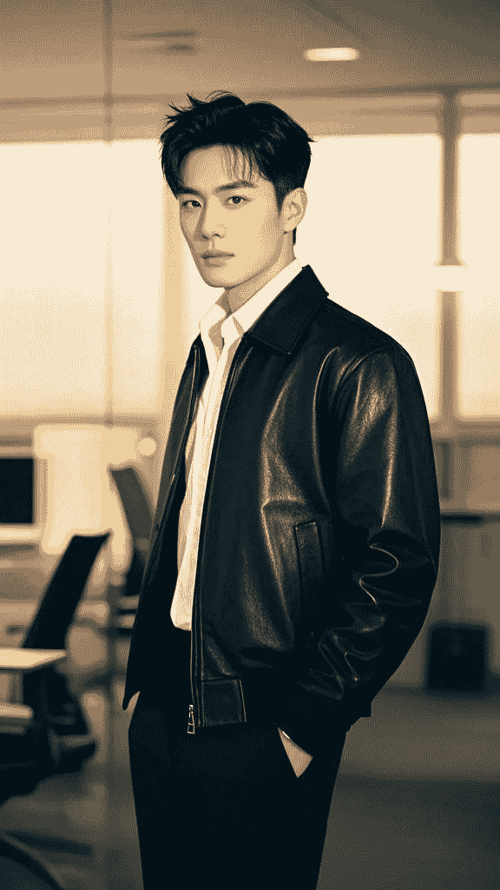 | 图片中的人物变身为3D卡通人 |  | # 主题  通过 3D 渲染过程将图像 1 转变为皮克斯/迪士尼风格的人物。  # 风格  3D渲染  # 要求:  1.详细描述图像 1 中的主体。  2.详细描绘转变过程。  3.详细描绘最终的皮克斯/迪士尼风格的人物，包括超大的眼睛、红润的脸颊、手、腿、动作、面部表情、夸张的头身比例 |  | +   原始提示词：会有一定概率无法变成3D卡通人 |
| 参考生 | 森系动态写真-单人 |  | 女子面向镜头轻盈向前走，步伐坚定而优雅。林间小道上，阳光透过斑驳的树影洒落在她肩头，微风拂过，裙摆轻轻摆动，透着自在与从容，落叶随步伐轻轻翻飞。 |  | # 主题 |  | 原始提示词：对应的视频效果走路效果很奇怪，可能和镜头固定有关系 |

[vidu-video-2678765638315869.mp4](https://internal-api-drive-stream.feishu.cn/space/api/box/stream/download/all/ZQdEbII4Xo7gI7xm6RSchJeQnVc)

[vidu-video-2678829579076562.mp4](https://internal-api-drive-stream.feishu.cn/space/api/box/stream/download/all/XwL4boXJdoPIcNxmADEchY3encd)

[vidu-video-2678953591371606.mp4](https://internal-api-drive-stream.feishu.cn/space/api/box/stream/download/all/A1jsbCOxWoed3axUBh2cxqK3nnh)

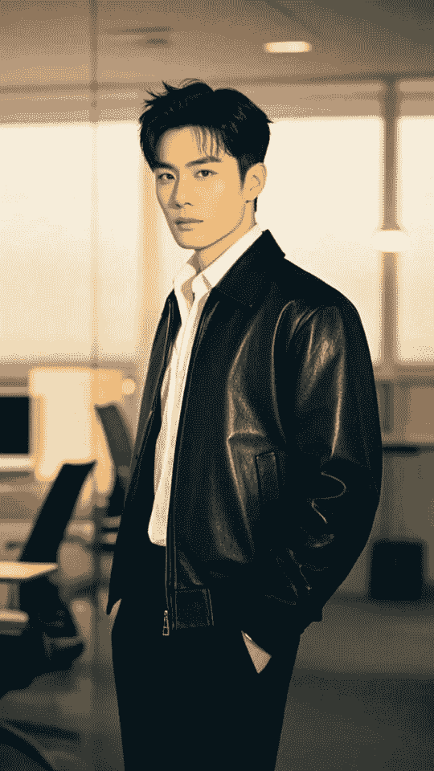

[vidu-video-2678960446375571.mp4](https://internal-api-drive-stream.feishu.cn/space/api/box/stream/download/all/NGENbQTKuo5cXIxFPPpcM3nsnYc)

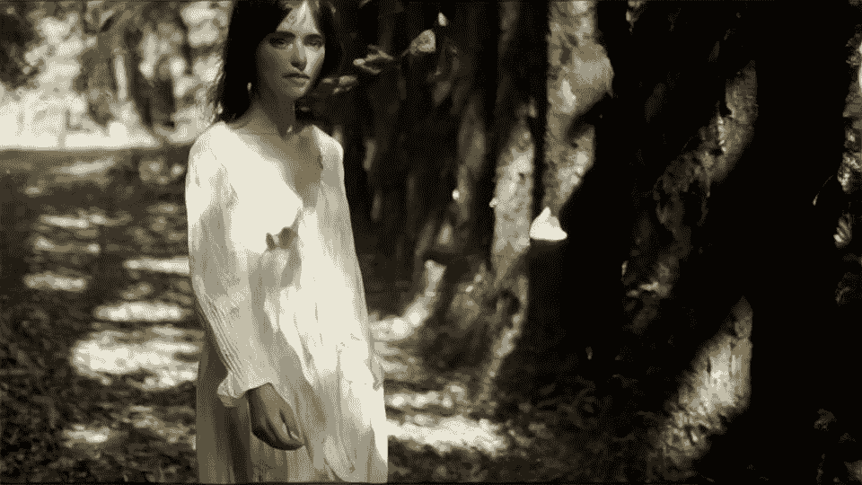

[vidu-video-2678472159641576.mp4](https://internal-api-drive-stream.feishu.cn/space/api/box/stream/download/all/Wys3bawnKoCksSx3afJcqEIEnNd)

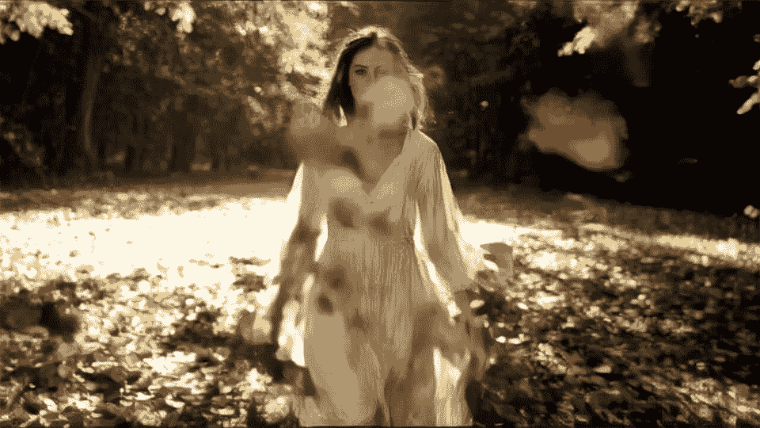

[vidu-video-2678490184380880.mp4](https://internal-api-drive-stream.feishu.cn/space/api/box/stream/download/all/Nq5VbmcBGoSnIHxegYhckBqmnMc)

# 进阶教程

## 1、轻松玩转「主体库」

### 1.1 基础操作指引

| 第一步 | 第二步 | 第三步 | 第四步 | 第五步 | 第六步 | 第七步 |
| --- | --- | --- | --- | --- | --- | --- |
| 1.选择参考生视频 | 2.点击我的主体 | 3.添加我的主体 | 4.上传主体三视图 | 5.确认描述，保存主体 | 6.在创作时，选择主体，或者在提示词框中输入@调取 | 7.编辑提示词，生成视频 |
|  |  | 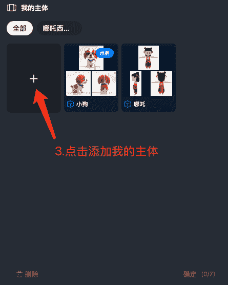 | 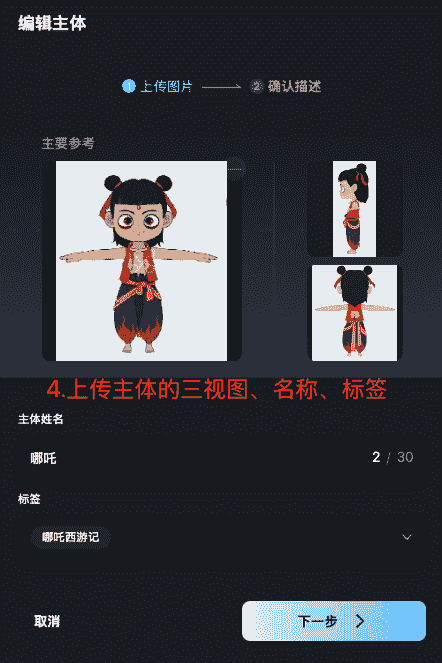 | 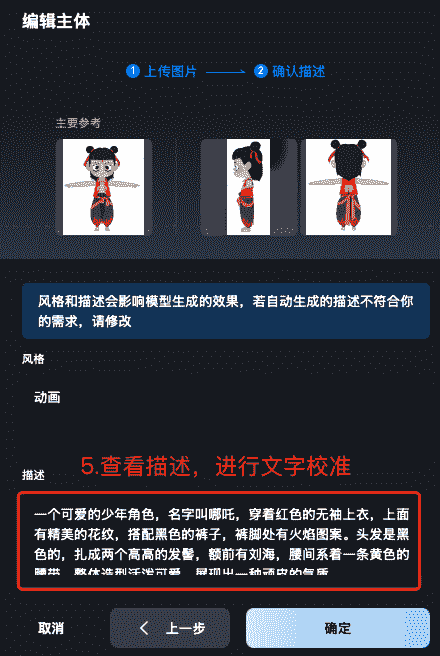 | 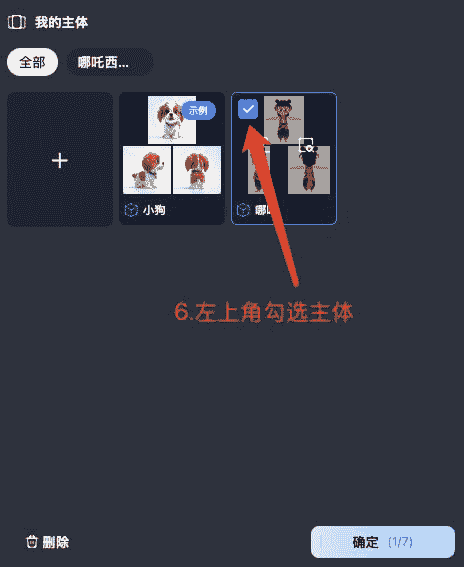 |  |

### 1.2 如何提升主体的一致性？

建立主体核心是 2 步，1 是上传图片，2 是对描述进行确认。图片建议上传三视图（正面、侧面、背面），如果没有，也可上传多角度图片，或者立体感的图片。描述需要仔细查看，对于不符合的地方可修改矫正，提升识别准确性。

### 1.3 提示词中如何使用我的主体？

有 2 种方式，1 是在我的主体中勾选，2 是在提示词输入框中输入@调取。

在提示词撰写中，可以将主体放置在提示词最后面，也可以将主体穿插在提示词中间。

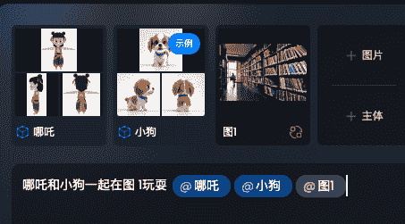

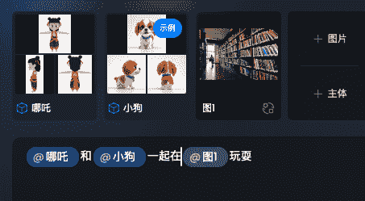

### 1.4 如何提升提示词的可控性？

1.  使用的图片总量**不建议超过 7 张**，**主体总量不超过 4 个**。

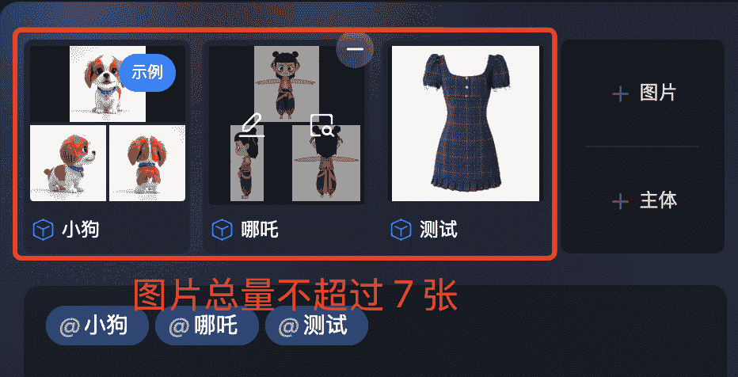

1.  如果发现物体的动作不符合预期，可尝试对主体加特征词，例如扎着丸子头的小男孩@哪吒，带着蓝色脖套的@小狗。

1.  可调整提示词的结构，比如首帧 xxxx，中间帧 xxxx，尾帧 xxxx，或者第 1 秒 xxxx，第2 秒 xxx。

附优质 case

| 提示词 | 哪吒和小狗一起在图 1玩耍 @小狗 @哪吒 @图1 | 俯拍，特写@韩立 的面部，他抬头用震惊的表情看向镜头。镜头拉升，展示渺小的感觉。@图1 |
| --- | --- | --- |
| 视频片段 |  |  |

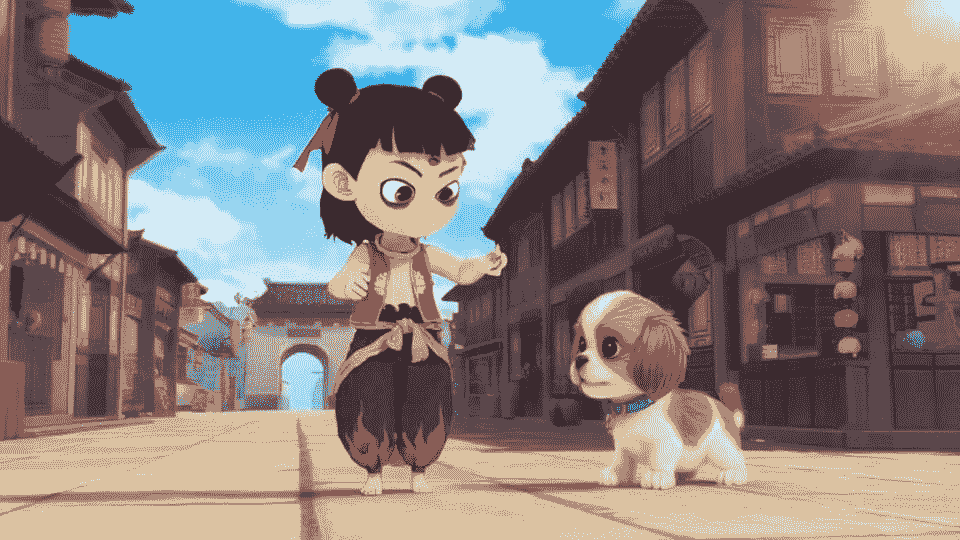

[vidu-video-2696911329885495.mp4](https://internal-api-drive-stream.feishu.cn/space/api/box/stream/download/all/ZpK0bcvVfoRoKNxazAtcnhgYnPe)

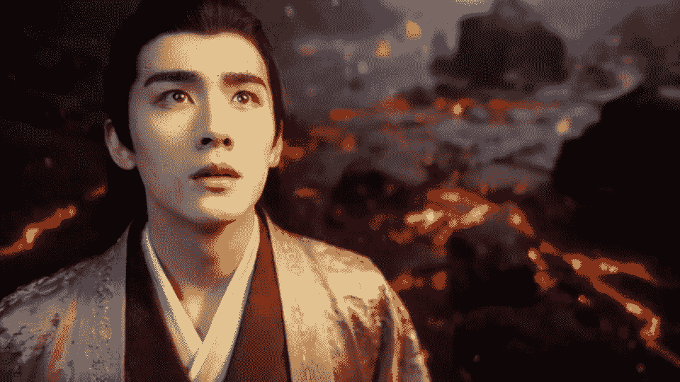

[vidu-video-2690418556027421.mp4](https://internal-api-drive-stream.feishu.cn/space/api/box/stream/download/all/TPEfbP0btopzX5x71hdcVBPEnDx)

## 2、玩转参考生

### 2.1 如何对主体动作进行控制

| 方法 | 三帧法 | 线稿模式 | 墨骨移行 |
| --- | --- | --- | --- |
| 作者 | 花染色 | Eason | 冰皓 |
|  |  |  |  |

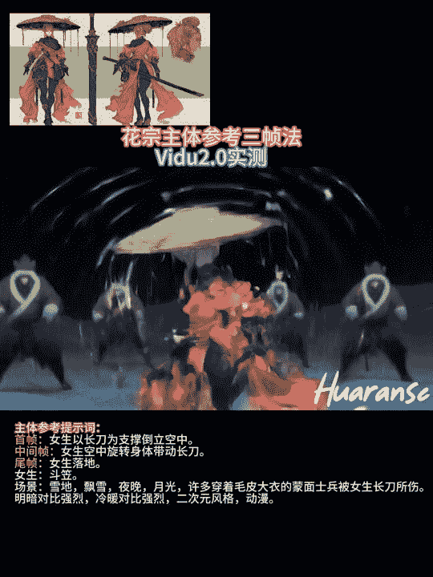

[三帧法.mp4](https://internal-api-drive-stream.feishu.cn/space/api/box/stream/download/all/ZEkWbFn46oZXuRxoqEycf6LEn4X)

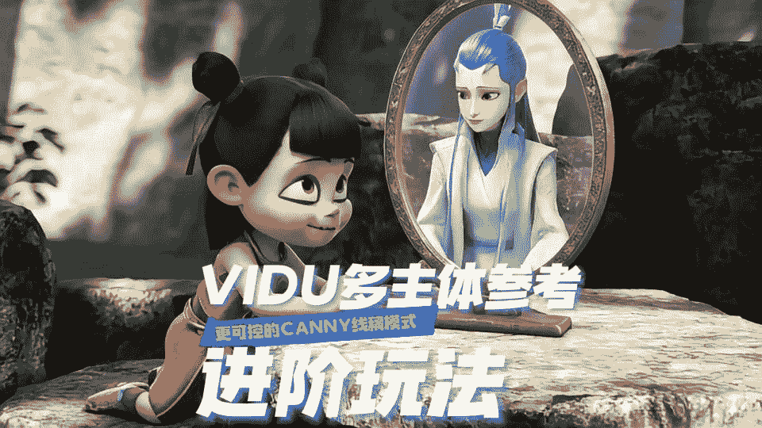

[vidu线稿教程.mp4](https://internal-api-drive-stream.feishu.cn/space/api/box/stream/download/all/D27TbFlmqorNSoxxLuncgMqpnNb)

[墨骨.mp4](https://internal-api-drive-stream.feishu.cn/space/api/box/stream/download/all/M7SHbtXkOo1lb9xY4qRcO7XGn0e)

### 2.2 召唤物的一致性

作者：冰皓

[万象归一.mp4](https://internal-api-drive-stream.feishu.cn/space/api/box/stream/download/all/Ka95biMDAo0j9CxUtpKcC34rnTf)

### 2.3 表情迁移、天气控制

作者：Eason

[vidu表情迁移教程.mp4](https://internal-api-drive-stream.feishu.cn/space/api/box/stream/download/all/TZKebjvCKo2dbcxke8NcTWoanNg)

## 3、💡玩转图生视频

### 3.1 功能介绍

图生视频功能升级！最多支持上传10张图片，最长可生成64s视频！

1.  图生视频创作更灵活，多图上传，转场更多，视频画面更丰富

1.  多图多时长，让创意可一镜到底

1.  多图连续镜头，一镜到底

### 3.2 功能使用方法及示例

+   **使用方法**

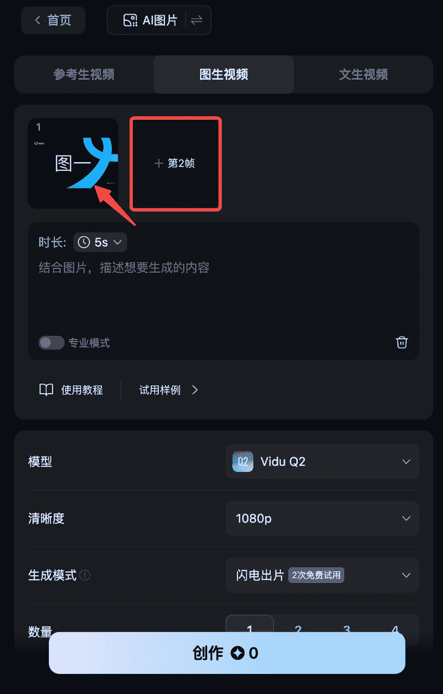

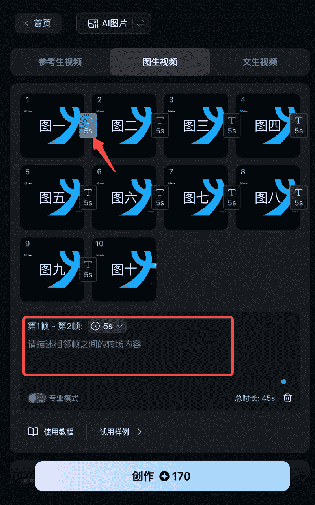

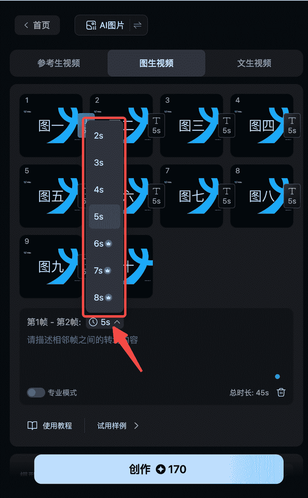

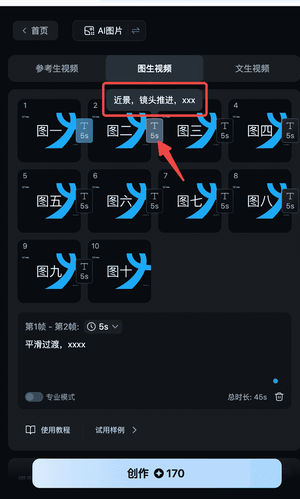

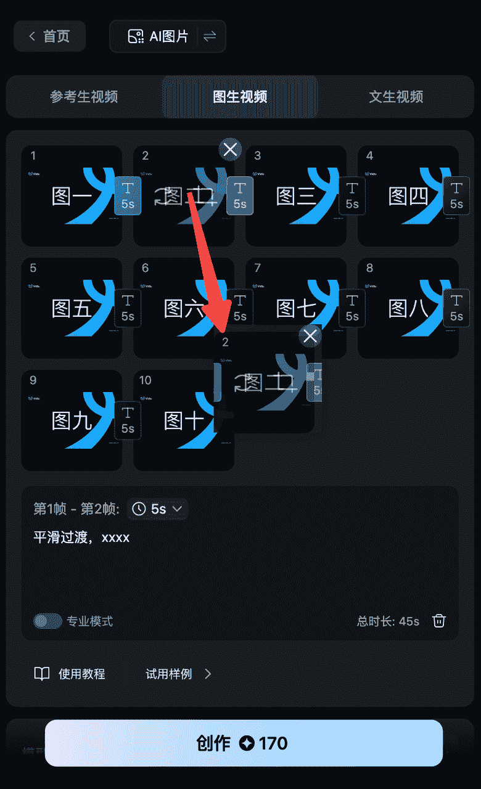

+   **生成效果示例**

| 原始图片 | 提示词 | 视频结果 |
| --- | --- | --- |
|  | 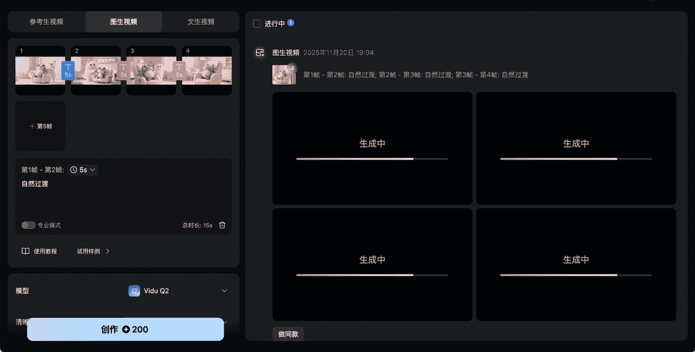 |  |

[vidu图生视频.mp4](https://internal-api-drive-stream.feishu.cn/space/api/box/stream/download/all/BMxSbLh2goAVHIxnhdncAKusnrb)

+   **实战教学** ☞[点击此处查看](https://shengshu.feishu.cn/docx/QV9RdqjNLou1cgxaqdCcO9AVnvd)

## 4、玩转视频延长功能

### 4.1 功能介绍

视频延长功能是对已生成的视频进行延长操作，延长后生成一个新视频。

也可上传尾帧图作为延续后的新视频结尾，在原来的视频上进行延续，生成一个新的视频。

### 4.2功能使用方式及示例

#### 4.2.1 在生成视频后直接延长

选择一条已生成的视频，点击进入视频的工具栏，选择「视频延长」功能（默认选中全部视频）

选择生成视频的全部视频，作为**延长视频的开头**

选择一张图片上传，作为延长视频的尾帧，也可以不上传尾帧图

添加**提示词**prompt，**选择延长时间**秒数1-7s

#### 4.2.2 在生成视频中间选择延长

选择一条已生成的视频，点击进入视频的工具栏，选择「视频延长」功能（默认选中全部视频）

**选择生成视频的**中间部分视频画面（最短选择2s的视频区间），作为延长视频的开头

选择一张图片上传，作为**延长视频的尾帧**

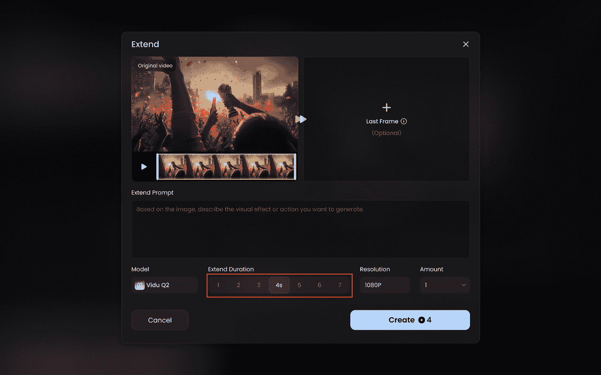

添加**提示词**prompt，**选择延长时间**秒数1-7s

**特别提示：**

1.  **适用范围限定****：视频延长功能**暂时仅支持对 直接生成的清晰度为1080P视频 进行延长操作；进行过【画质增强】后达到1080P的视频，暂时不可使用视频延长功能。

1.  **功能限制**：视频延长后，暂不支持再次执行【画质增强】操作。

1.  **二次创作相关**：延长后的视频暂不支持“做同款”等后续二次创作相关功能。

1.  **使用权限差异**：不同订阅版本可延长的视频时长有所不同，您可根据自身需求选择合适的订阅方案：

**免费用户**

最多可延长至30s ，0积分最多可使用2次频延长功能

**标准版用户**

1min

**专业版用户**

3min

**旗舰版用户**

5min

#### 4.2.3 视频延长功能生成效果示例

| 类型 | 动漫 | 真人 | 真人 |
| --- | --- | --- | --- |
| 输入视频 |  |  |  |
| 延长视频 |  |  |  |

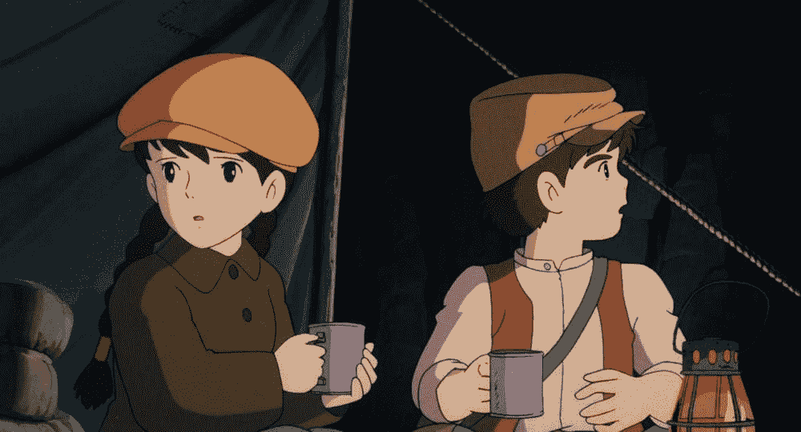

[7ztNv2yUaavNwmpNnysB.mp4](https://internal-api-drive-stream.feishu.cn/space/api/box/stream/download/all/Luqvb17cyoKSczxNwTZcOW4cnh8)

[7006040-uhd_3840_2160_24fps.mp4](https://internal-api-drive-stream.feishu.cn/space/api/box/stream/download/all/IoYNbgvrIo5HXIxKjF4ctbqLnge)

[5119260-hd_1920_1080_25fps.mp4](https://internal-api-drive-stream.feishu.cn/space/api/box/stream/download/all/CSa2bpBa7ooRY1xUKc8czHfDn55)

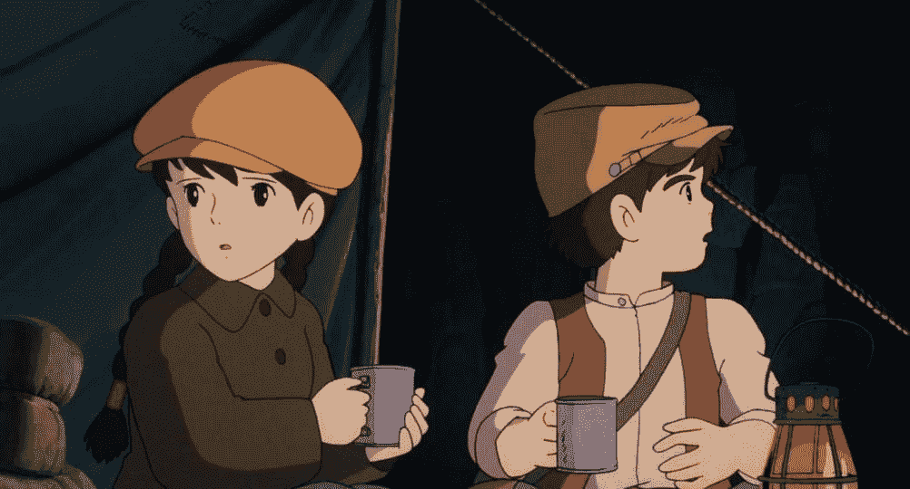

[recuZiQZvHQ6fw_850657.mp4](https://internal-api-drive-stream.feishu.cn/space/api/box/stream/download/all/NU6GbEU4MoVCW0xmuGXc7bYbnng)

> prompt：两个小孩将手中的杯子放下，起身向屋外走去。

[rec1ZHJGdu_481470.mp4](https://internal-api-drive-stream.feishu.cn/space/api/box/stream/download/all/SSVQb579fovnWIxJdwRczVYVnD7)

> prompt：一个女人从屏幕右侧走进来，和这个男人拥抱以示庆祝。

[recJzGEpUO_338675.mp4](https://internal-api-drive-stream.feishu.cn/space/api/box/stream/download/all/Ma0Sbp96Yoq8RGxDS9AcBRENnFh)

> prompt：镜头拉远，更完整呈现男人暴怒的状态，双拳紧握，他处于一个黑暗破旧的地下室。他拿起身旁的凳子狠狠砸向镜头。

## 5、镜头控制

[点击此处查看](https://shengshu.feishu.cn/docx/Dtv8dbnUKo5glfxDoLXcEwzSnyd#share-Bf5JdBQisoa50yxYQDPc8vh5nWd)

## 6、风格控制

[点击此处查看](https://shengshu.feishu.cn/docx/Dtv8dbnUKo5glfxDoLXcEwzSnyd#share-JB1kdEB3goQxqtx9CxLcIOHLndf)

# 产品说明文档

## Vidu Q3

[Vidu Q3（文生/图生）使用指南](https://shengshu.feishu.cn/docx/G07xdT3V1oTNiGxoXwqcG37unVb)

## Vidu Q2 Pro

[Vidu Q2 Pro 使用指南](https://shengshu.feishu.cn/docx/SJrFdMTsmo1cQxxuUX8cqqaXnub)

# 一、参考生介绍

## 1、参考生功能介绍

### 1.1  **复杂主体的精准控制**

无论是细节丰富的角色，还是复杂的物体，Vidu都能保证其在多个不同视角下的一致性。

**示例**

造型复杂的3D动画风格角色，无论视角如何变化，Vidu始终确保头型、服饰的全角度细节一致，避免了传统视频模型在复杂视角切换时产生的瑕疵。

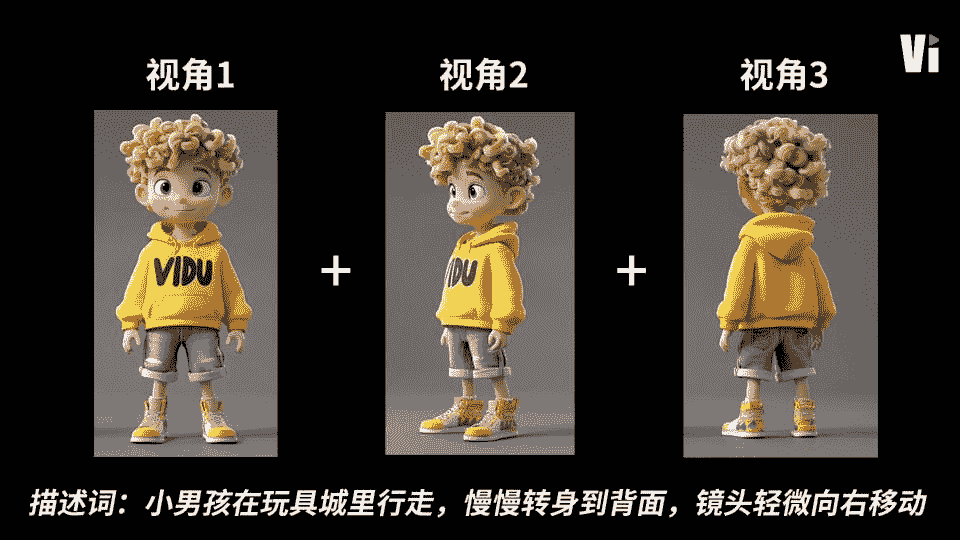

[案例1.mp4](https://internal-api-drive-stream.feishu.cn/space/api/box/stream/download/all/ZvUjbqVhHoP2WQxwU4DcIxRonrg)

### 1.2  人物面部特征和动态表情的自然一致

在人物特写镜头中，Vidu能够自然且流畅地保持人物面部特征和表情的连贯性，避免了面部僵硬或失真的现象。精细的面部控制使Vidu在创作细腻、真实角色时具有显著的优势。

**示例**

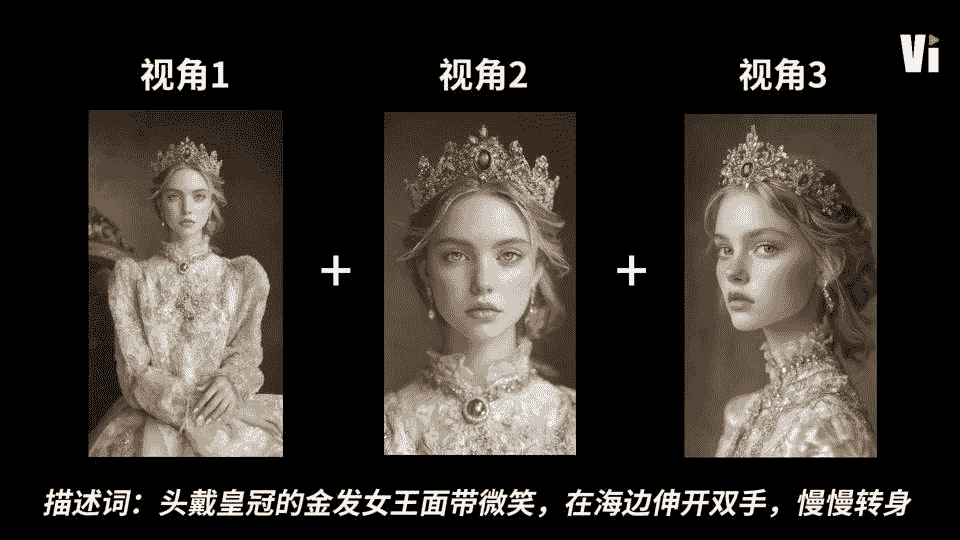

[案例2.mp4](https://internal-api-drive-stream.feishu.cn/space/api/box/stream/download/all/MU7EbrrM5oDx05xYae2c8udOnTe)

### 1.3  **多主体一致性**

Vidu允许用户上传多个主体图像，包括人物角色、道具物体、环境背景等，并在视频生成中实现这些元素的交互。例如，用户可以上传主体、客体和环境的图片，创建定制角色身穿特定服装、在定制空间内自由动作的场景。Vidu还支持多个主体之间的互动，用户可以上传多个自定义角色，让它们在指定空间内进行交互。

此外，Vidu还支持融合不同主体特征，例如将角色A的正面与角色B的反面无缝融合，创造出全新的角色或物体。

[飞书20241113-173737.mp4](https://internal-api-drive-stream.feishu.cn/space/api/box/stream/download/all/O3gPbYfo6owanoxtUVjcl4RXn6z)

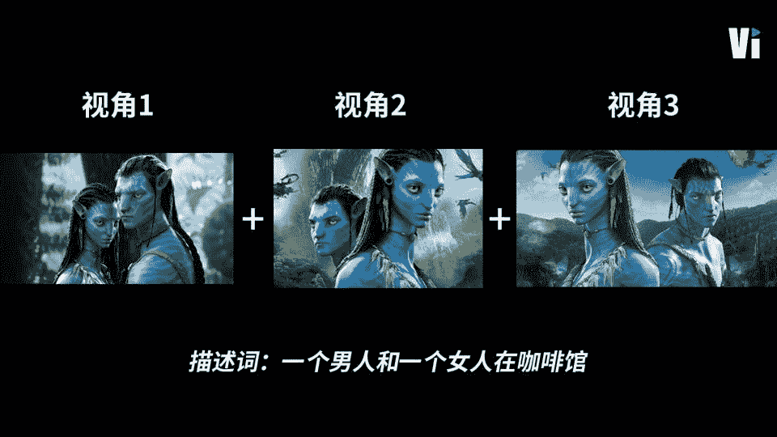

[案例4.mp4](https://internal-api-drive-stream.feishu.cn/space/api/box/stream/download/all/HBiSbSOO6oQ4uax3JF2ci24un3e)

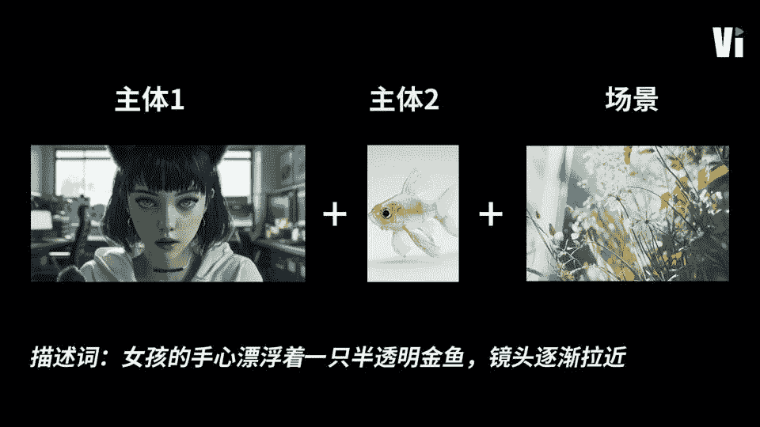

[案例5.mp4](https://internal-api-drive-stream.feishu.cn/space/api/box/stream/download/all/VVT7bTNnIobdcZxeKg3cNdlGnIh)

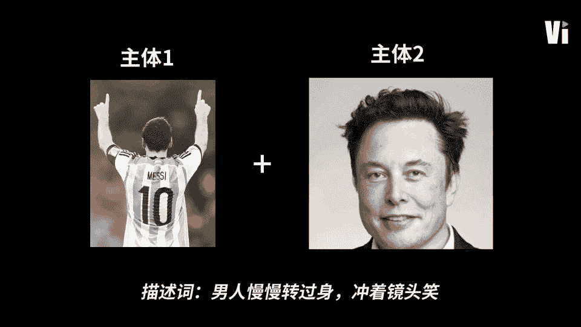

[案例6.mp4](https://internal-api-drive-stream.feishu.cn/space/api/box/stream/download/all/WX7QbYR7uoRiayxETWvcBERunLf)

### 1.4  镜头控制

**通过镜头提示词的使用，可以控制镜头**的运动方式，并可实现两种镜头的组合使用。

| **镜头** | **视频效果** |  |  |  |  |
| --- | --- | --- | --- | --- | --- |
| **镜头组** |  | **单镜头** |  |  |  |
| 推+顺时针旋转 |  | 左移跟踪 |  | 升 |  |
| 拉+逆时针旋转 |  | 右移跟踪 |  | 拉 |  |
| 降+推 |  | 顺时针旋转 |  | 推 |  |
| 升+拉 |  | 逆时针旋转 |  | 固定镜头 |  |

[08ae0d79.mp4](https://internal-api-drive-stream.feishu.cn/space/api/box/stream/download/all/OAyxbYVaiobxj5xThakc74xRnBe)

[39be7d3b.mp4](https://internal-api-drive-stream.feishu.cn/space/api/box/stream/download/all/TEbCbUn3loy3Z5x0h1UcHg6JnEd)

[9f28089f.mp4](https://internal-api-drive-stream.feishu.cn/space/api/box/stream/download/all/Aa7YbDqh8on5FPxWo3IcwzWSnXx)

[31360db8.mp4](https://internal-api-drive-stream.feishu.cn/space/api/box/stream/download/all/CyQ8bwUlno4N4txgLuYc0QhxnTf)

[a4b57db6.mp4](https://internal-api-drive-stream.feishu.cn/space/api/box/stream/download/all/XiDnbzgIIon0kbxbrwtctEdDnZb)

[12d5bac7.mp4](https://internal-api-drive-stream.feishu.cn/space/api/box/stream/download/all/GC4kbrrg6ofl7exHju6cAiAsnDh)

[fd451a72.mp4](https://internal-api-drive-stream.feishu.cn/space/api/box/stream/download/all/AP9GbmOPqoPFI6xKPd1c088Fnbf)

[32a4b903.mp4](https://internal-api-drive-stream.feishu.cn/space/api/box/stream/download/all/NZB5bdfulorgtqxnJxecYbQInfc)

[fee304bf.mp4](https://internal-api-drive-stream.feishu.cn/space/api/box/stream/download/all/BG0eb6fQMo0NJqxIl08clJk0nQc)

[8186f638.mp4](https://internal-api-drive-stream.feishu.cn/space/api/box/stream/download/all/PvFsbHi16oPoyKxil9dceQOVnCe)

[ba9ec775.mp4](https://internal-api-drive-stream.feishu.cn/space/api/box/stream/download/all/OLa2bX4w4otjUJxcJMDc9LmRnib)

[444a27fb.mp4](https://internal-api-drive-stream.feishu.cn/space/api/box/stream/download/all/ShRfbgAOioyrpNxM5qMcGZFmnAd)

# 二、Vidu Prompt 基本构成

## 1、提示词基础架构

> **主体/场景**——**场景描述**——**环境描述**——**艺术风格/媒介**

+   调整句式和语序，避免主体物过多/复杂，主体物分散的句式描述；

+   避免模糊的术语表达，尽可能准确；

+   使用更加流畅准确的口语化措辞，避免过度文学化的叙述；

+   丰富、准确和完整的描述才能生成特定艺术风格、满足需求的视频。

## 2、提示词与画面**联想程度**的说明

为了帮助你更好的地理解，让我们使用单帧图像作为最简单的例子，来向您介绍提示词与画面联想的关系。

示例图如下：

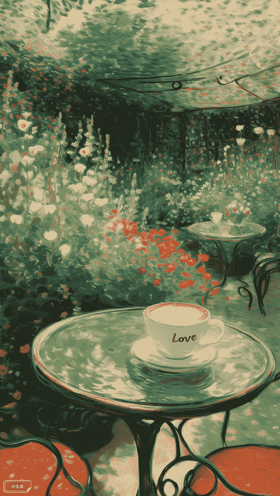

+   **基础词**：玻璃桌上的咖啡杯，杯子外面写着单词 LOVE。

+   **适度联想扩充：**花园里（具体的位置描述）的透明（材质描述）**玻****璃桌上的**咖啡杯，杯子外面写着单词 LOVE，周围满是盛开的鲜花（具体的位置描述/环境描述），和煦的阳光洒满整个花园（环境描述），Claude Monet（艺术家风格），印象派风格（艺术流派风格）。

+   **联想关键点：**

1.  具体详实的位置描述/环境描述：笼统来讲就是在进行构图，可以帮助构建画面的基本呈现效果；

1.  艺术风格描述：进一步提升效果和氛围，统一画面风格。

## 3、效果示例

### 3.1 概述

当提示词遵循**主体/场景（主要指具体内容）**，**场景描述**，**环境描述**和**艺术风格/媒介**的基本结构时，可以在一定程度上提升视频生成效果。

在提示词的不同位置**重复和强化关键内容**的风格描述，可以适度提高输出风格的一致性和画面丰富程度。

### 3.2  具体示例

**以“柯基犬游泳”为例**

[a94bc656_fi.mp4](https://internal-api-drive-stream.feishu.cn/space/api/box/stream/download/all/OVLAbbPz5oxL06xRPS4cJ0JbnHe)

Capture a serene moment featuring a baby Corgi swimming gracefully in a large, sunlit pool. The underwater perspective showcases the puppy, its gentle smile illuminated by soft, golden hour lighting that filters through the water, creating a dance of light and shadow on the pool's bottom. The scene is set in soft pastel colors, enhancing the dreamlike, ethereal quality of the atmosphere. The high-resolution photography captures every delicate detail of the water's texture and the Corgi's joyful expression, creating a simple yet cinematic portrait of tranquility and innocence. This minimalist yet emotive setup conveys a sense of calm and happiness, ideal for a serene and visually captivating film sequence.

捕捉柯基犬宝宝在阳光照耀下的大泳池中优雅游泳的宁静时刻。水下的视角展现了小狗温柔的笑容，柔和的金色灯光穿过水面，在池底形成光影的舞动。场景以柔和的粉色为主色调，烘托出梦幻般的空灵氛围。高分辨率的摄影作品捕捉到了水的纹理和柯基犬欢快表情的每一个精致细节，创造出一幅简单而又充满电影感的宁静和纯真的肖像。这种简约而富有情感的设置传达出一种平静和幸福的感觉，是宁静而具有视觉吸引力的电影镜头的理想选择。

### 3.3  提示词分析

[71cbe2f0_fi.mp4](https://internal-api-drive-stream.feishu.cn/space/api/box/stream/download/all/ZOq6bMvBcoCh6zxfEsLc9fP5nph)

**原始提示词：**A baby corgi swims in a large pool

[a94bc656_fi.mp4](https://internal-api-drive-stream.feishu.cn/space/api/box/stream/download/all/IbR8bJHkio7PgjxuDK0cREmEnQh)

**联想提示词：**Capture a serene moment featuring a baby Corgi swimming gracefully in a large, sunlit pool. The underwater perspective showcases the puppy, its gentle smile illuminated by soft, golden hour lighting that filters through the water, creating a dance of light and shadow on the pool's bottom. The scene is set in soft pastel colors, enhancing the dreamlike, ethereal quality of the atmosphere. The high-resolution photography captures every delicate detail of the water's texture and the Corgi's joyful expression, creating a simple yet cinematic portrait of tranquility and innocence. This minimalist yet emotive setup conveys a sense of calm and happiness, ideal for a serene and visually captivating film sequence.

#### 3.3.1  “柯基犬游泳”视频生成需求

+   温馨宁静的氛围

+   电影画面及质感

+   柔和的光影效果

> 基于上述的视频生成需求，按照提示词基本架构进行调整和优化，在基本的框架下对主体/场景（“柯基犬游泳）进行扩写，重点在于营造视频整体温馨纯真的电影视觉效果。

> 同时，为了强化效果和氛围的一致性，需要对整体氛围进行多次强调和细化，在提示词的不同位置也可以适度强调氛围提示词内容。

>

> 注**：**氛围提示词，可以重复进行强调和细化。如“柯基犬游泳”的提示词所示，为了整体温馨宁静的氛围，提示词内多次出现温柔、柔和、优雅、宁静等符合整体氛围的不同氛围词，以此强化整体的氛围效果。

#### 3.3.2  “柯基犬游泳”视频提示词架构

# 三、Vidu Prompt 关键词

**以“Teddy bear/泰迪熊”为主角进行风格化的效果演示，通过关键**词的使用，帮助实现多种电影风格以及拍摄方式的呈现，更好地完成个人的视频生成需求。

[116b86c5_fi.mp4](https://internal-api-drive-stream.feishu.cn/space/api/box/stream/download/all/T7r9bstn0oM2zLxQgtAcBZEsnNd)

**基础提示词：**A melancholic teddy bear, dressed in rugged attire with a wide-brimmed hat and a bandolier, gazes at the camera, its lips trembling slightly as it exhales a puff of smoke. The warm glow of its cigarette illuminates its face, casting shadows that emphasize its somber mood. Its paws rest on the porch railing in a relaxed pose, but its button eyes betray a deeper sadness. As it slowly turns its head to the left, its gaze shifts to the distant horizon, lost in thought. The lighting is low, with cool blue tones contrasting the warm light from the cigarette, enhancing the mood of quiet reflection. The setting, a porch with wooden panels and a window behind it, completes the Western ambiance, capturing a moment of introspective solitude amidst the vast, open landscape.

[3273b954_fi.mp4](https://internal-api-drive-stream.feishu.cn/space/api/box/stream/download/all/RRvcbt3SqocDSCxHDA5c8G6In3c)

**风格化提示词：****In classical romantic movie**** s**tyle（电影风格/拍摄方式/媒介）, a melancholic teddy bear, dressed in rugged Western attire with a wide-brimmed hat and a bandolier, gazes at the camera, its lips trembling slightly as it exhales a puff of smoke. The warm glow of its cigarette illuminates its face, casting shadows that emphasize its somber mood. Its paws rest on the porch railing in a relaxed pose, but its button eyes betray a deeper sadness. As it slowly turns its head to the left, its gaze shifts to the distant horizon, lost in thought. The lighting is soft, with a blend of pink and golden hues from a setting sun, enhancing a romantic atmosphere. The setting, a porch with wooden panels and a window behind it, completes the Western ambiance, capturing a moment of introspective solitude amidst the vast, open landscape.

## 1、电影风格

| **keyword** | **Output** |
| --- | --- |
| **基础风格** |  |
| **科幻 ** |  |
| **西部** |  |
| **浪漫** |  |
| **犯罪 ** |  |
| **恐怖 ** |  |
| **黑色** |  |
| **喜剧 ** |  |
| **剧情** |  |
| **动作** |  |
| **纪录片 ** |  |
| **动画** |  |

[116b86c5_fi.mp4](https://internal-api-drive-stream.feishu.cn/space/api/box/stream/download/all/Uw2ObH2XSoE1t5xOXZWcuKuAnld)

[746ebe3e_fi.mp4](https://internal-api-drive-stream.feishu.cn/space/api/box/stream/download/all/V9ohbBrYqor0XyxygLBc9a3gn8d)

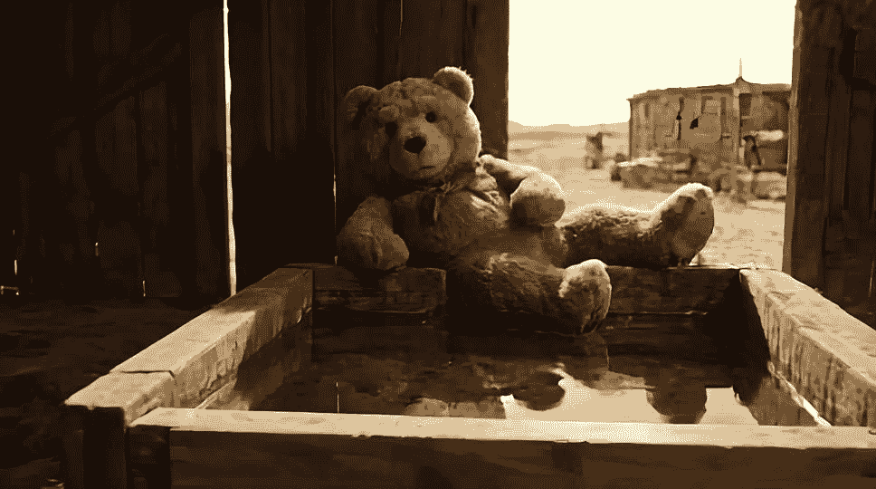

[b2a64add_fi.mp4](https://internal-api-drive-stream.feishu.cn/space/api/box/stream/download/all/K0GiboLqjoi2fZxMqmQcxGSBnTg)

[3273b954_fi.mp4](https://internal-api-drive-stream.feishu.cn/space/api/box/stream/download/all/Hv7bbGPtfoO3Gixgch1c5HSKn8c)

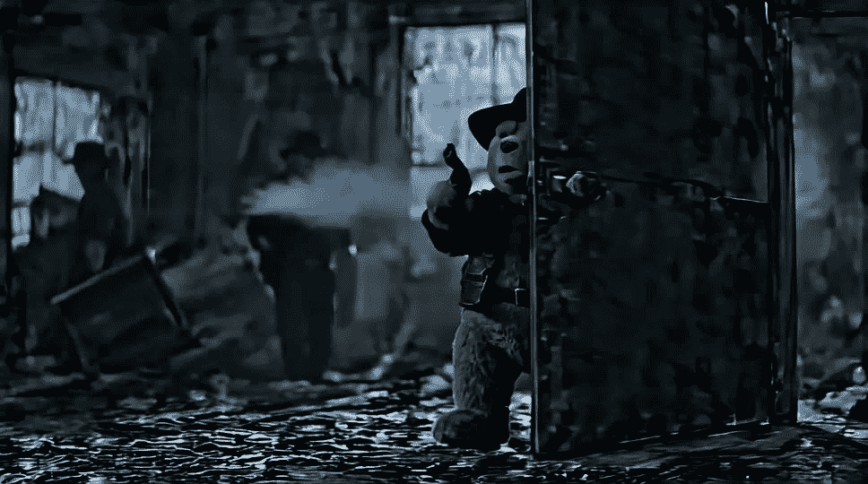

[crime_1080.mp4](https://internal-api-drive-stream.feishu.cn/space/api/box/stream/download/all/VNBbbWyhRoNElSxABvYcwAhgnyO)

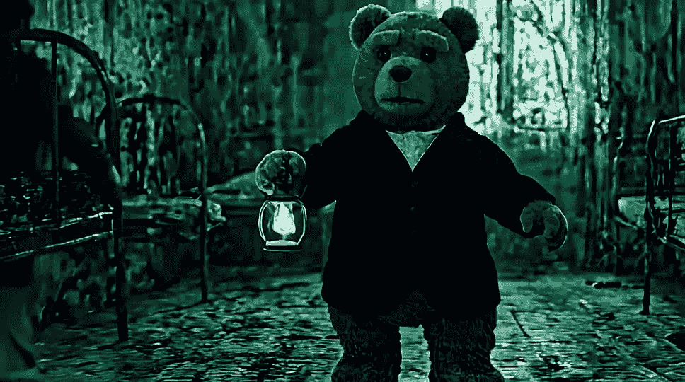

[4ad7fc28_fi.mp4](https://internal-api-drive-stream.feishu.cn/space/api/box/stream/download/all/XsgQbFdaOo71l4xUqACc1G3Kndh)

[64f4f2ea_fi.mp4](https://internal-api-drive-stream.feishu.cn/space/api/box/stream/download/all/HNl3bbbTfo7W40xBFw7c7EcNnmh)

[39c75bc9_fi.mp4](https://internal-api-drive-stream.feishu.cn/space/api/box/stream/download/all/XZtfbKulgoatFLxQrk2cFsZjn7c)

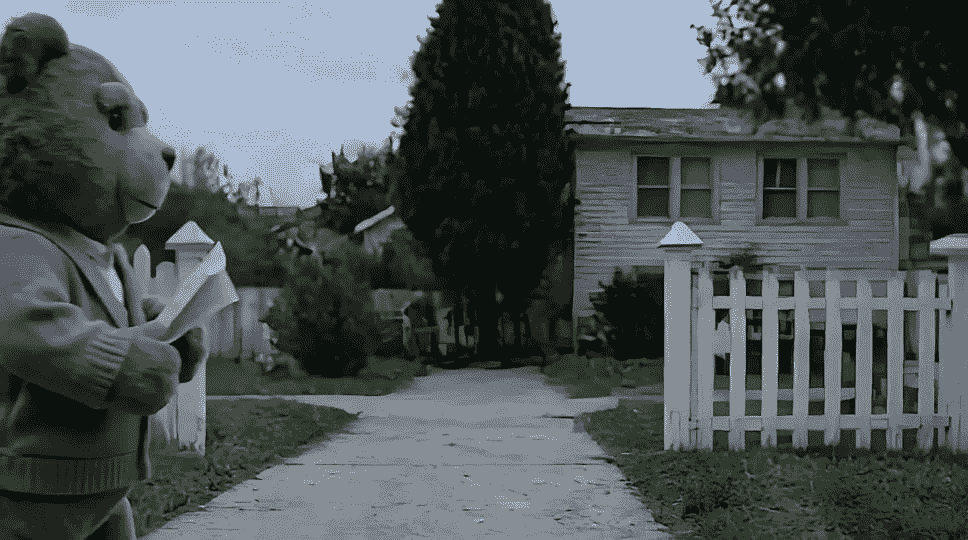

[04998c1e_fi.mp4](https://internal-api-drive-stream.feishu.cn/space/api/box/stream/download/all/X3vVbfEEIoU3LmxqatkcBCYwnRf)

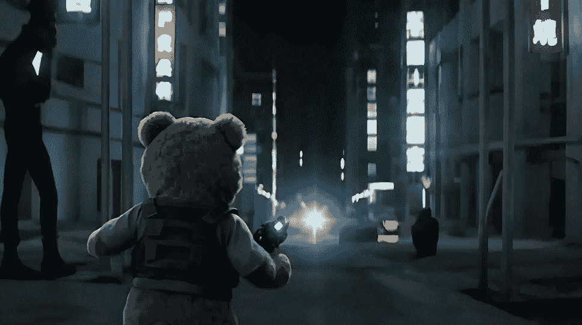

[8398b7e6_fi.mp4](https://internal-api-drive-stream.feishu.cn/space/api/box/stream/download/all/H025bMx9aov2T4xDXpTcE9PZnOh)

[48a7828c_fi.mp4](https://internal-api-drive-stream.feishu.cn/space/api/box/stream/download/all/Ps7tbYUccowZqcxAxV2crUIKn8f)

[6c706dfc_fi.mp4](https://internal-api-drive-stream.feishu.cn/space/api/box/stream/download/all/FlfGbvvVQo2YndxwPRAcbZ8Intc)

## 2、视觉艺术风格

| **keyword** | **Output** |
| --- | --- |
| 艺术家/艺术作品 (Artist/Artwork) |  |
| **波普艺术** |  |
| 蒸汽朋克 （Steampunk） |  |
| 粘土动画 （Claymation） |  |
| **冰雕 ** |  |

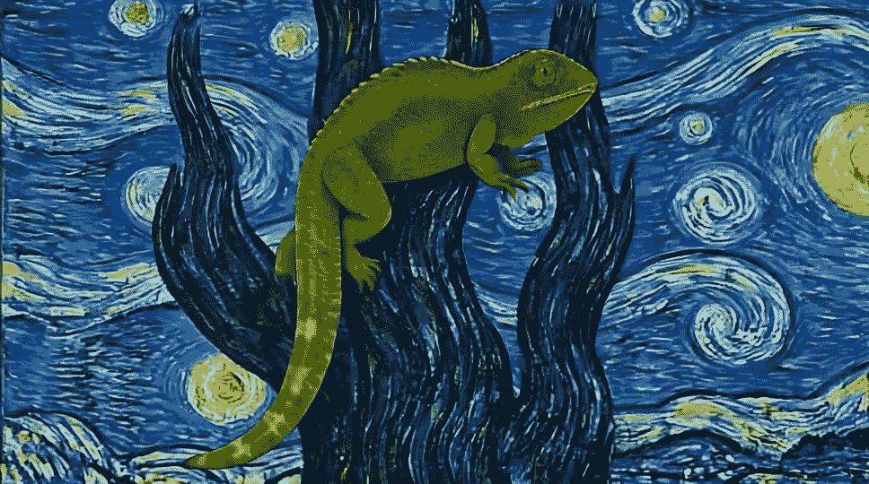

[44dd2d6c_fi.mp4](https://internal-api-drive-stream.feishu.cn/space/api/box/stream/download/all/BN3bbHOT8oPNikx2esxcaKpSn9g)

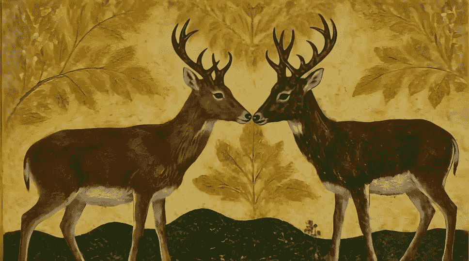

[6f5a789d_fi.mp4](https://internal-api-drive-stream.feishu.cn/space/api/box/stream/download/all/TzBPbd1Dwo1zsdxu31ucS9n5noe)

[fedc6d1a_fi.mp4](https://internal-api-drive-stream.feishu.cn/space/api/box/stream/download/all/KfA9bcS6son6ctxoTEYcPnshn1e)

[48e02ab3_fi.mp4](https://internal-api-drive-stream.feishu.cn/space/api/box/stream/download/all/QlLEbZE6ho9ku2xCwmfcLipQnSe)

[664ffe9f_fi.mp4](https://internal-api-drive-stream.feishu.cn/space/api/box/stream/download/all/G2AjbMLTYogUn1xJ5OScwrKMn8b)

[5c9c167e_fi.mp4](https://internal-api-drive-stream.feishu.cn/space/api/box/stream/download/all/DtXcbUk4moK04RxUJe4cTOnsnUg)

[6e652e54_fi.mp4](https://internal-api-drive-stream.feishu.cn/space/api/box/stream/download/all/Pu1Rbi5gboCqmhxmsaZc6CBInKg)

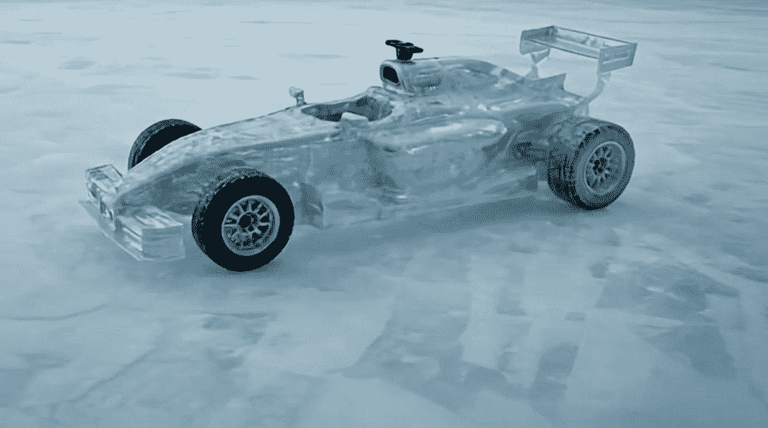

[2bcc9463.mp4](https://internal-api-drive-stream.feishu.cn/space/api/box/stream/download/all/NOhcbcAsXoHOVdxmieScpy30nze)

## 3、拍摄及动作方式

| **keyword** | **Output** | **备注** |
| --- | --- | --- |
| **延时** |  |  |
| **水下摄影** |  |  |
| **第一人称视角 ** |  | 以下建议使用Recaption功能 |
| **俯视** |  |  |
| **手持** |  |  |
| **特写** |  |  |
| **生长** |  |  |
| **爆炸** |  |  |
| **粉碎** |  |  |

[848fa11a.mp4](https://internal-api-drive-stream.feishu.cn/space/api/box/stream/download/all/KBBibcmuEoUbqqxobcqcVCQTnAh)

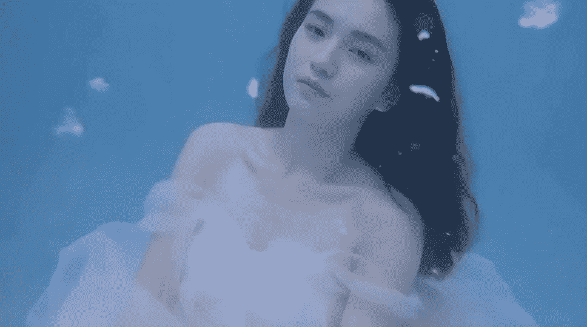

[2203e047_fi.mp4](https://internal-api-drive-stream.feishu.cn/space/api/box/stream/download/all/ZaUIbwPdtoeY4Ix6IqtcW4Ymnpc)

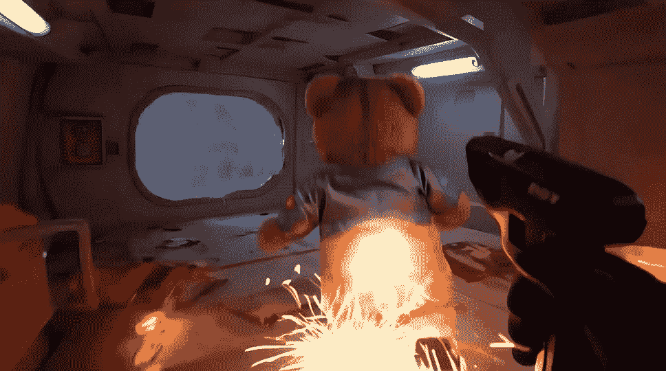

[cf5e730f_fi_sr.mp4](https://internal-api-drive-stream.feishu.cn/space/api/box/stream/download/all/W1fxb8qZ5oIQk7xYIhWcfeLLnlc)

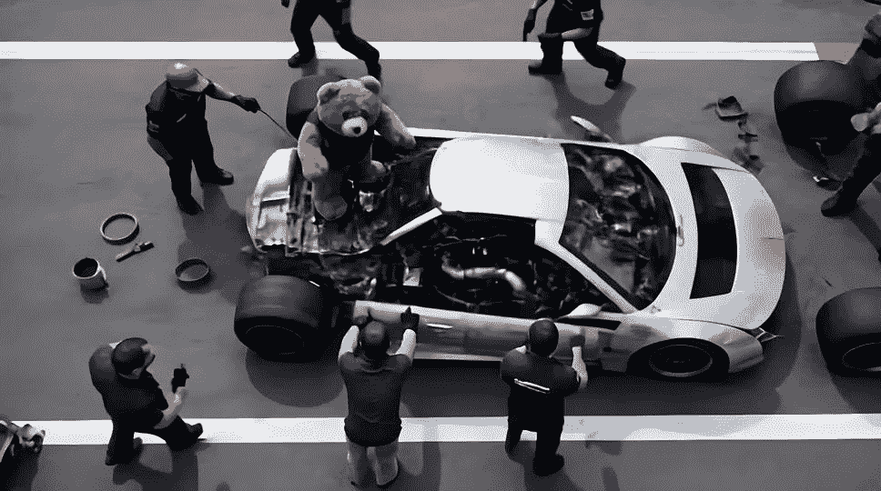

[019121ae_fi_sr.mp4](https://internal-api-drive-stream.feishu.cn/space/api/box/stream/download/all/NyyOb2sKyooormxscBUcdN1Xnvd)

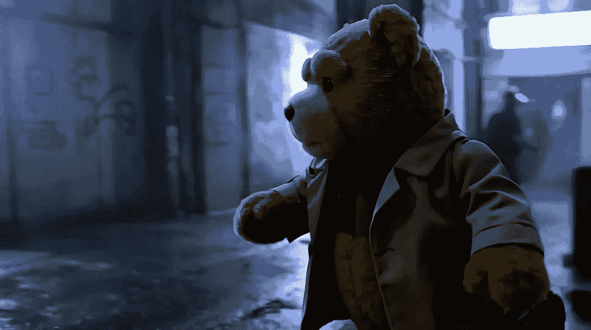

[3b53cae3_fi.mp4](https://internal-api-drive-stream.feishu.cn/space/api/box/stream/download/all/Z6EcbQNJ4oMdoax1Bukc5Uh7nRc)

[615c6fe4_fi_sr.mp4](https://internal-api-drive-stream.feishu.cn/space/api/box/stream/download/all/QZpBbCXq4ou32ixXouIceaoinfD)

[6f23d6e0_fi.mp4](https://internal-api-drive-stream.feishu.cn/space/api/box/stream/download/all/O8uZbho93ohV3hxsdUwciS65n0g)

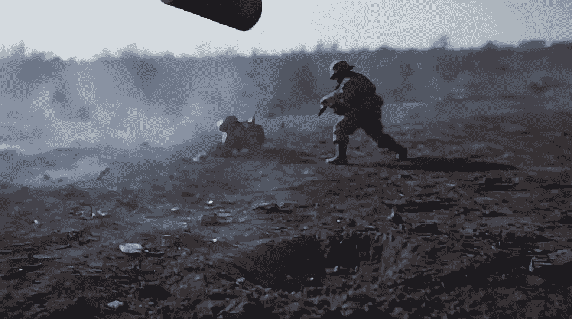

[19c297cf_fi.mp4](https://internal-api-drive-stream.feishu.cn/space/api/box/stream/download/all/Ai80bkR7To9z5ixF2occkyB9nyz)

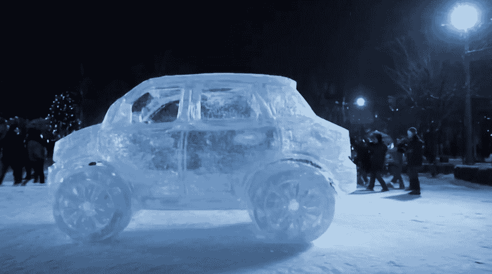

[b4013127_fi.mp4](https://internal-api-drive-stream.feishu.cn/space/api/box/stream/download/all/RCEKbBgcHoUwQVxhHDAcobPLngf)

##

## 4、文字特效

| **视频效果** | **原始图** | **关键点** |
| --- | --- | --- |
|  |  |  |
|  |  | 特效：镜头推进 |
|  |  |  |

[04d9d67f_fi_sr.mp4](https://internal-api-drive-stream.feishu.cn/space/api/box/stream/download/all/Ry9ab13qkoNsOUxuqb0cUT98nyb)

[c62d26f8 (1).mp4](https://internal-api-drive-stream.feishu.cn/space/api/box/stream/download/all/UPbEbJ8ZYoxnFRxDIurc8gD0nvc)

[94612b42_fi_sr.mp4](https://internal-api-drive-stream.feishu.cn/space/api/box/stream/download/all/GgrbbMSA7ohhgcxKyvLc0u1Injh)

[837e9780_fi_sr.mp4](https://internal-api-drive-stream.feishu.cn/space/api/box/stream/download/all/FTLubGgdLojCM7xEZj5cgsRxnQd)

[ed00e7dc_fi_sr.mp4](https://internal-api-drive-stream.feishu.cn/space/api/box/stream/download/all/KHhmbIxuOoajDVxtk1gch7YnnFd)

[3be4dd7a_fi_sr.mp4](https://internal-api-drive-stream.feishu.cn/space/api/box/stream/download/all/FQPAbwMENoLin2xiqnkc0FQ7nhF)

[d07fb7fc_fi_sr.mp4](https://internal-api-drive-stream.feishu.cn/space/api/box/stream/download/all/D4SFbYMmLoTSEsxK8RBcOD3ynkE)

# 四、风格化效果示例

## 1、**文生视频**

| **序号** | **视频效果** | **关键点** |
| --- | --- | --- |
| **1** |  | **基础风格：** |
|  |  | **风格升级：** |
| **2** |  | **基础风格：** |
|  |  | **风格升级：** |
| **3** |  | **基础风格：** |
|  |  | **风格升级：** |
| **4** |  | **基础风格：** |
|  |  | **风格升级（1）：** |
|  |  | **风格升级（2）：** |
| **5** |  | **基础风格：** |
| **6** |  | **基础风格：** |
| **7** |  | **基础风格：** |

[file_v3_00ct_3199764e-7859-4fc3-b600-b5381c5b14fg.mp4](https://internal-api-drive-stream.feishu.cn/space/api/box/stream/download/all/H7kDbGdV0oR5FrxbFSbc0r7Hnod)

[76003bde_fi_sr.mp4](https://internal-api-drive-stream.feishu.cn/space/api/box/stream/download/all/PpXKbdP9Nonho9xLVKDc7qsdnud)

[c9d532d4_fi_sr.mp4](https://internal-api-drive-stream.feishu.cn/space/api/box/stream/download/all/LD8SbCqAeoYsSfxHQhNcAyNtn9e)

[61e93ef3_fi_sr.mp4](https://internal-api-drive-stream.feishu.cn/space/api/box/stream/download/all/PNAwbnX4ao9FJ7xkuusciqWNnhg)

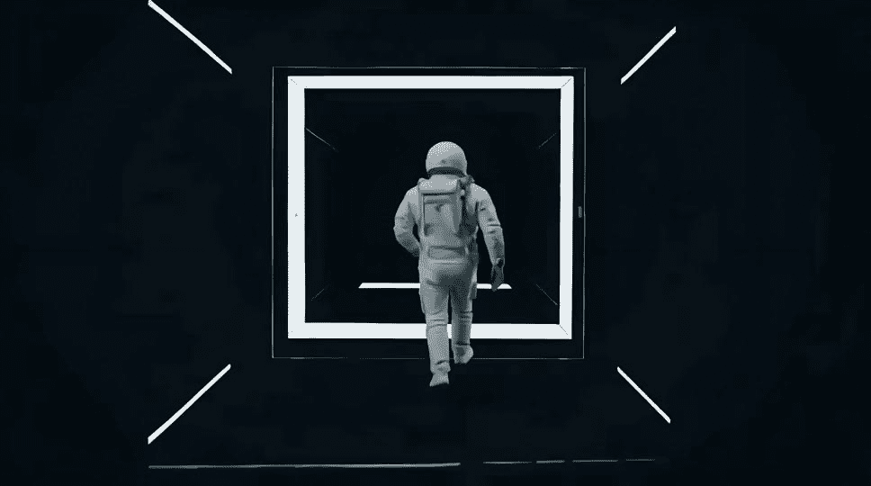

[0859253b_fi_sr.mp4](https://internal-api-drive-stream.feishu.cn/space/api/box/stream/download/all/CLW7bN53AolHKMxKd4KcFX4tnDe)

[92d35756_fi_sr (1).mp4](https://internal-api-drive-stream.feishu.cn/space/api/box/stream/download/all/XoQ6b66GmokuapxZ3oNc1Fr4n0c)

[a5ce6066_fi_sr.mp4](https://internal-api-drive-stream.feishu.cn/space/api/box/stream/download/all/NZh6b6MWVonf0bxctsfcivaqn8d)

[eaa5bfd4_fi_sr.mp4](https://internal-api-drive-stream.feishu.cn/space/api/box/stream/download/all/Jaw7bysHyoQPUvx1KH0cNt1Wntc)

[1954f318_fi_sr.mp4](https://internal-api-drive-stream.feishu.cn/space/api/box/stream/download/all/Do8cbkULZoRBgcxVD3acmOQKnCV)

[d3f5d983_fi_sr.mp4](https://internal-api-drive-stream.feishu.cn/space/api/box/stream/download/all/VclMbRvtooE6UUxyWGscpWpxnBb)

[8dec395f_fi_sr.mp4](https://internal-api-drive-stream.feishu.cn/space/api/box/stream/download/all/JaPpbqFhDoJREoxHgZ4cWt6Nngd)

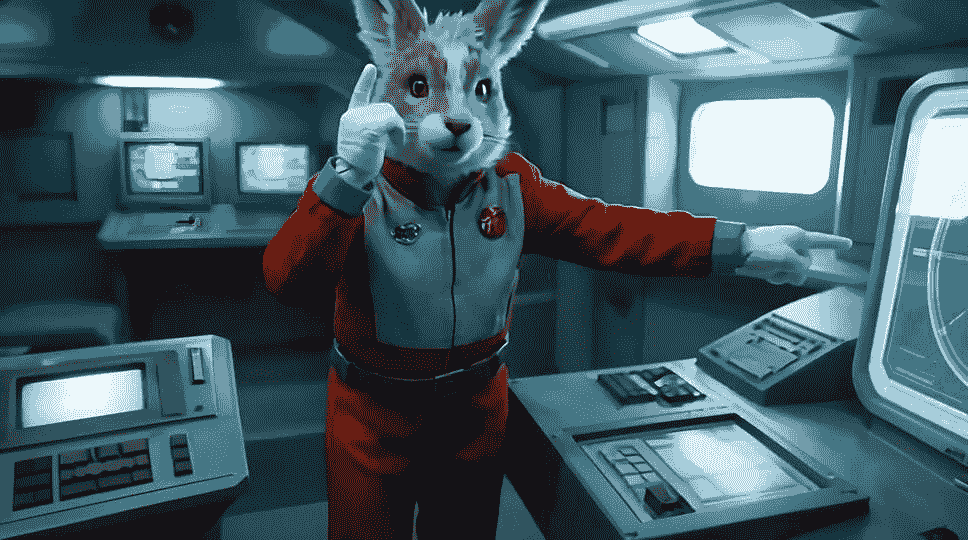

[13f050d2_fi_sr.mp4](https://internal-api-drive-stream.feishu.cn/space/api/box/stream/download/all/Vfjlb0BkHo7vvRxuOe1ctKuJn2e)

[674d4c87_fi_sr.mp4](https://internal-api-drive-stream.feishu.cn/space/api/box/stream/download/all/Lu9nbT0eeom7ghxcvLPczHnSn7e)

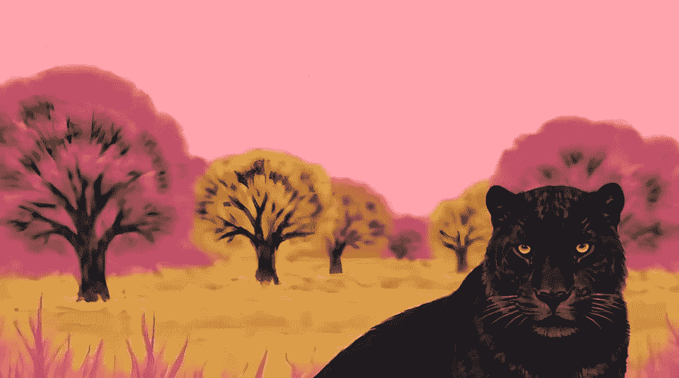

[1c1a6974_fi_sr.mp4](https://internal-api-drive-stream.feishu.cn/space/api/box/stream/download/all/OslEbz0yyovFwDxJViXcb0mxn1l)

## 2、**图生视频**

符合场景/氛围的适度/合理的变化和联想

| **序号** | **视频效果** | **原始图** | **关键点** |
| --- | --- | --- | --- |
|  |  |  | 符合画面的动作延续 |
|  |  | 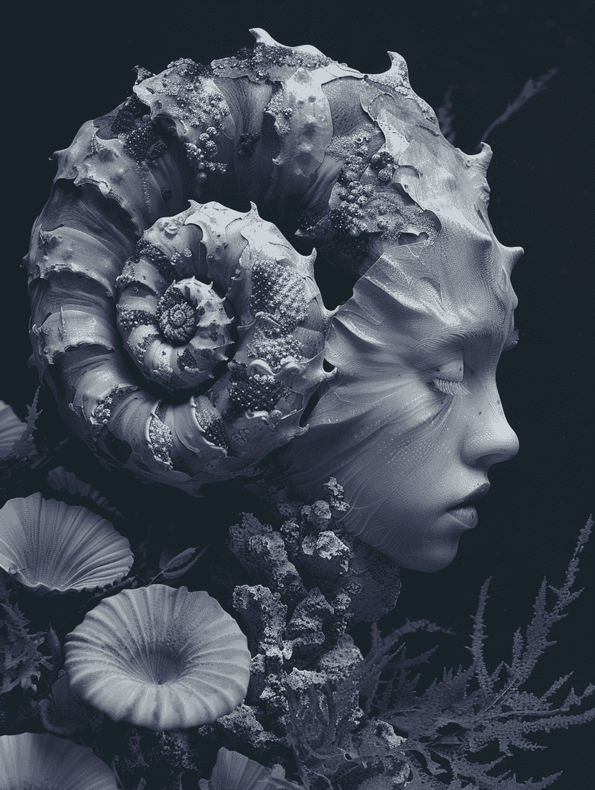 | 符合画面氛围的场景效果 |
|  |  | 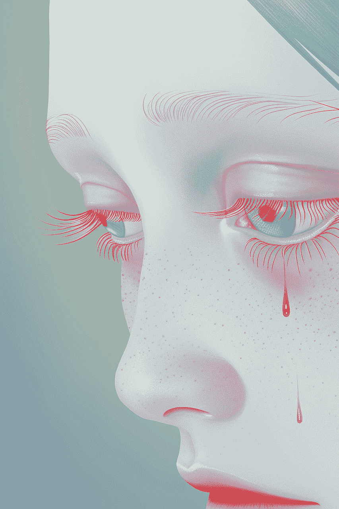 | 符合画面氛围的情绪表达 |
|  |  |  | 符合画面氛围的电影氛围、拍摄方式 |
|  |  | 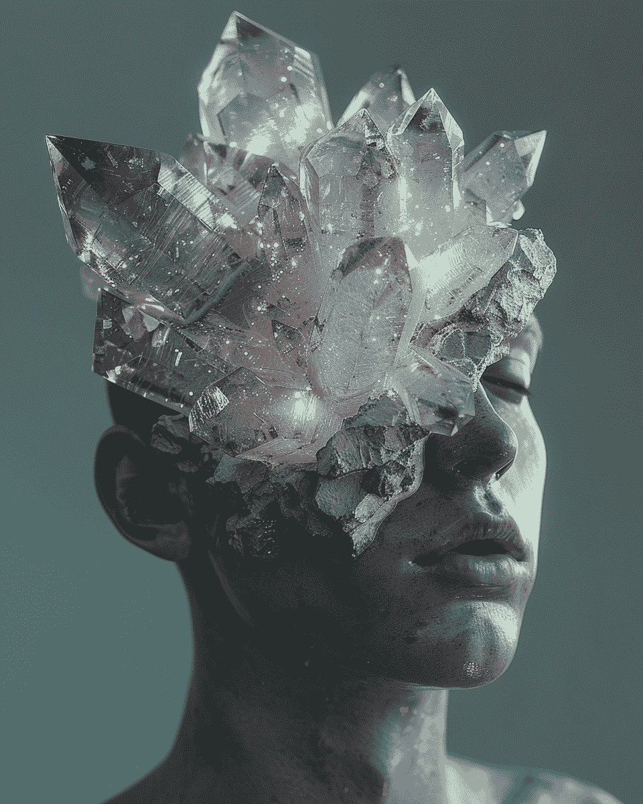 | 符合画面效果的材质表达 |
|  |  |  | **风格升级：** |

[356e8cef_fi_sr.mp4](https://internal-api-drive-stream.feishu.cn/space/api/box/stream/download/all/ClYLbECdMo09GKxyH2ycUtGlnHy)

[610416cc_fi_sr.mp4](https://internal-api-drive-stream.feishu.cn/space/api/box/stream/download/all/GvuNbYZ07oeTSOx96uocQLTNnSg)

[42da898a_fi_sr.mp4](https://internal-api-drive-stream.feishu.cn/space/api/box/stream/download/all/LpNMbVZQwobItHx0YXPciVHqnEg)

[b73b06ec 1_fi_sr.mp4](https://internal-api-drive-stream.feishu.cn/space/api/box/stream/download/all/T4mYbqFEroh6xixmCokc6XVQnUf)

[0e54b268_fi_sr.mp4](https://internal-api-drive-stream.feishu.cn/space/api/box/stream/download/all/WtIZbNuNIoK7vNxlNjCcZBDQngb)

[1e074d25_fi_sr.mp4](https://internal-api-drive-stream.feishu.cn/space/api/box/stream/download/all/WOFhbAchmoTIbSxyBfRcn9vqnOf)

[1dc4ad36_fi_sr.mp4](https://internal-api-drive-stream.feishu.cn/space/api/box/stream/download/all/UneGbBI7ToEp2ixh0JTcnMxTn2g)

[136547b7_fi_sr.mp4](https://internal-api-drive-stream.feishu.cn/space/api/box/stream/download/all/UAftbqahWoGNXGxfhzIcmfE8nAd)

[04ab66be_fi_sr.mp4](https://internal-api-drive-stream.feishu.cn/space/api/box/stream/download/all/Vm5cbXpxMoVfGExY8oecnHGTnzg)

[3cc7d849_fi_sr.mp4](https://internal-api-drive-stream.feishu.cn/space/api/box/stream/download/all/IDeebNDajoAIKqxgniKczEHDnVc)