# 实际运用案例（电影、广告片、宣传片、短视频）

> 来源：[https://yunyinghui.feishu.cn/docx/WNRfdNhWcoGmeyx1DH4cjKnGnte](https://yunyinghui.feishu.cn/docx/WNRfdNhWcoGmeyx1DH4cjKnGnte)

# 文生视频实际运用案例

> **文生视频的优势：**制作便捷高效；提供多元的创作思路

> **文生视频的缺点：**较难保证 主体 / 风画面格 的一致性

## 1 **主要使用场景**

文生视频的实际使用场景更多是作为 空镜头 / 非叙事性镜头 / 大场面特效镜头 的制作。

**完整制作案例展示**——《科幻预告片》

传统科幻类型影像具有相近的视觉元素，通过对于同类型视觉元素的空镜头制作，构成具有类似场景和美学风格的画面，利用“爆破”等优质表现的画面作为主要节奏点，制作出充满紧张感的科幻电影伪预告片。

[科幻预告片.mp4](https://internal-api-drive-stream.feishu.cn/space/api/box/stream/download/all/LU3gbNLzzoZElVxUBBRcrIW0nZz)

**完整制作案例展示**——《雪崩灾难片预告》

根据“雪崩”这一主题，设计**多组空镜头 / 大场面镜头**组合，最大程度利用海螺AI文生视频的优异表现力，通过节奏感较强的剪辑，制作出一个以简单的故事线串联而成的预告片。

[Hailuo AI｜Rescue at the Edge of Life.mp4](https://internal-api-drive-stream.feishu.cn/space/api/box/stream/download/all/IJ0mbq1gqo4zKYx0nTfcvoFJn8T)

## 2 特殊使用方式：相似物转场快速剪辑

基于海螺AI丰富的场景写实能力，在快速蒙太奇场景中，可以用近似的Prompt输出相似构图的多样化场景进行组接，在不影响叙事结构的情况下最大程度规避主体稳定性问题。

**相似物快速剪辑**——跨时空科幻之门

产出相似的“科幻之门”形象在不同的时空场景中的镜头，将镜头快速组接在一起，极具张力地响应了跨时空这一叙事结构。

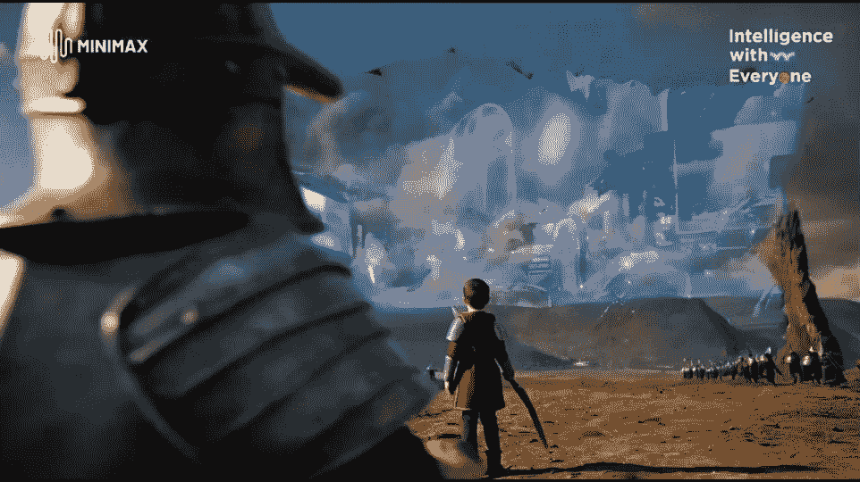

[教程使用-5.mp4](https://internal-api-drive-stream.feishu.cn/space/api/box/stream/download/all/QMKDb38TxorRCBxHsmhciLiRnRd)

## **附：提高主体稳定性的方式**

基于海螺AI优质的Prompt响应能力，可以使用文生进行特定性外形保持。

通过测试外形描述Prompt的保持情况，确定响应较为稳定的外形要素，反复使用以保持一定程度的稳定性。

> 外形要素——发型+年龄性别+衣物颜色 + 环境

> **发型 / 衣物：**基本稳定角色头部形象

> **年龄：**生成相近年龄角色

> **环境：**相同的环境空间，尤其是光环境，可以增加观众对于形象认识的“一致性”认知

> **例如较大明**暗对比的环境，保留较少的角色的面部信息，有助于角色“一致性”

**例子：**

特写一个棕色卷发，身穿棕褐色上衣的小男孩，正对镜头，面部被烛光照亮，表情惊讶，环境昏暗明暗对比强烈。

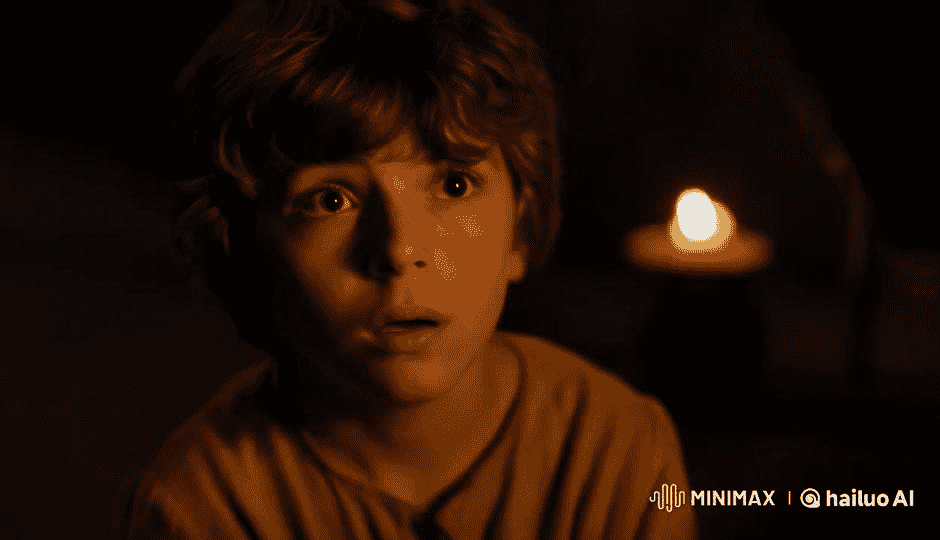

[主体稳固case-2.mp4](https://internal-api-drive-stream.feishu.cn/space/api/box/stream/download/all/D0ELbEXB6oGuDOxmJbuc6eW3nwb)

特写一个棕色卷发，身穿棕褐色上衣的小男孩，镜头，面部被阳光照亮，表情惊讶，环境明暗对比强烈。

[主体稳固case-1.mp4](https://internal-api-drive-stream.feishu.cn/space/api/box/stream/download/all/MObGb6gdXo8dZkxUSswcXtZdnBf)

特写一个棕色卷发，身穿棕褐色上衣的小男孩，侧对镜头，微微仰头走在一片暗绿色的森林中，面部被手中提着的油灯照亮，环境昏暗明暗对比强烈

[82d794001236c80e66bd49aaf0ec4855.mp4](https://internal-api-drive-stream.feishu.cn/space/api/box/stream/download/all/FDcwb4cnWo51ufxatnwcEvqAneh)

# 图生视频实际运用案例

> **图生视频的优势：**精确的画面主体控制；精确的画面美学控制。

> **图生视频的缺点：**创作自由度较低。

## 1 **主要使用场景**

图生视频保证了视频主体信息的稳定性，适用于固定主体物的叙事，能够利用视频静帧继续生成视频段落并完成叙事功能。

例子：片段节选自海螺AI宣传片《Magic Wheel》

利用相同主体的一组图片，生成符合情节需求的视频，保证了主体形象在故事画面中的一致性。（视频声音为后期制作）

| **图片** | **情节需求** | **生成效果** |
| --- | --- | --- |
|  | 小恶龙警察骄傲地对着镜头介绍Magic Wheel。 |  |
|  | 小恶龙警察对于世界失控感到紧张但仍强装镇定。 |  |

[小龙1.mp4](https://internal-api-drive-stream.feishu.cn/space/api/box/stream/download/all/EqGIbNEfwoHV23xbBGEcBhvtnkg)

[小龙2.mp4](https://internal-api-drive-stream.feishu.cn/space/api/box/stream/download/all/Bnd4bhOKuomZbTx7zf3c6ojBnjh)

## 2 特殊使用方式一：尾帧续写伪长镜头

目前海螺AI能生成6秒的优质视频，但可以合理使用现有视频的尾帧作为首图进行图生视频输出，续接制作超过6秒的伪长镜头。（视频声音为后期制作）

例子：片段节选自海螺AI宣传片《Magic Wheel》

**Step 1**

首先生成视频所需的基础动作——女孩抬手触碰Magic Wheel之后放下手臂。

[教程使用-10.mp4](https://internal-api-drive-stream.feishu.cn/space/api/box/stream/download/all/TvfEbUJrxo2M7Qx0DijcHOBsnCd)

**Step 2**

将满意的视频效果的最后一帧截取（下图），将最后一帧作为图片进行第二次图生视频——镜头缓缓拉远拍摄Magic Wheel被女孩触碰后慢慢开始发光转动。

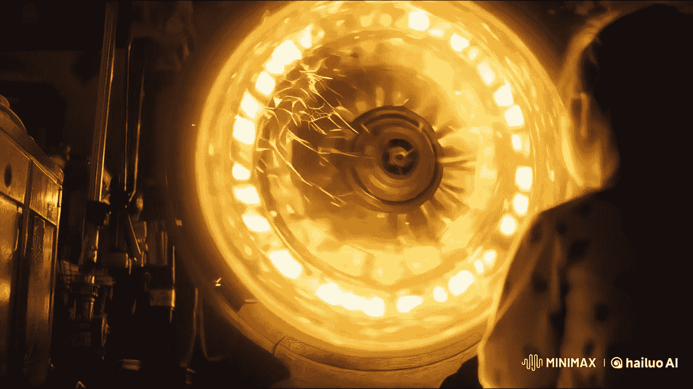

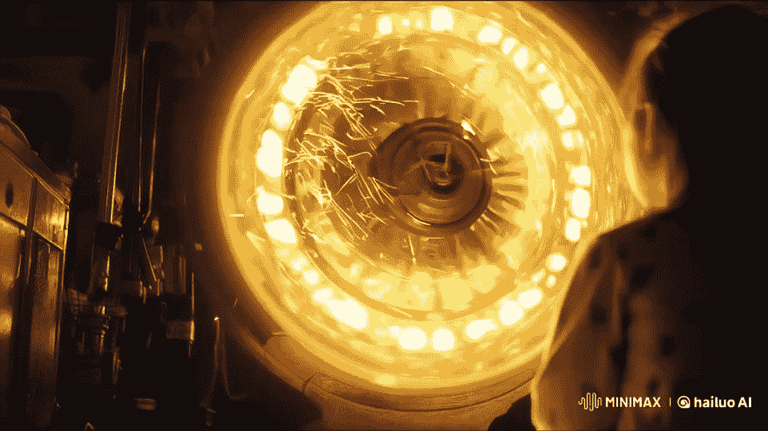

[教程使用-11.mp4](https://internal-api-drive-stream.feishu.cn/space/api/box/stream/download/all/XvxXbmWAAo5SMExpzJqcV06hnoc)

**Step 3**

将最佳视频效果的合适帧截取下来（下图），作为图片进行第三次图生视频——Magic Wheel逐渐失控，发出电光后停止运作。

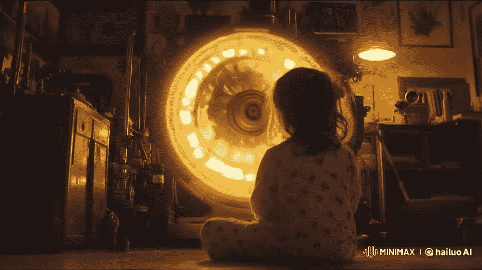

[教程使用-13.mp4](https://internal-api-drive-stream.feishu.cn/space/api/box/stream/download/all/IaaDbw5wvootLoxHC5lcPCGwnic)

**Step 4**

将上述的三段视频剪辑结合在一起，获得一个11秒长的完整视频，视频展示女孩触碰Magic Wheel导致其魔法失效的完整动作。

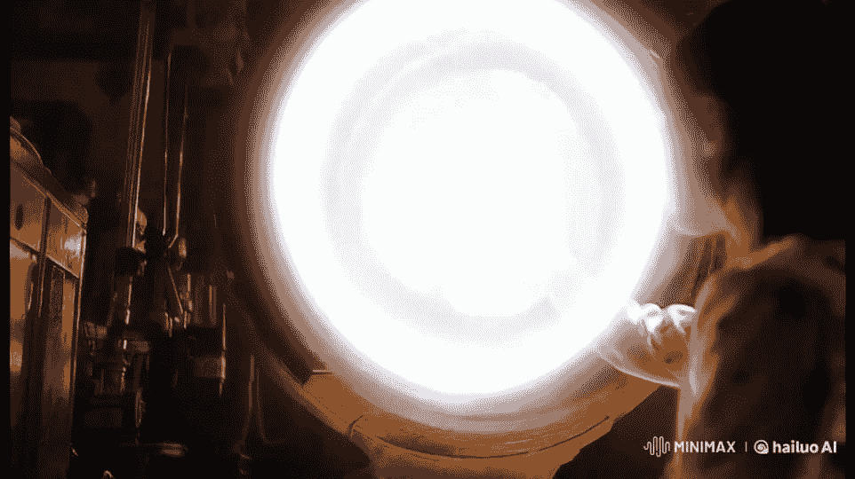

[教程使用-12.mp4](https://internal-api-drive-stream.feishu.cn/space/api/box/stream/download/all/WXf4bQzwco3cBMxDoOScnFFBnyf)

## 3 **特殊使用方式二：** 合成图片穿越融合

将任意两张图片通过合适的比例进行组合后进行图生视频创作，海螺AI就可以将特定图片中的形象完美的融合到了另一图片之中，并且主体从场景片进入目标场景后，光影、色调都会完美嵌入新场景的设定，这为在更多高质量场景下的确定性创作提供了无限可能。

| **图片** | ** Prompt** | **视频效果** |
| --- | --- | --- |
|  | 女子走向绿地，站在草地上，望着美丽的湖面，镜头缓缓左移。 |  |
| 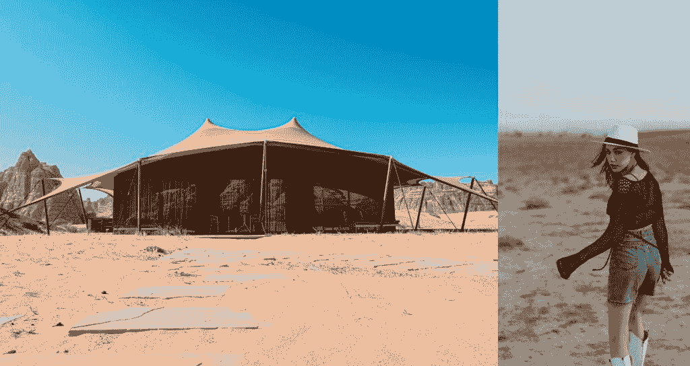 | 女子走向帐篷，镜头缓缓左移。 |  |
| 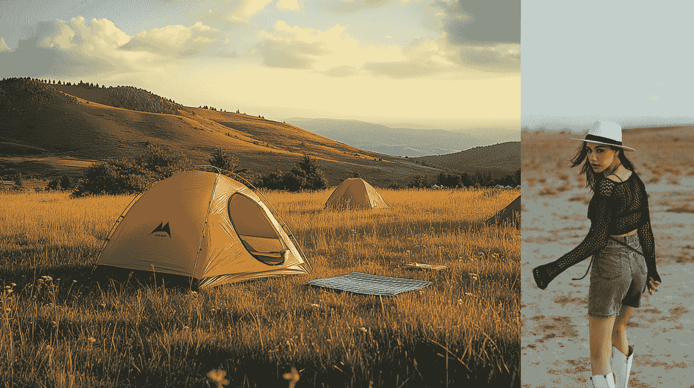 | 女子走向帐篷。镜头缓缓左移。 |  |

[飞书20241007-161909.mp4](https://internal-api-drive-stream.feishu.cn/space/api/box/stream/download/all/Op4QbMeMVoOpM9xOxAgcxKWFn5e)

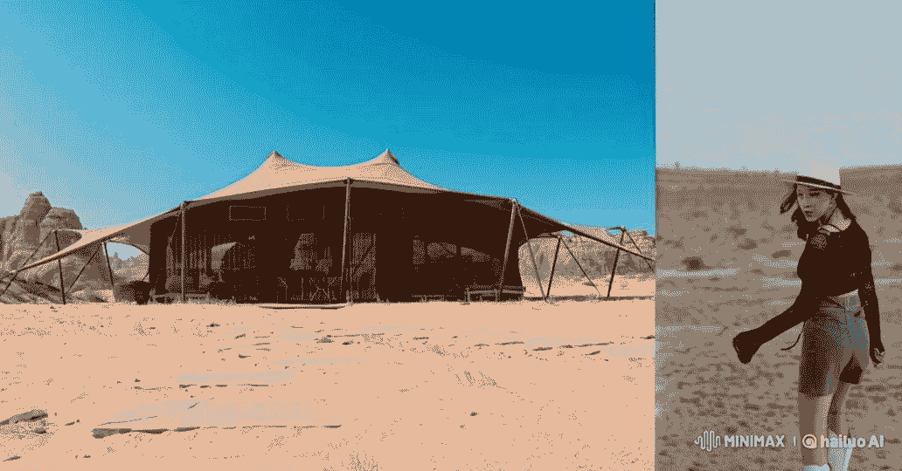

[2da2f12f3b68a68ce7788c9341aee03c3c599715a60f6b2638125769.mp4](https://internal-api-drive-stream.feishu.cn/space/api/box/stream/download/all/RKRHbOkhdofkcBxvGY4c819Bnn2)

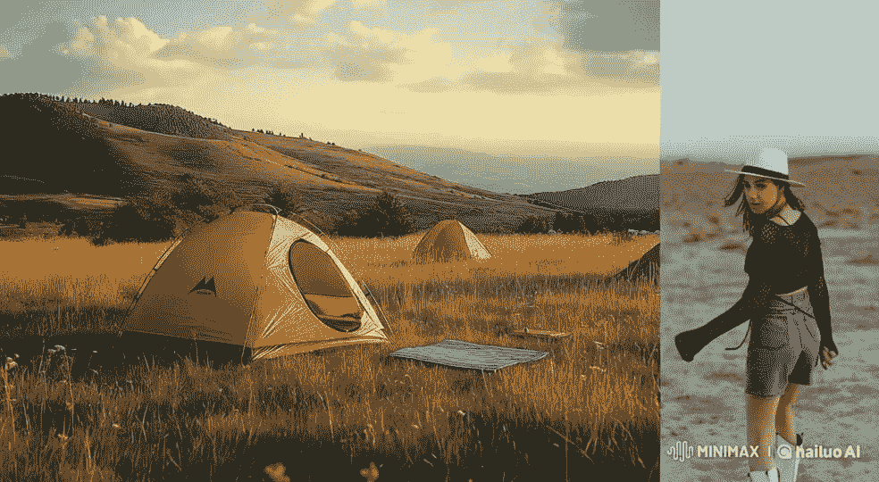

[飞书20241007-161825.mp4](https://internal-api-drive-stream.feishu.cn/space/api/box/stream/download/all/VXZbbRsVgosyz1xzWYdc1vPhnah)

# 综合使用案例

**文生 / 图生 综合使用方式**

+   不涉及主体稳固的场景 / 镜头使用文生视频

+   需要精确的稳定主体形象的镜头采用图生视频

例子：**海螺AI《万圣节宣传片**》首场戏分镜头拆解梳理（视频声音为后期制作）

| **镜头** | **情节需求** | **视频生成方式** | **视频结果** |
| --- | --- | --- | --- |
| 1 | 展示一个肥胖的绿衣服男人在万圣节一个在屋内娱乐，被一阵敲门声打扰。 | 作为首场戏的第一个镜头，采用文生视频进行生产，通过细致的主体外形限定——中年，黑色长发、绿色上衣黑色、眼镜、肥胖，为之后的视频生成打好主体描述的基础。 |  |
| 2 | 交代敲门声来自门外。 | 紧跟着男人的转头动作给到男人的视点镜头，交代敲门声的由来。 |  |
| 3 | 男人呵斥让门外的人离开 | 利用男人的特写来推进剧情，由于是特写，只需要展示男人的部分特征，采用文生视频进行生成保留主体外形描述——黑发、肥胖、眼镜、绿色上衣……稳固主体形象。 |  |
| 4 | 敲门声没有停止 | 给到门的特写，敲门声越来越大。这里依旧没有主体出现，使用文生视频生成门的特写画面。 |  |
| 5 | 男人无奈起身开门 | 需要男性从第一幕中的状态改改变为起身去开门的动作。这里对于主体一致性的要求很高，且需要在相同的场景 / 光影条件下进行，使用文生视频对第1镜头的尾帧进行续生成。 |  |
| 6 | 男人开门 | 这里没有完整主体出现，只有主体的局部特征，使用文生视频生成伸手开门的特写画面。 |  |
| 7 | 男人开门走出 | 此时男人已经出门，给到一个正面的交代镜头，因为是全新的场景空间环境，利用文生视频来提供更多的画面视觉元素更加便捷。使用相似的主体外形描述以稳固主体形象。 |  |
| 8 | 门外两个万圣节扮相的小女孩向男人要糖 | 这里是两个小女孩角色的第一次出场，采用文生视频，筛选最佳表现的画面内容作为正片素材 |  |
| 9 | 男人嫌弃地拒绝女孩的要糖请求 | 这里需要使用过肩镜头交代女孩和男人的位置关系，同时展示男人的细节表情。使用文生视频进行生成，选择 镜头 / 主体表情神态最 符合需求的素材作为正片。 |  |
| 10 | 女孩露出魔鬼的真面目，张开大嘴向男人走去 | 这里需要和第8镜完全相同的画面场景才能使叙事成立，采用第8镜头的静帧作为视频的图片进行图生视频操作。 |  |

[教程使用-14.mp4](https://internal-api-drive-stream.feishu.cn/space/api/box/stream/download/all/WuL4b6XWSozdPhx8FlMcXQasnef)

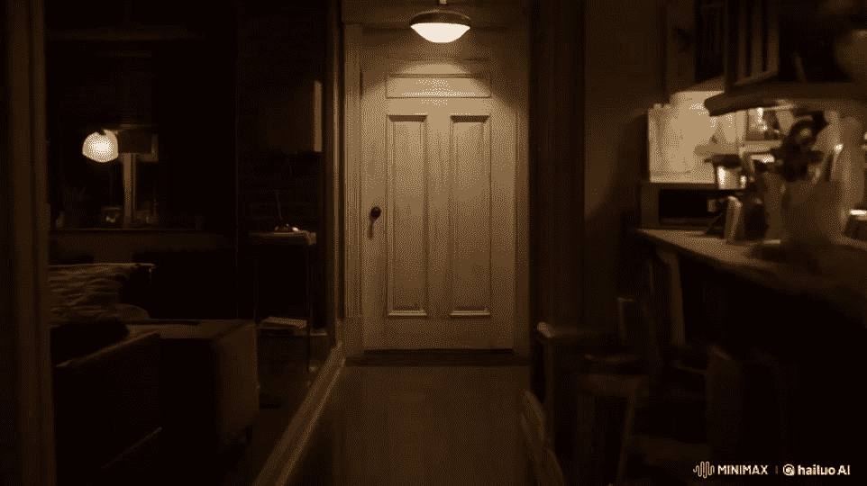

[教程使用-15.mp4](https://internal-api-drive-stream.feishu.cn/space/api/box/stream/download/all/VFWBb3MHWoQztax4FuAceB96nPe)

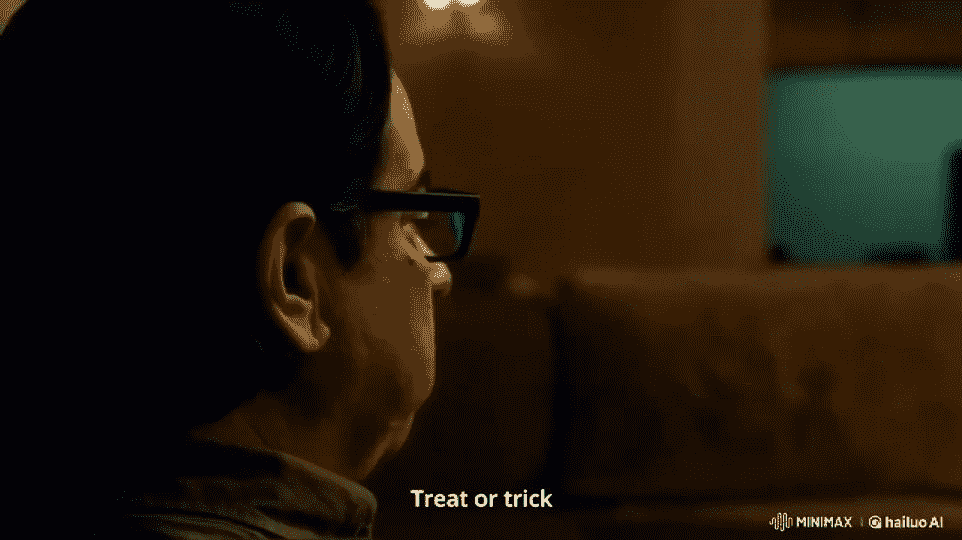

[教程使用-16.mp4](https://internal-api-drive-stream.feishu.cn/space/api/box/stream/download/all/WF2vbtnJYoViUrxsVurcamWJnwe)

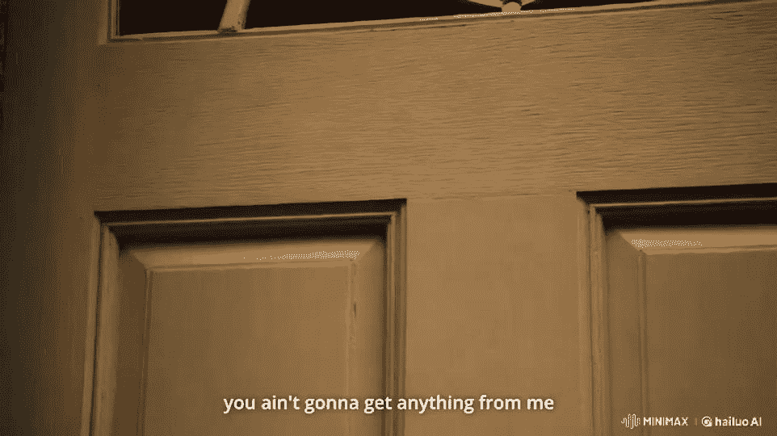

[教程使用-17.mp4](https://internal-api-drive-stream.feishu.cn/space/api/box/stream/download/all/HQ9fbTchxo4HaVx4zZPcKp9unwe)

[教程使用-18.mp4](https://internal-api-drive-stream.feishu.cn/space/api/box/stream/download/all/ST77b9dQaoWQDuxzb21cWj7Znsb)

[教程使用-19.mp4](https://internal-api-drive-stream.feishu.cn/space/api/box/stream/download/all/CRPabZr3NogXQUxj7ePcOYE4nrb)

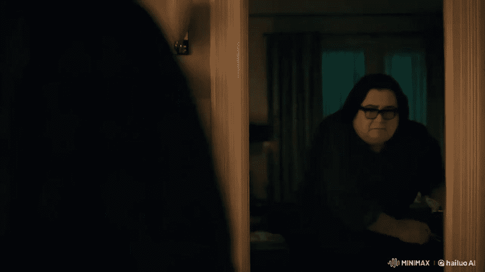

[教程使用-20.mp4](https://internal-api-drive-stream.feishu.cn/space/api/box/stream/download/all/IMDJbZPxJoudU8xRrQCcko9hnsc)

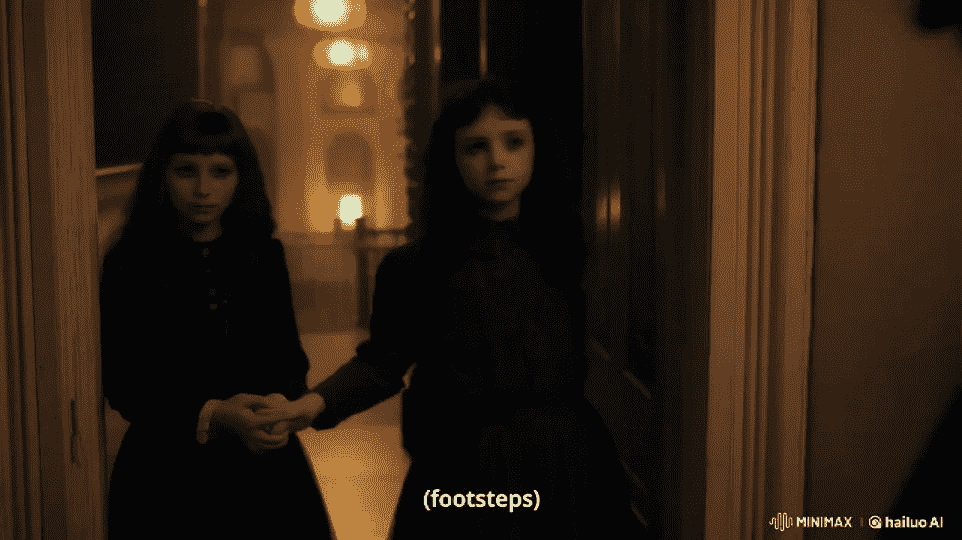

[教程使用-22.mp4](https://internal-api-drive-stream.feishu.cn/space/api/box/stream/download/all/S19dbhv00o12SsxgrNJc47Slnse)

[教程使用-23.mp4](https://internal-api-drive-stream.feishu.cn/space/api/box/stream/download/all/Rn55bF7Rqo9x04xz1FTc5tQaneg)

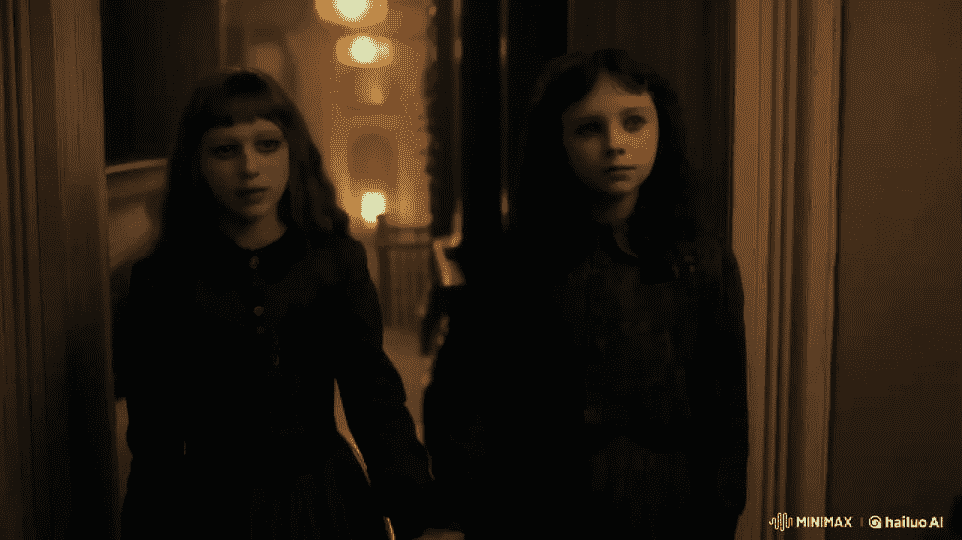

[教程使用-24.mp4](https://internal-api-drive-stream.feishu.cn/space/api/box/stream/download/all/OcSOb9IMlo5oP7x7whAc0wzdn7b)

**成片效果：**

将上述的分镜素材按照顺序进行组接，获得完整的首场戏效果

[教程使用-21.mp4](https://internal-api-drive-stream.feishu.cn/space/api/box/stream/download/all/QKdtbAUG9oWo6bxQU6NcUAHrnLe)