# 主体参考功能使用教程

> 来源：[https://yunyinghui.feishu.cn/docx/FmeAdoLf3oVV8Lxsm1rct5yQn4f](https://yunyinghui.feishu.cn/docx/FmeAdoLf3oVV8Lxsm1rct5yQn4f)

海螺AI的**主体参考**功能可以通过识别用户上传照片中的面部信息，生成拥有对应面部信息的主体形象，并根据文字Prompt生成该主体形象的视频画面。

使**用海螺AI主**体参考**功能进行视频生成需要**用户提供【主体面部照片】和【视频生成Prompt】

进入创作页面，选择主体参考模型。依次添加参考角色，输入prompt，点击生成，等待片刻就完成了一次创作。

## 第一步：选取参考角色

主体参考功能需要上传可识别的面部信息，作为视频主体生成的面部参考。当前版本暂时只支持人物面部识别；

海螺AI 能够准确识别照片中不同性别、年龄、人种的面部特征。

图片符合相应的**规格、主体角度和画面光照信息**，可以让主体参考功能达到最佳的视频生成效果。

### **基础规格**

> **面部数量：**主体一致功能支持上传**单人照片**进行面部识别

> **图片尺寸：**分辨率不低于**120*120**，图片不大于20M

> **其他：**面部不可被遮挡，照片不可虚焦或有过多滤镜特效

**标准面部照片：**

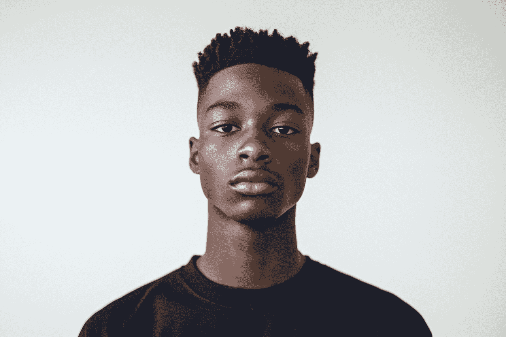

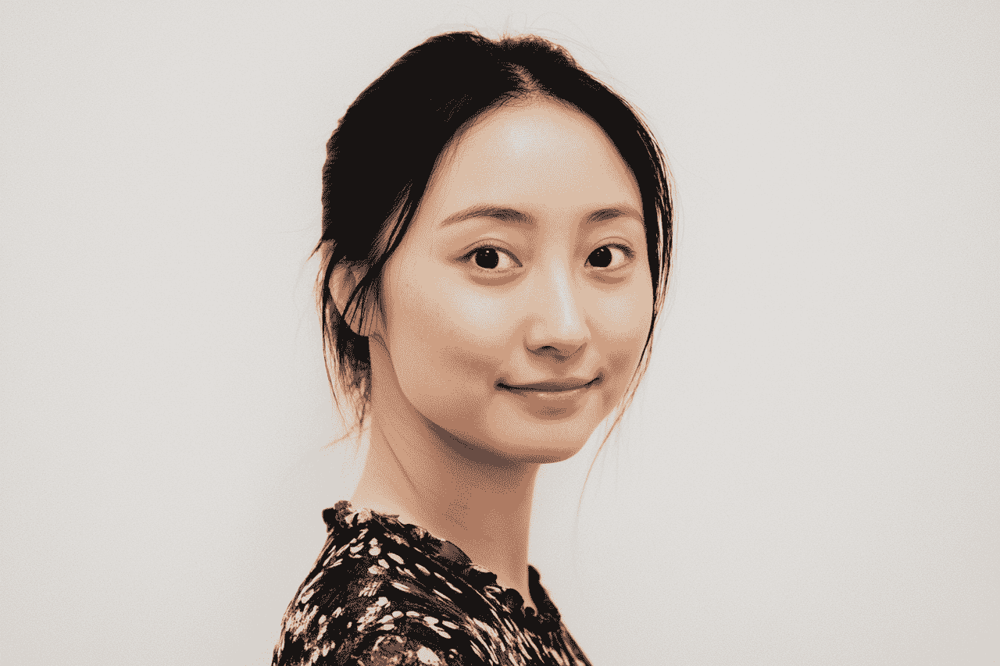

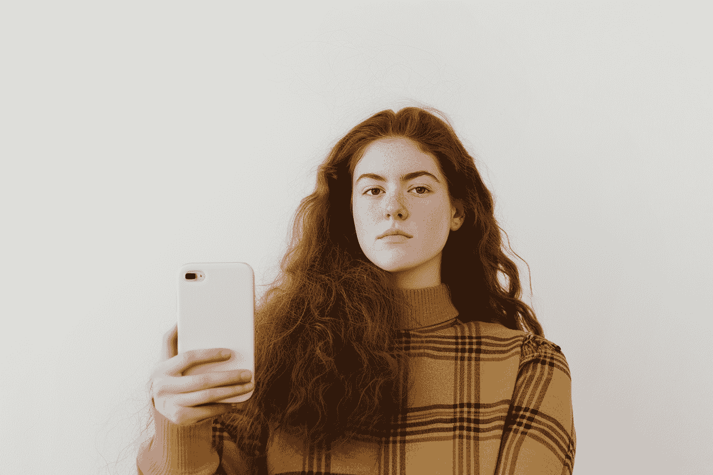

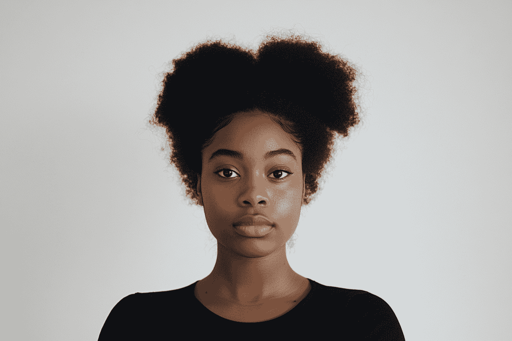

**不适合用于参考的照片示例：**

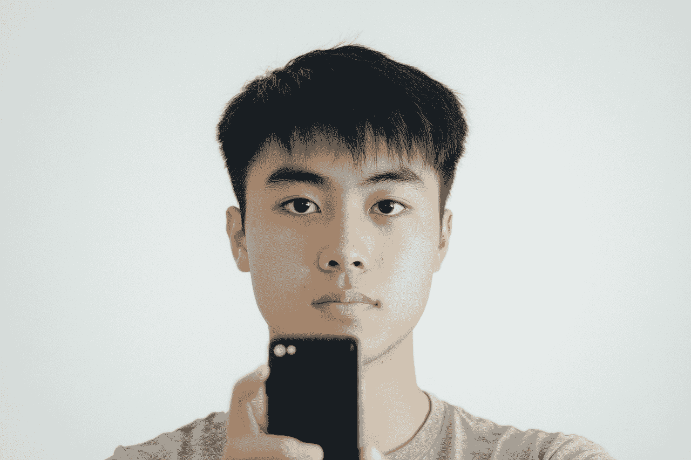

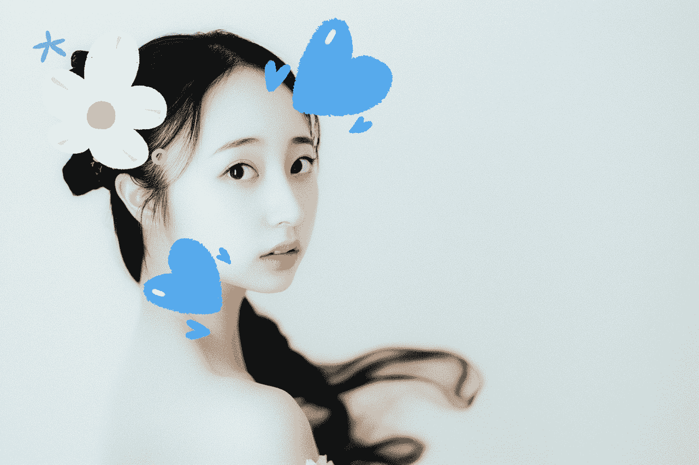

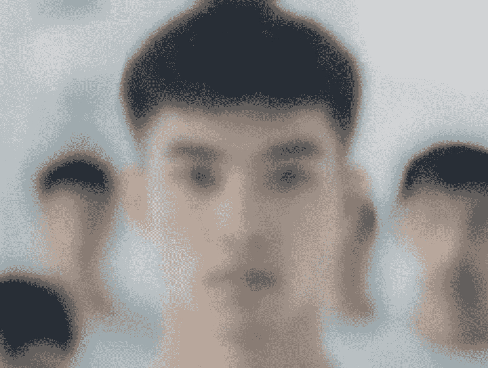

### **主体角度**

> 上传的照片中主体角度需**正对镜头**或**轻微侧对镜头**

> **正对镜头：**照片中的主体正对镜头，五官清晰出现在画面内，能够提供最完整的面部信息。

> **轻微侧对镜头：****需保证人的面部五官和脸部轮廓**完整出现在照片内，避免正侧角度或五官不在画面内的面部照片。

**不适合用于参考的主体角度示例：**

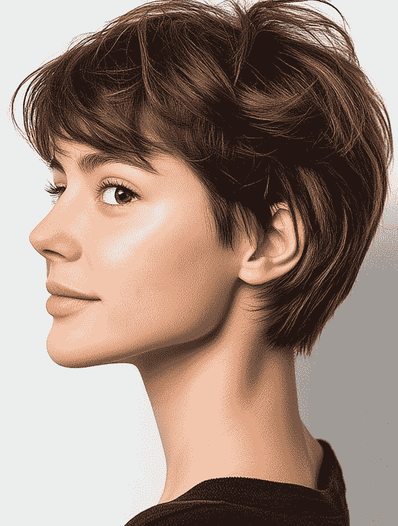

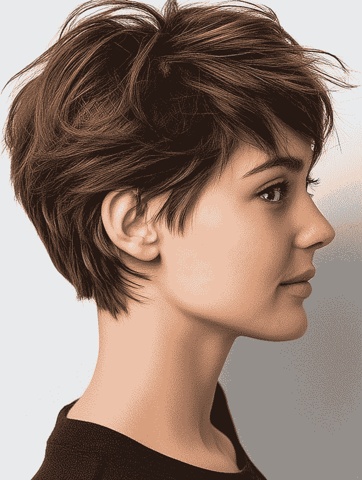

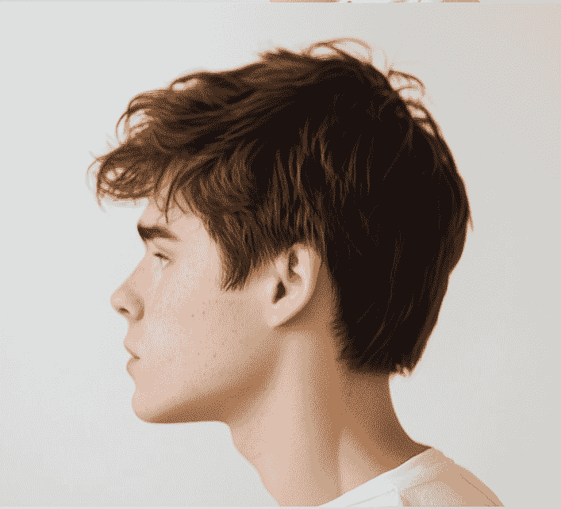

### 面部光照

> **为了获得最贴近照片中**面**部的视频**，上传的照**片中主体**面部光照需要规避大面积的黑色阴影或局部过曝，同时保证光色自然，面部可以有一定的阴影细节。

不适合用于参考的主体面部光照示例：

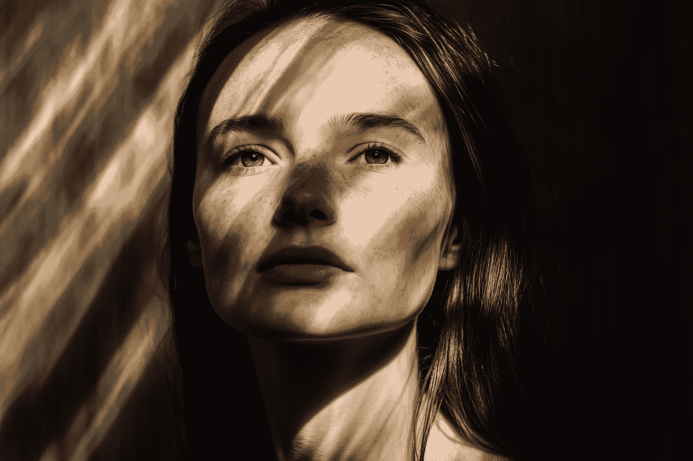

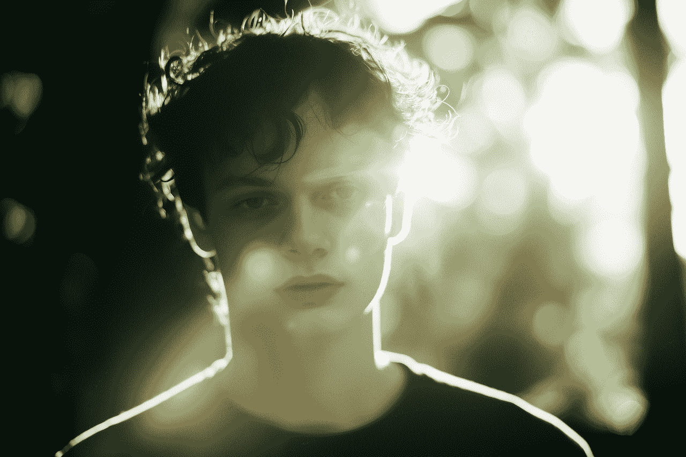

## 第二步：添加视频提示词（Prompt）

主体参考功能的生成逻辑和文生视频相似，详见文生视频Prompt教程。

> **用于主体参考功**能的Prompt，只涉及单人内容，可以获得最准确的表现效果。

> 若Prompt涉及多主体，可以补充对于Pr**ompt特**定主体的描述，海螺AI能够通过年龄、性别识别对应面部主体并完成生成。

**单人内容示例**

| **面部信息** | **Prompt** | **视频** |
| --- | --- | --- |
| 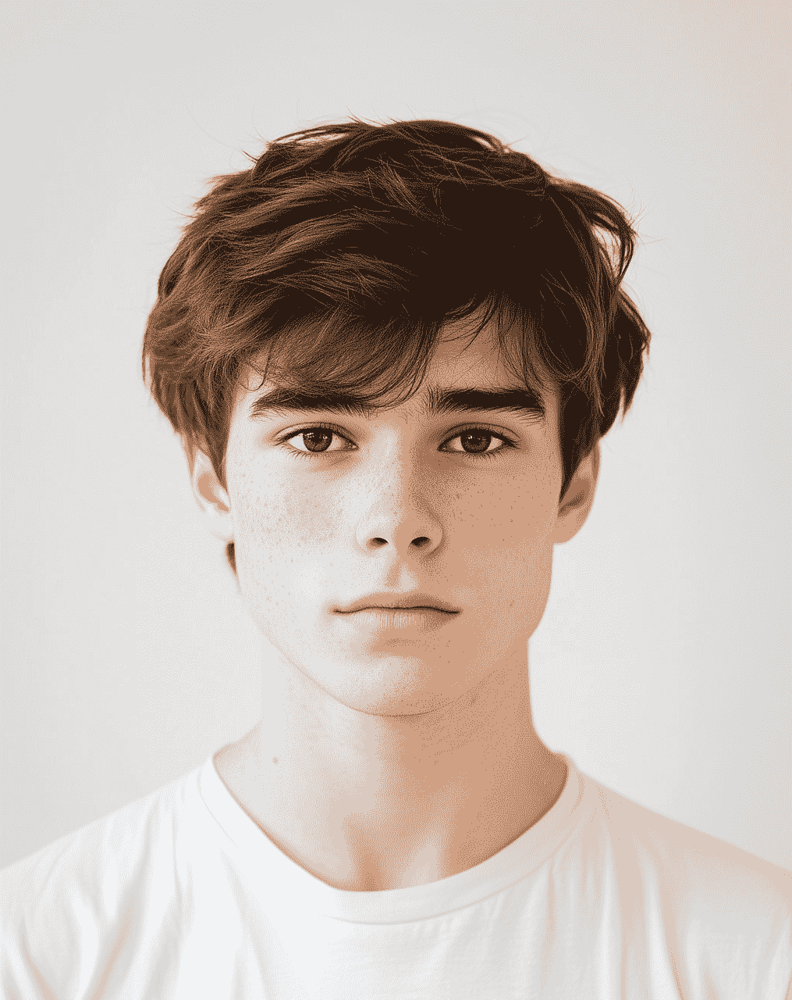 | 阴天，在石板铺就的古朴小巷里，模特穿着一件棕色灯芯绒夹克，搭配米色裤子和短靴，头戴一顶复古贝雷帽。镜头从模特身后的肩膀开始，跟随他的脚步，捕捉模特晃动的身姿。随后，镜头从模特身旁侧向前移，展现他微笑着用手拢了拢贝雷帽的自然动作。接着，镜头稍微俯拍，捕捉模特站在转角扶墙的优雅姿态，最后以上升的镜头结束，模特对着镜头微笑。视频光色自然，画面具有电影质感。 |  |
|  | 阴天，在石板铺就的古朴小巷里，模特穿着一件棕色灯芯绒夹克，搭配米色裤子和短靴，头戴一顶复古贝雷帽。镜头从模特身后的肩膀开始，跟随他的脚步，捕捉模特晃动的身姿。随后，镜头从模特身旁侧向前移，展现他微笑着用手拢了拢贝雷帽的自然动作。接着，镜头稍微俯拍，捕捉模特站在转角扶墙的优雅姿态，最后以上升的镜头结束，模特对着镜头微笑。视频光色自然，画面具有电影质感。 |  |
| 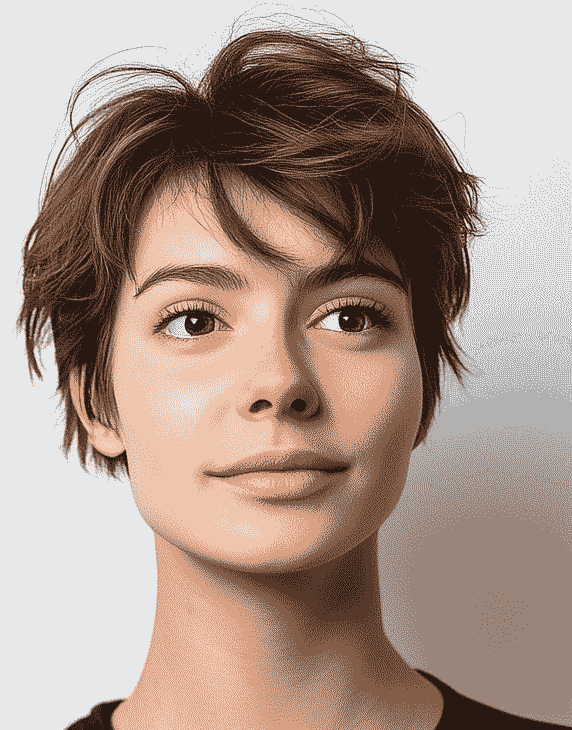 | 在一个光线柔和的现代居家空间，模特穿着一件柔软的米白色针织毛衣，搭配高腰牛仔裤和简约的白色运动鞋，整个人散发出舒适随意的气质。模特身后是一面透着阳光的大玻璃窗，阳光洒在木地板上，模特正悠闲地坐在沙发上翻阅一本书，身边是一杯热咖啡。镜头缓慢推近，捕捉她轻轻抬起头，看向窗外瞬间，眼神安静温柔。接着，镜头环绕到她的侧面，展示她整理头发的动作。 |  |
| 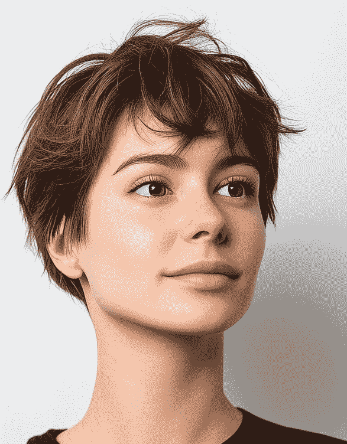 | 在一个光线柔和的现代居家空间，模特穿着一件柔软的米白色针织毛衣，搭配高腰牛仔裤和简约的白色运动鞋，整个人散发出舒适随意的气质。模特身后是一面透着阳光的大玻璃窗，阳光洒在木地板上，模特正悠闲地坐在沙发上翻阅一本书，身边是一杯热咖啡。镜头缓慢推近，捕捉她轻轻抬起头，看向窗外瞬间，眼神安静温柔。接着，镜头环绕到她的侧面，展示她整理头发的动作。 |  |
| 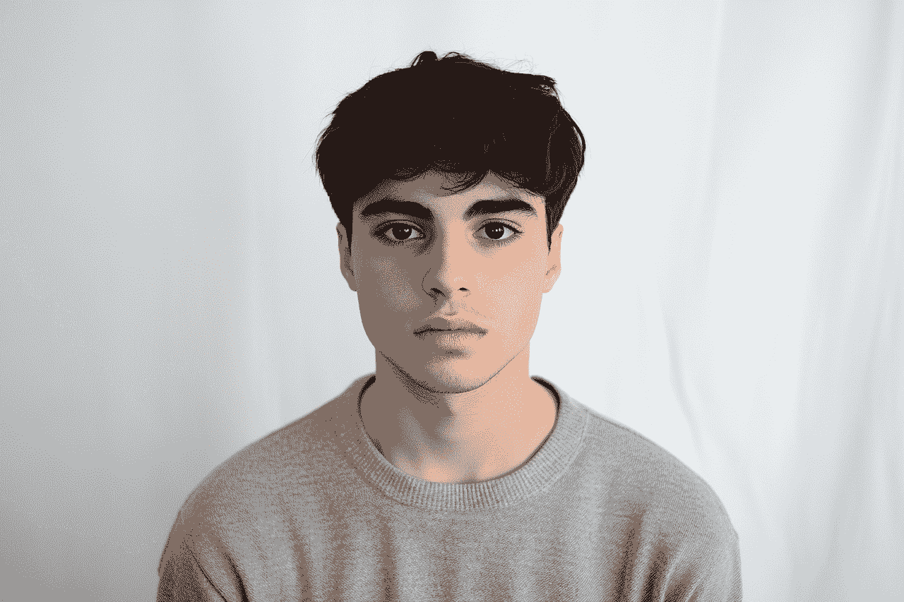 | 一个牛仔骑着马，穿过一片雪景，身后绑着一支步枪。他戴着宽边帽，他粗犷而醒目的五官格外显眼。在他身后的远处，是高大的云杉林，林外是令人叹为观止的白雪皑皑的群山，地面上覆盖着洁白的积雪，牛仔缓缓在寒冷的旷野中骑马前行。他盯着前方，显得坚毅且勇敢。 |  |
| 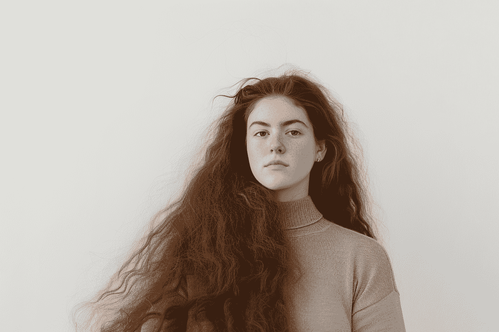 | 一名模特，穿着复古的围裙，脖子上系着一条丝带，脚踩高跟短靴。她站在昏暗的木质酒馆吧台后，手里端着一杯倒满威士忌的玻璃杯，背景是挂满酒瓶和油灯的木架。她卷曲的头发垂落在肩膀上，脸上带着一丝狡黠的笑容，镜头大幅度运动。 |  |

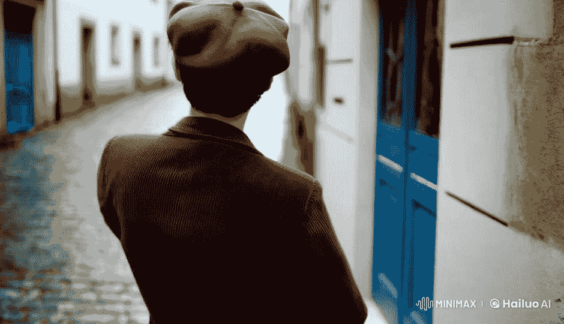

[正面-男.mp4](https://internal-api-drive-stream.feishu.cn/space/api/box/stream/download/all/Kgfxbu2qYogRnTxsrr5cM00cnkh)

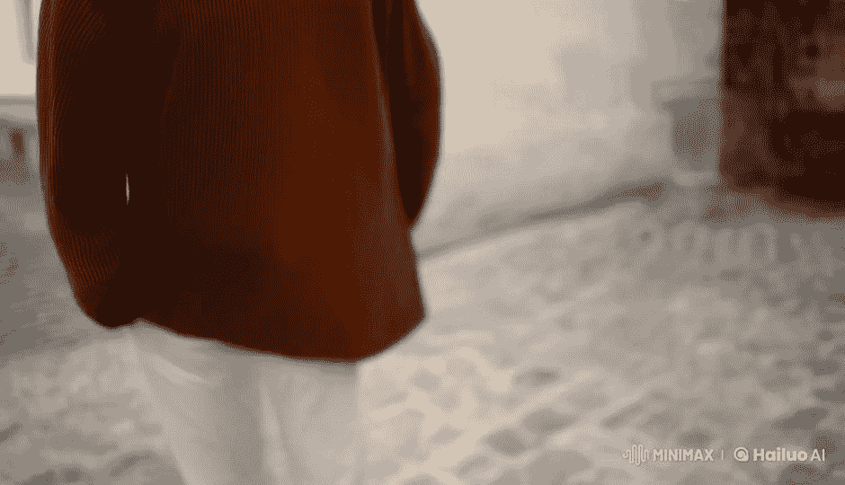

[侧面-男.mp4](https://internal-api-drive-stream.feishu.cn/space/api/box/stream/download/all/Lc6Zb8p2ioLRPhxAbkHcKj0dnug)

[正面-女2.mp4](https://internal-api-drive-stream.feishu.cn/space/api/box/stream/download/all/MkYNbOaieolCkOxReIScTRXQnKb)

[侧面-女.mp4](https://internal-api-drive-stream.feishu.cn/space/api/box/stream/download/all/EgJ0bLP4do3IvmxUd1dcUHV2n5d)

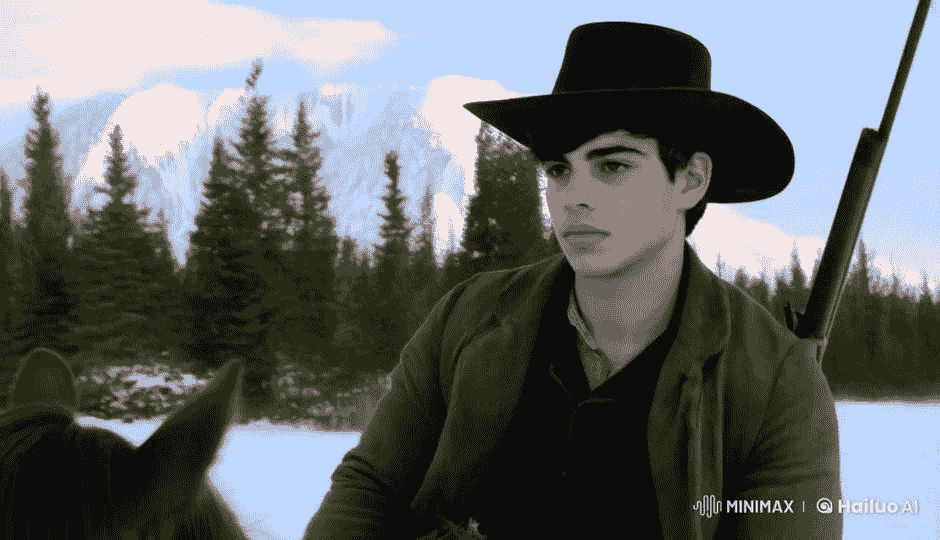

[光照-男333262437424898052.mp4](https://internal-api-drive-stream.feishu.cn/space/api/box/stream/download/all/Fn2sbaO3aonpQKxWaRocCNkAnec)

[光照-女.mp4](https://internal-api-drive-stream.feishu.cn/space/api/box/stream/download/all/N8vwbjCyyofZvpxmswiceW7DnRf)

### 多主体下如何准确映射

1.  在**Prompt**中补充面部照片的性别信息，可以帮助海螺AI锁定响应的主体并生成符合预期的画面。

| **面部信息** | **Prompt** | **视频** |
| --- | --- | --- |
| 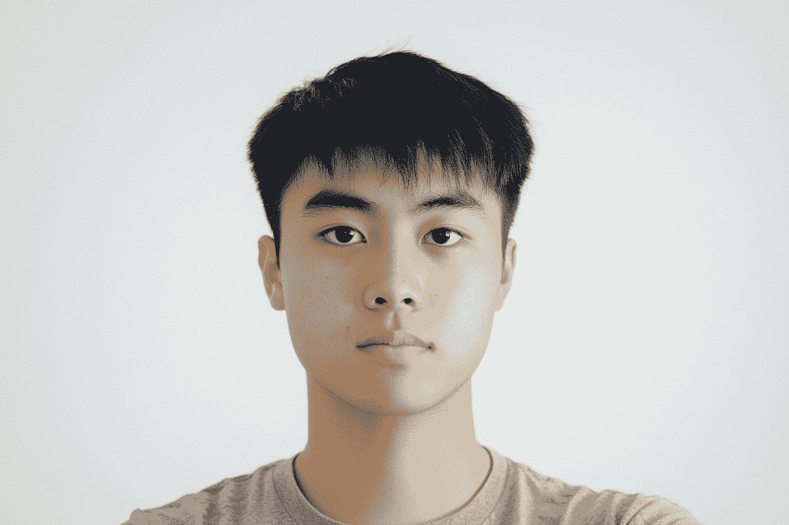 | 画面中一个**黑发男性**身穿西装坐在欧式餐桌旁看向镜头，在他身旁，是一个留着棕发的女性微笑着看向镜头。 |  |
|  | **画面中一个黑发**男性身穿西装坐在欧式餐桌旁看向镜头，在他身旁，是一个留着棕发的女性微笑着看向镜头。 |  |

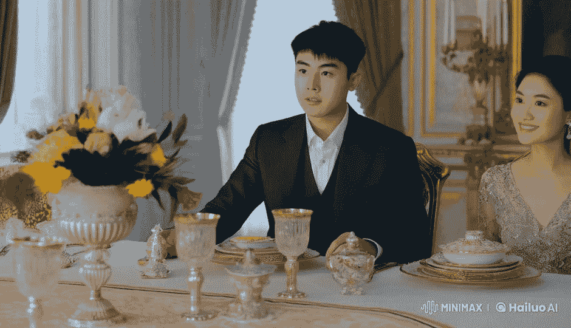

[性别-男.mp4](https://internal-api-drive-stream.feishu.cn/space/api/box/stream/download/all/Ab5YbBIk4oPOjMxgKMtcUB4qnWb)

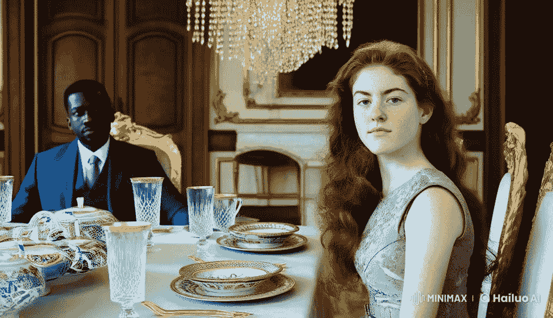

[333294378157121548.mp4](https://internal-api-drive-stream.feishu.cn/space/api/box/stream/download/all/GU28brbbmouM1qxO2QYcYfFGnkf)

1.  在**Prompt**中补充面部照片的年龄信息，可以帮助海螺AI锁定响应的主体并生成符合预期的画面。

| **面部信息** | **Prompt** | **视频** |
| --- | --- | --- |
| 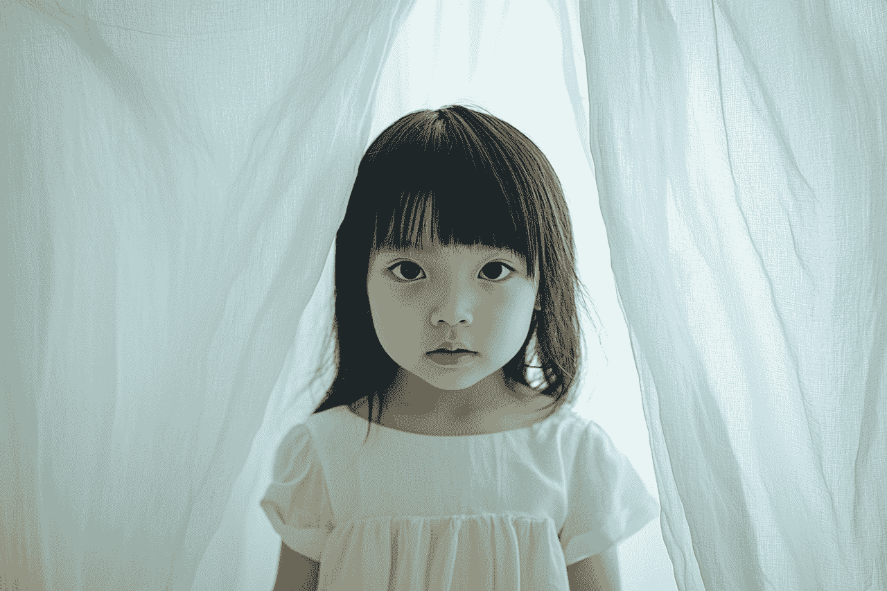 | **一个身穿衬**衫的年迈的老人抱着一个身穿红衣的幼年小女孩，两人坐在温馨的室内，相拥而笑。 |  |
| 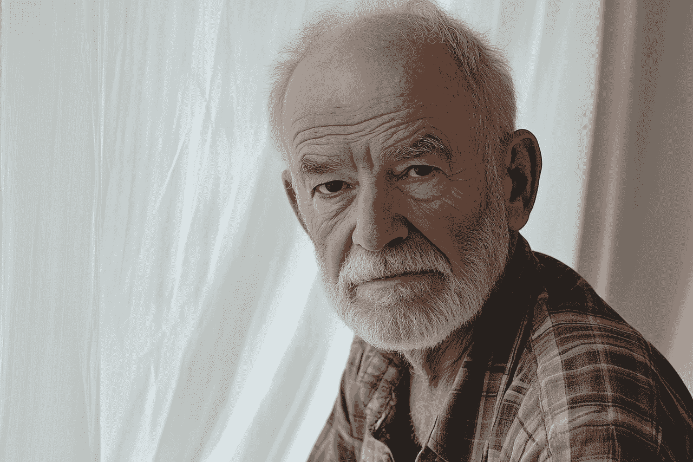 | 一个身穿衬衫的**年迈的老人**抱着一个身穿红衣的幼年小女孩，两人坐在温馨的室内，相拥而笑。 |  |

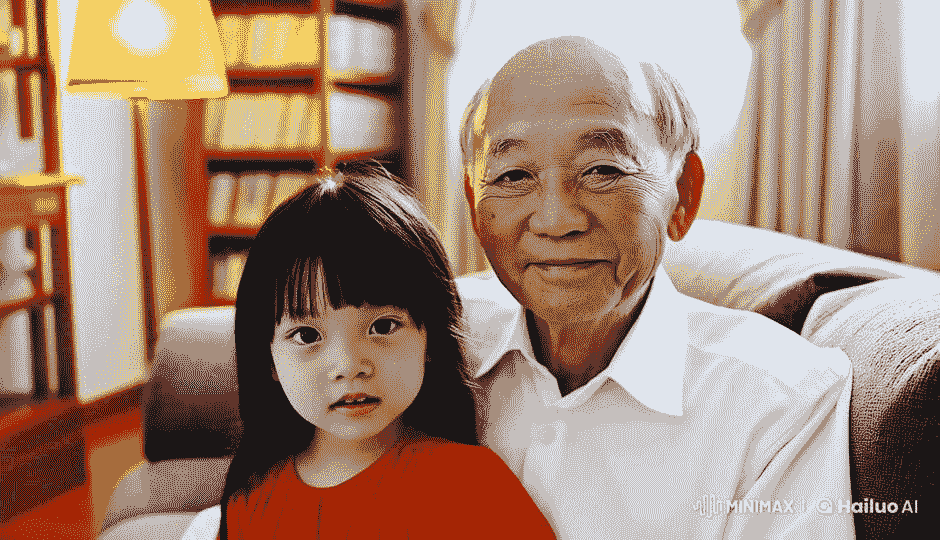

[年龄.mp4](https://internal-api-drive-stream.feishu.cn/space/api/box/stream/download/all/Nspybn06roEuD0xVIKYcU0iwnAf)

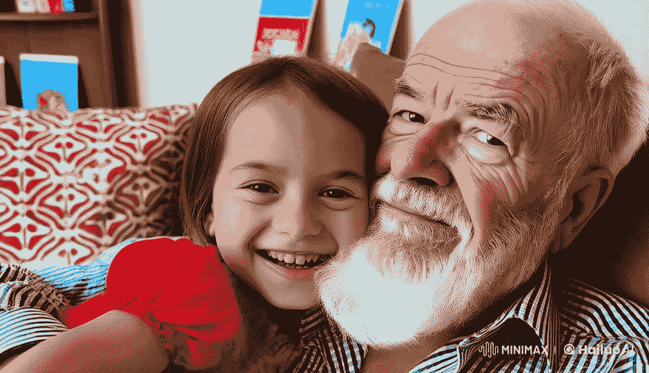

[333299236532695047.mp4](https://internal-api-drive-stream.feishu.cn/space/api/box/stream/download/all/RAH1bQKnuoqTakxfQ2Jc4W5DnEg)