# 清影：AI 视频玩转手册

> 来源：[https://yunyinghui.feishu.cn/docx/Nz7cd0zHPob6UBxmnyxco5OUnAe](https://yunyinghui.feishu.cn/docx/Nz7cd0zHPob6UBxmnyxco5OUnAe)

## 我是谁？关于清影的一句话介绍！

> 清影是智谱清言产品打造的视频创作智能体，依托于智谱大模型团队自研的视频生成大模型`CogVideo`，提供文生视频和图生视频两大核心能力，并支持生成最长10秒的视频。清影生成的视频具备高清晰度画面、精细细节呈现、符合物理规律的主体运动以及稳定的输出效果，可满足用户对高质量艺术视频创作的需求。

> 清影支持通过文本生成视频或图片生成视频，可广泛应用于广告制作、电影剪辑、短视频内容创作等多个领域。

> ⚠️提醒：创作者在使用清影时，应确保素材合法合规，避免侵权问题，并注意保护个人隐私和信息安全，避免泄露敏感信息。

> 💻PC端访问链接：[清影-网页版](https://chatglm.cn/video?fr=opt_homepage_PC)

> 📱移动端访问链接：[清影-移动端](https://chatglm.cn/video?&fr=opt_888_qy3)

> 🍏小程序端访问入口：👷施工中

亲爱的清影创作者们，首先感谢大家对我们产品的喜爱！为了让大家更好地通过提示词（`prompt`）来驯服清影的大模型，写出更好的清影🧙‍♀️咒语，我们将以下优质 `case` 咒语心法总结出来作为参考。当然，随着模型的持续迭代和对模型的不断探索，这份指南也会持续更新。

我们希望与各位创作者朋友们共同完善。如果有发现更好用的模型小妙招，欢迎大家一起交流！祝大家创作更多更好的优质作品！

## 欢迎加入清影创作者交流群！

## 🆕0821清影上线首尾帧！

只需手动上传两张精心挑选的图片，一张作为视频的首帧，一张作为尾帧，就能轻松实现一镜到底的效果，确保主体在整个视频过程中稳定呈现。动画短剧、商业广告、产品演示…让清影精准贴合你的创意构想。

使用方法：

+ 在视频生成过程中，选择你想要作为首帧和尾帧的图片。

+ 确定后，系统会自动将这两张图片分别设置为视频的开始和结束。

### showcase

| 首帧 | 尾帧 | 视频效果 |
| --- | --- | --- |
| 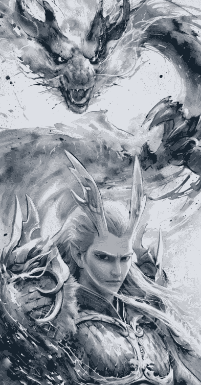 |  | |
| 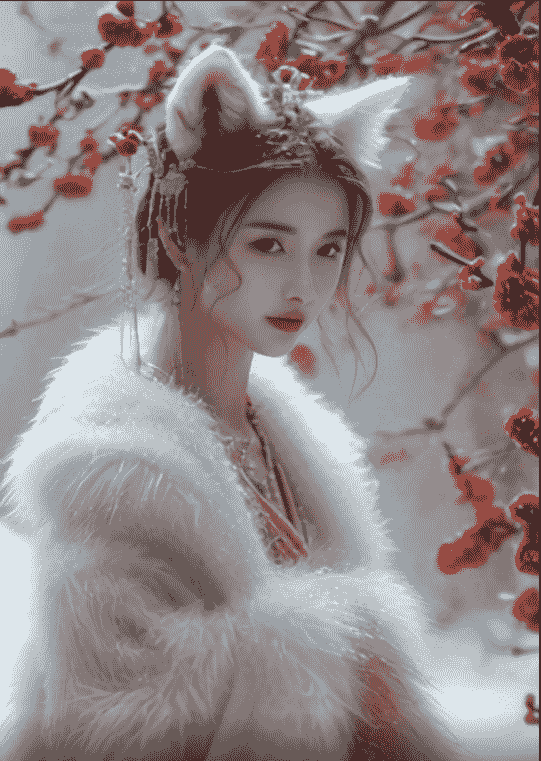 |  | |

[52.mp4](https://internal-api-drive-stream.feishu.cn/space/api/box/stream/download/all/P2vSbqj2GoeJoVxxQkEc7FMpnOd)

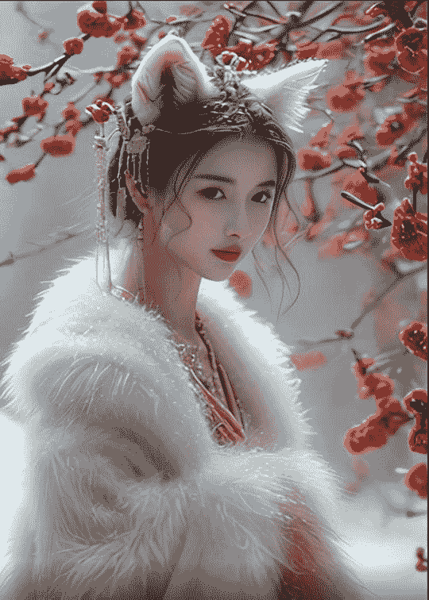

[20.mp4](https://internal-api-drive-stream.feishu.cn/space/api/box/stream/download/all/NJUZbDfw8oS7RPx8sa2cpFCQncd)

## 🆕0715清影全面升级

本次升级聚焦于文生视频和图生视频的整体画面质量、美观程度、主体运动合理性以及画面稳定性核心能力的全面提升，旨在为用户带来更高质量、更稳定可靠的视频生成体验。

### 核心能力提升

+ 画面表现：生成的视频画面稳定清晰，细节呈现（如毛发）更加细腻，色彩搭配更趋合理。

+ 运动模拟：人物、动物等主体的行走动作效果优化，肌肉动态与结构展现更符合物理规律。

+ 稳定性与可靠性：有效减少了画面异常现象（畸形问题）。

### 【新清影】Showcase

| 极致的画面表现 | | | | | |
| --- | --- | --- | --- | --- | --- |
| 流畅的动态效果 | | | | | |
| 稳定的画面主体 | | | | | |
| 多样的场景风格 | | | | | |

[178.mp4](https://internal-api-drive-stream.feishu.cn/space/api/box/stream/download/all/NzwobyHJ5oaN1dxAz37cG7aun5g)

[82.mp4](https://internal-api-drive-stream.feishu.cn/space/api/box/stream/download/all/RR0ubJrmNoridpxnuNiclviMnDb)

[镜头从高空俯拍，一道.mp4](https://internal-api-drive-stream.feishu.cn/space/api/box/stream/download/all/Eu5Qb4BvDoCWvtxauIwcqmaBnWg)

[非洲大地刚苏醒，金色.mp4](https://internal-api-drive-stream.feishu.cn/space/api/box/stream/download/all/JkYgb03PJozocVx6xDIcyB1Wn9d)

[让画面动起来 (1).mp4](https://internal-api-drive-stream.feishu.cn/space/api/box/stream/download/all/RhRjb3RgooVlEVxTaA5chv5Cnzd)

[31.mp4](https://internal-api-drive-stream.feishu.cn/space/api/box/stream/download/all/TfIjbjFC2os3HUxIs9VcE9P6nqb)

[2d9f37a4-5b1e-11f0-aace-02c06ab77468_0.mp4](https://internal-api-drive-stream.feishu.cn/space/api/box/stream/download/all/TXWVbwzfBon2NOx6V2cc6gqnnQh)

[一位优雅女子站在维多.mp4](https://internal-api-drive-stream.feishu.cn/space/api/box/stream/download/all/VF1sbE6LPoF9nyxHZfQcRSIanmg)

[蓝天白云下，一只金鱼从空中游进鱼缸中，白云慢慢飘动.mp4](https://internal-api-drive-stream.feishu.cn/space/api/box/stream/download/all/D9efbo83ooWisix7p6VcSaHunvb)

[一只银白色鹿在雪夜森.mp4](https://internal-api-drive-stream.feishu.cn/space/api/box/stream/download/all/YoRzbxjhfoXNbXxf0A3cvH7snzg)

[136.mp4](https://internal-api-drive-stream.feishu.cn/space/api/box/stream/download/all/Gexzb2AqHoXnbKxqKWVcwaKZn2d)

[641c2aea-5d61-11f0-a5e3-d6bee6897a09_0.mp4](https://internal-api-drive-stream.feishu.cn/space/api/box/stream/download/all/JXa0bMeJion3FkxRHq1ceQHQnhd)

[dde27c6e-5cab-11f0-b75b-9299018e6d3a_0.mp4](https://internal-api-drive-stream.feishu.cn/space/api/box/stream/download/all/IcqEbUqB6oY68IxSZcwcUpwunid)

[c3cfcd9e-5b26-11f0-aace-02c06ab77468_0.mp4](https://internal-api-drive-stream.feishu.cn/space/api/box/stream/download/all/Mp4wbfUoloO8qhxd40Ycxyd2nhg)

[A tiny sparrow lands gently on a sunlit cherry blossom, its wings stirring the a.mp4](https://internal-api-drive-stream.feishu.cn/space/api/box/stream/download/all/I8ZJbgQ5dojBP3xQ6wvcZpbPnbh)

[2dd2ac50-5d63-11f0-a5e3-d6bee6897a09_0.mp4](https://internal-api-drive-stream.feishu.cn/space/api/box/stream/download/all/RdbUbNVdToGWM0xsSz0c9HdinX1)

[aea52398-5bb6-11f0-aace-02c06ab77468_0.mp4](https://internal-api-drive-stream.feishu.cn/space/api/box/stream/download/all/LpMPb7OQpoH4KGxAsFzcWAhVns0)

[一张古琴静静浮在浅浅溪水中，梅花瓣从空中飘落，落在琴身与水面之上，激起圈圈涟漪。镜头超低空扫过水面，捕捉琴弦微微震动与花瓣纹理的细腻质感。光影柔和，如诗如画，构.mp4](https://internal-api-drive-stream.feishu.cn/space/api/box/stream/download/all/OkRgb0tUXoy3KuxkXgcckLwznKe)

[一瓶晶体玻璃香水瓶立.mp4](https://internal-api-drive-stream.feishu.cn/space/api/box/stream/download/all/NnFbbuD19o32XRxTLMkcc2S9n9g)

[香薰蜡烛点燃后置于深.mp4](https://internal-api-drive-stream.feishu.cn/space/api/box/stream/download/all/PiZ4bIkjEoMMLmxGot5cTIh9nRg)

## 🆕1108清影重磅更新：模型全面升级、4K、任意比例、自带音效

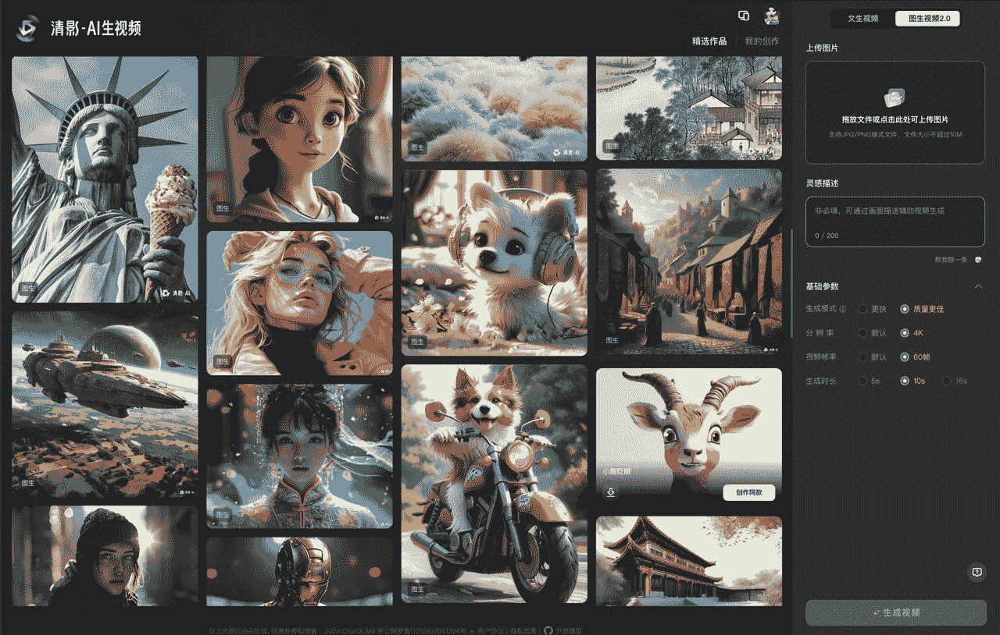

从今天开始，清影迈入新阶段：4k、60 帧超高清画质、任意尺寸，自带音效，以及更好人体动作和物理世界模拟。

基于我们最新的 `CogVideoX` 模型技术进展，新清影在许多方面得到提升。

+ 模型能力全面提升：在图生视频的质量、美学表现、运动合理性以及复杂提示词语义理解方面能力显著增强；更强的人物面部、表演细节、动作连贯性和物理特性模拟，提高了视频的自然度和逼真度。

+ 4K超高清分辨率：支持生成 4K、60 帧超高清视频，视觉体验拉到极致，动态画面更加流畅。

+ 可变比例：支持任意比例的图像生成视频，超宽画幅也能轻松 Hold 住，从而适应不同的播放需求。

+ 多通道生成能力：同一指令/图片可以支持同步生成 4 个视频。

+ 带声效的AI视频：新清影可以生成与画面匹配的音效了。音效功能将很快在本月上线公测。

### 【新清影】Showcase

细节重生，体验AI视频动态真实感，4k、60tps、每一根毛发、每一道纹路，精准捕捉细腻动态。

| 还原物理规律 | 还原物理规律 |
| --- | --- |
| 动物的毛发及表情 | 动物的毛发及表情 |
| 大幅度的镜头调度 | 清晰的纹理呈现 |
| 原彩高色准 | 电影特效 |
| 动作连贯性 | 逼真的面部肌肉细节 |
| 动作连贯性 | 逼真的面部肌肉细节 |
| 多比例（1:1） | 多比例（3:4） |
| 多比例（4:3） | 多比例（9:16） |
| 多比例（16:9） | |

[latent_recon_0.mp4](https://internal-api-drive-stream.feishu.cn/space/api/box/stream/download/all/PGI2bEewjo7Ne5xUiKTc88wgnFf)

[latent_recon_0.mp4](https://internal-api-drive-stream.feishu.cn/space/api/box/stream/download/all/Bt1Qbj9fFo7HXnxOwARce5xXnYU)

[d79844c2-9c0a-11ef-8666-e65c6bc34337_0.mp4](https://internal-api-drive-stream.feishu.cn/space/api/box/stream/download/all/TuzWbv9lxo0pyvxJ2g2cqbjanY9)

[9e53b624-9c14-11ef-a2ac-ae61e9fb88b7_0.mp4](https://internal-api-drive-stream.feishu.cn/space/api/box/stream/download/all/L6R7bEh6uo84pCxd6Qccyt5Wnnh)

[307_1730882102(原视频).mp4](https://internal-api-drive-stream.feishu.cn/space/api/box/stream/download/all/M9llbXHq1oT2zvxzH3qcDtxwnwe)

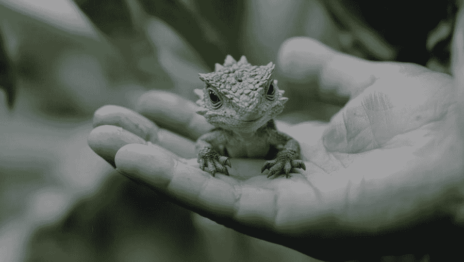

[latent_recon_0.mp4](https://internal-api-drive-stream.feishu.cn/space/api/box/stream/download/all/DULzbrVzeoU4lRxgu5acw1HknZ1)

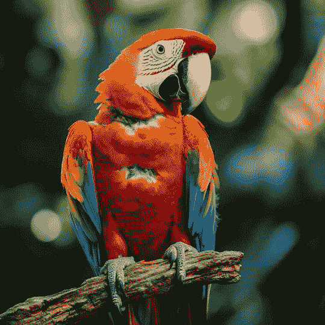

[latent_recon_0 32.mp4](https://internal-api-drive-stream.feishu.cn/space/api/box/stream/download/all/VGUQb5USvobxkMxzmFWcNfNPnsb)

[latent_recon_0.mp4](https://internal-api-drive-stream.feishu.cn/space/api/box/stream/download/all/Tw0LbdV3UoF8ObxVKLscKL8yn0g)

[latent_recon_0.mp4](https://internal-api-drive-stream.feishu.cn/space/api/box/stream/download/all/KmtlbI8mIoGM79xC1Y3c9Rwjnrd)

[latent_recon_0 16.mp4](https://internal-api-drive-stream.feishu.cn/space/api/box/stream/download/all/Fv2kbMEQMolWIzxX7IiceBpin0g)

[latent_recon_0 14.mp4](https://internal-api-drive-stream.feishu.cn/space/api/box/stream/download/all/MfB5bSGYDohy42xECFBcucMcnre)

[latent_recon_0 29.mp4](https://internal-api-drive-stream.feishu.cn/space/api/box/stream/download/all/IxJ7bigQGoF1G6xDw2kce6nmnJc)

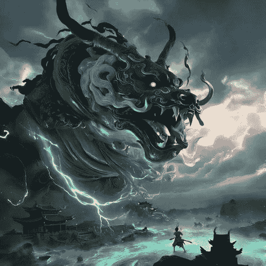

[latent_recon_0.mp4](https://internal-api-drive-stream.feishu.cn/space/api/box/stream/download/all/UW5Fb4qgfonOGWxn7NGc66lwnOe)

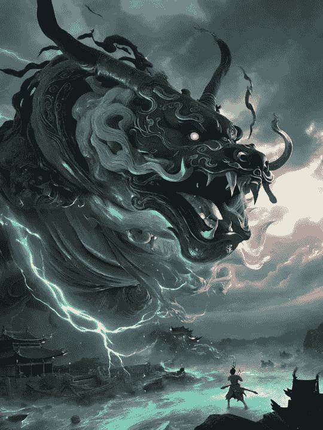

[11月7日 (1).mov](https://internal-api-drive-stream.feishu.cn/space/api/box/stream/download/all/QTZnbANzYogk6MxCiFVc1QZXn8g)

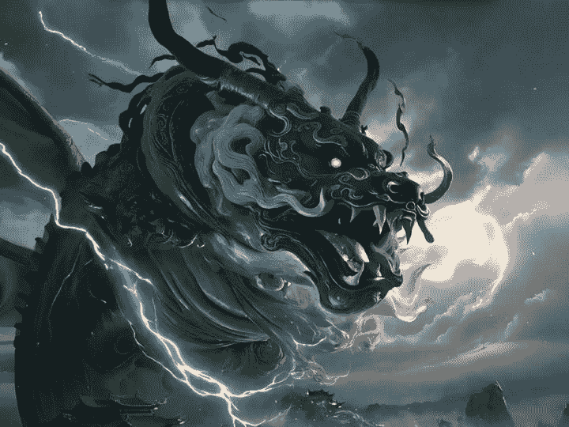

[11月7日 (2).mov](https://internal-api-drive-stream.feishu.cn/space/api/box/stream/download/all/W7pxbTN2qoYejPxYcf4cz4F1nRe)

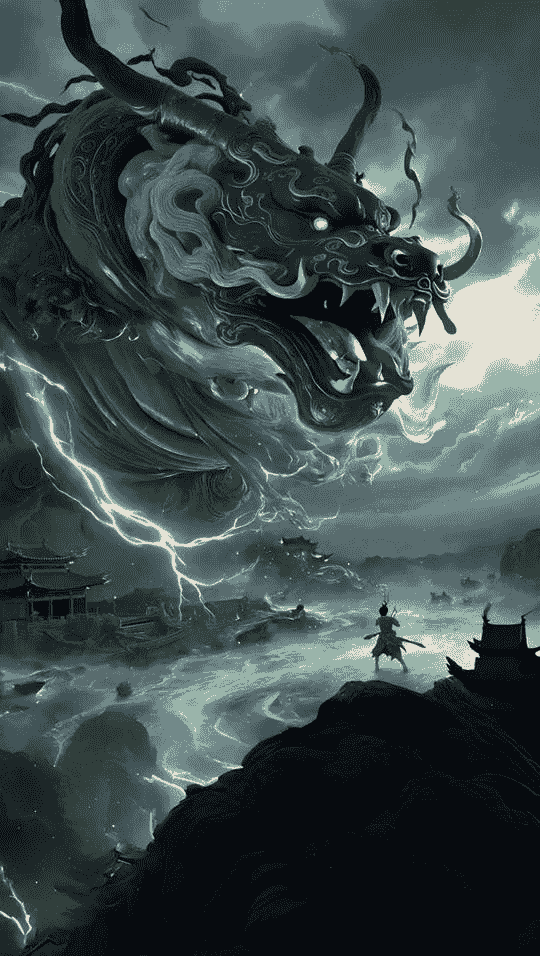

[latent_recon_0.mp4](https://internal-api-drive-stream.feishu.cn/space/api/box/stream/download/all/IDLibtIKooKG2vxHlOEceU6On9f)

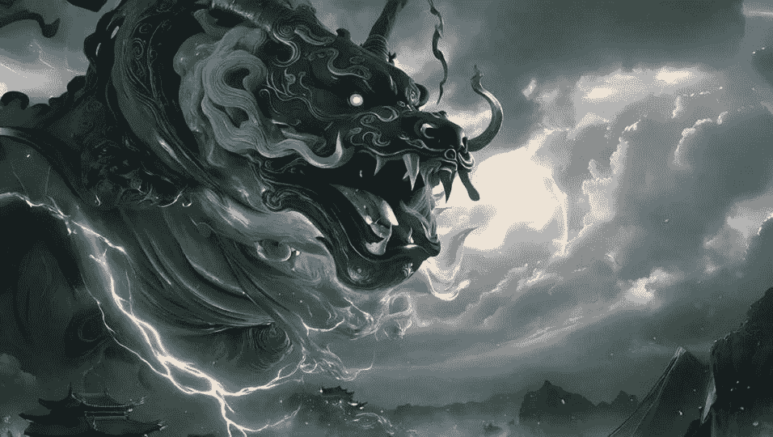

[11月7日 (3).mov](https://internal-api-drive-stream.feishu.cn/space/api/box/stream/download/all/XjTdbxGhBoufM8x5ZkzccrkVnvb)

### 【音效模型CogSound】Showcase

| **场景** | **所有音效均由音效模型生成** |
| --- | --- |
| 巨轮撞向冰山 |  |
| 水下探险 |  |
| 怪物嘶吼 |  |
| 核爆炸 |  |
| 赛车、引擎轰鸣 |  |
| 乐器演奏 |  |
| 动物叫声 |  |
| 动物进食 |  |
| 篝火 |  |
| 森林 |  |
| 小火车 |  |

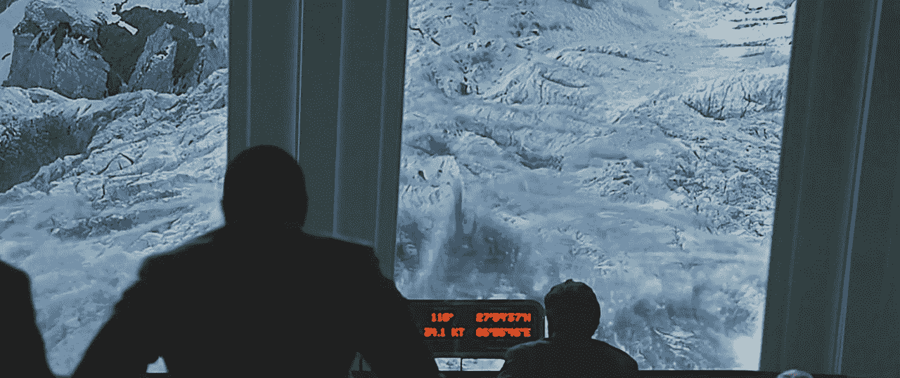

[2012撞冰10s.mp4](https://internal-api-drive-stream.feishu.cn/space/api/box/stream/download/all/P2yqbj7yDou36IxLpmncqMi2nPd)

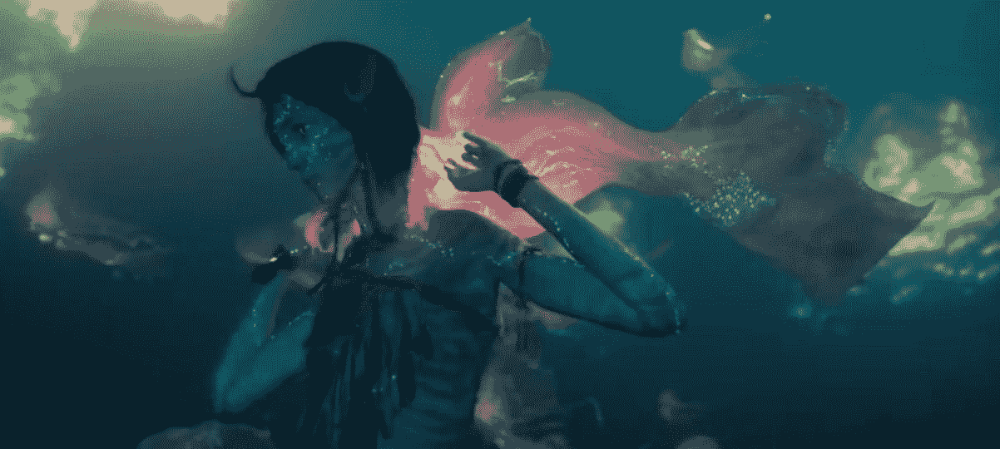

[阿凡达1.10s.mp4](https://internal-api-drive-stream.feishu.cn/space/api/box/stream/download/all/REyTboQYQoJq3xxe4GMcICXTnyc)

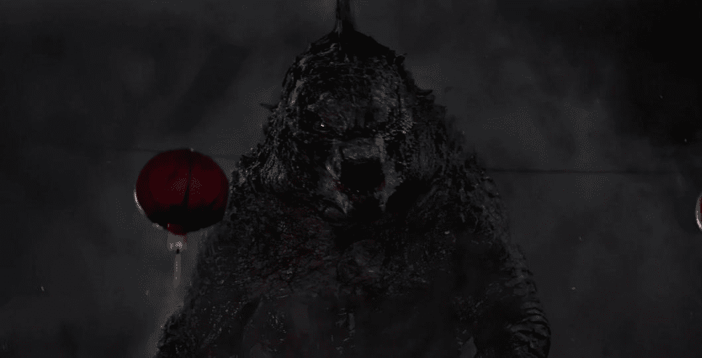

[哥斯拉1.10s.mp4](https://internal-api-drive-stream.feishu.cn/space/api/box/stream/download/all/KmZ7bin4toiDRNxdv5wcoNqknZg)

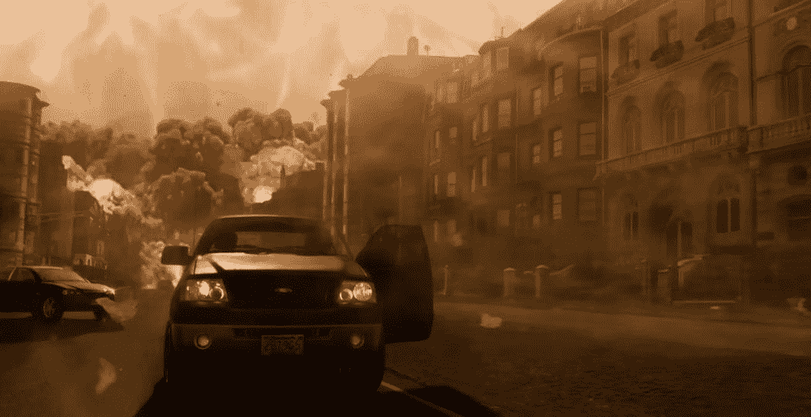

[神秘代码1.10s.mp4](https://internal-api-drive-stream.feishu.cn/space/api/box/stream/download/all/V33dbxsRto02wnxhiABc6E3Zn7f)

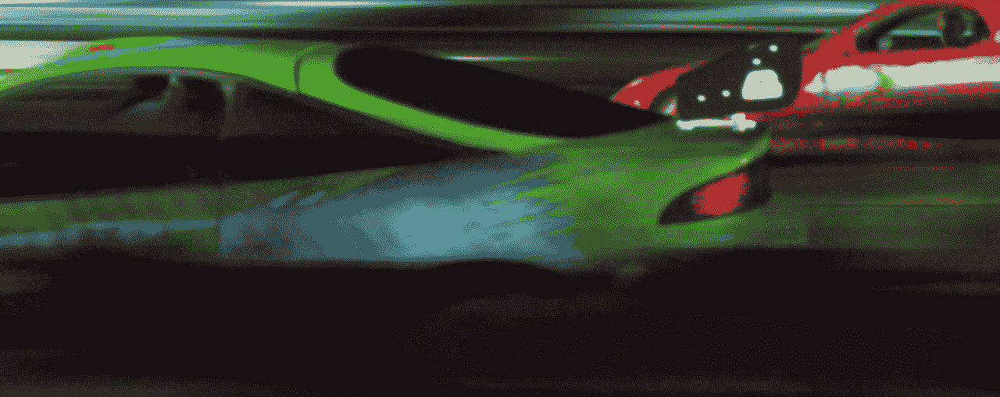

[速度与激情1.10s.mp4](https://internal-api-drive-stream.feishu.cn/space/api/box/stream/download/all/LNKdbLDhWodHX6x3VAfcUBNmnGb)

[飞书20241105-115404.mp4](https://internal-api-drive-stream.feishu.cn/space/api/box/stream/download/all/WJqAbo4oBo2SDfxnq5KckSmcn3c)

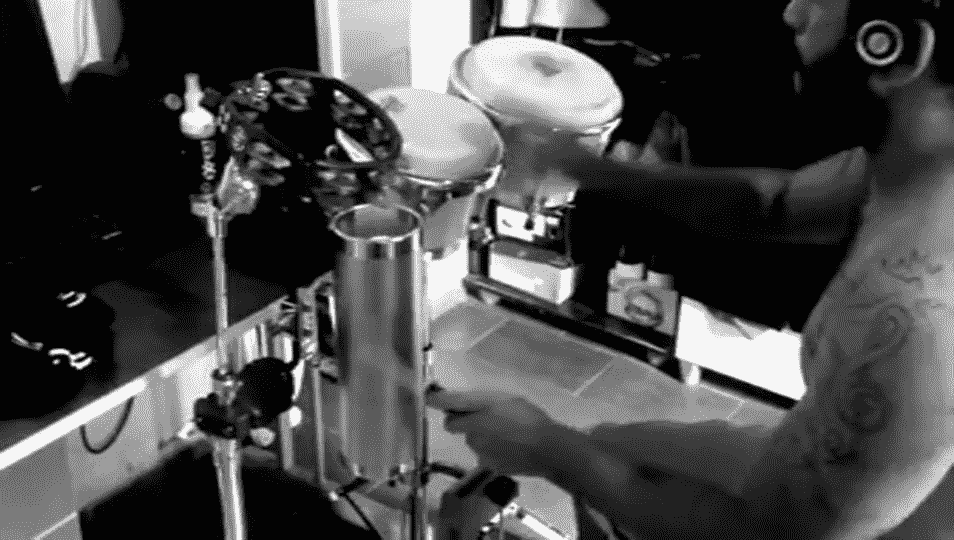

[file_v3_00fu_01430309-a2b1-4eb3-9f88-6ed7a1f6b54g_2-2.mp4](https://internal-api-drive-stream.feishu.cn/space/api/box/stream/download/all/JTAkbBdVOo5nVGxkbBrcgkZondf)

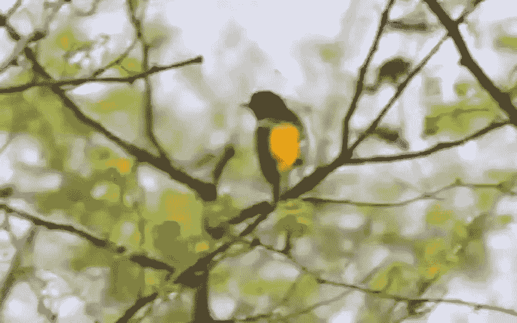

[file_v3_00fu_055f9e18-08ae-4237-b77d-cf192dedf2eg_5-2(2).mp4](https://internal-api-drive-stream.feishu.cn/space/api/box/stream/download/all/REcfbUGHkoNjGWxKkKccbZovnad)

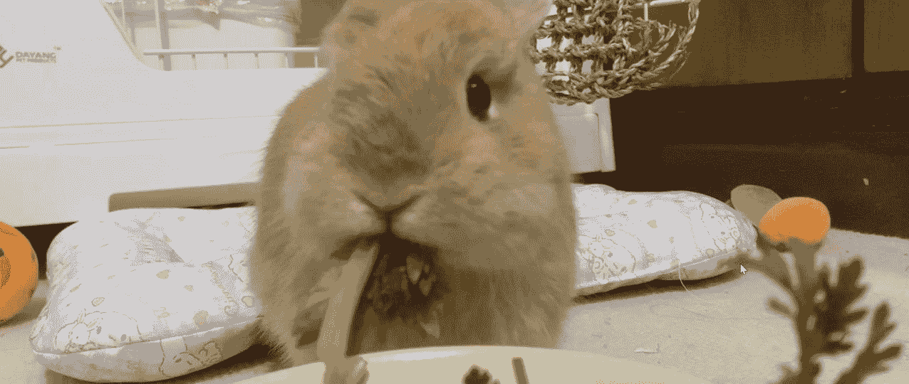

[小兔进食.mp4](https://internal-api-drive-stream.feishu.cn/space/api/box/stream/download/all/Hqx1bG8gNoK3Rcx10bDc5U7Xnph)

[Demo5-2.mp4](https://internal-api-drive-stream.feishu.cn/space/api/box/stream/download/all/Ml5Sbfeaaog82BxjHSocJyfCnEg)

[latent_recon_0 (10).mp4](https://internal-api-drive-stream.feishu.cn/space/api/box/stream/download/all/OZ3obUlSIoaVmIxOSCJcm23YnBZ)

[11月6日.mov](https://internal-api-drive-stream.feishu.cn/space/api/box/stream/download/all/RIjLbWP4noZEduxZbbQcn7p4nOd)

## 文生视频技巧专区

### 🤔什么是文生视频？

输入一段文字，清影大模型根据文本表达将您的文字转变为视频画面。

✅【文生视频】可选“速度更快”or“质量更佳”两种模式，无论追求创作速度还是画面更高表现力，都能满足需求！

### ⚠️技巧 1：提示词最重要的守则：结！构！性！

当提示词有**清晰的结构**时，提示效果是最有效的。

使用以下结构有助于生成期望的结果：

> **简单公式：**[摄像机移动]+[建立场景]+[更多细节]
>
> **复杂公式：**[镜头语言] + [光影] + [主体 (主体描述)] + [主体运动] + [场景 (场景描述)] + [情绪/氛围/风格]

**无结构提示词：**小男孩喝咖啡

**有结构的提示词：**摄影机平移（镜头移动），一个小男孩坐在公园的长椅上（主体描述），手里拿着一杯热气腾腾的咖啡（主体动作）。他穿着一件蓝色的衬衫，看起来很愉快（主体细节描述），背景是绿树成荫的公园，阳光透过树叶洒在男孩身上（所处环境描述）。

| **类型** | **无结构提示词** | **有结构的提示词** |
| --- | --- | --- |
| **prompt** | 小男孩喝咖啡 | 摄影机平移，一个小男孩坐在公园的长椅上，手里拿着一杯热气腾腾的咖啡。他穿着一件蓝色的衬衫，看起来很愉快，背景是绿树成荫的公园，阳光透过树叶洒在男孩身上。 |
| **视频效果** |  |  |

[a9c8b0e7-8384-5877-820f-02ad3dc3965d_0.mp4](https://internal-api-drive-stream.feishu.cn/space/api/box/stream/download/all/Kv89bBmlLoVIcnxBrficijbYnVg)

[eea46e02-9b82-5aac-a23e-846227ca8da4_0.mp4](https://internal-api-drive-stream.feishu.cn/space/api/box/stream/download/all/PcbcbC4k7oaNnAx3mnJcorNTngh)

### ⚠️技巧 2：提示词优化

还有三个原则：

**强调关键信息**：在提示的不同部分重复或强化关键词有助于提高输出的一致性。例如，摄像机以超高速镜头快速飞过场景。（其中的“超高速”、“快速”就是重复词）

**聚焦出现内容**：尽量让你的提示集中在场景中应该出现的内容上。例如，你应该提示晴朗的天空，而不是没有云的天空。

**规避负面效果**：为了进一步保障视频生成质量，可以在提示词中写明不需要的效果。例如：“不出现扭曲、变形、模糊的场景。”

#### ✍️怎么写一个提示词？

首先，要明确场景中的人物和冲突是什么，这是推动整个场景发展的关键因素。例如，在一个追逐场景中，冲突可能是间谍试图逃脱追赶者的追捕。

其次，是对场景进行详细的描述，包括地点、人物形象、任务动作等细节。使用生动的动词来营造动态和戏剧化的氛围，如“匆匆前行”、“缓缓旋转”等。例如：“在昏暗的街道上，雨滴如注，一个孤独的行人匆匆前行。”

第三，加强镜头语言，镜头语言是通过摄影机的移动或焦距变化来表现画面内容的一种方式。常用的镜头运动包括推、拉、摇、移、升、降等。每种镜头运动都有其特定的作用和效果：

+ **推镜头**：逐渐聚焦在某一角色的面部表情上，突出表现该角色的情感变化。
+ **拉镜头**：逐渐远离主体，展示环境或背景，形成一种运动的主体不变、静止的背景变化的造型效果。
+ **摇镜头**：跟随主体运动的表现方式，可以突出主体的同时，又可以交待主体运动方向、速度、体态及其与环境的关系。

提示词要具体明确且符合物理规律，使用简单且清晰的语言。

### ⚠️技巧 3：使用免费赠送的官方小工具

为了让大家快速上手，我们为大家制作了一个帮写视频提示词的智能体，输入简单的场景就可以获得 3 个优质提示词（专业！）。

#### 使用地址➡️：[清影提示词智能体](https://chatglm.cn/main/gdetail/669911fe0bef38883947d3c6)

#### 使用示例：

| **原始提示词** | **小男孩喝咖啡** |  |  |
| --- | --- | --- | --- |
| **视频** |  |  |  |
| **优化提示词** | **版本 1** | **版本 2** | **版本 3** |
|  | 提示词1：赛博朋克风格（Cyberpunk Style） | 提示词2：黑白电影风格（Black and White Film Style） | 提示词3：日式卡通风格（Anime Style） |
| **视频** |  |  |  |

[5b0bf9b6-0b68-53b6-a5de-0d4890a1ad35_0.mp4](https://internal-api-drive-stream.feishu.cn/space/api/box/stream/download/all/McISbyIatoZvPsxJC9kcpvqlnTe)

[a2e1451b-3467-5e45-8a37-9b5436b39e3d_0.mp4](https://internal-api-drive-stream.feishu.cn/space/api/box/stream/download/all/LbWmbz4tVoZtYRxf43AcHyNTnrc)

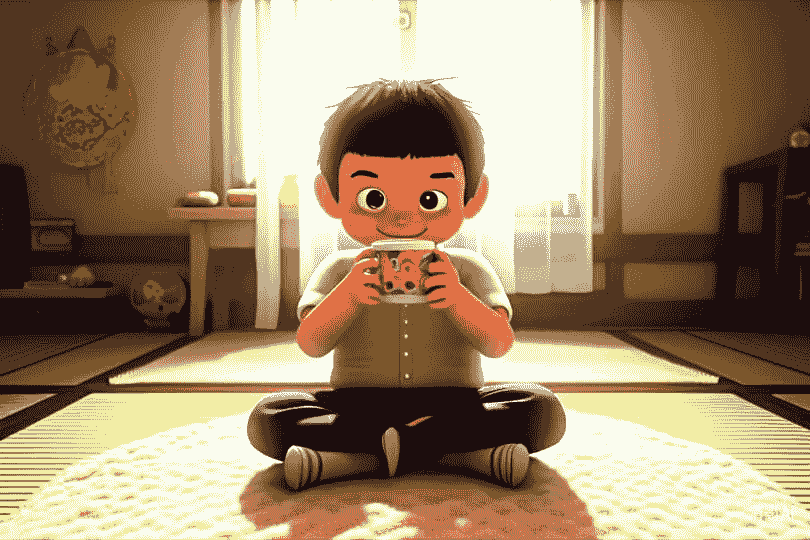

[50d82059-f980-59dc-ab81-3fd265981f13_0.mp4](https://internal-api-drive-stream.feishu.cn/space/api/box/stream/download/all/GwHgbhb8MoWdZQxCGtHcGkrLnKh)

### ⚠️技巧 4：大力出奇迹，多抽几次卡！（可能是最重要的 Tips 之一）

大模型输出具有不稳定性，多试几次会有小惊喜，得到你满意的结果。

以下是同一个提示词抽出的不同的视频，差距很大。

| **提示词** | **小男孩喝咖啡** |  |  |  |  |
| --- | --- | --- | --- | --- | --- |
| **抽卡结果** | **版本 1** | **版本 2** | **版本 3** | **版本 4** | **版本 5** |
|  |  |  |  |  |  |
| **效果等级** | 三星 | 二星 | 二星 | 三星 | 五星 |

[a9fe3e26-bb31-5482-88da-ad63b74c0732_0.mp4](https://internal-api-drive-stream.feishu.cn/space/api/box/stream/download/all/WUMwbeB51oQGdixNojtcd6v3nPg)

[59b88bd0-e89d-5939-b8f2-277b46b4be58_0.mp4](https://internal-api-drive-stream.feishu.cn/space/api/box/stream/download/all/VCWZbiSf1o7rjexp3NVcXwCNn5r)

[b688cc8d-eb8e-5619-ab3c-d132feb28a3d_0.mp4](https://internal-api-drive-stream.feishu.cn/space/api/box/stream/download/all/SP9Ab5mMYoaoAYxvR3eckb6Mnph)

[88b7d088-6fab-568d-aa5b-d4364fd7daef_0.mp4](https://internal-api-drive-stream.feishu.cn/space/api/box/stream/download/all/DTLMbrDYwovDonxeuxIcUMfan0c)

[d0779722-ba0b-5e20-a879-c29d09a8b24b_0.mp4](https://internal-api-drive-stream.feishu.cn/space/api/box/stream/download/all/H9zVbDcdQogXo7x2a65cUuXNnMf)

### ⚠️技巧5：提示词之电影风格

在提示词中添加“电影风格”，可以更好地指定视频的呈现效果。

| **电影风格** | **基础风格** | 科幻风格 | 西部风格 | 犯罪风格 | 恐怖风格 | 黑色风格 |
| --- | --- | --- | --- | --- | --- | --- |
| **视频** |  |  |  |  |  |  |
| **提示词** | 一个乐高积木小人在高速公路上开跑车 | 科幻风格，一个乐高积木小人在高速公路上开跑车 | 西部风格，一个乐高积木小人在高速公路上开跑车 | 犯罪风格，一个乐高积木小人在高速公路上开跑车 | 恐怖风格，一个乐高积木小人在高速公路上开跑车 | 黑色电影（Noir）风格，一个乐高积木小人在公路上开车 |

# 视频生成提示词指南

[video_gen1723777119725.mp4](https://internal-api-drive-stream.feishu.cn/space/api/box/stream/download/all/QFm0bvz0locdUCxzNHicaRNPnEu)
[video_gen1723777393327.mp4](https://internal-api-drive-stream.feishu.cn/space/api/box/stream/download/all/AapPbXcK3oJfDBxL7dUcm8Szn6d)
[video_gen1723777483251.mp4](https://internal-api-drive-stream.feishu.cn/space/api/box/stream/download/all/BwPAbZj9Soufg6xKRmYc6znYnQh)

[video_gen1723778275445.mp4](https://internal-api-drive-stream.feishu.cn/space/api/box/stream/download/all/F2nPbMGYeoHqJoxv0ArcKZu5nqf)

[video_gen1723778452718.mp4](https://internal-api-drive-stream.feishu.cn/space/api/box/stream/download/all/Vi38bf5UcoCDdMxVoyucjMW8nfe)

[video_gen1723779533068.mp4](https://internal-api-drive-stream.feishu.cn/space/api/box/stream/download/all/NWhMbV3k0oCfCyxpKEWchFhonEc)

> 电影风格小词库
> 科幻、西部、浪漫、犯罪、恐怖、黑色、喜剧、剧情、动作、动画、悲剧、史诗、古典……

## ⚠️ 技巧6：提示词之艺术风格

在提示词中添加“艺术家/艺术作品风格”，可以更好地指定视频的呈现效果。

| 艺术风格 | 梵高 | 威廉·透纳 | 古斯塔夫·克里姆特 | 莫奈 | 草间弥生 | 弗里达·卡罗 | 爱德华·蒙克 |
| --- | --- | --- | --- | --- | --- | --- | --- |
| 视频 | | | | | | | |
| 提示词 | 参考风格：文森特·梵高，种子发芽破土而出 | 参考风格：威廉·透纳，种子发芽破土而出 | 参考风格：古斯塔夫·克林姆特，种子发芽破土而出 | 参考风格：莫奈（Claude Monet），种子发芽破土而出 | 参考风格：草间弥生（Yayoi Kusama），几个蘑菇破土而出 | 参考风格：弗里达·卡罗，种子发芽破土而出 | 参考风格：爱德华·蒙克，种子发芽破土而出 |

[video_gen1723789388234.mp4](https://internal-api-drive-stream.feishu.cn/space/api/box/stream/download/all/M1VRbI27OoWWTqx9WK2clo9gnK0)

[video_gen1723791671678.mp4](https://internal-api-drive-stream.feishu.cn/space/api/box/stream/download/all/JOJ7bC14foPhFXxhSG0cm6Ozn1b)

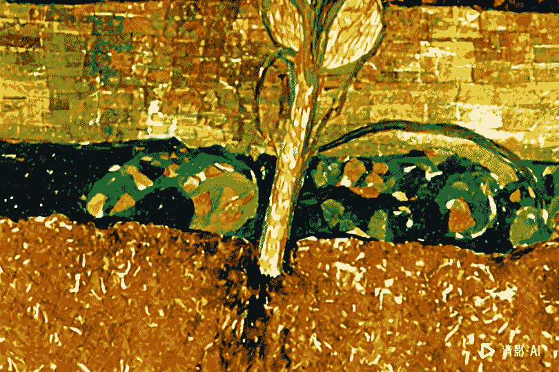

[video_gen1723790013741.mp4](https://internal-api-drive-stream.feishu.cn/space/api/box/stream/download/all/DTGRbKFkao2f7BxDdhccMjM9n6f)

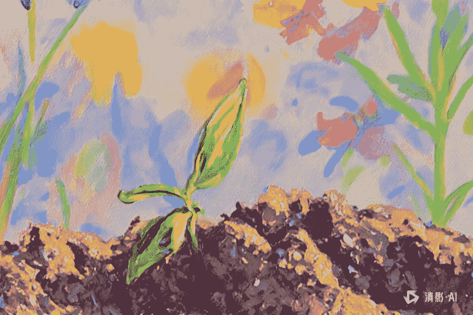

[video_gen1723790405349.mp4](https://internal-api-drive-stream.feishu.cn/space/api/box/stream/download/all/OCedbVLz6oKqJaxqtOtcUxATnpI)

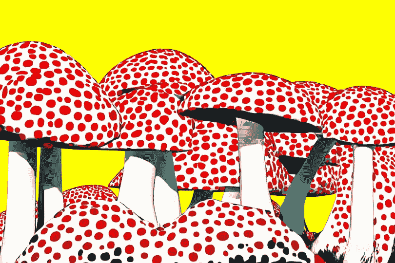

[video_gen1723790629412.mp4](https://internal-api-drive-stream.feishu.cn/space/api/box/stream/download/all/ZBYubf1wOoAHiNxOFlxc9ZZanIh)

[video_gen1723791382860.mp4](https://internal-api-drive-stream.feishu.cn/space/api/box/stream/download/all/S2uEb7DUToSc7LxfG0Zcmdx1nVd)

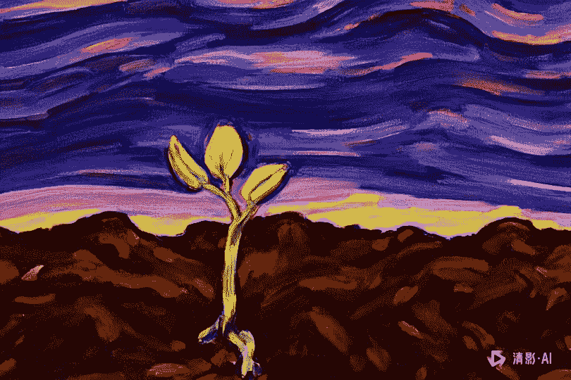

[video_gen1723792166421.mp4](https://internal-api-drive-stream.feishu.cn/space/api/box/stream/download/all/GJcJbBMrooFdIlxMdWXcnhDBnqc)

> 艺术风格小词库

+ 梵高（Vincent van Gogh） 后印象派风格，以其强烈的色彩和动感的笔触著称。
+ 马克斯·梅勒（Max Ernst） 超现实主义，使用荒诞、梦幻的元素。
+ 杜尚（Marcel Duchamp） 达达主义和概念艺术，挑战传统艺术定义。
+ 杰克逊·波洛克（Jackson Pollock） 抽象表现主义，以其独特的滴画技法闻名。
+ 雷内·马格里特（René Magritte） 超现实主义，以其神秘和哲学性质的作品著称。
+ 弗里达·卡罗（Frida Kahlo） 表现主义和墨西哥传统艺术风格，作品充满个人情感和象征意义。
+ 毕加索（Pablo Picasso） 立体主义和多种其他风格，以其解构和重构形状的方式知名。
+ 莫奈（Claude Monet） 印象派，以其对光线和色彩变化的细腻捕捉著称。
+ 威廉·透纳（J.M.W. Turner） 浪漫主义，以其戏剧化的光影和色彩运用闻名。
+ 爱德华·蒙克（Edvard Munch） 表现主义，以其强烈的情感表达和象征性画面著称。
+ 草间弥生（Yayoi Kusama） 波普艺术和抽象艺术，以其重复的图案和强烈的色彩对比著称。
+ 安迪·沃霍尔（Andy Warhol） 波普艺术，以其丝网印刷和重复图像的使用知名。
+ 达利（Salvador Dalí） 超现实主义，以其梦幻般的场景和精细的细节处理著称。
+ 古斯塔夫·克里姆特（Gustav Klimt） 新艺术运动和象征主义，以其装饰性图案和金色运用闻名。
+ 布鲁诺·毕加索（Bruno Picasso） 先锋派和实验性艺术，以其创新和跨媒介的作品著称。

## ⚠️ 技巧7：提示词之镜头语言

| 镜头语言 | 延时 | 第一人称视角（FPV） | 水下摄影 | 俯视 | 特写 |
| --- | --- | --- | --- | --- | --- |
| 视频 | | | | | |
| 提示词 | 延时摄影风格，一朵白色的芍药花逐渐盛开，背景是纯黑的 | 第一人称视角，我漫步在清晨的森林小径上，一切都是那么清新而宁静。阳光透过层层叠叠的树叶，洒下斑驳的光影。 | 水下摄影，一只柯基幼崽在阳光照耀的大型泳池中优雅地游泳，从水下视角捕捉柯基幼崽的微笑 | 俯视视角，田野间蜿蜒的小溪像一条银色的丝带穿梭在绿色的田野中。农民们忙碌的身影在田间显得格外渺小，他们有的在耕作，有的在收割，每一个动作都显得井然有序。 | 特写镜头，大卫雕像手持可乐 |

[video_gen1723793747195.mp4](https://internal-api-drive-stream.feishu.cn/space/api/box/stream/download/all/KF8Lbm8YnoSumExHv2zca1vwnAd)

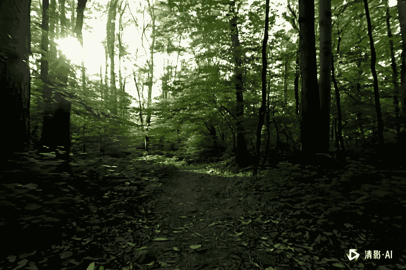

[video_gen1723795354758.mp4](https://internal-api-drive-stream.feishu.cn/space/api/box/stream/download/all/CTV8bUspeou2FzxQVEScovAGnDB)

[video_gen1723797058173.mp4](https://internal-api-drive-stream.feishu.cn/space/api/box/stream/download/all/LFaIbaTF6olHYnxzwMPcsM2vn7D)

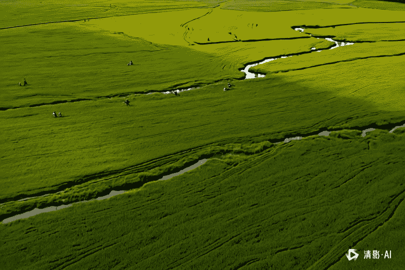

[video_gen1723798024300.mp4](https://internal-api-drive-stream.feishu.cn/space/api/box/stream/download/all/FFNcbiMGgog3wixltGlcxaESnSa)

[video_gen1723796367648.mp4](https://internal-api-drive-stream.feishu.cn/space/api/box/stream/download/all/Q6rbbe73yoULiYxLwPGcTfTXngb)

## ShowCase 专区

| 卡通动漫 | | | | | | | | |
| --- | --- | --- | --- | --- | --- | --- | --- | --- |
| `prompt` | | | | | | | 使用水彩画风格拍摄，中景，宇航员穿着白色宇航服，坐在月亮表面，慢慢弹吉他，周围有音符飘出，远处是地球的轮廓，画面色彩柔和，充满梦幻感，周围环境是模糊的星空背景，氛围宁静，4K高清。 | |
| 视频 | | | | | | | | |
| 真实生活 | | | | | | | | |
| `prompt` | | x | | x | 山间的野餐布上，各式各样的野餐食品错落有致，新鲜的水果、香脆的面包、还有刚烤好的香肠，四周是郁郁葱葱的树木和远处传来的鸟鸣。 | 豪华游艇的甲板上，一张圆桌被布置得优雅而浪漫，桌上摆放着香槟和精美的海鲜拼盘，海风轻拂，波光粼粼的海面在夕阳下闪烁着金色的光芒。 | 手撩头发轻盈，自然的眨眼，笑起来 | 美丽的油画少女，年轻女子，光透过树叶形成斑驳的影子，柔光落在她的脸上 |
| 视频 | | | | | | | | |
| 艺术创作 | | | | | | | | |
| `prompt` | 木头上长出两朵奇特的透明塑料花，花瓣闪闪发光，花瓣是淡粉色的，花瓣被风吹动 | | | 黑白老照片风格，80年代，两个小孩在玩滑板车 | 摄像机围绕着一大堆老式电视旋转，这些电视播放着不同的节目——20世纪50年代的科幻电影、恐怖电影、新闻、静态、70年代的情景喜剧等，背景设在纽约博物馆的一个大型画廊里。 | 深海里的一艘沉船，电影质感，由远到近 | 庭院中，苏轼在月光下起舞。镜头环绕苏轼旋转，捕捉其舞动的身影和清影。 | 落霞与孤鹜齐飞，秋水共长天一色 |
| 视频 | | | | | | | | |
| 脑洞大开 | | | | | | | | |
| `prompt` | | 达芬奇和最后的晚餐里的人物觥筹交错，相谈甚欢，中近景，人物要求清晰，注意细节 | 一名宇航员和一名外星人在火星上握手，背景中有一艘火箭。 | 猴子们在电脑前打工 | 土豆变薯条 | 粉色怪兽张大嘴巴说话 | 千与千寻电影画面里出现好多好吃的 | 卡皮巴拉吃披萨 |
| 视频 | | | | | | | | |
| bgm大片纯享 | | | | | | | | |
| `prompt` | 蘑菇变成小熊 | 在霓虹灯闪烁的赛博朋克风格城市夜景中，手持跟拍的镜头缓缓推近，一个机械风格的小猴子正在用高科技工具维修，周围是闪烁的电子设备和未来主义的装修材料。赛博朋克风格，气氛神秘，4K高清。 | 末日来临，穿着宇航服的航天员缓缓朝着飞船走去，眼神中透露着对地球的不舍，注意细节刻画，废土风 | 广告拍摄视角，黄色背景，白色桌子上，画面中一个土豆被扔下来变成一份薯条 | 低角度向上推进，缓缓抬头，冰山上突然出现一条恶龙，然后恶龙发现你，冲向你。好莱坞电影风 | 写实描绘，近距离，猎豹卧在地上睡觉，身体微微起伏 | 在一片森林中，人视，参天大树遮蔽着太阳，树叶的缝隙中洒下一些阳光，丁达尔效应 | 山间的野餐布上，各式各样的野餐食品错落有致，新鲜的水果、香脆的面包、还有刚烤好的香肠，四周是郁郁葱葱的树木和远处传来的鸟鸣。 |
| 视频 | | | | | | | | |

[0fd1b5d5-4d3d-5985-87f8-6d37b10ef77b_0.mp4](https://internal-api-drive-stream.feishu.cn/space/api/box/stream/download/all/IccOboQLJoV0qex4hjtcWwbHnJw)

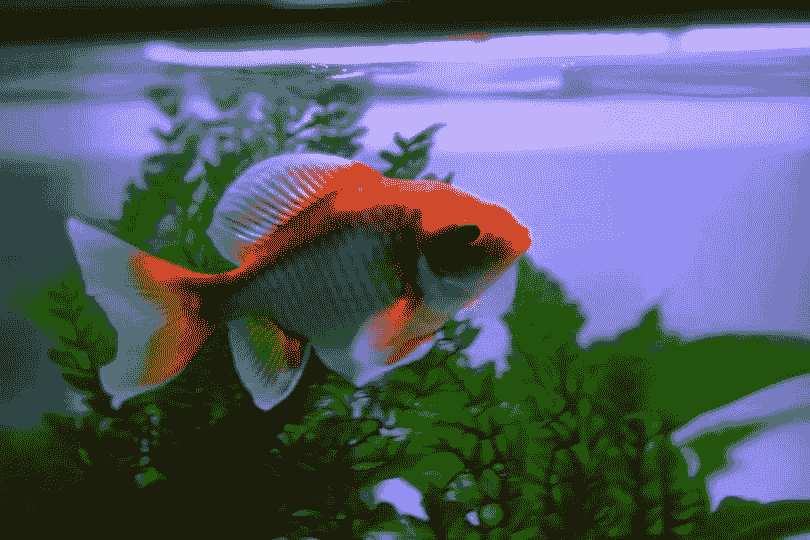

[7.mp4](https://internal-api-drive-stream.feishu.cn/space/api/box/stream/download/all/Wi06bHRIxoJfBHxrqnnc7HA8n6c)

[10.mp4](https://internal-api-drive-stream.feishu.cn/space/api/box/stream/download/all/MPIZbTIpuo2Q7rxCIWXcLPVln0b)

[11.mp4](https://internal-api-drive-stream.feishu.cn/space/api/box/stream/download/all/BhkAbAkqFobY5Oxf4ihcF4TMnwf)

[13.mp4](https://internal-api-drive-stream.feishu.cn/space/api/box/stream/download/all/ThY1bNVQdoqMcTx1Pd5cERvHnTh)

[14.mp4](https://internal-api-drive-stream.feishu.cn/space/api/box/stream/download/all/Ba92boIB1oRhUxxMArYc0cgBnRH)

[8.mp4](https://internal-api-drive-stream.feishu.cn/space/api/box/stream/download/all/P7hBbrieWoK7ODxWJU9csTdOnTe)

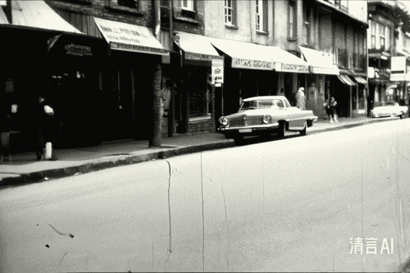

[965d523e-05bc-55a8-9031-f660c2ba2c8c_0.mp4](https://internal-api-drive-stream.feishu.cn/space/api/box/stream/download/all/BqdKbNUaOoQF9FxzDgHcjez6nSa)

[0da0bff0-4ba6-53bd-8584-e8267acf11fc_0.mp4](https://internal-api-drive-stream.feishu.cn/space/api/box/stream/download/all/J8FKbSACYoUa54xTtwuc1hV2nzd)

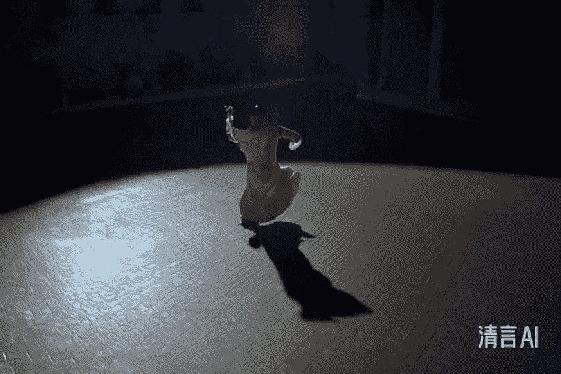

[2d5659c2-a96f-56da-81e0-878ad17e203c_0.mp4](https://internal-api-drive-stream.feishu.cn/space/api/box/stream/download/all/KOxqbJXUwok9haxIDihcIZmhnsd)

[5e2ed912-78b3-57d1-aa3c-3014f42ccfe3_0.mp4](https://internal-api-drive-stream.feishu.cn/space/api/box/stream/download/all/IgDdb9jmqocNnaxusGCctBTvnQe)

[000000.mp4](https://internal-api-drive-stream.feishu.cn/space/api/box/stream/download/all/ScfQb78eMoKNd9xx79Mc3aOGnxf)

[000000-3.mp4](https://internal-api-drive-stream.feishu.cn/space/api/box/stream/download/all/MUMfbfF8aory1uxqlFGcwMl0nic)

[猴子打工.mp4](https://internal-api-drive-stream.feishu.cn/space/api/box/stream/download/all/QckNbhs00oYHvhx79ECcZ6aqnBd)

[土豆变薯条.mp4](https://internal-api-drive-stream.feishu.cn/space/api/box/stream/download/all/IsnlbLjKzorM5dxi5Xrccn21nMg)

[粉色怪兽.mp4](https://internal-api-drive-stream.feishu.cn/space/api/box/stream/download/all/RvWzbGs1UoawW8x2M3DcZ1JznGg)

[千与千寻好多吃的.mp4](https://internal-api-drive-stream.feishu.cn/space/api/box/stream/download/all/Zg7fbOfsooIRjYxyD6FcHJqRnie)

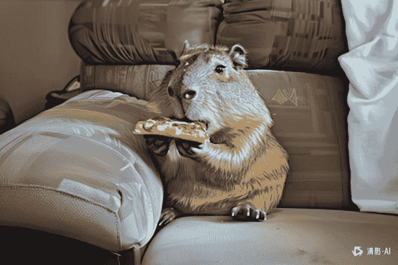

[卡皮巴拉吃披萨.mp4](https://internal-api-drive-stream.feishu.cn/space/api/box/stream/download/all/IXqcbLax6oQniBxwBnpcixI0nRh)

[2.蘑菇变小熊（音乐版）.mp4](https://internal-api-drive-stream.feishu.cn/space/api/box/stream/download/all/AKYhbRsrxotjqyxDbVTc2R87nzf)

[10.赛博吗喽黑客（音乐版）.mp4](https://internal-api-drive-stream.feishu.cn/space/api/box/stream/download/all/LNAlbdVwEoJV9dx6GyTcYRXYncP)

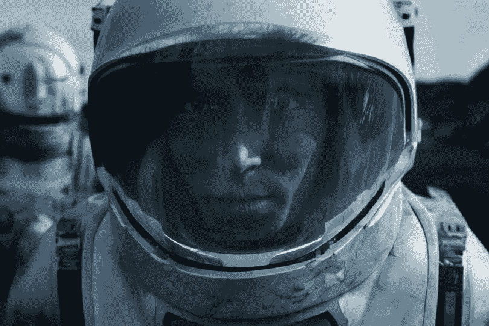

[3.末日宇航员（音乐版）.mov](https://internal-api-drive-stream.feishu.cn/space/api/box/stream/download/all/XrZgb0kTKo1x64xqelPcS3shnvb)

[8.土豆变薯条（音乐版）.mov](https://internal-api-drive-stream.feishu.cn/space/api/box/stream/download/all/V7pSb6afToiYu2xDZtPchvoMnyb)

[1.冰山恶龙（音乐版）.mov](https://internal-api-drive-stream.feishu.cn/space/api/box/stream/download/all/SBOvbJeQBoazXRxq4jBcROhanUb)

[5.猎豹小憩（音乐版）.mov](https://internal-api-drive-stream.feishu.cn/space/api/box/stream/download/all/A4MFbC2R8o0qI5xNzt6cW8XcnDo)

[7.阳光森林_prob4（音乐版）.mov](https://internal-api-drive-stream.feishu.cn/space/api/box/stream/download/all/A3aYbNdjWobziuxCfi2cvLAqnig)

[6.山间野餐（音乐版）.mov](https://internal-api-drive-stream.feishu.cn/space/api/box/stream/download/all/MCupbRWUroMBFlxyqpXckTbYnYb)

# 图生视频技巧专区

## 🤔 什么是图生视频？

输入一张图片+相应的提示词，清影大模型将根据提示将图片转变为视频画面。您也可以只输入一张图片，清影大模型将自行发挥想象力，把图片扩展为一段有故事的视频。

✅ `图生视频` 可选 `速度更快` 或 `质量更佳` 两种模式，无论追求创作速度还是画面更高表现力，都能满足需求！

可生成 `原图` / `9:16` / `16:9` / `1:1` / `3:4` / `4:3` 六种比例，竖屏、横屏全兼备，完美适配不同媒体场景！

如果原图不够清晰，会影响模型对图片的识别，可以采用分辨率提升工具将图片变清晰。

## 👍 两个小技巧

### ⚠️ 技巧 1：选用 尽可能清晰 的图片

支持多种比例上传，清影支持上传 `png` 和 `jpeg` 图像。

### ⚠️ 技巧 2：提示词要 `简单清晰`

1️⃣ 可以选择不写 `prompt`，直接让模型自己操控图片动起来。

2️⃣ 明确你想动起来的 `主体` 并以 `主体` + `主题运动` + `背景` + `背景运动` 的方式撰写提示词（一定要有 `主体`，不然可能会出现 AI 狂乱景象）

如果你不明确大模型如何理解你的图片，推荐将照片发送到清言对话框进行识图，明确你的 `主体` 该如何描述。

## 再加一个小技巧！使用免费赠送的官方小工具

为了让大家快速上手，我们还为大家制作了一个帮写视频提示词的智能体。

### 使用地址➡️：[清影提示词（图生视频专用）](https://chatglm.cn/main/gdetail/669fb16ffdf0683c86f7d903)

### 图生视频 `prompt` 效果展示

| 原始图片 | 提示词 | 提示词说明 | 视频效果 |
| --- | --- | --- | --- |
| 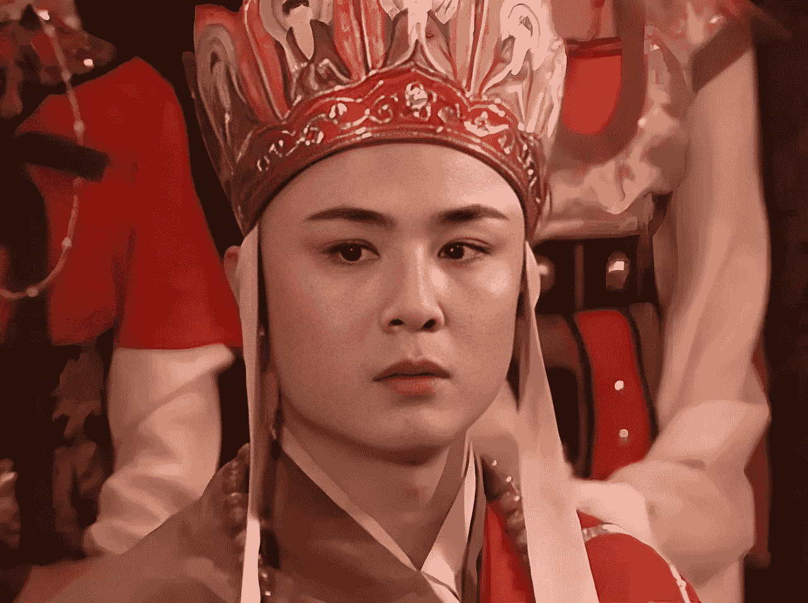 | 无提示词 | 无提示词 |  |
|  | 戴眼镜 | 无主体，唐僧未能遵从指令戴上墨镜 |  |
|  | 唐僧伸出手，戴上墨镜 | 有 `主体` |  |

[c1c5f954-64a1-581e-8d73-e42a5a55fa3f_0.mp4](https://internal-api-drive-stream.feishu.cn/space/api/box/stream/download/all/GHAAbBqYLoAPrgx55KCcDVrwnRe)

[46c24d0c-cf11-5c6f-bd5e-3b62863eaf51_0.mp4](https://internal-api-drive-stream.feishu.cn/space/api/box/stream/download/all/SE1Wbu4yVoZE6wxWsOKcqk70nsc)

[7月22日.mov](https://internal-api-drive-stream.feishu.cn/space/api/box/stream/download/all/XWSqbOuM9ouNBMxJABRcFKUyn9c)

## ShowCase 专区

| 梗图表情 |  |  |  |  |  |  |  |
| --- | --- | --- | --- | --- | --- | --- | --- |
| `prompt` | 甄嬛眉庄跨屏拥抱 | 小猫张大嘴，脸上是困惑表情，很多问号 | 图中的小猫带上了眼镜，叫了一声 | 图中的小人眨眨眼睛，旁边的爱心在动，画风保持原图一致 | 女子的泪从脸上流下来，眼神中是震撼、不解与绝望 | 图中的蜡笔小新眨眨眼睛，表情小委屈，旁边的星星在转动 | 画中鸡踩着滑板飞快的滑行着 |
| 视频 |  |  |  |  |  |  |  |
| 艺术创作 |  |  |  |  |  |  |  |
| `prompt` | 一个法师正在海浪中施展法术，宝石将海水都聚集过来，打开了一道魔法传送门 | 汹涌的海啸淹没了村庄 | 一条龙的口中喷射出火焰，烧毁了一个小村庄 | 镜头拉近到人物震惊的脸上 | 游戏场景在下雨，人物看起来非常担心 | 从高角度拍摄，镜头迅速跨越整个城市 | 一棵神奇的紫色树开始在地面中央生长 |
| 视频 |  |  |  |  |  |  |  |
| 老照片 |  |  |  |  |  |  |  |
| `人物` | 布拉德皮特 | 奥黛丽赫本 | 爱因斯坦 | 陈红 | 胡适 | 末代格格王敏彤 | 张柏芝 |
| `prompt` | 图中男子站起来，风吹着他的头发 | 旋转拍摄，表情冷艳 | 掏出一个苹果手机拍照 | 莞尔一笑，轻轻低下头 | 转身离开 | 轻轻摇扇子，微微笑 | 戴上了鲜艳的红领巾 |
| 视频 |  |  |  |  |  |  |  |
| bgm大片纯享 |  |  |  |  |  |  |  |
| `prompt` | 无提示词 | 水豚慵懒地用吸管喝可乐，扭头朝向相机 | The primitive man raises his hand. The camera zooms out. | celine, classic photograph from Life magazine | An astronaut plays guitar in space, weightlessness, Christopher Nolan style | 天鹅挥动翅膀 | 一条龙的口中喷射出火焰，烧毁了一个小村庄 |
| 视频 |  |  |  |  |  | 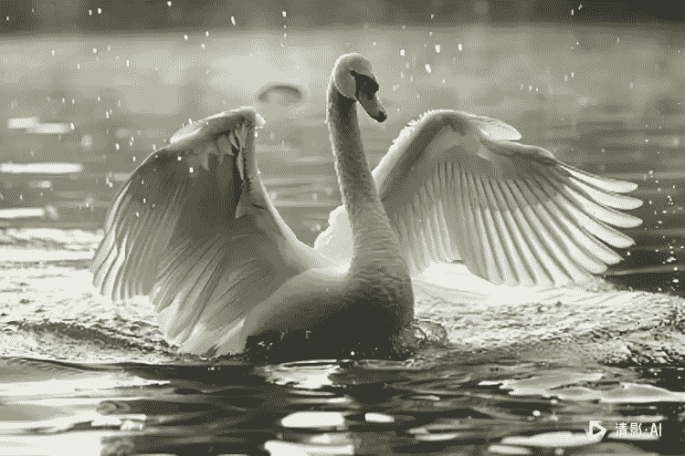 |  |

[甄嬛安陵容跨屏拥抱.mp4](https://internal-api-drive-stream.feishu.cn/space/api/box/stream/download/all/Sd5ebmwHFoIOKJxlhjucIshknXc)

[6a8de3d4-000f-55fa-ac69-56c059e7d906_0 (1).mp4](https://internal-api-drive-stream.feishu.cn/space/api/box/stream/download/all/TJxUbrJ7BoqCmgxTxEscvFQWnBe)

[4ac7f78d-6661-5e92-bfbb-60090d82b810_0.mp4](https://internal-api-drive-stream.feishu.cn/space/api/box/stream/download/all/ZDjJbpsyHoxpAex9oREc2A00n2e)

[039a8895-5e1d-546e-bf03-ca18f4bdb824_0.mp4](https://internal-api-drive-stream.feishu.cn/space/api/box/stream/download/all/IxoPbkaPbo1oXIxVNcuc4aURnRd)

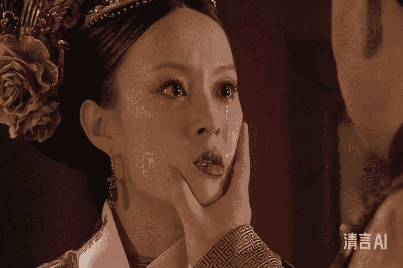

[1-3.mp4](https://internal-api-drive-stream.feishu.cn/space/api/box/stream/download/all/MngNbE5N9oXTyxxyhtAcloH4nVb)

[video_gen1721827217534.mp4](https://internal-api-drive-stream.feishu.cn/space/api/box/stream/download/all/WWpsbxjKwos0DaxOkvlc8Vbmnib)

[video_gen1721378695603.mp4](https://internal-api-drive-stream.feishu.cn/space/api/box/stream/download/all/B7NcbrLSRoWmUqxK7E3c0drXnuY)

[000000-5.mp4](https://internal-api-drive-stream.feishu.cn/space/api/box/stream/download/all/JSdZbTkO9oAuNSx8ygLcm5i2nsf)

[000000-8.mp4](https://internal-api-drive-stream.feishu.cn/space/api/box/stream/download/all/On2Zb7O4Poiig4xkX2hck4mYnUh)

[000000-9.mp4](https://internal-api-drive-stream.feishu.cn/space/api/box/stream/download/all/TCAkb6piOonH8fxU2escMqminMv)

[000000-16.mp4](https://internal-api-drive-stream.feishu.cn/space/api/box/stream/download/all/PkV2b80WVoAChTx6pNJc5MDHnLg)

[000000-11.mp4](https://internal-api-drive-stream.feishu.cn/space/api/box/stream/download/all/FKwXbOPccoL6qvxndxWcQuq7ncc)

[000000-13.mp4](https://internal-api-drive-stream.feishu.cn/space/api/box/stream/download/all/YlK9b97iIolzUKx2etzch0E4n0f)

[000000-15.mp4](https://internal-api-drive-stream.feishu.cn/space/api/box/stream/download/all/YUYWbkTkXoNrNmxdszEcZALOnUg)

[000000.mp4](https://internal-api-drive-stream.feishu.cn/space/api/box/stream/download/all/IP13bbbclolOpExtwUpcDRbDn3f)

[000000.mp4](https://internal-api-drive-stream.feishu.cn/space/api/box/stream/download/all/YzpUbWhUZon1H0xxRq1cywSKnhh)

[000000.mp4](https://internal-api-drive-stream.feishu.cn/space/api/box/stream/download/all/ZeXrbJmNUoxw2xxINg2cESrLnNc)

[000000.mp4](https://internal-api-drive-stream.feishu.cn/space/api/box/stream/download/all/Ne78b2mLgoANGFxzXxscoW6jn4d)

[000000.mp4](https://internal-api-drive-stream.feishu.cn/space/api/box/stream/download/all/L14ybXVjkoZfW1xkn7IcXr5hn3e)
[000000.mp4](https://internal-api-drive-stream.feishu.cn/space/api/box/stream/download/all/SsFTbRb5gotBbNxOQwhc6cN5nFN)
[000000.mp4](https://internal-api-drive-stream.feishu.cn/space/api/box/stream/download/all/LdnbbdKeioQO3Ex6mQqcErEUnhd)
[赛博美女.mov](https://internal-api-drive-stream.feishu.cn/space/api/box/stream/download/all/Pq5sbrlRYoFx6Dxd3GSce7Zgnwd)

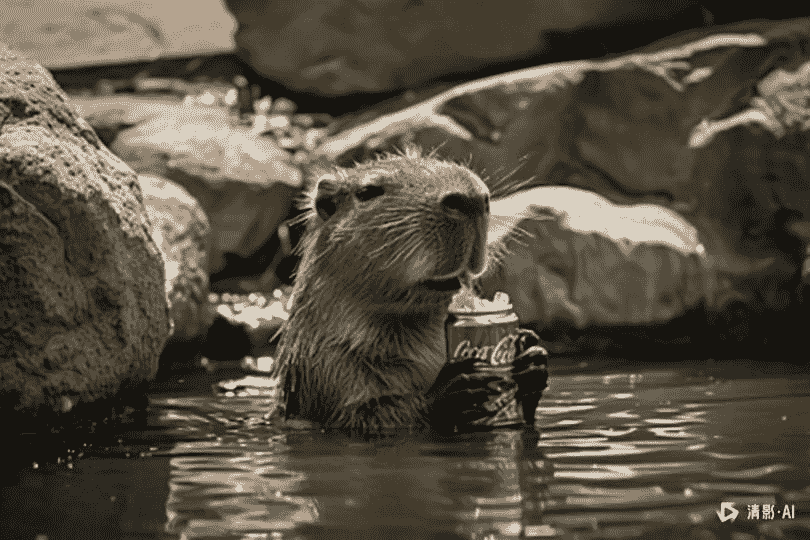

[8.卡皮巴拉喝可乐（音乐版）.mov](https://internal-api-drive-stream.feishu.cn/space/api/box/stream/download/all/YyjTbfMJCobjgWxEVMPcRaANnAd)

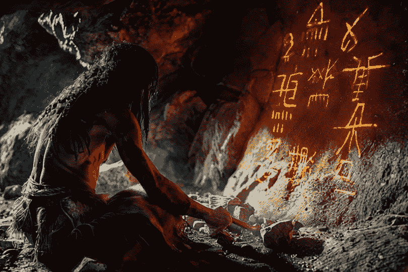

[2.洞穴文明（音乐版）.mov](https://internal-api-drive-stream.feishu.cn/space/api/box/stream/download/all/GfpRb7305oW1M2x3gZxcY2zAnlh)

[9.宇宙吉他手（音乐版）.mov](https://internal-api-drive-stream.feishu.cn/space/api/box/stream/download/all/Gw5SbrkqroCTpPxEp5tcxHegnGe)

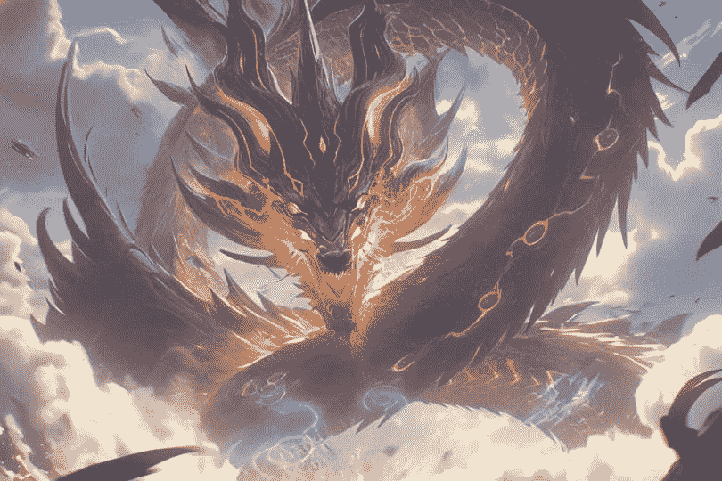

[7.火龙吐息（音乐版）.mov](https://internal-api-drive-stream.feishu.cn/space/api/box/stream/download/all/Rx0EbOXatoQPRzxdPi2cK88fnSd)

## 祝大家在清影玩的开心！

### ➕欢迎关注我们的视频号获得更多教程&活动信息⬇️

> 给清影投稿吧！一经采用，即可获得 **1 年的加速会员包**，多投多得！

📪 投稿链接：`https://zhipu-ai.feishu.cn/share/base/form/shrcnV9yAT9iyNndeGKbCI5Vchf`

## 附录：提示词公式小词典

### 1️⃣镜头语言

1. 镜头平移 (Panning): 摄像机在水平方向上移动，从一个点平稳地移动到另一个点。这种拍摄方式常用于展示一个场景的全貌或跟随一个移动的物体。
1. 推近 (Pushing In): 摄像机向被拍摄对象靠近，使观众感觉好像自己也在靠近画面中的物体或人物。这种方式可以增加观众的参与感和紧张感。
1. 拉远 (Pulling Back): 摄像机从被拍摄对象后退，使观众感觉好像自己在远离画面中的物体或人物。这种方式可以展示更大的场景或减少观众的参与感。
1. 升降拍摄 (Tilting): 摄像机在垂直方向上移动，向上或向下。向上倾斜可以展示从低到高的场景，向下倾斜则相反。
1. 摇摄 (Swiveling): 摄像机在固定的位置上旋转，改变拍摄的方向。这种方式可以用于展示周围的环境或跟随移动的物体。
1. 跟随拍摄 (Tracking): 摄像机沿着一个特定的路径移动，通常用于跟随一个移动的物体或人物。
1. 手持拍摄 (Handheld): 摄像机由摄影师手持移动，这种方式可以增加画面的动态感和真实感。
1. 稳定器拍摄 (Stabilized): 使用稳定器（如斯坦尼康）进行拍摄，即使在移动中也能保持画面的稳定。
1. 无人机航拍 (Aerial): 使用无人机进行高空拍摄，可以展示大范围的地形和场景。
1. 轨道拍摄 (Dolly Shot): 摄像机安装在轨道上移动，可以平稳地前进或后退，常用于电影中的经典镜头。

### 2️⃣景别角度

1. 大全景 (Wide Shot): 摄像机远离主体，通常用于展示环境或场景的全貌。
1. 中景 (Medium Shot): 主体占据画面的一部分，适用于展示人物的上半身或场景的一部分。
1. 近景 (Close-Up): 主体占据画面的主要部分，适用于展示人物的脸部或物体的细节。
1. 特写 (Extreme Close-Up): 画面中只显示主体的某一小部分，适用于展示细节或情感。
1. 高角度俯拍 (High Angle Shot): 摄像机从高处向下拍摄，使主体显得较小或弱小。
1. 低角度仰拍 (Low Angle Shot): 摄像机从低处向上拍摄，使主体显得强大或威严。
1. 正面拍摄 (Front Angle Shot): 摄像机正对主体，适用于直接展示人物或物体的正面。
1. 侧面拍摄 (Side Angle Shot): 摄像机从主体的侧面拍摄，适用于展示人物或物体的侧面轮廓。
1. 背面拍摄 (Rear Angle Shot): 摄像机从主体的背后拍摄，适用于展示人物或物体的背面。
1. 鸟瞰视角 (Bird’s Eye View): 摄像机从极高的角度拍摄，类似于鸟儿在空中俯瞰的视角。
1. 虫视角 (Worm’s Eye View): 摄像机从极低的角度拍摄，类似于虫子在地面上仰望的视角。
1. 跟随视角 (Tracking Shot): 摄像机跟随移动的主体，适用于展示主体的动态。
1. 倾斜角度 (Dutch Angle): 摄像机倾斜拍摄，使画面产生不平衡或紧张感。
1. 对称构图 (Symmetrical Composition): 画面中的元素以中心轴线对称排列，适用于创造平衡和和谐感。
1. 框架构图 (Frame Within a Frame): 画面中有一个或多个框架元素，如门窗，用于突出主体。
1. 深度构图 (Deep Focus): 画面中的前后景都保持清晰，适用于展示丰富的场景层次。
1. 长焦肖像 (Telephoto Portrait): 使用长焦镜头拍摄人物肖像，使主体在画面中显得更加突出。
1. 宽角建筑 (Wide-Angle Architecture): 使用宽角镜头拍摄建筑物，展示其宏伟或独特的结构。
1. 鱼眼效果 (Fisheye Lens Effect): 使用鱼眼镜头拍摄，产生一种极端的宽角效果，使画面边缘产生畸变。

### 3️⃣光影效果

1. 自然光 (Natural Light): 来源于太阳或月亮的光线，通常给人一种自然和真实的感觉。
1. 丁达尔效应
1. 柔和散射 (Soft Light): 经过散射的光线，如阴天时的光线，产生柔和的阴影和较少的对比。
1. 硬光直射 (Hard Light): 直接来自光源的光线，如晴朗天气下的阳光，产生清晰的阴影和强烈的对比。
1. 逆光剪影 (Backlighting): 光源位于主体的背后，使主体产生剪影效果，强调轮廓和形状。
1. 侧逆光 (Side Light): 光源从主体的侧面照射，强调纹理和形状，产生戏剧性的阴影效果。
1. 伦勃朗光 (Rembrandt Lighting): 类似于伦勃朗画作中的光影效果，通常在主体的脸颊上产生一个三角形的光亮区域。
1. 三点布光 (Three-Point Lighting): 使用三个光源：主光、辅助光和背光，分别照亮主体的正面、减少阴影和强调轮廓。
1. 聚光灯 (Spotlight): 集中的光线，用于突出特定区域或主体，产生戏剧性的效果。
1. 泛光灯 (Floodlight): 广泛分布的光线，用于照亮较大的区域，通常产生均匀的光照效果。
1. LED灯 (LED Lighting): 使用LED光源，具有高能效和长寿命的特点，适用于各种照明需求。
1. 色温调节 (Color Temperature Adjustment): 调整光源的色温，使其更暖或更冷，影响画面的氛围和感觉。
1. 光影交错 (Interplay of Light and Shadow): 光线和阴影的相互作用，用于创造深度和戏剧性。
1. 阳光透过 (Sunlight Filtering): 阳光透过物体，如树叶或窗户，产生斑驳的光影效果。
1. 霓虹灯光 (Neon Lighting): 使用霓虹灯作为光源，通常产生鲜艳和未来感的效果。
1. 舞台灯光 (Theatrical Lighting): 类似于舞台表演使用的灯光，用于创造戏剧性和强调特定区域。
