# AI 短剧学习手册（行业首发&持续更新 ing...

> 来源：[https://yunyinghui.feishu.cn/docx/X7fSdzZkGorA9txHceccVf8pncG](https://yunyinghui.feishu.cn/docx/X7fSdzZkGorA9txHceccVf8pncG)

> **适用人群：** AI 短剧兴趣人员、内容创作者、从业人员等

> **首发时间：**2025 年 12 月 24 日

> **更新时间：**2026 年 3 月 10 日

> **内容出品人：**** **** **

> **内容出品方：**[玩赚 AI 实验室](https://yunyinghui.feishu.cn/wiki/WhelwZnxQi55mpkOzatc3Xran5b?from=from_copylink)

> **使用建议：**建议电脑端打开学习，如果需要快速定位到精确内容，可以使用快捷键 Ctrl +F/Command +F 的形式，搜索关键字/词，查找你想要的内容。

>

> **持续更新 AI 短剧 & AI 漫剧的相关介绍及动****态，平台政策，制作流程，变现模式**及案例等 12 个板块内容 10 万+字内容，永久免费在线查看，欢迎收藏、转发和支持，内容创作不易，请勿直接抄袭搬运。

# 🤹🏼适用人群

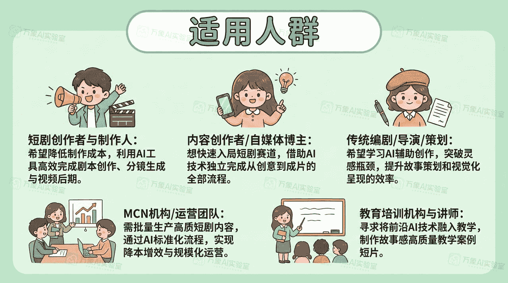

# 〽️学习目标

**目标一：**系统化掌握 AI 短剧制作的知识体系和前沿信息

**目标二：**AI 短剧全流程技术实战，从选题到视频制作生成

**目标三：**掌握 AI 短剧的全链路变现模式和合规上线

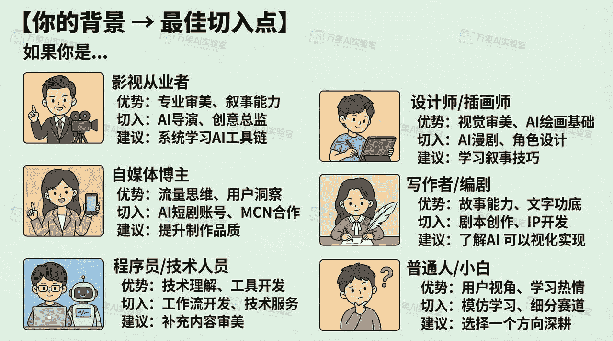

> **本手册的核心价值：**

+   **打破认知，系统梳理：**带你全面梳理和入局 AI 短剧的知识点，让你有一个全局的视野看待 AI 短剧发展的历程。

+   **工具赋能，而非替代：** AI 是你最高效的“制作团队”，帮你完成 80%的重复性劳动，让你专注于 20%的核心创意。

+   **流程为王，效率至上：** 我们将建立一套标准化的工业流程（SOP），让你告别手忙脚乱，高效稳定地产出内容。

+   **从简入繁，小步快跑：**将引导你从相对容易上手的 AI 漫剧开始，逐步过渡到更具挑战的 AI 真人短剧，最终探索更广阔的 AI 视频内容创作世界。

# **🧑‍💻作者介绍**

**大国**

+   万象 AI 实验室主理人

+   AI 短剧内容创作者

+   AI 商业化及流量操盘手

+   知识 IP 操盘手


**德里克文**

+   万象 AI 实验室共创者

+   AINext 联合创始人

+   厦门大学电影学院 AIGC 指导专家、温州理工大学产业教授

+   可灵、拍我、百度等多 AI 视频创作平台超级创作者

+   AI 视频作品网上总点击超 5 亿，AI 科普文章网上阅读量超 5000 万


# 📱交流合作

持**续关**注**并更新 A****I 短剧/漫剧的相关资讯动态，研究报告，商业落地，常见问题，永久免费在线查看**。已建立社群聊聊 AI 短剧/漫剧发展、应用、对接及合作，邀请嘉宾讲课，没进群的可以扫码加入，群满可加大国微信 ID：zhangyuguo94s（备注：短剧），已经在社群内的无需重复加入，开源知识库及社群学习全部为公开免费分享。


**5000 人飞书学习交流群**


**AI 短剧微信学习交流群**


好友（ID：zhangyuguo94s）

**扫码交流、进群、合作**


微信扫码加好友（微信 ID：derek

---

# **🌈前言概述**

你好，我是万象 AI 实验室社区主理人大国！

我们正处**在一个前所未有的**时代，人工智能如同一场席卷全球的浪潮，正在重塑各行各业，而内容创作领域，尤其是短剧，正处于这场变革的风口浪尖。曾经，制作一部短剧需要专业的团队、昂贵的设备和漫长的周期。如今，借助 AI 的力量，一个富有创意的个体，在自己的电脑前，就能完成从剧本构思到成片输出的全过程。也正因此，2025 年，被称之为 AI 短剧元年，同时，2026 年 AI 短剧的需求还会持续激增。

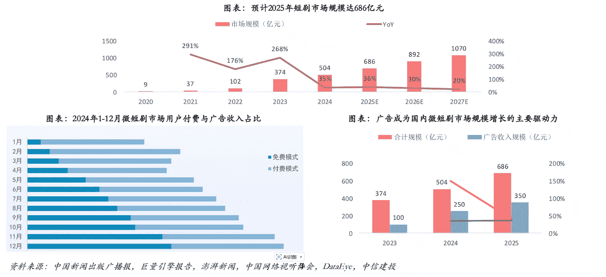

希望**这本学习手册，为每**一**个渴望抓住时代机**遇的创作者量身打造一张学习航海图。它并非是鼓吹“一键生成爆款”的速成秘籍，而是一份强调“人机协同，创意为王”的实操指南。AI 是强大的工具，但真正的灵魂——故事、情感和创意——永远掌握在你的手中。

---

# 第一章、认知篇：AI 短剧创作前沿认知

本章将为你奠定坚实的认知理论基础，让你对 AI 短剧有一个全局性的认识。

## **1.1 什么是 AI 短剧**


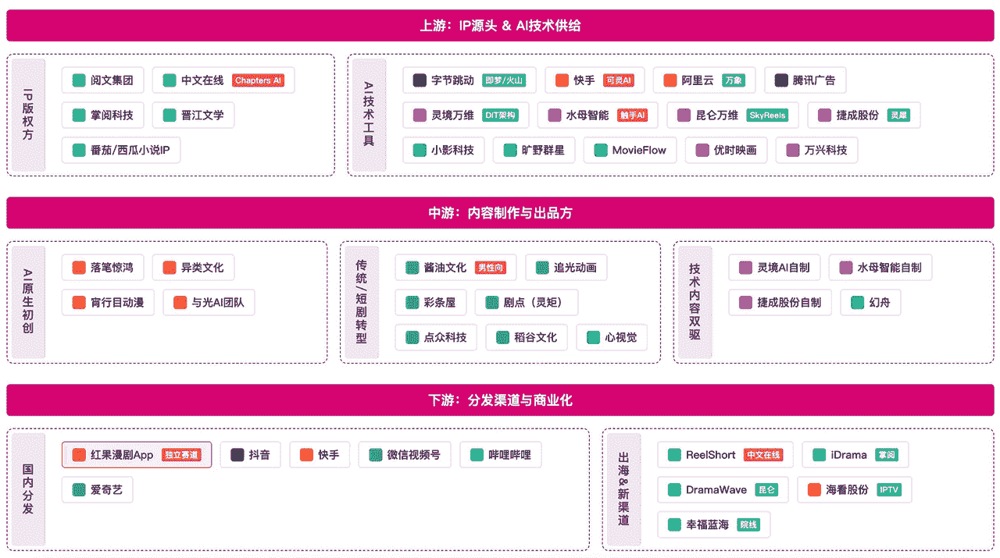

宦家臣分享的 AI 漫短剧行业图谱

根据**视觉呈现形式**，主要分为**两大流派**：

+   **AI 漫剧：** 利用 AI 绘画工具（如 Nano banana pro 、即**梦 4，Midjourney**，Flux）生成漫画风格的连续画面，再通过后期剪辑，配上动态效果、音效和配音，形成“动态漫画”或“漫动画”的形式。这是当前最成熟、最容易落地、成本最低的 AI 短剧形式。

+   **AI 真人短剧：** **利用 AI 视频生成工具**（如 Veo ， Sora ，可灵，阿里万相，海螺，即梦，拍我，Vidu 等）直接生成类真人或写实风格的视频片段，再进行剪辑和后期制作。这是未来的发展方向，但目前技术尚在发展中，面临一致性、可控性、成本高昂等挑战。

> **结论：** 对于初学者，强烈建议从 **AI 漫剧** 入手，完成“**从 0 到 1**”的突破。

**AI 漫剧的三类模式**

| #### 类型 | #### 核心模式 | #### 优势 | #### 特色 | #### 代表作品 |
| --- | --- | --- | --- | --- |
| AI 转绘短剧 | 以真人短剧为蓝本，通过 AI 将真人拍摄画面转化为动漫风格 | 利用现有真人短剧资源，快速赋予新动漫视觉；制作周期大幅缩短；丰富平台内容、吸引动漫视觉偏好观众 | 基于已有真人短剧做风格转化 |  |
| AI+动态漫 | 基于漫画原著，在静态画面基础上通过 AI 添加动效（人物动作、场景动态）+专业配音 | 保留漫画原著的艺术风格与故事架构；动效+声音增强沉浸感；适配碎片化观看习惯 | 对漫画原著做动态+听觉升级 | 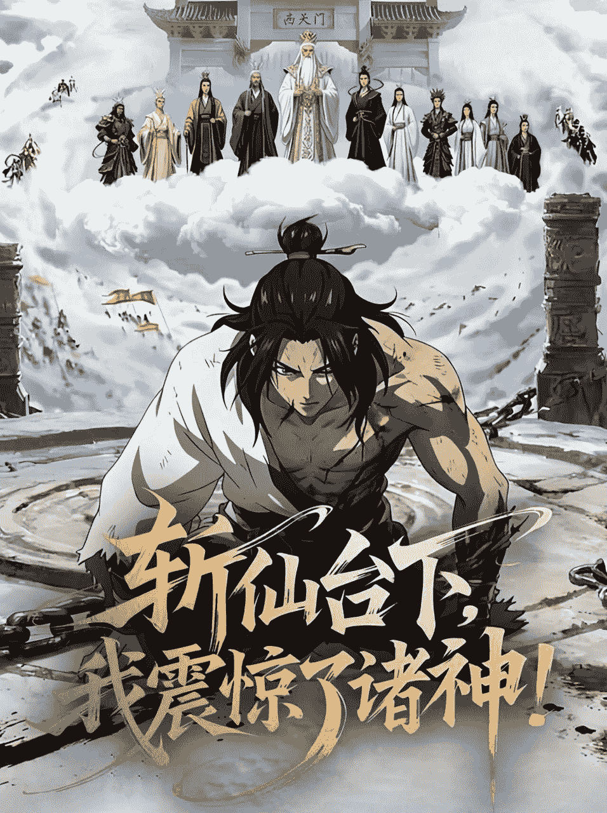 |
| AI+动画短剧 | 独立创作剧情向动画短剧，全流程（故事、角色、画面、演绎）深度用 AI，适配目标地区观众喜好 | 不受已有作品束缚，充分发挥 AI 优势；可定制本地化内容，适配全球任意市场 | 全流程 AI 创作+本地化定制 | 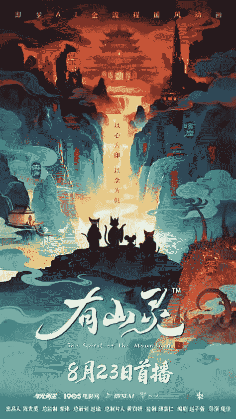 |

**AI 真人短剧的九类模式**

| #### **核心类型** | #### **核心 AI 应用场景** | #### **优势** | #### **特色** | #### **代表作品** |
| --- | --- | --- | --- | --- |
| AI 剧本生成+真人演绎 | AI 生成剧本大纲/台词/分镜，真人团队完成拍摄、表演、后期 | 剧本产出效率提升 80%，降低创意门槛；适配短剧快节奏、强冲突需求 | 剧情聚焦“爽点/泪点/反转”，贴合下沉市场偏好；可批量产出同质化爆款内容 | 《战神归来：女儿被辱我怒掀全城》《离婚后，我成了亿万富翁》 |
| AI 辅助拍摄+真人出演 | AI 场景生成（虚拟棚拍摄）、镜头规划、演员动作指导、拍摄参数优化 | 无需搭建实景，降低场地成本 30-50%；拍摄周期缩短 40%，适配小团队快速量产 | 虚拟场景与真人表演无缝融合，支持玄幻、科幻等强场景需求；镜头语言更专业 | 《三星堆：未来启示录》（AI 生成考古场景）、《异能觉醒：都市秘战》 |
| AI 后期优化+真人短剧 | AI 智能剪辑（自动卡点/转场）、批量调色、降噪/去水印、字幕自动生成/翻译 | 后期人力成本降低 60%；单集后期时间从 2 小时压缩至 15 分钟；保证内容输出稳定性 | 适配短剧“日更/周更”节奏；统一账号内容风格，提升用户辨识度 | **《我在工地搬砖，美女总裁倒追我》（**AI 批量剪辑）、《乡村爱情小短剧》系列 |
| AI 特效合成+真人主演 | AI 生成虚拟道具、特效（如修仙法术、科幻装备、爆炸效果）、场景延伸（如远景扩展） | 特效成本降至传统的 1/10；无需专业特效团队，小团队可制作高视觉冲击内容 | 视觉效果升级，打破真人短剧“五毛特效”局限；适配玄幻、科幻、悬疑等题材 | **《龙抬头：我爸是绝世战神》（AI 修仙特效）、《末世求生**：我有无限物资》（AI 丧尸/灾难特效） |
| AI 数字人+真人合拍 | AI 数字人担任配角/群演，与真人主演互动；AI 驱动数字人表情/动作，同步真人台词 | 降低演员片酬成本 40-60%；数字人可无限复用，适配多场景拍摄 | 数字人形象贴合二次元/科幻设定，弥补真人演员表现力局限；可快速替换数字人形象 | **《虚拟男友竟是千亿总裁》（AI 数字**人男二）、《AI 女友：我的专属守护神》 |
| AI 个性化定制+真人短剧 | AI 根据用户画像（年龄/性别/地域）生成多版本剧情（如不同结局/角色设定），真人拍摄多线内容 | 精准匹配用户偏好，提升完播率和付费转化率；支持“一人一剧”定制化体验 | 剧情分岔点多，用户可选择观看方向；适配短视频平台“算法推荐”逻辑，易起量 | **《选择你的人生：逆袭 or 平凡》（多结**局短剧）、《同城热恋：你的专属恋爱剧本》 |
| AI 营销适配+真人短剧 | AI 分析平台热榜关键词，生成适配性剧本；AI 生成多版本标题/封面/预告片，精准投放 | 爆款命中率提升 50%；营销成本降低 30%，投放 ROI 提升 2 倍以上 | 内容“为流量定制”，标题/封面强吸睛（如“极端场景+身份反差”）；易引发话题传播 | 《婆婆逼我净身出户，我亮出亿万家产》《高考失利，我激活了全球首富系统》 |
| AI 修复/升级+经典真人短剧 | AI 高清修复老剧画质、AI 上色、AI 重配台词/音效，适配短视频平台传播 | 盘活存量 IP，降低内容制作成本；吸引怀旧用户群体，实现二次变现 | 保留经典剧情，优化视听体验；适配碎片化观看习惯，单集截取核心剧情 | **《西游记》短剧精简 AI 修复版、《还珠格格》AI 重配**搞笑版、《亮剑》热血名场面 AI 剪辑版 |
| 全流程 AI+真人短剧 | 全链路 AI 主导：AI 生成剧本（含分镜/台词）→ AI 虚拟场景生成→ AI 拍摄调度（镜头规划/参数设置）→ AI 数字人→ AI 自动剪辑/调色/特效合成→ AI 生成标题/封面/投放素材→ AI 数据监测优化内容 | 制作成本降低 70-80%；从创意到上线周期压缩至 24-48 小时；实现“零经验团队量产爆款” | 支持“日更 10+集”；内容高度适配平台算法，爆款复制性强；可快速迭代剧情方向 | **《**AI 创世：全民逆袭》（灵境 AI 全流程制作）、《虚拟都市：我的开挂人生》（中文在线全 AI 链路） |

按照**呈现形式**（基础创作维度）分大类，再按**制作水准（核心质量维度）**定等级，补充**题材、变现、渠道 **3 个实用维度，覆盖 AI 短剧从创作到落地的全链路选型需求，适配新手到进阶创作者对标参考。

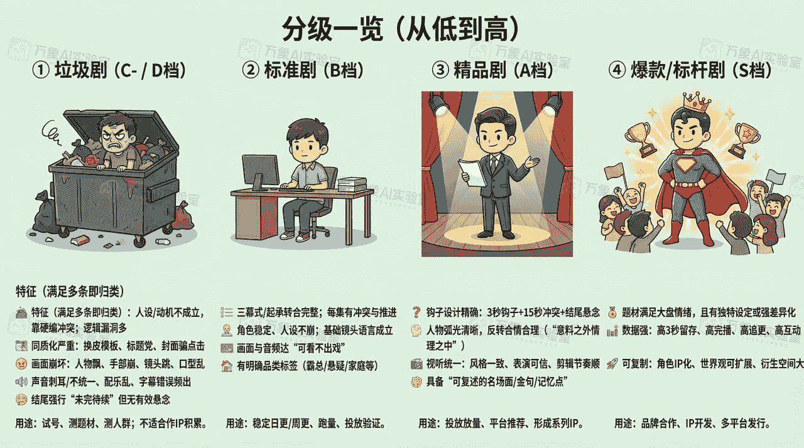

## **1.2  AI 短剧发展简史**

**AI 短剧的诞生并非一蹴而就**，它是技术奇点、市场需求和内容生态三者共振的结果。

### 前 AI 时代：短剧市场的野蛮生长与痛点 （2020-2022）

+   **市场背景：** 抖音、快手等短视频平台崛起，用户习惯被重塑，碎片化、快节奏的“微短剧”应运而生。这些一两分钟一集、剧情冲突强烈、付费点密集的短剧，迅速占领了用户的闲暇时间。

+   **生产模式：** 主要是真人实拍。以“横店”为中心，形成了成熟但“草根”的产业链。剧组通常由小团队构成，拍摄周期快，成本相对传统影视剧较低，但一部 80-100 集的短剧，成本依然在几十万到上百万不等。

+   **核心痛点：**

+   **成本制约：** 服化道、场景、演员片酬，每一项都是刚性支出。这使得许多小团队和个人创作者望而却步。

+   **生产周期：** 即使是“快餐式”制作，从剧本、组盘、拍摄到后期，仍需数周到数月，无法快速响应市场热点。

+   **创意受限：** 受限于成本和实拍难度，题材高度同质化，集中在“霸总甜宠”、“都市赘婿”、“豪门恩怨”等现代场景。科幻、奇幻、宏大历史等想象力丰富的题材难以实现。

+   **人才依赖：** 强依赖于演员的颜值和演技，以及导演的调度能力，生产质量不稳定。

### AI 的萌芽与探索期 （2023 - 2024 年中）

+   **技术奇点：** 2023 年是生成式 AI 的“寒武纪大爆发”。

+   **文生图：** Midjourney、Stable Diffusion 等 AI 绘画工具发布，让普通人拥有了“以文作画”的能力。初期的作品虽然充满瑕疵（如“六指琴魔”），但其展现的潜力震惊了世界。

+   **大语言模型：** 以 ChatGPT 为代表的 LLM，极大地降低了剧本构思、大纲撰写和分镜描述的门槛。

+   **早期形态：** 创作者开始尝试将 AI 生成的单张图片，通过简单的剪辑拼接成“PPT 式”的视频故事。这些作品被称为“AI** 看新闻”、“AI 故事**会”等，角色一致性差、画面动态感弱，更像是技术演示，而非成熟的剧集。但它们验证了一个核心可能性：用 AI 讲故事是可行的。

### AI 短剧/漫剧的爆发元年 （2024 年中 - 至今）

+   **催化剂：**

+   **技术飞跃：** Midjour**ney V**5.2 及后续版本在画面质感、风格控制和语义理解上实现巨大突破。而 2024 年初推出的--cref（角色一致性）功能，更是解决了 AI 漫剧制作中最大的痛点，使得连续创作成为可能。

+   **工具链成熟：** **以“剪映”为代表的剪辑软件**，集成了强大的 AI 配音、智能字幕、关键帧动画等功能，与 Midjourney 等上游工具形成了“AI 绘画 + AI 剪辑”的黄金工作流，生产效率大大提升。

+   **市场验证：** 抖音等平台上涌现出第一批 AI 漫剧爆款账号。他们将网文的“爽点”逻辑与 AI 的视觉表现力结合，创作出《我在古代当皇帝》、《末日囤货》等题材的漫剧，收获了惊人的播放量和粉丝增长，证明了其商业价值。

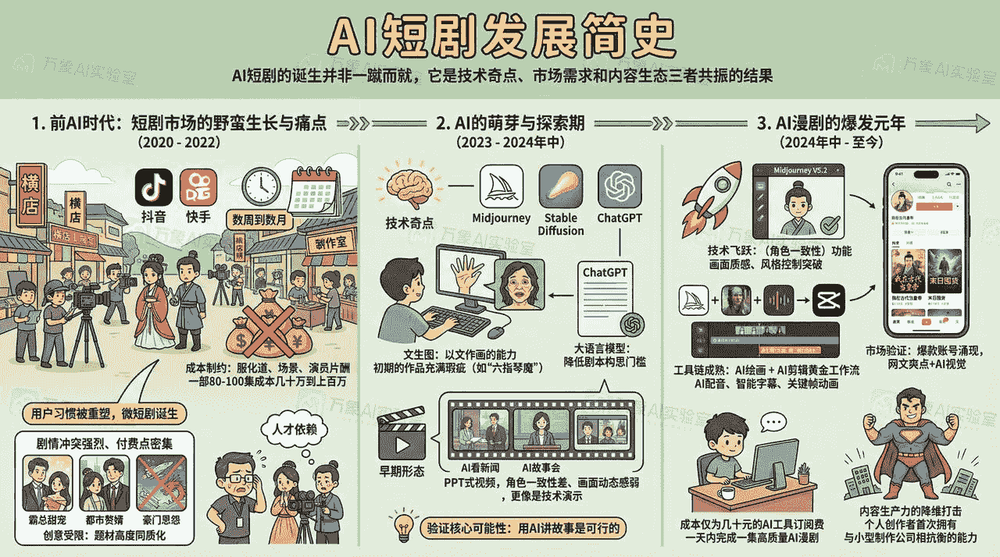

+   **现状：** AI 漫剧正式从“玩具”进化为“内容工厂”。一个熟练的创作者，可以在一天内完成一集高质量的 AI 漫剧，成本仅为几十元的 AI 工具订阅费。这标志着内容生产力的“降维打击”，个人创作者首次拥有了与小型制作公司相抗衡的能力。

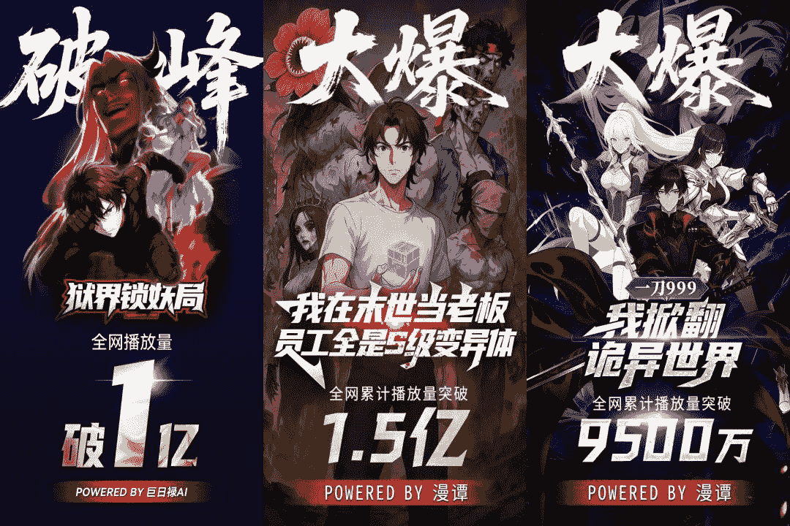

+   **国内首部付费 AI 短剧：****《兴安岭诡事》于 2025 年 2 月 19 日正**式上线，首发平台为风芒、抖音及 B 站。上线不到 21 小时播放量即破千万，截至 10 月 17 日累计播放量达 5613.3 万，抖音原生端收益超过 30 万，账号涨粉 10 万+。

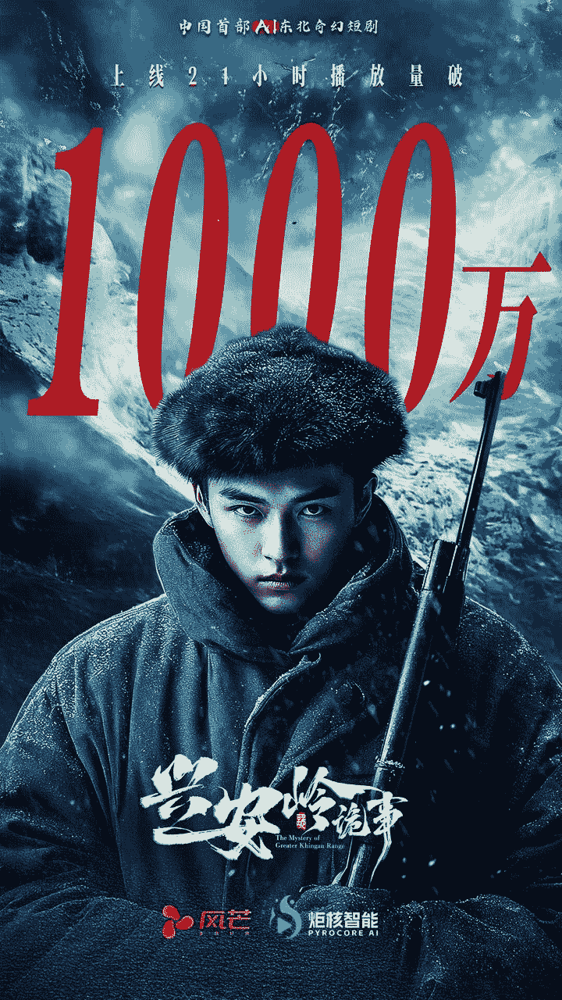

> **延展阅读：**[**人间丨专访国内首部付费 AI 短剧《兴安岭诡事》导演：AI **](https://www.toutiao.com/article/7493071465512698418/?app=news_article&category_new=__search__&module_name=Android_tt_url&share_did=MS4wLjACAAAAa_2ZQfKohEB5QmOLai9bTt9cRxjOEQinZWndvX_GUAuz6ppc9x5EBTo_W1F9d2ab&share_token=dd529532-ccdf-42d8-ae05-f43734a077ea&share_uid=MS4wLjABAAAAQDeiZPXjF_JWUvr63-akJzgW56pD18Oj71nRcLeugdSLfLQ9dB5qRhC2QNT4RT9K&timestamp=1766107832&tt_from=copy_link&upstream_biz=Android_url&utm_campaign=client_share&utm_medium=toutiao_android&utm_source=copy_link&source=m_redirect)短剧并非“一键生成”，真人演员无法被取代

+   **香港首部 AI 短剧：**香港电视广播有限公司（TVB）于 2025 年 9 月正式推出其首部完全由人工智能（AI）技术生成的微短剧《在我心中，你是独一无二》（英文名：You， and Only You），此举标志着香港主流电视媒体正式迈入 AI 内容创作的新纪元 。该剧的推出不仅是 TVB 在内容生产上的一次大胆尝试，也为学术界和产业界提供了一个极具分析价值的案例，用以探讨 AI 技术在影视制作领域的应用、影响及其未来发展方向。首部 AI 生成青春校园爱情短剧《在我心中，你是独一无二》于 2025 年 9 月 15 日正式登陆 myTV SUPER 及 TVB Plus 平台，一经上线就引发全网热议。

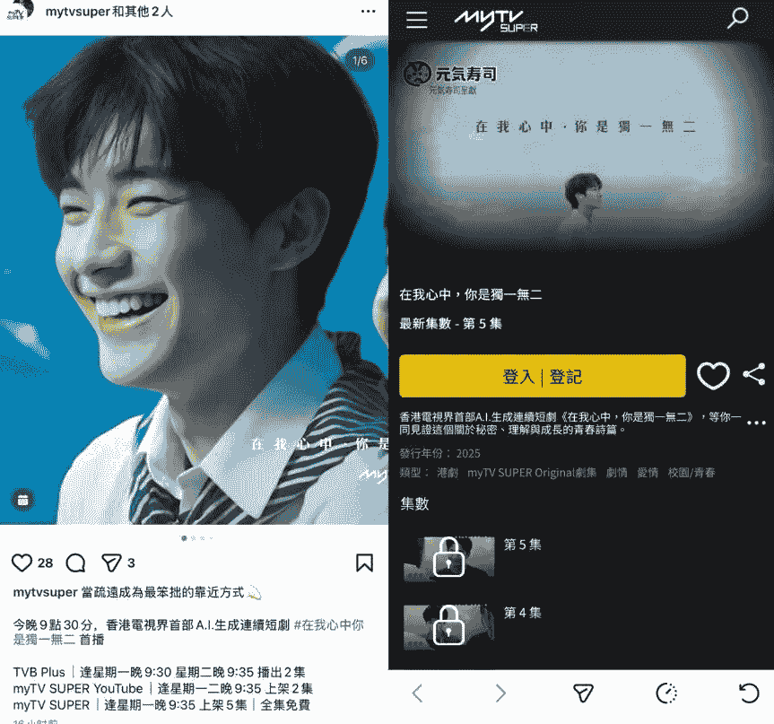

**延伸阅读：**[AI漫剧行业大记事](https://yunyinghui.feishu.cn/wiki/D3hMwmHwBiGZkskTMYvcTaOZnnh?from=from_copylink)

## **1.3 现阶段国内市场分析 **

### **市场规模与增长潜力**

+   **宏观市场：** 根据《中国网络视听发展研究报告》等行业数据，2**023 年中国微短**剧市场规模已达到惊人的 373.9 亿元，同比增长 267.65%，2024 年突破千亿大关。短剧出海也成为热潮，ReelShort 等应用在北美市场大获成功，月流水过亿。

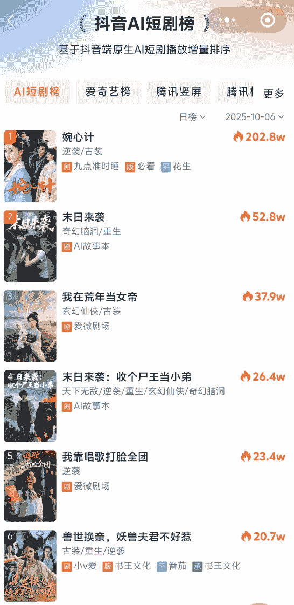

+   **AI 短剧定位：** 在这个千亿赛道中，AI 短剧目前所占份额尚小，但它是增速最快、最具想象空间的新生力量。它的核心价值在于：

+   **增量市场：** 满足了传统短剧无法覆盖的**科幻、奇幻**等题材需求。

+   **成本革命：** 极大地拉低了入局门槛，吸引了海量个人创作者，使短剧供给量指数级增长。

### **核心消费群体画像**

AI 短剧的消费者与传统短剧、网文的受众高度重合，呈现以下特征：

+   **追求“情绪价值”：** 他们观看的核心目的是为了**解压、放松、获得即时满足感**。剧情逻辑的严谨性次于“爽点”的密集度。

+   **下沉与上升并存：** 主力军被认为是三四线城市拥有较多闲暇时间的用户，但随着内容精品化，一二线城市的白领在通勤、午休等碎片化时间也成为重要消费群体。

+   **付费意愿强：** 长期受到网文付费阅读模式的熏陶，他们习惯为优质、上头的内容付费。只要“钩子”足够吸引人，他们愿意为解锁下一集而支付费用。

+   **高容忍度：** 对于 AI 生成画面的一些瑕疵（如轻微的闪烁、细节不一致），只要不影响核心剧情理解，他们普遍表现出较高的容忍度。


### ** AI 短剧的魅力与市场前景**

+   **降维打击的生产力：** 传统动画一集成本动辄数十万，周期数月。AI 漫剧可将成本压缩至几百到几千元，周期缩短至几天甚至几小时。

+   **想象力的无限释放：** 宏大的科幻场景、瑰丽的奇幻世界、难以复刻的历史风貌……这些传统拍摄成本极高的题材，在 AI 面前变得轻而易举。

+   **垂直赛道的蓝海机遇：** 小众题材、特定圈层的“爽点”故事，过去因市场规模小而无人问津，现在可以用极低成本进行快速试错和内容生产，满足细分市场的需求。例如“霸总重生爱上我”、“我在古代修仙搞发明”、“末世囤货生存指南”等网文常见题材，都是 AI 短剧的沃土。


### **AI 短剧的资本市场布局**

2024 年，博纳影业做了一次大胆的尝试—用 AI 制作了一部短剧集《三星堆：未来启示录》，这也是国内首部拿到网络剧片发行许可证的 AIGC（生成式人工智能）科幻短剧集。

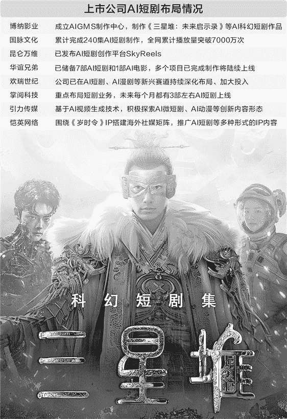

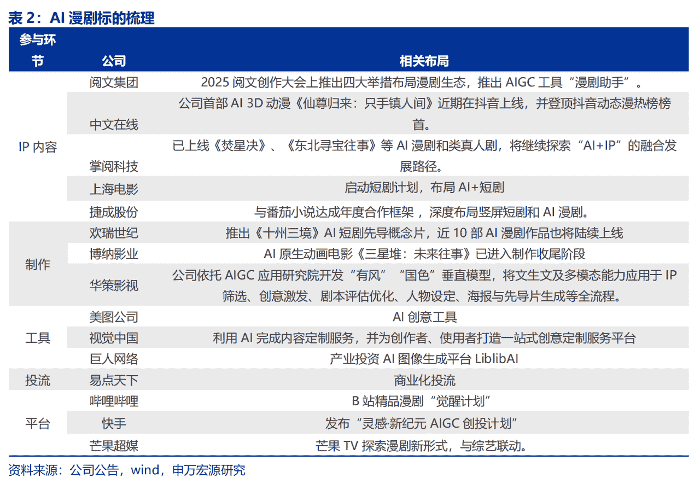

### ** **

**延展阅读：**


[研究报告：漫剧，AI+IP助力高增长、高潜力赛道爆发.pdf](https://internal-api-drive-stream.feishu.cn/space/api/box/stream/download/all/IcF5bYgN7oGhc4xHqiVcEFgEn6d)

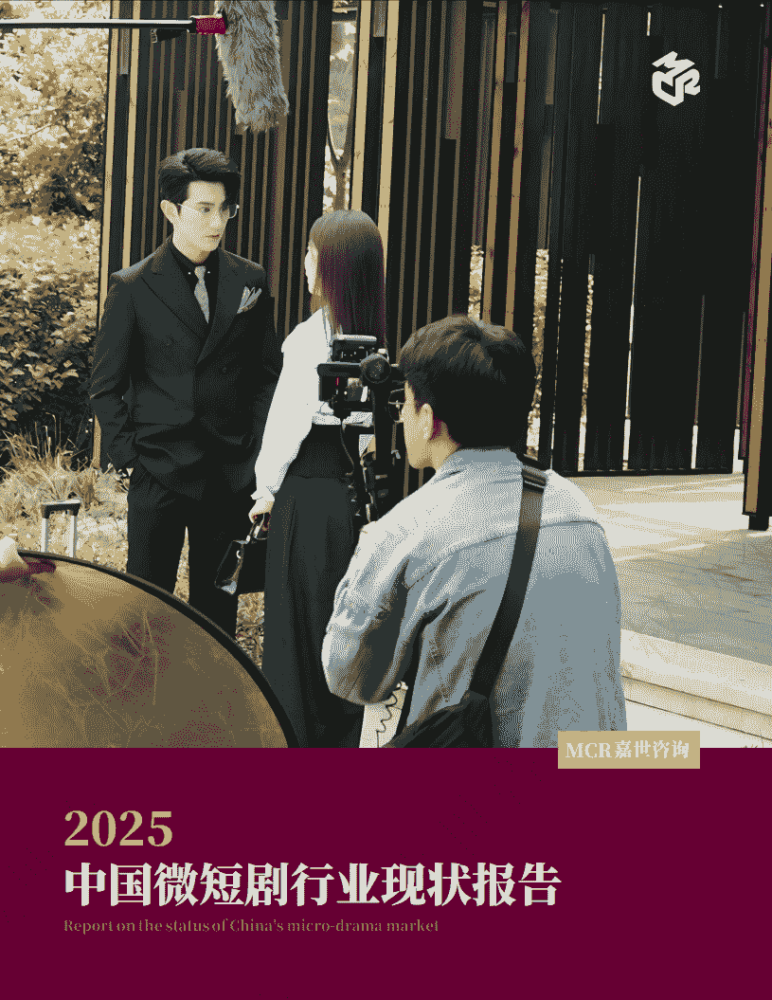

[2025中国微短剧行业现状报告.pdf](https://internal-api-drive-stream.feishu.cn/space/api/box/stream/download/all/V0xObtEIjo1cE6xSQDycGC93nvh)

### **5.AI 短剧各大平台的需求**

各大平台 AI 短剧/漫剧扶持政策对比表（2025 年 12 月最新）

#### 1）抖音平台

**需求分析**：

+   竖屏短剧（9:16）为主要形态，单集 1-3 分钟，日上线约 120 部，月新增播放量超 61 亿

+   仿真人漫剧、2D/3D 漫剧为平台主推方向，表情包/沙雕漫剧次之，静态漫剧已边缘化

+   用户画像：男性占比高，偏好爽文改编、重生、悬疑题材，《奶团太后宫心计》《九尾狐男妖爱上我》等爆款频出

**核心扶持计划**：

+   **AIGC 短剧招募计划**（2025 年 3 月）：单部最高 500 万投资 +1 亿流量，分为两种模式：

+   AI 精品短剧：投资比例最高 70%，优质项目保底 50 万

+   AI 达人短剧：发布 3 集以上获千万流量 +5 万元现金奖励

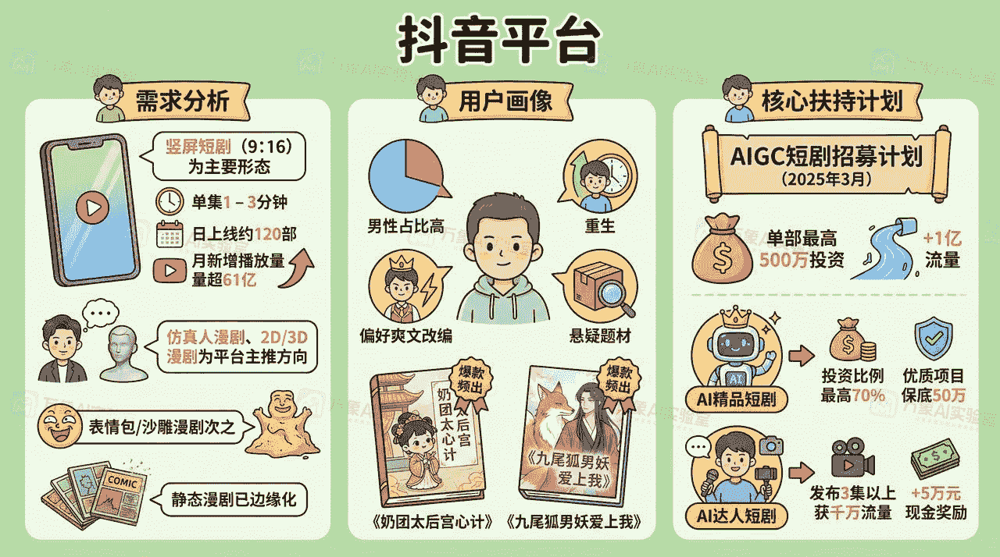

+   **星光/辰星计划**：漫剧内容 90%-95%超高分成，IP 改编额外 50%扶持

+   **精品漫剧激励政策**（2025 年 11 月）：分级保底+超保底持续分成：

| **内容等级** | **保底标准** | **备注** |
| --- | --- | --- |
| 超头部 | 每分钟 1-3 万元，单部最高 300 万 | 单独评估 |
| S+级 | 每分钟 5000 元，单部 50-75 万 | 100 分钟作品保底 50 万+ |
| S 级 | 每分钟 3000 元，单部 30-45 万 |  |
| A 级 | 每分钟 2000 元，单部 15-25 万 |  |

+   **版权合作**：开放 6 万+番茄小说 IP，提供 IP 授权+成片保底+头部采买三种合作模式

+   **分成系数调整**（2025 年 11 月）：

+   仿真人漫剧：60（最高）

+   2D/3D 漫剧：50

+   表情包/沙雕漫剧：10

+   静态漫剧：1

+   全版权合作可获 2 倍系数加成

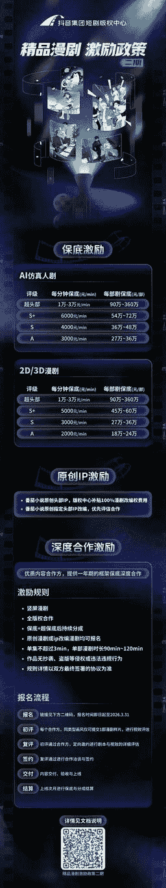

#### 2）快手平台

**需求分析**：

+   短剧用户规模突破 3 亿，上线短剧超 1000 部，单集 1-2 分钟，漫剧类优先

+   偏好"老铁文化"，内容需真实感强，平台重视用户信任关系，AI 内容必须双重标记"AI 制作"

+   可灵 AI 平台用户达 4500 万，推动全球 AI 视频创作人数破亿，动态漫用户 6 个月突破 400 万

**核心扶持计划**：

+   **AI 创想剧场**（2025 年 7 月）：短剧时长 1-10 分钟，总集数≥2，单部最高 8 万元现金+专属流量

+   灵感·新纪元 AIGC 创投计划（2025 年 9 月）：

+   联合出品：单部最高 1000 万"灵感值"+1 亿流量支持

+   联合运营：提供制作补贴+分成+宣发资源

+   **星芒创想计划**：AI 融合为核心，提供变现渠道全覆盖，单部最高 50 万现金 +1000 万灵感值 +1 亿流量

+   **技术支持**：可灵 AI（2025 年 11 月新版）支持 30 秒+高质量视频生成，优化角色一致性和复杂镜头语言


#### 3）B 站平台

**需求分析**：

+   以二次元用户为基础，偏好 16:9 横屏长剧集（5-10 分钟），古风、治愈、创新形态内容易火

+   平台将动画短剧列为 2025 年核心方向，与刺猬猫、菠萝轻小说等网文平台合作，已购上千部 IP

+   "充电付费+会员专享"为主要变现模式，粉丝粘性高但流量规模不及抖音

**核心扶持计划**：

+   **觉醒计划**（2025 年 6 月）：

+   制作支持：承担 30%-100%制作成本，新人可享 100%成本覆盖（零门槛试错）

+   分成政策：版权授权与充电分成最高 80%，纳入小说短剧分润体系

+   流量扶持：千万级曝光，优先推荐

+   **曦光计划**（2025 年 3 月）：

+   充电短剧合作：多平台分发，支持包月或全集购买

+   精品短剧制作：评估通过后提供资金+流量+宣发

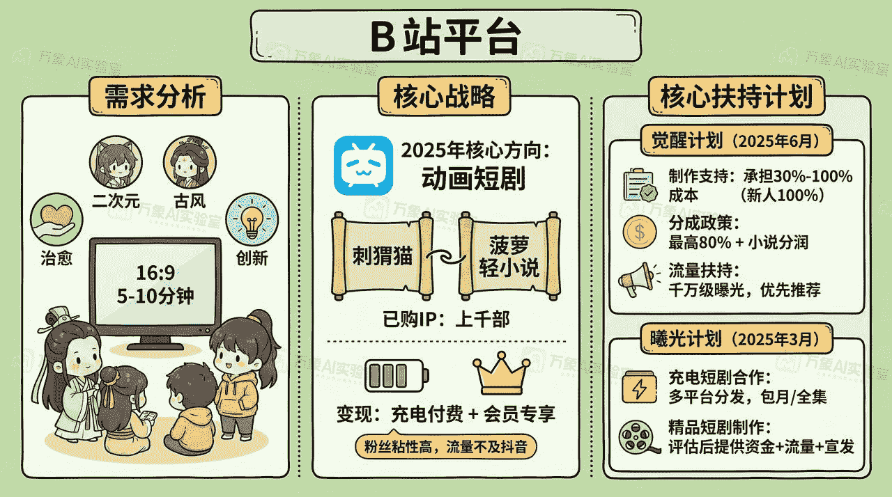

#### 4）视频号平台

**需求分析**：

+   端原生短剧与小程序可同步发布，一次上传多端分发，节省时间成本

+   内容审核严格，AI 生成内容必须标注声明，违规将封禁账号（2025 年 9 月新规）

+   用户群体偏成熟，更适合家庭向、正能量内容

**核心扶持计划**：

+   **短剧组件支持**（2025 年 11 月）：

+   账号授权：支持短剧机构授权，绑定后可发表内容并挂载小程序

+   流量支持：自然流量分发+精准加热投放，帮助获取付费用户

+   **AI 内容规范**：

+   必须标注"AI 制作"声明，视频和图片均需主动标识

+   2026 年 3 月前完成存量 AI 内容补审，否则下架

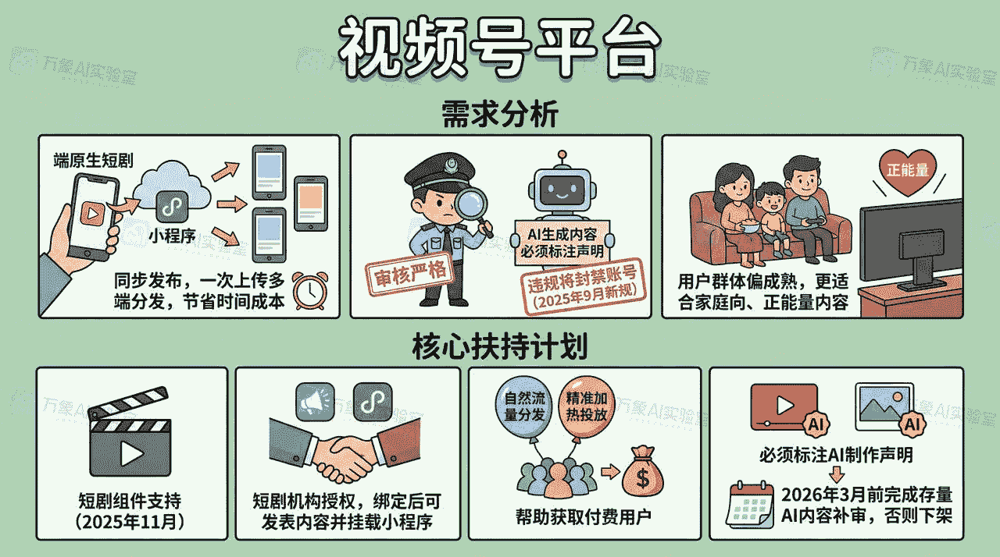

#### 5）爱奇艺平台

**需求分析**：

+   主推 16:9 横屏长剧集（5-10 分钟），内容质量要求高，强调艺术性与商业性平衡

+   漫剧频道聚合 AI 剧、动态漫、沙雕漫等多元形态，已吸引超 200 家制作机构入驻

+   注重 IP 价值，《盗墓笔记》《鬼吹灯》等热门 IP 改编作品表现优异

**核心扶持计划**：

+   **鲍德熹·爱奇艺 AI 剧场**（2025 年 9 月）：

+   内容定位：15 分钟以上的 AI 叙事长片，2026 年一季度上线首批作品

+   扶持内容：提供技术支持+创作补贴+收益分成（参与会员费和广告收入）

+   **漫剧合作计划**：

+   保底分账+流量倾斜，基础分成模式高达 70%-100%

+   版权合作：开放海量影视 IP 资源，提供测试金兜底赔付，降低试错风险

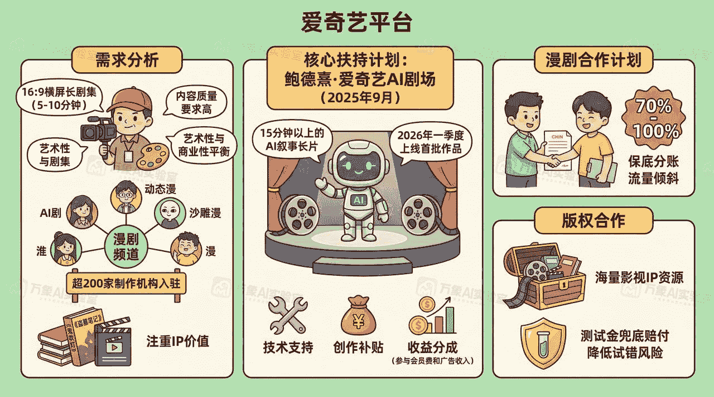

#### 6）腾讯视频平台

**需求分析**：

+   竖屏短剧与横屏漫剧并行，短剧单集 1-3 分钟，漫剧 5-10 分钟

+   重视 IP 开发，与腾讯动漫、阅文集团协同，《庆余年》《斗罗大陆》等 IP 改编表现突出

+   用户画像：女性占比高，偏好爱情、都市、家庭题材

**核心扶持计划**：

+   **AI 创作大赛·i 短剧**（2025 年 10 月）：

+   奖金池 120 万元：最佳 AI 短剧（40 万）+最佳技术/创意短剧（各 20 万×2）

+   资源支持：签约机会+千万级曝光+分账激励

+   **文娱-微短剧政策**：

+   分成政策：最高 95%分成比例，行业领先

+   超额激励：漫剧授权官方小程序可获 110%-160%超额分成

+   IP 支持：开放海量影视 IP 资源，提供测试金兜底（降低 50%试错风险）


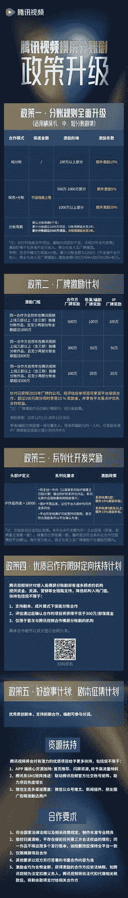

#### 7）百度平台

**需求分析**：

+   短剧已成为百度 APP 第一大视频品类，DAU 破 4000 万，消费时长同比增 3.8 倍

+   AI 技术深度赋能，通过文心大模型辅助从故事到分镜的全流程创作

+   用户群体广泛，覆盖各年龄段，内容偏好多元

**核心扶持计划**：

+   **百看计划+智跃计划**（2025 年 4 月）：

+   智跃计划：开放直播+电商+短剧+智能体四大能力，提供 25 亿激励金

+   短剧支持：分发 1 万部剧本资源，结合 AI 生成降低制作成本

+   技术赋能：AI 剧本生成、智能投流、一站式数据监测

+   **AI 星河计划**：

+   流量支持：千万级预算，优先推荐

+   创作工具：文心大模型辅助创作，一键生成剧本+分镜+剪辑

+   **七猫漫剧**（2025 年 11 月）：

+   独立频道：专注漫剧内容，提供保底+分成+IP 支持

+   与百度文心一言深度整合，5 步实现从故事到成片的 AI 制作流程

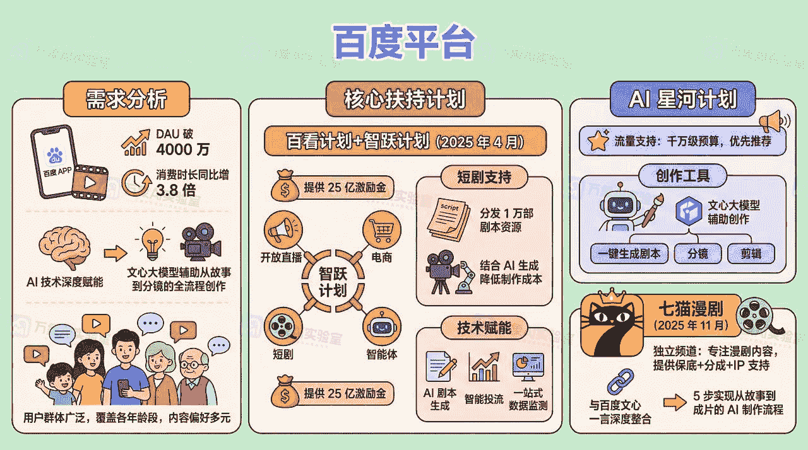

#### 8）其他平台政策概览

**红果短剧**（字节跳动旗下）：

+   独立 APP（2025 年 11 月上线），月活千万，下载量超 130 万

+   精品漫剧保底：30-300 万，单价最高每分钟 3 万元

+   分成比例：最高 60 系数，全版权合作翻倍（120 系数）

+   月产能≥5 部的机构可获批量保底+优先排期

**快手旗下可灵 AI**：

+   全球创作者 4500 万，AI 视频创作人数破亿

+   技术优势：支持复杂动态生成、多模态编辑、AI 音效生成，角色一致性优化

+   代表作品：《新世界加载中》（全球首部 AI 单元剧），上线 40 天全网曝光超 4 亿

**咪咕数媒**：

+   AI 剧专区：为 AIGC 内容提供专属展示与推广，依托移动 10 亿用户布局市场

+   国际发行：通过自有平台（FlareFlow、UniReel）和公域平台（YouTube、TikTok）分发

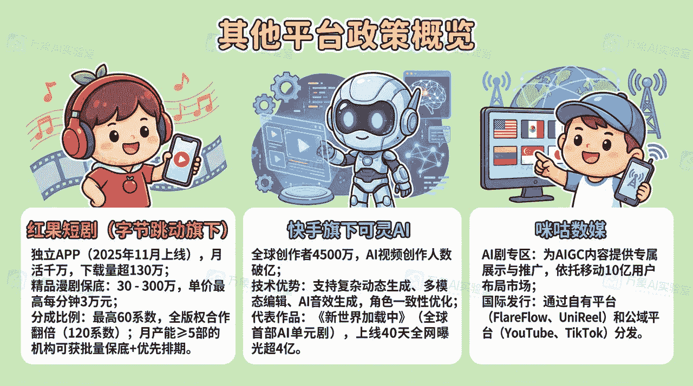

> **行业监管与趋势**

> **监管要点**：

+   分类审核：30 万以下项目平台自审备案，30-100 万省局审核，100 万以上总局审核

+   AI 内容标识：必须在片头添加"AI 制作"标识，虚拟演员需著作权登记

+   内容规范：严禁不良导向，AIGC 内容被列为重点审核对象（2025 年 11 月专项治理）

> **市场趋势**：

+   2025 年被称为"AI 漫剧元年"，市场规模达 200 亿，日上线量预计 2026 年初达 220 部+

+   成本革命：AI 转绘短剧成本比真人剧降低 70%-90%，5-10 万可制作精品短剧

+   内容升级：从"野蛮生长"到"精品化"转变，平台通过分成系数引导高质量创作

+   国际拓展：《愤怒的吸血鬼》《全民转职》等作品在北美、东南亚市场表现优异

#### 各大平台扶持计划总结对比表

| #### **平台** | #### **核心模式** | #### **分成比例** | #### **保底标准** | #### **技术支持** | #### **适合创作者** |
| --- | --- | --- | --- | --- | --- |
| 抖音 | 分级保底+高分成 | 90%-95% | 最高每分钟 3 万元 | 即梦 AI+文心一言 | 产能稳定、IP 资源丰富的团队 |
| 快手 | 灵感值+流量+现金 | 未公开 | 单部最高 50 万 +1000 万灵感值 | 可灵 AI（角色一致性强） | 擅长老铁文化、接地气内容的团队 |
| B 站 | 全额/部分成本+高分成 | 最高 80% | 未公开 | 创作指导+技术培训 | 二次元创作者、新人团队（零门槛） |
| 视频号 | 小程序+流量支持 | 未公开 | 未公开 | AI 内容标识规范 | 内容合规、注重质量的成熟团队 |
| 爱奇艺 | 高分成+IP 授权 | 70%-100% | 未公开 | AI 剧场技术支持 | 追求艺术品质的专业团队 |
| 腾讯视频 | 高分成+超额激励 | 最高 95%+160%超额 | 未公开 | AI 创作工具+IP 库 | 擅长 IP 开发、女性向内容团队 |
| 百度 | 技术赋能+流量+资金 | 未公开 | 未公开 | 文心大模型全流程辅助 | 技术驱动型、效率优先的团队 |

> **注**：本表格基于 2025 年 12 月最新公开信息整理，各平台政策可能随时调整，建议创作者在合作前与平台官方确认最新细节。

## **1.4 主流短剧类型**

AI 的加持，让短剧题材库得到了极大丰富。

### 1）AI 短剧核心信息表

| #### **类型** | #### **核心特点** | #### **优势** | #### **劣势** | #### **消费人群** | #### **代表作（Top3）** |
| --- | --- | --- | --- | --- | --- |
| 玄幻/仙侠类（主流） | AI 生成震撼战斗场景+异世界景观，主打超现实体验 | 视觉奇观表现力强；世界观构建成本低；满足&quot;修仙打怪&quot;爽感 | 剧情同质化严重；角色塑造单薄；情感共鸣不足 | 18-35 岁年轻男性（占比 67%），游戏/网文爱好者 | 《玄幻：从拉二胡开始》《寒窑赋》《我在山顶建末日堡垒》 |
| 悬疑/志怪类 | 融合民俗传说+现代叙事，AI 生成恐怖氛围与奇幻场景 | 悬念感强；文化底蕴深厚；低成本实现视觉冲击 | 逻辑漏洞常见；恐怖感浮于表面；难以形成长期 IP | 25-45 岁男女均衡，偏好刺激/推理内容 | 《兴安岭诡事》《异兽降临》《迷雾追凶》 |
| 逆袭/重生类（爽文改编） | 普通人获超能力/重生/穿越，实现人生逆袭，爽感密集 | 强代入感；情绪价值高；受众基数大 | 套路化严重；价值观单一；脱离现实 | 18-30 岁年轻人（职场/校园人群为主） | 《奶团太后》《重生之我在霸总家当保姆》《婉心计》 |
| 科幻/未来类 | 探讨科技伦理、虚拟与现实，AI 技术视觉优势明显 | 想象力丰富；视觉创新空间大；话题性强 | 内容晦涩；观众接受度参差不齐 | 25-45 岁科技爱好者，科幻文学粉丝 | 《三星堆：未来启示录》《新世界加载中》《双子希娜西米》 |
| 萌宠类 | 动物拟人化，结合都市情感故事，方言配音+ASMR 提升沉浸感 | 治愈感强；规避真人表演限制；传播性强 | 题材小众；内容深度有限 | 三四线城市中年女性（微信群转发主力） | 《霸总雪纳瑞》《奇幻专卖店》《喵星人统治地球》 |
| 年代/怀旧类 | 还原特定年代场景，唤起集体记忆 | 情感共鸣强；历史细节还原度高 | 市场规模有限；年轻观众接受度低 | 40-60 岁中老年，对年代剧有情感需求 | 《我在 80 年代当后妈》《美猴王》《在我心中，你是独一无二》 |

根据剧查查和漫数有剧的信息，统计了 2025 年播放量在 1000 万以上的 37 部 AI 真人短剧和 22 部播放量在 3500 万以上的 AI 漫剧，以此作品本身为主，绘制 2025AI 短剧的内容图谱。


### 2）AI 漫剧核心信息表

| #### 类型 | #### 核心特点 | #### 优势 | #### 劣势 | #### 消费人群 | #### 代表作（Top3） |
| --- | --- | --- | --- | --- | --- |
| 沙雕漫（早期形态） | 极简画面（表情包/熊猫头），密集反转，荒诞搞笑 | 制作成本极低（2000 元可实现 10 万流水）；产出速度快；笑点密集 | 视觉简陋；内容轻薄；IP 价值低 | 18-25 岁年轻男性，B 站文化爱好者 | 《元武惊世》《剑隐凡间》《太后传》 |
| 动态漫（主流形态） | 静态漫画动态化（镜头平移/缩放），保留原漫画风格，AI 配音 | 还原漫画美学；制作周期短（45 天完成样片）；成本低（传统动画 1/5） | 动态效果有限；场景转换生硬 | 18-30 岁二次元爱好者，漫画原著粉丝 | 《传武》《开局强吻裂口女》《斩仙台下，我震惊了诸神！》 |
| 小说剧（文字转视觉） | 旁白朗读网文+简单场景动画+文字特效，忠实还原原著 | 改编成本低；内容来源丰富；满足网文读者视觉化需求 | 视觉体验弱；叙事单调；观众参与感低 | 25-40 岁网文爱好者，尤其是男频用户 | 《开局物价贬值百万倍，我竟成了世界首富》《从娘胎开始逆袭》 |
| 原创动画漫剧 | 全流程 AI 创作（角色设计到配音），原创世界观 | 创意自由度高；视觉风格独特；内容差异化明显 | 技术要求高；制作周期较长；投入成本相对较高 | 18-35 岁动画爱好者，追求新鲜体验的年轻人 | 《有山灵》《果果星球》《双子希娜西米》 |
| 真人+动画混合类 | AI 生成动画角色与真人演员同台，突破传统拍摄限制 | 视觉冲击力强；内容形式新颖；叙事空间扩展 | 技术融合难度大；风格不统一；制作成本较高 | 全年龄段，尤其是喜欢创新内容的年轻家庭 | 《无名特攻队》《中国神话》 |

2025 年 AI 短剧行业迎来关键性增长节点，尤其下半年呈现出“量级激增、品类全面开花”的爆发态势。在统计的 59 部作品中，有 13 部播放量破亿的作品，4 部为 AI 真人短剧、9 部为 AI 漫剧；播放量在 5000 万至 1 亿的作品则为 28 部。其中，AI 真人短剧侧，《奶团太后宫心计》以 2.2 亿的播放量拔得头筹；AI 漫剧侧，《洪荒：代管截教，忽悠出了一堆圣人》以 2.71 亿的播放量占得榜首。


### 3）AI 短剧 vs AI 漫剧核心差异对比表

| #### 对比维度 | #### AI 短剧 | #### AI 漫剧 |
| --- | --- | --- |
| 内容形态 | 真人形象（AI 生成或合成） | 动画/漫画风格 |
| 制作成本（单集） | 800-5000 元（传统短剧 1/10-1/20） | 500-4000 元（传统动画 1/5-1/10） |
| 制作周期（单集） | 1-7 天 | 7-30 天 |
| 核心内容特点 | 贴近现实或超现实场景，爽感密集 | 奇幻世界观构建，视觉想象力更丰富 |
| 核心用户画像 | 25-35 岁年轻人（40%）+41-60 岁中老年（20%），下沉市场为主 | 18-30 岁年轻男性（86%），Z 世代为主，二次元/网文重度用户 |
| 题材偏好 | 逆袭/重生、悬疑、年代剧 | 玄幻修仙（39%）、系统流、末世穿越 |
| 观看场景 | 碎片化（通勤/午休）、家庭场景 | 专注观看，日均 1-2 小时 |
| 主流商业模式 | 广告+付费订阅+IP 衍生 | 付费点播+小说引流+周边开发 |

## **1.5 AI 短剧必备工具库**

工欲善其事，必先利其器。本章节将为你系统性地盘点从剧本构思到成片输出的全链路 AI 工具。我们将它们分为六大类别，并详细解析每一款工具的作用、网址、优劣势，助你打造属于自己的“神兵利器”。

### **1. 创意与剧本生成工具**

这类工具是你的“首席编剧”，负责将你的灵感火花扩展成完整的故事。

| #### **工具名称** | #### **核心功能** | #### **优势** | #### **劣势** | #### **适用场景** | #### **官方网址** |
| --- | --- | --- | --- | --- | --- |
| ChatGPT( OpenAI) | 生成剧本大纲、角色对白、分镜辅助，支持多风格转换、逻辑分析与跨语言创作，适配短剧/漫剧结构设计 | 创造力强、上下文理解深，多语言支持，可定制化程度高，能提供多元创作思路 | 中文本土化适配稍弱，长剧本逻辑连贯性需人工校准，情感细腻度不足，高级功能付费 | 个人创作者、跨语言项目、灵感激发、脚本初稿生成，各类题材短剧/漫剧构思 | https://chat.openai.com |
| Gemini 3 Pro（谷歌） | 15 分钟生成完整短剧创意包，含角色小传+三幕结构+分镜，多模态内容生成，API 支持图像/视频集成 | 画面感极强，环境描写细腻，商业可行性高，适合投资级提案，支持镜头数控制 | 国内访问需特殊网络环境，高级功能需付费 API | 高质量短剧/短片创作、视觉导向型内容、多模态协同制作 | https://gemini.google.com |
| Claude 4.5( Anthropic) | 20 万字级长文本处理，逻辑冲突检测，细腻情感描写，结构化输出剧本/分镜 | 长剧本逻辑连贯性极佳，人物刻画深度高，自动检测剧情漏洞 | 生成速度较慢，需手动优化短剧节奏，国内访问需第三方平台 | 悬疑/刑侦题材、角色驱动型剧集、网文 IP 改编 | https://claude.ai |
| 文心一言 5.0（百度） | 生成 5-8 集短剧剧本框架，角色设定+冲突设计，分镜脚本辅助，与文心一格联动 AI 视频生成 | 中文语境理解极强，网络流行语捕捉精准，批量生产效率高，有官方创作基金支持 | 情感细腻度需人工微调，深度原创性略逊 | 都市甜宠/现实题材、热点话题短剧、平台内容矩阵 | https://yiyan.baidu.com |
| 通义千问 Max（阿里） | 分钟级剧本灵感激发，桥段设计+对白优化，剧本评估与改进，多模态内容生成 | 中文理解与生成双优，智能对话交互自然，知识类/科普类内容创作尤佳，阿里生态集成 | 剧情节奏控制一般，需人工强化“爽感” | 知识类短剧、企业宣传短片、阿里生态内内容创作 | https://qianwen.aliyun.com |
| 混元 Turbo S（腾讯） | 短视频分镜脚本生成，视频内容分析与改编，多模态内容生成，角色形象设计联动 | 视频理解能力极强，镜头语言专业，支持 50+腾讯产品集成，开源视频生成模型 | 长剧本结构规划较弱，商业化节奏把握一般 | 短视频/信息流内容、广告短片、游戏 CG/动画脚本 | https://hunyuan.cloud.tencent.com |
| Kimi+（月之暗面） | 200 万字超长文本处理，故事框架构建，标题优化（金句制造），内容创作与润色 | 长文本处理能力顶尖，角色一致性保持极佳，批量内容生产效率高，爆文标题拆解快 | 剧情张力较弱，需人工增强“爽感” | 长篇连载改编、网文 IP 漫改、内容矩阵批量生产 | https://kimi.moonshot.cn |
| 豆包（字节跳动） | 生成剧本大纲、人设与对白，支持多轮对话式创作；适配短剧/漫剧全流程脚本生成（含分级大纲、分场脚本），可联动生成角色/场景效果图，支持抖音/剪映生态适配的脚本格式输出 | 中文理解精准，交互人性化；免费额度充足，新手友好；深度绑定字节系生态，脚本可直接对接短视频制作工具；支持深度思考模式，能优化剧情逻辑与冲突设计 | 前沿题材创意突破力有限，知识更新偶尔延迟；长剧本（50 集以上）结构把控需人工校准；高级多模态生成功能需解锁会员 | 个人创作者、新手入门；抖音/视频号短剧创作；短剧/漫剧脚本快速初稿与逻辑优化；字节系生态内内容矩阵生产 | https://www.doubao.com |

## 使用总结建议

### 1. 工具组合策略

> 优先推荐“场景化组合”：

> ① 字节系生态创作（抖音/剪映）：豆包+Kimi+，豆包负责脚本初稿与逻辑优化，Kimi+处理长篇 IP 改编的框架构建，脚本可直接对接后续制作工具；

> ② 通用商业化短剧：ChatGPT+文心一言，ChatGPT 发散多元创意，文心一言优化中文表达与短剧节奏；③ 长剧本精品创作：Kimi+Claude，保障逻辑连贯与角色深度；

> ④ 视觉导向项目：Gemini+腾讯混元，强化分镜与画面适配。

### 2. 场景化选择技巧

> ① 个人/新手：优先试用豆包、文心一言、通义千问，免费额度充足，中文适配好，操作门槛低，其中豆包的对话式创作更贴近新手思维；

> ② 中型团队：讯飞星火、腾讯混元，企业级功能完善，生态集成性强，支持团队协作；

> ③ 专业工作室：Claude、Gemini，创作质量高，适合精品化内容，支持 API 深度集成；

> ④ 字节系矩阵号：必选豆包，生态联动优势显著，能大幅提升从脚本到发布的效率。

### 3. 效率提升要点

> ① 精准提示词模板：需明确“题材+集数+时长+核心要求”，例如“用豆包生成 3 集×2 分钟民国虐恋短剧脚本，每集 1 个反转，含角色设定、分场描述，输出适配抖音的口语化台词”；

> ② 二次优化逻辑：初稿生成后，用 Claude 或豆包做逻辑校验，文心一言优化本土化表达；

> ③ 避坑指南：避免单一工具依赖，关键情节人工审核；警惕同质化，利用豆包的深度思考模式强化剧情独特性；关注工具数据更新节奏，热点题材优先用文心一言或豆包获取最新流行元素。

### **2. AI 绘画工具 **

这是 AI 短剧和 AI 漫剧的核心生产力，以下工具覆盖 AI 短剧/AI 漫剧图片生产全场景（角色形象设计、场景搭建、分镜插画、动态帧生成、海报制作等），优先筛选技术稳定的大厂工具及专业垂直工具，适配不同创作需求与团队规模。

| 工具名称 | 核心功能 | 优势 | 劣势 | 使用场景 | 网址 | 价格 |
| --- | --- | --- | --- | --- | --- | --- |
| **即梦 AI** | 1. 文生图/图生图（支持 2K-4K 分辨率）；2. 批量分镜生成（内置 10+分镜模板）；3. 角色一致性维护（跨镜头形象统一）；4. 图生视频延伸能力（支持动态效果添加）；5. 局部重绘与风格微调（含写实、日漫等 8 种基础风格） | 1. 中文语义理解精准，可识别“清冷感”“破碎感”等抽象词汇；2. 生成速度快（2K 图仅 1.8 秒/张）；3. 分镜与正文创作无缝衔接，支持一键导出分镜脚本；4. 免费额度充足，新手友好；5. 支持批量生成风格统一的组图 | 1. 艺术风格多样性有限，小众风格适配不足；2. 复杂场景（如多人群像、宏大场景）层次感不足；3. 高阶定制功能（如精细光影调节）缺失；4. 付费资源包仅支持视频生成抵扣，图片生成无批量优惠 | 1. 中文短剧分镜快速生成；2. 日常剧情画面批量产出；3. 新手入门级角色设定初稿；4. 低成本短剧概念图设计 | https://jimeng.jianying.com/ | 1. 免费额度：200 次图片生成；2. 付费：0.22 元/张（4.0 版图片）；3. 视频资源包：3.0 720P 250 秒/70 元，3.0 1080P 250 秒/157.5 元 |
| **NanoBanana** | 1. 高精度文生图与图生图；2. 专业级图片编辑（去水印、姿态调整、局部替换）；3. 多图融合与角色锁定；4. 旧素材修复（模糊修复、高清重塑）；5. 风格迁移（支持 15+艺术风格转换） | 1. 角色一致性业界领先，跨场景保持细节（五官、服饰、比例）统一；2. 编辑功能媲美 PS，无需专业技能即可完成精细修图；3. 多图融合逻辑自然，场景合成无违和感；4. 支持批量处理相似素材 | 1. 生成速度较慢（单张 2K 图约 10-15 秒）；2. 中文语义理解一般，抽象描述适配差；3. 免费额度少，新手体验受限；4. 高阶功能需 Pro 版解锁，成本较高 | 1. 系列短剧角色设定与维护；2. 关键帧画面精修；3. 旧素材高清修复与再利用；4. 多场景角色同框画面合成 | https://nanobanana.ai | 1. 免费：新用户 5 个免费积分（1 积分≈1 张图），免费用户单次限传 1 张图；2. Pro 版：500 积分/月（$19.99）；3. 支持按次付费，单张高清图约$0.5 |
| **Midjourney** | 1. 高艺术感图像生成（支持 8K 分辨率）；2. 风格迁移与参考（支持指定艺术家风格）；3. 图像延展与局部重绘；4. 多版本迭代生成（单提示词出 4 个变体）；5. 社区模板复用（百万级创意参考） | 1. 艺术表现力极强，色彩、光影、构图专业级；2. 风格多样性丰富（写实、科幻、古风、日漫等全覆盖）；3. 社区资源丰富，可直接复用优质提示词；4. 细节还原度高，复杂场景层次感强 | 1. 需通过 Discord 操作，上手门槛较高；2. 中文提示词适配差，需用英文精准描述；3. 价格较高，无单次付费选项；4. 角色一致性较弱，系列内容需额外调试；5. 商业使用需确认授权范围 | 1. 短剧/漫剧概念海报制作；2. 关键帧艺术化渲染；3. 视觉风格定位与参考图生成；4. 高质感场景氛围图创作 | 通过 Discord 使用（官网：https://www.midjourney.com） | 1. 基础版：$10/月（每月 200 次快速生成）；2. 标准版：$30/月（每月 15 小时快速生成）；3. 企业版：$600/年起，支持商业授权 |
| Stable Diffusion | 1. 高度自定义生成（支持 SD3 模型）；2. 插件扩展功能（ControlNet 精准控图、LoRA 角色训练）；3. 本地部署与离线生成；4. 新增采样调度器（Align Your Steps、KL Optimal 等）；5. 批量生成与参数微调（采样步长、CFG 值等） | 1. 完全开源免费，无使用次数限制；2. 定制化程度极高，可通过模型、插件实现专属风格；3. 本地部署保障隐私，适合敏感内容创作；4. 支持角色训练，系列内容一致性可控；5. 性能优化好，批量生成效率高 | 1. 技术门槛高，需掌握参数调试、模型安装等技能；2. 本地部署需高配置电脑（建议 RTX 3060 以上显卡）；3. 基础模型效果一般，需额外下载优质模型/插件；4. 中文提示词支持需安装扩展插件 | 1. 定制化角色/场景生成；2. 系列短剧固定角色训练与复用；3. 特殊视觉效果制作（如科幻特效、古风氛围感）；4. 隐私性要求高的商业内容创作 | https://stablediffusionwebui.com | 1. 开源免费，无使用成本；2. 模型/插件多为免费，部分优质 LoRA 模型需付费（约$5-20/个）；3. 云部署服务：AutoDL 等平台约$0.5-2/小时 |
| **DALL·E 3** | 1. 精准文本-图像匹配生成；2. 图像编辑（移除/添加元素、扩展画面）；3. 高分辨率输出（支持 4K）；4. 与文本创作无缝衔接；5. 多风格适配（写实、卡通、插画等） | 1. 文本理解能力极强，可精准还原复杂描述；2. 操作极简，无需专业提示词技巧；3. 与 ChatGPT 联动，可实现“脚本-图像”一站式生成；4. 商业使用授权清晰，无版权风险；5. 生成内容安全性高，无违规风险 | 1. 价格较高，无免费批量生成额度；2. 艺术风格表现力弱于 Midjourney；3. 角色一致性一般，系列内容需反复调试；4. 中文提示词虽支持，但效果略逊于英文 | 1. 脚本驱动的精准画面生成；2. 新手快速产出剧情画面；3. 商业短剧合规素材创作；4. 文本密集型场景（如带文字的海报、说明书画面） | 通过 ChatGPT 或官网使用（https://dalle3.org） | 1. 免费版：前 7 天每天 10 张生成额度；2. Pro 版：$5/月（每月 1000 次快速生成）；3. Max 版：$10/月（每月 3000 次快速生成）；4. 需绑定 Stripe 支付 |
| **豆包 ****seed****ream 4.0** | 1. 中文优化文生图；2. 角色一致性生成；3. 高分辨率输出（支持 4K）；4. 风格定制（支持指定短剧/漫剧风格）；5. 图像局部修改与重绘 | 1. 中文语义理解顶级，适配本土创作语境；2. 角色一致性强，跨场景形象稳定；3. 完全免费使用，无次数限制；4. 操作简单，无需注册复杂账号；5. 与豆包脚本创作功能联动，流程顺畅 | 1. 功能相对单一，无分镜批量生成功能；2. 艺术风格多样性不足，小众风格缺失；3. 生成速度一般（单张 2K 图约 5-8 秒）；4. 无专业编辑功能，需搭配其他工具修图 | 1. 中文短剧日常剧情画面生成；2. 新手入门级角色设定；3. 低成本短剧素材创作；4. 中文创意概念图快速产出 | 在豆包 APP 内使用（官网：https://www.doubao.com） | 1. 免费：无使用次数与分辨率限制；2. API 付费：0.2 元/张（商业批量调用）；3. 无单独付费套餐，核心功能免费开放 |
| **ComicsMaker.ai** | 1. 漫画专用分镜生成；2. 黑白稿转彩漫；3. 角色设计与训练；4. 漫画文本排版（气泡、字幕）；5. 四格/多格漫画布局生成 | 1. 漫画创作全流程支持，适配漫剧专属需求；2. ControlNet 草图转彩漫功能精准；3. 分镜布局符合漫画阅读逻辑；4. 文本排版功能强大，无需额外设计工具；5. 新手友好，内置漫画模板 | 1. 非通用型工具，短剧实景画面生成效果差；2. 生成速度较慢，批量分镜需等待；3. 风格局限于漫画，无写实风格支持；4. 免费版额度少，高级功能需付费解锁 | 1. 漫剧分镜设计；2. 黑白漫画稿转彩漫；3. 四格漫画/连载漫剧创作；4. 漫画风格短剧海报制作 | https://www.comicsmaker.ai | 1. 免费版：100 积分/月（1 积分≈1 张图）；2. 高级版：$10/月（无限生成+高级编辑功能）；3. 商业版：$50/月（支持商业授权） |
| **文心一格** | 1. 中文创意图像生成；2. 艺术风格迁移；3. 图像延展与重绘；4. 批量生成与导出；5. 与百度生态工具联动（如文心一言、剪映） | 1. 中文理解优秀，适配本土创意需求；2. 风格多样性较强（支持国风、科幻、卡通等）；3. 与百度系工具联动顺畅，适合全流程创作；4. 会员体系完善，可选套餐多；5. 生成内容版权清晰，商业使用有保障 | 1. 细节表现一般，复杂场景层次感不足；2. 角色一致性较弱，系列内容需调试；3. 免费额度少，核心功能需会员；4. 生成速度较慢，批量生成效率低 | 1. 国风短剧/漫剧素材生成；2. 中文创意概念图设计；3. 百度生态内全流程创作；4. 品牌联动短剧素材制作 | https://yige.baidu.com | 1. 白银会员：66 元/月（600 电量 +200 张免费生图）；2. 黄金会员：119 元/月（1700 电量+无限免费生图）；3. 白金会员：299 元/月（4500 电量+无限免费生图）；4. 电量包：按需购买，1 电量≈1 张基础图 |

## 使用总结建议

> ** 一、按用户类型精准选工具**

> **1. 个人创作者/****新手入****门：优先选择即梦 A**I+豆包 seedream 4.0 组合。即梦 AI 满足分镜快速生成和批量剧情画面产出的核心需求，免费额度充足且中文友好；豆包 seedream 4.0 完全免费，可作为补充工具生成日常剧情画面，二者均无需复杂操作，能快速降低创作门槛。

> **2. 专业工作室/商业项目：推荐 Mid**journey+Stable Diffusion+NanoBanana 组合。Midjourney 负责概念海报、关键帧的艺术化渲染，保障视觉质感；Stable Diffusion 通过插件和模型微调实现定制化角色与场景生成，适配特殊风格需求；NanoBanana 专注角色一致性维护和关键帧精修，确保系列内容风格统一，同时解决素材修复、多图合成等后期问题。

> 3. 漫剧专项创作：首选** ComicsMaker.ai**，搭配 NanoBanana 使用。ComicsMaker.ai 适配漫剧分镜设计、黑白稿转彩漫、文本排版等全流程需求，分镜布局符合漫画阅读逻辑；NanoBanana 可辅助优化角色一致性，提升画面细节精度，弥补前者精修功能的不足。

> **4. 国风/中文创意**项目：优先考虑文心一格+即梦 AI。文心一格在国风风格表现力上更具优势，生成内容版权清晰，适合品牌联动类国风短剧素材创作；即梦 AI 则可快速产出分镜和日常剧情画面，二者联动兼顾风格与效率。

> ** 二、按创作环节高效匹配**

> 1. 概念设计阶段：用 Midjourney 生成多元风格参考图，确定视觉基调；若为中文创意，可先用即梦 AI 快速产出基础概念图，再用 Midjourney 优化艺术质感。

> 2. 分镜制作阶段：中文短剧选即梦 AI（批量生成+一键导出脚本），漫剧选 ComicsMaker.ai（专属漫画分镜模板），新手可直接复用工具内置模板提升效率。

> 3. 角色设计与维护：系列短剧优先用 NanoBanana 锁定角色特征，确保跨场景细节统一；定制化角色需求可选 Stable Diffusion 训练专属 LoRA 模型；低成本项目可用豆包 cdream 4.0 快速生成角色初稿。

> 4. 后期精修与素材复用：旧素材修复、画面局部修改选 NanoBanana；批量剧情画面微调可用即梦 AI；需要精准文本-图像匹配的场景（如带文字海报）可选用 DALL·E 3。

> **三、通用高效使用技巧**

> 1. 成本控制：免费额度优先用于初稿创作（即梦 AI、豆包 cdream 4.0），关键帧、海报等核心素材再用付费工具（Midjourney、NanoBanana）优化；Stable Diffusion 本地部署可规避重复付费，适合长期创作。

> 2. 风格统一：生成时明确标注风格关键词（如“写实短剧风”“日系漫画风”），系列内容可上传参考图锁定风格；角色设计时保存多角度参考图，供后续工具调用确保一致性。

> 3. 提示词优化：中文创作用“风格+主体+细节+光影+氛围”的结构描述（适配即梦 AI、豆包）；英文创作可添加摄影/艺术专业术语（如“cinematic lighting， 8K”）提升 Midjourney、DALL·E 3 的生成质量。

> **四、注意事项**

> 1. 版权合规：商业项目优先选择版权清晰的工具（如 DALL·E 3、文心一格、即梦 AI），使用 Midjourney 需确认商业授权范围，避免侵权风险。

> 2. 设备适配：Stable Diffusion 本地部署需高配置电脑（建议 RTX 3060 以上显卡），低配置用户可选用云部署服务（如 AutoDL）或直接使用在线工具（即梦 AI、

### **3.AI 视频生成工具 **

这是 AI 短剧的未来，目前正处于高速发展阶段，各类工具百花齐放。

| #### 工具名称 | #### 核心功能 | #### 优势 | #### 劣势 | #### 使用场景 | #### 官方网址 |
| --- | --- | --- | --- | --- | --- |
| **即梦 AI**（字节跳动） | 1. 文生视频（最长 12 秒）、图生视频，支持 720p/1080p 分辨率、24-30FPS；2. 智能多帧（上传 10 张关键帧生成 54 秒连贯视频），支持推/拉/摇/移等运镜控制；3. 音画一体（自动匹配环境音、人声对白、背景音乐），口型精准对齐；4. 支持 46 种音色，含四川话、粤语等多方言及情绪调控；5. 智能画布（多图融合、局部重绘、抠图）与多图层编辑功能 | 1. 中文语义理解精准度达 92%，方言适配性强；2. 音画同步效果出色，含动态声场，无需后期拼接；3. 界面一体化设计，新手友好，无代码门槛；4. 每日赠送 60-100 积分，基础创作零成本；5. 角色一致性强，支持背景替换、画风保持等精细化操作 | 1. 基础版单段视频长度有限（仅 12 秒），需拼接生成长视频；2. 复杂动态场景（如多人打斗）易出现肢体变形、反重力水流等问题；3. 付费会员价格偏高（79-649 元/月），高阶功能需升级专业版；4. 生成画面细节略逊于专业级工具 | 1. 竖屏情感短剧、校园短剧等短视频创作；2. 地域特色内容（如重庆小面、粤语美食）创作；3. 自媒体剧情切片、抖音电商 AI 营销素材制作；4. 新手快速产出的轻量化漫剧片段；5. 《三星堆：未来启示录》类文化主题短剧 | https://dreamina.cn/ |
| **可灵 AI**（快手） | 1. 文生视频（最长 3 分钟）、图生视频，支持 1080p 分辨率、30FPS；2. 高精度物理模拟（流体运动、重力效果、刀具切割/倒水等物体交互）；3. 视频续写功能，可多轮扩展生成长内容；4. 10 种音色对口型，支持复杂肢体动作（芭蕾舞、中国古典水下舞）；5. 运动笔刷（区域动态调节）与镜头参数手动调控 | 1. 物理世界模拟逼真，物体交互、肌肉动态等细节处理领先；2. 支持超长视频生成，单段最长 3 分钟，适合完整剧情片段；3. 1.6 版本图生视频效果较 1.5 版提升 195%，语义理解精准；4. 性价比高，5 秒视频生成成本仅 1 元（为 Runway 的 1/5）；5. 支持 B 端 API 服务，适配工业化生产 | 1. 功能分散，需频繁切换网页端/APP/小程序，操作门槛较高；2. 非会员生成速度慢（40 分钟/视频），每日仅 6 次免费额度；3. 复杂多主体场景偶现人物扭曲；4. 新手需一定学习成本才能熟练掌握高阶功能 | 1. 科幻短剧（含流体、爆炸特效）、动作短剧（打斗/舞蹈场景）；2. 长篇剧情短剧（3 分钟单集）、影视级高精度片段创作；3. 亚冬会主火炬特效类商业广告素材制作；4. 电商虚拟试穿场景视频；5. 专业团队工业化批量生产 AI 短剧 | https://kling.kuaishou.com/ |
| **Vidu AI**（生数科技） | 1. 文生视频（最长 16 秒）、图生视频、参考生视频，支持 24-60FPS；2. 上百种动漫风格，含写实电影、水墨国风、赛博朋克等 8 种预设风格；3. 首尾帧精准控制，多主体参考支持，确保连续多图风格一致性；4. 中国元素数据库，可自动识别并增强熊猫、古建筑等特色元素；5. 支持景深效果和镜头运动轨迹调整 | 1. 动漫风格表现出色，风格一致性强，适配漫剧创作；2. 首尾帧控制精准，过渡自然，镜头语言流畅；3. 生成速度快（3 分钟/视频），支持多模态混合生成；4. 可精准解析包含 50+元素的中英文复合指令；5. 对二次元、国风等特色风格的细节还原度高 | 1. 单段视频长度有限（最长 16 秒），需拼接生成长内容；2. 非动漫风格的写实场景表现一般；3. 免费试用额度有限，付费按需计费，长期使用成本较高；4. 复杂动态特效支持不足 | 1. 二次元漫剧改编（校园、悬疑等题材）；2. 水墨国风、赛博朋克风格短剧创作；3. 含中国传统元素的动漫短视频；4. 四格漫画转动态视频；5. 需要精准镜头控制的动漫剧情片段 | https://www.vidu-china.com/ |
| **巨日禄 AI** | 1. 文本智能解析分镜，支持 6000 字长文本一键生成 20 分钟漫画视频；2. 100+漫画画风，含“巨日禄风”等市场认可风格；3. 图生视频、多角色配音配乐，支持人物细腻表情变化；4. 数字资产沉淀（角色/道具/场景共享库），支持多人多组并行操作；5. 一站式流程（文本→分镜→视频），无需多种工具切换 | 1. 漫画风格多样化，适配不同题材漫剧需求；2. 支持长文本处理，适合长篇小说改编；3. 接近国漫动画效果，人物表情丰富，表现力强；4. 生产效率高，15 人团队 3 天可完成一部 AI 漫剧，实现“一人一天一集”；5. 新手友好，零门槛操作，支持免费小说推文授权 | 1. 动画流畅度略逊于专业视频工具；2. 写实风格表现不如即梦、可灵；3. 复杂动态场景的物理效果模拟较弱；4. 高阶功能需订阅专业版，长期使用有成本压力 | 1. 小说改编漫剧（言情、玄幻、悬疑等题材）；2. 漫画解说博主、自媒体小说推文视频制作；3. 《无限返还：我买爆了诡异末日》类爆款漫剧创作；4. 教育机构教学内容漫画视频转化；5. 个人创作者/小团队规模化产出漫剧 | https://ai.jurilu.com/ |
| **Runway** | 1. 专业级文生视频、图生视频，支持电影级画质；2. 时间线编辑功能，可精细化调控视频节奏；3. 多种特效工具（动态模糊、色彩校正）；4. 支持多格式导出，适配专业后期制作 | 1. 生成画质顶尖，达到电影级水准；2. 编辑功能强大，可精准控制视频细节；3. 行业认可度高，适配专业影视制作流程；4. 支持多种创作风格，兼容性强 | 1. 价格高昂，订阅费用高；2. 操作复杂，需专业影视制作知识；3. 生成速度较慢，对设备配置要求高；4. 中文语义理解适配性一般 | 1. 专业团队影视级 AI 短剧制作；2. 电影级特效片段创作；3. 需要精细化编辑的高品质短剧；4. 商业影视项目的辅助创作 | https://runway.ml/ |
| **Sora** | 1. 顶级文生视频，支持多语言输入；2. 高逻辑连贯性，可生成复杂场景叙事内容；3. 支持长时视频生成，画面细节丰富 | 1. 生成质量顶尖，场景逻辑、画面质感行业领先；2. 多语言支持，适配国际题材创作；3. 复杂场景的叙事连贯性强 | 1. 国内访问不稳定，需特殊网络环境；2. 价格高昂，创作成本高；3. 对中文语境的适配性不如国产工具；4. 开放权限有限，并非所有创作者可使用 | 1. 高质量国际题材短剧创作；2. 需要强叙事逻辑的复杂剧情片段；3. 商业大片级别的特效场景原型制作 | https://www.sora.com/ |
| **白日梦 AI** | 1. 长视频生成（最长 6 分钟）；2. 情绪感知架构，可匹配剧情情绪生成画面；3. 悬念生成器，支持悬疑题材内容创作；4. 文本→视频一站式生成 | 1. 支持超长视频生成，适合完整短剧单集；2. 情绪感知精准，画面氛围与剧情匹配度高；3. 悬疑题材创作有专属优化；4. 操作相对简单，新手友好 | 1. 画面质量较可灵、Vidu 略逊；2. 角色一致性一般；3. 生成速度较慢；4. 风格选择相对单一 | 1. 6 分钟完整单集短剧创作；2. 悬疑、情感类长短视频；3. 自媒体长故事推文视频；4. 新手长内容创作练习 | https://www.daydream.ai/ |
| **商汤 Seko** | 1. 对话生成剧本+智能分镜拆解；2. 角色动画生成，支持 100 集连续创作；3. 智能工作流，适配批量生产；4. 多格式导出，支持后期编辑 | 1. 全流程智能工作流，创作效率高；2. 支持长篇系列短剧（100 集）连续创作；3. 角色一致性稳定，适配系列内容；4. 商业合作适配性强，支持定制化需求 | 1. 价格较高，更适合商业团队；2. 个人创作者使用成本高；3. 部分功能需配合专业后期工具；4. 新手操作门槛中等 | 1. 系列短剧（100 集）工业化生产；2. 商业定制短剧创作；3. 影视公司批量产出短剧内容；4. 品牌定制剧情类营销视频 | https://seko.sensetime.com |

> **使用总结建议**

> **选择 AI 视频生成工具的核心逻辑：以**创作目标为导向，匹配工具核心优势；以团队能力&成本预算为约束，平衡效率与效果。结合各工具特性，从多维度给出精准使用建议，覆盖不同创作场景与需求层级。

## 一、按创作类型精准匹配工具（核心推荐）

> 不同题材/形式的短剧/漫剧，对工具的核心要求（如时长、风格、特效）差异较大，优先按类型锁定核心工具：

1.  竖屏短视频/情感短剧（1-3 分钟）：优先选「即梦 AI」。其音画一体功能可直接搞定配音配乐，方言适配性强，适合校园、都市情感、地域特色题材；新手能快速上手，零门槛产出抖音、快手等平台适配的竖屏内容。

1.  **动作/科幻短剧（含特效场景）**：首选「可灵 AI」。物理模拟（流体、爆炸、肢体动作）效果领先，支持 3 分钟长视频，适合打斗、舞蹈、科幻特效类题材；专业团队可借助其 API 服务实现工业化批量生产。

1.  **二次元/国风漫剧**：重点选「Vidu AI」。上百种动漫风格适配，首尾帧控制精准，国风元素还原度高，适合校园漫、悬疑漫、水墨风格漫剧；四格漫画转动态视频的效果最优。

1.  小说改编/长篇漫剧（单集 5-20 分钟）：优先「巨日禄 AI」。支持 6000 字长文本一键生成 20 分钟视频，100+漫画风格可选，数字资产库可沉淀角色道具，适合言情、玄幻、悬疑等小说 IP 改编，小团队可实现“一人一天一集”的高效产出。

1.  **专业影视级短剧/商业定制内容**：选「可灵 AI+Runway」组合。可灵负责核心剧情片段生成，Runway 负责精细化编辑与电影级画质优化；商业定制项目（如品牌营销短剧、赛事特效视频）可搭配商汤 Seko 的智能工作流，适配 100 集以上系列创作。

1.  **国际题材/高叙事逻辑短剧**：尝试「Sora」（需特殊网络环境）。其场景逻辑连贯性与画面质感顶尖，适合复杂叙事的国际题材内容；预算有限可改用「可灵 AI」替代，平衡效果与成本。

>

## 二、按团队规模&操作能力选择

1.  新手/个人创作者（零经验、低成本）：

+   核心工具：即梦 AI（免费积分够用）、巨日禄 AI（免费试用）；

+   优势：操作简单、一站式流程，无需后期技术，能快速产出成品；

+   避坑：先从小片段（10-30 秒）练手，避免直接挑战复杂多角色场景。

1.  中小团队（3-10 人，有基础后期能力）：

+   核心工具：可灵 AI（长视频+物理特效）、Vidu AI（漫剧风格）；

+   优化策略：用即梦 AI 生成碎片化片段，可灵 AI 续写拼接，Vidu AI 处理风格化部分，提升效率的同时保证效果；

+   成本控制：开通可灵 AI 黄金会员（46 元/月），集中额度批量生成，避免零散消耗。

1.  专业团队/商业项目（有影视制作经验，高预算）：

+   核心工具：可灵 AI（API 接入）、Runway（精细化编辑）、商汤 Seko（系列创作）；

+   进阶配置：建立角色参考图库（3-5 张不同角度/表情），确保系列内容角色一致性；

+   效率提升：借助商汤 Seko 的智能分镜拆解功能，实现“剧本→分镜→视频”全流程自动化。

## 三、成本控制&效率提升实用技巧

1.  **免费额度最大化利用**：

+   即梦 AI：每日 60-100 积分，优先用于生成核心剧情片段（如对话场景），避免浪费在无关特效上；

+   可灵 AI：每日 6 次免费额度，用于测试镜头参数、风格效果，确定方案后再用会员额度批量生成。

1.  **多工具组合降本增效**：

+   “即梦生成片段+可灵续写”：解决即梦时长限制，同时降低可灵的额度消耗；

+   “巨日禄分镜+Vidu 风格化”：巨日禄快速拆解长文本生成分镜，Vidu 优化漫剧画面质感。

1.  **批量生产流程搭建**：

+   统一提示词模板：固定“场景+角色+动作+风格+镜头”格式（如“校园操场，17 岁女生跑步，青春动漫风，全景推近”），提升 AI 生成精准度；

+   沉淀数字资产：将常用角色、场景、道具保存到工具素材库，重复使用减少重复创作成本。

## 四、避坑指南&进阶优化要点

>

1.  **避免常见生成问题**：

+   肢体变形/角色“变脸”：上传清晰的角色参考图（正面、侧面、特写各 1 张），生成时明确标注“保持角色一致性”；

+   物理逻辑混乱：复杂特效场景（如倒水、爆炸）优先用可灵 AI，避免用其他工具生成导致效果失真；

+   音画不同步：优先使用即梦 AI 的音画一体功能，或可灵的对口型功能，减少后期拼接误差。

1.  **进阶优化方向**：

+   镜头语言丰富化：用即梦/可灵的运镜控制功能（推、拉、摇、移），避免固定镜头导致画面单调；

+   风格差异化：Vidu 的赛博朋克、水墨国风等特色风格，可用于打造内容记忆点，提升竞争力；

+   版权合规：避免使用真人形象参考图，优先用 AI 生成原创角色；商业用途需确认工具版权协议，必要时购买商业授权。

## 五、核心总结

> 1. **新手/轻量化创作：**优先「即梦 AI」「巨日禄 AI」，以“快速产出”为核心，降低学习成本；

> 2. **中高阶/特效类创作：**锁定「可灵 AI」「Vidu AI」，以“效果精准”为核心，借助工具优势打造优质内容；

> 3.** 商业/系列创作：**组合「可灵 AI+Runway/商汤 Seko」，以“效率+一致性”为核心，适配工业化生产需求；

> **最终核心原则：**工具是辅助，创意是核心。先明确创作目标与受众，再选择适配工具，避免盲目追求“高配置”而忽视内容本身的叙事与情感传递。

### **4. AI 配音与音频工具 **

这里盘点聚焦 AI 短剧、AI 漫剧创作全流程中的配音核心需求，筛选出功能适配性强、市场使用率高的 AI 配音工具，从核心功能、优劣势、官方网址、精准使用场景四个维度展开详细说明，为不同预算、不同创作场景的创作者提供清晰的工具选择参考。

| #### 工具名称 | #### 核心功能 | #### 优劣势分析 | #### 使用网址 | #### 适用场景 |
| --- | --- | --- | --- | --- |
| 讯飞配音（讯飞星火配音） | 1. 提供数百种中文音色，涵盖甜美少女、沉稳大叔、古风公子等适配短剧/漫剧角色的声线；2. 搭载情感引擎，支持喜悦、悲伤、悬疑等多情绪精准表达；3. 支持多语种配音、文本批量导入（TXT 格式）；4. 可微调语速、语调、停顿间隔，导出 MP3/WAV 等多种音频格式。 | 优势：中文发音自然度高，情感表达细腻，音色库贴合本土短剧创作需求，操作界面简洁易上手，支持 APP 与网页端同步使用。劣势：专业版功能（如定制音色）收费较高，免费额度有限，长文本合成速度略慢。 | 网页端：https://peiyin.xunfei.cn/；APP：各大应用商店搜索“讯飞配音” | 1. 国产古装、现代都市等剧情类短剧的多角色配音；2. 对情感表达要求高的剧情片段（如虐心戏、悬疑反转戏）；3. 中文科普类短剧的旁白录制。 |
| 魔音工坊 | 1. 内置抖音爆款配音、广告宣传、角色对话等专属模板；2. 支持多人对话配音，可快速切换角色音色并自动调整对话衔接节奏；3. 提供音色定制功能，支持根据角色设定生成专属声线；4. 支持文本标注情感标签，精准匹配语气风格。 | 优势：模板化操作效率高，多人对话配音功能适配短剧多角色场景，新手友好，部分基础功能免费可用。劣势：部分优质音色需付费解锁，情感表达细腻度略逊于讯飞配音，长文本合成易出现语气断层。 | 网页端：https://www.moyin.com/；APP：各大应用商店搜索“魔音工坊” | 1. 轻量型短视频短剧、竖屏短剧的快速配音；2. 多角色互动频繁的喜剧、家庭伦理类短剧；3. 广告营销类短剧（如美妆、电商带货短剧）的品牌调性配音。 |
| MiniMax 语音 | 1. 支持提示词定制音色（公式：人物设定+语调+语速+语气）；2. 支持 40+种语言配音，适配出海短剧需求；3. 支持 20 万字符长文本合成，可导入 PDF/TXT/网页链接；4. 海外版支持声音克隆（仅需 10 秒音频样本），国内版具备 AI 降噪功能。 | 优势：音色定制灵活性高，多语种适配性强，长文本合成效率高，声音克隆功能可保持角色声线一致性。劣势：国内版无声音克隆功能，部分小众语种发音准确度一般，收费套餐性价比低于本土工具。 | 国内版：https://www.minimaxi.com/audio；海外版：https://www.minimax.io/audio | 1. 出海短剧（如东南亚、欧美市场）的多语种配音；2. 系列化短剧的角色配音（需保持声线统一）；3. 短剧解说、长剧情漫剧的旁白录制。 |
| TopMediai 文字转语音 | 1. 支持 190+种语言、3200+种语音风格，含大量二次元声线（傲娇小、温柔大姐姐、热血少年等）；2. 具备声音克隆功能，仅需 10 秒语音片段即可复刻声线；3. 可微调语速、音高、情感强度，支持实时试听调整；4. 导出音频质量高，支持多格式下载。 | 优势：二次元声线资源丰富，多语种覆盖广，声音克隆精准度高，操作流程简单。劣势：中文本土题材声线适配性一般，免费版导出音频带水印，高级功能收费较高。 | 网页端：https://tw.topmediai.com/text-speaker/ai-voice-actor/ | 1. 二次元漫剧、古风动漫短剧的角色配音；2. 跨国 IP 漫剧的多语种适配配音；3. 定制化虚拟角色（如 VTuber 联动短剧）的专属声线配音。 |
| 微软 Azure Text-to-Speech | 1. 提供高质量语音合成服务，支持自定义语速、语调、停顿时长等细节参数；2. 支持多语言、多口音配音，发音准确度高；3. 可通过 API 接口集成到批量创作工具中，适配工业化生产需求；4. 支持语音风格定制，适配不同剧情氛围。 | 优势：配音细节可控性强，音质稳定，API 集成适配批量创作，多口音适配出海需求。劣势：操作门槛较高，需基础技术配置，免费额度少，中文情感表达自然度低于本土工具。 | 网页端：https://azure.microsoft.com/zh-cn/services/cognitive-services/text-to-speech/ | 1. 对配音细节要求高的专业级短剧/漫剧创作；2. 工业化批量生产的短剧项目（需 API 集成）；3. 欧美市场出海短剧的英文、多口音配音。 |
| 配音鸭 | 1. 专注二次元配音，提供日系萌音、热血少年音、御姐音等特色声线；2. 支持方言配音（如粤语、川语、东北话等）；3. 操作简单，输入文本即可快速生成配音，支持实时调整语速和语气；4. 内置动漫音效库，可搭配配音使用。 | 优势：二次元声线精准适配，方言资源丰富，完全免费（基础功能），新手零门槛。劣势：音色库总量较少，情感表达层次单一，不支持长文本批量合成。 | 网页端：https://www.peiyinya.com/；APP：各大应用商店搜索“配音鸭” | 1. 低成本二次元漫剧、校园题材短剧的配音；2. 含方言元素的本土特色短剧（如乡村、地域文化类短剧）；3. 新手创作者的试水创作或短视频漫剧片段配音。 |

## 使用总结建议

> **1.  按创作场景精准选工具**

> 本土剧情类短剧优先选「讯飞配音」（情感细腻）或「魔音工坊」（高效模板）；二次元漫剧首选「TopMediai」（声线丰富）或「配音鸭」（免费适配）；出海短剧重点考虑「MiniMax 语音」（多语种+音色定制）或「微软 Azure」（专业音质）；系列化作品推荐「MiniMax 语音海外版」（声音克隆）保障声线统一。

> **2.  控制成本与效率平衡**

> 新手或低成本创作可先用「配音鸭」「豆包配音」的免费功能完成基础配音；中等预算项目可选择「讯飞配音」「魔音工坊」的基础付费套餐，解锁优质音色；批量生产或出海项目可评估「MiniMax 语音」「微软 Azure」的 API 集成方案，提升工业化效率。

> **3.  提升配音质量的关键技巧**

> 一是提前优化脚本文本，将长句拆分、标注情感标签（如#喜悦#快速、#悬疑#慢速），避免 AI 发音生硬；二是多工具组合使用，比如用「讯飞配音」配主角台词、「魔音工坊」配配角对话，兼顾情感与效率；三是重视后期处理，用 Audacity 等工具降噪、调整音量，搭配音效库增强氛围，提升观众代入感。

> **4.  规避常见坑点**

> 选择工具时优先确认版权合规性，避免商用配音侵权；长文本合成前先分段试听，及时调整语气参数，防止出现情绪断层；出海配音需提前测试目标语种的发音准确度，必要时搭配人工校对修正。

### **5.**** 剪辑与后期合成工**具

AI 技术正彻底改变短剧与漫剧制作流程，将传统数周的制作周期压缩至数小时，成本降低超 60%。

| #### 工具名称 | #### 核心功能 | #### 技术亮点/优势 | #### 劣势/局限 | #### 适用场景 | #### 官方网址 |
| --- | --- | --- | --- | --- | --- |
| 剪映（CapCut） | AI 脚本生成、智能剪辑、一键成片、多轨道编辑、AI 配音（支持方言/外语）、自动字幕；新增 3D 运镜、伪 3D 变形、3D 立体卡点等功能；多平台格式一键适配 | 与抖音生态无缝集成；2025 年升级超仿真配音 3.0 及 AI 音乐改词翻唱；操作门槛低，新手友好；支持批量字幕样式修改与自动降噪；3D 特效生成速度快（3-5 秒/个） | 高级功能需付费订阅；部分特效偏基础，专业影视级效果不足；批量剪辑自动化深度有限 | 个人创作者入门、MCN 日更短剧、电商带货短视频、校园/都市题材短剧；3D 立体相册、卡点短视频制作 | https://www.capcut.com |
| Veed.io | AI 自动字幕（多语种，准确率 97%）、视频剪辑、音频编辑、滤镜效果、屏幕录制、一键导出多格式 | 云端操作无需安装；免费版功能完整；字幕同步精度高；支持团队轻量协作；对低配置设备友好 | 免费版导出带水印；最高导出分辨率限制为 720p；复杂特效资源较少 | 口播类短剧、知识科普短剧、轻量剧情短片；多语种短剧初步制作 | https://www.veed.io |
| Adobe Premiere Pro+Firefly | 专业级多轨道剪辑、AI 内容感知填充、智能修复、4K/8K 超高清支持、动态图形生成；可批量套用特效与调色模板 | 行业标准工具，功能全面且专业；与 Adobe 生态深度集成；AI 修复能力强，可精准修复画面瑕疵；支持数据驱动模板批量生成个性化视频 | 价格较高；学习曲线陡峭；资源占用大，对硬件要求高；无法实现全自动化批量生成 | 专业级短剧制作、高品质漫剧后期、影视级短剧特效合成；需要精细化剪辑的科幻/古风短剧 | https://www.adobe.com |
| OpusClip | ClipAnything（长视频转爆款短视频）、ReframeAnything（智能重构图）、AI 配音/字幕、B-roll 自动生成 | 支持全品类视频（游戏/体育/剧情等）转短剧；智能追踪画面主体，重构图精准；用户完播率提升 57%；操作极简，一键生成高光片段 | 免费版每月仅 60 分钟额度；部分高级特效需付费；对复杂剧情的高光识别准确率有限 | 长视频二次创作短剧、游戏解说短剧、体育赛事高光短剧；需要快速提取核心剧情的内容 | https://www.opus.pro |
| ELSER.AI | 四大 AI 模块（剧本/分镜/角色/合成）、图层融合技术、角色口型精准同步、多分辨率输出；支持文本→分镜→成片全流程 | 全球首个融合文字/声音/视频大模型的漫剧平台；角色一致性强；口型同步误差小；可一键生成完整漫剧 | 高级功能价格较高；部分场景需手动调整；对网络稳定性要求高 | 2D/3D 漫剧制作、动画短片、IP 改编漫剧；需要角色高度一致的多集漫剧 | https://www.elser.ai |
| 商汤 Seko 2.0 | 剧本→分镜→视频一键生成、角色一致性保障（SekoIDX 技术）、多人对口型（SekoTalk 技术）、自动配音/字幕 | 真·Agent 模式重构工作流；解决多剧集跨分镜角色一致性难题；漫剧制作周期缩短 80%-90%；合作短剧曾登顶抖音 AI 短剧榜 No.1 | 对硬件要求较高；部分特效需额外付费；仅提供企业版定制服务 | 专业漫剧制作、IP 改编多集漫剧、高质量多人互动漫剧 | https://seko.sensetime.com/explore |
| 万像天影 | 全链路 AI 短剧工厂（剧本→分镜→虚拟拍摄→剪辑→发行）、物理级仿真引擎、4K/8K 超高清渲染 | 72 小时极速交付；国际化技术标准，获好莱坞技术验证；复杂材质渲染精度达毫米级；曾创 7 天完成 S 级短剧制作案例 | 仅面向企业客户；价格昂贵；操作需专业团队配合 | 品牌定制短剧、海外合拍短剧、S 级高品质短剧；虚拟人短剧制作 | 无 |
| SkyReels（昆仑万维） | 文本→分镜→成片全流程自动化、3D 建模引擎、动态角色表情迁移、多语种适配（30+语种） | 解决虚拟演员“恐怖谷效应”；嘴型同步误差&lt;0.1 秒；海外短剧制作成本低（$500/集）；曾创欧美播放量破亿案例 | 国内使用需适配网络；部分 3D 场景生成较慢；基础版功能有限 | 海外出海短剧、虚拟人短剧、科幻题材短剧 | https://www.kunlun.com |

## 核心总结建议

+   按场景+预算选型：新手/个人选剪映+Canva 免费版；专业漫剧选商汤 Seko 2.0/ELSER.AI；出海短剧优先剧能剪/SkyReels。

+   优先工具组合提效：AI 生成素材（ELSER/商汤）→粗剪（深影/剧能剪）→精修（剪映/Pr）→音频字幕（讯飞听见），最大化各工具优势。

+   严控版权与合规：使用自带合规检测的工具（剧能剪），避免侵权素材；多语种出海需核对翻译精度与文化适配性。

+   成本控制核心：免费版测试原型，关键场景付费；团队共享账号降低成本；优先选择按效果付费的企业工具。

### 6.AI 短剧一站式制作智能体/集成平台

这类工具试图将上述多个步骤打包，实现“一键式”或“低代码”的短剧生成，是未来的发展方向，但目前多处于早期阶段。这里聚焦 AI 短剧/AI 漫剧制作全流程，精选当前行业主流的 AI 智能体及集成平台工具，从核心功能、优劣势、官方网址（可访问性）、适配场景四大核心维度进行详细拆解，为不同规模创作者（个人、小团队、专业机构）提供精准工具匹配参考，最后附专属使用总结建议。

| #### **工具名称** | #### **核心功能** | #### **优劣势分析** | #### **适用场景** | #### **使用网址/访问方式** |
| --- | --- | --- | --- | --- |
| ELSER.AI（全流程智能体平台） | 1. 四大 AI 智能体全链路覆盖：Writer Agent（基于海量数据生成紧凑剧本）、Director Agent（自动生成分镜确保视觉逻辑统一）、Animator Agent（融合文音画解决画面跳戏）、Actor Agent（保障角色表情自然+口型同步）；2. 支持角色形象、声音风格、分镜节奏精细调节；3. 导出 720P/1080P 高清格式；4. 多剧集角色与场景一致性管理。 | 优势：全流程闭环无需跨工具，画面品质稳定，专业度高，适配商业化内容制作；劣势：价格较高，对个人创作者成本压力大，操作有一定学习门槛。 | 专业创作者、IP 运营团队、品牌方；网文改编短剧/漫剧、品牌定制短视频、课程可视化视频制作。 | https://www.elser.ai/zh |
| 商汤 Seko 2.0（多剧集生成智能体） | 1. 创编一体，支持 100 集以内剧本连续创作；2. SekoIDX 技术保障多剧集/跨分镜角色一致性；3. SekoTalk 解决多人对口型难题，实现精准声画同步；4. 全新 UI 沉浸式创作，支持角色妆造随场景自适应；5. 国产化部署，消费级显卡可快速生成视频。 | 优势：多剧集创作能力突出，角色一致性与多人声画同步技术领先，成本可控（Phased DMD 蒸馏技术降本），适配国产芯片；劣势：功能聚焦剧集创作，单一特效生成能力较弱。 | 个人/小团队规模化剧集创作、专业影视团队短剧预演、百集级漫剧量产；如抖音 AI 短剧榜爆款《婉心计》类作品制作。 | https://seko.sensetime.com/explore |
| 白日梦 AI（新手友好型漫剧平台） | 1. 三步出片：文案输入→可视化引导→视频生成，全程无剪辑门槛；2. 永久角色库：上传 5 张照片生成专属角色，跨场景保持形象稳定；3. 支持 6-30 分钟长视频生成，画面连贯无跳帧；4. 自动匹配平台竖屏格式。 | 优势：操作极简，新手易上手，长视频支持能力突出，角色一致性好；劣势：专业调节功能少，无法满足高精度创作需求，生成风格较为单一。 | 新手创作者、自媒体达人；小说推文漫剧、知识分享类长漫剧、轻量剧情类短剧制作。 | https://aibrm.com/ |
| 巨日禄 AI（低成本批量制作平台） | 1. 高效批量制作：支持 1-2 分钟/集漫剧快速产出；2. 多元素融合生成：保障角色、场景、物品跨镜头一致性；3. 智能剪辑优化叙事节奏，自动适配信息流平台需求。 | 优势：成本极低（每分钟综合成本≤700 元），出片效率高（较传统流程提升 5 倍），适配批量运营；劣势：画面精细度一般，剧情创作引导功能薄弱。 | 矩阵账号运营、小成本团队批量产出、信息流短剧/漫剧制作、下沉市场内容量产。 | https://video.jurilu.com/index |
| NeoDomain AI 创意工坊 | 1. 文本转短剧：脚本/小说一键生成短视频短剧；2. 视频转动漫：真人视频一键转动漫风格，可改写剧情与对话；3. AI 故事板生成：快速将创意转化为可视化分镜；4. 集成音频合成、智能编辑，支持导出至剪映精细化编辑。 | 优势：二次创作能力突出，一站式创作无需跨工具，支持剪映联动；劣势：长视频生成能力较弱，复杂场景渲染效果一般。 | 个人创意落地、老视频二次创作（转动漫风格）、小型创意团队 demo 快速生成、抖音/小红书短剧量产。 | https://story.neodomain.cn |
| OiiOii（AI 动画制片智能体） | 1. 内置 AI 制片团队（艺术总监、编剧、角色设计师、分镜师）；2. 一句话生成漫剧：支持剧情短片全流程自动创作（定调→写本→出角色图→生成动态分镜）；3. 支持漫画转视频、衍生品设计；4. 上传角色设定图即可精准生成对应角色剧情。 | 优势：创意落地快，镜头语言专业，角色一致性强，激发灵感效果好；劣势：音乐节奏匹配度差，完整成片需二次剪辑，需申请邀请码才能使用。 | 创意灵感可视化、角色向短剧/漫剧素材生成、动漫 MV 片段制作、小众风格短剧试错创作。 | https://www.oiioii.ai/home |
| Runway ML（AI 视频创作集成平台） | 1. AI 驱动视频编辑：文本生成场景、背景移除、高级特效添加；2. 实时协作功能，支持团队同步创作；3. 素材增强工具：优化画面清晰度、调节叙事节奏；4. 适配多平台视频格式导出。 | 优势：工具生态完善，特效功能强大，支持实时协作，适配创意型创作；劣势：不侧重完整故事情节生成，需搭配剧本工具使用，复杂项目资源消耗大。 | 创意型短剧/漫剧制作、短剧特效加工、团队协作式内容创作、现有素材优化升级。 | https://runwayml.com/ |

## 使用总结建议

> **1. 按创作规模精准匹配工具**

> 个人新手优先选择**白日梦**或** NeoDomain****，零门****槛快速实现创意落地；**小**团队/矩阵账号优先巨日****禄，以低**成本高产出抢占流量；专业机构/IP 运营优先 ELSER.AI 或商汤 Seko 2.0，保障内容品质与多剧集一致性；出海需求优先对接万像天影，依托国际化技术标准适配海外平台。

> **2. 聚焦核心痛点选择核心工具**

> **若核心痛点是“多剧集角**色不一致”，直接锁定商汤 **Seko 2.0（****SekoID**X 技术）或 ELSER.A**I；若痛点是****“长视频制作效**率低”，优先白日梦 AI；若痛点是“成本控制”，优先巨日禄 AI；若痛点是“创意快速可视化”，优先 OiiOii。

> 3. 专业创作可采用“主工具+辅工具”组合

> 以** ELSER.AI**（全流程主控）+**Runway ML**（特效增强）为例，兼顾全流程效率与画面质感；个人创作可采用“NeoDomain”（素材生成）+“剪映”（精细化编辑），平衡效率与个性化需求。

> **4. 注意成本与版权管控**

> 个人创作者避免盲目选择高价专业平台，优先试用免费额度（如 NeoDomain 新用户免费额度）；商业创作需确认工具素材版权归属，优先选择支持商业化授权的平台（如 ELSER.AI、商汤 Seko 2.0），避免侵权风险。

> **5. 关注工具更新与技术适配**

> **AI 创作工具迭****代速度快，建议**重点关注商汤 Seko 的国产化部署进展（降低硬件成本）、OiiOii 的音乐节奏匹配功能优化，及时跟进工具升级以提升创作效率。

## 1.6  AI 短剧及 AI 漫剧的制作基本流程

以下是 AI 短剧/漫剧全流程制作工作流，涵盖从前期策划到发布运营的核心环节，结合 AI 工具提效，兼顾专业性与可操作性，适合个人创作者或小型团队直接落地。

| ### **阶段** | ### **核心步骤** | ### **具体任务** | ### **AI 工具推荐** | ### **交付物/产出** | ### 注意事项 |
| --- | --- | --- | --- | --- | --- |
| **前期策划** | 市场与受众调研 | 分析热门赛道（如甜宠、悬疑、短剧）、用户偏好（时长、节奏、人设）、竞品亮点 | 蝉妈妈（短剧数据）、巨量算数（热点趋势）、ChatGPT（竞品分析总结） | 调研报告+赛道定位 | 避免同质化，聚焦“小而美”细分场景（如“AI 创业者甜宠”“校园悬疑漫剧”） |
|  | 剧本创作与优化 | 确定核心剧情（3-10 集，单集 1-3 分钟）、人设、台词；打磨节奏（开篇抓眼球） | ChatGPT/通义千问（剧本初稿生成）、Grammarly（台词润色）、Copy.ai（剧情脑洞） | 最终版剧本（分镜脚本雏形） | 单集开篇 3 秒必须有冲突/钩子，台词口语化、无冗余，避免复杂场景切换 |
|  | 分镜与视觉风格定调 | 拆解剧本为分镜（每集 5-10 个镜头），确定画风（2D 漫风/3D 写实/二次元 Q 版） | Midjourney/Stable Diffusion（分镜草图生成）、Figma（分镜排版）、Pinterest（风格参考） | 分镜脚本（含镜头序号、场景、动作、台词） | 分镜需标注“景别”（近景/全景）、“镜头运动”（推/拉/切），风格需统一（如漫剧统一线条、配色） |
|  | 人设与场景设计 | 设计主角/配角形象（符合人设）、核心场景（如办公室、校园、悬疑密室） | Midjourney（角色/场景原图生成）、Character.ai（人设细节打磨）、Canva（人设卡排版） | 人设卡（正面/侧面图+性格标签）、场景素材包 | 角色形象需有记忆点（如“戴眼镜的 AI 工程师”“双马尾悬疑少女”），场景素材统一分辨率（1080P） |
| **中期制作** | 角色与场景资产生成 | 批量生成角色立绘、场景图、道具（如手机、办公设备），确保风格统一 | Stable Diffusion（批量生成）、DALL·E 3（高精度资产）、ControlNet（角色姿态控制） | 可复用资产库（角色/场景/道具） | 生成时添加关键词“高清、无背景、可商用”，避免版权问题，同一角色的服装/发型保持一致 |
|  | 动画/视频合成 | 按分镜将角色、场景组合，添加动作、镜头切换、转场效果 | 漫剧：ToonMe（2D 动画生成）、PicsArt（帧动画）；短剧：Runway Gen-2（文本生成视频）、Pika Labs（场景/角色动态合成）、剪映（基础动画拼接） | 粗剪版视频（无配音/字幕） | 动作避免过于复杂，AI 生成的动态若卡顿，用剪映“变速”“定格”修复；转场简洁（溶解/切屏） |
|  | 配音与音效制作 | 为角色匹配音色（甜妹/霸总/悬疑旁白），添加背景音、特效音（如开门声、BGM） | 讯飞听见（AI 配音，支持情绪调节）、 ElevenLabs（逼真音色）、Audiojungle（无版权 BGM） | 配音文件+音效包 | 配音语速与角色人设匹配（悬疑旁白慢且低沉，甜宠角色轻快），BGM 音量不盖过人声 |
| **后期优化** | 字幕添加与校对 | 生成台词字幕，调整字体、颜色、位置（不遮挡角色） | 剪映（自动字幕生成）、Arctime（字幕精细调整）、DeepL（多语言字幕翻译） | 带字幕的最终版视频 | 字幕字号适中（手机端清晰可见），关键台词可加粗/变色强调 |
|  | 调色与画质提升 | 统一视频色调（如漫剧暖色调、悬疑剧冷色调），修复 AI 生成的模糊/畸变 | 剪映（调色预设）、Topaz Gigapixel AI（画质放大）、DaVinci Resolve（专业调色） | 高清成片（1080P/4K，竖屏 9:16） | 竖屏格式适配手机全屏观看，色调需符合剧情氛围（如甜宠剧高饱和，悬疑剧低饱和） |
|  | 片头片尾与 LOGO 添加 | 制作 10 秒片头（含剧名、人设）、5 秒片尾（引导关注/下集预告），添加品牌 LOGO | Canva（片头片尾模板）、剪映（LOGO 动画）、Kapwing（快速合成） | 完整成片（含片头片尾+LOGO） | 片头需突出核心卖点（如“AI 创业+甜宠”），片尾引导语明确（如“点赞追更，下集揭秘”） |
| **发布运营** | 平台适配与分发 | 按平台规则裁剪视频（如抖音竖屏、B 站横屏），编写标题、封面、标签 | 剪映（比例调整）、ChatGPT（标题/文案生成）、Canva（封面设计） | 多平台适配版本+发布素材包 | 封面突出主角+核心冲突（如“AI 工程师遇神秘客户”），标题含关键词（如“AI 短剧”“悬疑漫剧”） |
|  | 数据追踪与迭代 | 监控播放量、完播率、点赞评论，分析用户反馈，优化后续剧集 | 抖音创作者中心、B 站数据中心、蝉妈妈（短剧数据监控） | 数据报告+迭代方案 | 重点关注“3 秒留存”“完播率”，若某集完播低，下集调整开篇节奏或增加冲突 |
|  | 商业化变现对接 | 开通平台收益（如抖音中视频计划）、接广告植入、粉丝定制、IP 衍生（如人设周边） | 抖音星图（广告对接）、淘宝/拼多多（周边电商）、微信小商店（付费剧集） | 变现渠道清单+合作意向 | 前期积累粉丝量，再对接商业合作，避免广告植入生硬影响观感 |

### 补充说明：

1.  **工具替代方案**：若预算有限，可优先使用免费工具（剪映、Canva 免费版、讯飞听见免费额度），核心依赖 AI 生成资产（角色/场景）和自动字幕，降低制作门槛；

1.  **效率提升技巧**：批量生成资产（如一次性生成 10 个场景图）、复用人设/场景（减少 AI 生成成本）、用剪映预设模板（快速搞定字幕/调色）；

1.  **版权注意事项**：AI 生成素材需确认工具的商用授权（如 Midjourney 商业版、Pika Labs 商用许可），BGM/音效选用无版权平台（如 Audiojungle、Pixabay）；

1.  **漫剧 vs 短剧差异**：

+   漫剧：侧重 “静态帧 + 动态转场 + 配音”，适合 AI 绘画能力强的创作者，工具优先选 ToonMe、PicsArt；

+   短剧：侧重 “动态视频 + 写实 / 3D 风格”，适合追求视觉冲击的赛道，工具优先选 Runway Gen-2、Pika Labs。

> 按此工作流，单人可在 **3-7 天** 完成 1 季（5-10 集）AI 短剧/漫剧制作，核心优势是通过 AI 工具减少美术、拍摄、后期的人力成本，同时聚焦内容本身的“强节奏”和“高共鸣”，更易在短视频平台出圈。

## 1.7 成功 AI 短剧创作者的核心心态

在 AI 技术大幅降低创作门槛的行业背景下，创作者的核心竞争力不再局限于传统的剧本创作能力，更在于与 AI 协同的心态与能力。技术是工具，心态是方向，只有建立适配 AI 创作逻辑的核心心态，才能在海量创作者中脱颖而出，真正驾驭技术红利而非被技术裹挟。

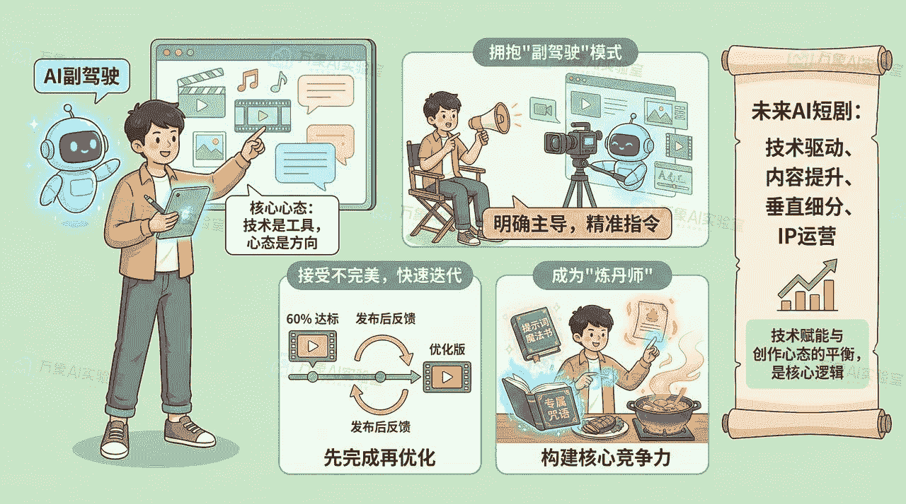

+   拥抱“副驾驶”模式：明确人机协同的核心边界：AI 本质是高效的执行工具，而非替代创作者的“全能导演”。创作者必须确立自身的主导地位——你是故事的灵魂掌控者，负责定主题、搭框架、塑人物、控情绪，AI 则是执行团队，负责将你的创意落地为具体的视频画面、音效等素材。这就要求创作者具备清晰的指令输出能力，比如拍摄悬疑短剧时，不能简单下达“生成一个恐怖场景”的模糊指令，而要精准描述“深夜林间小道，冷月光透过树梢形成斑驳光影，镜头从地面落叶缓慢上移至前方摇晃的黑影，背景音为风声+远处隐约的脚步声”。只有明确“拍什么”“怎么拍”的细节要求，才能让 AI 产出符合预期的素材，避免陷入“等待 AI 生成完美成品”的被动误区。

+   接受不完美，快速迭代：适配 AI 创作的节奏逻辑：AI 生成内容存在天然的随机性，无论是画面细节、人物动作还是台词匹配度，都难以一次达到 100%的完美状态。创作者需摒弃“精雕细琢再发布”的传统创作思维，建立“先完成再优化”的迭代逻辑。建议以“60%-80%的核心内容达标”为发布门槛，比如先通过 AI 生成核心剧情片段，快速发布后收集用户反馈——若观众反映“某段剧情节奏拖沓”，则针对性调整 AI 指令优化镜头时长；若觉得“人物表情僵硬”，则补充动作捕捉数据或优化提示词细节。在 AI 创作时代，市场反馈的迭代效率远重于单次作品的完美度，“快速试错、及时调整”才是可持续的创作节奏。

+   成为“炼丹师”而非“操作员”：构建不可替代的核心竞争力：当 AI 工具成为行业标配，单纯的“AI 操作能力”无法形成差异化优势，创作者的核心价值在于对故事的深度理解与对 AI 工具的精准驾驭能力，这一能力的核心便是提示词工程（Prompt Engineering）。所谓“炼丹师”，就是通过不断学习、测试、总结，打磨出适配自身创作风格的“专属咒语”。比如同样生成“美食制作场景”，不同创作者的提示词会因风格差异呈现不同效果——专注“治愈系美食”的创作者，会在提示词中加入“暖色调灯光、柔和镜头、食材特写时的蒸汽效果、轻快民谣背景音”等细节；专注“硬核美食教程”的创作者，则会强调“高清特写食材处理步骤、专业厨具展示、精准的操作讲解字幕、无多余装饰的简洁背景”。创作者需建立自己的“提示词魔法书”，记录不同题材、风格下的有效指令的搭配逻辑，这正是区别于普通操作员的核心竞争力。

总体而言，未来 AI 短剧将在技术驱动下实现生产效率与内容质量的双重提升，通过垂直细分、IP 运营、交互创新拓展商业边界，同时需在版权保护与伦理规范的框架下实现可持续发展。而对于创作者而言，技术赋能与创作心态的平衡，将是穿越行业竞争的核心逻辑。

## 1.8  AI 短剧赛道真正赚钱的 4 类角色

**AI 短剧内容创作者能赚到**钱**，但不是主要的。主要赚**钱的角色是早已搭建好生态闭环的技术方、平台方、培训方与版权方，他们共同瓜分着流量红利下的利润蛋糕。

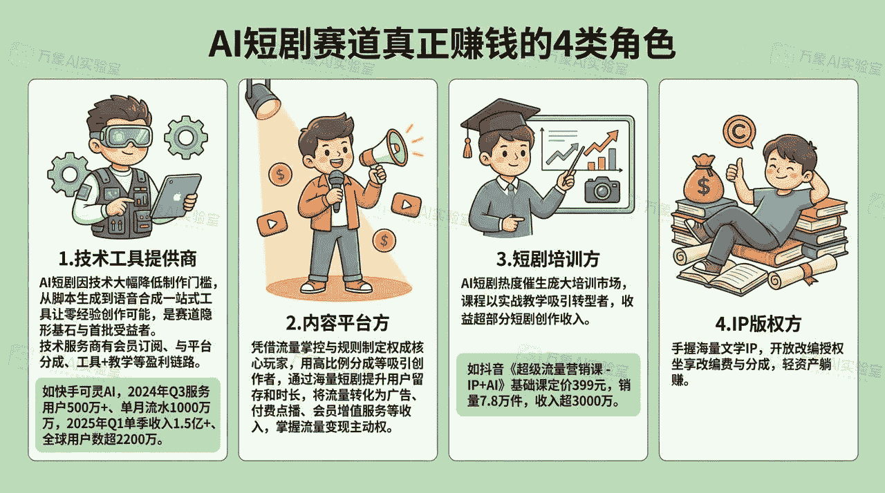

在内容创作者层面，有明显的头部效应：

**AI 剧创作者营**收两极分化，核心源于技术、能力、资源的三重差距。

头部团队或个人手握技术与内容优势，要么有自研模型、专业的美术团队，能产出高质量内容，还可借 IP 开发周边、承接高价商单；且头部易获平台流量倾斜，像《兴安岭诡事》一周收益超 30 万。

而中小创作者大多缺乏核心能力，仅会基础工具操作，内容同质化严重，又难把握受众画像，付费群体不明。同时，他们议价权弱，受平台政策与成本压缩影响大，还常因技术瓶颈导致作品质量低，最终陷入营收困境。

> **大国希望大家记住：**AI 时代，要掌握核心的 AI 技能，而不是会一点点，你会一点点就没有任何的竞争力，越精通在 AI 赛道拿到的结果越大。

### **1.技术工具提供商**

AI 短剧之所以能实现爆发式增长，核心在于技术大幅降低了制作门槛——从脚**本生成到角色建模，从场景渲染**到语音合成，一站式工具让“零经验创作”成为可能，这是赛道的隐形基石与首批受益者。

这**些技术服务**商或通过会员订阅模式稳定创收，或与平台深度绑定享受分成收益，更有甚者将工具与培训服务结合，构建起“工具+教学”的双重盈利链路，在行业爆发初期就牢牢占据了利润上游。

以快手的可灵 AI 为例，根据官方财报显示，2024 年 Q3，可灵的服务用户在 500 万+，商业化单月流水在 1000 万+。而到了 2025 年 Q1，其单季收入蹿升至 1.5 亿元以上，全球用户数则突破了 2200 万。

### **2.内容平台方**

内容平台凭借流量掌控权与规则制定权，成为盈利格局中的核心玩家。为了吸引优质创作者入驻，各大平台纷纷抛出高比例分成、流量扶持等诱饵，但这背后是更为精密的商业逻辑：

**通过**海量短剧内容提升用户留存与使用时长，再将流量转化为广告收入、付费点播收益与会员增值服务。无论是定制独播剧的版权运营，还是跨端内容的协同分发，平台方始终掌握着流量变现的主动权，成为连接创作者与消费者的关键枢纽。

### **3.短剧培训方**

随着 AI 短剧热度攀升，“零基础速成”“快速变现”等需求催生了庞大的培训市场，各类课程以实战教学为卖点，吸引着大量渴望入局的转型者，其收益甚至远超部分短剧本身的创作收入。

据白鲸技术线报道，抖音平台上销量第一的《超级流量营销课-IP+AI》基础课程，定价在 399 元，销量高达 7.8 万件，单课程收入超过 3000 万元。

### 4.IP 版权方

手握海量文学 IP 的版权方也迎来红利期，通过开放 IP 改编授权，无需参与实际制作即可坐享改编费与后续分成，实现“轻资产躺赚”。

## 1.9 AI 短剧市场人才需求


随着 AI 短剧的市场需求激增，也诞生了很多新的 AI 岗位，如 AI 编剧、AI 分镜师、AI 导演、AI 剪辑师、AIGC 视频制作师等等 AI 岗位，招聘薪资也较传统岗位提升 10%—30%。

而且，人才缺口遍布杭州、武汉、西安、郑州、北京、上海、广州、深圳等城市。

**AI 短剧核心岗位信息**

| #### **岗位名称** | #### **基本工作要求** | #### **时长需求度分析** | #### **核心职责** |
| --- | --- | --- | --- |
| **核心创作类** |  |  |  |
| AI 短剧编剧/人机协同编剧 | 1. 本科及以上学历，影视编导、戏剧文学等相关专业优先；2. 熟悉抖音、红果等平台短剧“强冲突、快节奏、高情绪”的创作逻辑，擅长爽文、逆袭、悬疑等主流题材；3. 掌握 AI 脚本生成工具（如豆包、ChatGPT），精通 Prompt 工程，能利用 AI 生成故事大纲、情节框架并完成人工润色与情感深化；4. 具备跨文化创作能力，可适应多题材风格，有 1-2 年短剧编剧经验，需提供原创剧本示例。 | ★★★★★（极高）：剧本是制作核心，直接决定项目基础周期。即使借助 AI 生成初稿，专业编剧仍需 12-15 小时/部进行修改打磨，且剧本审核不通过会导致全流程返工，对总时长起决定性影响。 | 独立完成剧本创作或 IP 短剧化改编，提炼核心情节与人设；与导演协同优化脚本，确保符合平台用户偏好；跟踪行业热点，输出可拍选题；借助 AI 工具提升创作效率，深化内容情感表达。 |
| AI 分镜设计师 | 1. 本科及以上学历，美术、影视动画相关专业；2. 精通 AI 视频生成工具（即梦、可灵等）的参数设置，具备扎实的美术基础和视觉叙事能力；3. 能将剧本转化为视觉化分镜脚本，确保画面构图、镜头运动与剧情节奏匹配；4. 需提供分镜设计作品集（含 AI 辅助设计案例）。 | ★★★★☆（高）：分镜是 AI 视频生成的直接依据，设计需衔接剧本与后续制作环节。若分镜参数设置不合理或视觉逻辑不清晰，会导致 AI 生成画面反复返工，直接延误素材产出进度。 | 将剧本视觉化，完成分镜脚本创作；优化分镜参数设置，匹配 AI 生成工具能力边界；配合导演把控画面节奏与视觉风格，确保分镜可落地执行。 |
| AI 角色设计师 | 1. 本科及以上学历，美术、角色设计相关专业；2. 熟练使用 AI 生图工具（海螺、通义万相等）与 PS 等修图软件；3. 结合 AI 生成技术与传统角色塑造方法，能创建兼具真实感和感染力的虚拟角色形象、性格及动作设计；4. 需提供角色设计作品集（含 AI 生成与人工优化案例）。 | ★★★★☆（高）：角色是短剧核心视觉符号，需产出多角度、多情绪的角色素材（单角色至少 10 个角度 +5 种核心情绪），废稿率较高，且角色风格需贯穿全片，调整耗时久，影响后续动画制作进度。 | 负责虚拟角色的形象、性格与动作设计；利用 AI 工具生成角色素材并进行人工优化；确保角色风格统一，适配不同题材需求，增强角色感染力。 |
| AI 生图师（场景方向） | 1. 本科及以上学历，美术、场景设计相关专业；2. 熟练使用 PS 及主流 AI 生图工具（海螺、即梦等）；3. 熟悉短剧主流美术风格，能基于剧本构建 Prompt 工程体系，生成统一风格的场景图；4. 需提供非 AI 手绘作品及 AI 生图场景作品集。 | ★★★★☆（高）：场景是 AI 生成视频的基础载体，需覆盖全片所有场景（单部短剧通常 15-20 个场景），每个场景需生成多角度素材，手动调整耗时久，直接影响分镜生成进度。 | 生成并筛选符合需求的场景 AI 素材；微调素材提升质量，确保场景风格统一性；配合导演完成全片视觉风格统一，适配剧情场景需求。 |
| AI 动画师 | 1. 本科及以上学历，动画、影视相关专业，具备动画相关工作经验；2. 熟练使用 AI 视频工具（可灵、Runway、Sora 等）及剪辑软件（AE、Pr）；3. 懂分镜语言，节奏感强，能生成动态分镜，控制镜头连贯性；4. 需提供 AIGC 动态作品及制作周期说明。 | ★★★★☆（高）：负责将静态素材转化为动态片段，AI 生成过程存在不确定性（如角色变形、镜头模糊），需采用“首尾帧控制法”反复调试，单 5-10 秒片段可能需多次生成，其效率直接影响视频素材产出速度。 | 制作角色动画、场景动画及特效动画；生成动态分镜，确保镜头逻辑连贯；持续学习新 AI 技术，提升动画制作质量。 |
| AI 短剧导演 | 1. 本科及以上学历，1 年以上短剧/新媒体影视导演经验；2. 精通镜头语言、运镜规则及光影美学，具备基础分镜绘制能力；3. 熟悉 AIGC 制作流程，懂 AI 工具（如即梦、可灵）能力边界，能规避技术局限设计分镜；4. 需提供 2 部以上代表短剧作品及后台数据截图。 | ★★★★★（极高）：主导全流程制作，统筹脚本、分镜、AI 生成、后期等环节。其对节奏的把控和决策效率直接影响各环节衔接速度，若分镜设计不合理需反复调整，将显著延长制作周期。 | 把控项目整体叙事风格与视觉美学；审核各制作环节成果，给出修改建议；协调团队资源，确保项目高效落地，对成片质量负责。 |
| **技术类** |  |  |  |
| AI 工具工程师 | 1. 本科及以上学历，计算机、软件工程相关专业；2. 熟练掌握文生图、图生视频等 AI 工具的开发与应用，具备编程能力和数据处理能力；3. 熟悉深度学习框架，能进行模型调优、参数配置，解决 AI 生成过程中的技术问题；4. 需提供相关 AI 工具开发或调优案例。 | ★★★★☆（高）：技术支撑全制作流程，AI 生成过程中出现的技术故障（如生成失败、画面失真）需及时解决，否则会导致对应环节停滞。模型调优质量直接影响 AI 生成效率，间接缩短整体制作周期。 | 负责 AI 制作工具的开发、调试与优化；解决 AI 生成过程中的技术问题，保障制作流程顺畅；根据制作需求进行模型调优和参数配置。 |
| 虚拟制片经理 | 1. 本科及以上学历，具备项目管理经验；2. 熟悉 AI 短剧制作流程与各类 AI 制作工具，能协调技术团队与创作团队工作；3. 具备较强的统筹协调能力，能应对制作过程中的各类技术挑战；4. 需提供相关影视或新媒体项目管理案例。 | ★★★★★（极高）：统筹全项目制作流程，负责各团队衔接与进度把控。若流程规划不合理或协调不及时，会导致环节脱节、进度延误，对总时长起决定性统筹作用。 | 统筹 AI 短剧制作全流程，制定项目进度计划；协调技术团队与创作团队协作，解决跨团队问题；确保项目按时、按质完成，把控项目成本与质量。 |
| 数据运营师 | 1. 本科及以上学历，统计学、数据科学相关专业；2. 掌握数据分析工具和方法，能解读用户数据、播放数据背后的需求与趋势；3. 熟悉短视频平台数据逻辑，能为创作和运营提供决策支持；4. 需提供数据分析案例及相关报告。 | ★★★☆☆（中）：贯穿项目全周期但不直接影响制作环节进度，其数据反馈可优化后续创作方向。若前期数据调研不充分，可能导致作品不符合市场需求，间接增加返工时长。 | 收集并分析用户数据、播放数据等；输出数据分析报告，为内容创作和运营策略提供决策支持；优化内容生产和分发策略，提升作品市场适配度。 |
| **运营与推广类** |  |  |  |
| AI 短剧运营专员 | 1. 大专及以上学历，1 年以上短视频运营经验；2. 熟悉短视频平台的运营规则和算法推荐机制；3. 具备内容策划、活动策划及用户互动能力，能制定有效的推广策略；4. 需提供相关短视频运营案例及数据成果（如曝光量、用户粘性提升数据）。 | ★★★☆☆（中）：聚焦成片后的推广运营环节，不影响制作周期。但运营策略合理性直接影响作品传播效果，若推广效果不佳可能需要调整内容二次分发，间接增加整体项目周期。 | 负责 AI 短剧在平台的推广与运营，制定运营策略；策划内容活动，开展用户互动；提升内容曝光率和用户粘性，跟踪运营数据并优化策略。 |
| 品牌合作经理 | 1. 本科及以上学历，具备商务谈判与市场调研能力；2. 熟悉品牌营销逻辑，能将品牌需求与内容创作相结合；3. 拥有一定的品牌资源，能独立策划和执行品牌合作项目；4. 需提供品牌营销合作案例及成果数据。 | ★★☆☆☆（低）：主要参与项目商业化环节，可与制作环节并行推进。若品牌需求调整需适配内容，可能对后期内容修改产生小幅影响，但对整体制作时长影响较小。 | 开发品牌合作资源，与品牌方洽谈合作；策划并执行 AI 短剧品牌营销项目；实现品牌价值与内容价值双赢，保障项目商业化收益。 |
| 海外运营专员 | 1. 本科及以上学历，具备外语沟通能力；2. 熟悉海外市场文化特点和用户需求，了解海外短视频平台规则；3. 能制定针对性的海外推广策略，提升内容海外影响力；4. 需提供海外内容运营案例。 | ★★☆☆☆（低）：专注海外推广环节，与国内制作环节并行。仅在内容本地化改编时需与创作团队协同，对核心制作周期影响极小。 | 负责 AI 短剧的海外推广与运营；制定适配海外市场的运营策略，开展本地化运营；跟踪海外运营数据，优化推广方案，提升内容海外影响力。 |
| **跨界融合类** |  |  |  |
| AI 美学工程师 | 1. 本科及以上学历，兼具技术与艺术背景（如计算机+美术相关专业）；2. 熟悉 AI 生成技术原理与应用，具备一定的美术基础和设计能力；3. 能从数据中提炼价值，同时把控画面艺术质感，实现技术与艺术融合；4. 需提供技术与艺术结合的创作案例（如 AI 生成美学作品）。 | ★★★★☆（高）：参与前期视觉风格定位与后期画面优化，其审美把控直接影响作品质感。若 AI 生成画面美学不达标，需反复调整参数或人工优化，增加制作时长。 | 把控 AI 生成画面的艺术质感，制定美学标准；优化 AI 生成参数，实现技术与艺术融合；配合导演完成全片视觉美学统一，提升作品审美价值。 |
| 文化适配专家 | 1. 本科及以上学历，具备跨文化研究背景；2. 熟悉不同文化背景下的审美标准和价值观；3. 能对 AI 短剧进行跨文化创作和本地化改编，适配目标市场文化环境；4. 需提供跨文化内容改编案例。 | ★★★☆☆（中）：主要参与前期剧本创作与内容本地化环节，若文化适配分析不充分，会导致作品在目标市场水土不服，需返工修改，影响前期创作周期。 | 负责 AI 短剧的跨文化创作与本地化改编；分析目标市场文化特点，优化内容以适配当地审美与价值观；规避文化禁忌，提升内容在目标市场的接受度。 |
| IP 开发专员 | 1. 本科及以上学历，具备 IP 运营经验和市场洞察力；2. 熟悉 IP 挖掘、创作、授权及衍生开发逻辑；3. 能结合 AI 短剧内容进行 IP 价值最大化开发；4. 需提供 IP 运营或衍生开发案例。 | ★★☆☆☆（低）：贯穿项目全周期，侧重 IP 长期发展，不直接影响制作周期。仅在 IP 挖掘与内容创作结合阶段需与编剧协同，对整体制作时长影响较小。 | 负责 AI 短剧 IP 的挖掘、创作与运营；推进 IP 授权及衍生开发，实现内容多元化发展；挖掘 IP 长期价值，制定 IP 运营战略。 |
| 剪辑师 | 1. 大专及以上学历，1 年以上短视频剪辑经验；2. 精通 PR、达芬奇、剪映等剪辑软件，擅长 AE 模板修改；3. 熟悉摄影构图、BGM 搭配，能把控画面与音乐节奏；4. 需提供 10W+播放量的剪辑作品链接。 | ★★★☆☆（中）：后期合成配音是收尾环节，需拼接 AI 生成素材、调色、添加音效、字幕等。虽 AI 可辅助生成音频，但优质作品需专业后期处理，若素材问题多，需额外耗时调整，但对总时长影响小于前期环节。 | 拼接动画及实拍素材，完成调色、字幕、包装；匹配 BGM 及音效，优化画面节奏；输出符合平台要求的成片。 |

## 1.10 AI 漫剧市场人才需求

漫剧的人才竞争无疑是激烈的。行业风口，随着需求如雪片纷至沓来，“缺人”隐藏在发展的缝隙，展露在招聘平台数百上千的岗位需求里。

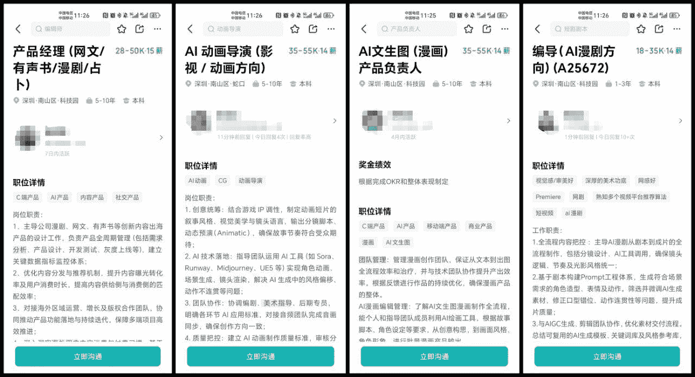

对某招聘平台的岗位调研来看，**现阶段各家最缺的是****能够从创意构思到****使用 AI 工****具一条龙完成项目的漫剧【制作**/创作】人才；需求不相上下的【编剧/策划】岗位，主要负责剧本相关工作。前者的需求很好理解，哪个老板会不想要六边形战士呢？而后者则反映了当前行业的内容缺口。

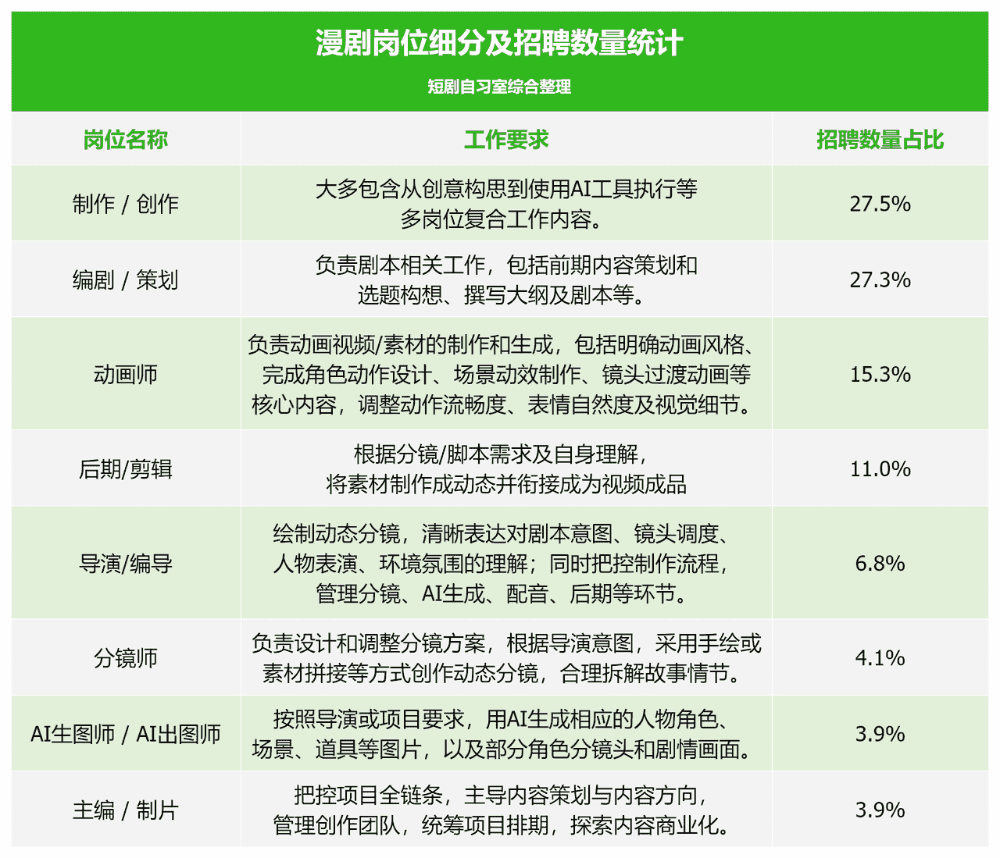

**随着漫剧行业发展，IP 来源愈发丰富，**小说、原创剧本等内容也开始寻求动漫化，不可避免要涉及到编剧对剧情的取**舍和编排，编剧的重要性和需求比重**便逐渐上升，“现在的观众可能会更关注剧情爽不爽。”当前，剧情节奏越来越快，过去一个大剧情可以讲十几集，现在两集之内可能就完成了一段情节，且要不断加入网络热梗，对编剧的节奏感、网感、架构能力，甚至是对市场需求的预判都提出了极高要求。这样的难度让好编剧成为影响项目成败的核心资源之一，也就能理解各家大力招聘编剧的原因了。

**根据某招聘平台的数百个漫剧****相关岗位调研，北京的漫剧人才需****求缺****口最大，相关岗位数量达到 48**** 个**；杭州以 46 的岗位数量略微次之；成都的岗位数量约为 41，是三个岗位数量超过 40 的城市之一。

此外，合肥、郑州、重庆、长沙、深圳、南京、上海、武汉、广州、沈阳、天津都是发布漫剧岗位数量超过 10 个的城市。

从这部分数据来看，北上广深四座**一线城市**均在列，这与城市本身较大的人口基数和人**才供需有一**定关系；诸如杭州、成都、合肥等新一线城市也有类似的影响因素。

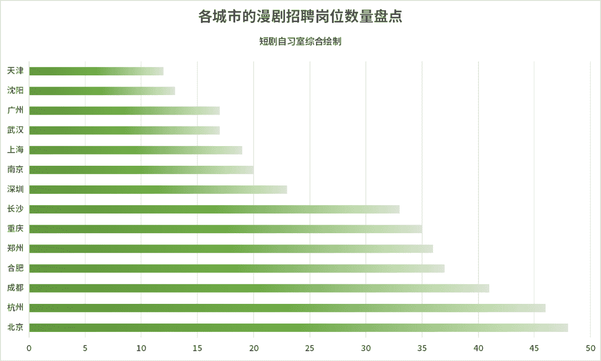

**延展阅读：**

[社区共学课件：零基础 AI 漫剧入门及制作指南](https://yunyinghui.feishu.cn/wiki/Me6KwJjPOirv9jkqDQ6cygzfnOc?from=from_copylink)

---

# 第二章、剧本篇：AI 时代的故事架构与剧本创作

一个平庸的故事，用再华丽的 AI 技术包装，也只是一个“精致的垃圾”。这里我们将聚焦于故事本身，并学习如何利用 AI 高效产出合格的剧本。

## 2.1 核心要素拆解

AI 短剧故事的核心就是抓住“注意力密码”。

A**I 短剧的核心受众多为**碎片化时间浏览的用户（如通勤、休息、睡前等场景），这类用户注意力停留时间短、对冗余信息容忍度低，因此故事核心必须围绕“强冲突、快反转、高情绪”三大核心要素展开，形成“3 秒抓眼、10 秒共情、30 秒转折”的黄金法则。

具体来说，3 秒内需通过视觉冲击（如激烈争执、意外场景）或台词钩子（如“你根本不是我丈夫！”）留住用户；10 秒内要让用户代入主角情绪（如被羞辱的憋屈、被背叛的愤怒）；30 秒内必须出现第一个小转折，打破初始平衡，让用户产生“想继续看”的欲望。

> **核心原则：**用最小的篇幅传递最强烈的情绪价值（爽感、痛感、共情感），拒绝冗长铺垫和复杂设定。

| #### **核心要素** | #### **具体要求** | #### **示例（都市逆袭题材）** | #### **避坑提示** |
| --- | --- | --- | --- |
| 强冲突 | 矛盾要直接、尖锐，避免模糊不清；冲突类型优先选“身份反差”“利益对立”“情感纠葛”三类高共鸣冲突，同时冲突要贴近用户认知，避免过于小众的矛盾点 | 穷小子被富家女退婚羞辱，转头揭露自己是隐藏千亿总裁 | 避免“为冲突而冲突”，如无理由的恶意针对，需给冲突加合理诱因（如男主曾被认为“没前途”） |
| 快反转 | 每 30 秒至少 1 个小转折，每 2-3 分钟 1 个大高潮；开篇直接切入冲突，不做背景铺垫，背景信息通过“道具+台词”快速交代（如用“离婚协议”交代婚姻关系） | 0-10 秒：退婚现场被羞辱；11-30 秒：男主亮出黑卡反击；31-60 秒：前岳父岳母跪地求饶 | 避免“节奏忽快忽慢”，如长时间无转折的对话，或转折过于密集导致逻辑混乱 |
| 高情绪 | 精准戳中用户情绪点（爽感、虐感、治愈感、焦虑感），情绪要极致、不拖沓；可通过“对比”强化情绪（如之前的卑微与之后的强势） | 男主反击时的“爽感”，退婚时的“憋屈感”，反击后围观者的“震惊感” | 避免情绪“平淡如水”或“过度煽情”，如男主被羞辱时毫无反应，或哭戏长达 10 秒以上 |
| 清晰目标 | 主角的目标要明确（复仇、逆袭、寻爱、救人），让用户知道“主角要做什么”；目标可分为“短期小目标”（如当下反击羞辱者）和“长期大目标”（如逆袭整个行业） | 男主目标：短期——反击退婚羞辱，长期——夺回属于自己的商业帝国 | 避免主角目标“模糊不清”，如男主既想复仇又想创业，却没有明确的优先级 |


**短剧观众心理需求**

> **短剧，尤其是面向抖音、快手等平**台的一分钟短剧，其核心是在极短时间内提供极致的情绪体验。观众没有耐心等待铺垫，你必须在开头 3 秒就抓住他们。

+   **常见“爽点”类型：**

+   **逆袭打脸：** 主角从被轻视到展现实力，让反派惊愕。

+   **扮猪吃虎：** 隐藏大佬体验生活，在关键时刻暴露身份。

+   **甜宠爱恋：** 高甜互动，满足观众对完美爱情的向往。

+   **解压复仇：** 主角对曾经的仇人进行酣畅淋漓的报复。

+   **金手指/系统：** 主角获得超能力或外挂，一路开挂

**短剧的「钩子理论」**

> **🪝 **钩子 = 让观众停下滑动手指的理由

**钩子类型表：**

## 2.2 短剧题材选择

新人不建议挑战小众题材（如科幻硬核、历史正剧、抽象悬疑），这类题材需要深厚的知识储备和较高的用户理解成本，容易导致完播率低。

优先选择以下成熟赛道，降低创作和传播难度，同时可结合当下热点微调题材（如加入“直播带货”“职场内卷”等元素）：

+   都市逆袭/霸总：受众最广（覆盖 18-45 岁女性、男性），爽感直接，剧情模式成熟（如隐藏身份、重生复仇、职场逆袭）；可延伸子题材：“霸总甜宠”“寒门逆袭”“商业复仇”

+   古风甜宠/虐恋：服化道有记忆点，情感冲突强烈，容易引发二次传播（如短视频剪辑名场面）；可延伸子题材：“王爷追妻”“重生虐渣”“仙侠小甜饼”，注意避免复杂的历史背景设定

+   悬疑短剧（微悬疑）：用“钩子”牵引用户，每集结尾留悬念，适合碎片化追更；优先选择“生活化悬疑”（如家庭失踪、职场阴谋），避免硬核推理（如密室杀人、复杂诡计）

+   家庭伦理：贴近生活，容易引发共情，受众年龄层广（覆盖 25-50 岁女性为主）；核心冲突围绕“婆媳矛盾、子女教育、夫妻关系、财产分割”，剧情要真实不悬浮

+   校园甜宠/青春：受众以学生党和年轻上班族为主，剧情轻松治愈，冲突简单（如“学霸与学渣”“暗恋成真”）；避免校园霸凌、早恋负面等敏感内容

### **三大爆款题材详解**

#### 📖 题材一：战神归来（男频顶流）

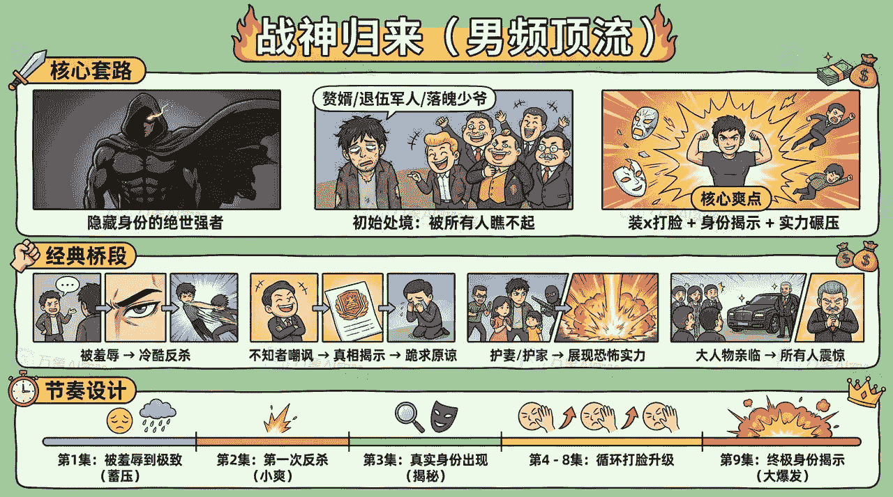

```
核心套路:
主角设定: 隐藏身份的绝世强者
初始处境: 被所有人瞧不起（赘婿/退伍军人/落魄少爷）
核心爽点: 装x打脸 + 身份揭示 + 实力碾压
经典桥段:
- 📍 被羞辱 → 冷酷反杀
- 📍 不知者嘲讽 → 真相揭示 → 跪求原谅
- 📍 护妻/护家 → 展现恐怖实力
- 📍 大人物亲临 → 所有人震惊
节奏设计:
第1集: 被羞辱到极致（蓄压）
第2集: 第一次反杀（小爽）
第3集: 真实身份出现（揭秘）
第4-8集: 循环打脸升级
第9集: 终极身份揭示（大爆发）
```

#### 📖 题材二：霸道总裁（女频经典）

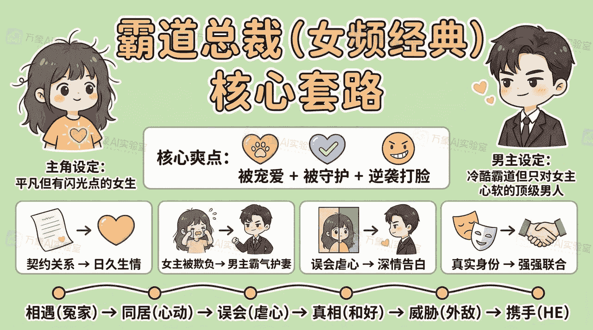

```
核心套路:
主角设定: 平凡但有闪光点的女生
男主设定: 冷酷霸道但只对女主心软的顶级男人
核心爽点: 被宠爱 + 被守护 + 逆袭打脸
经典桥段:
- 💕 契约关系 → 日久生情
- 💕 女主被欺负 → 男主霸气护妻
- 💕 误会虐心 → 深情告白
- 💕 真实身份 → 强强联合
情感曲线:
相遇(冤家) → 同居(心动) → 误会(虐心) → 真相(和好) → 威胁(外敌) → 携手(HE)
```

#### 📖 题材三：重生复仇（男女通吃）

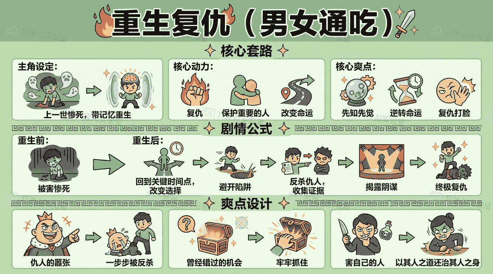

```
核心套路:
  主角设定: 上一世惨死，带记忆重生
  核心动力: 复仇 + 保护重要的人 + 改变命运
  核心爽点: 先知先觉 + 逆转命运 + 复仇打脸

剧情公式:
 重生前：被害惨死                            
   ↓                                    
 重生后：回到关键时间点                        
   ↓                                      
 改变选择 → 避开陷阱 → 反杀仇人            
   ↓                                       
 收集证据 → 揭露阴谋 → 终极复仇 
             
爽点设计:
  - 🔄 仇人的嚣张 → 一步步被反杀
  - 🔄 曾经错过的机会 → 牢牢抓住
  - 🔄 害自己的人 → 以其人之道还治其人之身
```

## **2.3 经典故事结构**

### 2.3.1 核心框架：三幕式结构（单集通用）

虽然短剧短，但“麻雀虽小，五脏俱全”。经典的三幕剧结构依然是构建故事的黄金法则。

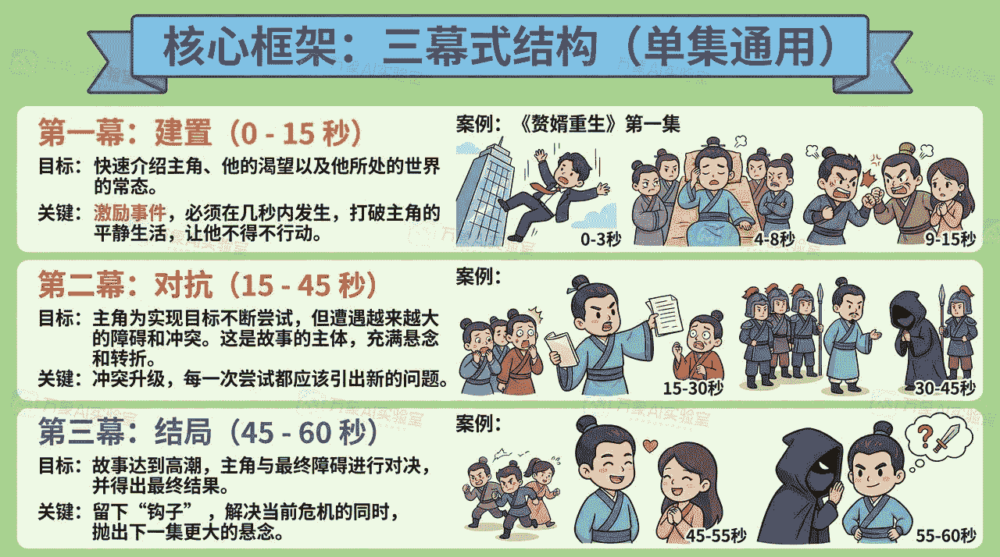

+   第一幕：建置 （Setup） - （0-15 秒）

+   **目标：** 快速介绍主角、他的渴望以及他所处的世界的常态。

+   **关键：** 激励事件 （Inciting Incident） 必须在几秒内发生，打破主角的平静生活，让他不得不行动。

+   **案例：** 《赘婿重生》第一集

+   **0-3 秒：**** 主角（现**代商业精英）被下属背叛，从高楼坠落。（强冲突开场）

+   **4-8 秒：** 主角睁眼，发现自己穿越成古代一个受**尽欺辱的傻子赘婿**，正被妻子一家人鄙视。（建立新身份和困境）

+   **9-15 秒：**** 对家上**门挑衅，要强抢主角家的生意，主角妻子束手无策。（激励事件）

+   第二幕：对抗 （Confrontation） - （15-45 秒）

+   **目标：** 主角为实现目标不断尝试，但遭遇越来越大的障碍和冲突。这是故事的主体，充满悬念和转折。

+   **关键：** 冲突升级 （Rising Action）。每一次尝试都应该引出新的问题。

+   **案例：**

+   **15-30 秒：** 主角突然开口，用现代商业知识指出对家合同里的漏洞，众人震惊。妻子开始对他刮目相看。

+   **30-45 秒：** **对家恼羞成怒，准备用**武力解决。此时，一个神秘的权贵人物出现，恭敬地向主角行礼，原来主角的真实身份并不简单。（中点转折，引入新悬念）

+   第三幕：结局 （Resolution） - （45-60 秒）

+   **目标：** 故事达到高潮，主角与最终障碍进行对决，并得出最终结果。

+   **关键：** **留下“钩子” （Hook）**。解决当前危机的同时，抛出下一集更大的悬念。

+   **案例：**

+   **45-55 秒：** 对家吓得屁滚尿流，危机解除。主角与妻子相视一笑，关系发生微妙变化。

+   **55-60 秒：** 权贵悄悄对主角说：“主上，京城传来消息，您的灭门仇人有线**索了。” 镜头定格在主角冰**冷的眼神上。（为下一集埋下复仇主线的钩子）

“3 幕 7 点”短剧结构（表格版）

> 对于 AI 漫剧，每个节点通常对应 2–4 个画面。

### 2.3.2 全剧框架：“主线+单元”结构（多集通用）

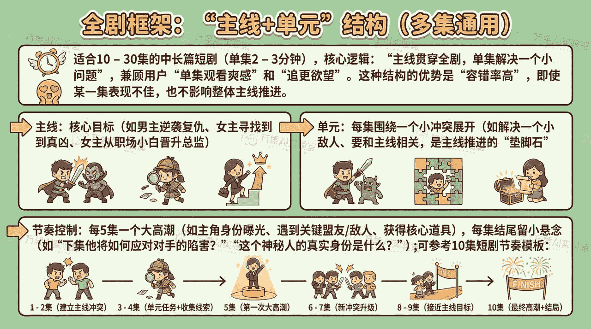

适合 10-30 集的中长篇短剧（单集 2-3 分钟），核心逻辑：“主线贯穿全剧，单集解决一个小问题”，兼顾用户“单集观看爽感”和“追更欲望”。这种结构的优势是“容错率高”，即使某一集表现不佳，也不影响整体主线推进，具体拆解和示例如下：

1.  主线：核心目标（如男主逆袭复仇、女主寻找到真凶、女主从职场小白晋升总监），主线要贯穿始终，每集都要推进一点点主线进度（哪怕只是获得一个关键信息）

1.  单元：每集围绕一个小冲突展开（如解决一个小敌人、完成一个小任务、揭露一个小秘密），每个单元都是一个完整的“三幕式结构”；单元冲突要和主线相关，是主线推进的“垫脚石”

1.  节奏控制：每 5 集一个大高潮（如主角身份曝光、遇到关键盟友/敌人、获得核心道具），每集结尾留小悬念（如“下集他将如何应对对手的陷害？”“这个神秘人的真实身份是什么？”) ; 可参考 10 集短剧节奏模板：1-2 集（建立主线冲突）、3-4 集（单元任务+收集线索）、5 集（第一次大高潮）、6-7 集（新冲突升级）、8-9 集（接近主线目标）、10 集（最终高潮+结局）

> **注意：**单元剧情不能脱离主线，每集结尾的悬念要“可落地”，避免让用户觉得“故意吊胃口”。

### 2.3.3 爆款框架：“黄金 10 秒+反转再反转”结构（流量密码）

适合 1-2 分钟的短视频短剧，核心是“用极致节奏抓住流量”，结构如下：

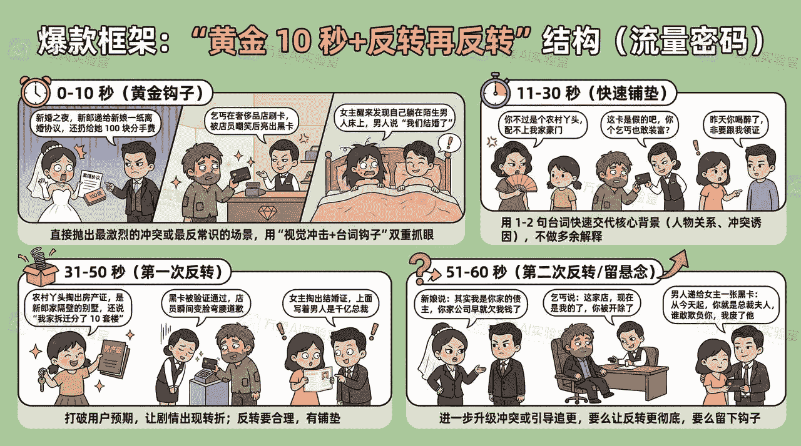

1.  0-10 秒（黄金钩子）：直接抛出最激烈的冲突或最反常识的场景，用“视觉冲击+台词钩子”双重抓眼（如“新婚之夜，新郎递给新娘一纸离婚协议，还扔给她 100 块分手费”“乞丐在奢侈品店刷卡，被店员嘲笑后亮出黑卡”“女主醒来发现自己躺在陌生男人床上，男人说‘我们结婚了’”）

1.  11-30 秒（快速铺垫）：用 1-2 句台词快速交代核心背景（人物关系、冲突诱因），不做多余解释（如“你不过是个农村丫头，配不上我家豪门”“这卡是假的吧，你个乞丐也敢装富？”“昨天你喝醉了，非要跟我领证”）

1.  31-50 秒（第一次反转）：打破用户预期，让剧情出现转折；反转要合理，有铺垫（如“农村丫头掏出房产证，是新郎家隔壁的别墅，还说‘我家拆迁分了 10 套楼’”“黑卡被验证通过，店员瞬间变脸弯腰道歉”“女主掏出结婚证，上面写着男人是千亿总裁”）

1.  51-60 秒（第二次反转/留悬念）：进一步升级冲突或引导追更，要么让反转更彻底，要么留下钩子（如“新娘说：其实我是你家的债主，你家公司早就欠我钱了”“乞丐说：这家店，现在是我的了，你被开除了”“男人递给女主一张黑卡：从今天起，你就是总裁夫人，谁敢欺负你，我废了他”）

> **反转技巧：**反转要“意料之外，情理之中”，提前在细节处埋伏笔（如乞丐手上的名表、农村丫头身上的小众奢侈品配饰），避免无厘头反转（如突然出现超能力）。

## **2.4 短剧剧本写作技巧**

### 2.4.1 人物塑造：标签化+反差感（让用户快速记住）

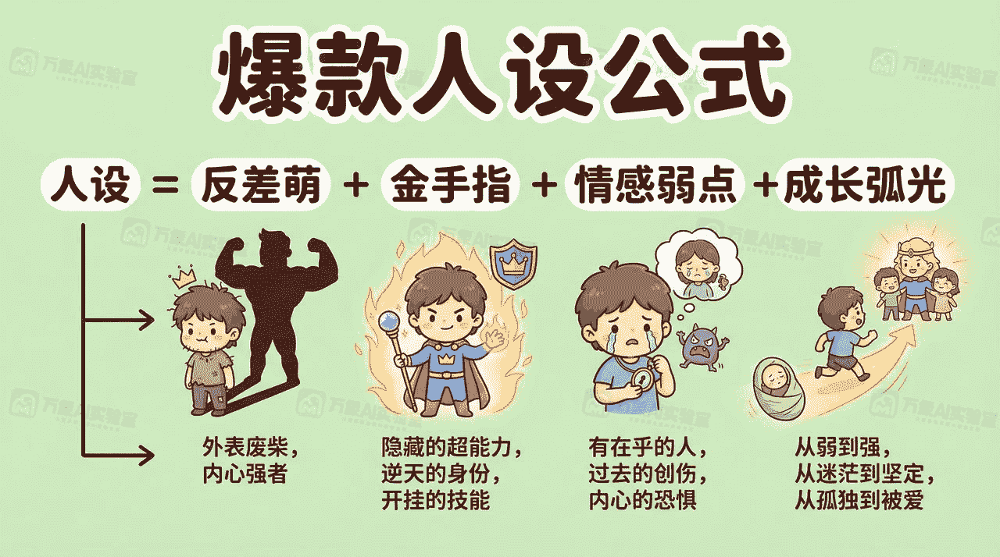

AI 短剧不需要复杂的人物弧光（即人物的长期成长变化），核心是“让人物有记忆点，让用户 10 秒内记住”，技巧是“标签化设定+反差感塑造”，同时人物行为要符合人设，不能前后矛盾：

+   标签化设定：给主角、配角贴清晰的“身份标签+性格标签”（如“隐藏总裁+低调隐忍”“拜金女+嚣张跋扈”“恶毒婆婆+重男轻女”“甜妹助理+热心护主”）；通过“固定服装、标志性动作、重复台词”强化标签（如恶毒婆婆常用台词“你个不下蛋的扫把星”，动作常叉腰、翻白眼；霸总常用动作“整理领带、眼神杀”，台词“女人，你成功引起了我的注意”）

+   反差感塑造：这是人物出彩的关键，也是引发用户讨论的核心点；常见反差类型有“身份反差”（外卖员+千亿总裁、小乞丐+公主）、“性格反差”（外表冷酷的霸总+只对女主温柔、看似柔弱的小白花+实则复仇女王）、“能力反差”（看似笨拙的员工+隐藏大佬、学渣+考试天才）；示例：穷小子穿着地摊货，却戴着限量版眼镜王蛇手表，被嘲笑后亮出总裁身份

> **新人人物设定模板（直接套用）：**

> 主角（核心标签+隐藏优势+短期目标）+ 反派（核心标签+与主角的冲突点+弱点）+ 辅助角色（核心标签+作用：推动剧情/缓解情绪）。比如：主角（外卖员+千亿总裁+反击羞辱者）、反派（嚣张经理+看不起底层+贪财）、辅助角色（前台小妹+见证反转/传递信息）。

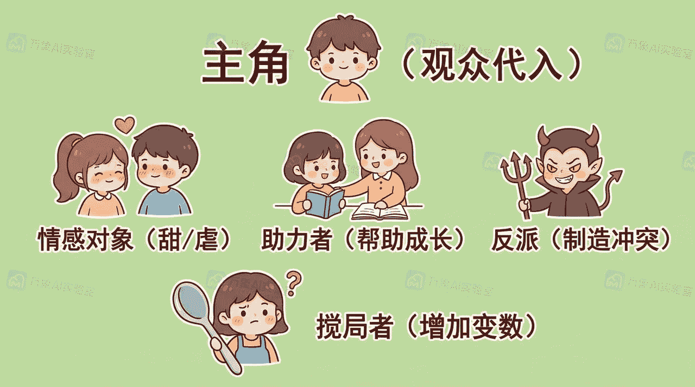

**示例：**男主设定为“外卖员+隐藏千亿总裁”，标签是“低调、隐忍、护妻”，反差感体现在“被羞辱时沉默不语，女主被欺负时瞬间爆发，亮出身份”。

### 2.4.2 台词写作：口语化+情绪感+信息密度高（避免废话）

AI 短剧台词要符合“碎片化观看”场景，用户可能在嘈杂环境中观看（如地铁、公交），因此台词要“听得懂、记得住、有情绪”，避免书面化、冗长的表达，核心技巧+反面案例对比如下：

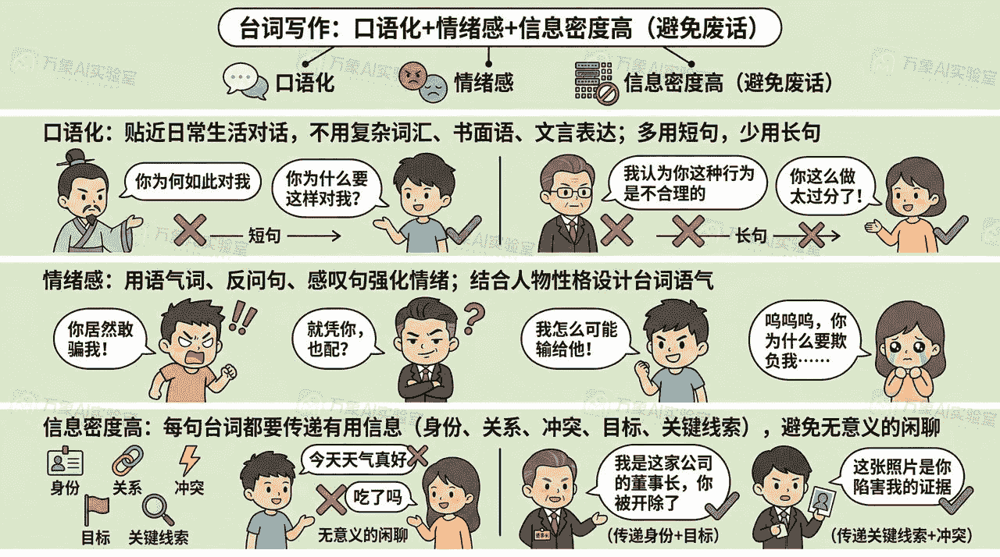

1.  口语化：贴近日常生活对话，不用复杂词汇、书面语、文言表达；多用短句，少用长句（如“你为何如此对我”改为“你为什么要这样对我？”; “我认为你这种行为是不合理的”改为“你这么做太过分了！”)

1.  情绪感：用语气词、反问句、感叹句强化情绪；结合人物性格设计台词语气（如霸总台词要沉稳有气场，甜妹台词要软糯）；示例：“你居然敢骗我！”“就凭你，也配？”“我怎么可能输给他！”“呜呜呜，你为什么要欺负我……”

1.  信息密度高：每句台词都要传递有用信息（身份、关系、冲突、目标、关键线索），避免无意义的闲聊（如删除“今天天气真好”“吃了吗”“最近怎么样”这类无关剧情的台词）；示例：“我是这家公司的董事长，你被开除了”（传递身份+目标）、“这张照片是你陷害我的证据”（传递关键线索+冲突）

| **反面案例（不好的台词）** | **优化后案例（好的台词）** | **优化说明** |
| --- | --- | --- |
| “我觉得你这种不尊重他人的行为，是不符合社会道德规范的，我希望你能向我道歉。” | “你敢这么侮辱我？给我道歉！” | 删除书面化表达，用短句+感叹句强化情绪，传递“要求道歉”的目标 |
| “昨天我去超市买东西，遇到了一个熟人，我们聊了很久，然后我就回家了。” | “昨天在超市碰到你闺蜜，她跟我说了你不少坏话。” | 删除无关信息，传递“闺蜜说坏话”的关键冲突点，推动剧情 |
| “这位先生，请问你认识我吗？我好像没有见过你。” | “你是谁？我根本不认识你！” | 口语化改造，用反问句强化疑惑/警惕的情绪，更符合短剧节奏 |

> **小技巧：**写台词时，可在括号内标注情绪和动作（如“（愤怒，拍桌）你给我滚！”“（委屈，眼眶泛红）我没有骗你……”），方便 AI 生成角色动作和表情。

### 2.4.3 节奏把控：“快”字当头，拒绝拖沓

新人最容易犯的错误是“铺垫过长”，记住 3 个节奏准则：

+   **开篇不铺垫：**直接切入冲突，背景信息通过台词、道具快速交代（如用“离婚协议”交代婚姻关系，用“黑卡”交代隐藏身份）

+   **冲突不拖沓：**一个冲突解决时间不超过 1 分钟，避免“主角被欺负后，迟迟不反击”

+   **悬念不滥用：**每集结尾的悬念要和主线相关，且下集能快速解答（如“下集揭秘黑影身份”，而不是“下集不知道会发生什么”）

## 2.5 实操案例：1 分钟都市逆袭短剧剧本

### 2.5.1 剧本基本信息

| 项目 | 内容 |
| --- | --- |
| 剧本名称 | 《外卖员的逆袭》第一集 |
| 时长 | 1 分钟 |
| 题材 | 都市逆袭 |
| 人物 | 林辰（男主，25 岁，外卖员，隐藏千亿总裁）、王经理（40 岁，嚣张跋扈的公司经理）、前台小妹（22 岁，旁观者） |
| 场景 | 某公司前台大厅 |

### 2.5.2 完整分镜剧本（逐秒拆解+细节标注）

> **说明：**分镜剧本按“时长精准到秒+镜头类型+画面细节+台词情绪+音效适配”设计，完全贴合 1 分钟快节奏要求，每个环节都对应前文核心技巧，新人可直接复用此格式创作。

| #### **时长（秒）** | #### **镜头类型** | #### **画面内容（细节标注）** | #### **台词（情绪+动作标注）** | #### **音效/音乐（氛围适配）** | #### **对应核心技巧** |
| --- | --- | --- | --- | --- | --- |
| 0-10 | 中景→特写（快速切换） | 中景：林辰穿蓝色外卖服，手拎外卖袋，站在装修豪华的公司前台（大理石台面、水晶吊灯），身形略显局促但站姿笔直；特写：王经理（西装革履，梳油头）皱紧眉头，快步走向林辰，右手猛地挥出，打掉林辰手中的外卖袋。外卖盒摔在光洁的地砖上，汤汁溅出，米饭散落。 | 王经理（愤怒，叉腰，手指林辰，语气刻薄）：谁让你进来的？外卖员也配进我们鼎盛集团大厅？脏东西！  林辰（平静隐忍，弯腰欲捡外卖，眼神微沉，声音低沉）：3 楼李总订的餐，前台让我在这等。 | 环境音：大厅轻微的办公嘈杂声；音效：外卖袋掉落的“哗啦”声、汤汁溅落的“噗嗤”声；音乐：低沉鼓点起，营造紧张氛围。 | 黄金 10 秒抓眼：用“环境反差（外卖服+豪华大厅）+ 动作冲突（打落外卖）”快速留住用户；人物标签初显（王经理嚣张、林辰隐忍）。 |
| 11-35 | 近景→特写（递进式） | 近景：王经理抬起右脚，踩着散落的米饭和外卖盒，居高临下地瞪着林辰，嘴角挂着嘲讽；前台小妹（穿职业装）低头站在一旁，眼神躲闪，不敢抬头；特写：林辰握紧的拳头，指节发白，指甲嵌进掌心，原本平静的眼神逐渐变冷，眼底闪过一丝锐利（伏笔：暗示隐藏身份）。 | 王经理（轻蔑，冷笑，吐字清晰）：鼎盛集团是什么地方？也是你这种底层垃圾能待的？赶紧滚出去，不然我叫保安把你拖去后街打一顿！  林辰（压制怒火，站直身体，抬头直视王经理，声音平稳但有力度）：你踩坏了我的餐，也侮辱了我，要么道歉，要么赔偿。 | 音效：王经理跺脚踩米饭的“咯吱”声、林辰握拳的“咔咔”声；音乐：鼓点节奏加快，情绪逐渐升级；环境音：办公嘈杂声减弱，突出核心冲突声。 | 冲突升级：通过“踩餐”动作强化矛盾，林辰的“隐忍→反击前兆”让情绪层层递进；台词信息密度高（交代公司名称、冲突核心：侮辱+损坏物品）。 |
| 36-50 | 特写→中景→近景（反转核心镜头） | 特写：林辰左手伸进口袋，掏出一张黑色卡片（总裁黑卡），卡片边缘有金色纹路，在灯光下反光；中景：林辰抬手，将黑卡递给前台小妹；近景：前台小妹抬头看到黑卡，眼睛瞪圆，嘴巴微张，双手颤抖着接过黑卡，表情从胆怯变为震惊。 | 林辰（语气平淡，无多余情绪，语速平稳）：给你们董事长打个电话，说林辰在前台等他，30 秒内让他下来。  前台小妹（震惊，声音发颤，结巴）：这……这是……至尊黑卡？只有集团最大股东才能持有！ | 音效：黑卡掏出的轻微“唰”声、前台小妹倒吸凉气的声音；音乐：鼓点突然拔高，加入“叮”的反转标志性音效；环境音：完全安静，突出核心对话。 | 第一次反转：用“黑卡特写”强化视觉冲击，通过前台小妹的反应侧面烘托黑卡含金量，让反转更合理；呼应前文“隐藏优势”技巧。 |
| 51-60 | 近景→远景→特写（收尾+留悬念） | 近景：王经理脸上的嘲讽瞬间消失，脸色从红变白，再变青，双腿微微发抖，额头冒出细密的汗珠；远景：林辰收回黑卡，转身走向大厅深处的总裁专属电梯，背影挺拔，与之前的局促判若两人；特写：林辰按下电梯按钮，电梯门缓缓打开，他回头冷冷瞥了王经理一眼。 | 王经理（慌张，结巴，声音发抖，试图辩解）：您……您是林总？对不起！是我有眼不识泰山，我错了！  林辰（冷漠，眼神冰冷，语气不带一丝温度）：3 分钟后，来 28 楼总裁办公室找我。（对前台小妹，语气平淡）把这里清理干净，餐费和精神损失费，从他工资里扣。 | 音效：王经理牙齿打颤的“咯咯”声、电梯按钮的“嘀”声、电梯门打开的“叮”声；音乐：鼓点渐强后收尾，留下余韵；环境音：电梯门打开的轻微机械声。 | 留悬念+爽感收尾：王经理的慌张反应强化逆袭爽感；“3 分钟后总裁办公室”留下钩子，引导用户追更；人物反差彻底凸显（隐忍→冷漠总裁）。 |

### 2.5.3 案例深度拆解（新手可复用的创作逻辑）

本案例严格遵循“强冲突、快节奏、高情绪”核心，每个环节都有明确的创作目的，新手可按此逻辑复刻其他题材剧本，具体拆解如下：

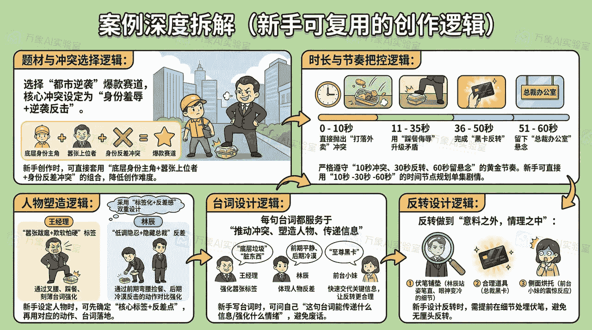

1.  **题材与冲突选择逻辑**：选择“都市逆袭”爆款赛道，核心冲突设定为“身份羞辱+逆袭反击”——这类冲突贴近用户认知，爽感直接，无需复杂铺垫。新手创作时，可直接套用“底层身份主角+嚣张上位者+身份反差冲突”的组合，降低创作难度。

1.  **时长与节奏把控逻辑**：严格遵守“10 秒冲突、30 秒反转、60 秒留悬念”的黄金节奏：0-10 秒直接抛出“打落外卖”冲突，11-35 秒用“踩餐侮辱”升级矛盾，36-50 秒完成“黑卡反转”，51-60 秒留下“总裁办公室”悬念。新手可直接用“10 秒 -30 秒 -60 秒”的时间节点规划单集剧情。

1.  **人物塑造逻辑**：采用“标签化+反差感”双重设计：① 王经理“嚣张跋扈+欺软怕硬”标签（通过叉腰、踩餐、刻薄台词强化）；② 林辰“低调隐忍+隐藏总裁”反差（通过前期弯腰捡餐、后期冷漠反击的动作对比强化）。新手设定人物时，可先确定“核心标签+反差点”，再用对应的动作、台词落地。

1.  **台词设计逻辑**：每句台词都服务于“推动冲突、塑造人物、传递信息”：① 王经理的台词（“底层垃圾”“脏东西”）强化嚣张标签；② 林辰的台词（前期平静、后期冷漠）体现人物反差；③ 前台小妹的台词（“至尊黑卡”）快速交代关键信息，让反转更合理。新手写台词时，可问自己“这句台词能传递什么信息/强化什么情绪”，避免废话。

1.  **反转设计逻辑**：反转做到“意料之外，情理之中”：① 伏笔铺垫（林辰站姿笔直、眼神变冷的细节）；② 合理道具（总裁黑卡）；③ 侧面烘托（前台小妹的震惊反应）。新手设计反转时，需提前在细节处埋伏笔，避免无厘头反转。

| #### 工具类型 | #### 推荐工具 | #### 使用技巧（精准提示词） | #### 进阶优化建议 |
| --- | --- | --- | --- |
| 剧本生成 | ChatGPT、豆包、文心一言 | **提示词模板：** | AI 生成后，重点检查“节奏是否过快/过慢”“人物行为是否符合标签”“反转是否合理”，删除冗余台词，补充动作和情绪标注 |
| 台词优化 | 豆包、讯飞星火 | **提示词模板：** | 优化后可朗读一遍，检查是否顺口、有情绪；避免过于网络化的词汇（如“yyds”“绝绝子”），保证不同年龄层用户都能理解 |
| 冲突设计 | ChatGPT、豆包 | **提示词模板：** | 从生成的冲突场景中，选择最贴近主线、情绪张力最强的场景；可将多个场景串联成单元剧情 |
| 分镜脚本生成 | 豆包、剪映 AI 脚本工具 | **提示词模板：** | 分镜脚本要简洁明了，避免复杂镜头（如长镜头、多角度切换），方便后续 AI 生成视频或实拍；重点标注“关键镜头”（如反转时的特写镜头） |

### 2.5.4 新手复用模板（直接填空创作）

基于本案例，整理出“1 分钟都市逆袭短剧剧本模板”，新手只需填空即可完成初稿，降低创作门槛：

| #### 环节 | #### 时长 | #### 创作模板（填空处用【】标注） |
| --- | --- | --- |
| 开篇冲突 | 0-10 秒 | 镜头：中景→特写；画面：【主角底层身份装扮】站在【豪华/高端场景】，【反派】做出【侮辱性动作】；台词：反派（【情绪】）：“【刻薄台词，体现身份歧视】”；主角（【情绪】）：“【简短回应，体现隐忍】”；音效：【冲突相关音效】+ 低沉鼓点。 |
| 冲突升级 | 11-35 秒 | 镜头：近景→特写；画面：【反派】做出【进一步升级冲突的动作】，【辅助角色】表现出【胆怯/围观】态度；主角【身体细节变化，暗示反击前兆】；台词：反派（【情绪】）：“【更嚣张的台词，强化冲突】”；主角（【情绪】）：“【简短反击，传递底线】”；音效：【动作相关音效】+ 节奏加快的鼓点。 |
| 核心反转 | 36-50 秒 | 镜头：特写→中景→近景；画面：主角拿出【反转道具】，【辅助角色】表现出【震惊】态度；台词：主角（【情绪】）：“【简短指令，体现身份】”；辅助角色（【情绪】）：“【惊讶台词，交代反转道具的含金量】”；音效：【反转道具相关音效】+ 拔高的音乐特效。 |
| 收尾悬念 | 51-60 秒 | 镜头：近景→远景→特写；画面：反派【慌张/害怕的动作】，主角走向【象征身份的场景】；台词：反派（【情绪】）：“【道歉/辩解台词】”；主角（【情绪】）：“【冷漠指令，留下悬念】”；音效：【反派慌张相关音效】+ 收尾音乐；留悬念：【具体的后续约定，如“X 分钟后到 XX 地方找我”】。 |

> **模板使用示例：**填空后即可生成新剧本，比如将【主角底层身份装扮】改为“清洁工制服”，【反转道具】改为“董事长聘书”，【反派】改为“部门主管”，就能快速创作《清洁工的逆袭》剧本。

## 2.6 AI 短剧剧本格式规范表

| **模块名称** | **格式规范** | **核心要素** | **示例** |
| --- | --- | --- | --- |
| 场景标注 | 场景[编号]：[地点] / [时间] / [天气/光线] | 1. 场景编号（按顺序递增）&lt;br&gt;2。 具体地点（明确场景位置）&lt;br&gt;3。 时间（日/夜/黄昏等）&lt;br&gt;4。 天气/光线（暴雨/晴朗/昏暗等） | 场景 1：天台 / 夜 / 暴雨 |
| 画面描述 | 【画面描述】&lt;br&gt;（简洁文字表述，分点涵盖核心信息） | 1. 场景环境（整体氛围/布局）&lt;br&gt;2。 人物位置和状态（站立/坐姿/情绪状态）&lt;br&gt;3。 关键道具和动作（手持物品/核心动作）&lt;br&gt;4。 镜头运动（特写/远景/推拉/跟拍等） | 【画面描述】&lt;br&gt;天台边缘积水反光，苏念独自倚栏，双手紧握手机（特写），远处城市灯光模糊（远景），镜头缓慢推向她泛红的眼眶 |
| 台词格式 | 角色名：（情绪/动作提示）&lt;br&gt;台词内容（口语化、简洁有力，符合角色人设） | 1. 角色名（清晰区分说话人）&lt;br&gt;2。 情绪/动作提示（括号内补充，辅助表演）&lt;br&gt;3。 台词内容（贴合剧情节奏，避免冗长） | 林婉儿：（假装心疼，实则讥讽）&lt;br&gt;念念，你还是这么天真。 |
| 画外音/内心独白 | 【画外音/角色名内心独白】&lt;br&gt;独白内容（贴合角色心理，推动剧情发展） | 1. 类型标注（明确是画外音还是内心独白）&lt;br&gt;2。 角色名（内心独白需指定角色）&lt;br&gt;3。 独白内容（补充背景/心理活动，不喧宾夺主） | 【苏念内心独白】&lt;br&gt;他明明答应过会等我，为什么转身就和别人在一起了？ |
| 特殊标注 | [标注类型] + 简要说明（标注在对应内容上方或右侧，突出显示） | 1. 标注类型（明确特殊画面/效果需求）&lt;br&gt;2。 对应画面/效果（简要说明核心诉求） | 1. [闪回] - 苏念与男主过去在天台约定的甜蜜画面&lt;br&gt;2。 [特效] - 手机屏幕破碎时的炸裂光效&lt;br&gt;3。 [转场] - 从天台快速切至医院走廊 |

### 使用说明

1.  **格式统一性**

> 剧本全文需保持字体、字号一致（建议宋体小四，1.5 倍行距），模块标注（如【画面描述】）统一使用中括号+加粗，便于后期制作人员快速识别。

1.  **篇幅控制**

> 单集 AI 短剧（1-3 分钟）剧本字数建议控制在 300-800 字，台词占比 60%-70%，画面描述简洁不冗余。

1.  **兼容性提示**

> 若用于 AI 生成视频，可在【画面描述】中补充“镜头时长”（如“镜头持续 3 秒”），特殊标注可增加“AI 生成关键词”（如[特效] - 闪电特效，关键词：暴雨、闪电、光影闪烁）。

## 2.7 AI 短剧剧本格式规范表

| #### 检查维度 | #### 具体检查项 | #### 补充说明（核心要点/判断标准） |
| --- | --- | --- |
| 开篇检查 | 前 3 秒是否有吸引力？ | 需快速呈现强冲突、悬念或吸睛画面（如主角危机、反转前置），抓住观众注意力，避免平淡铺垫 |
|  | 前 30 秒是否建立了核心冲突？ | 明确主角核心矛盾（如利益争夺、情感纠葛、生存危机），让观众清晰知晓故事核心走向 |
|  | 是否让观众对主角产生情感？ | 通过主角的困境、特质引发观众共情、同情或期待等情绪，建立观众与主角的情感连接 |
| 结构检查 | 每集是否有至少 1 个反转？ | 反转需合理且有冲击力，避免生硬刻意；可通过信息差、角色立场转变等方式设计，提升剧情吸引力 |
|  | 每集结尾是否有钩子？ | 结尾需留下悬念（如主角陷入新危机、关键问题未解决、出现意外变故），引导观众期待下一集 |
|  | 整体节奏是否有起伏？ | 避免平铺直叙，合理搭配紧张剧情与舒缓过渡，高潮与铺垫衔接自然，符合短剧快节奏特点 |
| 人物检查 | 主角是否有明确的目标和动机？ | 主角目标需具体（如复仇、逆袭、寻亲），动机合理且贯穿剧情，驱动主角所有行为逻辑 |
|  | 反派是否构成真正的威胁？ | 反派能力、手段需匹配主角目标，能持续给主角制造阻碍，避免反派过于薄弱导致冲突张力不足 |
|  | 人物行为是否符合人设？ | 角色言行需贴合其性格、身份、成长背景，无前后矛盾的行为，保证人物形象统一立体 |
| 对话检查 | 是否删除了不必要的解释性台词？ | 避免“旁白式对话”“说明式对话”，对话需服务于剧情推进、人物塑造或情绪表达 |
|  | 高能场景是否有金句？ | 在剧情高潮、角色高光时刻设计简洁有力、易传播的金句，强化场景记忆点，提升观众共鸣 |
|  | 潜台词是否运用得当？ | 通过含蓄表达传递角色真实想法（如试探、嘲讽、隐忍），丰富对话层次，避免台词过于直白生硬 |
| 情感检查 | 爽点是否足够？ | 爽点需精准贴合目标受众偏好（如逆袭打脸、绝境翻盘、恶人受惩），密度适中且有递进感 |
|  | 虐点是否让人心疼？ | 虐点需围绕主角核心情感展开（如亲情/爱情背叛、努力白费），真实可感，避免为虐而虐 |
|  | 甜点是否让人姨母笑？ | 甜蜜互动需自然细腻（如眼神交流、细节关怀），符合角色关系，营造温馨浪漫氛围，满足观众情感需求 |
| 画面检查 | 场景描述是否清晰？ | 场景信息需明确（如地点、时间、环境氛围），让拍摄/AI 生成时有清晰依据，避免模糊不清的描述 |
|  | 是否考虑了 AI 生成的可行性？ | 避免过于复杂、元素过多的场景（如大规模群戏、特殊特效场景），降低 AI 生成难度与成本，提升生成效果 |
|  | 关键画面是否足够有视觉冲击力？ | 高潮场景、反转场景需设计具有张力的画面（如对比强烈的光影、夸张的动作造型），强化剧情记忆点 |

## 2.8 新人避坑指南

1.  **铺垫过长：**开篇用 1 分钟介绍主角成长背景（如“男主从小家境贫寒，努力打工，考上大学后……”），导致用户划走；真实新手案例：某新人剧本开篇用 2 分钟讲述男主的童年经历，完播率不足 10%。正确做法：用 1-2 句台词+道具快速交代背景（如“（看着旧照片）当年的仇，我今天必报”，用旧照片交代复仇背景）

1.  **人物过多：**单集出现 5 个以上新人物（如男主、女主、反派、三个配角），每个人物都有戏份，用户记不住；正确做法：单集核心人物不超过 3 个，辅助人物 1-2 个即可，且辅助人物只负责一个功能（如传递信息、见证反转）

1.  **冲突模糊：**主角的目标不明确，用户不知道“要讲什么”（如男主既想复仇，又想追女主，还想创业，剧情混乱）；正确做法：开篇就明确主角的核心目标（如“这集男主要反击羞辱他的经理”），其他目标作为支线后期推进

1.  **台词废话多：**加入大量无关剧情的闲聊（如“今天天气真好，你吃饭了吗？”“这个咖啡很好喝，你要不要试试？”) ; 正确做法：每句台词都要传递有用信息（身份、关系、冲突、目标），删除任何不推动剧情的台词

1.  **悬念不落地：**结尾留的悬念和主线无关，下集无法解答（如“下集将出现神秘人”，但神秘人跟主角的复仇主线毫无关系）；正确做法：悬念要围绕主线，且下集能快速兑现（如“下集揭秘王经理的贪污证据”，与男主整顿公司的主线相关）

1.  **人设崩塌：**人物行为不符合标签（如“低调隐忍的男主”突然主动挑衅别人，“恶毒婆婆”突然温柔善良）；正确做法：人物行为要始终围绕核心标签，即使有转变，也要有合理的诱因（如“恶毒婆婆看到女主怀孕后态度转变”）

1.  **反转生硬：**反转没有铺垫，无厘头（如男主突然拥有超能力，没有任何伏笔）；正确做法：提前在细节处埋伏笔（如男主之前不经意间展示过格斗技巧，后续反转成特种兵身份）

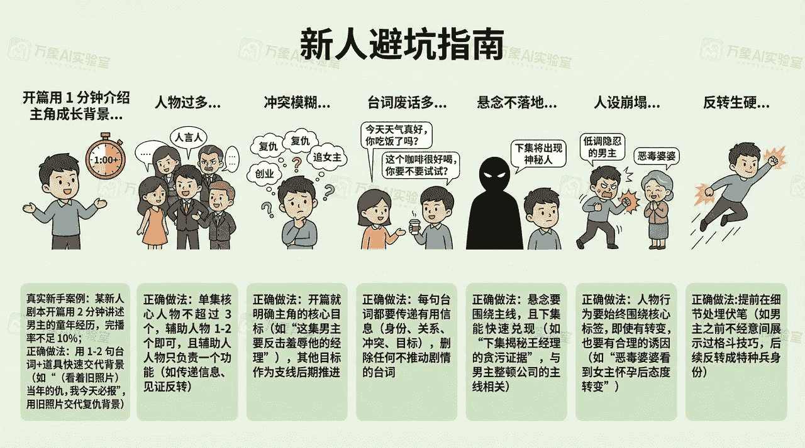

---

# 第三章、视觉篇：AI 分镜与画面风格确立

有了剧本，下一步就是将文字转化为视觉。分镜是连接剧本和最终画面的桥梁，决定了故事的视觉呈现。

## **3.1 AI 分镜的定义**

> **AI 分镜** = 利用 AI 绘图工具（如 Midjourney、Stable Diffusion、DALL-E 等）生成连续的画面帧，用于指导短剧/漫剧的视觉呈现。

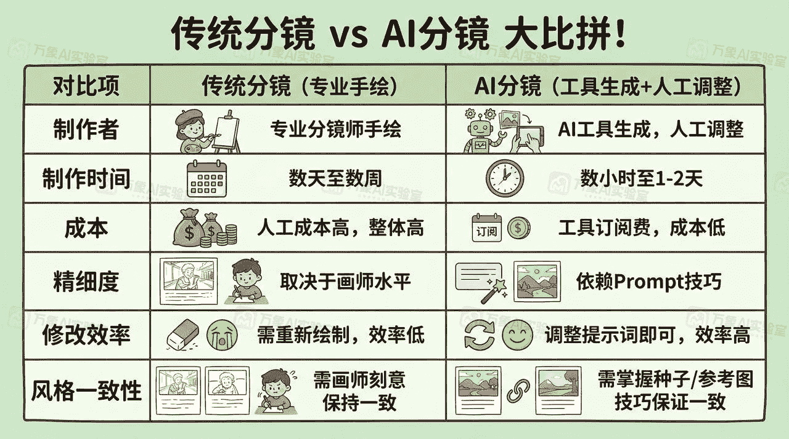

## 3.2 AI 分镜的 7 大核心要素

AI 短剧的视觉呈现直接决定观众留存率，而分镜是视觉创作的“骨架”，画面风格是“灵魂”。AI 分镜七要素模型（景别、角度、构图、光影、色调、动势、转场），是快速搭建专业分镜、统一画面风格的核心工具—它能帮你把抽象的剧情需求，转化为 AI 可理解、能生成的具体视觉指令，同时确保每一个画面都服务于剧情情绪与叙事逻辑。

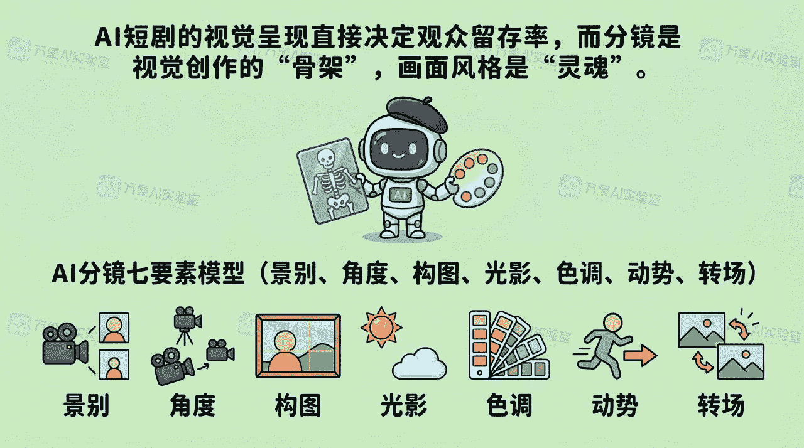

这里为大家梳理掌握七要素的核心含义、作用及适用场景，学会用七要素组合指令指导 AI 生成符合需求的分镜画面，最终确立统一的短剧画面风格。

AI 短剧视觉篇：AI 分镜与画面风格确立（七要素模型教学）

### 要素一：景别

> **核心逻辑：**景别越大，视野越宽，侧重环境氛围；景别越小，视野越窄，侧重角色细节（情绪、动作）。AI 生成时，需明确景别指令，避免画面信息冗余或缺失。

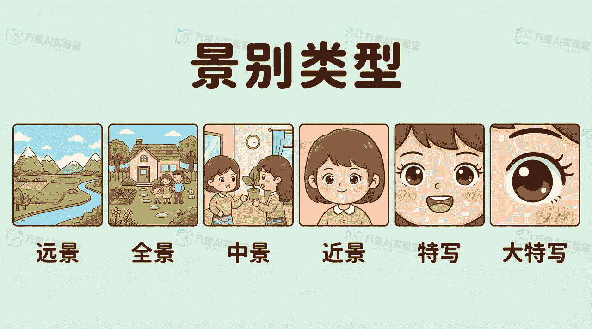

| #### 景别类型 | #### 核心定义 | #### 核心作用 | #### 适用场景 | #### AI 生成关键指令 |
| --- | --- | --- | --- | --- |
| 远景 | 画面以环境为主，角色占比极小（或无角色） | 展现空间规模、交代故事背景、营造宏大/空旷氛围 | 短剧开篇交代场景（如“深夜的废弃工厂”“繁华的都市 CBD”）、剧情转折处的环境烘托 | 明确标注“远景”+ 环境关键词，例：“远景，深夜的废弃工厂，月光洒在铁皮屋顶上” |
| 全景 | 包含完整角色与周边核心环境，角色占画面 1/3-1/2 | 展现角色与环境的关系、角色完整动作、群体互动场景 | 角色出场（如“女主穿着红裙站在工厂大门前”）、多人对话、动作戏开场（如“两人在巷口对峙”） | “全景”+ 角色状态+环境，例：“全景，女主双手叉腰站在工厂大门前，身后是飘落的枯叶” |
| 中景 | 画面包含角色上半身至膝盖，环境仅保留核心元素 | 聚焦角色动作与简单互动，平衡“人物”与“环境”信息 | 日常对话场景（如“男女主在咖啡馆聊天”）、角色单人动作（如“女主翻找背包”） | “中景”+ 互动/动作关键词，例：“中景，男女主相对而坐喝咖啡，女主低头浅笑” |
| 近景 | 画面包含角色上半身（胸部以上），环境弱化 | 突出角色表情、细微动作，强化角色情绪传递 | 角色内心波动时（如“女主听到噩耗后眼神呆滞”）、单人独白、关键动作特写前铺垫（如“男主抬手准备递戒指”） | “近景”+ 情绪/细微动作，例：“近景，男主眼神坚定地看着女主，手指微微蜷缩” |
| 特写 | 画面聚焦角色局部（面部、手部、脚部等），环境几乎消失 | 放大关键细节，强化情绪冲击、突出关键道具/线索 | 角色情绪爆发点（如“女主流泪的眼睛”）、关键道具展示（如“男主手中的旧照片”）、悬念铺垫（如“地上滴落的血迹”） | “特写”+ 具体部位/道具，例：“特写，女主泛红的眼眶，泪珠慢慢滑落”“特写，男主手中刻着‘爱’字的项链” |
| 大特写 | 极致聚焦局部细节（如瞳孔、指尖、道具纹理） | 制造强烈视觉冲击，传递极致情绪或关键线索 | 高潮戏情绪顶点（如“男主瞳孔骤缩”）、道具核心信息（如“合同上的签名笔迹”） | “大特写”+ 细节描述，例：“大特写，男主瞳孔中倒映出女主的身影，眼神充满震惊” |

> **AI 生成避坑：**不要只说“特写”，必须补充“特写部位/道具”，否则 AI 可能生成不符合需求的画面（如需要“手部特写”，却生成“面部特写”）。

>

> **景别选择速查口诀：**

> 远景建立世界观，交代时空与地点

> 全景展示人物态，动作姿势看得见

> 中景对话最常用，叙事推进不觉烦

> 近景情绪往外传，喜怒哀乐都明显

> 特写关键时刻用，强调冲击入心间

### 要素二：角度

> **核心逻辑：**角度决定观众“从什么位置看画面”，不同角度会赋予角色/场景不同的情感属性（如权威、渺小、客观等）。AI 生成时，角度指令需与剧情情绪匹配。

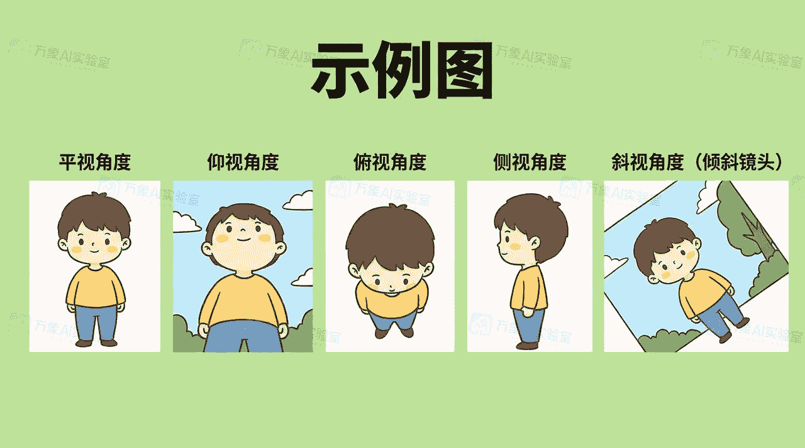

| #### 角度类型 | #### 核心定义 | #### 核心作用 | #### 适用场景 | #### AI 生成关键指令 |
| --- | --- | --- | --- | --- |
| 平视角度 | 镜头与角色视线平齐，模拟人眼正常观察视角 | 传递客观、真实的感觉，让观众产生代入感 | 大部分日常场景（对话、逛街、工作）、需要观众客观判断的剧情 | “平视角度”+ 场景，例：“平视角度，女主在办公桌前打字” |
| 仰视角度 | 镜头低于角色，向上拍摄 | 放大角色形象，传递威严、强大、神圣的感觉；或强化场景的压迫感 | 英雄角色出场（如“男主身披披风站在楼顶”）、反派展现气场（如“黑帮大佬坐在沙发上”）、高大建筑的压迫感（如“阴森的古堡大门”） | “仰视角度”+ 角色状态，例：“仰视角度，男主站在楼顶，背后是夕阳，身影高大” |
| 俯视角度 | 镜头高于角色，向下拍摄 | 缩小角色形象，传递渺小、无助、孤独的感觉；或展现全局场景 | 角色陷入困境（如“女主被困在迷宫中央”）、孤独场景（如“男主独自坐在空无一人的街头”）、全局动作戏（如“多人巷战的整体布局”） | “俯视角度”+ 场景氛围，例：“俯视角度，女主蜷缩在迷宫中央，周围是交错的高墙，氛围孤独” |
| 侧视角度 | 镜头位于角色侧面，拍摄角色侧面轮廓 | 突出角色轮廓线条，强化动作流畅感，或展现角色的“隐秘感” | 角色行走、奔跑等动作场景，角色内心纠结时的独处场景，双人对话时的交替拍摄 | “侧视角度”+ 动作，例：“侧视角度，女主快步走在雨夜的街头，雨水打湿头发” |
| 斜视角度（倾斜镜头） | 镜头故意倾斜，画面不水平 | 制造混乱、紧张、眩晕的氛围，暗示剧情的不稳定或角色的精神异常 | 打斗戏、追逐戏、角色醉酒/失忆场景、悬疑剧情的紧张时刻 | “斜视角度（倾斜 30°）”+ 氛围，例：“斜视角度，男主在酒吧被围攻，画面倾斜，灯光混乱” |

### 要素三：构图

> 核心逻辑：构图是把“景别+角度”下的元素（角色、道具、环境）合理排列，引导观众视线聚焦到核心信息上。好的构图能让画面更美观，同时强化叙事逻辑；AI 生成时，需明确构图类型，避免画面杂乱。


| #### 构图类型 | #### 核心定义 | #### 核心作用 | #### 适用场景 | #### AI 生成关键指令 |
| --- | --- | --- | --- | --- |
| 三分法构图 | 用两条水平线、两条垂直线将画面分为 9 格，核心元素放在交叉点或线上 | 画面平衡自然，引导观众视线聚焦，适用大部分场景 | 日常对话、角色单人场景、风景烘托场景 | “三分法构图”+ 核心元素位置，例：“三分法构图，女主放在右侧交叉点，背景是落地窗” |
| 对称构图 | 画面以中轴线为中心，左右/上下元素对称 | 传递稳定、庄重、和谐的感觉；也可通过“对称打破”制造冲突 | 庄重场景（如“婚礼殿堂”）、对称建筑场景（如“宫殿大门”）、需要强化稳定感的剧情 | “对称构图”+ 中轴线方向，例：“对称构图，以大门中轴线为中心，男主站在门中央” |
| 引导线构图 | 用画面中的线条（道路、栏杆、光线等）引导观众视线到核心元素 | 强化画面纵深感，让观众视线自然跟随剧情重点 | 追逐戏（如“角色沿着小巷奔跑，小巷线条引导视线”）、场景过渡（如“女主沿着走廊走向房间”） | “引导线构图”+ 引导线类型，例：“引导线构图，以走廊的地砖线条为引导，聚焦尽头的女主” |
| 框架构图（框中框） | 用画面中的元素（门窗、门框、树枝等）形成“框架”，核心元素在框架内 | 制造“窥视感”，强化场景的封闭性/神秘感；或突出核心元素 | 悬疑场景（如“有人从门缝偷看女主”）、角色被困场景（如“女主在铁窗内向外张望”）、回忆场景 | “框架构图”+ 框架类型，例：“框架构图，以门缝为框架，聚焦门外的男主” |
| 对比构图 | 通过画面中元素的对比（大小、明暗、色彩、动静）突出核心元素 | 强化冲突感，让核心元素更醒目，传递剧情的反差感 | 反派与正派同框（如“高大的反派与瘦小的女主对比”）、贫富差距场景（如“豪车旁的乞丐”）、情绪反差场景 | “对比构图”+ 对比类型，例：“对比构图，明暗对比，男主站在亮处，反派藏在暗处” |

### 要素四：光影

> **核心逻辑：**光影不仅是“照亮画面”，更是“情绪的画笔”——亮部传递轻松、希望，暗部传递压抑、神秘。AI 生成时，需明确“光影类型+光影方向”，避免画面明暗混乱。

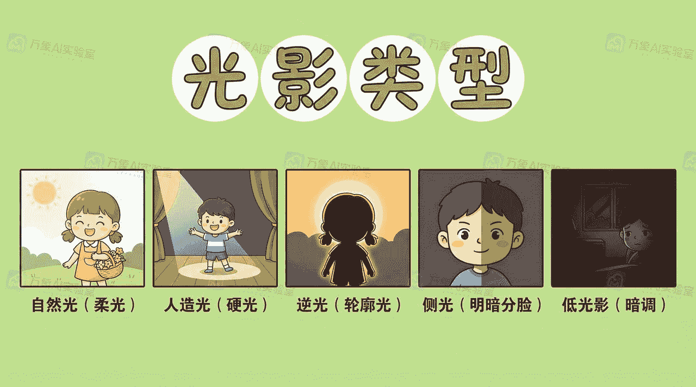

| #### 光影类型 | #### 核心定义 | #### 核心作用 | #### 适用场景 | #### AI 生成关键指令 |
| --- | --- | --- | --- | --- |
| 自然光（柔光） | 模拟阳光、月光等自然光源，光线柔和，阴影浅淡 | 传递真实、温暖、轻松的氛围 | 白天的户外场景、温馨的室内场景（如“阳光透过窗户洒进客厅”）、回忆中的美好片段 | “自然光（柔光）”+ 光源方向，例：“自然光（柔光），从左侧窗户射入，照亮女主的侧脸” |
| 人造光（硬光） | 模拟灯光、台灯等人造光源，光线集中，阴影浓重 | 传递紧张、压抑、神秘的氛围；或突出局部细节 | 夜晚的室内场景、悬疑剧情（如“台灯下男主翻看秘密文件”）、反派的独处场景 | “人造光（硬光）”+ 光源类型，例：“人造光（硬光），台灯直射桌面，文件清晰，周围昏暗” |
| 逆光（轮廓光） | 光源在角色/物体后方，照亮轮廓，主体呈暗部或剪影 | 突出角色轮廓，营造神秘、悲壮、唯美的氛围 | 角色出场的唯美场景（如“女主在夕阳下逆光站立，头发发光”）、悲剧场景（如“男主独自离开的背影”） | “逆光（轮廓光）”+ 氛围，例：“逆光（轮廓光），夕阳为背景，女主的背影呈金色轮廓，氛围悲壮” |
| 侧光（明暗分脸） | 光源在角色侧面，画面一半亮、一半暗 | 强化角色的内心矛盾、双面性；或营造紧张感 | 角色内心纠结时（如“女主在选择救男主还是救家人”）、反派的心理戏（如“反派谋划阴谋时”） | “侧光（明暗分脸）”+ 角色状态，例：“侧光（明暗分脸），男主面部一半亮一半暗，眼神纠结” |
| 低光影（暗调） | 画面整体偏暗，亮部极少，阴影占比大 | 传递压抑、恐怖、神秘的氛围 | 恐怖剧情（如“废弃医院的走廊”）、悬疑剧情的关键转折（如“男主进入凶案现场”） | “低光影（暗调）”+ 少量亮部提示，例：“低光影（暗调），仅手电筒的光线照亮前方道路，周围全黑” |

### 要素五：色调

> 核心逻辑：色调是画面的“色彩风格”，不同色彩会引发观众不同的情绪联想（如红色=紧张/热情，蓝色=冷静/压抑）。AI 短剧的色调需“统一且贴合剧情”，避免单集内色调混乱；AI 生成时，需明确“主色调+辅助色调”。


| #### 色调类型 | #### 核心定义 | #### 核心情绪 | #### 适用短剧题材 | #### AI 生成关键指令 |
| --- | --- | --- | --- | --- |
| 暖色调（红/橙/黄为主） | 画面以暖色为核心，色彩饱和度偏高 | 温暖、热情、治愈；也可表示紧张、躁动 | 甜宠剧、治愈剧、家庭剧；也可用于爱情高潮、冲突场景 | “暖色调，以橙色为主，黄色为辅”+ 场景，例：“暖色调，以橙色为主，女主在烛光晚餐前微笑” |
| 冷色调（蓝/绿/青为主） | 画面以冷色为核心，色彩饱和度偏低 | 冷静、压抑、神秘、孤独 | 悬疑剧、科幻剧、复仇剧、悲剧 | “冷色调，以蓝色为主，青色为辅”+ 氛围，例：“冷色调，以蓝色为主，深夜的侦探事务所，氛围神秘” |
| 高饱和色调（色彩鲜艳） | 画面色彩鲜艳明亮，饱和度高 | 活泼、热烈、梦幻；也可表示荒诞、混乱 | 甜宠剧、奇幻剧、喜剧；也可用于梦境、幻想场景 | “高饱和色调，色彩鲜艳”+ 场景，例：“高饱和色调，女主在花海中奔跑，花海色彩鲜艳” |
| 低饱和色调（色彩淡雅） | 画面色彩淡雅，饱和度低，接近黑白 | 怀旧、伤感、文艺；也可表示压抑、绝望 | 怀旧剧、文艺剧、悲剧；也可用于回忆场景、压抑剧情 | “低饱和色调，偏灰色调”+ 场景，例：“低饱和色调，偏灰色调，男主回忆童年的旧街道” |
| 对比色调（冷暖色对比强烈） | 画面中暖色与冷色并存，对比鲜明 | 冲突、紧张、戏剧性强 | 复仇剧、悬疑剧、动作剧；也可用于正邪对抗场景 | “对比色调，红色与蓝色对比”+ 场景，例：“对比色调，红色的血与蓝色的雨水对比，男主倒在雨中” |

> **关键技巧：**AI 短剧的“画面风格统一”，核心是“色调统一”——单集短剧建议只选 1 种主色调，系列短剧可通过“主色调变化”区分不同篇章（如前期冷色调、后期暖色调，暗示剧情从压抑到治愈）。

### 要素六：动势

> **核心逻辑：**动势包含“镜头运动”和“角色运动”，静止画面传递稳定，运动画面传递活力/紧张。AI 生成时，需明确“运动类型+运动速度”，避免画面晃动混乱。

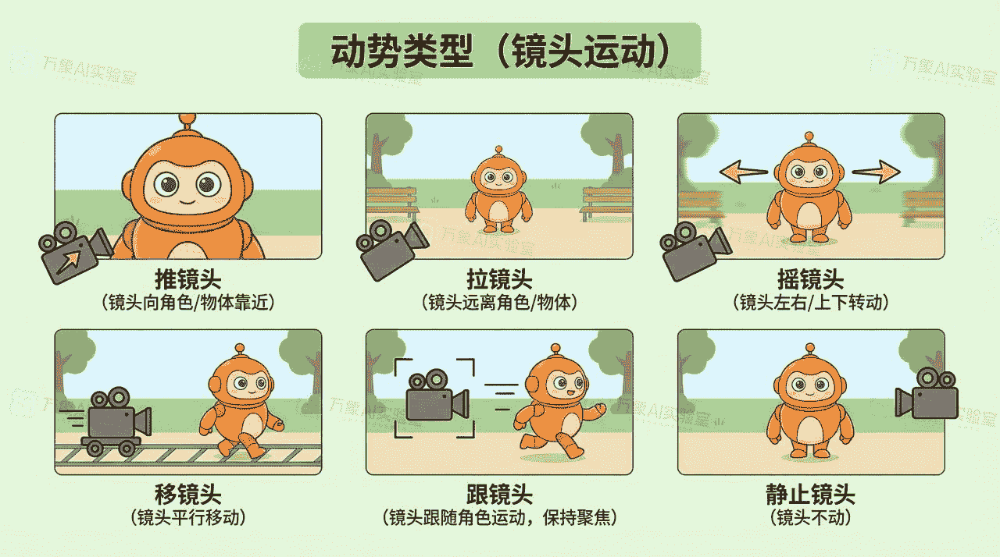

| #### 动势类型（镜头运动） | #### 核心定义 | #### 核心作用 | #### 适用场景 | #### AI 生成关键指令 |
| --- | --- | --- | --- | --- |
| 推镜头（镜头向角色/物体靠近） | 镜头从远到近移动，逐渐聚焦核心元素 | 强化情绪冲击，引导观众关注重点，营造紧张感 | 角色情绪爆发点（如“推镜头，聚焦女主流泪的脸”）、关键道具展示（如“推镜头，聚焦合同上的签名”） | “推镜头，缓慢靠近”+ 核心元素，例：“推镜头，缓慢靠近男主，聚焦他紧握的拳头” |
| 拉镜头（镜头远离角色/物体） | 镜头从近到远移动，逐渐展现全局环境 | 营造孤独感、渺小感，或交代场景全貌 | 角色独处的孤独场景（如“拉镜头，女主独自站在空旷的广场”）、剧情结尾的场景升华（如“拉镜头，展现城市全貌，男主女主相拥”） | “拉镜头，缓慢远离”+ 场景，例：“拉镜头，缓慢远离，展现女主站在广场中央，周围是来往的人群” |
| 摇镜头（镜头左右/上下转动） | 镜头固定在一点，左右或上下转动，模拟人眼转动视角 | 展现场景全貌，强化画面纵深感，或跟随角色运动 | 展现宏大场景（如“摇镜头，展现雪山全貌”）、跟随角色奔跑（如“摇镜头，跟随女主在巷中奔跑”） | “摇镜头，左右缓慢转动”+ 场景，例：“摇镜头，左右缓慢转动，展现深夜的古城墙” |
| 移镜头（镜头平行移动） | 镜头与角色/物体平行移动，保持距离不变 | 跟随角色运动，营造代入感，强化动作的流畅性 | 追逐戏（如“移镜头，跟随男主奔跑”）、角色行走场景（如“移镜头，跟随女主在海边散步”） | “移镜头，与女主平行移动”+ 动作，例：“移镜头，与女主平行移动，她沿着海边散步，海浪拍打着沙滩” |
| 跟镜头（镜头跟随角色运动，保持聚焦） | 镜头全程跟随角色，始终聚焦角色，视角灵活 | 极强的代入感，让观众跟随角色的视角体验剧情 | 大部分动作戏、角色探索场景（如“跟镜头，跟随男主进入废弃的仓库”） | “跟镜头，跟随男主，保持聚焦”+ 场景，例：“跟镜头，跟随男主进入废弃仓库，仓库内昏暗，布满灰尘” |
| 静止镜头（镜头不动） | 镜头固定，不做任何运动 | 传递稳定、严肃、压抑的感觉；或让观众专注于角色对话/情绪 | 对话场景（如“静止镜头，男女主面对面聊天”）、严肃的剧情场景（如“静止镜头，男主接受审判”） | “静止镜头”+ 角色状态，例：“静止镜头，女主坐在沙发上，眼神空洞” |

> **补充：**角色运动的动势需与镜头运动匹配——如角色快速奔跑，搭配“跟镜头+快速运动”；角色缓慢行走，搭配“移镜头+缓慢运动”，避免画面违和。

### 要素七：转场

> **核心逻辑：**转场是两个分镜画面的过渡方式，好的转场能让剧情衔接自然、节奏流畅；差的转场会让观众感到突兀。AI 短剧常用“简洁转场”（避免复杂转场分散注意力），AI 生成时，需明确转场类型，部分转场可通过“剧情元素”自然衔接。

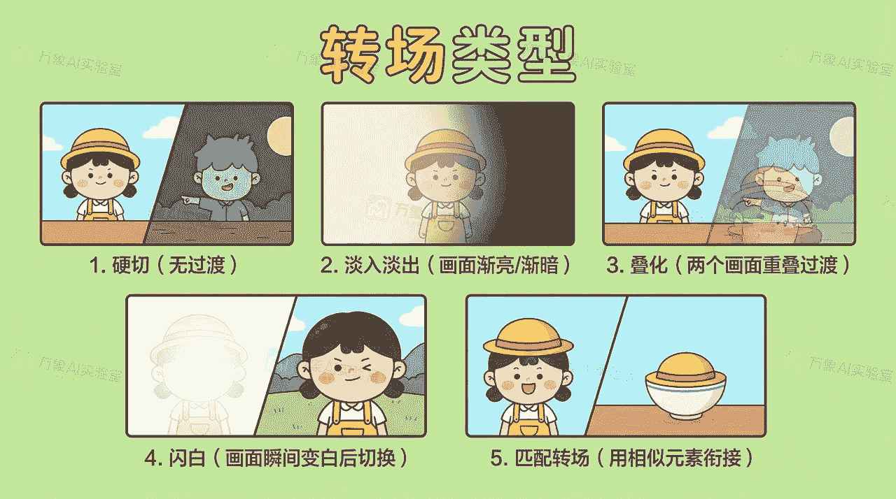

| #### 转场类型 | #### 核心定义 | #### 核心作用 | #### 适用场景 | #### AI 生成关键指令 |
| --- | --- | --- | --- | --- |
| 硬切（无过渡） | 两个画面直接切换，无任何过渡效果 | 简洁、快速，推进剧情节奏；或制造突兀感、冲突感 | 大部分日常场景切换（如“女主家→公司”）、动作戏的快速切换（如“打斗时的不同角度切换”） | 无需额外指令，直接生成两个分镜画面，标注“硬切衔接”即可 |
| 淡入淡出（画面渐亮/渐暗） | 前一个画面渐暗消失，后一个画面渐亮出现 | 营造温馨、怀旧、舒缓的氛围；或表示时间流逝、场景大跨度切换 | 回忆场景（如“淡入，男主的童年回忆”）、剧情开篇/结尾（如“淡出，剧终”）、时间跳跃（如“白天→夜晚”） | 标注“淡入”或“淡出”+ 场景，例：“淡入，男主的童年回忆，画面渐亮” |
| 叠化（两个画面重叠过渡） | 前一个画面逐渐透明，后一个画面逐渐清晰，中间有重叠阶段 | 温柔、流畅，暗示剧情的连贯性；或表示思绪、梦境的切换 | 思绪飘远场景（如“女主发呆，叠化到她想象的画面”）、温柔的情感场景（如“男女主相处片段的切换”） | 标注“叠化”+ 两个画面内容，例：“叠化，从女主发呆的画面，过渡到她想象与男主约会的画面” |
| 闪白（画面瞬间变白后切换） | 画面瞬间变为白色，然后切换到下一个画面 | 制造冲击感，暗示时间快速流逝、晕倒/失忆、剧情转折 | 角色晕倒（如“女主被打晕，闪白后切换到医院”）、时间快速跳跃（如“闪白，从少年→成年”） | 标注“闪白”+ 过渡前后画面，例：“闪白，从女主被打晕的画面，过渡到医院的画面” |
| 匹配转场（用相似元素衔接） | 利用两个画面中的相似元素（形状、颜色、动作）自然过渡 | 衔接自然，富有创意，强化剧情的关联性 | 创意场景切换（如“女主手中的苹果→下一个画面的太阳”“男主抬手→下一个画面的时钟指针”） | 标注“匹配转场”+ 相似元素，例：“匹配转场，从女主手中的圆形镜子，过渡到下一个画面的满月” |

> AI 短剧转场技巧：优先用“硬切”（简洁高效），仅在需要营造氛围或特殊剧情时用“淡入淡出”“叠化”“闪白”；“匹配转场”创意性强，但需提前设计好相似元素，避免 AI 生成偏差。

## **3.3 AI 分镜制作全流程**

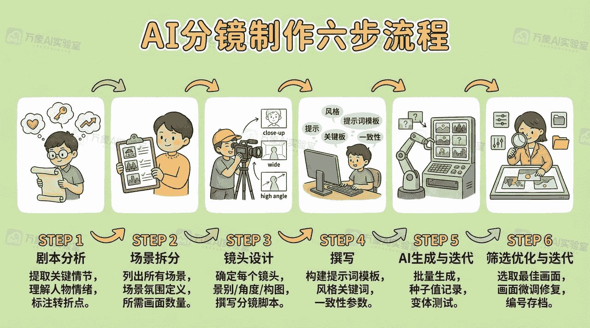

####  **STEP 1：剧本分析**

剧本是分镜的 “源头”，这一步要把抽象文字转化为可视觉化的关键信息：

+   **提取关键情节**：将剧本按 “起承转合” 拆分模块，比如校园短剧《误会》，提取核心情节：「主角被同学误会偷书→独自躲在图书馆角落→好友拿出监控证据解围」。

+   **理解人物情绪**：给每个情节标注 “情绪 + 动作” 标签，比如 “被误会时：委屈（皱眉 + 低头攥衣角）；解围后：释然（眼眶红 + 轻舒一口气）”。

+   **标注转折点**：用 “【转折点】” 标记情节变化处，比如 “第 3 场：同学当众指责→【转折点】→主角沉默跑开”。

+   **工具推荐**：用 飞书 / 腾讯文档做 “剧本标注表”，把关键信息分栏整理。

**剧本分析表格模板**

#### STEP 2：场景拆分

把剧本情节对应到具体空间，明确每个空间的视觉属性：

+   **列出所有场景**：按 “空间 + 时间” 命名，比如《误会》的场景：「教室（白天 / 课间）、图书馆走廊（傍晚 / 空荡）、图书馆角落（傍晚 / 昏暗）」。

+   **场景氛围定义**：结合情节情绪定氛围 + 色调，比如 “教室：压抑（冷色调、紧凑布局）；图书馆角落：孤独（暖光局部打亮、背景模糊）”。

+   **确定画面数量**：按情节密度分配，冲突场景（如 “当众指责”）画面多（5-8 个），过渡场景（如 “走廊行走”）画面少（2-3 个）。

#### **STEP 3：镜头设计详表**

这是分镜的核心，要明确每个镜头的 “视觉语言”：

+   **景别 / 角度 / 构图**：

+   景别：选对应情绪的景别（远景→交代环境；特写→放大情绪，比如 “主角攥衣角” 用特写）；

+   角度：平视（客观叙事）、仰视（突出压迫感，比如 “同学指责主角” 用仰视）、俯视（突出孤独，比如 “主角躲角落” 用俯视）；

+   构图：三分法（人物放画面 1/3 处更自然）、对角线（动作戏用对角线增强动感）。

**分镜脚本模板**

#### STEP 4：Prompt 撰写

Prompt 是 AI 生成分镜的 “密码”，要结构化、细节化：

+   **构建提示词模板**：公式 =「景别 + 角度 + 构图 + 画面内容 + 人物情绪 / 动作 + 风格 + 一致性参数 + 画质」

+   **风格关键词**：根据短剧类型选，比如 “日系校园漫剧风、赛博朋克短剧写实风、国漫水墨质感”。

+   **一致性参数**：确保角色统一，比如 “保持主角：棕色短发 + 圆框眼镜 + 蓝白校服，与前一镜头形象完全一致”。

+   **完整 Prompt 示例**：“近景，平视，居中构图，高中女生低头捏着蓝白校服衣角，眼眶泛红（委屈情绪），日系校园漫剧风格，高清 8K，细节丰富，保持主角棕色短发 + 圆框眼镜的形象”。

> AI 分镜 Prompt 万能公式

> [主体描述] + [动作/表情] + [场景环境] + [景别角度] + [光影色调] +    [风格关键词] + [质量参数】

** 【公式拆解】     **

主体描述：人物外貌特征、服装、标志性元素

示例：一位长发乌黑的年轻亚裔女子，身着白色连衣裙。

动作表情：当前状态、情绪表达、肢体语言

示例：悲伤地望着窗外，眼中含泪，触碰着玻璃

场景环境：地点、时间、天气、环境细节

示例：现代公寓内，外面是雨夜，城市灯光虚化

景别角度：摄影术语、构图方式

示例：现代公寓内，外面是雨夜，城市灯光虚化

光影色调：光源类型、整体氛围、色彩基调

示例：冷蓝色的灯光，霓虹的倒影，忧郁的氛围

风格参数：艺术风格、画质要求、技术参数

示例：电影感，8K 画质，照片级真实感，胶片颗粒感，ARRI 摄影机拍摄

#### STEP 5：AI 生成与迭代

用 AI 工具批量生成，再优化调整：

+   **批量生成**：用 MidJourney 的 “批量指令”（比如一次生成 4 张），或 Stable Diffusion 的 “批量提示词输入”。

+   **种子值记录**：AI 生成时会附带 “种子值”（比如 MidJourney 的 --seed 12345），记录优质画面的种子值，后续微调能保持风格稳定。

+   **变体测试**：调整 1 个变量生成变体，比如把 “委屈” 改成 “委屈带点倔强”，对比不同情绪的画面效果。

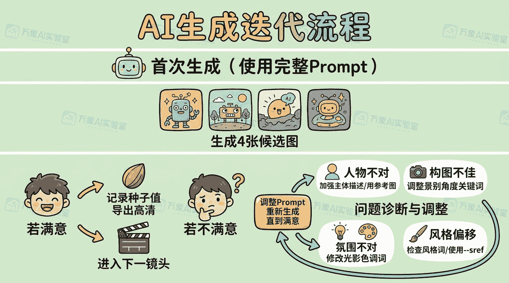

**一致性保持技巧表**

#### STEP 6：筛选优化与定稿整理

整理可用的分镜画面，形成最终素材包：

+   **选取最佳画面**：标准→符合镜头设计 + 情绪匹配 + 风格统一，比如排除 “主角眼镜消失” 的画面。

+   **画面微调修复**：用 PS / 美图秀秀修小瑕疵（比如人物五官歪、背景穿帮）。

+   **编号存档**：按 “剧集名 - 场景号 - 镜头号” 命名，比如 “校园误会 01-03-02”，用文件夹按场景分类存放（如 “教室场景分镜”“图书馆场景分镜”）。

**AI 短剧画面质量检查清单 **

| #### 检查维度 | #### 检查项 | #### 检查说明 | #### 检查结果 |
| --- | --- | --- | --- |
| 人物形象一致性 | 面部特征匹配角色设定 | 角色五官、发型、妆容需与剧本/人设参考图完全一致，无造型偏差 | □达标 □待优化 |
|  | 服装配饰符合场景 | 契合场景时代背景、角色身份（如古风场景避免现代饰品），无穿搭违和 | □达标 □待优化 |
|  | 体态比例正常 | 符合人体工学，无肢体扭曲、头身比异常等比例失调问题 | □达标 □待优化 |
| 情绪表达准确性 | 表情传达正确情绪 | 神态与当前剧情情绪匹配（如悲伤场景呈现垂眼/皱眉），无表情脱节 | □达标 □待优化 |
|  | 肢体语言自然 | 动作贴合情绪状态（如愤怒时肢体紧绷），无松弛、违和的肢体表现 | □达标 □待优化 |
|  | 与剧情发展匹配 | 情绪强度贴合剧情节点（如高潮场景情绪饱满，无平淡感） | □达标 □待优化 |
| 画面技术质量 | 无畸变（手指、五官） | 无多指/少指、五官错位（眼距异常、嘴歪）等肢体/面部畸变问题 | □达标 □待优化 |
|  | 清晰度满足输出需求 | 符合播出平台分辨率标准（竖屏≥720P、横屏≥1080P），无画面模糊 | □达标 □待优化 |
|  | 无明显 AI 痕迹需修复 | 无模糊重影、边缘锯齿、色彩断层等 AI 生成类瑕疵 | □达标 □待优化 |
| 视觉连贯性 | 与前后镜头衔接 | 动作/场景切换流畅（如角色抬手动作连贯，无卡顿/跳帧） | □达标 □待优化 |
|  | 光影方向一致 | 同一场景内光源方向统一（如侧光场景无顶光阴影），无光影冲突 | □达标 □待优化 |
|  | 整体风格统一 | 画风/色调与剧集定位契合（甜宠剧明亮柔和、悬疑剧冷暗），无风格割裂 | □达标 □待优化 |
| 构图与景别 | 达到设计意图 | 景别选择贴合叙事需求（如特写聚焦微表情），无偏离核心表达 | □达标 □待优化 |
|  | 视觉焦点明确 | 主体处于画面核心区域（如九宫格交叉点），无被背景元素干扰 | □达标 □待优化 |
|  | 画面有视觉张力 | 通过景别对比/构图层次（近景+远景结合）增强画面吸引力，无单调感 | □达标 □待优化 |

## 3.4 AI 短剧画面风格类型大全

### **3.4.1 主流画面风格分类**

#### **写实系**

**电影写实风**

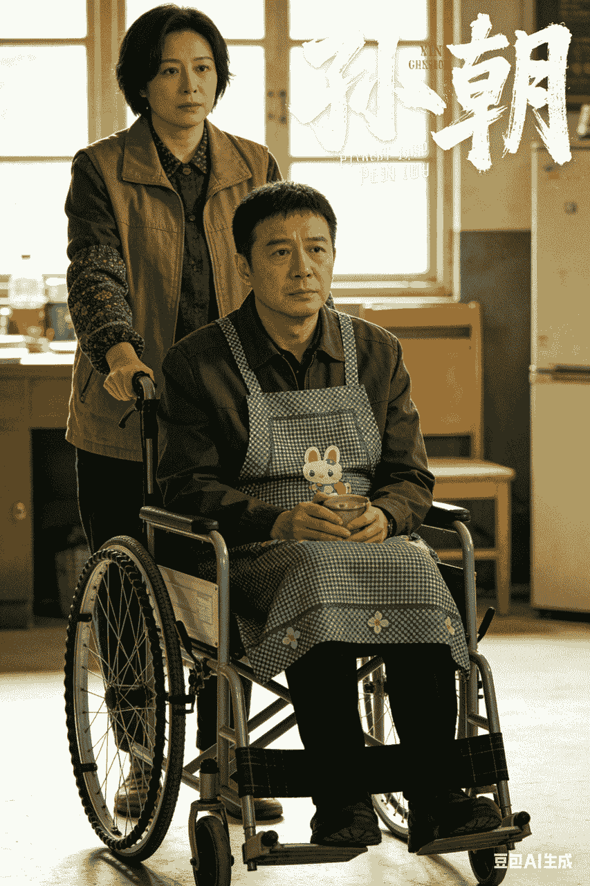

**特点：**接近院线电影的镜头质感，场景 / 服化道高度贴合现实生活。

**照片写实风**


**特点：**细节（皮肤纹理、光影）与真实照片无明显差异。

**超现实写实**


**特点：**现实质感 + 超现实设定（比如写实场景里的奇幻元素）。

#### 插画系

**日系动漫**


**特点：**大眼睛、线条柔和、色彩清新的二次元人物 / 场景。

**韩系漫画**

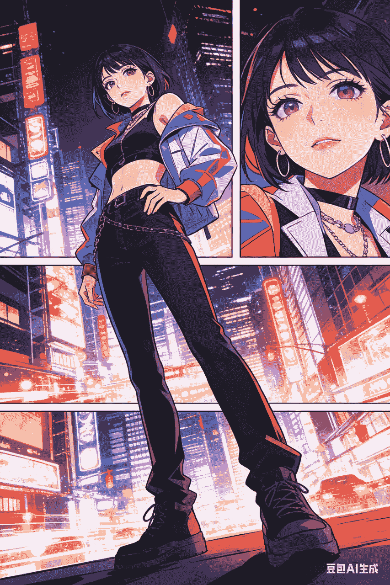

**特点：**人物比例修长、色彩饱和度高、分镜节奏紧凑。

**国漫风格**


**特点：**融合中式美学（古建筑、汉服），画风飘逸有东方意境。

**欧美漫画**


**特点：**欧美漫画的粗犷线条 + 立体感，常带夸张的人物特征。

**扁平插画**


**特点：**线条简洁、色彩明快，偏向现代 UI 插画质感。

**厚涂 CG**


**特点：**类似手绘油画的肌理，人物 / 场景立体感强。

#### 艺术系

**油画艺术风**


**特点：**浓郁的色彩、明显的笔触肌理，类似油画作品质感。

**复古胶片风**


**特点：**还原老胶片的质感，有年代感滤镜效果。

**概念艺术风**


**特点：**侧重展现世界观氛围，画面有强烈的设计感。

#### 常见风格

**赛博朋克**


**特点：**蓝紫 / 粉橙霓虹色调、全息投影、机械义体等元素。

**黑白漫画**


**特点：**靠线条、阴影塑造层次，类似早期漫画风格。

**像素复古**


**特点：**低分辨率像素构成，还原复古游戏质感。

**3D 卡通**


**特点：**立体建模 + 卡通化造型，类似 3D 动画短片风格。

**蒸汽朋克**


特**点：**工业革命美学 + 奇幻机械设定。

**剪纸拼贴**


**特点：**平面化、材质感强，类似手工剪纸的拼接效果。

### 3.4.2 风格详解与 Prompt 模板

#### **写实系风格**

电影写实风完整 Prompt 模板

```
【电影写实风Prompt模板】

[人物描述], [场景描述], [情绪动作],
电影构图，剧照，  
使用ARRI Alexa拍摄，35mm镜头，变形镜头光晕，  
浅景深，散景背景，  
戏剧性灯光，体积雾效，  
胶片颗粒，调色处理，  
高对比度，深邃阴影，  
8K分辨率，照片级真实感，  
[著名导演]风格执导

--ar 16:9 --s 300 --q 2
```

#### **插画系风格**

日系动漫风格完整 Prompt 模板

```
【日系动漫Prompt模板】

1女孩/1男孩，[外貌描述]，[服装描述]，
[表情动作]，[场景描述]，
动漫风格，漫画艺术，
新海诚作品，京都动画制作，
美丽细腻的眼睛，闪亮的瞳孔，
柔和光线，温暖色调，
飘落的樱花花瓣，
镜头光晕，景深效果，
杰作，最佳画质，
高度精细，8K壁纸，
动漫主视觉图

--niji 6 --ar 16:9 --s 400
```

#### **常见风格**

#### AI 短剧风格对照速查表


## **3.5 风格确立方法与实战**

#### **STEP 1：题材分析**

这一步是明确 “作品要服务谁、讲什么、传递什么情绪”，直接决定风格的大框架：

+   **确定故事类型**：先明确短剧核心类型，不同类型对应差异化视觉风格例：甜宠恋爱→柔和线条 + 暖色调；悬疑推理→锐利线条 + 冷色调；古风仙侠→国风笔触 + 水墨质感

+   **明确目标受众**：锁定受众的年龄、偏好，匹配其审美习惯例：15-20 岁学生→Q 版 / 二次元画风；25-30 岁职场人→写实偏简约画风

+   **理清情绪基调**：对应故事核心情绪，决定色彩 / 光影走向例：治愈向→低饱和马卡龙色；热血向→高对比撞色；悲情向→灰调 + 弱光影

+   **预估制作周期**：周期影响风格复杂度（周期短优先选 AI 易批量生成的风格）例：3 天出片→扁平简化风；7 天以上→精细厚涂风


> AI 短剧目标受众影响

> • 年轻女性 → 韩系漫画、日系动漫、电影浪漫

> • 年轻男性 → 厚涂 CG、赛博朋克、电影动作

> • 泛大众   → 电影写实、中和型风格

> • 二次元向 → 日系动漫、niji 模式

> • 国风爱好 → 国漫、水墨、工笔画

####  **STEP 2：收集参考**

这一步是帮 AI “建立审美标准”，避免生成风格跑偏。

**参考图收集来源**

**参考图整理模板**

| #### **分类** | #### **需收集内容** |
| --- | --- |
| 角色参考 | 1. 主角面部参考（3-5 张不同角度） |
| 场景参考 | 1. 主要场景参考（每场景 2-3 张） |
| 风格参考 | 1. 整体美术风格参考（5-10 张） |
| 镜头参考 | 1. 构图参考 |

#### STEP3：风格测试

这一步是筛选 “既符合需求、又能稳定生成” 的风格：

+   **生成测试图**：用 Midjourney/Stable Diffusion，基于题材 + 参考，生成 3-5 种风格的同一片段分镜例：同一对话片段，生成 “Q 版萌系、写实简约、二次元动漫”3 种风格

+   **对比不同风格**：从 3 个维度评估①视觉契合度：是否匹配故事情绪；②AI 生成效率：出图速度 / 修改成本；③受众偏好：目标用户的接受度

+   **征求反馈意见**：在粉丝群 / 创作社群发测试图投票，记录高频评价（如 “Q 版可爱但剧情代入感弱”）

+   **评估可行性**：判断该风格能否批量生产（例：精细厚涂风虽好看，但 AI 生成每张需 10 分钟且细节不一致，周期短则排除）


#### STEP4：确立模板

这一步是把风格 “标准化”，避免后续分镜风格混乱：

+   **锁定核心词**：提炼风格的精准描述词（例：“古风甜宠 + 暖橙主色调 + Q 版人物（头身比 3:1）+ 国风写意场景”）

+   **记录参数**：保存 AI 工具的关键生成参数（例：Midjourney 的--ar 16:9（短剧分镜比例） --style cute（Q版风格） --iw 2（参考图权重））

+   **创建 Prompt 库**：按 “人物出场分镜、对话分镜、场景转场分镜” 分类，写好对应 Prompt 例：对话分镜 Prompt：“古风甜宠 AI 短剧分镜，暖橙色调，Q 版女主（双马尾 + 粉裙）与男主（束发 + 青衫）在庭院对话，近景镜头，柔和光影 --ar 16:9 --style cute”

+   **建立角色参考**：生成 “角色设定参考图”（固定五官、服饰、头身比），后续分镜生成时都关联该参考，保障角色形象一致


《AI 短剧画面风格规范手册》参考表

| #### 模块分类 | #### 核心 | #### 详细内容 | #### 补充说明 |
| --- | --- | --- | --- |
| 风格定义 | 风格名称 | 电影质感都市浪漫风 | 明确画面核心调性，便于导演、AI 生成团队统一视觉认知 |
|  | 风格描述 | 融合韩剧细腻情感叙事与电影级光影质感，以都市场景为载体，兼顾现实生活的真实肌理与浪漫氛围的氛围感营造 | 适配 AI 短剧“短平快”的叙事节奏，既保留生活细节的代入感，又通过电影质感提升内容质感 |
|  | 参考作品 | 《鬼怪》《来自星星的你》电影级画面质感 | 对标成熟影视项目的镜头语言、光影逻辑，降低 AI 生成的风格偏差率 |
| 核心 Prompt 模板 | 基础风格词 | 电影感摄影、韩剧美学、浪漫氛围、柔光灯效、浅景深、电影颗粒感、暖色调调色、35 毫米镜头、ARRI 摄影机拍摄 | 精准传递画面美学特征，引导 AI 聚焦“都市+浪漫+电影感”的核心视觉元素 |
|  | 固定质量词 | 杰作级品质、顶级画质、极致细节、8K 分辨率、照片级真实感 | 保障画面清晰度、纹理细节达到短剧平台（如抖音、快手）的播出级画质要求 |
|  | 固定参数 | --ar 16:9 --s 250 --q 2 | --ar 16:9 适配短剧横屏播放比例；--s 250 控制风格强度避免偏离调性；--q 2 提升画质精细度 |
| 色调规范 | 日间场景 | 暖金色调、柔和日光、轻柔高光 | 适配都市清晨通勤、午后户外约会等戏份，暖金色调增强生活温馨感，避免强光过曝 |
|  | 夜间场景 | 冷蓝色调、城市灯光散景、霓虹点缀 | 适配深夜街头谈心、都市夜景戏份，冷蓝基调突出夜晚疏离感，霓虹点缀强化浪漫氛围 |
|  | 情感场景 | 暖琥珀光效、柔和对比度、浪漫氛围 | 适配告白、回忆杀等温馨戏份，暖琥珀光效烘托亲密感，低对比避免视觉压迫 |
|  | 冲突场景 | 高对比度、冷硬光效、戏剧化阴影 | 适配争吵、对峙等情绪戏，高对比+冷硬光强化戏剧张力，阴影突出角色情绪压抑感 |
| 禁用元素 | 禁用内容列表 | --no 卡通、插画、绘画、动漫、3D 渲染、CGI、过度饱和、生硬对比度 | 避免非写实元素/极端视觉效果破坏“电影质感+都市真实感”的核心风格 |
|  | 禁用原因 | 破坏电影质感与都市真实感氛围 | 保障全剧画面风格统一，避免观众因视觉跳脱降低沉浸感 |
| 角色参考图 | 女主参考 | [上传图片 URL] → --cref URL | --cref 参数锁定女主外形特征（妆容、穿搭），确保 AI 生成角色形象统一 |
|  | 男主参考 | [上传图片 URL] → --cref URL | 同理女主参考，保障男主外形与气质契合“都市浪漫”调性 |
|  | 风格参考 | [上传图片 URL] → --sref URL | --sref 参数对齐参考作品的光影、构图逻辑，提升 AI 生成画面的风格匹配度 |

---

# 第四章、动态篇：AI 漫剧核心画面生成实战

本章节帮助新人快速掌握 AI 漫剧的图片素材生成、动态视频合成全流程，以“即梦 AI”（新手友好型工具）为实操载体，覆盖从需求拆解到最终导出的每一步，同时总结高频技巧与避坑要点，降低入门门槛。

## 4.1 AI 漫剧图及视频生成的核心逻辑

AI 漫剧的核心是“**静态素材生成+动态化处理**”：先通过 AI 生成符合剧情、风格统一的漫剧截图（图片），再将图片按分镜逻辑排序，添加转场、动效、音效/配音，最终合成连贯视频。即梦 AI 的优势在于“生图+视频合成一体化”，无需跨工具切换，适合新手入门。

核心前提：明确漫剧基础信息（避免生成混乱），需提前确定 3 个关键要素，可参考下表整理：

| 关键要素 | 说明 |
| --- | --- |
| 漫剧风格 | 确定整体画风（日系、国漫、美式等），需统一风格避免违和 |
| 核心角色 | 明确角色外貌、服装、性格（生成时保持角色一致性） |
| 分镜需求 | 拆解单集分镜（远景/中景/近景/特写），明确每帧画面内容 |

本次示例剧本与分镜准备

> **示例剧本片段：**

> **第一集：命运的相遇**

> 场景 1：城市 CBD，暴雨天

+   镜头 1：女主林小雨撑着破旧雨伞，在写字楼前焦急等待（全景）

+   镜头 2：女主面部特写，雨水打湿了她的脸庞（特写）

+   镜头 3：一辆黑色劳斯莱斯停在她面前，溅起水花（中景）

> 场景 2：劳斯莱斯车内

+   镜头 4：车窗缓缓降下，男主顾霆琛冷峻的侧脸出现（特写）

+   镜头 5：男女主四目相对的对视镜头（双人中景）

>

> **女主角设定**

> 姓名：林小雨

> 年龄：24 岁

> 身份：普通公司职员

> 外貌特征：

+   长发及腰，黑色直发

+   大眼睛，略带倔强

+   身材纤细，165cm

+   穿搭：职业通勤风，白衬衫+灰色半裙

> 性格关键词：坚强、独立、善良

>

> **男主角设定**

> 姓名：顾明

> 年龄：28 岁

> 身份：集团 CEO

> 外貌特征：

+   短发，偏分造型

+   剑眉星目，冷峻面容

+   身材挺拔，185cm

+   穿搭：黑色西装三件套，质感高级

> 性格关键词：高冷、腹黑、专情

## 4.2 实操模块一：即梦 AI 生成漫剧图片

目标：生成符合分镜要求、风格统一、角色一致的漫剧静态图片，步骤如下：

### 步骤 1：工具准备与登录

+   访问即梦 AI 官网（https://jimeng.jianying.com/ai-tool/home/），注册账号（支持手机号/微信登录），新手首次登录会赠送免费生成额度（足够完成 1-2 个短篇漫剧）。


### 步骤 2：精准输入提示词（生图核心）

提示词是 AI 理解需求的关键，新手需遵循“风格+场景+角色+动作+细节”的公式，避免模糊表述。

> **标准提示词结构：**

> 【主体描述】+【外貌细节】+【服装配饰】+【场景环境】+【光影氛围】+【画面风格】+【镜头参数】

**女主定妆照提示词实例**

```

一位24岁的中国年轻女性，长发及腰，黑色直发，大眼睛，
清纯温婉的面容，皮肤白皙细腻，
穿着白色丝绸衬衫，灰色高腰包臀裙，
站在落地窗前，窗外是城市CBD景观，
柔和的自然光从窗外照射进来，形成唯美的逆光效果，
韩式清冷漫画风格，半身照，
画面精致，色彩柔和，电影感，高清，2K
```

操作：在即梦 AI“提示词输入框”中粘贴提示词，设置好对应的参数即可。


### 步骤 3：设置生成参数（新手默认+微调）

即梦 AI 的参数界面简洁，新手无需复杂调整，重点关注 3 个核心参数，其余默认即可：

| **参数名称** | **新手推荐值** | **调整逻辑** | **本次案例设置** |
| --- | --- | --- | --- |
| 比例 | 1080×1920（竖屏）/ 1920×1080（横屏） | 漫剧多为竖屏（适配手机观看），横屏适合大屏播放，分辨率越高，细节越清晰但生成时间越长 | 1080×1920（竖屏） |
| 生成数量 | 2-4 张 | 生成多张后选择最优，避免单张不满意需重新生成，浪费额度 | 3 张 |
| 分辨率 | 2k、4k | 分辨率越高清晰度越高 | 4k |

操作：参数设置完成后，点击【开始生成】，等待 30 秒 -2 分钟（根据生成数量和分辨率调整）。

### 步骤 4：图片筛选与优化

+   生成完成后，查看 3 张结果图，选择最符合分镜要求的 1 张（重点看角色动作、表情、场景是否匹配）。

+   若不满意（如角色表情僵硬、场景杂乱）：点击该图片下方的【重新生成】，可微调提示词（如补充“男生嘴角上扬角度适中”）或参数（如提高风格强度），再次生成。

+   若仅小细节问题（如女生头发颜色偏深）：点击【局部修改】，框选需要修改的区域，输入修改提示词（如“将女生头发颜色调整为纯黑色，保持发丝细节”），精准优化，避免整体重生成。


我们选择上面生成的第二张照片作为女主的定妆照


### **锁定角色一致性——关键技巧**

> **图生图固定角色操作步骤：**

1.  将满意的女主定妆照上传到「参考图」区域

1.  修改提示词中的场景/动作/表情部分

1.  保持人物描述部分不变

**基于定妆照生成「雨中等待」场景**

```
【保持上传的参考图人物外貌形象不变】
该人物手撑一把浅蓝色雨伞，
站在现代写字楼大门前，暴雨倾盆，
神情焦急地向远方张望，裙摆和头发被雨水打湿，
城市街道背景，霓虹灯倒影，湿润的地面反射光线，
韩式清冷漫画风格，全身照，
电影级画面，雨滴清晰可见，2K
```


**同理男主定妆照提示词：**

```
一位28岁的中国男性，精英气质，
短发偏分，剑眉星目，眼神深邃冷峻，
轮廓分明的下颌线，略带胡茬，
穿着黑色修身西装三件套，白色衬衫，深蓝色领带，
站在豪华办公室落地窗前，俯瞰城市夜景，
单手插口袋，侧身45度角，
韩式漫画风格，冷色调灯光，
画面精致高级感，半身照，2K
```


我们选择上面生成的第三张照片作为男主的定妆照


### 步骤 5：图片导出与整理

选中满意的图片，点击【下载】，保存为 PNG 格式（清晰度最高，适合后续视频合成）。建议按“分镜序号+内容”命名（如“02-男主向女主走来。png”），避免后续混乱。重复步骤 2-5，完成所有分镜的图片生成。

**图片输出核心技巧与避坑点**

| **类别** | **核心技巧** | **常见坑** | **避坑方案** |
| --- | --- | --- | --- |
| 提示词 | 1. 角色一致性：首次生成角色后，保存提示词中的角色描述，后续生成同角色时直接复用；2. 参考画风：可在提示词中加入“参考《XXX》画风”（如参考《堀与宫村》），AI 更易理解 | 提示词模糊，导致角色动作/场景偏离预期；角色前后画风不一致 | 1. 严格遵循“风格+场景+角色+动作+细节”公式； |
| 参数设置 | 新手优先使用即梦 AI 的“漫剧风格参考”（日系、国漫等），预设已优化好参数，无需手动调整 | 分辨率设置过高，导致生成时间过长/额度消耗过快；风格强度过低，画风不贴合 | 前期测试用低分辨率（2k），确定满意后再用高分辨率 |
| 图片优化 | 小细节修改用“局部修改”功能，比整体重生成更节省额度和时间 | 不满意就直接整体重生成，浪费免费额度 | 先判断问题类型：小细节（颜色、发丝）用局部修改；大问题（角色动作、场景错误）再整体重生成 |

**案例分镜场景图汇总**

| **场景** | **镜头** | **景别** | **提示词** | **图片** |
| --- | --- | --- | --- | --- |
| 1 | 1 | 全景 | ``` 暴雨中的现代城市CBD街道， 一位年轻女性站在高耸的玻璃写字楼大门前， 撑着一把显得有些破旧的浅蓝色雨伞， 雨水如注倾泻而下，路面积水映射着霓虹灯光， 女孩穿着已经被淋湿的白衬衫和灰色半裙， 焦急地向马路方向张望， 远景构图，韩式漫画风格， 电影感色调，蓝灰色为主，画面有雨水滴落的动感，2K ``` |  |
| 1 | 3 | 中景 | ``` 暴雨的城市街道， 一辆黑色劳斯莱斯幻影轿车从画面左侧疾驰而来， 车轮碾过积水，溅起巨大的水花， 水花朝向画面右侧的一位撑伞少女飞溅， 女孩惊讶地后退一步，伞被风吹得歪斜， 中景构图，车辆和人物都清晰可见， 韩式漫画风格，动感十足，雨夜氛围， 电影级画面，高速快门效果，2K ``` |  |
| 2 | 4 | 特写 | ``` 黑色劳斯莱斯轿车车窗特写， 车窗正在缓缓降下， 窗内一位西装革履的年轻男性，侧脸轮廓分明， 剑眉星目，神情冷峻，略带审视的目光望向窗外， 车内昏暗的光线映衬出他精致的五官轮廓， 窗外是模糊的雨夜背景， 特写镜头，浅景深效果， 韩式漫画风格，高级感，2K ``` |  |

## 4.3 实操模块二：即梦 AI 将图片合成为漫剧视频

目标：将生成的静态图片按分镜顺序排列，添加转场、动效、音效/配音，合成连贯的漫剧视频，步骤如下：

### 进入视频合成模块

**操作步骤：**

1.  在即梦首页点击「AI 视频」

1.  选择「图生视频」功能

1.  上传准备好的分镜图片


### **视频提示词编写技巧**

核心原则：简洁、具体、描述动作而非静态

> **结构模板：**【主体动作】+【运动方向】+【镜头运动】+【环境动态】

**各场景视频提示词示例**

| **镜头** | **主要场景** | **提示词** | **示例视频** |
| --- | --- | --- | --- |
| 镜头 1 | 女主雨中等待 | ``` 女孩微微转头向马路方向张望， 雨水不断滴落在雨伞上， 裙摆和头发随风轻轻飘动， 镜头保持静止，背景有雨水流动效果 ``` |  |
| 镜头 2 | 面部特写 | ``` 女孩面部特写，眼睛轻轻眨动， 雨滴从脸颊滑落， 表情从期待转为焦虑， 睫毛微微颤动， 镜头缓慢推近 ``` |  |
| 镜头 3 | 豪车溅水 | ``` 黑色轿车从画面左侧快速驶入， 车轮碾过积水溅起巨大水花， 水花朝女孩方向飞溅， 女孩惊讶后退，雨伞被吹歪， 镜头跟随车辆运动 ``` |  |
| 镜头 4 | 车窗摇下 | ``` 车窗缓缓向下滑动， 窗内男性面部逐渐显露， 他的眼睛微微转动看向窗外， 嘴角似乎有一丝笑意， 窗外雨滴不断滑落 ``` |  |


[jimeng-2025-12-22-6236-女孩微微转头向马路方向张望， 雨水不断滴落在雨伞上， 裙摆和头发随风轻轻飘动， ....mp4](https://internal-api-drive-stream.feishu.cn/space/api/box/stream/download/all/KFG2bvZE6oHwiVx9ACGcOwOFnNe)


[jimeng-2025-12-22-3084-女孩面部特写，眼睛轻轻眨动， 雨滴从脸颊滑落， 表情从期待转为焦虑， 睫毛微微颤....mp4](https://internal-api-drive-stream.feishu.cn/space/api/box/stream/download/all/VkcubyUlXonhWdxE5cwc9jtbnBd)


[jimeng-2025-12-22-9513-黑色轿车从画面左侧快速驶入， 车轮碾过积水溅起巨大水花， 水花朝女孩方向飞溅， ....mp4](https://internal-api-drive-stream.feishu.cn/space/api/box/stream/download/all/JhrxbJmZ9og086x90K9cF7RJnRd)


[jimeng-2025-12-22-7354.mp4](https://internal-api-drive-stream.feishu.cn/space/api/box/stream/download/all/VJVAbouMMoOoB3xF4Hzc43pKnZg)

**问题诊断速查表**

---

# 第五章、后期篇：AI 短剧后期剪辑与音效合成

后**期制作是 A**I** 短剧/**A**I 漫剧**的“临门一脚”，直接决定作品的观感、节奏和传播效果。本节内容聚焦后期核心环节——后期剪辑流程、配音合成、最终输出，详细拆解操作步骤、核心技巧及新人高频避坑点，方便新人理解和查阅。


## 5.1 后期剪辑流程

> **剪辑的核心目标：**让剧情流畅易懂、节奏紧凑抓眼（AI 短剧通常 1-3 分钟/集，AI 漫剧 3-5 分钟/集，需避免拖沓）。流程分为“素材整理→粗剪→精剪→转场/特效添加→字幕制作”5 个关键步骤。

### 5.1.1 详细流程拆解

#### 1）素材整理：避免后期混乱的基础

**核心动作：**对前期生成的 AI 画面素材（短剧实拍素材+AI 辅助素材、漫剧分镜 AI 生成图/动态帧）、音频素材（原始配音、音效库、背景音乐）进行分类归档，标注清晰用途。

具体操作：

+   建立文件夹体系：按“项目名→画面素材（分镜序号/场景）→音频素材（配音/音效/音乐）→特效素材（转场/贴纸/字幕模板）”分类存放；


+   筛选可用素材：剔除模糊、卡顿、与剧情无关的画面，标注“可用”“备选”；音频素材剔除杂音、时长不符的片段；

+   统一素材格式：确保画面素材分辨率、帧率一致（避免后期拉伸变形），音频格式统一为 MP3/WAV（主流剪辑软件兼容）。

#### 2）粗剪：搭建剧情骨架

核心动作：按剧本叙事逻辑，将筛选后的画面素材按顺序拼接，确定基本剧情走向，不纠结细节。

具体操作：

+   导入素材至剪辑软件（推荐新人用剪映、CapCut；专业需求用 PR）；

+   按“开端→发展→高潮→结尾”的逻辑，将画面片段拖拽至时间轴，删除冗余片段（如过长的空镜、重复的动作）；

+   预留配音/字幕空间：根据剧本对话时长，调整画面片段长度，避免画面与台词不同步。

#### 3）精剪：优化节奏与观感

核心动作：调整画面节奏、修正细节，让剧情更紧凑、视觉更舒适，这是提升作品质感的关键。


具体操作：

+   节奏调整：AI 短剧/漫剧需“快节奏”，单镜头时长控制在 3-5 秒（高潮部分可缩短至 1-2 秒），避免单一镜头停留过久；根据台词情绪调整镜头切换（如紧张剧情快速切，抒情剧情慢切）；

+   画面修正：裁剪黑边、调整画面亮度/对比度/饱和度（确保色彩统一，AI 生成素材易出现色彩偏差）；删除画面抖动、闪烁的片段（可用“防抖”功能修复轻微抖动）；

+   镜头衔接：确保相邻镜头逻辑连贯（如角色从左走到右，下一个镜头仍保持运动方向一致，避免“跳切”混乱）。

#### 4）转场与特效添加：服务剧情，不炫技

核心动作：用转场衔接镜头，用特效弥补 AI 素材不足，所有效果需贴合剧情风格（如古风剧用“水墨转场”，科幻剧用“故障转场”）。

具体操作：

+   转场选择：新人优先用“硬切”（无特效直接切换，最自然），仅在场景切换时用简单转场（如淡入淡出、叠化，时长 0.2-0.5 秒）；避免滥用花哨转场（如旋转、缩放），易分散观众注意力；

+   特效添加：AI 漫剧可添加“动态分镜效果”（如速度线、网点纸纹理，增强漫画感）；AI 短剧可添加“氛围特效”（如下雨、烟雾，弥补实拍素材不足）；优先用剪辑软件自带特效（兼容性好、操作简单）；

+   特效原则：“能少则少”，所有特效都是为了强化剧情，而非单纯炫技。

#### 5）字幕制作：清晰可读，同步台词

核心动作：制作台词字幕+关键信息字幕（如人物姓名、时间地点），确保观众快速获取信息。

具体操作：

+   字幕样式：字体选择清晰易读的（如微软雅黑、思源黑体），字号适中（手机观看需≥24 号字），颜色与画面对比度高（如浅色背景用黑色字幕，深色背景用白色字幕，可加 1-2px 描边增强可读性）；

+   同步与位置：字幕需严格同步台词（提前 0.1-0.2 秒出现，延迟 0.1 秒消失），位置固定在画面下方 1/3 处（避免遮挡角色/关键信息）；

+   工具推荐：新人用剪映“自动字幕”功能（识别准确率高，可手动修正错误），专业需求用 PR“字幕工具。

**字幕类型与规范**

**字幕避坑指南**

### 5.1.2 剪辑核心技巧与避坑点汇总

| **环节** | **核心技巧** | **新人避坑点** |
| --- | --- | --- |
| 素材整理 | 1. 用“场景+序号”命名素材（如“古风-客栈 -01”）；  2. 提前备份素材（避免丢失）；  3. 统一素材帧率（推荐 25/30 帧，符合短视频平台要求） | 1. 素材杂乱无章，后期找素材浪费时间；  2. 不备份素材，剪辑中丢失文件；  3. 素材帧率不统一，导致画面卡顿 |
| 粗剪 | 1. 先确定“剧情主线”，再拼接素材；  2. 删除所有“无效镜头”（如角色无动作的空镜、台词卡顿的片段）；  3. 控制单集时长（短剧 1-3 分钟，漫剧 3-5 分钟） | 1. 按素材顺序拼接，忽略剧情逻辑；  2. 保留冗余镜头，导致剧情拖沓；  3. 单集时长过长，观众流失 |
| 精剪 | 1. 用“台词情绪”匹配镜头节奏（紧张台词快切，抒情台词慢切）；  2. 相邻镜头“景别交替”（如近景→中景→全景，避免视觉疲劳）；  3. 修正“跳切”（用特写镜头过渡，或调整镜头顺序） | 1. 镜头时长过长，节奏拖沓；  2. 景别重复（如连续多个近景），视觉单调；  3. 忽略跳切，导致画面逻辑混乱 |
| 转场/特效 | 1. 场景切换用“淡入淡出”，同场景镜头用“硬切”；  2. 特效透明度控制在 70%-80%，避免遮挡画面；  3. 统一特效风格（如全剧只用“水墨风”特效） | 1. 滥用花哨转场，分散观众注意力；  2. 特效过于厚重，遮挡关键剧情；  3. 特效风格混乱（古风剧用科幻特效） |
| 字幕 | 1. 用“自动字幕”后手动检查（修正错别字、多音字）；  2. 关键信息（如人物姓名）加颜色标注；  3. 避免字幕覆盖角色面部/动作 | 1. 直接用自动字幕不检查，出现错别字；  2. 字幕字号过小/颜色过浅，手机观看看不清；  3. 字幕位置随意，遮挡关键信息 |

## 5.2 后期配音合成

配音是作品的“灵魂”，AI 短剧/AI 漫剧的配音分为“AI 配音”和“真人配音”（新人优先用 AI 配音，成本低、效率高）。核心目标：配音风格贴合角色人设，声音清晰无杂音，与画面口型/动作同步。流程分为“配音素材准备→人声处理→音效匹配→背景音乐融合→整体混音”5 个步骤。

## 5.2.1 详细流程拆解

#### 1）配音素材准备：选对声音，匹配人设

核心动作：根据角色人设（年龄、性别、性格）选择配音类型，生成/录制符合剧情的配音素材。

具体操作：

+   AI 配音选择：推荐工具（剪映 AI 配音、讯飞听见、火山 TTS），选择对应音色（如“少年音”“御姐音”“古风公子音”）；调整参数（语速：正常 150-180 字/分钟，紧张剧情 180-200 字/分钟；情绪：开心、愤怒、悲伤等，贴合台词语境）；

+   真人配音录制：用手机录音（需加防风麦，避免杂音）或专业麦克风，录制环境保持安静（关闭空调、门窗）；让配音演员熟悉剧本，把握角色情绪；

+   配音脚本整理：将剧本台词按“角色+场景+时长”整理（如“男主-客栈 -0:15-0:20”），避免配音与画面时长不符。

#### 2）人声处理：清晰无杂音，音量统一

核心动作：修正配音中的杂音、音量波动，让声音更干净、舒适。

具体操作：

+   降噪处理：用剪辑软件“降噪”功能（剪映：音频→降噪；PR：效果→降噪/修复→自适应降噪），消除环境杂音（如电流声、脚步声）；

+   音量统一：将所有人声音量调整至 -12dB 至 -6dB（行业标准，避免过大失真、过小听不清）；用“音量自动化”功能修正音量波动（如台词开头小声、结尾大声）；

+   音色优化：新人无需复杂调整，可用“均衡器”轻微提升高频（让声音更清晰）、降低低频（减少杂音）。

#### 3）音效匹配：增强沉浸感，贴合场景

核心动作：添加环境音效、动作音效，让观众有“代入感”（音效是“隐形的剧情助推器”）。

具体操作：

+   音效分类：环境音效（如客栈喧闹声、雨天雨声、科幻场景机械声）、动作音效（如走路声、开门声、打斗声）、情绪音效（如心跳声、紧张的鼓点）；

+   添加原则：“有动作必有效音，有场景必有人环境音”，但音量需低于人声（占人声音量的 30%-50%），避免盖过人声；

+   工具推荐：新人用剪映自带音效库（免费、分类清晰），专业需求用“爱给网”“音效网”（下载无版权音效）。

**BGM 场景-情绪-音乐对照表**

** BGM 音量标准**

#### 4）背景音乐融合：烘托情绪，不抢戏

核心动作：选择贴合剧情风格的背景音乐，控制音量，烘托情绪但不干扰台词。

具体操作：

+   音乐选择：风格匹配（古风剧用古筝、二胡曲；科幻剧用电子音乐；悬疑剧用低沉的弦乐）；优先选“无版权音乐”（避免侵权，剪映、网易云音乐有免费无版权库）；

+   音量控制：背景音乐音量为 -18dB 至 -12dB（低于人声），剧情高潮时可轻微提升（不超过 -10dB），台词密集时可降低（至 -20dB）；

+   衔接处理：背景音乐开头用“淡入”（0.5 秒），结尾用“淡出”（1 秒），避免突然出现/消失。

#### 5）整体混音：平衡所有音频，确保整体协调

核心动作：调整人声、音效、背景音乐的比例，确保所有音频清晰可辨，无失真、无杂音。

具体操作：

+   比例参考：人声（100%）：音效（30%-50%）：背景音乐（20%-40%）；

+   整体检查：戴上耳机完整听一遍，修正“音频过载”（声音失真）、“音量忽大忽小”“杂音残留”等问题；

+   工具辅助：用剪辑软件“音频仪表”（如 PR 的“音量单位表”）监测音量，避免超过 0dB（失真阈值）。

### 5.2.2 配音合成核心技巧与避坑点汇总

| #### 环节 | #### 核心技巧 | #### 新人避坑点 |
| --- | --- | --- |
| 配音素材准备 | 1. AI 配音先试听 1-2 句，调整语速/情绪至贴合角色；  2. 真人配音提前让演员熟悉剧本，标注台词重音；  3. 配音时长比画面台词时长短 0.1-0.2 秒（避免同步问题） | 1. 随便选音色，不贴合角色（如少年用苍老音）；  2. AI 配音语速过快/过慢，与剧情节奏不符；  3. 配音时长过长，导致口型不同步 |
| 人声处理 | 1. 降噪前先截取“空白杂音片段”（作为降噪样本）；  2. 用“压缩器”让音量更平稳（新人用剪映“自动压缩”）；  3. 重要台词（如高潮台词）可轻微提升音量（至 -8dB） | 1. 不降噪，保留环境杂音；  2. 音量调整过大，导致声音失真；  3. 不同角色音量差异大，观众需频繁调音量 |
| 音效匹配 | 1. 动作音效与画面严格同步（如开门声与门打开动作同时出现）；  2. 同一场景音效风格统一（如古风场景不用现代汽车声）；  3. 避免“音效堆砌”（一个动作只加 1 种核心音效） | 1. 音效与画面不同步（如走路声晚于脚步动作）；  2. 音效音量过大，盖过人声；  3. 随意添加音效，与场景不符（如科幻剧用古风鸟鸣声） |
| 背景音乐融合 | 1. 剧情转折处切换背景音乐（如从抒情转紧张）；  2. 无台词片段可提升背景音乐音量（至 -12dB）；  3. 避免用带歌词的音乐（干扰台词理解） | 1. 背景音乐风格与剧情不符（如悲剧用欢快音乐）；  2. 背景音乐音量过大，盖过人声；  3. 用有版权音乐，导致作品下架 |
| 整体混音 | 1. 用耳机+外放双重检查（确保不同设备听感一致）；  2. 重点检查剧情高潮、台词密集片段；  3. 导出前保存“音频工程文件”（方便后续修改） | 1. 只戴耳机检查，忽略外放听感（手机观看时声音失衡）；  2. 未检查音频过载，导致声音失真；  3. 不保存工程文件，后续无法修改 |

## 5.3 AI 短剧最终输出

输出是作品的“最后一关”，核心目标：输出格式、参数符合发布平台要求，画面清晰、音频正常，无压缩失真。流程分为“输出参数设置→预览检查→多版本备份→发布适配”4 个步骤。

### 5.3.1 详细流程拆解

#### 1）输出参数设置：匹配平台要求，避免压缩失真

核心动作：根据发布平台（抖音、快手、B 站、小红书等）调整分辨率、帧率、码率、格式等参数（平台参数要求会更新，需提前查看最新规则）。

具体操作（新人通用参数）：

+   格式：推荐 MP4（兼容性最强，所有平台支持）；避免用 MOV（部分平台不支持）；

+   分辨率：手机竖屏发布（抖音、快手、小红书）选 9:16 比例，分辨率 1080×1920（1080P）；横屏发布（B 站、西瓜视频）选 16:9 比例，分辨率 1920×1080（1080P）；新人不建议用 4K（文件过大，平台会二次压缩，反而失真）；

+   帧率：25 帧/秒（国内主流）或 30 帧/秒（海外平台常用），与前期素材帧率一致（避免画面卡顿）；

+   码率：1080P 分辨率建议码率 8-12Mbps（平衡画质与文件大小）；码率过低会导致画面模糊，过高会导致文件过大（上传慢、平台压缩严重）；

+   音频参数：采样率 48kHz，比特率 192kbps（确保音频清晰），声道立体声（适合手机/电脑播放）。

国内各大平台短剧/漫剧专属导出规格表

| #### 平台名称 | #### 推荐画幅比例 | #### 分辨率建议 | #### 帧率要求 | #### 推荐格式 | #### 码率参考（1080P） | #### 单集时长限制 | #### 其他注意事项 |
| --- | --- | --- | --- | --- | --- | --- | --- |
| 抖音 | 竖屏 9:16（首选）；横屏 16:9（支持） | 竖屏 1080×1920；横屏 1920×1080 | 25 帧/秒或 30 帧/秒，禁止低于 24 帧/秒 | MP4（H.264 编码） | 8-12Mbps（可变码率 VBR 优先） | 单集≤3 分钟；系列短剧总时长无明确限制 | 1. 音频采样率 48kHz，比特率≥128kbps；2. 避免画面上下黑边，建议满屏构图；3. 短剧标签需包含#短剧 #AI 短剧 等核心词提升曝光 |
| 小红书 | 竖屏 9:16（主流）；正方形 1:1（支持） | 竖屏 1080×1920；正方形 1080×1080 | 25-30 帧/秒，建议 30 帧/秒（画面更流畅） | MP4、MOV（MOV 兼容性略逊于 MP4） | 6-10Mbps（避免过高导致上传失败） | 单集≤5 分钟；超过 5 分钟需申请长视频权限 | 1. 画面顶部预留 10%空间，避免被平台标题遮挡；2. 漫剧建议添加漫画风贴纸增强辨识度；3. 音频避免尖锐杂音，适配手机外放特性 |
| 视频号 | 竖屏 9:16（推荐）；横屏 16:9；正方形 1:1 | 统一 1080P（竖屏 1080×1920；横屏 1920×1080） | 25-30 帧/秒，与素材帧率一致即可 | MP4（H.264/H.265 编码均可） | 8-12Mbps; H.265 编码可适当降低至 6-8Mbps（节省空间） | 普通账号单集≤15 分钟；短剧建议单集≤3 分钟提升完播率 | 1. 音频音量控制在 -12dB 至 -6dB，避免过载；2. 支持自定义封面，建议尺寸 1080×1920（竖屏）；3. 发布时关联“短剧”话题标签 |
| B 站 | 横屏 16:9（首选）；竖屏 9:16（支持，需适配播放器） | 横屏 1920×1080（1080P）；优质内容可 2K（2560×1440） | 24-60 帧/秒，建议 30 帧/秒（平衡流畅度与制作成本） | MP4、FLV（MP4 兼容性更强） | 10-15Mbps( 1080P) ; 2K 建议 15-20Mbps | 无明确单集时长限制；漫剧建议单集 3-5 分钟，短剧 1-3 分钟 | 1. 支持多音轨，可添加字幕轨（SRT 格式导入）；2. 避免画面暗部过暗，适配 B 站播放器特性；3. 标签建议包含#AI 漫剧 #短剧安利 等 |
| 快手 | 竖屏 9:16（核心画幅）；横屏 16:9（兼容） | 竖屏 1080×1920（1080P）；最低支持 720P（不推荐，画质差） | 25 帧/秒（国内主流）或 30 帧/秒，禁止帧率波动 | MP4（H.264 编码） | 6-10Mbps( 1080P) ; 网络较差时可降至 4-6Mbps（保证基本画质） | 单集≤5 分钟；短剧赛道推荐单集 1-2 分钟（适配快节奏观看习惯） | 1. 音频需清晰，无背景杂音，支持 AI 降噪后导出；2. 画面构图避免边缘裁切关键信息；3. 发布时选择“短剧”分类 |
| 红果 | 竖屏 9:16（唯一推荐画幅，适配平台生态） | 1080×1920( 1080P) ; 不支持 4K（平台会强制压缩） | 25-30 帧/秒，建议 25 帧/秒（适配国内素材） | MP4（仅支持 H.264 编码） | 5-8Mbps（过高易导致上传超时，过低画质模糊） | 单集≤3 分钟；系列短剧单集时长建议统一（提升用户习惯） | 1. 音频比特率≥128kbps，立体声；2. 封面需突出剧情核心元素，尺寸 1080×1920；3. 避免使用违规特效与敏感台词，平台审核较严格 |

> **注：**平台规格可能随版本更新微调，导出前建议查阅对应平台最新创作者指南；以下为短剧/漫剧适配的核心规格，优先保障播放兼容性与画质。

#### 2）预览检查：逐帧逐句，避免遗漏问题

核心动作：导出前完整预览作品，检查画面、音频、字幕的所有问题（一旦导出，修改需重新渲染，浪费时间）。

检查清单：

+   画面：无黑边、无拉伸变形；色彩统一，无卡顿、闪烁；转场/特效正常显示；

+   音频：无杂音、无失真；人声、音效、背景音乐比例协调；无音频缺失（如某段台词无声）；

+   字幕：无错别字；与台词同步；位置合适，无遮挡；

+   时长：符合平台要求（如抖音单集≤3 分钟，小红书≤5 分钟）。

#### 3）多版本备份：避免文件丢失，方便后续修改

核心动作：保存工程文件和输出文件，多渠道备份（避免意外丢失）。

具体操作：

+   保存工程文件：剪辑软件的原始工程文件（如剪映的“草稿文件”、PR 的“。prproj”文件），存放在电脑本地+云盘（百度云、阿里云）；

+   保存输出文件：导出后的 MP4 文件，按“项目名+集数+分辨率”命名（如“古风短剧 -01-1080P”），同样本地+云盘备份；

+   备份原则：“多一份备份，少一份风险”，避免电脑损坏、误删导致文件丢失。

#### 4）发布适配：根据平台优化，提升传播效果

核心动作：根据平台特性调整作品细节（如封面、标题、标签），让作品更易被推荐。

具体操作：

+   封面：选择剧情高潮画面（如角色对峙、关键动作），添加清晰标题（字体大、颜色醒目）；避免用纯文字或模糊画面；

+   标题：简洁抓眼，包含关键词（如“古风短剧|王爷失忆后，竟被小丫鬟拿捏了”）；长度符合平台要求（抖音≤30 字）；

+   标签：添加相关标签（如#AI 短剧 #古风剧 #逆袭剧情），提升搜索曝光；避免无关标签（如发古风剧加#科幻剧）；

+   发布时间：根据目标受众活跃时间发布（如年轻受众选晚上 7-10 点，中老年受众选下午 3-5 点）。

### 5.3.2 最终输出核心技巧与避坑点汇总

| #### 环节 | #### 核心技巧 | #### 新人避坑点 |
| --- | --- | --- |
| 输出参数设置 | 1. 优先用剪辑软件“平台预设”（如剪映的“抖音 1080P”预设）；2. 码率选择“可变码率（VBR）”（平衡画质与文件大小）；3. 导出时勾选“硬件加速”（加快渲染速度） | 1. 分辨率/比例错误（如竖屏作品导出为横屏，导致黑边）；2. 码率过低，画面模糊；3. 格式错误（如用 MOV 导出，平台无法上传） |
| 预览检查 | 1. 逐帧观看画面，逐句听音频；2. 用不同设备预览（手机、电脑）；3. 让他人帮忙检查（避免自身遗漏） | 1. 只快速预览，忽略细节问题（如错别字、音频卡顿）；2. 仅用电脑检查，忽略手机观看效果；3. 不检查就导出，发布后才发现问题 |
| 多版本备份 | 1. 工程文件和输出文件分开备份；2. 云盘备份时设置“私密分享”（避免泄露）；3. 定期清理无用备份（节省空间） | 1. 不保存工程文件，后续无法修改；2. 只存本地，电脑损坏导致文件丢失；3. 云盘备份不加密，泄露作品素材 |
| 发布适配 | 1. 封面标题与剧情强相关（让观众一眼知道内容）；2. 标签精准（3-5 个核心标签即可）；3. 发布后观察数据，调整后续发布策略 | 1. 封面模糊/标题无关，吸引不到观众；2. 标签过多/无关，降低推荐权重；3. 不看平台规则，发布违规内容（如敏感台词）导致下架 |

> **核心总结：**AI 短剧/AI 漫剧后期的关键是“节奏紧凑、声画同步、适配平台”。新人不用追求复杂技巧，先把“素材整理、粗剪、人声清晰、参数正确”这几个基础环节做好，再逐步提升精剪、特效、混音的质感。多练习、多总结，就能快速掌握后期核心能力！


### 5.4 AI 后期常见问题

Q1：一集 AI 短剧制作需要多长时间？

> A：根据经验：

+   新手：8-12 小时/集（包含学习时间）

+   熟练：4-6 小时/集

+   团队高效：2-3 小时/集

> 时间分配：AI 生成 30%，剪辑 40%，音频 20%，其他 10%

**Q2：预算有限如何选择工具？**

> A：免费方案组合：

+   剪辑：剪映专业版

+   AI 生成：Bing Image Creator + Pika Labs 免费额度

+   配音：剪映内置配音免费额度

+   音效：剪映

> 总成本可控制在 0-50 元/集

**Q3：如何提高渲染速度？**

> A：五大优化方法：

1.  使用代理文件（素材转低分辨率编辑）

1.  关闭实时预览特效

1.  升级硬件（优先级：SSD>内存>显卡>CPU）

1.  分段渲染长视频

1.  使用 GPU 加速编码

Q4：AI 配音总是不自然怎么办？

> A：六步优化法：

1.  优化文本断句和标点

1.  添加情感标签

1.  分句调整语速音调

1.  后期加混响和 EQ

1.  混入真人呼吸、叹气声

1.  重要台词考虑真人配音

---

# 第六章、实战篇：AI 短剧制作全流程

在这里展示更多的 AI 真人短剧和 AI 漫剧实战案例，帮助大家更体系化的做实战实操，学会真正的 AI 短剧制作。

## **6.1 AI 真人短剧制作痛点**

流程与漫剧类似，但核心的“画面生成”替换为“视频片段生成”。

| #### **大类** | #### **核心痛点** | #### **具体表现** | #### **关键数据/影响** |
| --- | --- | --- | --- |
| **技术痛点** | 角色一致性缺失 | 同一角色频繁“变脸”、服装/配饰细节随机变化、纹身移位等 | 无模型可根治，仅能缓解；严重破坏叙事连贯性 |
|  | 恐怖谷效应 | 表情僵硬、肢体动作机械、缺乏深层情感传递 | 被观众调侃“面瘫演员”，无法呈现复杂情绪场景 |
|  | 技术细节崩坏 | 透视错误、口型错位、画质缺陷（分辨率不足、色彩断层） | 画面质感远逊于实拍，类似“劣质译制片”体验 |
| **内容创作痛点** | 剧本质量低下 | 故事空洞、逻辑崩坏（违背常识）、同质化严重（集中三大套路） | 平台审核通过率不足 7%，80%作品同质化，需 12-15 小时人工重写 |
|  | 创作效率悖论 | 抽卡式生成（成功率不足 10%）、时间黑洞（一下午仅产出数个镜头）、迭代陷阱 | 资金成本转化为昂贵时间成本，本质是“高强度试错” |
| **成本与算力困境** | 算力成本高 | 单次生成消耗量大、90%算力浪费在试错、硬件门槛高且需持续更新 | 5 秒视频耗 10 万 token，中小团队难以负担 |
|  | 隐性成本陷阱 | 新增 AI 提示词工程师等岗位、机会成本（挤占艺术思考时间）、设备测试浪费 | 总人力成本不降反升，创作者陷入技术调试循环 |
| **审核与合规痛点** | 内容安全审核难 | 敏感内容风险高、隐蔽违规（隐喻不良价值观）、未成年人保护问题 | 审核退回率高达 75%，违规成本随监管加码攀升 |
|  | 版权与合规风险 | 素材侵权争议、虚假信息生成、监管纳入分级审核 | 易触发网信办专项整治，法律风险突出 |
| **制作流程与协作痛点** | 工作流断裂 | 工具碎片化（需频繁切换）、环节衔接不畅、缺乏工业标准 | 需大量人工干预修复，质量参差不齐 |
|  | 专业人才缺口 | 复合型人才稀缺、传统从业者转型难、技术迭代快需持续培训 | 团队协作效率低，运营成本增加 |
| **市场变现困境** | 用户接受度低 | AI 角色认可度不足、播放量惨淡、广告植入效果差 | 90%作品播放量不足 1 万，付费转化率仅为传统剧 1/3 |
|  | 商业合作难 | 品牌方避之不及，缺乏优质商业变现场景 | 难以突破商业变现瓶颈，行业盈利模式不成熟 |
| **突围方向** | 技术突破 | 聚焦角色一致性、情感表达优化，如商汤 Seko2.0 实现多人对口型 | 提升镜头可用率，缓解技术核心痛点 |
|  | 内容策略优化 | 优先视觉导向题材，采用“人机共创”（AI 做效率工作，人工磨内容） | 提升剧本质量，降低同质化风险 |
|  | 流程重构 | 建立技术风险容差机制、标准化中间件、AI 初审+人工复核审核模式 | 效率提升 300%，漏判率降至 0.5%以下 |

**【解决思路】****

目前，纯 AI **真人短**剧还不成熟。更可行**的思路是 “实拍 + AI” 或 “AI 特效短片”。

+   **实拍+AI：** 用手机拍摄基础的人物对话镜头，然后用 AI 生成宏大的背景、特效、或难以拍摄的转场画面，进行合成。

+   **AI 特效短片：** 放弃叙事，专注于视觉奇观。例如，制作一个“未来城市漫游”、“魔法生物百科”等概念短片，充分发挥 AI 的想象力优势。

AI 真人短剧目前仍处于 "技术玩具" 向 "实用工具" 过渡期，真正突破需解决 "一致性"" 情感表达 "和" 内容创新 "三大核心痛点。短期内，AI 更适合作为传统影视的辅助工具，而非替代品，" 机器造景，人工铸魂 " 的人机协同模式将是未来主流。

## 6.2  AI 真人短剧制作全流程实操案例

下面我们以一个实际的真人短剧制作流程实操来进行演示。

下面这个真人短剧是由 AINext 团队（德里克文、肉肉、阿肯）及甜椒 AI 平台共同制作的一个真人短剧的其中一集用作参考（本剧是用于出海，因此所有对话字幕均为英文）


[MY-UNCLE-v4.mp4](https://internal-api-drive-stream.feishu.cn/space/api/box/stream/download/all/E49IbqJyOoaoydxGLK4cC4FAnFd)

作为整体的 AI 短剧，分为三个主要步骤，分别是准备阶段、制作阶段、收尾调整阶段。


在准备阶段，我们需要先确定整体短剧面对的受众群体。

### 6.2.1 准备阶段

例如在这部剧中，我们做了针对北美短剧市场调研。

得出以下短剧的目标受众：

+   以女性为主要受众和付费群体，为满足女性的情感抚慰与需求。

+   情节和人设与国内相比更为简单直接，不靠复杂嵌套的新奇设定，而是主要靠男女主之间的情感拉扯吸引观众，尺度更大，感情浓度更高。

+   风格上更偏向于触手可得的真实感，强调心理动因和压抑后的爆发，爆款作品往往比较克制，并不过分狗血和夸张。

在这个基础上，我们得出了对标短剧选择。挑选在美区市场上霸占日、周月榜排名第一的剧《如何驯服魅力大叔》的内容作为目标。发现在观察榜单前 20 的排名内，以 Age Gap 作为 tag 的短剧高达四部，这类短剧以年龄差为卖点，男主多为帅气多金且成熟稳重的引导型恋人，甚至是与女主有着不伦之恋的角色，满足了北美女性观众的喜好。

因此，我们把 Age Gap 作为本剧的核心聚焦目标，霸总作为北美短剧长盛不衰的主题，也将融入其中。同时在创作过程中，根据北美简洁的口语表达风格，在台词撰写上更贴近目标受众的语境。

有了初步目标后，下一步我们需要做的就是先设定人设。

我们通过设定人物的外貌，服饰，性格等特征形成初步的文字内容：

Abby （女主角）

Ethan （男主角）

Vanessa （主要反派）

同步进行的还有剧本，我们可以先有一个简单的创意，然后再由 AI 来辅助我们完成大纲，例如在第一集，核心的故事内容就是这些。

> Abby 因父母双亡在姨妈家寄宿，从小到大经常被姨妈嘲讽欺负，在学校也逃不过表姐 Vanessa 的霸凌。这天她忍无可忍只能去图书馆躲清静，走夜路时遇到混混骚扰调戏，还用洒水器喷到她身上。千钧一发之际，一辆豪车停在路边，Ethan 下车制服了歹徒并救走 Abby。

然后再将创意扩展为具体的剧本内容。

> 01/02 夜 外 街道

> 人物：Abby、Ethan

> ΔAbby 在车内坐着，愣愣看着这条性感晚礼服，有点害羞，又往窗外看了看背对着站在车外的 Ethan，确定对方没看自己

> 01/03 夜 内 车里

> 人物如上

> ΔEthan 等 Abby 换好后上车，看到 Abby 正取了眼镜在擦上面的水雾，低胸裙使她看起来很火辣，丝毫不像刚才那个 nerd，Ethan 咽了咽口水有些出神。

> Abby: Hey, Sir, Sir?

> Δ将 Ethan 喊回来，并戴上眼镜

> Ethan（强势）：你不戴眼镜很漂亮，不如取掉吧。

> Abby（小声嘟囔）：凭什么听你的......

> Ethan：你说什么？

> Abby：不能取，取了眼睛看不到了，我有高度近视。

> ΔAbby 抬起头，并把眼镜扶正，露出了胸口的项链

> ΔEthan 露出十分惊讶的表情，看着项链陷入沉思

接着我们需要将剧本制作为分镜表格。

在分镜阶段我们可以充分利用飞书多维表格进行分镜文字内容的整理，将主要的内容拆分成一个个分镜，便于后续的制作过程。


### 6.2.2 制作阶段

在制作阶段，我们需要将之前的文字转化为图片。

第一步要做的是生成人设图片。

我们采用 AI 生图工具（Midjourney， Nano Banana Pro，即梦，可灵，通义等工具生成图像）先生成不同风格进行挑选，例如：

Abby:

浅色调写实风：


漫画风格：


深色调写实风：


Vanessa （女配） ：


Ethan （男主） ：


然后通过筛选确定最后的人设形象文字，放到飞书多维表格内，通过文字语言大模型转换成文生图片提示词。


提示词可以参考（根据我们自己需要的内容，对关键的信息进行修改）：

> 根据关键人物的描述和参考案例生成设定图的图片生成提示词，只选择参考案例的描述方式和风格词

> 参考案例：A futuristic cyberpunk armour， holograph， glitchcore， glassmorphism， luxurious cyberpunk， frosted glass， male armour， transparent torso， dark ambient， dynamic pose， imposing， elegant， faceless， badass helmet， character design， modern urban design， concept art， faceless， gradient， dystopia， glorious， mysterious， 8k UHD

然后我们把 AI 帮助我们生成的内容，丢到 AI 生图工具（Midjourney， Nano Banana Pro，即梦，可灵，通义等工具生成图像）中生成图像，然后我们从不同风格进行挑选。

Abby:

浅色调写实风：


漫画风格：


深色调写实风：


Vanessa （女配） ：


Ethan （男主） ：


然后通过筛选确定最后的人设形象。

确定最后的形象后，我们通过飞书的多维表格，采用文本模型，分析分镜场景，并生成图像。


生成图像完成后，我们再采用图生视频的形式制作成一个个的视频片段。

在视频制作过程中，我们可以选择音画同步的视频工具直接将口型和声音一起出，例如可灵 O1、拍我 V5.5、WAN2.6，字节 Seedance 1.5Pro 音画同步的功能，直出口型。

或者我们也可以先生成视频后，再采用这些工具的数字人来对口型。

此外，也推荐可以采用 Elevenlabs-加上辅助标签来增强语气，可以加上类似笑声（大笑、轻笑、嘲讽笑……）、停顿、各种情感标签、可以生成多人对话（add speakers）

### 6.2.3 调整阶段

我们可以将在飞书多维表格里面做好的福建批量下载附件到本地（利用飞书插件【附件批量下载】，下载选择以镜号命名视频）

然后在剪映添加音效，字幕等等，将内容拼接在一起，就形成了最后的剪辑文件。


## 6.3  AI 漫剧制作全流程实操案例（待补充）

AI 漫剧的制作流程大致与真人短剧类似，但是漫剧的制作更加轻量化。

放上 AINext 团队（德里克文、肉肉）及呆话西游团队共同制作的《呆话蛇仙》先导片作为参考。


[V3.mp4](https://internal-api-drive-stream.feishu.cn/space/api/box/stream/download/all/RmR2baRqPouWftx4IrEcacZ8nDf)

---

# 第七章、资源篇：AI 短剧学习知识库

对于新人来说，面对海量的工具和信息，很容易感到迷茫。别担心，这篇指南就是为你们量身打造的“藏宝图”。我将从剧本写作、AI 短剧工具、AI 短剧素材三个方面，为大家梳理出一份详尽的资源清单，帮助你从零开始全面构建 AI 短剧/漫剧的制作能力。

## 7.1 AI 短剧的剧本写作资源

好的故事是一切的基石，AI 可以帮助我们提升效率，但无法替代创作者的核心构思和情感洞察。因此，扎实的剧本能力是你的核心竞争力。

### 7.1.1 剧本结构与理论学习（打好基本功）

在求助于 AI 之前，你必须先了解“什么是好故事”。

### 7.7.2  剧本创作提示词库（Prompt 模板）

```
**【角色设定Prompt】**
请创建一个短剧角色：
- 性别：[男/女]
- 年龄：[具体年龄]
- 职业：[职业]
- 性格特点：[3-5个关键词]
- 核心欲望：[角色最想要的]
- 致命弱点：[性格缺陷]
- 口头禅：[特色语言]
```

```
**【冲突点生成Prompt】**
基于以下设定生成3分钟短剧的5个关键冲突点：
- 主角：[角色A]
- 对手：[角色B]
- 核心矛盾：[简述]
- 情感基调：[爱情/复仇/成长等]
要求：每30秒一个小高潮，结尾必须有强反转
```

```
**【对话生成Prompt】**
场景：[描述具体场景]
情绪：[愤怒/悲伤/惊喜等]
人物关系：[关系描述]
请生成10句对话，要求：
- 每句不超过15字
- 包含3次情绪转折
- 最后一句是金句/钩子
```

### 7.1.3 剧本爆款分析（洞察市场热点）

---

## 7.2 AI 短剧视觉工具学习资源

## **7.3 AI 短剧素材资源清单**

### **7.3.1 图片素材库**

| 资源名称 | 资源特点 | 获取方式 | 适用场景 | 版权说明 |
| --- | --- | --- | --- | --- |
| 剪映内置音乐库 | 分类齐全（悬疑、甜宠、热血等），适配短剧节奏 | 剪映 APP 内直接选用 | 短剧 BGM、转场音效 | 平台授权，免费商用，无版权风险 |
| 爱给网（免费板块） | 海量免费音效（环境音、动作音、特效音） | 官网筛选“免费商用”标签：aigei.com | 漫剧拟声词音效、短剧剧情音效（如开门、打斗） | 免费商用，部分音效需注册账号下载 |

### **7.3.2 字体资源**

| 资源名称 | 资源特点 | 获取方式 | 适用场景 | 版权说明 |
| --- | --- | --- | --- | --- |
| 字由 | 5000+款字体，含 1000+免费商用字体，支持一键激活 | 官网下载客户端：ziyouziti.com | 短剧字幕、漫剧对话框文字 | 含版权检测功能，可查授权证明 |
| 猫啃网 | 专注中文免费商用字体，分类清晰，更新及时 | 官网直接下载：maoken.com | 古风、现代等多种风格字幕设计 | 部分字体支持在线开具授权证书 |
| 站酷字库 | 原创免费字体，风格鲜明（文艺、可爱等） | 官网直接下载：zcool.com.cn/font | 短剧标题、漫剧标题设计 | 可免费用于个人及商业项目，无需注册 |

### **7.3.3 图片素材库**

| 资源名称 | 资源特点 | 获取方式 | 适用场景 | 版权说明 |
| --- | --- | --- | --- | --- |
| Pixabay | 海量免费高清图片、视频，涵盖多种场景 | 官网直接搜索下载：pixabay.com | 短剧背景素材、漫剧场景补充 | CC0 协议，可免费商用，无需署名 |
| Unsplash | 高质量实拍图片，光影效果优质 | 官网搜索下载：unsplash.com | 短剧写实场景素材、封面背景 | CC0 协议，免费商用，部分图片需注明来源 |

### **7.3.4 模型与素材下载站**

做漫剧或短剧，你需要特定的画风（如：古风、赛博朋克、皮克斯风）。

+   L[iblibAI （哩](https://www.liblib.art/)布哩布）: liblib.art

+   必下资源： 国内最大的模型站，**中国古风、修仙、现代言情**类模型资源比 C 站更丰富，且提供在线生图工具（适合电脑配置低的同学）。

---

# 第八章、技巧篇：AI 短剧制作技巧

许**多新手在**跑通“剧本-出图-剪辑”的基础流程后，会发现自己的作品总缺点“那味儿”——画面呆板、角色不连贯、节奏平淡。这道鸿沟，就是由制作技巧决定的。本章将带你跨越这道鸿沟，让你的 AI 短剧实现质的飞跃。

## **技巧一：剧本写作技巧**

传统剧本是写给人类导演和演员看的，而 AI 短剧的剧本，是写给 AI“绘画师”和“剪辑师”看的。你必须学会使用 AI 能理解的语言。

### 剧本创作关键技巧

AI 短剧/漫剧的核心竞争力是“快速抓住观众”，剧本创作需遵循 3 个关键技巧：


+   选题聚焦高共鸣赛道：优先选择爱情、悬疑、逆袭、轻喜剧等大众情绪点密集的题材（如“霸总逆袭”“重生复仇”“校园甜宠”），这类题材受众基数大，容易引发点赞、转发。新人避免选择小众题材（如专业领域科普、冷门历史故事），前期难以积累流量。

+   节奏极致紧凑：单集时长控制在 1-3 分钟，全剧 10-20 集为宜；每集开头 3 秒必须抛钩子（如“女主被陷害入狱，意外获得重生机会”“男主突然发现自己能看透人心”），中间 1-2 个小冲突，结尾留悬念（如“就在他要成功时，背后传来熟悉的声音”），倒逼观众追更。

+   台词简洁直白：避免冗长对话和复杂逻辑，多用“口语化表达+情绪关键词”（如“你居然骗我！”“这次我一定要赢！”），适配短视频用户“碎片化观看”习惯。可用 AI 工具（如 ChatGPT、豆包、秘塔写作猫）辅助生成剧本，输入“题材+时长+核心冲突”，再手动优化细节，提升效率。

### **打造 AI 适用分镜脚本**

放弃模糊的文学性描述，拥抱精确的视觉化指令。我们推荐一种结构化的分镜描述格式：

> **【万能分镜公式】**

> [镜头景别] + [场景/环境] + [人物信息与姿态] + [核心动作/事件] + [情绪/表情细节] + [光影氛围] + [画风/参考] + [参数]

**【错误示范】**

> 分镜 3：男主很伤心，他想起了女主。

> （这种描述 AI 无法理解“伤心”的具体画面，也无法具象化“想起”）

**【正确示范】**

> 分镜 3：【特写镜头】，昏暗的房间内，雨水敲打着窗户。【年轻男主】坐在窗边的旧沙发上，他【低着头，双手捂脸】，肩膀在微微颤抖。一滴眼泪从他的指缝中滑落。【特写他紧锁的眉头和痛苦的表情】。画面采用【冷色调，电影感光线，伦勃朗光从侧面打亮他的半边脸】。画风为【写实动漫风格，类似新海诚】。 --ar 16:9

**【技巧解析】**

+   **景别先行：** 特写、近景、中景、全景、远景 是最基础的镜头语言，必须放在前面，它决定了画面的主体。

+   **元素拆解：** 将一个复杂的场景拆解成环境、人物、动作、情绪等多个元素，逐一描述。

+   **情绪具象化：** 不要说“悲伤”，要描述“紧锁的眉头、泛红的眼眶、向下撇的嘴角”。不要说“开心”，要描述“上扬的嘴角、眯起的眼睛、容光焕发的脸颊”。

+   **光影是情绪的催化剂：** 电影感光线(cinematic lighting)、体积光(volumetric lighting)、边缘光(rim light)、黄金时刻(golden hour)、霓虹灯光(neon-lit)，这些关键词能瞬间提升画面质感和氛围感。

## **技巧二：视觉出图技巧**

画面是 AI 短剧的根基，而“一致性”是这根基上最难搭建的梁柱。

### **角色一致性终极解决方案**

这是 AI 漫剧制作中最大的痛点，也是区分新手和高手的关键。

+   **方案 A****：Midjou**rney cref大法 （推荐）

1.  **制作“角色设定图” ：** 在项目开始前，先生成角色的标准像。最好包含正面、侧面、不同基础表情（喜、怒、哀）的清晰图片。这张图就是你的“角色身份证”。

1.  Prompt 示例 （用于生成角色设定图）:
角色设定：25 岁女主角 Luna，银色长发，翡翠绿眼睛，面容温和。包含多种表情：快乐、悲伤、愤怒。纯白背景，统一风格，动漫造型。——比例 16:9

1.  **提取“身份证”URL：** 选中最标准、最干净的正面角色图， URL 就是角色的“基因”。

1.  **在分镜中使用****--cref****：** 在后续每一张需要该角色出现的图片 Prompt 结尾，都附上 --cref [粘贴你的角色图URL]。

1.  **调整权重****--cw****：** --cw （character weight） 的范围是 0-100，用于控制与参考图的相似度。

+   --cw 100： 强力“换脸”，尽可能保持面部一致，但可能忽略新 Prompt 中的表情描述。适合用于同一场景的连续镜头。

+   --cw 0-30： 轻微参考，主要借鉴发型、颜色等特征，同时允许 AI 根据新 Prompt 创造更多表情和角度变化。适合用于需要角色有大情绪变化的镜头。

+   方案 B：Stable Diffusion LoRA 大法 （高阶）
对于追求极致控制的创作者，可以为你的主角训练一个专属的 LoRA 模型。

1.  **准备数据集：** 准备 15-30 张主角的多角度、多表情、多服装的高质量图片。

1.  **训练 LoRA：** 使用本地或云端（如炼丹阁、Google Colab）的训练脚本进行训练。

1.  **调用 LoRA：** 在 Prompt 中通过特定语法 <lora:YourCharacterName:0.8> 来调用，并可以调整权重。

+   **优点：** 一致性效果最好，可实现“像素级”的稳定。

+   **缺点：** 学习门槛极高，需要技术基础和大量时间。

### **场景一致性与“数字置景”**

+   **固定“场景圣经”：** 像锁定角色一样，为你的核心场景（如主角的房间、公司的办公室）创建一段详细的描述，并反复使用。

> 在一间舒适凌乱的作家工作室里，书架上堆满了书，一张大木桌配着一盏复古台灯，大窗户透出外面阴雨绵绵的城市街道……

+   **善用****--seed****值：** 在 Midjourney 中，如果你想在同一个场景中，只做微小的角色动作或表情变化，可以在生成第一张满意的场景图后，获取其seed值，并在下一条 Prompt 中使用相同的seed值，AI 会倾向于生成构图非常相似的图片。

+   图生图 （Image-to-Image）： 将上一张图作为下一张图的参考（垫图），可以极大地稳定构图和元素布局。

## **技巧三：AI 配音技巧**

声音是情绪的直接传递者。生硬的 AI 配音会瞬间摧毁观众的沉浸感。

### **告别“机读感”的调音秘籍**

+   **手动断句与呼吸感：**

+   **标点法：** 在需要停顿的地方插入逗号（短停）、句号（长停）。连续使用...可以制造思考或迟疑的效果。

+   **分段生成：** 不要将一大段对白一次性生成。将长句拆分成短句，分段生成再拼接，这样你可以单独控制每一句的情感和语速。

+   **善用多音色与情感标签：**

+   **角色区分：** 绝对不要让旁白和主角使用同一种音色。为每个主要角色挑选一个固定的、符合其人设的 AI 音色。

+   **利用情感 API：** 专业的配音工具（如魔音工坊、微软 Azure TTS）通常支持情感设置（如开心、悲伤、愤怒）。即使是剪映，也提供了一些“故事风”、“情绪化”的音色选项。

+   声音克隆的妙用 （如 ElevenLabs）：

+   你可以用自己或朋友的声音来克隆，赋予角色独一无二的声线。

+   **高级技巧：** 录制一段你想要的语气（如气喘吁吁、疲惫不堪），用这段录音作为“风格参考”，让 AI 用目标音色模仿这种语气去朗读台词。

### **声音的“环境感”塑造**

+   **添加混响 （Reverb）：** 在空旷的大厅、山洞或教堂里说话，一定要在后期为配音加上适度的混响效果，这会让声音“融入”环境。

+   **EQ 均衡器模拟场景：**

+   **电话/对讲机声：** 在剪辑软件中，使用 EQ 效果器，切掉声音的高频和低频部分，只保留中频，就能立刻模拟出电话音效。

+   **内心独白：** 可以给内心独白的音轨加上一点点混响和延迟，使其与正常对话区分开。

+   **环境音是沉浸感的灵魂：** 永远不要让你的音轨只有对白。根据场景添加相应的环境背景音，如城市的喧嚣、森林的风声鸟叫、室内的电流声，音效库网站（如爱给网）是你的宝库。

## **技巧四：AI 短剧剪辑技巧**

静态图片本身没有生命，是剪辑赋予了它们动态和节奏。

### **“静图动做”的核心魔法：关键帧**

关键帧 （Keyframe） 是 AI 漫剧剪辑的灵魂，在剪映等工具中，它能让一张静态图片“演”起来。

+   平移与缩放 （Ken Burns Effect）：

+   **制造呼吸感：** 对一张人物特写图，在开头打一个关键帧（比如缩放 100%），在结尾打一个关键帧（缩放 105%）。在几秒钟内，画面会缓慢放大，仿佛镜头在向角色靠近，制造出强烈的情感聚焦和呼吸感。

+   **巡视场景：** 对一张全景图，让画面从左到右缓慢平移，如同人的视线在巡视环境。

+   “伪 3D”效果：视差滚动 （Parallax）
这是让你的画面瞬间变高级的“黑科技”。

1.  在剪映中，复制你的主画面轨道。

1.  对上层轨道的图片使用“智能抠像”，将人物抠出。

1.  现在你有了两层：上层是人物，下层是背景。

1.  对下层的背景轨道使用关键帧，让它进行小幅度的平移或缩放。

1.  **对上层**的**人物轨道**使用关键帧，让它进行反方向或不同幅度的平移缩放。

+   **效果：** 这会制造出前景和背景分离的伪 3D 纵深感，极大提升画面的电影感。

+   **眨眼与微表情：**
为了让特写镜头更生动，可以做一个“眨眼”效果。将人物图导入 PS 或手机 P 图软件，手动 P 一个闭眼版本。在剪辑时，将这张闭眼图以 1-2 帧（约 0.05 秒）的长度插入到原图中间，一个自然的眨眼就完成了。

### **节奏感是“爽点”的放大器**

+   **J-Cut 与 L-Cut：**

+   **J-Cut:** 下一个场景的**声音**先于**画面**出现。比如，画面还在 A 场景，但已经听到了 B 场景的开门声。

+   **L-Cut:** 上一个场景的**画面**已经切换，但**声音**还在延续。比如，主角说完一句话，画面切到听者的反应，但主角的声音还在。

+   这两种剪辑技巧能让场景过渡如丝般顺滑，是专业剪辑的标志。

+   **快切与慢放的艺术：**

+   **冲突与高潮：** 在打斗、争吵或情节快速反转时，使用 0.5-1 秒的快速切镜，配合激昂的 BGM 和音效，冲击力十足。

+   **抒情与渲染：** 在情感爆发、回忆、或展示唯美风景时，将一个镜头的时长拉到 5-8 秒，配合缓慢的关键帧动画和抒情音乐，给观众足够的时间沉浸其中。

+   **音效卡点：** 你的每一个动作都应该有声音。挥拳要有风声和击中声，转身要有衣服摩擦声，魔法要有吟唱和释放声。将这些音效的波峰与画面的关键动作帧对齐，能让打击感和力量感提升 10 倍。

## **技巧总结与实践清单**

掌握以上技巧需要不断的练习和尝试。不要怕失败，每一个参数的调整，每一个关键帧的设置，都是你通往大神之路的阶梯。现在，去将这些魔法应用到你的作品中吧！

## 避坑技巧：避免 AI 短剧常见问题

+   **避坑 1：**不依赖 AI，人工把控核心逻辑。AI 可提效，但不能替代人工对剧情、情绪的把控，避免出现“AI 生成内容堆砌，剧情无灵魂”的问题。

+   **避坑 2：**注意版权问题。使用 AI 生成的素材（如音乐、图片、脚本）时，需确认版权归属，避免使用无版权素材导致侵权。

+   **避坑 3：**控制节奏，避免拖沓。短剧的核心是“快”，每一集都要推进剧情、制造冲突，避免出现无关的情节、冗长的台词。

---

# 第九章、运营篇：AI 短剧的推广方式

在这一章节，我们重点学习，AI 短剧、AI 漫剧备案的基本知识，同时也学习 AI 短剧、AI 漫剧如何选择合适的发布运营平台，以及运营推广的技巧。

## 9.1 AI 短剧备案要求与流程

自 2025 年广电总局将 AIGC 类、漫画类微短剧正式纳入分类分层审核体系后，备案已成为 AI 短剧/AI 漫剧合法上线的核心前提。本指南针对新人创作者，全面拆解备案的核心要求、完整流程，同时提炼实操技巧与高频坑点，助力作品顺利通过审核、合规传播。


> **几个关键概念：**

1.  **监管主体：** 国家广播电视总局（宏观政策制定）及各省、市级广播电视局（具体执行审核）。

1.  **审核主体：** 目前实行的是“平台负责制”。也就是说，你的剧主要想在哪个平台上线（如抖音、快手、微信小程序、腾讯视频等），你就需要通过这个平台的后台系统提交备案申请。平台会进行初审，然后再提交给属地的广电局进行复审。

1.  **备案类型：**

+   **“规划备案”/“剧本备案”：** 在拍摄/制作**前**，对剧本大纲、思想内涵等进行备案。审核通过后，你会获得一个《网络视听节目规划备案号》。拿到这个号，你才能开始正式制作。

+   **“上线备案”/“成片备案”：** 在剧集全部制作完成**后**，将成片、相关资质文件等提交审核。审核通过后，你会获得一个《网络视听节目上线备案号》。拿到这个号，你的剧才能正式上线播出。

> **特别注意：**** AI **漫剧和 AI 短剧**在备案流**程和标准上完全一致。监管部门关心的是内容本身，而不是制作形式。你用 AI 生成，还是用摄像机拍摄，都需要遵循同一套规则。

### 9.1.1 备案基础认知：先分清“分类”，再选对“赛道”

AI 短剧与 AI 漫剧均纳入微短剧管理范畴，备案实行“分类分层审核”机制，核心按投资额度、题材敏感性、平台推荐等级划分为三类，不同类别对应不同备案系统、审核权限与流程，新人需先明确自身作品归属：

| **备案类别** | **划分标准** | **适用备案系统** | **审核权限** | **备案号格式示例** |
| --- | --- | --- | --- | --- |
| 重点类 | 1. 总投资≥100 万元；  2. 特殊题材（政治、军事、宗教等）；  3. 平台招商主推/首页首屏推荐；  4. 自愿按重点类申报 | 重点网络影视剧信息备案系统（http://211.146.10.138:8080/YSJBA/） | 省局初审 → 国家广电总局复审 | （属地省份简称）网微剧备字（年份）第 XXX 号 |
| 普通类 | 30 万元≤总投资＜100 万元，且非重点推荐 | 网络视听节目备案系统（http://117.134.1.55:9034/） | 省级广电局初审（无需总局复审） | （zongju 或属地省份简称）网微剧备字（年份）第 XXX 号 |
| 其他类 | 总投资＜30 万元，且非重点推荐 | 无统一系统，由播出平台自审后上报备案 | 平台初审 → 属地广电局督导核查 | （播出平台简称）网微剧备字（年份）第 XXX 号 |

> **关键提醒：**2026 年 4 月 1 日起，未履行备案程序的存量 AI 短剧/漫剧将被强制下线，存量作品需在 2026 年 3 月底前补办备案手续。新人优先聚焦“增量作品”合规备案，避免触碰存量清理红线。

### 9.1.2 备案核心要求：资质、内容、材料三大硬门槛

1）主体资质要求：个人与机构的差异的差异

1.  **机构创作者**：必须具备《广播电视节目制作经营许可证》+《营业执照》，且两证法人代表信息一致（不一致需提供变更受理证明）；若涉及 APP/小程序发行，还需补充《增值电信业务经营许可证》《网络文化经营许可证》。同一总编辑/法人名下备案账号不超过 10 个，同一审核员证挂靠不超过 3 个主体。

1.  **个人创作者**：需完成平台实名认证（年满 18 岁），提交作品版权证明（如《视频作品登记证书》、创作底稿）；无法申报“重点类”备案，仅可通过平台申报“其他类”备案。


2）内容合规要求：AI 漫剧的特殊红线

内容审核标准严于真人短剧，尤其针对 AIGC 生成内容和未成年人保护，明确禁止以下行为：

+   内容禁区：无底线恶搞、低俗擦边、以暴制暴、极端复仇、畸形婚恋观等；禁用丑闻劣迹人员的形象/声音素材；禁止传播已下线真人短剧的动画版、儿童熟知动画形象的恶搞二创。

+   AI 专属要求：保留 AIGC 内容的原始生成记录、修改过程（以备审核核查）；训练数据需合法合规，避免侵权；虚拟演员需完成著作权登记，并在片尾标注“数字人出演”。

+   未成年人保护：儿童标签（如“儿童动画”“萌系画风”）作品需落实未成年人专员审核，标注适龄提示；未成年人模式下严禁传播不适配内容；以未成年人为主角/受众的作品，需符合《未成年人节目管理规定》。

+   版权要求：严禁未经授权改编他人小说、漫画等 IP；推荐通过正规平台获取版权授权（多采用流量分成模式，降低成本）。


3）材料规范要求：细节决定审核效率

所有纸质材料需加盖公章（机构）或签字确认（个人），电子材料格式需符合要求，核心材料清单如下：

+   通用材料：备案表（系统导出打印）、内容大纲（1500-3000 字）、人物介绍、思想内涵说明（不少于 300 字）、完成剧本承诺书。

+   重点类额外材料：完整剧本胶装 2 份、成本配置比例报告、演员片酬合同复印件；特殊题材需提供省级以上相关部门审核意见（如军事题材需军方主管部门意见）。

+   成片材料：视频分辨率不低于 1280×720，码率≥5500mbps，帧率＞25 帧/秒，音频格式为 AAC；全片需添加“审核专用”标识（右上角）和时钟码（左上角）；高清海报/剧照不少于 3-6 张（大小≥4 兆），片头片尾字幕需与成片一致。


> 备案/提审常见材料清单（给新人直接照着准备）

> 不同通道要求不一，但你准备得越完整，返工越少。

> **1）文本类**

+   项目基本信息表（片名、题材、集数、单集时长、总时长）

+   故事梗概（500-2000 字）

+   分集大纲（每集 200-500 字，写清冲突与转折）

+   完整剧本（平台精品/分账通道通常更需要）

+   人物小传与关系图（可选但很加分）

> **2）主体与制作类**

+   营业执照/统一社会信用代码

+   法人/负责人信息、版权联系人

+   主创名单（编剧、导演、制作公司等）

+   演员信息（真人短剧）

+   拍摄许可证/场地授权（视情况）

> **3）版权与授权类（极重要）**

+   原创声明 / 改编授权（小说改编必须有“改编权+信息网络传播权”等）

+   音乐授权（BGM、主题曲、音效库）

+   字体授权（商用字体侵权是高发点）

+   图片/素材授权（含 AI 模型素材、训练集来源说明如需要）

+   配音授权（商用配音库/配音演员授权）

> **4）AI 与深度合成合规说明**

+   是否使用 AIGC 生成画面、角色、背景、配音

+   是否涉及深度合成（换脸、拟声、拟真人物）

+   标识方式：片头/片尾/简介/标签/水印

+   风险声明：不冒充真实人物、不制作虚假新闻等

### 9.1.3 AI 短剧/漫剧备案完整流程

备案流程可以概括为“两步走”：**先备剧本，后备成片。**

#### **步骤一：规划备案（剧本备案）**

这是万里长征的第一步，也是最关键的一步。剧本的方向错了，后面全是无用功。

**【所需材料】**

1.  **《网络微短剧信息备案表》：** 通常在平台方的备案系统后台填写，包含剧名、集数、题材、内容简介等。

1.  剧本大纲（500-1000 字）： 这是审核的重中之重！你需要清晰地阐述故事的起因、经过、高潮和结局，主要人物关系和命运走向。

1.  思想**内涵阐述（约 300 字）：** 必须明确、正面地阐述你的剧集想要传达的核心价值观。比如“弘扬了中华民族诚实守信的传统美德”、“展现了小人物自强不息的奋斗精神”、“批判了拜金主义等不良风气，倡导积极健康的爱情观”等。切忌假大空，要结合剧情来写。

1.  **公司资质：**

+   **《营业执照》：** 备案主体必须是公司，个人无法直接备案。

+   《广播电视节目制作经营许可证》： 这是硬性门槛！如果你的公司没有这个证，可以考虑与有资质的发行公司或 MCN 机构合作，由他们作为备案主体。


**【提交流程】**

1.  登录你计划首发的平台方后台（如抖音的“剧场”、快手的“星海”系统、微信小程序后台等）。

1.  找到“微短剧备案”入口。

1.  按照指引填写信息，上传上述材料。

1.  平台进行初审，耗时约 3-5 个工作日。

1.  初审通过后，由平台提交至省级广电局进行审核，耗时约 5-15 个工作日。

1.  审核通过，系统后台会下发《规划备案号》。

| #### 主流平台 | #### 备案入口 | #### 具体位置 | #### 适用备案类别 |
| --- | --- | --- | --- |
| 抖音 | 平台内短剧备案申报系统 | 1. 登录抖音创作者服务中心（网页版/APP 端）；2. 进入「创作服务」-「内容管理」-「短剧备案」板块；3. 按指引填写信息并上传备案材料（平台统一向省级广电局报备） | 其他类（总投资＜30 万元）；重点类/普通类需先通过官方系统完成备案后，在平台补充申报 |
| 快手 | 快手商家后台/创作者服务平台 | 1. 网页版登录快手商家后台（https://sms.kwaixiaodian.com/）；2. 选择「内容生态」-「短剧管理」-「备案申报」；3. 完成实名认证后提交备案资料 | 其他类（总投资＜30 万元）；重点类/普通类需同步完成官方系统备案 |
| 微信（视频号/小程序） | 微信公众平台/小程序后台 | 1. 视频号：登录微信公众平台-「视频号」-「内容管理」-「短剧备案」；2. 小程序：登录小程序后台-「运营中心」-「内容审核」-「短剧备案」；3. 提交成本配置比例报告等材料审核 | 其他类（总投资＜30 万元）；小程序分发的重点类/普通类需先完成官方备案 |
| 腾讯视频 | 腾讯视频内容开放平台 | 1. 登录腾讯视频内容开放平台（https://om.qq.com/）；2. 进入「内容上传」-「短剧专区」-「备案申请」；3. 按要求上传剧本大纲、成片等材料 | 重点类（平台主推）、普通类、其他类（全覆盖，需匹配对应资质） |
| 爱奇艺 | 爱奇艺号创作者平台 | 1. 登录爱奇艺号创作者平台（https://mp.iqiyi.com/）；2. 进入「创作中心」-「短剧管理」-「备案申报」；3. 选择备案类别并提交相关材料 | 重点类、普通类、其他类（根据投资额度及题材匹配） |
| 官方系统 | 重点网络影视剧信息备案系统/网络视听节目备案系统 | 1. 重点类：http://211.146.10.138:8080/YSJBA/（需先向属地省广电局申请账号）；2. 普通类：http://117.134.1.55:9034/（需先申请系统账号） | 重点类（总投资≥100 万元/特殊题材等）、普通类（30 万元≤总投资＜100 万元） |

#### **步骤二：上线备案（成片备案）**

拿到规划备案号，并完成全部剧集制作后，就可以进行上线备案了。

**【所需材料】**

1.  **《规划备案号》：** 证明你的剧本已经通过审核。

1.  **全集高清成片：** 带有片头、片尾、集数标识的最终版本。片头需要展示《规划备案号》。

1.  **《上线备案信息表》：** 同样在后台填写。

1.  **版权证明材料：**

+   **剧本著作权登记证书（或合同）：** 证明剧本版权归属清晰。

+   **音乐、音效、字体授权证明：** 证明你使用的所有素材都是正版或已获授权。

+   （AI 创作特有）素材版权声明： 针对 AI 生成的画面、配音，你需要提供一份声明，承诺对所有 AI 生成内容拥有合法使用权或商业授权，并承担由此产生的一切法律责任。


**【提交流程】**

1.  同样在平台后台，找到“上线备案”或“成片审核”入口。

1.  关联之前的《规划备案号》，上传所有成片和相关文件。

1.  平台进行初审（审核内容完整性、画面质量、是否有违规内容等）。

1.  平台提交至广电局进行最终审核。

1.  审核通过，系统后台会下发《上线备案号》。此时，你的剧集就可以在平台设置上线时间，正式与观众见面了。

#### **备案技巧（“如何提高通过率”）**

1.  **剧本阶段定生死：** 备案的 90%的精力要花在剧本上。不要抱着“先随便写写，拍出来再说”的心态。剧本大纲一定要逻辑清晰，结局必须正向。

1.  **写好“思想内涵”：** 这是给审核老师看的“阅读理解答案”。不要只写“本剧很有趣”，要提炼出积极向上的价值内核。即使是“爽剧”，也可以包装成“正义战胜邪恶”、“善良终有回报”的主题。

1.  **题材选择要“求稳”：**

+   **安全区：** 都市甜宠、家庭伦理（正面）、乡村振兴、职场奋斗、古风言情（架空历史）。

+   **谨慎区：** 悬疑探案（不能过分血腥暴力，凶手必须伏法）、重生逆袭（不能宣扬宿命论，要强调个人努力）、“战神”（不能过度夸张，不能涉及现实军队番号）。

1.  **与平台审核员保持良好沟通：** 他们是你的“第一道关卡”和“盟友”。如果被打回，礼貌地询问具体修改意见，精准修改，不要反复试探底线。

1.  **片头片尾要规范：** 成片片头显著位置必须展示《规划备案号》，片尾要展示出品方、制作方信息以及《广播电视节目制作经营许可证》编号。

#### **避坑指南（“哪些红线不能碰”）**

> 以下内容是审核中的“高压线”，一旦触碰，几乎 100%会被驳回：

1.  **价值观扭曲类：**

+   **炫富拜金：** 过度展示奢侈生活，宣扬“金钱至上”。

+   **“三观不正”：** 如小三上位、出轨合理化、美化犯罪等。

+   **恶俗狗血：** 以低俗、猎奇、刻意制造矛盾冲突为卖点。

+   **甜宠剧中的“霸凌”行为：** 男主以爱为名进行非法拘禁、强制行为等，会被判定为价值观导向问题。

1.  **历史与政治类：**

+   **历史虚无主义：** 歪曲、调侃、丑化党史、国史、英雄烈士。

+   **涉及敏感政治话题、国家领导人。**

+   **架空历史要彻底：** 如果是古装剧，避免使用真实历史人物和朝代，以免产生争议。

1.  **内容元素类：**

+   **血腥暴力：** 画面不能有直接的血腥特写、残忍的杀戮过程。

+   **软色情与性暗示：** 衣着暴露、低俗言语、性挑逗姿势等。

+   **封建迷信与怪力乱神：** 不能宣扬鬼神、算命、转世轮回等，除非是作为批判对象或神话故事背景。

+   抽烟、酗酒、赌博等不良行为特写。

### 9.1.4 备案常见问题

**Q1**：我只是个人爱好者，做着玩也需要备案吗？

A： 如果你只是制作单集、无连续剧情的 AI 视频，发布在个人账号，通常被视为 UGC（用户生成内容），平台会进行自我审查。但一旦你的视频形成系列（如“霸总爱上我”第 1 集、第 2 集...），并产生商业行为（如付费观看、广告植入），就极有可能被平台或监管认定为“网络微短剧”，从而要求你补齐备案手续，否则将面临下架风险。界限正在变得模糊，合规化是必然趋势。

**Q2**：没有《广电许可证》怎么办？

A： 最实际的办法是“挂靠”。寻找一家有资质的文化传媒公司、MCN 机构或短剧发行方合作。你作为内容创作方，他们作为出品方和备案主体。当然，你需要和他们签订合同，并可能需要分享一部分收益。

**Q3：备案需要花钱吗？****

A**： 提交备案本身，广电总局和平台方不收取“审核费”。但你的成本在于：注册公司、申请《广电许可证》（如果自己申请）、购买剧本版权、素材版权的费用，以及与合作方分成的费用。

**Q4**：如果备案被打回，可以修改后重新提交吗？

A： 当然可以。仔细阅读驳回理由，有针对性地修改剧本或成片，然后再次提交。只要不是触碰了原则性红线，大部分问题都是可以通过修改解决的。

**Q5:海外发行需要备案吗？**

**A：分情况。**

+   仅在海外平台发行：不需要国内备案

+   同时在国内发行：必须备案

+   使用国内公司主体：建议备案

**Q6：备案后可以修改内容吗？**

A：小幅修改可以，大幅修改需重新备案。

+   错别字修正、画质优化：无需重新备案

+   增减集数、修改主要剧情：需要变更备案

## **9.2 AI 短剧发布平台选择**

在选择平台发布之前，请确保你的作品已经具备了以下基本素质，这决定了你的“起跑线”。

**内容为王，AI 为辅**：

+   **故事是灵魂**：AI 可以生成华丽的画面，但无法替代一**个引人入胜的好故事。确保**你的剧本有清晰的主线、冲突、转折和记忆点。

+   **质量是底线**：画面要清晰（推荐 1080p），画面切换流畅，配音、配乐、音效要与情节贴合。不要让观众因为“AI 感”过重（如人物闪烁、口型严重不对）而出戏。

**版权意识，保命护身符**：这是新人的**第一大坑**，务必重视！

+   **音乐/音效**：绝对不要随意使用热门歌曲！优先使用平台自带的商用曲库（如剪映、抖音的热门音乐）。或者，使用无版权音乐网站（如 Pixabay Music， Epidemic Sound - 后者付费但专业）。

+   **肖像权**：严禁使用真人明星的照片进行 AI 重绘或制作！这是高压线，极易引发法律纠纷和平台封禁。尽量使用 AI 生成的原创虚拟形象。

+   **字体**：使用免费可商用的字体（如思源黑体、阿里普惠体等）。

+   **素材**：如果你使用了 AI 以外的视频或图片素材，确保来源合法，拥有商用授权。

**格式统一，视觉规范**：

+   **尺寸**：手机端主流为**竖屏 9:16**。

+   **时长**：

+   **AI 短剧**：单集通常在** 1-2 分钟**，快节奏，强冲突。

+   **AI 漫剧**：单集时长可以稍长，**2-5 分钟**，给画面和情绪留出发酵时间。

+   **字幕**：必须有！字体清晰，大小适中，位置固定，不要被平台 UI 遮挡。

+   **个人标识（Watermark）**：在不影响观看的位置，添加你的账号名或 Logo 作为水印，防止盗用，并建立品牌认知。

### 9.2.1 核心平台发布信息对比表

不同的平台就像不同的“江湖门派”，各有各的规矩和风格。选择适合你的“门派”至关重要。

| #### 平台类型 | #### 核心发布规则 | #### 适配类型 | #### 官方合作入口 | #### 核心优势与短板 |
| --- | --- | --- | --- | --- |
| 抖音（泛娱乐头部平台） | 1. 格式：9:16 竖屏，分辨率≥1080P，帧率 30fps；2. 时长：AI 短剧/漫剧单集 1-3 分钟，系列剧建议 30 集以上；3. 审核：先审后播，严禁涉黄、涉暴、封建迷信、以暴制暴、不良婚恋观等内容；4. 备案要求：重点/普通短剧需完成广电备案并标注备案号，其他短剧由平台审核备案。 | AI 短剧：悬疑、言情、搞笑、传奇逆袭；AI 漫剧：2D 动态漫（仙侠/言情）、动态沙雕漫、校园系统漫，契合 Z 世代喜好。 | 1. 个人/团队：抖音 APP-创作者服务中心-短剧创作入口；2. 机构合作：巨量星图官网-短剧合作通道；3. 星光计划申报：创作者服务中心-活动广场-星光计划入口。 | 优势：7 亿+日活，流量底盘大，算法推荐精准，爆款易破亿播放；短板：竞争激烈，审核严格，对内容开头 3 秒抓眼球要求极高。 |
| B 站（二次元核心平台） | 1. 格式：支持 16:9 横屏（5-10 分钟）、9:16 竖屏（1-3 分钟），分辨率≥1080P；2. 内容：鼓励原创 IP，严禁低俗擦边、历史歪曲，二次元内容需符合社区规范；3. 备案：重点/普通短剧需完成广电备案，标注备案号。 | AI 短剧：科幻、校园、二次元衍生；AI 漫剧：2D 国漫/日漫风格（仙侠/科幻）、原创 IP 漫剧，适配深度剧情内容。 | 1. 个人：B 站 APP-创作中心-投稿-选择“短剧/漫剧”分类；2. 机构：B 站官网-商业合作-内容合作-短剧合作通道；3. 觉醒计划申报：创作中心-活动中心-觉醒计划。 | 优势：粉丝粘性强，适合 IP 长期孵化，二次元用户精准；短板：流量底盘小于抖音，对内容深度要求高，变现周期较长。 |
| 快手（下沉市场主力平台） | 1. 格式：9:16 竖屏，分辨率≥1080P，无水印、无黑边；2. 时长：单集 1-3 分钟，鼓励日更；3. 审核：严禁片名低劣、导向偏差内容，严查违规剧“换马甲”传播；4. 备案：按广电分类要求完成备案并标注备案号。 | AI 短剧：接地气搞笑、职场、乡村逆袭、中老年修仙；AI 漫剧：3D 简约漫剧（科幻/职场）、沙雕漫，适配下沉市场审美。 | 1. 个人：快手 APP-创作者服务中心-短剧投稿；2. 机构：快手官网-商业合作-短剧合作；3. 星芒创想计划申报：创作者服务中心-扶持计划-星芒创想。 | 优势：下沉市场用户基数大，内容接受度高，审核相对灵活；短板：爆款流量天花板低于抖音，高端广告变现能力较弱。 |
| 红果（短剧垂直平台） | 1. 格式：竖屏 9:16，分辨率≥1080P，单部总时长≥100min；2. 内容：优先传奇逆袭、奇幻脑洞、现实情感类，要求前 30%内容高光密集、矛盾冲突不断；3. 审核：严格筛查低俗、封建迷信内容，重点审核爽点密度。 | AI 短剧：重生复仇、末世求生、苦情虐恋、异能奇幻；AI 漫剧：土味逆袭漫、修仙漫，适配下沉市场短剧爱好者。 | 1. 官方合作：红果官网-创作者平台-掘金计划申报；2. 素材提交：需提前 7 天上传正片、男女主口播素材、预告片。 | 优势：短剧用户精准，拉新激励力度大，中小团队易获收益；短板：流量底盘小（月活 1.66 亿），AI 漫剧接受度较低，头部播放仅百万级。 |
| 微信小程序（私域变现平台） | 1. 格式：支持竖屏/横屏，分辨率≥1080P；2. 内容：符合网络视听规范，严禁违规内容；3. 合作：需将短剧授权给平台，同部剧最早授权方优先合作。 | AI 短剧/漫剧：适合“前免费+后付费”长剧集，如仙侠、悬疑、言情系列剧。 | 1. 合作入口：登录 https://mp.weixin.qq.com/ 参与计划；2. 批量合作：通过接口 https://developers.weixin.qq.com/miniprogram/dev/platform-capabilities/industry/videoplayer.html 批量参与。 | 优势：私域流量可控，变现链路短，粉丝沉淀效果好；短板：自身流量少，需依赖外部平台引流。 |

### 9.2.2  AI 短剧主流平台发布策略

**通用策略和发布规则**


+   **黄金发布时间：** 通常是工作日的中午 12-1 点、下午 6-8 点，以及周末的下午和晚上。

+   **标题与封面：** 标题要引人入胜，设置悬念（如“他被开除后，竟造出了...结局惊人！”) . 封面要选择本集最精彩、最具冲突感的一帧。

> 标题三要素：情绪 + 冲突 + 悬念

> 示例：

+   《婚礼上，他当众宣布要和我离婚》

+   《被全家嫌弃的女婿，其实是首富之子》

+   《老板逼我加班到凌晨，第二天他跪着求我回来》

> **封面建议：**

+   一图胜千言：选用情绪最极端的画面

+   大字标题 8–12 字，直接说事，如“当众赶我出门”

+   同账号封面风格统一，方便记忆

+   **标签 :** 添加相关标签，如 #ai短剧 #ai绘画 #短剧 #科幻 #逆袭，帮助算法精准推荐。

+   **互动引导：** 在视频结尾或评论区引导用户互动，如“你觉得零的真实目的是什么？评论区告诉我！”“想看下一集，点赞过万马上更新！

**各大主流平台发布策略**


#### **1）抖音**

+   **平台规则与要求**：


+   **算法核心**：完播率、互动率（点赞、评论、转发）、关注率。前 5 秒的“黄金钩子”决定生死。

+   **内容审核**：对低质、搬运、血腥暴力、软色情内容审核严格。AI 生成内容若被判定为“非原创性低质内容”，可能被限流。

+   **发布策略**：

+   **养号**：新号不要立刻发作品。先花 3-5 天刷你目标领域的内容，模拟正常用户行为，给账号打上“标签”。

+   **标题与封面**：标题要设置悬念（“他竟然为了...”“最后一秒的反转...”），封面要选择最刺激、最有悬念的一帧，并配上大字。

+   **音乐**：蹭平台热门 BGM，能有效提升初始流量。

+   **发布时间**：工作日的中午 12-14 点、晚上 18-22 点；周末下午和晚上。

+   **更新频率**：保持日更或隔日更，稳定更新能培养粉丝粘性。

+   **互动**：积极回复评论区的“神评”，引导用户“催更”，在视频结尾用“点赞过万，马上更新下一集”等话术引导互动。

+   **适合类型**：男频的“战神归来”、“神医下山”、“赘婿逆袭”；女频的“手撕绿茶”、“霸总缠爱”、“大女主复仇”。节奏一定要快，每 10-15 秒就要有一个小反转或冲突。

+   **合作入口****：账号粉**丝达到一定量级（通常是 1 万**或 10 **万），即可开通抖音星图平台接商单。更重要的是，可以和短剧出品方合作，他们会提供剧本，你负责制作，按 CPS（分销）或 CPA（拉新）模式结算。

+   **避坑点**：

+   **不要做“哑巴剧”**：必须有配音和音效，纯图文滚动非常影响完播率。

+   **避免同质化**：虽然是爽剧，但也要有自己的微创新，否则很快会被淹没。

+   **注意合集**：一定要创建“合集”，方便用户追剧，极大提升账号总播放量。

#### **2）** **Bilibili （B 站）**

+   **平台规则与要求**：


+   **算法核心**：**三连（点赞、投币、收藏）**、弹幕互动、粉丝粘性。用户更有耐心，愿意看更长、更有深度的内容。

+   **社区氛围**：用户对内容质量要求高，对“缝合怪”、“低创”容忍度低。但对有创意、画风独特的 AI 作品非常包容和鼓励。

+   **发布策略**：

+   **AI 漫剧天堂**：B 站是 AI 漫剧的最佳发布平台。精美的画风、宏大的世界观、有趣的玩梗，都能在这里找到知音。

+   **精雕细琢**：与其日更粗制滥造，不如周更一部精品。打磨好每一帧画面、每一句台词。

+   **标题与分区**：标题可以更有“B 站味”（如玩梗、吐槽），分区选择正确（动画-原创动画/手书）。

+   **利用动态和评论区**：发布作品后，在动态里分享创作心得、幕后故事、废案等，与粉丝建立深度连接。在评论区和弹幕里玩梗互动。

+   **参与创作活动**：B 站官方会不定期举办各种创作激励活动，是获取流量和奖金的好机会。

+   **适合类型**：AI 漫剧（科幻、奇幻、悬疑、搞笑、同人二创），或者故事性、艺术性较强的 AI 短剧。

+   **合作入口**：**创作激励****（根据播放量、三**连等数据给与收益）、粉丝“为爱充电”、达到要求后开通“悬赏计划”/“花火平台”接商单。

+   **避坑点**：

+   **不要把抖音那套直接搬过来**：快节奏的“霸总”在 B 站可能水土不服，用户会觉得“没营养”。

+   **封面和标题党要适度**：过度夸张会引起用户反感。

+   **尊重社区文化**：了解 B 站的热梗和用户偏好，能让你的作品更快融入。

#### **3）小红书**

+   **平台规则与要求**：


+   **算法核心**：点击率、互动率（点赞、收藏）、搜索。笔记的“颜值”非常重要。

+   **用户画像**：以一二线城市年轻女性为主，追求精致、美好、有格调的生活。

+   **发布策略**：

+   **颜值即正义**：AI 漫剧的画风一定要精美、时尚、有高级感。色彩搭配、人物服饰都要符合平台审美。

+   **封面是关键**：小红书是双列瀑布流，封面图的美观度直接决定点击率。用心制作一张“神图”当封面。

+   **讲好“小”故事**：不必追求宏大叙事，聚焦于都市情感、女性成长、职场困惑、疗愈瞬间等能引发女性共鸣的话题。

+   **文案和标签**：首图下方的前几十个字非常重要，要写出引人入胜的导语。标签要打满，覆盖核心关键词（如#AI 漫画 #原创漫剧 #情感故事）。

+   **适合类型**：画风唯美的 AI 漫剧、都市情感短剧、时尚穿搭剧。

+   **合作入口**：粉丝量起来后，品牌会通过**蒲公英平台**或私信联系合作。主要以美妆、护肤、服饰、生活方式类品牌为主。

+   **避坑点**：

+   **画风不要“土”**：避免高饱和度、粗糙的 AI 画风。

+   **避免强行营销**：广告植入要自然，符合内容调性。

+   **注意引导**：可以在结尾引导用户“蹲后续”、“聊聊你的看法”，收藏量在小红书是重要指标。

#### **4）** **微信视频号 **

+   **平台规则与要求**：


+   **算法核心**：**社交推荐 + 算法推荐**。“朋友点赞”是其最独特的强力推荐机制。一个视频被你的几个朋友点赞后，它会迅速扩散到他们各自的社交圈。

+   **内容审核**：与微信整体生态一致，对诱导分享、低俗、不实信息等管控严格。内容风格偏向正向、温情、实用。

+   **生态联动**：可以无缝衔接**公众号、小程序、企业微信、社群**，是打通私域流量的最佳平台。

+   **发布策略**：

+   **选题“可分享”**：创作时思考：“这个内容我爸妈会转到家族群吗？”“这能引起我同事的共鸣吗？”. 情感、哲理、健康、育儿、职场智慧等题材有天然优势。

+   **冷启动靠社交**：发布后，可以分享到朋友圈、社群，邀请朋友点赞，完成初始的“社交启动”。

+   **标题和文案**：多用引发共鸣和讨论的文案，如“成年人的世界，没有容易二字”、“看完这个，我释怀了”。

+   **直播是放大器**：通过短剧/漫剧内容吸引粉丝，然后通过直播与粉丝互动、带货或提供服务，是视频号最高效的变现路径之一。

+   **适合类型**：情感故事、家庭伦理、人生哲理、职场剧、国学历史 AI 漫剧。节奏可以比抖音稍慢，留给观众思考和回味的空间。

+   **合作入口**：视频创作者广告共享计划（视频底部广告）、直播带货、引流到公众号或私域进行知识付费、社群运营等。

+   **避坑点**：

+   **别把视频号当抖音玩**：过于喧闹、快节奏、纯娱乐的内容，在视频号的社交推荐体系下可能效果不佳。

+   **忽略私域联动**：只发视频不导流，等于浪费了视频号最大的优势。务必在主页留下公众号或企微的入口。

+   **标题党**：过度夸张的标题在熟人社交圈里容易引发反感。

#### **5）** **微信小程序短剧 **

+   这并不是一个“发布平台”，而是一种“分销变现模式”，请务必理解这个核心区别！


+   **运作模式拆解**：

1.  **剧厂/平台**：拥有大量短剧版权的公司（如九州、点众等）。

1.  **小程序**：这些公司将短剧打包放进一个微信小程序里，前几集免费，后续观看需要付费解锁。

1.  **你（推广者）**：你从这些平台获取一个专属的推广链接。

1.  **剪辑引流**：你将一部短剧（通常 100 集）里最精彩、最冲突的片段剪辑成 1-2 分钟的“钩子视频”。

1.  **发布**：你把这个“钩子视频”发布到**抖音、快手、视频号**等流量平台，并在评论区或通过其他方式挂上你的专属小程序链接。

1.  **转化变现**：用户被你的视频吸引，点击链接进入小程序观看，付费后，你获得一定比例的佣金（CPS）。

+   **发布策略（作为推广者）**：

+   **选剧是关键**：选择那些已经被市场验证过的爆款爽剧，如“龙王赘婿”、“复仇千金”等，转化率有保证。

+   **剪辑“黄金三秒”**：你的剪辑任务只有一个目的：**勾引**。开头必须是巴掌、下跪、离婚协议等强冲突场面，让用户瞬间上头。

+   **文案引导**：视频文案和配音要极具煽动性：“后续反转惊掉下巴！点击下方链接看完整版！”

+   **批量测试**：不要死磕一部剧或一个剪辑。大力出奇迹，一天发布多个不同剪辑的视频，测试哪个素材、哪个片段的转化率最高。

+   **合作入口**：搜索“短剧分销平台”，找到如九州、点众等平台的官方合作渠道，注册成为推广员。

+   **避坑点**：

+   **链接被封**：抖音等平台会打击“引流到站外”的行为，推广链接经常被屏蔽。需要时刻关注平台的规则变化，或使用更隐蔽的引导方式（如引导私信）。

+   **素材同质化**：一部爆款剧有成千上万的人在剪，你的视频很容易被判为“搬运”或“低质”。需要加入自己的二次创作元素，如独特的解说、表情包等。

+   **结算不稳定**：选择信誉好、结算稳定的大平台合作，避免辛苦推广后拿不到佣金。

#### **6）** **红果短剧 **

+   **平台规则与要求**：


+   **商业模式**：用户免费观看完整剧集，但需要观看激励广告（看完广告才能解锁下一集或免广告几集）。平台靠广告费赚钱。

+   **内容要求**：因为是免费，所以对“钩子”的要求极高。剧本必须有持续不断的爽点和反转，让用户愿意为了看下一集而忍受广告。制作质量要求高于小程序分销剧。

+   **合作方式**：你不再是剪辑推广者，而是**内容供应商**。你需要向平台**提交完整的剧集**（通常 80-100 集，每集 1-2 分钟）。

+   **发布策略（作为内容供应商）**：

+   **研究平台热门**：下载 App，研究榜单上排名前列的剧集，分析它们的题材、节奏和爽点设置。

+   **专业化生产**：这通常需要一个团队，包括编剧、AI 制作、剪辑、配音等。AI 制作在这里是提高效率的工具，但故事内核和制作水平是关键。

+   **通过官方渠道投稿**：寻找“红果短剧”官方的“内容合作”或“创作者招募”入口，提交你的剧本大纲、样片或完整剧集。这是一个 To B 的商务合作，而不是 To C 的日常发布。

+   **适合类型**：各类爽剧，与小程序短剧类似，但因为平台方直接参与，会更注重合规性。

+   **合作入口**：红果短剧官方网站或相关行业社群里的制片人、商务联系方式。

+   **避坑点**：

+   **个人创作者的门槛**：单打独斗的个人创作者很难满足平台对稳定产出和制作规格的要求。建议先从抖音等平台积累经验和作品，再寻求与这类平台合作。

+   **合同条款**：合作模式多样（版权买断、保底+分成等），务必仔细阅读合同，明确收益分配、版权归属等核心条款。

#### **7）爱优腾（短剧频道） **

+   **平台规则与要求**：


+   **定位**：这些长视频巨头正在将短剧“精品化”、“剧场化”，将其作为长剧的补充和新的增长点。

+   **质量标杆**：对剧本、制作、画面的要求是所有平台中最高的。它们希望看到的是“微短剧”，而不是“大号的 TikTok 视频”。更注重故事逻辑、人物塑造和影像质感。

+   **合作方式**：同样是 To B 的**内容供应模式**。你需要通过平台的开放平台或创作者计划提交项目。

+   **发布策略（作为专业制作方）**：

+   **剧本为王**：一个好的、有创意的、逻辑严谨的剧本是敲门砖。单纯的“爽”可能不够，需要加入悬疑、喜剧、科幻等创新元素。

+   **提升制作水准**：如果使用 AI，必须达到以假乱真的电影级质感，或形成独特的艺术风格。对运镜、调色、配乐的要求都向专业影视剧看齐。

+   **准备完整的项目方案**：除了剧本，你可能还需要准备项目策划书（PPT），包括故事梗概、人物小传、市场分析、主创团队介绍、预算规划等。

+   **适合类型**：悬疑推理、都市情感、古装探案、轻科幻等。题材可以更多元，但故事必须讲得圆满、精彩。

+   **合作入口**：爱奇艺“云腾计划”、腾讯视频“火星计划”、优酷“扶摇计划”等官方创作者合作计划。

+   **避坑点**：

+   **不切实际的幻想**：这是最专业的赛道，竞争对手是传统影视公司。新人团队需要有极其亮眼的作品或创意才可能入围。

+   **忽视分账规则**：分账剧的收入与有效播放量、会员转化率等数据强相关。在签约前，必须彻底搞懂平台的 S 级、A 级、B 级等评级标准和对应的分账比例。

> **总结与进阶路径建议**

> 对于一个 AI 短剧/漫剧创作新人，我建议的成长路径是：

1.  第一阶段：练手与积累 （抖音/B 站/小红书）

+   在这里发布你的 AI 作品，熟悉 AI 工作流，打磨你的故事节奏感和画面表现力。

+   目标是积累初始粉丝，验证你的创作风格，并打造出几个“作品集”级别的爆款。

1.  第二阶段：流量变现 （视频号/小程序分销）

+   当你在第一阶段有了网感和剪辑能力后，可以尝试小程序分销，将流量转化为最直接的收入。这是“赚快钱”的阶段。

+   同时，在视频号上进行内容深耕和私域运营，建立长期 IP 价值。这是“赚慢钱”的阶段。

1.  第三阶段：专业化进阶 （红果/爱奇艺）

+   当你拥有了成熟的作品、稳定的团队（或者你个人能力极强）和一定的行业知名度后，就可以整理好你的作品集和项目方案，去和红果、爱奇艺这类平台谈合作，成为专业的内容供应商，追求更高的制作水准和更可观的规模化收益。

+

> **新人发布 AI 短剧/**AI 漫剧，核心是“先合规、再适配、后运营”：第一步完成备案和版权确权，避免基础**风险；第二步根据作品类型选择 **1-2 个核心平**台深耕（如搞**笑类选抖音，二次元类选 B 站），不要盲目跨平台分发；第三步用“黄金 3 秒开头+精准运营技巧”提升流量，用“多元变现组合”提升收益；最后持续监测数据、规避违规雷区，逐步积累粉丝和创作经验。

### 9.2.3 各大平台短剧/漫剧合作入口

| #### 平台 | #### 入驻地址 | #### 合作说明 |
| --- | --- | --- |
| 抖音短剧 | https://www.shortdramas.com/ | [抖音集团短剧版权中心-漫剧操作指南](https://bytedance.larkoffice.com/docx/LvXZdfsgEoorHmxh0iocGz0BnCh) |
| 阅文漫剧 | https://nova.yuewen.com/ | [阅文漫剧达人合作](https://docs.qq.com/doc/DU2J4UXdvVGhWTXBk) |
| 快手短剧 | https://kdj.kuaishou.com/v2/portal |  |
| 百度短剧 | https://duanju.baidu.com/builder/theme/playletPlat/product |  |
| 腾讯视频 | https://mp.v.qq.com/ |  |
| 爱奇艺 | https://mp.iqiyi.com/ |  |

## 9.3 AI 短剧发布数据分析与常见问题

###  9.3.1 AI 短剧发布数据分析

#### **📊 **核**心数据指标解读**

关注每条视频的**完播率、点赞率、评论率、转发率**。

+   **高完播率：** 说明故事节奏好，观众愿意看完。

+   **高互动率：** 说明内容引发了观众的情感共鸣或讨论欲望。

---

#### **📈 **数**据监控表格模板**

```
【日报表】

日期：2025-12-01
平台：抖音

视频标题：《霸总的替身新娘》第3集

发布数据：
├ 发布时间：20:00
├ 初始播放：500（1小时内）
├ 初始点赞：35（7%）✅
├ 初始评论：8（1.6%）✅
└ 初始转发：3（0.6%）✅24小时数据：
├ 总播放：12.5万
├ 点赞：8,200（6.56%）
├ 评论：1,350（1.08%）
├ 转发：680（0.54%）
├ 关注：2,100（1.68%）
├ 完播率：52%
└ 平均播放：78秒（总时长120秒）

流量来源：
├ 推荐页：70%
├ 关注页：20%
├ 搜索：5%
└ 其他：5%

结论：
✅ 数据优秀，持续该风格
⚠️ 搜索流量低，标题/标签需优化
```

### **9.3.2 常见错误与解决方案**

#### **🔧 技术类问题**

#### **📊 运营类问题**

---

# 第十章、变现篇：AI 短剧的商业化模式

**AI 短剧/**漫剧的变现逻辑围绕**“内容价**值转**化”展开**，核**心分为“流量变现**”“商业合作”“IP 衍生与培训”三大类，每类均有成熟落地案例，新人可优先从低门槛方式切入。

## **10.1 多元化的变现模式**

### 10.1.1 流量变现

#### 1）小说推文/短剧分销（新手首选，最快见效）

+   **模式：** 将知乎、番茄、UC 等平台的小说精彩片段，制作成 AI 漫剧（通常是悬疑、言情、爽文类）。在评论区引导用户去阅读原文，根据拉新或会员充值获取佣金。

+   **案例：** 某账号制作《规则怪谈》类 AI 漫剧，视频爆火后，评论区引导“去 xx 搜 xx 看后续”，单条视频佣金可达数千元。

+   **门槛：** 低。只需拿到授权（通过 MCN 或平台），无需自己写剧本。

+   **优劣势：**

+   优： 变现路径极短，素材源源不断。

+   劣： 竞争激烈，甚至开始内卷，对前 5 秒完播率要求极高。


####  2） 平台流量分成（抖音精选计划/创作者基金）

+   **模式：** 在抖音（抖音精选计划）、西瓜视频、B 站、YouTube 等平台发布横屏长视频（>1 分钟），根据播放量获取收益。

+   **案例：** 制作“AI 历史推演”或“AI 神话故事”系列，单条视频播放量百万，平台补贴收益可达 2000-5000 元。

+   **门槛：** 中等。需要账号达到一定粉丝量或播放量才能开通权益。

+   **优劣势：**

+   优： 收入纯粹，专注内容即可。

+   劣： 单价波动大，极其依赖算法推荐，如果是纯搬运或低质 AI 容易被判违规。

#### 3） 商业广告商单（星图/蒲公英）

+   **基本方式**：当你的账号拥有大量精准粉丝后，品牌方会主动找你合作。你可以在短剧中植入他们的产品或品牌信息，并收取广告费。

+   **案例**：一个主打“AI 科幻”的短剧账号，拥有 50 万粉丝，粉丝画像多为科技爱好者。一家新款笔记本电脑品牌找到他，以 8 万元的价格合作了一期深度植入视频，将电脑作为主角穿越时空的关键道具。

+   **门槛**：

+   **庞大且垂直的粉丝群体**：粉丝数通常要求在 10 万以上，且粉丝画像清晰。

+   **稳定的内容质量和更新频率**。

+   **优势**：

+   相对轻松，是在原有内容创作基础上增加收入。

+   是账号影响力最直接的变现方式。

+   **劣势**：

+   广告内容可能引起部分粉丝反感，需要巧妙平衡内容与商业。

+   对账号数据要求高，数据下滑会影响报价。

#### 4）小程序短剧分销/付费（高风险，高回报）

+   **基本方式**：这是目前国内短剧市场最火爆的模式。你将制作好的 AI 短剧（通常是节奏快、爽点密集的题材，如霸总、战神、逆袭）授权给短剧平台方（拥有付费小程序的公司）。他们负责投放和推广，用户观看几集后需要付费解锁后续剧情，你根据用户付费金额获得分成。

+   **案例**：一个小型 AI 创作团队制作了一部 80 集的《重生之我是女霸总》AI 漫剧，与一家短剧平台达成合作。平台投入 10 万元买量（在抖音等平台投流广告），最终产生了 50 万元的充值流水。按照 30%的分成比例，该团队获得了 15 万元的收益。

+   **门槛**：

+   **剧本质量极高**：需要深度了解付费短剧的“爽点”逻辑，前 3 集必须牢牢抓住用户。

+   **制作效率要快**：通常需要快速产出完整的一季（60-100 集）。

+   **对接渠道**：需要找到靠谱的短剧平台方进行合作。

+   **优势**：

+   **变现天花板极高**：一个爆款剧可能带来数十万甚至上百万的收入。

+   一旦模式跑通，可以批量化复制。

+   **劣势**：

+   **风险极高**：剧本不爆，或者平台投放策略失误，可能血本无归。

+   回款周期长，且平台方可能存在“买量作弊”、“克扣分成”等风险。

+   对内容创作的“套路化”要求高，可能限制艺术创造力。

#### 5）内容电商/带货变现（中高门槛，上限极高）

+   **基本方式**：这是一种将内容流量直接转化为商品销售的模式。创作者通过在 AI 短剧/漫剧中巧妙地展示或推荐商品，并在视频下方挂上“小黄车”（商品链接），或者在个人主页开设“商品橱窗”，引导粉丝购买。更进一步的玩法是进行“直播带货”，通过实时互动来促进销售。

+   **案例**：

+   **视频带货**：一个制作“AI 古代生活”系列漫剧的账号，专门讲述古代人的衣食住行。在一期关于“宋代点茶”的视频中，他们不仅用 AI 生成了精美的点茶动画，还自然地展示了一套仿宋风格的茶具。视频下方就挂着这套茶具的购买链接。该视频爆火后，单条视频带动了上千套茶具的销售，创作者按 20%的佣金比例，仅此一条视频就获利数万元。

+   **直播带货**：一个拥有 20 万粉丝的“AI 科幻故事”博主，在直播时与粉丝聊最新的 AI 技术和科幻电影。同时，直播间会推荐一些与科幻、赛博朋克主题相关的商品，如机械键盘、酷炫的桌面摆件、科幻小说等。粉丝基于对博主内容和审美的信任而下单购买。

+   **门槛**：

+   **平台电商功能开通权限**：通常需要一定的粉丝量（如抖音要求 1000 粉丝）和实名认证。

+   **精准的选品能力**：这是带货的核心。所选商品必须与你的内容风格、粉丝画像高度契合。给讲历史故事的粉丝推荐游戏本，转化率必然很低。

+   **内容植入能力**：如何将产品自然地融入到故事中，而不是生硬的广告，是决定转化率高低的关键。需要优秀的剧本创意。

+   **供应链和售后认知**：你需要了解合作商家的发货、品控和售后服务情况，因为粉丝是基于对你的信任购买，商品出问题会直接损害你的信誉。

+   **优势**：

+   **变现天花板极高**：远超平台流量分成和普通广告。一个爆款带货视频或一场成功的直播，收入可能达到六位数甚至更高。

+   **商业闭环**：实现了从“内容种草”到“销售转化”的最短路径，商业价值非常直观。

+   **增强粉丝粘性**：如果推荐的商品确实优质且符合粉丝需求，会反向增强粉丝对你的信任感，认为你是一个“懂他们”的宝藏博主。

+   **劣势**：

+   **损害信誉风险**：选品不慎或过度商业化，容易引起粉丝反感，导致“掉粉”和信任崩塌。

+   **收入不稳定**：收入与销量直接挂钩，波动性非常大，可能某条视频爆单，也可能连续多条零收入。

+   **精力投入大**：需要花大量时间选品、与商家沟通、策划带货内容，甚至处理一些简单的客诉咨询。

> **流量变现的优劣势分析**

> 优势：

> ① 门槛最低，无需粉丝基础和商业对接能力，新手可快速上手；

> ② 操作灵活，可兼职完成，时间成本低；

> ③ 平台扶持政策多，有流量倾斜和现金补贴，试错成本低。

> 劣势：

> ① 收益不稳定，依赖播放量、完播率等数据，受平台算法影响大；

> ② 单价偏低，单条内容分成收益有限，需靠批量产出积累；

> ③ 竞争激烈，同质化内容易被淹没，需持续优化内容质量。

### 10.1.2 商业合作

当账号积累一定粉丝量（通常 1 万+）或单条内容爆量后，通过对接品牌、平台定制需求获取商业收益，单价高于流量分成。


#### 1）品牌定制/广告植入

将品牌产品、服务自然融入剧情，常见于都市、职场、美妆等题材，分为“软植入”（如剧中角色使用产品）和“硬植入”（片尾品牌鸣谢）：

案例：抖音头部达人联合平台打造的 AI 漫剧，植入美妆小样、家居百货等高频复购品类，单部定制剧收益突破 600 万元，品牌方通过短剧实现精准引流，创作者获得高额定制费。新人可从本地生活品牌切入，如餐饮、美甲店的同城推广短剧，单条定制费用 1000-5000 元。

#### 2） 平台定制/剧本合作

平台针对特定题材（如文旅、公益）征集 AI 短剧脚本或成片，提供固定剧本费+后续分账：

+   爱奇艺：单部剧本合作最高提供 5 万元以上剧本费及播后定级奖励；

+   地方文旅：如江海的《郎在月河》原本为嘉兴文旅定制剧本，后续通过 AI 制作上线后，获得当地文联、文旅局扶持，同时开辟了“AI 短剧+文旅推广”的定制赛道。

#### **3）B 端定制服务（代制作）**

+   **基本方式**：承接企业或个人的 AI 视频定制需求。例如，为品牌制作创意广告、为小说 IP 制作动态漫剧、为个人制作生日祝福视频等。

+   **门槛**：

+   **专业的作品集或者媒体账号**：这是你能力的最好证明。

+   **商务谈判和项目管理能力**：需要会报价、签合同、管理客户预期和项目进度。

+   **获客渠道**：需要主动在设计平台（如站酷）、社交媒体、行业社群中展示自己，寻找客户。

+   **优势**：

+   **单笔收入高**，项目制收款，现金流相对健康。

+   能接触到多样的商业需求，提升综合能力。

+   **劣势**：

+   “乙方”工作，可能需要反复修改，沟通成本高。

+   收入不稳定，有“不开张”的风险。

**服务类型及报价**

### 商业合作优劣势分析

> **优势：**

> ① 单价高，单条商单或定制项目收益远超流量分成；

> ② 收益稳定，优质商业合作可形成长期合作关系；

> ③ 助力账号升级，品牌背书能提升账号影响力，反向带动流量变现。

> **劣势：**

> ① 门槛高，需积累一定粉丝量（通常 1 万+）或爆量内容背书；

> ② 对接成本高，需学习商务谈判技巧，花费时间对接品牌；

> ③ 创作自由度受限，需贴合品牌需求调整剧情，可能影响内容调性。

### 10.1.3 IP 衍生和培训


#### **1）IP 衍生 （终极目标）**

+   **基本方式**：当你的 AI 短剧/漫剧孵化出成功的 IP（即拥有广泛认知度和粉丝喜爱的角色或故事）后，可以通过售卖周边产品（手办、服装）、授权给游戏/影视公司等方式变现。

+   **案例**：一个名为《山海奇谈》的 AI 漫剧系列，成功塑造了几个可爱的精怪角色。创作者团队开设了淘宝店，售卖角色形象的钥匙扣和手机壳，月流水稳定在 2 万元以上。同时，他们正在与一家网络大电影公司洽谈故事的影视改编权。

+   **门槛**：

+   **成功的 IP 孵化能力**：这是最难的一步，需要天时地利人和。

+   供应链和版权运营知识。

+   **优势**：

+   **收入的想象空间无限大**，是实现财富自由的终极路径。

+   **劣势**：

+   **路径极长，不确定性极高**，不适合作为新人初期的变现目标。

#### 2）培训 / 服务 （高阶模式）

+   **基本方式**：当你成为某个领域的 AI 创作高手后，可以将自己的技能和经验打包成课程、训练营、社群或直播教学，出售给想入行的新人。

+   **案例**：创作者“AI 漫剧魔法师”在抖音通过分享高质量的制作教程和幕后花絮，积累了 30 万粉丝。他开设了一个 998 元的“AI 漫剧从入门到精通”线上训练营，首期招募了 100 名学员，收入近 10 万元。

+   **门槛**：

+   **自身技术过硬**：你必须是真正的专家，有拿得出手的成功案例。

+   **个人品牌和影响力**：需要通过持续的内容输出，在目标用户中建立信任感和权威性。

+   **教学和营销能力**：需要会做课件、懂营销、能运营社群。

+   **优势**：

+   **利润率极高**：知识产品的边际成本几乎为零。

+   能建立极强的个人品牌和粉丝粘性。

+   **劣势**：

+   前期积累周期非常长，需要先成为“大神”。

+   竞争激烈，需要不断迭代课程内容。

#### 3）矩阵账号代运营

为企业、品牌方运营 AI 短剧账号，提供“剧本创作-内容生成-发布运营”全流程服务，按月度收取服务费（3000-10000 元/月/账号），适合团队化运营后放大收益。

###  IP 衍生与培训优劣势分析

> **优势：**

> ① 长期价值高，IP 可多维度开发，实现持续变现；

> ② 收益多元，涵盖授权、周边、培训等多种形式；

> ③ 抗风险能力强，不依赖单一平台或商业合作，变现模式更稳定。

> **劣势：**

> ① 门槛极高，需打造优质且有差异化的 IP，对内容创作和运营能力要求高；

> ② 周期长，从内容积累到 IP 成型再到衍生变现，需长期投入；

> ③ 前期收益低，IP 培育阶段可能无明显收益，需靠其他变现方式支撑。


### 10.2 学习规划：零基础到月入过万的 AI 短剧从业者成长规划

### AI 短剧新人心态建设

**你需要先想清楚三个问题：**

1.  你更偏向哪种变现路线？

+   A：做自己的账号 + 流量变现

+   B：给别人做内容 + 接项目

+   C：两条腿走路（推荐）

1.  你能稳定每天投入多少时间？

+   工作中挤时间：2–3 小时/天

+   全职/自由职业：4–8 小时/天

1.  你对哪类题材感兴趣？（会影响后期爆款概率）

+   情感/婚恋/家庭、职场/创业、悬疑/反转、都市爽文、校园、古风等

**建议：**

+   新人优先选「情感 / 职场 / 都市反转」这一类，变现空间大，带货和商单适配性强

+   起步期走「C：既做自己的号，又准备接单」最稳

> **核心思路：**从“工具学习-内容试错-变现突破-稳定放大”四阶段推进，最小成本试错，优先攻克“内容质量”与“平台规则”两大核心，3-4 个月实现月入过万。

#### 第一阶段：基础搭建期（第 1-30 天）

> **核心目标**

> 熟练使用 3-5 款核心 AI 工具，产出 3 条符合平台规范的 AI 短剧成片（每集 40-60 秒），明确自身擅长的题材方向。


**详细学习方案：**

1.  工具学习（第 1-10 天）：

+   剧本创作类：通义千问、豆包（免费版），学习“爆款要素拆解+指令细化”技巧，如参考抖音热榜短剧，生成带“开局冲突-转机-爽点”的 3 分钟剧本大纲；

+   图像/视频生成类：即梦、可灵（国产工具，操作简单）、剪映可图（图生视频功能），重点学习“人物/场景建模”“首尾帧控制法”（避免人物变形）；

+   剪辑配音类：剪映（免费，AI 自动匹配字幕、配乐）、讯飞听见（AI 配音，选择贴合角色的音色）；

+   学习资源：平台官方免费教程（抖音创作者学院、剪映学堂）、B 站 AI 短剧制作实操视频，无需购买高价付费课程。

1.  题材调研（第 11-15 天）：

+   分析抖音、快手、红果等平台的 AI 短剧热榜，记录爆款题材（如都市爽剧、古风甜宠、悬疑反诈）、剧情结构、镜头语言；

+   确定 1 个细分方向（新手推荐：都市逆袭、校园甜宠、同城反诈，受众广、创作难度低）。

1.  合规学习（第 16-20 天）：

+   了解平台规则：禁止敏感题材（暴力、低俗、虚假宣传），学习短剧发布规范（如时长、字幕要求）；

+   版权科普：避免使用无商用权的素材，AI 生成内容需保留提示词、参数调整记录，证明“独创性”。

> **实践任务**

1.  第 21-25 天：完成 1 个 3 集系列短剧的剧本创作（每集 40-60 秒），用 AI 工具生成分镜脚本（包含镜头景别、画面内容、对话、音效）；

1.  第 26-30 天：使用核心工具完成视频生成、配音、剪辑，发布至抖音、快手 2 个平台，记录播放量、完播率数据（目标：单条播放量 1000+，完播率 30%+）。

#### 第二阶段：内容打磨期（第 31-60 天）

> **核心目标**

> 提升内容完播率和粉丝留存，打造 1 个垂直题材账号（粉丝量 5000+），掌握 AI 工具进阶技巧，降低内容制作成本。

**详细学习方案：**

1.  进阶工具技巧（第 31-40 天）：

+   提示词优化：学习“正向提示词+反向提示词”组合，如“生成古风美女，汉服形制准确，面部表情自然，反向提示词：手部失真、背景模糊”；

+   后期修图：学习用醒图、PS 简化版修正 AI 生成的失真画面（如抠除多余肢体、调整人物表情）；

+   批量生产：使用剪映模板、AI 批量生成工具，提升内容产出效率（目标：每天产出 1 集成片）。

1.  剧情优化技巧（第 41-50 天）：

+   拆解爆款短剧的“情绪钩子”：如开局 3 秒用“被羞辱、遇危机”制造冲突，中间用“反转、助攻”提升爽感，结尾用“悬念、预告”引导追更；

+   人工润色剧本：AI 生成的对话可能生硬，需手动添加网感俚语、调整台词节奏。

1.  平台运营知识（第 51-60 天）：

+   学习平台流量算法：如抖音的“完播率-互动率-转发率”权重，优化视频标题、封面（封面突出冲突，标题带悬念，如“她被渣男抛弃，转身嫁给千亿大佬？第 2 集”）；

+   参与平台活动：报名抖音“星光计划”、快手“星芒创想计划”，获取流量扶持。

> **实践任务**

1.  持续更新账号：每天发布 1 集垂直题材短剧（如“都市逆袭小甜剧”系列），共更新 30 集，优化标题、封面，提升完播率（目标：完播率 40%+）；

1.  数据复盘：每周统计视频数据，淘汰播放量低、完播率差的剧情方向，聚焦用户反馈好的内容（如评论区高赞的剧情点）；

1.  积累粉丝：通过视频结尾引导关注（如“下集揭秘真相，关注不迷路”），建立粉丝群，收集用户需求，调整创作方向（目标：账号粉丝 5000+）。

#### 第三阶段：变现突破期（第 61-90 天）

> **核心目标：**开通平台分成，承接小额商单，实现月收入 5000+，验证变现模式可行性。

**详细学习方案：**

1.  变现渠道对接（第 61-70 天）：

+   平台分成开通：满足平台要求（如粉丝量 1000+、发布 10 条以上合规内容），申请开通抖音、快手、红果等平台的短剧分成计划；

+   商单渠道拓展：注册星图平台、加入本地创作者社群，对接餐饮、美妆、本地生活等小额商单（单条费用 1000-3000 元）。

1.  商单创作技巧（第 71-80 天）：

+   学习“剧情+植入”融合技巧：避免硬广，如推广餐饮品牌可设计“主角约会选择该餐厅，夸赞菜品口感”的剧情；

+   制作商单案例：完成 2-3 条商单作品后，整理成案例合集，用于后续承接更高价商单。

1.  付费变现尝试（第 81-90 天）：

+   在微信小程序上线系列短剧：通过抖音、快手发布片花引流，设置“前 3 集免费，后续集数 1 元/集解锁”；

+   学习付费转化技巧：在视频结尾引导跳转（如“完整剧情点击下方小程序解锁”），优化小程序封面和简介。

> **实践任务**

1.  开通平台分成：完成各平台分成申请，发布 10 集以上符合分成要求的短剧，首月目标分成收益 2000+；

1.  承接商单：完成 3-5 条本地生活类商单，目标商单收入 3000+；

1.  付费变现测试：上线 1 个 10 集系列短剧至微信小程序，通过公域引流，目标付费转化收益 1000+；

1.  总结变现数据：分析不同变现渠道的投入产出比，聚焦高效渠道（如商单利润高则重点拓展，分成收益稳定则持续更新）。

#### 第四阶段：稳定放大期（第 91-120 天）

> **核心目标：**通过账号矩阵、商单升级、IP 衍生等方式放大收益，优化盈利结构，实现月入 1 万+，建立可持续的变现模式。

**详细学习方案：**

1.  矩阵运营技巧（第 91-100 天）：

+   复制成功账号：在同一平台或跨平台（如抖音+快手）开设 2-3 个垂直题材账号，共享制作模板和剧情框架，提升整体产能；

+   团队化协作：若个人精力不足，可招募 1-2 名兼职助手（如负责剧本润色、后期修图），提升内容产出效率。

1.  商单升级策略（第 101-110 天）：

+   提升商单单价：通过优质案例和粉丝量积累，对接更高预算的品牌（如连锁餐饮、美妆品牌），单条商单费用提升至 5000-10000 元；

+   开发定制化服务：推出“AI 短剧定制套餐”（如“品牌推广 3 集系列剧+运营 1 个月”），提升单客户收益。

1.  长期变现布局（第 111-120 天）：

+   IP 衍生尝试：将优质系列短剧的角色、剧情进行二次开发，如制作壁纸、表情包，或授权给小程序进行二次分发；

+   知识付费筹备：整理自身制作经验和变现技巧，录制基础教程（如《AI 短剧 0 基础入门指南》），测试售卖效果。

> **实践任务**

1.  矩阵账号运营：开设 2 个新账号，持续更新内容，目标 3 个账号总粉丝量 2 万+，平台分成月收益 5000+；

1.  商单拓展：承接 2-3 条高价商单（5000 元以上），月商单收入 5000+；

1.  长期变现测试：上线 1 套基础教程，目标销售额 1000+；或授权 1 个系列短剧 IP，获得授权收益；

1.  优化盈利结构：确保商单收入占比 50%以上，分成和其他收入占比 50%，实现稳定盈利（目标：月总收入 1 万+）。

| #### **阶段名称** | #### **时间周期** | #### **学习目标** | #### **行动任务** |
| --- | --- | --- | --- |
| 基础搭建期 | 第 1-30 天 | 1. 熟练使用 3-5 款核心 AI 工具； | 1. 第 1-10 天：学习通义千问、即梦、剪映等工具基础操作，参考平台免费教程；2. 第 11-15 天：调研平台热榜短剧，确定 1 个细分题材； |
| 内容打磨期 | 第 31-60 天 | 1. 提升内容完播率与粉丝留存； | 1. 第 31-40 天：学习提示词优化、后期修图及批量生产技巧； |
| 变现突破期 | 第 61-90 天 | 1. 开通平台分成渠道； | 1. 第 61-70 天：申请开通各平台分成，注册星图对接本地小额商单； |
| 稳定放大期 | 第 91-120 天 | 1. 通过账号矩阵、商单升级放大收益； | 1. 第 91-100 天：开设 2-3 个矩阵账号，共享制作模板，必要时招募兼职助手； |

> **给新手的 10 条建议**

1.  先完成，再完美：不要等到一切都准备好才开始，边做边学

1.  日更是最好的老师：持续输出会让你快速成长

1.  数据会说话：用数据指导决策，不要自嗨

1.  变现要趁早：从第一天就思考如何变现

1.  多看多学多借鉴：研究 100 个对标账号

1.  找到自己的风格：模仿是起点，创新是终点

1.  积累比爆款更重要：持续稳定的内容输出胜过偶尔的爆款

1.  付费学习节省时间：好的课程和社群能加速成长

1.  心态比技术更重要：做好 3-6 个月不赚钱的准备

1.  开始行动：看完这篇内容，立刻开始第一步！

---

# 第十一章、答疑篇：AI 短剧常见问题汇总

## 认知类问题

### 1. AI 短剧和传统短剧的核心区别是什么？

AI 短剧是借助人工智能技术（如 AI 生成脚本、AI 绘画、AI 配音、AI 剪辑等）完成部分或全部制作流程的短剧/漫剧形式。

核心区别在于“**生产工具与效率**”：

传统短剧依赖全人工创作（脚本撰写、实景拍摄/手绘原画、专业配音、逐帧剪辑），周期长、成本高；

AI 类作品通过 AI 工具降低人工依赖，可实现脚本快速生成、画面批量产出、配音实时合成，制作周期缩短 50%-80%，成本降低 30%-70%，但需人工对 AI 产出内容进行审核、优化，保证质量和逻辑性。

### 2. AI 短剧的核心优势是什么？适合哪些创作场景？

核心优势：

① 降本增效：大幅降低脚本、画面、配音等环节的人力和时间成本，适合小团队、个人创作者或预算有限的项目；② 快速试错：可快速生成多个版本的脚本、画面风格，快速验证市场反馈，适配“短平快”的市场需求；

③ 风格多样化：AI 可轻松切换写实、二次元、国潮等多种画面风格，配音可适配不同角色声线，满足多元内容需求。

适合场景：网生平台短剧（如抖音、快手、B 站）、垂直领域漫剧（如校园、悬疑、甜宠）、品牌定制短内容、个人 IP 孵化、短剧试错原型制作等。

### 3. 现在做 AI 短剧还有市场机会吗？竞争格局如何？

仍有较大市场机会，但竞争正逐步加剧。从市场需求看，短视频平台用户对“短平快、强冲突”内容的需求持续旺盛，AI 短剧/AI 漫剧能快速响应需求；从供给端看，目前行业仍以中小团队和个人创作者为主，头部专业团队尚未大规模入局，优质内容仍属稀缺。竞争格局呈现“量多质低”的特点：大量低质量 AI 生成内容充斥市场，但具备优质脚本、精良制作、清晰 IP 定位的作品仍能快速突围。建议聚焦垂直细分领域（如古风悬疑、科幻甜宠），打造差异化内容。

### 4. AI 生成的内容质量能满足商业发行需求吗？

目前 AI 生成内容已能满足基础商业发行需求，但若想打造精品内容，需人工深度优化。具体来看：

① 脚本：AI 可生成符合逻辑和冲突的基础脚本，但需人工调整细节、强化人物动机、优化台词质感；

② 画面：AI 绘画工具（如 Midjourney、Stable Diffusion）可生成高清画面，适配漫剧和部分短剧的虚拟场景需求，但存在人物比例失真、动作不连贯、细节模糊等问题，需人工修图、调整帧衔接；

③ 配音：AI 配音已能实现自然的语气、情绪表达，适配多数角色，但专业感（如情感张力、台词节奏）仍略逊于真人配音，关键角色可选择真人配音+AI 辅助。

### 5.做 AI 短剧有法律风险吗？

**需要注意的风险点**

**1）版权风险****

✓ ****使用原创剧****本

✓** 使用商用授权素材

✗ 避免搬运/抄袭

2）内容合规

✓ 遵守平台社区规范

✓ 避免敏感/低俗内容

✗ 不涉及政治/暴力/色情

3）肖像权

✓ 使用 AI 生成虚拟人物

✗ 不使用真人肖像训练

4）商业使用

✓ 确认工具商用授权

✓ 保留创作过程记录

### 6.做 AI 短剧需要准备多少启动资金？

最低配置：500-1000 元/月

推荐配置：1500-3000 元/月

包含：AI 工具订阅 + 素材资源 + 学习投入

### 7. 新人入局 AI 短剧/漫剧有哪些建议？

**

1）先模仿，再创**新

新人入门不要急于“原创”，先分析爆款 AI 短剧/漫剧的逻辑：比如爆款的选题方向、剧本节奏、人设打造、镜头运用、封面标题设计等，模仿其核心框架，再加入自己的小创新（如调整角色设定、修改冲突细节）。通过模仿快速掌握制作规律，积累实战经验后再尝试原创题材。

**2）小成本试错，迭代优化**

前期不要投入过多资金（如购买高价工具、搭建复杂场景），用免费/低成本工具（如剪映、豆包、免费版 Midjourney）制作 1-2 部短剧/漫剧，发布到平台（如抖音、快手、B 站）后，根据数据反馈（播放量、点赞量、评论量、完播率）优化内容。比如如果完播率低，说明节奏太慢或钩子不吸引人，下次创作调整剧本节奏；如果点赞量低，说明内容共鸣感不足，调整选题或人设。

3）聚焦单一赛道，打造个人 IP

新人不要同时尝试多个题材（如既做甜宠剧，又做悬疑剧，还做逆袭剧），容易导致受众混乱，难以积累精准粉丝。建议聚焦一个自己擅长/感兴趣的赛道（如专注校园甜宠 AI 漫剧），持续输出同类型内容，打造个人 IP（如“XX 甜宠漫剧社”），让观众形成“想看甜宠漫剧就找你”的认知，提升粉丝粘性。

4）善用 AI 工具，但不依赖 AI

AI 工具是提升效率的辅助，不是“万能神器”。比如 AI 生成的剧本可能逻辑生硬，需要手动优化；AI 生成的角色可能细节不足，需要手动修改；AI 配音可能情绪不到位，需要手动调整。新人要学会“AI 生成+人工优化”的组合模式，用 AI 解决基础工作，用人工打磨核心细节，才能做出高质量内容。

**5）关注平台规则，规避违规风险**

不同平台（抖音、快手、B 站）对 AI 短剧/漫剧的规则不同，比如有些平台禁止低俗内容、违规营销，有些平台鼓励原创内容、扶持新人。发布前一定要仔细阅读平台规则，避免出现违规内容（如色情、暴力、歧视、虚假宣传），导致视频被下架、账号被限流。同时，优先选择平台扶持的赛道，更容易获得流量倾斜。

**总体而言，“AI 生成+人工优化”的模式完**全可满足商业发行，也是目前行业主流做法。

## 技能类问题

### 1. 零基础做 AI 短剧，需要掌握哪些核心技能？

核心技能分为 3 类：

**① 工具操作能力：**掌握 1-2 款 AI 脚本工具（如豆包、ChatGPT）、AI 绘画工具（如 Midjourney、Stable Diffusion）、AI 配音工具（如讯飞听见、魔音工坊）、视频剪辑工具（如剪映、PR，含 AI 剪辑功能）；

**② 内容优化能力：**具备基础的脚本逻辑判断、画面审美（如人物比例、场景合理性）、配音情绪适配能力，能识别并修正 AI 生成内容的问题；

**③ 市场感知能力：**了解主流平台（抖音、快手、B 站）的内容规则、用户偏好（如近期热门题材、叙事节奏），能针对性创作内容。零基础可从简单工具（如剪映 AI 剪辑、豆包脚本生成）入手，逐步提升优化能力。

### 2. 如何用 AI 生成优质脚本？避免脚本同质化的关键是什么？

AI 生成优质脚本的步骤：

① 精准 Prompt 输入：明确题材（如古风甜宠）、人物设定（如女主身份、性格）、核心冲突（如误会、复仇）、叙事节奏（如每集 3 分钟，含 1 个小冲突），例：“生成抖音 AI 短剧脚本，题材为现代悬疑，女主是职场新人，核心冲突是发现公司隐藏秘密，共 10 集，每集 2 分钟，包含开场钩子、中间转折、结尾留悬念”；

② 多版本生成筛选：用 AI 生成 2-3 个脚本版本，筛选出逻辑清晰、冲突强烈的版本；

③ 人工优化细节：补充人物心理活动、优化台词（更口语化、符合角色性格）、调整情节节奏（避免拖沓）。

避免同质化的关键：

① 加入差异化元素：如独特的人物设定（如女主有特殊技能）、地域特色（如结合地方文化）、创新冲突点（如非传统“霸总甜宠”，而是“职场互助成长”）；

② 参考但不抄袭：分析热门脚本的结构，但替换人物、场景、冲突细节；

③ 结合真实生活素材：将身边的故事、社会热点融入脚本，增加真实性和独特性。

### 3. AI 绘画生成漫剧画面，如何保证人物形象统一、动作连贯？

保证人物形象统一的核心：

① 建立人物参考图：用 AI 生成或手绘人物设定图（含正面、侧面、不同表情），作为 Prompt 的核心素材；

② 固定 Prompt 关键词：在生成每帧画面时，保留人物的核心特征关键词（如“黑长直头发、红色连衣裙、圆框眼镜、温柔眼神”），避免关键词遗漏或变更；

③ 使用同一模型和参数：用 Stable Diffusion 等工具时，固定模型（如 Realistic Vision、AnyLoRA）、采样方法、分辨率等参数，减少风格波动。

保证动作连贯的关键：

① 分镜设计：提前规划每帧画面的动作衔接（如从“抬手”到“说话”再到“转身”），避免动作跳跃；

② 利用 AI 动画工具：使用如 Runway Gen-2、Pika Labs 等工具，生成短时长的动作过渡画面，衔接关键帧；

③ 人工调整：对动作不连贯的画面，用 PS、Procreate 等工具修图，或补充中间帧，保证流畅度。

### 4. AI 配音如何匹配角色性格？避免配音生硬的技巧是什么？

匹配角色性格的方法：

① 明确角色定位：在配音工具中选择对应声线（如甜宠女主选“温柔甜妹音”，悬疑男主选“低沉沉稳音”），并标注情绪要求（如“开心、愤怒、委屈”）；

② 调整参数：部分 AI 配音工具（如魔音工坊）可调整语速（如甜宠剧语速稍快，悬疑剧语速稍慢）、语调（如开心时语调上扬，委屈时语调下沉）、停顿（如台词间适当停顿，符合说话逻辑）。

避免配音生硬的技巧：

① 优化台词：将 AI 生成的书面化台词调整为口语化表达（如去掉“综上所述”“因此”等书面词，替换为“所以”“这样一来”）；

② 分段配音：避免大段台词一次性生成，按句子或情绪片段分段配音，再拼接；

③ 加入背景音：在配音后叠加轻微的环境音（如办公室打字声、校园鸟鸣声），掩盖 AI 配音的机械感。

### 5. 新手如何快速掌握 AI 短剧/AI 漫剧的剪辑技巧？

新手可按“工具选择-核心技巧-实践优化”三步掌握：

① 工具选择：优先用剪映（含 AI 剪辑、自动字幕、音效库功能，操作简单），熟悉后可尝试 PR（专业功能更全）；

② 核心技巧：a。 节奏把控：AI 短剧/AI 漫剧每集 2-3 分钟，需快速切入主题，每 30 秒设置 1 个小钩子（如悬念、冲突升级），剪辑时删除拖沓画面；b. 画面衔接：用基础转场（如淡入淡出、切屏），避免复杂转场导致混乱；c. 字幕与音效：添加清晰的口语化字幕（AI 自动生成后核对修正），搭配适配情绪的音效（如紧张时用鼓点音乐，开心时用轻快音乐），增强代入感；d. AI 功能利用：用剪映的“AI 自动剪辑”功能，导入素材后自动生成剪辑版本，再人工调整细节；

③ 实践优化：多观看热门 AI 短剧/AI 漫剧，模仿其剪辑节奏、转场方式、音效搭配，同时多练习自己的素材，逐步形成自己的风格。

## 转型类问题

### 1. 传统影视/动漫从业者转型做 AI 短剧/AI 漫剧，需要克服哪些难点？

核心难点：

① 思维转变：传统影视/动漫注重“精细制作”，周期长、流程复杂；AI 短剧/AI 漫剧注重“快速迭代、成本控制”，需放弃部分传统精细要求，接受“AI 生成+人工优化”的高效模式；

② 工具学习：需快速掌握 AI 脚本、AI 绘画、AI 配音等新工具的操作，熟悉工具的优势和局限性；

③ 节奏适配：传统影视/动漫的叙事节奏较慢，而 AI 短剧/AI 漫剧需“短平快、强冲突”，需调整叙事逻辑，适应平台用户的观看习惯；

④ 团队重组：传统团队分工（如专业编剧、手绘师、配音演员）需优化，新增 AI 工具操作员、AI 内容优化师等角色，调整团队协作流程。克服方法：从小项目入手，逐步熟悉 AI 工具；学习热门 AI 作品的叙事节奏；组建小而灵活的团队，提升协作效率。

### 2. 个人创作者（如文案、设计师）转型做 AI 漫剧，如何利用自身优势？

不同背景的个人创作者可针对性发挥优势：

① 文案创作者：核心优势是脚本优化，可先用 AI 生成基础脚本，再凭借自身文字功底优化台词、强化情节逻辑、设计冲突点，同时结合市场感知能力，选择热门题材；

② 设计师：核心优势是画面审美和优化，可利用 AI 绘画工具生成基础画面，再凭借设计功底修正人物比例、优化场景细节、统一画面风格，甚至可自己设计人物设定图，提升画面独特性；

③ 其他背景（如自媒体人）：可发挥平台运营优势，先分析平台用户偏好，再针对性创作内容，同时利用自身账号资源推广作品，快速积累粉丝。转型关键：聚焦自身优势环节，其他环节用 AI 工具辅助，避免全流程亲力亲为，提升效率。

### 3. 传统短剧团队转型做 AI 短剧，如何平衡 AI 工具与原有团队资源？

平衡核心：“**AI 辅助+人工核心**”，避免完全依赖 AI 或完全排斥 AI。具体做法：

① 分工优化：将重复性、基础性工作交给 AI（如生成基础脚本初稿、制作简单场景画面、批量生成字幕），核心工作保留人工（如脚本核心情节设计、关键角色配音、画面细节优化、后期审核）；

② 人员培训：组织原有团队学习 AI 工具操作（如编剧学习 AI 脚本生成 Prompt 设计，剪辑师学习 AI 剪辑功能），提升团队整体效率，而非替换原有人员；

③ 资源整合：利用原有团队的演员资源（关键角色可真人出演+AI 合成场景）、拍摄设备（部分实景画面可结合 AI 虚拟场景）、平台资源（原有发行渠道可直接复用），降低转型成本；

④ 小步试错：先选择 1-2 个小项目尝试“AI+人工”模式，总结经验后再逐步推广到全团队，避免一次性大规模转型导致混乱。

## 运营变现类问题

### 1. AI 短剧/AI 漫剧的主要变现渠道有哪些？适合新手的是哪类？

主要变现渠道：

① 平台分成：在抖音、快手、B 站等平台发布作品，加入平台短剧/漫剧创作计划，通过播放量、完播率获得分成；

② 广告植入：作品有一定粉丝基础后，植入品牌广告（如零食、美妆、游戏），按曝光量或转化量收费；

③ 付费观看：在腾讯视频、爱奇艺等长视频平台或专门的短剧平台，推出付费剧集（如单集付费、全集解锁）；④ IP 授权：打造优质 IP 后，授权给商家进行周边开发（如玩具、文具）、影视改编（如改编为传统短剧、动漫）；

⑤ 定制内容：为品牌、企业定制 AI 短剧/AI 漫剧（如品牌宣传短片、企业文化漫剧）。

适合新手的是

① 平台分成

② 轻量广告植入：平台分成门槛低，只需作品符合平台规则即可参与；轻量广告植入（如剧情中自然出现产品）对粉丝量要求不高，新手可从小品牌合作入手。

### 2. 如何提升 AI 短剧/AI 漫剧的播放量和完播率？

**提升播放量的核心：**

① 选题贴合热点：选择平台近期热门题材（如抖音近期热门的“职场逆袭”“古风复仇”），可在平台热搜、短剧榜单中查找灵感；

② 优化标题和封面：标题含关键词（如“AI 漫剧|职场新人逆袭记，第 1 集”），突出冲突点（如“她居然被老板这样对待！”) ; 封面用高清画面，突出人物和核心场景，搭配醒目文字；

③ 利用平台流量工具：新手可参与平台创作活动（如抖音“AI 短剧创作大赛”），获得流量扶持；适当投放平台推广（如 DOU+），测试内容吸引力；

④ 多平台分发：在抖音、快手、B 站等多个平台发布作品，扩大曝光范围。

**提升完播率的核心：**

① 开场钩子：前 3 秒设置强冲突或悬念（如“刚入职就被辞退，她却意外获得超能力”），留住用户；

② 节奏紧凑：每集控制在 2-3 分钟，避免拖沓，每 30 秒设置 1 个小转折；

③ 结尾留悬念：每集结尾留下未解决的冲突（如“他到底是谁？下集揭晓”），引导用户追更；

④ 优化画面和配音：保证画面清晰、动作连贯，配音自然，避免因制作粗糙导致用户中途退出。

### 3. 打造 AI 短剧/AI 漫剧 IP 的关键是什么？如何实现 IP 的长期变现？

**打造 IP 的关键：**

① 独特的核心设定：包括人物设定（如具有独特性格、技能的主角，如“能听懂动物说话的女主”）、世界观设定（如“未来科幻世界”“古风仙侠小世界”），让 IP 具有辨识度；

② 持续的内容输出：保持稳定的更新频率（如每周更新 2-3 集），持续强化用户对 IP 的认知；

③ 情感共鸣：内容传递正向价值观（如“成长”“互助”“勇敢”），让用户产生情感共鸣，提升粉丝粘性；

④ 多形式衍生：除短剧/漫剧外，可生成 IP 相关的短视频（如角色日常）、图文内容（如人物设定解析），丰富 IP 内容矩阵

**长期变现的方法：**

① 周边开发：基于 IP 角色、场景开发玩具、文具、服饰等周边产品，通过电商平台销售；

② 跨界合作：与品牌进行深度合作（如 IP 联名产品、主题活动）；

③ 内容升级：将 AI 短剧/AI 漫剧改编为传统短剧、动漫、小说等，拓展变现渠道；

④ 粉丝经济：搭建粉丝社群，通过粉丝打赏、付费会员（如专属内容、线下活动资格）实现变现。

### 4.个人创作者如何对接 MCN 机构，实现 AI 短剧/AI 漫剧的商业化升级？

对接 MCN 及商业化升级步骤：

① 前期准备：积累优质作品（至少 3 部以上、单部播放量 10 万+），明确自身定位（如擅长古风漫剧、悬疑短剧）；整理作品数据（播放量、完播率、粉丝画像），形成个人创作简历。

② 对接渠道：通过平台创作者中心的 MCN 入驻通道、行业展会（如中国网络视听大会）、同行推荐等方式联系机构；优先选择专注短视频、短剧领域的 MCN，避免泛娱乐机构。

③ 合作要点：明确合作权益，重点协商版权归属、收益分成（平台分成、广告植入、IP 授权等）、资源支持（流量推广、商业对接、工具补贴）；签订正式合作协议，细化双方责任（如内容更新频率、MCN 的推广义务）。

## 合规版权类问题

### 1. AI 生成的短剧/漫剧内容，版权归属是谁？会有版权风险吗？

版权归属：根据我国《著作权法》及相关规定，AI 生成内容若存在“人类的创造性投入”（如用户设计 Prompt、优化 AI 生成内容、调整情节逻辑等），则版权归属于进行创造性投入的自然人或法人；若完全由 AI 自动生成，无人类创造性投入，则难以获得著作权保护。AI 短剧/AI 漫剧的创作过程中，用户通常会进行 Prompt 设计、内容筛选、细节优化等创造性投入，因此版权一般归属于创作者。

> **版权风险主要有 3 类：**

> ① 训练数据侵权：若 AI 工具的训练数据包含未授权的版权内容（如他人的文字、图片），可能导致生成内容涉嫌侵权；

> ② 生成内容相似：AI 生成内容可能与现有版权作品（如传统短剧、动漫）相似，涉嫌抄袭；

> ③  Prompt 侵权：若使用他人享有版权的作品作为 Prompt 素材（如直接用他人的小说情节生成脚本），可能侵犯他人著作权。

### 2. 如何规避 AI 短剧/AI 漫剧的版权风险？

规避风险的核心方法：

① 选择合规 AI 工具：优先使用训练数据合规、有明确版权声明的 AI 工具（如官方授权的豆包、讯飞听见等），避免使用来源不明的工具；

② 原创 Prompt 设计：避免直接使用他人的版权内容作为 Prompt，可通过自己构思情节、设计人物、描述场景来生成内容；若参考他人作品，需进行大幅改编，加入自己的创造性元素；

③ 内容审核：生成内容后，通过平台版权检测工具（如抖音版权检测）或人工对比，排查是否与现有版权作品相似，避免抄袭；

④ 保留创作证据：记录创作过程（如 Prompt 设计记录、AI 生成内容的原始版本、人工优化记录等），若发生版权纠纷，可作为自己进行创造性投入的证据；

⑤ 获得授权：若需使用他人的版权内容（如音乐、图片），需提前获得版权方的授权，签订授权协议。

### 3. 发布 AI 短剧/AI 漫剧，需要遵守哪些平台规则？避免违规的注意事项有哪些？

核心平台规则：

① 内容合规：不得包含色情、暴力、血腥、反动、歧视等违规内容，符合平台的内容审核标准；

② 版权合规：不得发布侵犯他人版权的内容，需拥有作品的合法版权或授权；

③ 格式合规：符合平台对短剧/漫剧的格式要求（如时长、分辨率、字幕规范等），例：抖音短剧通常要求时长 2-5 分钟，分辨率 1080P，字幕清晰可见；

④ 推广合规：不得使用虚假宣传、诱导点击等违规方式推广作品（如标题党、虚假福利承诺）。

避免违规的注意事项：

① 提前熟悉平台规则：在发布作品前，仔细阅读平台的创作规范、版权政策、违规处罚规则；

② 内容预审：发布前对作品进行全面审核，删除违规内容、修正格式问题；

③ 避免敏感题材：不触碰政治敏感、宗教、医疗等敏感题材，避免因题材问题违规；

④ 规范引用素材：若使用平台提供的音乐、特效等素材，需在平台允许的范围内使用；若使用第三方素材，需确保合规授权。

## 工具选择类问题

### 1. 新手入门，推荐哪些好用又免费的 AI 短剧/AI 漫剧工具？

按功能分类推荐：

① AI 脚本生成：豆包（免费，支持精准 Prompt 输入，生成逻辑清晰的脚本，新手易上手）、ChatGPT（免费版可生成基础脚本，需优化 Prompt）；

② AI 绘画（漫剧画面）：Midjourney（免费试用，生成画面质量高，适合多种风格）、Stable Diffusion WebUI（免费开源，可本地部署，适合有一定电脑基础的新手）；

③ AI 配音：讯飞听见（免费版可生成基础配音，情绪自然）、魔音工坊（免费版含多种声线，支持语速、语调调整）；

④ 视频剪辑：剪映（免费，含 AI 剪辑、自动字幕、音效库，操作简单，适合新手）、必剪（免费，B 站官方工具，适配 B 站内容格式）；

⑤ 辅助工具：醒图（免费，可修图，优化 AI 绘画画面）、字幕通（免费，AI 自动转写字幕，支持多语言）。新手建议先从剪映、豆包、讯飞听见等简单工具入手，熟悉后再尝试更专业的工具。

### 2. 专业制作 AI 短剧/AI 漫剧，需要付费购买哪些工具？性价比高的选择有哪些？

专业制作需付费的核心工具及性价比选择：

① AI 脚本生成：ChatGPT Plus（每月 20 美元，生成脚本质量更高，支持更长文本）、豆包专业版（每年数百元，含专属脚本生成模板，适配短剧需求）；

② AI 绘画：Midjourney 会员（每月 10-60 美元，生成速度快、画面分辨率高，适合批量制作漫剧画面）、Stable Diffusion 商业版（一次性付费，可商业使用，避免版权风险）；

③ AI 配音：魔音工坊专业版（每年数百元，含更多声线、更高音质，支持情感精细化调整）、喜马拉雅 AI 配音（每年数百元，适合需要优质有声内容的短剧）；

④ 视频剪辑：PR（一次性付费或订阅，专业功能全，适合复杂剪辑）、AE（配合 PR 使用，适合制作特效、动画过渡，提升画面质感）；

⑤ 协作工具：飞书文档（付费版，支持团队协作编辑脚本、管理项目进度）。性价比高的组合：Midjourney 会员+豆包专业版+魔音工坊专业版+PR，既能保证内容质量，又能控制成本，适合中小团队专业制作。

### 3. 不同题材的 AI 漫剧（如古风、科幻、校园），如何选择适配的 AI 绘画工具和模型？

按题材分类推荐：

① 古风题材：工具选择 Midjourney、Stable Diffusion；模型推荐 AnyLoRA（古风风格适配度高，人物服饰、场景细节还原好）、Guochao（国潮风格，适合古风甜宠、武侠题材）。Prompt 关键词可加入“古风服饰、飞檐斗拱、水墨画风格”等；

② 科幻题材：工具选择 Midjourney、Stable Diffusion；模型推荐 Realistic Vision（写实风格，适合未来城市、科幻道具）、Cyberpunk（赛博朋克风格，适合科幻悬疑、未来职场题材）。Prompt 关键词可加入“未来城市、全息投影、机械装置”等；

③ 校园题材：工具选择 Midjourney、Stable Diffusion；模型推荐 AnimeStyle（二次元风格，适合校园甜宠、青春成长题材）、Chibi（Q 版风格，适合轻松搞笑的校园漫剧）。Prompt 关键词可加入“校园操场、校服、青春活力”等。选择核心：根据题材的风格需求（写实/二次元/国潮）选择模型，优先选择专门适配该题材的模型，减少后期优化成本。

## 实操避坑类问题

### 1. 新手制作 AI 短剧/AI 漫剧，最容易踩哪些坑？如何快速解决？

高频坑点及解决方案：

① 画面穿帮（如人物多手指、场景突变）：优先使用 AI 工具的细节修正功能（如白日梦 AI 的“细节修正”），圈选异常部位重新渲染 3 次左右可解决；重要场景提前生成 5 版画面备用，避免单版素材缺陷。

② 剧情逻辑混乱：脚本阶段用 AI 剧情检测工具（如白日梦“剧情合理性分析”）排查 bug，AI 生成的对话必须人工润色，适当加入网络热梗增强接地气感。

③ 盲目追求时长：平台更青睐 30-60 秒的碎片化内容，新手先从短时长试水，可使用工具的“短视频模式”快速适配。

④ 平台审核卡壳：避免 AI 生成人物过度写实，用工具“合规模式”添加虚拟特征（如水波纹特效）；发布前用“违禁词检测”扫描，重点规避医疗、金融类敏感内容。

### 2. AI 生成画面出现细节缺陷（如模糊、比例失衡），有哪些高效修复技巧？

核心修复技巧：

① 工具修复：用醒图、Photoshop 的 AI 修图功能，针对模糊部位进行“高清修复”；对比例失衡（如头身比异常）的人物，用 Stable Diffusion 的“Inpaint”功能局部重绘，保留人物核心特征。

②  Prompt 优化：在生成指令中补充细节要求，如“8K 分辨率、人物比例正常、发丝清晰可见、光影层次丰富”；若多次生成仍有缺陷，更换更适配的模型（如写实画面换 Realistic Vision，二次元换 AnimeStyle）。

③ 提前规避：生成前先确认工具参数，将采样步长调至 25-30 步，分辨率设置为 1080P 以上；复杂场景分区域生成后拼接，减少整体渲染的细节丢失。

### 3. 如何避免 AI 生成内容涉及敏感元素，顺利通过平台审核？

审核通过关键：

① 内容层面：不触碰政治、宗教、医疗、低俗暴力等敏感题材；人物设定避免模仿真实公众人物，AI 生成面部添加明显虚拟标识（如独特发型、配饰）。

② 工具层面：优先使用带合规检测的 AI 工具（如白日梦 AI、豆包），生成后用平台自带的版权检测、违禁词检测功能二次核查。

③ 细节层面：字幕、台词中避免使用“最”“第一”“根治”等极限词、绝对化表述；广告植入内容需标注“广告”，不隐瞒商业属性。

---

# 第十二章、趋势篇：未来 AI 短剧发展方向

随着 AI 技术的爆发式演进，AI 短剧与漫剧已从新兴赛道升级为数字内容领域的核心增长极。无论是市场规模的指数级扩张、技术能力的突破性迭代，还是商业化路径的多元升级，都预示着行业正迎来黄金发展期。本篇章将全面拆解行业未来趋势、市场潜力及 AI 技术的核心价值，为新人从业者清晰勾勒入行蓝图。


## 12.1  市场规模：千亿赛道崛起，红利期持续释放

AI 短剧/漫剧的市场体量正以惊人速度扩张，形成“国内根基稳固、海外增量爆发”的双增长格局，为从业者提供了广阔的市场空间。


### 1）国内市场：规模突破与平台加码双重驱动

仅 AI 漫剧这一细分赛道，2025 年全年市场规模已突破 200 亿元大关。而整个中国 AI 短剧市场规模更具想象力，2025 年预计达到 634-700 亿元人民币，用户规模超 6.62 亿，占全体网民的 52.4%，日均观看时长高达 1.5 小时，形成了庞大且高粘性的用户基础。

平台的重金扶持进一步放大行业红利：抖音推出投资额 500 万元的 AIGC 短剧招募计划，快手为 AI 漫剧提供单部最高 50 万现金 +1 亿流量的奖励，爱奇艺、腾讯视频、B 站等十余家平台纷纷上线漫剧频道或专属扶持政策，给到制作方的分成比例最高可达 90%-95%，极大降低了创作者的变现门槛。市场数据印证了行业热度：2025 年第三季度 AI 漫剧的行业日流水较 2024 年第四季度暴增 900%，月产漫剧集数增加 567%，第一批入局者已斩获丰厚回报——如 AI 漫剧《我在末世当老板，员工全是 S 级变异体》单剧分账超 200 万元。

### 2） 海外市场：千亿蓝海开启，增速全球领先

2025 年全球短剧市场已迎来千亿营收时代，其中海外市场营收 210.7 亿元，增速高达 145.7%，成为行业增长的核心引擎。从区域表现来看，北美、东南亚、拉美、非洲等市场均展现出巨大潜力：北美市场中，ReelShort 平台的 AI 短剧《Fated To My Forbidden Alpha》单集充值金额峰值达 45 万美元，成为首个打入美国 iOS 应用内购 TOP10 的短剧产品；东南亚市场中，融入本土非遗元素的《梅花香自苦寒来》播放量突破 3000 万，付费转化率较纯中国背景剧集提升 2.3 倍；非洲尼日利亚的本土 IAA 平台 NaijaDrama 上线 3 个月下载量即突破 100 万次。

长期来看，全球 AI 短剧市场增长动力强劲，预计 2027 年规模将突破 1000 亿元，中国相关企业的出海营收有望达到 162 亿美元，海外市场已从“可选赛道”升级为“必争赛道”。

## 12.2  核心发展趋势：四大方向定义行业未来

AI 技术的深度渗透的市场需求的持续升级，推动 AI 短剧/漫剧行业形成“技术赋能、内容升级、全球扩张、商业多元”的四大发展趋势，行业格局正被重新定义。


### 1）技术趋势：大模型突破瓶颈，全流程 AI 化成标配

以 Gemini 3.0、Sora 2 为代表的多模态大模型，已彻底打破 AI 短剧的技术壁垒，实现从“能用”到“好用”的跨越。一方面，技术能力全面升级：Gemini 3.0 在推理能力、多模态处理上的突破，让 AI 可完成从故事内核生成到高质量视听呈现的全链路创作，解决了此前角色一致性差、动作连贯性不足、运镜单一等核心痛点——如快手可灵的“角色记忆”技术确保同一角色在不同场景视觉统一，字节即梦支持 1080P 批量生成，AI 漫剧的观感已不逊于中小成本传统动画。

另一方面，技术应用全面普及：AI 将贯穿剧本生成、分镜设计、角色建模、动画制作、配音翻译、剪辑发布的全流程，制作周期从传统的数月压缩至数天，十人团队可在十天内完成百分钟剧集，单集制作成本降至传统真人剧的 1/10，非精品 AI 漫剧甚至下探到每分钟 200-300 元的极低水平。未来，技术将不再是行业门槛，核心竞争力将转向创意与内容内核。

### 2）内容趋势：从“流量导向”到“创意为王”，本土化与细分赛道崛起

随着 AI 降低制作门槛，大量玩家涌入赛道，“广撒网、测爆款”的粗放模式将逐渐失效，“AI+创意”成为核心竞争力——90%的制作能力可由 AI 工具实现，剩余 10%的独特想法将决定作品成败。具体呈现三大方向：

+   本土化适配深化：海外市场中，“直译中国剧本”的模式已被验证行不通，融入本土文化元素的作品才能突围。如印度平台 KukuTV 的《OBEROI KALADKA VS RAHEJA KI BETI》融入种姓制度、家族荣誉等本土元素，单集广告曝光量突破 500 万次；中东市场的《Desert Princess》让虚拟角色身着传统长袍，台词融入阿拉伯谚语，付费转化率显著提升。

+   细分题材挖掘：泛题材创作将逐渐失去竞争力，聚焦极度细分的垂直赛道成为中小创作者的核心机会。可探索的方向包括“AI+垂直题材”（如 AI+非遗科普、AI+职场技能、AI+乡村生活）、“AI+特定人群”（如面向银发群体的健康养生短剧、面向青少年的科学启蒙短剧）、“AI+地域文化”（如结合地方民俗的悬疑短剧）等。垂直领域的核心优势在于精准触达目标用户，降低获客成本，同时通过持续输出同类内容建立品牌标签，如专注“AI+美食探店”的账号可积累美食爱好者粉丝，形成稳定变现路径。

+   打造 短剧 IP 矩阵：单一剧集的生命周期有限，未来行业竞争将是 IP 价值的竞争。成功的 AI 短剧将围绕核心 IP 进行多维度开发：一是多季续作开发，延续核心人物与世界观，如《749 秘档：秦岭邪雨》试水成功后推出续作《东北山野诡事》，实现流量沉淀；二是番外内容拓展，挖掘配角故事、前传后传等，丰富 IP 内涵；三是跨领域联动，与游戏、文创、文旅等产业结合，如《三星堆：未来启示录》借助 AI 技术构建奇幻场景，可联动三星堆文旅开发线下体验项目；四是 IP 跨界合作，不同 IP 进行角色互串、剧情联动，构建“短剧宇宙”，提升用户粘性与商业价值。

**新兴 AI 短剧内容形态**

### 3）市场趋势：出海从“内容输出”到“全球生态共建”，多元玩家入局

海外市场正经历从“中国内容垄断”到“本土势力崛起”的格局重构，2025 年海外短剧下载榜 TOP30 中，中国应用占比已从 95%降至 67%，印度、东南亚本土平台凭借“免费+本土文化”模式快速崛起。这一趋势推动中国企业的出海策略从“译制出海”升级为“本土共创”：通过与当地 MCN 合作、搭建本土化创作团队、适配本土监管与支付规则，实现从“内容输出者”到“全球生态共建者”的转型。

同时，行业门槛的降低吸引了多元玩家跨界入局，游戏、工具类公司等非专业背景团队将大量涌入，带来资金与创意的双重增量，进一步做大市场蛋糕。

### 4）商业趋势：变现模式多元化，闭环生态逐步完善

AI 短剧/漫剧的变现路径已从单一付费走向“多元协同”，形成适配不同市场的商业化体系：

+   变现模式迭代：“免费看剧+广告变现（IAA）”已超越付费点播，成为海外主流获客模式，2025 年 9 月海外短剧下载榜 TOP30 中 IAA 应用占比达 58.1%。部分平台推出“付费解锁+广告免费”双轨制，如美国 Shortical 平台 35%的用户选择观看广告解锁内容，推动广告收入占比提升至 42%。

+   生态化变现：头部爆款已开始探索 IP 衍生开发，如昆仑万维的《订婚风暴》后续开发互动游戏，延长内容生命周期；易点天下等企业则构建“云服务-营销增长-商业化变现”的全链路闭环，为创作者提供从制作到变现的一站式支撑。此外，运营商流量分成、虚拟角色商业化等新路径也在持续探索中。

## 12.3 AI 技术的核心加持：让创作门槛“断崖式”下降，潜力无限

对于新人从业者而言，AI 技术并非“替代者”，而是最强“赋能者”，其核心价值体现在三大维度，让“零经验入局”成为可能。

### 1） 降本增效：大幅降低资金与人力门槛

AI 实现了制作成本与效率的“双向革命”：成本上，单条 AI 漫剧视频制作成本可降至百元以内，较传统模式下降 60%-80%；人力上，“一个高手带四个实习生”的团队模式即可运转，实习生经三五天培训就能上手，5 人团队可完成传统 20 人团队的工作量，月产能高达 30 部。对新人而言，无需巨额资金投入，借助 AI 工具就能完成从剧本到成片的全流程创作。

人机协同新范式成型，导演角色将向“AI 指令师”转型，核心工作从现场调度转为精准输出创作指令、优化模型生成参数；演员则分化为“表演数据提供者”与“核心情感演绎者”两类——前者通过动作捕捉提供基础表演数据训练模型，后者聚焦情感浓度高的关键片段演绎，形成“AI 负责场景与常规动作，真人负责核心情感”的混合创作模式。当前行业面临 AI 导演人才稀缺的困境，传统导演因不了解 AI 能力边界难以适配，而具备“创意+技术”双能力的新型人才将成为行业核心竞争力。


### 2）突破边界：实现创意的无限落地

AI 如同“六边形战士”，能以极低成本实现真人拍摄难以完成的宏大场景与特效，满足用户对“视觉化幻想”的需求。无论是末世中的变异体激战、斩仙台下的诸神对决，还是跨种族的奇幻场景，都能通过 AI 快速呈现。同时，AI 的素材测试周期从数周压缩至分钟级，创作者可快速验证创意方向，提升爆款命中率。

### 3） 赋能全球化：轻松打通多语言市场

新人无需掌握多语种能力，借助 AI 就能实现全球化布局。如某短剧出海团队利用 AI 本地化功能，半小时内完成 4 语种版本改编；《Raftaar》通过 AI 实时翻译与口型匹配，同步推出印地语、英语、泰米尔语三个版本，多语言制作成本仅增加 1.2 万元，较传统模式节省 94%。这种全球化赋能，让新人的作品能快速触达全球用户。

### 4）风险规避：重视 AI 创作版权，筑牢合规基础

AI 创作虽高效，但版权风险不容忽视，新人需提前规避。从法律层面看，纯 AI 生成的剧本因缺乏“独创性”可能无法被认定为著作权法保护的“作品”，仅“人机协作”模式（人工设计提示词、修改润色）且能证明独创性的剧本才可能确权。常见风险包括：AI 生成内容与现有作品“实质性相似”、训练语料未获授权、引导 AI 模仿已有人物/剧情等。避坑核心要点：一是全程留痕，记录提示词设计、AI 生成版本、人工修改稿等创作链条；二是明确合同约定，厘清著作权归属、署名方式及授权范围；三是审慎使用 AI 工具，规避模仿类提示词，仔细阅读商业使用许可条款。

> **总结：**AI 技术已为短剧/漫剧行业打开了“全民创作”的大门，千亿市场规模、多元变现路径、持续的技术迭代，共同构成了行业的黄金发展期。对于新人而言，现在入局恰逢其时——无需雄厚资本与专业背景，只要拥有独特的创意与落地的勇气，就能借助 AI 工具在这片蓝海中找到自己的位置。

---

# 总结：AI 短剧的时代，才刚刚开始

我们所处的，是一个技术日新月异、机遇与挑战并存的伟大时代。今天你掌握的工具，明天可能就会被迭代；今天你遇到的难题，明天可能就会有完美的解决方案。

**但这其中，唯一不变**的，是你作为创作者的热情、创意和洞察力。

不要畏惧技术的变化，去拥抱它，驾驭它。从你的第一个 AI 剧本，第一张 AI 画面，第一集 AI 短剧开始，去创作，去分享，去连接。

在 AI 的浪潮之巅，愿你成为那个手握罗盘、乘风破浪的航海家。

**现在，就去创造属于你的故事吧！**

---

欢迎扫码了解更多 AI 短剧知识

**觉得有用欢迎留个赞**