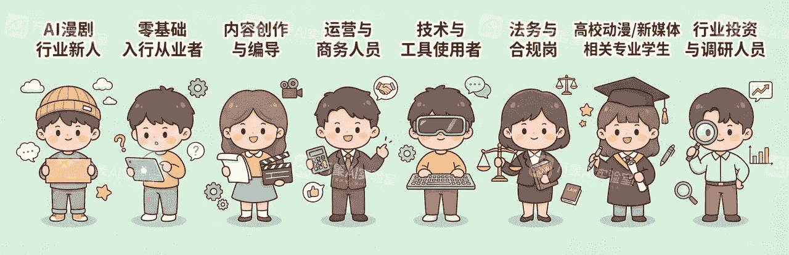
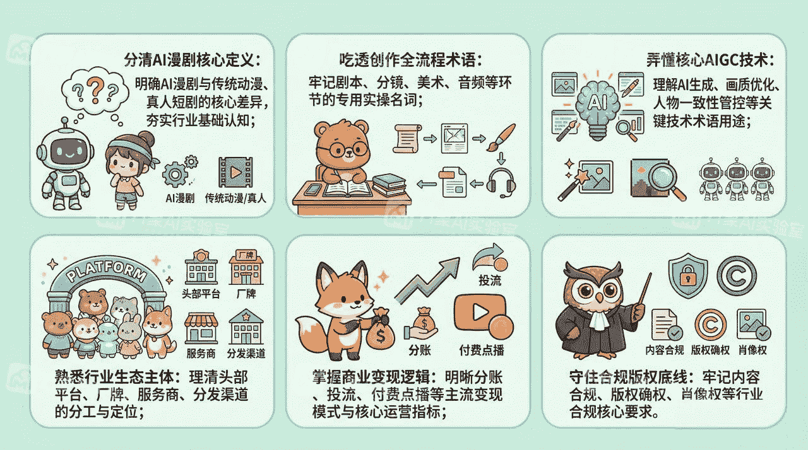
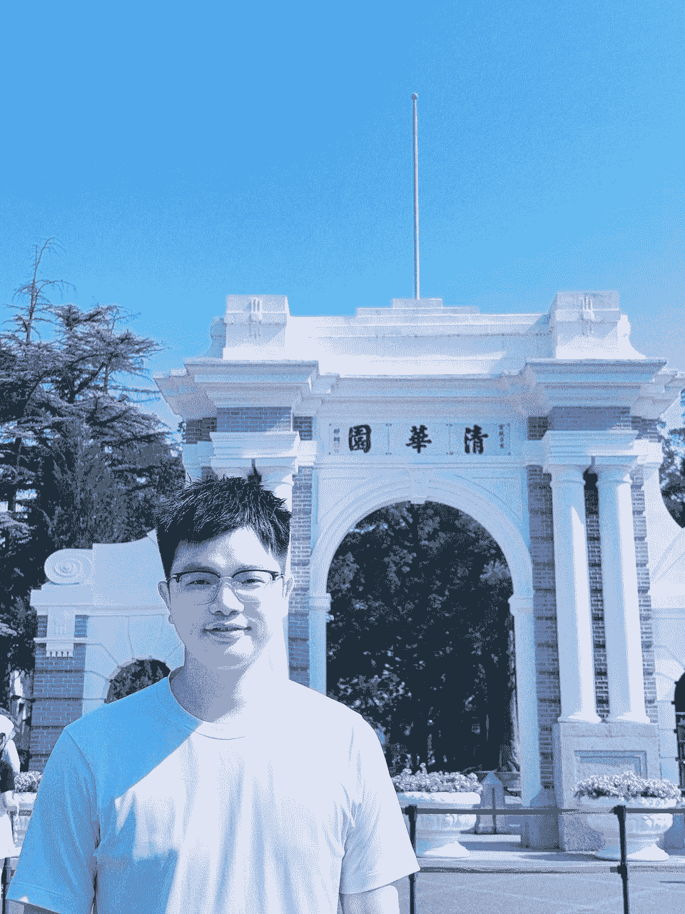

# AI 漫剧名词手册（行业首发&持续更新 ing...

> 来源：[https://yunyinghui.feishu.cn/docx/YZkHdM1FLoOTPLx0YxtcnHXanYg](https://yunyinghui.feishu.cn/docx/YZkHdM1FLoOTPLx0YxtcnHXanYg)

> **适用人群：** AI 短剧兴趣人员、内容创作者、从业人员等

> **首发时间：**2026 年 3 月 18 日

> **更新时间：**2026 年 3 月 19 日

> **内容出品人：**** **

> **内容出品方：**[万象 AI 实验室](https://yunyinghui.feishu.cn/wiki/WhelwZnxQi55mpkOzatc3Xran5b?from=from_copylink)

> **使用建议：**建议电脑端打开学习，如果需要快速定位到精确内容，可以使用快捷键 Ctrl +F/Command +F 的形式，搜索关键字/词，查找你想要的内容。

>

> **手册定位**：本手册是面向 AI 漫剧全产业链从业者（创作者、运营、产品、技术、法务、投资人）的专业手册，基于 2023-2026 年 AI 漫剧行业发展实践、国家相关法律法规、行业协会规范及头部平台标准编制，统一行业术语认知，规范创作与商业行为，所有核心名词均标注可靠信息来源，贴合产业真实应用场景，覆盖全产业链 8 大核心板块，累计收录专业名词 200+。

# 🤹🏼适用人群

# 〽️学习目标

1.  **分清 AI 漫剧核心定义**：明确 AI 漫剧与传统动漫、真人短剧的核心差异，夯实行业基础认知。

1.  **吃透创作全流程术语**：牢记剧本、分镜、美术、音频等环节的专用实操名词。

1.  **弄懂核心 AIGC 技术**：理解 AI 生成、画质优化、人物一致性管控等关键技术术语用途。

1.  **熟悉行业生态主体**：理清头部平台、厂牌、服务商、分发渠道的分工与定位。

1.  **掌握商业变现逻辑**：明晰分账、投流、付费点播等主流变现模式与核心运营指标。

1.  **守住合规版权底线**：牢记内容合规、版权确权、肖像权等行业合规核心要求。

# **🧑‍💻作者介绍**

**大国**

+   万象 AI 实验室主理人

+   AI 短剧内容创作者

+   AI 商业化及流量操盘手

+   AI 漫剧俱乐部发起人

# 📱交流合作

持**续关**注**并更新 A****I 短剧/漫剧的相关资讯动态，研究报告，商业落地，常见问题，永久免费在线查看**。已建立社群聊聊 AI 短剧/漫剧发展、应用、对接及合作，邀请嘉宾讲课，没进群的可以扫码加入，群满可加大国🛰️ ID：zhangyuguo94s（备注：短剧），已经在社群内的无需重复加入，开源知识库及社群学习全部为公开免费分享。

**5000 人飞书学习交流群**

**AI 短剧🛰️学习交流群**

好友（ID：zhangyuguo94s）

**扫码交流、进群、合作**

---

# **🌈前言概述**

AI 漫剧是指以 AI 技术为核心生产工具，贯穿剧本创作、美术生成、分镜设计、音频制作、剪辑合成全流程或核心环节，以「漫画叙事逻辑+影视化镜头表达+沉浸式音频体验」为核心形态，适配竖屏移动端碎片化观看场景的连续性叙事内容产品。

区别于传统动态漫画（基于已有静态漫画做二次动态加工）、真人竖屏短剧（真人实拍为核心），AI 漫剧实现了从 0 到 1 的全链路 AIGC 生产，将单部 100 集竖屏漫剧的生产周期从传统模式的 3-6 个月压缩至 7-15 天，生产成本降低 80%-90%，彻底重构了漫内容的工业化生产体系。截至 2025 年底，国内 AI 漫剧全年上线作品超 2 万部，全网累计播放量突破 15 万亿次，分账规模超 50 亿元，已形成从技术研发、内容创作、分发运营到商业化变现、IP 衍生的完整产业生态。

本手册基于中国网络视听节目服务协会《AI 网络视听内容创作与传播自律公约》、国家版权局《AI 生成内容版权保护指南》、快看漫画《2025AI 漫剧行业白皮书》、抖音《2025 短剧行业生态报告》等权威文件编制，是国内首部覆盖 AI 漫剧全产业链的专业名词手册。

---

# 第一章 AI 漫剧核心基础名词

本章节收录行业最底层的品类、形态、认知类名词，解决行业基础认知分歧，是全产业链从业者的入门必修内容。

## 1.1 核心品类定义名词

1.  **AI 漫剧**

**核心定义：**以 AI 技术为核心生产工具，覆盖剧本创作、美术生成、分镜设计、音频制作、剪辑合成全流程或核心生产环节，以多格漫画为叙事载体，搭配动态效果、配音配乐、字幕特效，适配竖屏移动端观看的连续性叙事内容，是融合漫画、影视、短视频、有声书四大品类特征的新型内容形态。

**行业语境：**区别于传统动态漫画（先有静态漫画 IP，再做动态化二次创作），AI 漫剧的核心特征是「AI 原生」，即从剧本到美术的核心内容均由 AI 辅助或直接生成，而非二次加工；区别于真人竖屏短剧，AI 漫剧的视觉呈现为漫画/二次元风格，生产成本更低、题材自由度更高、合规风险更可控。

参考来源：中国网络视听节目服务协会 2025 年《AI 网络视听内容创作规范》、快看漫画《2025AI 漫剧行业白皮书》

1.  **竖屏 AI 漫剧**

**核心定义：**采用 9:16 竖屏画幅创作，适配手机全屏观看的 AI 漫剧，是当前行业的主流品类，占全网 AI 漫剧上线总量的 95%以上。

**行业语境：**竖屏 AI 漫剧的核心创作逻辑是「单手握持、碎片化观看」，单集时长通常为 1-2 分钟，单部作品集数为 30-100 集，以强冲突、快节奏、高密度反转的剧情为核心，适配短视频平台的推荐算法逻辑，是当前商业化变现最成熟的 AI 漫剧品类。

参考来源：抖音《2025 竖屏内容创作白皮书》

1.  **横屏 AI 漫剧**

**核心定义：**采用 16:9 横屏画幅创作，适配平板、电视、PC 端观看的 AI 漫剧，也被称为「AI 漫剧番剧」。

**行业语境：**横屏 AI 漫剧的创作逻辑更接近传统动画番剧，单集时长通常为 5-20 分钟，剧情节奏更舒缓，世界观更完整，主要分发渠道为长视频平台、垂直动漫平台，商业化模式以会员订阅、IP 授权为主，当前行业占比较低，但 IP 孵化潜力更高。

1.  **条漫式 AI 漫剧**

**核心定义**：延续传统条漫的纵向滚动叙事逻辑，搭配局部动态效果、配音配乐的 AI 漫剧，是最接近传统漫画阅读习惯的 AI 漫剧形态。

**行业语境：**条漫式 AI 漫剧主要分发渠道为快看漫画、腾讯动漫等垂直漫画平台，用户以传统漫画爱好者为主，单集篇幅通常为 10-30 格，更新频率为周更/双周更，商业化模式以漫画平台付费阅读、会员分成为主。

1.  **分镜式 AI 漫剧**

**核心定义：**以影视分镜为核心叙事逻辑，每一个画格对应一个影视镜头，通过镜头切换、画面动效实现影视化叙事的 AI 漫剧，是当前行业的绝对主流形态。

**行业语境：**分镜式 AI 漫剧完全适配竖屏短视频的观看逻辑，将影视镜头语言与漫画美术风格结合，单集内容由 15-30 个分镜画格组成，通过推、拉、摇、移等镜头动效实现画面动态感，搭配对口型配音、沉浸式音效，实现「类短剧」的观看体验，是抖音、快手等短视频平台最主流的 AI 漫剧形态。

1.  **互动 AI 漫剧**

**核心定义：**加入互动选择分支的 AI 漫剧，用户可通过点击选项决定剧情走向，获得沉浸式叙事体验。

**行业语境：**互动 AI 漫剧是 2025 年起兴起的新品类，依托 AI 技术可快速生成多分支剧情、多版本美术内容，大幅降低互动内容的生产成本，主要分发渠道为 B 站、腾讯视频等支持互动视频的平台，商业化模式以付费解锁分支剧情、会员订阅为主。

1.  **出海 AI 漫剧**

**核心定义：**面向海外市场创作、适配海外用户审美与文化习惯的 AI 漫剧，是 2025 年国内漫剧行业的核心增长赛道。

**行业语境：**出海 AI 漫剧的核心优势在于生产成本低、多语言适配速度快，可快速覆盖东南亚、中东、欧美等全球市场，主要分发渠道为 TikTok、YouTube Shorts、Webtoon 等平台，2025 年国内头部出海 AI 漫剧厂牌的海外分账规模单部最高突破 800 万美元。

参考来源：商务部《2025 中国文化出海发展报告》

## 1.2 行业基础认知名词

1.  **AI 漫剧工业化**

**核心定义：**将 AI 漫剧的创作流程拆解为标准化、可复制、可批量生产的流水线环节，通过 AI 工具替代重复性人工劳动，实现产能、品控、人效的标准化管控。

**行业语境：**AI 漫剧工业化的核心是「流程拆解+工具提效+标准统一」，头部厂牌已实现「剧本创作-人设搭建-分镜设计-美术生成-音频制作-剪辑合成」全流程流水线作业，单团队月产能从传统模式的 1-2 部提升至 10-15 部，是行业从 UGC 向 PGC 升级的核心标志。

1.  **AI 漫剧人效比**

**核心定义：**衡量 AI 漫剧生产效率的核心指标，指单团队单位时间内可完成的 AI 漫剧产能与投入人力的比值。

**行业语境：**传统动态漫画的人效比约为「3 人团队月产 1 部 30 集作品」，而成熟的 AI 漫剧流水线可实现「3 人团队月产 5-8 部 100 集作品」，人效提升 10 倍以上；当前行业头部厂牌的人效比标杆为「5 人团队月产 10 部 100 集竖屏 AI 漫剧」。

1.  **AI 漫剧生产周期**

**核心定义：**指 AI 漫剧从项目立项到成片交付的全流程时间，是衡量工业化能力的核心指标。

**行业语境：**传统 100 集竖屏动态漫画的生产周期为 3-6 个月，而 AI 漫剧的常规生产周期为 7-15 天，头部流水线可实现 48 小时内完成从剧本到成片的全流程交付，大幅缩短了内容的市场反馈周期。

1.  **AI 漫剧品控标准**

**核心定义：**行业内针对 AI 漫剧的剧本质量、美术一致性、音画同步、内容合规等维度制定的标准化质量管控规则。

**行业语境：**当前行业通用的品控标准由快看漫画、腾讯动漫、抖音三大平台联合头部厂牌于 2025 年制定，核心包括「人物画风一致性≥95%、口型同步准确率≥98%、单集画面瑕疵率≤1%、内容合规 100%通过平台预检」，是 AI 漫剧成片交付的核心门槛。

1.  **产业链角色**

AI 漫剧行业的产业链可以大致划分为以下几个角色：

**（1）AI 技术/工具提供方**

提供 AI 图像生成、视频生成、语音合成等底层技术工具的公司。

**（2）内容制作方（CP 方）**

负责 AI 漫剧的剧本开发、AI 出图、后期合成等内容制作工作的团队。这是 AI 漫剧产业链中数量最多、竞争最激烈的环节。

**（3）投流/推广方**

专门负责广告投放和用户获取的团队或公司。有些投流方有自己的短剧/漫剧小程序，有些则依托第三方平台。

**（4）SaaS 服务商**

提供短剧/漫剧小程序搭建、支付接入、数据分析等基础设施服务的公司。

**（5）分发平台**

抖音、快手、🛰️视频号、TikTok 等内容分发平台，以及红果短剧、ReelShort 等垂直短剧平台。

**（6）版权/IP 方**

提供原始 IP（网络小说、漫画等）的版权授权方。

**（7）MCN 机构**

部分 MCN 机构（多频道网络）开始涉足 AI 漫剧，利用旗下的达人账号进行内容分发。

1.  **改编权**

**核心定义**：著作权人许可他人将作品改编为新形式作品的权利。把漫画做成漫剧、把小说做成 AI 漫剧、把漫画角色做成剧情短视频，都涉及改编权或相关授权。

**实务提醒**：

很多团队误以为“买了漫画发布权”就能做视频，这是错误的。

视频化通常至少涉及：

+   改编权；

+   复制权；

+   信息网络传播权；

+   可能还包括角色形象使用许可、配音演绎许可等。

1.  **先导片 / 测试片**

**核心定义：**指在整部作品正式制作前，先制作 1-3 集的测试内容，投放到平台测试数据表现（完播率、互动率、涨粉率、付费转化率）的内容。是工业化团队控制风险的核心手段：若测试片数据达标，则继续制作全片；若数据不达标，则调整选题或直接放弃，避免投入大量资源后作品无人问津。

1.  **团队架构与核心岗位**

工业化 AI 漫剧团队的标准部门与岗位设置，是实现标准化生产的基础，核心架构包括：

+   **编剧组：**主笔编剧（负责整体剧情走向、核心冲突、人设打造）、分集编剧（负责单集剧本撰写、钩子设计）、剧本审核（负责剧情逻辑、合规性、节奏审核）；

+   **AI 美术组：**AI 绘画师（负责 Prompt 撰写、画面批量生成）、Prompt 工程师（负责优化提示词、模型参数调试）、分镜师（负责分镜稿设计）、修图师（负责画面二次优化、崩图修正）；

+   **后期组：**剪辑师（负责动态化处理、剪辑、字幕制作）、音频师（负责配音、音效、BGM 匹配）、特效师（负责重动态、特效制作）；

+   **运营组：**内容运营（负责内容上线、账号维护、数据监测）、投流运营（负责付费投流、ROI 优化）、用户运营（负责粉丝互动、追更维护、私域沉淀）、商务运营（负责商单合作、品牌对接、平台对接）；

+   **项目负责人：**统筹全项目进度、质量、成本，对最终收益负责。

---

# 第二章 AI 漫剧全流程创作术语

本章节收录 AI 漫剧从前期策划到成片交付全流程的专业创作术语，是创作者、制片、导演的核心工具书，覆盖创作全链路 6 大核心环节。

## 2.1 前期策划与剧本创作环节术语

1.  **AI 漫剧剧本范式**

**核心定义：**适配 AI 漫剧创作逻辑、平台算法规则与用户观看习惯的标准化剧本结构，是 AI 漫剧剧本创作的核心规范。

**行业语境：**区别于传统影视剧本、漫画剧本，AI 漫剧剧本范式的核心特征是「强钩子、快节奏、高密度反转、口语化台词、分镜一体化」，通用结构为「单集 3 幕式结构：黄金 3 秒钩子-核心冲突-结尾悬念」，单集台词字数控制在 150-200 字，适配 1-2 分钟的竖屏时长。

参考来源：抖音短剧官方《AI 漫剧剧本创作规范 2025 版》

1.  **黄金 3 秒钩子**

**核心定义：**AI 漫剧单集开篇前 3 秒的内容，是决定用户是否继续观看、能否进入平台更高流量池的核心指标。

**行业语境：**AI 漫剧的黄金 3 秒需同时满足「视觉强冲击+剧情强冲突」，区别于真人短剧，AI 漫剧可通过 AI 生成实现更夸张的视觉效果、更极致的冲突场景，行业通用标准为「前 3 秒必须完成核心冲突铺垫+用户情绪调动」，直接决定单集的 5 秒留存率。

1.  **反转密度**

**核心定义：**AI 漫剧单位时长内的剧情反转次数，是衡量剧情吸引力的核心指标。

**行业语境：**竖屏 AI 漫剧的通用反转密度标准为「单集 1-2 分钟内至少 1 次核心反转，每 3 集至少 1 次大反转」，头部爆款作品的反转密度可达到「单集 2 次反转，每集结尾均设置悬念钩子」，适配用户碎片化观看的爽点需求。

1.  **人设锚点**

**核心定义：**为 AI 漫剧角色设定的固定化核心特征，包括人物外貌、性格、服饰、口头禅、行为习惯等，是保障 AI 生成人物一致性的核心基础。

**行业语境：**人设锚点分为「视觉锚点」和「性格锚点」，视觉锚点需精准到发色、瞳色、服饰款式、面部特征等可被 AI 识别的关键词，性格锚点需精准到人物的说话方式、行为逻辑，既用于剧本创作的人设统一，也用于 AI 美术生成的 Prompt 核心关键词。

1.  **AI 剧本 Prompt 工程**

**核心定义：**针对大语言模型设计的、适配 AI 漫剧剧本创作的提示词工程，是实现高质量 AI 剧本生成的核心技术。

**行业语境：**区别于通用文本生成 Prompt，AI 漫剧剧本 Prompt 需包含「题材赛道、人设锚点、剧本范式、反转密度、单集时长、平台规则、合规要求」等核心要素，头部创作者已形成标准化的 Prompt 模板，可通过少样本学习实现符合行业规范的剧本批量生成。

1.  **剧本分镜一体化**

**核心定义：**AI 漫剧剧本创作阶段同步完成分镜设计，在剧本中明确标注每个镜头的景别、构图、画面内容、运镜方式，实现剧本与分镜的同步输出。

**行业语境：**剧本分镜一体化是 AI 漫剧工业化的核心环节，可大幅降低后续分镜设计、美术生成的沟通成本，同时让 AI 美术生成的画面更符合创作需求，是头部厂牌的通用作业标准。

1.  **世界观设定**

**核心定义：**在漫剧制作中，世界观设定是剧本开发阶段的重要工作。它定义了故事发生的时间、空间、社会规则、力量体系等基础框架。

对于 AI 漫剧来说，世界观设定还有一个特殊的功能：它是生成 AI 画面时的"约束条件"。一个清晰的世界观设定可以帮助团队在使用 AI 工具时保持画面风格和内容逻辑的一致性。例如，如果设定是"现代都市+轻奇幻"，那么在生成场景图时就需要在提示词（prompt）中明确这些元素，避免出现不符合设定的画面。

1.  **题材类型**

**核心定义：**AI 漫剧的题材分类和短剧、网文高度重叠，目前市场上表现较好的题材类型包括：

+   **霸总甜宠**：男频或女频的都市言情题材，是流量最稳定的类型之一。

+   **逆袭打脸**：主角从被轻视到翻盘的爽文套路，男频居多。

+   **穿越重生**：主角穿越到古代/异世界，或者重生回到过去，利用先知优势改变命运。

+   **修仙玄幻**：东方奇幻题材，涉及修炼、法术、仙界等元素。

+   **悬疑推理**：烧脑向内容，在漫剧形态下因为可以通过画面暗示线索而有独特表现力。

+   **萌宠/治愈**：轻松向内容，以可爱角色或治愈系故事为核心。

值得注意的是，出海市场（主要是欧美和东南亚）的题材偏好和国内有显著差异。例如，欧美市场对"狼人/吸血鬼言情""亿万富翁罗曼史""黑手党爱情"等题材的接受度极高，这些在中国市场反而是小众类型。做 AI 漫剧出海时，题材选择是最先需要做的本地化工作。

1.  **金手指**

**核心定义：**特指主角拥有的、超越普通人的能力或资源，是重生、穿越、赘婿、战神题材的核心叙事元素，典型如重生预知未来、神医医术、千亿身家、战神人脉等。行业共识为：金手指必须在第一集前 30 秒内亮相，给主角提供逆袭的核心支撑，快速建立用户的观看期待。

1.  **剧情反转**

**核心定义：**指剧情出现与用户预期完全相反的转折，是提升完播率、追更率的核心手段，典型如 “一直帮助女主的好人，实则是最终反派”“主角的死亡是设计好的假死局”。行业标准为：单集结尾必须设置反转或反转钩子，让用户产生 “必须看下一集” 的冲动。

## 2.2 分镜与镜头设计环节术语

1.  **竖屏分镜构图**

**核心定义：**适配 9:16 竖屏画幅的分镜构图规则，是 AI 漫剧分镜设计的核心规范。

**行业语境：**竖屏分镜构图的核心逻辑是「纵向视觉引导、人物主体突出」，区别于横屏影视的横向构图，竖屏分镜中特写、近景的占比需达到 70%以上，核心视觉重心集中在画面纵向中线区域，适配手机单手握持的观看视线；行业通用规范为「单格分镜只讲一个信息点，避免画面信息过载」。

1.  **分镜一致性管控**

**核心定义：**AI 漫剧全片分镜中，人物、场景、画风的一致性管控规则，是 AI 漫剧品控的核心难点。

**行业语境：**分镜一致性管控的核心是「固定核心参数+标准化 Prompt 模板」，包括固定人物人设卡、场景关键词、画风模型、采样参数、种子值，通过 ControlNet、IP-Adapter 等技术实现人物动作、构图的可控性，同时保障全片画风统一，行业合格标准为「全片人物辨识度一致性≥95%」。

1.  **景别适配**

**核心定义：**AI 漫剧分镜中针对不同剧情内容选择的镜头景别，包括特写、近景、中景、全景、远景五大类，适配竖屏观看场景。

**行业语境：**竖屏 AI 漫剧的景别使用有明确的行业规范：特写用于人物表情、关键细节，传递情绪冲击；近景用于人物对话，是单集占比最高的景别；中景用于人物动作、多人互动；全景/远景用于场景交代、氛围渲染，单集占比通常不超过 20%。

1.  **镜头运动设计**

**核心定义：**AI 漫剧画格中的镜头动效设计，包括推、拉、摇、移、跟、缩放六大核心运镜方式，是实现画面动态感的核心手段。

**行业语境：**区别于传统动画的镜头运动，AI 漫剧的镜头运动主要通过后期剪辑实现，而非逐帧动画，行业通用规范为「单格分镜只使用一种运镜方式，避免运镜过于复杂导致用户眩晕」，对话场景常用缓慢推镜强化情绪，动作场景常用缩放、摇镜强化冲击力。

1.  **关键帧设定**

**核心定义：**AI 漫剧动态效果中，用于定义画面运动起点和终点的核心画面帧，是实现流畅动效的核心基础。

**行业语境：**AI 漫剧的关键帧通常为 AI 生成的静态画格，通过后期软件设定关键帧的位置、大小、透明度，实现画面的运动效果；对于长镜头动态画面，需通过 AI 视频生成工具设定关键帧，保障画面运动过程中人物、场景的一致性。

1.  **分镜稿 / 故事板**

**核心定义：**特指用于指导 AI 生成画面的镜头设计稿，包含镜头景别、人物动作、场景布局、台词位置、画面构图等信息，通常以线稿、简笔画形式呈现，配合 ControlNet 使用。区别于传统漫画分镜（给画师看），AI 漫剧的分镜稿核心是给 AI 识别，因此要求结构标准化、信息明确，避免模糊的艺术化表达，是保证生成画面符合叙事要求的核心前提。

## 2.3 美术与视觉生成环节术语

1.  **人物人设卡**

**核心定义：**为 AI 漫剧角色制作的、包含完整视觉特征的标准化卡片，是保障 AI 生成人物一致性的核心工具。

**行业语境：**人设卡通常包含「人物正面、侧面、45 度角的高清参考图、核心视觉关键词、固定 Prompt 模板、专属 LoRA 模型/Embedding 文件」，精准到人物的发色、瞳色、脸型、五官特征、服饰、配饰、身高体型等所有视觉元素，是 AI 漫剧美术生成的核心资产。

1.  **角色 LoRA 模型**

**核心定义：**基于 Stable Diffusion 等扩散模型，针对 AI 漫剧角色进行微调的轻量化模型，是实现人物画风 100%统一的核心技术。

**行业语境：**头部 AI 漫剧厂牌会为每个核心角色训练专属 LoRA 模型，训练素材通常为 10-20 张同一人物的高清参考图，可实现全片人物的面部特征、服饰、画风完全统一，彻底解决 AI 生成人物崩脸、特征不一致的行业痛点。

参考来源：Stability AI 官方 LoRA 技术规范、ComfyUI 官方开发文档

1.  **ControlNet 控制技术**

**核心定义：**基于扩散模型的画面控制技术，可通过线稿、姿态图、深度图等参考图，精准控制 AI 生成画面的人物动作、构图、场景布局，是 AI 漫剧分镜生成的核心技术。

**行业语境：**ControlNet 是 AI 漫剧美术生成的必备工具，创作者可通过手绘分镜线稿、人体姿态图，精准控制 AI 生成画面的人物动作、镜头构图，解决 AI 生成画面不可控的问题，当前行业通用的 ControlNet 模型包括 OpenPose（姿态控制）、Canny（线稿控制）、Depth（深度控制）三大类。

参考来源：ControlNet 官方论文《Adding Conditional Control to Text-to-Image Diffusion Models》

1.  IP-Adapter 人物一致性技术

**核心定义：**基于图像嵌入的人物一致性控制技术，可通过一张人物参考图，实现 AI 生成画面中人物特征的完全统一，是 2025 年起行业普及的核心技术。

**行业语境：**区别于 LoRA 模型需要提前训练，IP-Adapter 可直接通过单张人物参考图实现人物特征的锁定，无需训练，大幅降低了创作门槛，尤其适配中小团队和 UGC 创作者，当前已成为 Stable Diffusion、Midjourney 等主流 AI 绘画工具的标配功能。

1.  **去闪烁处理**

**核心定义：**针对 AI 生成的连续画面出现的画面闪烁、人物特征跳变问题进行的优化处理，是 AI 漫剧后期品控的核心环节。

**行业语境：**画面闪烁是 AI 生成视频/连续画面的核心痛点，行业通用的去闪烁方案包括「固定种子值、固定模型参数、使用帧插值技术、后期软件去闪烁插件、AI 视频修复工具」，头部厂牌已实现自动化去闪烁处理，保障全片画面流畅无跳变。

1.  **inpainting 局部重绘**

**核心定义：**AI 绘画中的局部重绘技术，可针对 AI 生成画面中的瑕疵区域、不符合需求的区域进行局部修改，无需重新生成整张画面，是 AI 漫剧美术优化的核心工具。

**行业语境：**inpainting 主要用于修复 AI 生成画面中的崩脸、手指畸形、服饰穿帮、场景瑕疵等问题，是美术品控的必备环节，可大幅提升画面合格率，降低重绘成本。

1.  **崩图 / 崩脸**

**核心定义：**行**业负面**术语，指 AI 生成的画面出现人物五官扭曲、肢体畸形、服装穿模、场景错乱、画风突变等问题，是 AI 漫剧制作中最常见的痛点。行业内用崩图率衡量制作效率，即崩图数量占总生成数量的比例，工业化团队要求崩图率控制在 5% 以内。

## 2.4 音频与配音制作环节术语

1.  **AI 配音**

**核心定义：**通过 TTS 文本转语音技术，为 AI 漫剧生成人物配音、旁白的技术，是 AI 漫剧音频制作的核心工具。

**行业语境：**AI 配音已完全替代传统人工配音，成为 AI 漫剧的主流配音方式，可实现多角色音色区分、情绪适配、多语言生成，生产成本仅为人工配音的 1%，生产周期从数天压缩至几分钟，当前行业主流的 AI 配音工具包括讯飞听见、阿里云语音、豆包 TTS 等。

1.  **音色定制**

**核心定义：**为 AI 漫剧角色定制专属音色，包括音色克隆、原创音色生成两种方式，是实现角色声音辨识度的核心手段。

**行业语境：**头部 AI 漫剧厂牌会为每个核心角色定制专属音色，通过少量音频素材克隆定制化音色，或通过 AI 生成原创音色，保障角色声音的唯一性和辨识度，避免与其他作品撞音色，同时实现全片角色音色的统一。

1.  **口型同步**

**核心定义：**口型同步是指让画面中角色的嘴部运动和配音的节奏、音素对应上。这是 AI 漫剧制作中的一个"最后一公里"难题——如果画面中的人物在说话，但嘴巴不动（或者动得不对），观众的沉浸感会大打折扣。

**行业语境：**口型同步是 AI 漫剧品控的核心环节，当前行业通用的技术方案包括 SadTalker、Wav2Lip、D-ID 等，可通过配音音频驱动人物面部口型变化，实现音画精准匹配，行业合格标准为「口型同步准确率≥98%，无明显延迟、错配」。

目前常用的口型同步技术和工具包括：

+   **SadTalker**：开源的人脸驱动模型，输入一张面部图片和一段音频，可以生成带有口型和头部微动的视频。

+   **Wav2Lip**：专门做口型同步的深度学习模型，可以把指定音频的口型"贴"到视频中的人脸上。

+   **MuseTalk**：腾讯开源的口型驱动模型。

+   **LivePortrait**：旷视科技开源的人像驱动工具，可以实现面部表情和头部姿态的迁移。

+   **HeyGen**：商业化的数字人视频平台，部分 AI 漫剧团队用它来处理角色的口型同步。

在实际制作中，口型同步的处理有两种路线：

+   **事后处理**：先生成静态画面和配音，再用口型同步工具把嘴部动画"套"上去。这种方式灵活但容易出现画面扭曲。

+   **回避策略**：干脆在画面构图上避免正面特写说话的镜头——用侧脸、远景、遮挡等手法规避口型问题。很多制作经验丰富的团队会在分镜阶段就主动规避需要口型同步的镜头。

1.  **情绪配音**

**核心定义：**AI 配音中针对剧情情绪生成对应的语气、语速、语调，实现配音情绪与剧情内容的精准匹配。

**行业语境：**情绪配音是 AI 漫剧配音质量的核心衡量指标，区别于传统机械的 AI 配音，当前主流的大模型 TTS 工具可实现开心、愤怒、悲伤、紧张、嘶吼等数十种情绪的精准适配，甚至可实现语气的细微变化，大幅提升内容的沉浸感。

1.  **响度标准化**

**核心定义：**针对 AI 漫剧的人声、BGM、音效进行音量标准化处理，保障全片音频音量统一，无忽大忽小的问题，是音频品控的核心环节。

**行业语境：**行业通用的响度标准为「人声响度统一为 -16LUFS，BGM 响度不超过 -24LUFS，音效响度不超过 -20LUFS」，适配手机移动端的播放场景，避免出现人声听不清、BGM 盖过人声的问题。

## 2.5 剪辑合成与后期环节术语

1.  **AI 漫剧生产管线**

**核心定义：**将 AI 漫剧的美术生成、音频制作、剪辑合成全流程整合为自动化的工作流，实现从分镜到成片的自动化批量生成，是 AI 漫剧工业化的核心载体。

**行业语境：**头部厂牌已基于 ComfyUI、剪映专业版、Python 脚本搭建了全自动化的 AI 漫剧生产管线，只需输入剧本、人设卡、分镜线稿，即可自动完成美术生成、配音、口型同步、剪辑合成、字幕添加全流程，大幅降低人工操作成本，实现产能的规模化提升。

1.  **画格动效合成**

**核心定义：**将 AI 生成的静态画格，通过剪辑软件添加镜头运动、转场特效、画面特效，实现静态画格的动态化处理，是 AI 漫剧成片合成的核心环节。

行业语境：画格动效合成的核心逻辑是「让静态画面跟着剧情情绪动起来」，对话场景用缓慢推镜强化情绪，动作场景用缩放、震动特效强化冲击力，悬念场景用暗角、降帧强化氛围，是 AI 漫剧区别于静态条漫的核心特征。

1.  **字幕流速适配**

**核心定义：**AI 漫剧字幕的播放速度与配音语速、用户阅读速度的适配规则，是提升观看体验的核心细节。

**行业语境：**竖屏 AI 漫剧的通用字幕规范为「单条字幕字数不超过 15 字，字幕停留时间与配音时长完全匹配，字幕流速适配普通人的阅读速度，避免出现字幕过快看不清、过慢拖沓的问题」，同时字幕位置固定在画面下方 1/5 区域，不遮挡人物主体。

1.  **AI 成片质检**

**核心定义：**针对 AI 漫剧成片的画面瑕疵、音画同步、字幕错误、内容合规等维度进行的自动化+人工双重质检，是成片交付前的最后一道品控关卡。

**行业语境：**头部厂牌已实现 AI 自动化质检，可通过 AI 模型自动识别画面崩脸、闪烁、音画不同步、字幕错误、违禁内容等问题，再配合人工复检，保障成片合格率 100%，避免出现违规内容、质量瑕疵导致的平台限流、下架。

1.  **后期合成**

AI 漫剧的后期合成是把所有 AI 生成的素材（画面、配音、音效、音乐）整合为成品视频的环节。这个环节的工具和工作内容和传统影视后期高度重叠：

+   Adobe After Effects（AE）：主要用于画面动效处理，如镜头推拉摇移、2.5D 视差动画、粒子特效、转场效果等。是 AI 漫剧后期的核心工具。

+   **Adobe Premiere P**ro / DaVinci Resolve：用于视频剪辑、音画对位、调色等。

+   **剪映 / CapCut**：字节跳动旗下的视频剪辑工具，因其易用性和内置素材库，被大量 AI 漫剧创作者（尤其是个人创作者和小团队）使用。

+   **Live2D**：二维动画工具，可以让静态画面产生"呼吸"般的微动效果（如人物的头发飘动、衣服摆动），在部分高品质 AI 漫剧中有使用。

后期合成的水平对 AI 漫剧的最终品质影响极大。同样的 AI 生成画面，一个优秀的后期合成师可以通过镜头语言和节奏控制，做出电影感十足的成品；而后期处理粗糙的作品，即使单帧画面质量很高，也会给人一种"PPT 翻页"的廉价感。

---

# 第三章 AI 漫剧底层技术术语

本章节收录支撑 AI 漫剧全链路生产的核心技术术语，面向技术产品、研发人员、技术服务商，兼顾技术专业性与产业应用场景，避免纯学术化的晦涩表述。

## 3.1 多模态生成核心技术术语

1.  **多模态大模型**

**核心定义：**可同时处理文本、图像、音频、视频等多种模态信息的大语言模型，是 AI 漫剧全链路生产的底层技术底座。

**行业语境：**AI 漫剧的全流程生产依赖多模态大模型的能力，包括剧本生成（文本模态）、美术生成（图像模态）、配音生成（音频模态）、动态视频生成（视频模态），当前行业主流的多模态大模型包括 GPT-4o、Claude 3.7、豆包 4.0、文心一言 4.0、通义千问 3.0 等，为 AI 漫剧创作平台提供底层技术支持。

参考来源：中国信通院《2025 多模态大模型产业发展白皮书》

1.  **文本生成图像（T2I）**

**核心定义：**通过文本提示词生成对应图像的 AI 技术，是 AI 漫剧美术生成的核心基础技术。

**行业语境：**T2I 技术是 AI 漫剧静态画格生成的核心工具，当前主流的 T2I 模型包括 Stable Diffusion 系列、Midjourney、DALL-E 3、智谱 CogView、可灵 AI 等，创作者通过精准的 Prompt 提示词，生成符合分镜需求的人物、场景画面，是 AI 漫剧生产成本大幅降低的核心原因。

1.  **文本生成视频（T2V）**

**核心定义：**通过文本提示词生成对应视频内容的 AI 技术，是 AI 漫剧动态画面生成的核心技术。

**行业语境：**T2V 技术主要用于 AI 漫剧中的动作镜头、长镜头动态画面生成，可直接通过文本描述生成连贯的动态视频，无需逐格制作静态画格，2025 年起，随着 Runway Gen-3、Pika 1.5、可灵 AI 2.0 等模型的迭代，已可生成 1080P、60 帧、时长 1 分钟以上的高清连贯视频，大幅提升了 AI 漫剧的动态效果上限。

1.  **图像生成视频（I2V）**

**核心定义：**基于静态参考图生成对应动态视频的 AI 技术，是当前 AI 漫剧动态化的主流技术方案。

**行业语境：**I2V 技术可基于 AI 生成的静态分镜画格，生成连贯的动态画面，同时保留画面中的人物、场景、画风完全一致，完美解决了 T2V 技术人物一致性差的痛点，是当前行业最主流的 AI 漫剧动态化方案，主流工具包括 Stable Video Diffusion、Pika、Runway、即梦 AI 等。

1.  **跨模态一致性对齐**

**核心定义：**让 AI 生成的文本、图像、音频、视频等多模态内容，在人设、剧情、风格、情绪上保持统一的技术，是 AI 漫剧全流程品控的核心底层技术。

**行业语境：**跨模态一致性对齐是解决 AI 漫剧「人物画崩、配音与人设不符、画面与剧本脱节」等核心痛点的底层技术，头部平台已通过多模态大模型的上下文学习能力，实现从剧本到成片的全链路内容一致性管控，大幅提升了 AI 漫剧的成片质量。

## 3.2 图像生成核心技术术语

1.  **潜在扩散模型（LDM）**

**核心定义：**当前主流 AI 绘画工具的底层算法模型，通过在潜在空间中逐步去噪生成图像，兼顾生成质量与生成速度，是 AI 漫剧美术生成的底层算法底座。

**行业语境：**当前行业主流的 Stable Diffusion、Midjourney 等 AI 绘画工具，均基于潜在扩散模型开发，区别于早期的扩散模型，LDM 将图像压缩到潜在空间中进行处理，大幅降低了算力消耗，让普通创作者在消费级显卡上即可完成 AI 美术生成，是 AI 漫剧行业普及的核心技术基础。

参考来源：LDM 官方论文《High-Resolution Image Synthesis with Latent Diffusion Models》

1.  **CFG 提示词引导系数**

**核心定义：**AI 绘画中，控制生成画面与文本提示词匹配度的核心参数，全称 Classifier-Free Guidance。

**行业语境：**CFG 值越高，生成画面与提示词的匹配度越高，但画面的创造性越低，容易出现过曝、画面僵硬的问题；CFG 值越低，画面的创造性越高，但与提示词的匹配度越低，容易出现画面偏离需求的问题。AI 漫剧美术生成的通用 CFG 值范围为 7-12，兼顾匹配度与画面质感。

1.  **种子值（Seed）**

**核心定义：**AI 绘画中，用于初始化随机数生成器的数值，相同的种子值、模型、参数、提示词，可生成完全一致的画面。

**行业语境：**种子值是 AI 漫剧画面一致性管控的核心参数，头部创作者会固定核心角色、场景的种子值，保障全片画面的画风、光影、色彩风格完全统一，避免出现画面跳变、风格不一致的问题。

1.  **采样器与采样步数**

**核心定义：**AI 绘画中，控制图像去噪生成过程的核心参数，采样器决定了去噪的算法逻辑，采样步数决定了去噪的迭代次数。

**行业语境：**采样步数越高，生成画面的细节越丰富，但生成时间越长；AI 漫剧美术生成的通用采样步数为 20-30 步，兼顾画面质量与生成效率。行业主流的采样器包括 Euler a、DPM++ 2M Karras、DDIM 等，其中 DPM++ 2M Karras 是 AI 漫剧创作的首选，兼顾生成速度与画面质量。

## 3.3 视频生成与动态处理技术术语

1.  **帧插值技术**

**核心定义：**通过 AI 算法在两个视频帧之间生成中间过渡帧，提升视频帧率、让画面更流畅的技术，是 AI 漫剧去闪烁、提升画面流畅度的核心工具。

**行业语境：**AI 生成的视频通常存在帧率低、画面卡顿、闪烁的问题，通过帧插值技术可将 15 帧/秒的低帧率视频提升至 60 帧/秒，让画面过渡更流畅，彻底解决画面闪烁、卡顿的问题，当前行业主流的帧插值工具包括 RIFE、DAIN 等。

1.  **面部表情驱动**

**核心定义：**通过音频、文本或参考视频，驱动 AI 生成的人物面部做出对应的表情、口型变化的技术，是 AI 漫剧口型同步、情绪表达的核心技术。

**行业语境：**面部表情驱动技术解决了 AI 漫剧人物表情僵硬、口型与配音不匹配的核心痛点，当前行业主流的工具包括 SadTalker、LivePortrait、D-ID、HeyGen 等，可实现人物表情的细微变化，包括皱眉、微笑、嘶吼等，大幅提升了 AI 漫剧人物的生动性。

1.  **视频超分辨率技术**

**核心定义：**通过 AI 算法将低分辨率视频提升至高分辨率，优化画面清晰度、细节质感的技术，是 AI 漫剧后期画质优化的核心工具。

**行业语境：**AI 生成的视频/画面通常存在分辨率不足、细节模糊的问题，通过视频超分技术可将 720P 的画面提升至 4K，优化画面的细节、锐度、色彩质感，当前行业主流的超分工具包括 Real-ESRGAN、Topaz Video AI 等，是 AI 漫剧画质品控的必备工具。

---

# 第四章 AI 漫剧平台与渠道生态名词

本章节收录 AI 漫剧行业的创作平台、分发渠道、生态服务平台相关名词，面向运营、发行、创作者，明确各平台的行业定位与核心规则。

## 4.1 AI 漫剧创作工具平台名词

1.  **快看 AI 漫剧创作平台**

**核心定义：**快看漫画于 2024 年推出的国内首个垂直 AI 漫剧全流程创作平台，是国内 PGC AI 漫剧的核心创作阵地。

**行业语境：**该平台整合了剧本生成、人设定制、分镜设计、美术生成、音频制作、剪辑合成全流程工具，内置了海量漫剧专用模型、LoRA 素材、分镜模板，可实现零基础创作者 10 分钟内完成单集 AI 漫剧制作，同时与快看漫画的分发、分账体系打通，创作者可直接实现从创作到变现的全链路闭环。截至 2025 年底，平台入驻创作者超 10 万人，上线 AI 漫剧作品超 8000 部。

参考来源：快看漫画官方 2025 年产品发布会信息

1.  **ComfyUI**

**核心定义：**基于 Stable Diffusion 开发的节点式 AI 绘画/视频生成工具，是国内头部 AI 漫剧厂牌的核心生产工具。

**行业语境：**ComfyUI 通过节点式的工作流搭建，可实现 AI 漫剧美术生成、一致性管控、动态视频生成、后期优化全流程的自动化，灵活性极高，可完全定制化搭建 AI 漫剧生产管线，头部厂牌均基于 ComfyUI 搭建了专属的自动化生产工作流，是行业工业化生产的核心工具。

1.  **Pika Labs**

**核心定义：**全球领先的 AI 视频生成平台，是 AI 漫剧动态画面生成的主流工具。

**行业语境：**Pika Labs 的文生视频、图生视频模型，可生成高清、流畅、画风统一的动态视频，完美适配 AI 漫剧的动态画格、动作镜头生成需求，支持自定义画面风格、镜头运动、人物动作，是 2025 年行业普及率最高的 AI 视频生成工具之一，国内超 60%的头部 AI 漫剧厂牌均使用 Pika 进行动态画面生成。

## 4.2 AI 漫剧分发与播出平台名词

1.  **分发平台分类**

AI 漫剧的分发平台可以大致分为以下几类：

**（1）短视频/信息流平台**

+   **抖音**：国内最大的短视频平台，也是 AI 漫剧的第一大分发阵地。抖音的推荐算法对内容的"完播率"和"互动率"非常敏感，这直接影响了 AI 漫剧的内容设计——需要在前 3 秒就抓住观众注意力。

+   **快手**：国内第二大短视频平台，用户画像和抖音有差异化（下沉市场占比更高），适合某些特定题材的漫剧。

+   **🛰️视频号**：依托🛰️生态的视频平台，社交推荐（而非纯算法推荐）是其特色，适合做私域流量转化。

+   **TikTok**：字节跳动旗下的海外短视频平台，是 AI 漫剧出海的核心阵地。

+   YouTube / YouTube Shorts：全球最大的视频平台，横屏长视频和竖屏短视频兼顾。

+   **Instagram Reels**：Meta 旗下的短视频功能，在欧美和拉美市场有强势的用户基础。

**（2）漫画/阅读平台**

+   **快看漫画**：国内头部漫画平台，有庞大的年轻用户群体。部分 AI 漫剧团队会把作品同步做成条漫版本在快看上线。

+   **哔哩哔哩漫画**：B 站旗下的漫画平台。

+   **咚漫**：腾讯旗下的漫画平台（原腾讯动漫的漫画板块）。

+   **Webtoon**：Naver 旗下的全球性漫画平台，在欧美市场市占率极高。

+   Tapas / Manta / Tappytoon：海外市场的其他主要漫画平台。

**（3）短剧平台/小程序**

+   **各类短剧小程序**：🛰️生态中的短剧分发渠道，如红果短剧（抖音系）、爽剧等。AI 漫剧可以直接作为"短剧"产品在这些平台上线。

+   **ReelShort**：枫叶互动（Crazy Maple Studio）旗下的海外短剧 APP，在北美市场非常火爆。虽然目前以真人短剧为主，但已有 AI 漫剧内容入驻。

+   **DramaBox**：九州文化旗下的海外短剧平台。

+   GoodShort、FlexTV、ShortMax 等：其他海外短剧平台。

**（4）独立 APP/聚合平台**

+   部分头部 AI 漫剧公司已经开始开发自己的独立 APP，将内容与分发渠道整合在一起，形成闭环。

1.  **抖音（含抖音火山版、西瓜视频）**

**核心定义：**国内 AI 漫剧最大的分发平台与变现阵地，截至 2025 年底，平台 AI 漫剧全年播放量突破 10 万亿次，占全网总量的 65%以上。

**行业语境：**抖音为 AI 漫剧提供了完整的分账体系，包括流量分账、广告分账、付费点播分账三大核心模式，同时推出了专门的 AI 漫剧流量扶持计划、创作者激励政策，头部爆款 AI 漫剧在抖音平台的单部分账金额突破 2000 万元，是行业商业化最成熟的平台。平台核心规则为「以完播率、5 秒留存率为核心推荐指标，强钩子、快节奏的竖屏 AI 漫剧更易获得流量推荐」。

参考来源：抖音《2025 短剧行业生态报告》

1.  **快手**

**核心定义：**国内 AI 漫剧第二大分发平台，下沉市场渗透率最高，是 AI 漫剧出海的核心阵地之一。

**行业语境：**快手于 2024 年推出了「快手漫剧工坊」，为 AI 漫剧创作者提供从创作到变现的全链路支持，分账模式包括流量分账、付费分账、品牌定制三大类，平台用户更偏好乡土、家庭、赘婿、战神等强下沉属性的题材，头部作品单部分账金额突破 1000 万元。同时，快手依托 TikTok 的海外生态，为创作者提供 AI 漫剧出海的一站式服务，是国内 AI 漫剧出海的核心渠道之一。

1.  **快看漫画**

**核心定义：**国内最大的垂直漫画平台，也是条漫式 AI 漫剧的核心分发阵地，是 AI 漫剧 IP 孵化的核心平台。

**行业语境：**快看漫画的用户以传统漫画爱好者、Z 世代用户为主，平台为 AI 漫剧提供了付费阅读、会员分成、IP 授权三大核心商业化模式，更适配世界观完整、剧情长线的条漫式 AI 漫剧，是 AI 漫剧 IP 孵化的核心阵地，2025 年平台有超 20 部 AI 漫剧作品实现了 IP 授权，包括真人短剧改编、游戏改编、周边衍生等。

1.  **B 站（哔哩哔哩）**

**核心定义：**Z 世代用户核心聚集地，是互动 AI 漫剧、横屏 AI 漫剧番剧的核心分发平台。

**行业语境：**B 站用户更偏好悬疑、科幻、二次元、脑洞向的 AI 漫剧题材，平台支持互动视频功能，是国内互动 AI 漫剧的核心分发阵地，商业化模式以会员订阅、充电计划、IP 授权为主，同时平台推出了 AI 创作者扶持计划，为 AI 漫剧创作者提供流量扶持、商业化对接服务，是横屏 AI 漫剧番剧的核心播出平台。

1.  **TikTok**

**核心定义：**全球最大的短视频平台，也是国内 AI 漫剧出海的核心分发渠道。

**行业语境：**TikTok 覆盖全球 150 多个国家和地区，月活用户超 10 亿，为 AI 漫剧提供了完整的海外分账体系、投流体系，是国内 AI 漫剧出海的首选平台，2025 年国内头部出海 AI 漫剧厂牌在 TikTok 平台的单部作品播放量突破 50 亿次，分账金额突破 800 万美元，核心市场包括东南亚、中东、欧美等地区。

## 4.3 产业链服务平台名词

1.  **Civitai**

**核心定义：**全球最大的 AI 绘画模型、LoRA 模型、Embedding 素材分享交易平台，是 AI 漫剧创作者的核心素材库。

**行业语境：**Civitai 平台汇聚了全球创作者分享的数百万个 AI 绘画模型、LoRA 模型、画风素材，涵盖了二次元、写实、古风、现代等几乎所有 AI 漫剧所需的画风类型，创作者可免费下载或付费购买对应的模型素材，大幅降低了 AI 漫剧美术生成的门槛，是全球 AI 漫剧创作者最常用的素材平台。

1.  中国版权保护中心 DCI 数字版权登记平台

**核心定义：**国内官方的数字版权登记平台，是 AI 漫剧版权确权的核心官方渠道。

**行业语境：**AI 生成内容的版权确权是行业核心痛点，通过该平台进行 AI 漫剧的 DCI 数字版权登记，可获得国家认可的版权权属证明，是版权维权、侵权诉讼的核心法律依据，截至 2025 年底，国内已有超 1 万部 AI 漫剧作品通过该平台完成了版权登记。

参考来源：国家版权局、中国版权保护中心官方发布信息

1.  **艺恩数据**

**核心定义：**国内领先的网络视听内容数据监测平台，是 AI 漫剧行业的核心数据服务机构。

**行业语境：**艺恩数据可提供全平台 AI 漫剧的播放量、热度、分账数据、用户画像、题材趋势等核心数据，是创作者、厂牌、投资方进行项目策划、市场分析、数据复盘的核心工具，同时定期发布 AI 漫剧行业白皮书、热度榜单，是行业公认的权威数据机构。

---

# 第五章 AI 漫剧产业主体与厂牌名词

本章节收录 AI 漫剧全产业链的核心市场主体，包括创作厂牌、技术服务商、产业链机构，面向行业从业者、投资人，明确各主体的行业定位与核心能力。

## 5.1 头部 AI 漫剧创作厂牌

1.  **快看自制 AI 漫剧厂牌**

**核心定义：**快看漫画旗下的官方 AI 漫剧自制厂牌，是国内 AI 漫剧行业的标杆厂牌，2025 年上线 AI 漫剧作品超 200 部，其中爆款作品《重生之我在豪门当后妈》全网播放量突破 30 亿次，分账金额突破 1500 万元。

**行业语境：**该厂牌搭建了国内最成熟的 AI 漫剧工业化生产管线，实现了从 IP 孵化、剧本创作、美术生成到发行运营的全链路闭环，主打精品化 PGC AI 漫剧，同时与阅文集团、晋江文学城等头部 IP 平台合作，将网文 IP 改编为 AI 漫剧，是国内 AI 漫剧 IP 化运营的标杆厂牌。

1.  **抖音头部漫剧 MCN 厂牌**

**核心定义：**包括奇树有鱼、掌阅科技、阅文漫剧、漫影科技等头部厂牌，是抖音平台 AI 漫剧的核心内容供给方，占抖音平台头部 AI 漫剧作品总量的 60%以上。

**行业语境：**这类厂牌均拥有成熟的真人短剧创作、运营、投流经验，2024 年起全面布局 AI 漫剧赛道，依托自身的剧本储备、投流能力、平台资源，快速实现规模化产能，主打强冲突、快节奏的竖屏付费 AI 漫剧，单厂牌月产能可达 30-50 部 100 集竖屏 AI 漫剧，是行业商业化变现的核心主体。

1.  **Webtoon AI 内容厂牌**

**核心定义：**全球最大的条漫平台 Webtoon 旗下的 AI 漫剧自制厂牌，是全球 AI 漫剧出海的标杆厂牌。

**行业语境：**该厂牌 2024 年起全面布局 AI 漫剧赛道，依托 Webtoon 的全球 IP 储备、分发渠道，将全球热门条漫 IP 改编为 AI 漫剧，同时孵化原生 AI 漫剧 IP，覆盖欧美、东南亚、日韩等全球市场，2025 年上线的 AI 漫剧作品全球累计播放量突破 200 亿次，是全球 AI 漫剧行业的头部厂牌。

## 5.2 核心技术服务商

1.  **国内多模态大模型服务商**

**核心主体：**字节跳动（豆包大模型）、智谱 AI、百度（文心一言）、阿里（通义千问）、腾讯（混元大模型）、月之暗面、MiniMax 等。

**行业语境：**这类厂商是 AI 漫剧行业的底层技术底座，为创作平台、厂牌提供剧本生成、美术生成、视频生成、音频制作全流程的大模型能力，其中豆包大模型、智谱 AI 在国内 AI 漫剧行业的市场占有率超 70%，为快看、抖音、快手等头部平台提供底层技术支持。

1.  **国内 AI 视频技术服务商**

**核心主体：**即梦科技、可灵 AI、美图公司、万兴科技等。

**行业语境：**这类厂商聚焦 AI 视频生成技术，为 AI 漫剧创作者提供图生视频、视频编辑、动态效果生成等核心工具，其中即梦 AI、可灵 AI 的 AI 视频生成模型在国内 AI 漫剧行业的普及率超 60%，适配竖屏漫剧的创作需求，可生成画风统一、人物一致的高清动态视频，是国内 AI 漫剧动态化的核心技术服务商。

1.  **全球 AI 技术服务商**

**核心主体：**Stability AI、Runway ML、Pika Labs、OpenAI、Midjourney 等。

**行业语境：**这类厂商是全球 AIGC 技术的领跑者，其推出的 Stable Diffusion、Runway Gen-3、Pika、GPT-4o 等产品，是 AI 漫剧行业的核心技术工具，为全球创作者提供 AI 绘画、AI 视频、文本生成的核心能力，是 AI 漫剧行业兴起的核心技术推动者。

## 5.3 产业链上下游核心机构

1.  **IP 版权方**

**核心主体：**阅文集团、晋江文学城、起点中文网、掌阅科技、番茄小说等。

**行业语境：**这类机构是 AI 漫剧行业的核心 IP 供给方，拥有海量的网文 IP 储备，是 AI 漫剧剧本的核心来源，2025 年全网上线的 AI 漫剧作品中，超 70%改编自网文 IP，头部 IP 版权方均与 AI 漫剧厂牌、平台达成了深度合作，推出 IP 改编 AI 漫剧的专项计划，实现 IP 价值的二次开发。

1.  **行业协会与监管机构**

**核心主体：**国家广播电视总局、国家网信办、国家版权局、中国网络视听节目服务协会、中国动漫集团、中国版权保护中心等。

**行业语境：**这类机构负责 AI 漫剧行业的监管、规范制定、版权保护、行业自律，2024-2025 年陆续出台了《AI 生成内容服务管理暂行规定》《AI 网络视听内容创作与传播自律公约》《AI 生成内容版权保护指南》等一系列规范文件，为 AI 漫剧行业的合规发展提供了明确的规则指引，是行业健康发展的核心保障。

1.  **投资机构**

**核心主体：**红杉中国、IDG 资本、真格基金、经纬中国、高瓴资本等。

**行业语境：**这类机构是 AI 漫剧行业的核心资本方，2024-2025 年，AI 漫剧赛道累计完成融资超 50 亿元，投资方向覆盖 AI 漫剧创作厂牌、技术服务商、SaaS 平台等全产业链环节，推动了行业的快速工业化与规模化发展。

---

# 第六章 AI 漫剧商业化与运营术语

本章节收录 AI 漫剧行业的商业化模式、流量运营、数据优化相关名词，面向运营、发行、商务人员，是行业变现的核心工具书。

## 6.1 核心商业化模式名词

1.  **AI 漫剧分账模式**

**核心定义：**平台与 AI 漫剧创作者/厂牌按照约定比例，对作品产生的收益进行分成的商业模式，是当前 AI 漫剧行业最主流的变现方式。

**行业语境：**AI 漫剧分账模式主要分为三大类：

+   流量分账：平台根据作品的播放量、完播率、观看时长等数据，给予创作者对应的现金分成，是 UGC 创作者的核心变现方式；

+   广告分账：平台将作品前贴、中插广告产生的收益，按照约定比例与创作者分成；

+   付费分账：用户付费解锁剧集产生的收益，平台与创作者按照比例分成，是 PGC 厂牌的核心变现方式，行业通用的分成比例为平台与创作者 5:5 分成，头部 S 级作品可拿到 70%-80%的分成比例。

参考来源：抖音、快手、快看漫画官方分账规则

1.  **付费点播（POV）**

**核心定义：**用户按集、按部付费解锁 AI 漫剧内容的商业模式，也被称为「付费解锁」，是竖屏 AI 漫剧最核心的变现方式。

**行业语境：**付费点播模式的通用玩法为「前 5-10 集免费引流，后续剧集付费解锁」，单集定价通常为 0.3-0.5 元，单部 100 集作品的全本定价通常为 29.9-39.9 元，2025 年行业头部爆款 AI 漫剧的付费用户数超 100 万人，单部分账金额突破 2000 万元。

1.  **投流变现模式**

**核心定义：**创作者/厂牌通过付费投流的方式，为 AI 漫剧作品获取精准流量，通过用户付费解锁实现盈利的商业模式，是当前行业头部厂牌的核心变现玩法。

投流是 AI 漫剧商业化中**最核心的运营环节之一**，指的是通过在信息流广告平台（如巨量引擎、腾讯广告、Meta Ads 等）上购买流量，将漫剧的"钩子素材"推送给目标用户，引导用户点击观看并付费解锁后续内容。

投流的基本逻辑：

1.  **制作投流素材**：从漫剧正片中截取最吸引人的片段（通常是悬念最强的情节、反转最大的桥段），做成 15-60 秒的短视频广告。

1.  **设定投放参数**：选择目标人群（年龄、性别、兴趣标签等）、投放时段、出价策略等。

1.  **测试与优化**：同时投放多组素材，根据数据表现（点击率、转化率、ROI 等）淘汰表现差的素材，加大表现好的素材的投放预算。

1.  **引导付费**：用户通过广告进入内容（通常是小程序或 APP），免费观看前 N 集后，在设定的"付费卡点"处弹出付费解锁提示。

投流的核心指标：

+   **ECPM**（Effective Cost Per Mille）：每千次展示的有效成本。

+   **CPA**（Cost Per Action）：每次有效行为（如注册、充值）的成本。

+   **ROI**（Return on Investment）：投资回报率，即"花 1 块钱投流能赚回多少钱"。AI 漫剧行业的健康 ROI 通常需要达到 1.2 以上（即花 1 块钱至少赚回 1.2 元）。

+   **LTV**（Lifetime Value）：单个用户的全生命周期价值。

+   **CTR**（Click-Through Rate）：广告点击率。

+   **CVR**（Conversion Rate）：从点击到付费的转化率。

投流成本在 AI 漫剧的总成本中占比极高——行业普遍的说法是"制作成本占 20%，投流成本占 80%"。这意味着一部 AI 漫剧的商业成败，很大程度上取决于投流效率而非内容质量。这是一个颇具争议的行业现实。

1.  **IP 授权与衍生**

**核心定义：**将 AI 漫剧 IP 的改编权、衍生品开发权、品牌联名权等授权给第三方，获取授权费用的商业模式，是 AI 漫剧 IP 长线变现的核心方式。

**行业语境：**AI 漫剧的 IP 授权主要包括真人短剧改编、游戏改编、有声书改编、周边衍生品开发、品牌联名等，头部爆款 AI 漫剧的单 IP 授权费用可达数百万元，是 AI 漫剧从短期流量变现向长线 IP 价值运营升级的核心方向。

1.  **品牌定制与广告植入**

**核心定义：**为品牌方定制专属 AI 漫剧作品，或在作品中植入品牌广告，获取广告收入的商业模式，是 2025 年起行业快速增长的变现赛道。

**行业语境：**AI 漫剧的广告植入模式包括剧情植入、品牌定制剧、口播广告、贴片广告等，相比真人短剧，AI 漫剧的品牌植入成本更低、修改更灵活、合规风险更低，尤其适配美妆、食品、游戏、文旅等行业的品牌宣传需求，2025 年行业头部 AI 漫剧厂牌的单部品牌定制剧收入最高突破 300 万元。

1.  IP（Intellectual Property，知识产权）

在漫剧行业里，IP 是最核心的资产之一。IP 可以分为几个层次理解：

+   **原创 IP**：制作团队自行开发的原创故事和角色，AI 漫剧团队拥有完整版权。

+   **改编 IP**：基于已有的网络小说、漫画、游戏等作品改编的漫剧内容，需要获得原作方的授权。

+   **衍生 IP**：基于漫剧内容衍生出的周边产品、游戏联动、品牌合作等。

AI 漫剧行业目前的 IP 运营还处于比较早期的阶段，大部分作品是原创 IP 或基于免费网文改编。但随着行业成熟，头部团队已经开始有意识地积累 IP 资产。一个成功的 AI 漫剧 IP，理论上可以向动画、游戏、真人剧、衍生品等多个方向延展。

1.  **巨量引擎**

巨量引擎是字节跳动旗下的广告投放平台，是抖音生态中进行 AI 漫剧投流的主要工具。通过巨量引擎，广告主可以将 AI 漫剧的投流素材精准投放到抖音、今日头条、西瓜视频等字节系产品的信息流中。

巨量引擎提供的核心能力包括：

+   **人群定向**：基于字节跳动的用户画像数据，对目标受众进行精确定向。

+   **智能出价**：自动优化出价策略，平衡获客成本和投放量。

+   **素材管理**：批量上传和管理投流素材，支持 A/B 测试。

+   **数据看板**：实时监控投放效果，包括消耗、展示、点击、转化等各维度数据。

1.  **付费卡点**

付费卡点是 AI 漫剧商业模式中的关键设计——在连续剧的某一集结尾设置一个"悬念高潮"，然后弹出付费提示，要求用户付费才能解锁后续内容。

付费卡点的设置是一门"学问"：

+   **太早**（比如第 2-3 集就设卡点）：用户还没有建立起对角色和剧情的情感投入，付费意愿低，转化率差。

+   **太晚**（比如第 15 集以后才设卡点）：用户虽然投入了，但前面太多免费内容导致平台的获客成本无法回收。

+   **行业常见做法**：通常在第 6-10 集之间设置第一个付费卡点。具体位置取决于剧情节奏和题材类型。

付费模式通常有以下几种：

+   **单集解锁**：按集付费，每集 0.5-2 元不等。

+   **全集打包**：一次性付费解锁全部集数，通常有折扣。

+   **VIP 会员**：订阅制，会员期内可观看平台上的所有内容。

+   **代币/金币体系**：用户先充值购买虚拟代币，再用代币解锁内容。这种模式在心理上弱化了"花钱"的感知。

1.  **CPS**

CPS 是 AI 漫剧行业中常见的商业合作模式。在 CPS 模式下，内容方把作品交给分发方（也叫"投流方"或"推广方"），分发方负责投流获客，收入在双方之间按比例分成。

典型的分成比例：

+   内容方：20%-40%

+   投流/分发方：60%-80%

这个分成比例乍一看对内容方不太友好，但考虑到投流方承担了 80%以上的总成本（广告费），这个比例在行业中被认为是合理的。

CPS 模式是当前 AI 漫剧行业最主流的商业合作方式，因为它让内容方和投流方的利益绑定在一起——只有作品赚钱了，双方才有收入。

1.  **版权买断**

**与 CPS 模式相对的是版权买断——**分发方以固定价格一次性购买 AI 漫剧的全部或部分版权，后续的所有收入归买方所有。

版权买断的价格因作品质量和题材热度而异。据行业人士透露，一部 80-100 集的 AI 漫剧，买断价格通常在几万到几十万元不等。头部作品可能更高。

版权买断模式对内容方来说，好处是收入确定性高（不用承担投流失败的风险），坏处是如果作品大爆，内容方无法分享超额收益。

1.  **制投一体**

制投一体是指同一个团队既负责内容制作，又负责投流推广的运营模式。与 CPS 模式下"制作方做内容、投流方做推广"的分工不同，制投一体的团队拥有完整的商业链路控制权。

制投一体的优势：

+   对内容和投放的协同把控更强，可以根据投放数据快速调整内容策略。

+   不需要给外部投流方分成，利润空间更大。

+   对用户数据的掌控更完整，有利于长期的用户运营。

劣势：

+   需要同时具备内容制作和广告投放两套能力，团队要求更高。

+   投流本身需要大量资金（预算从几万到几十万不等），小团队可能承受不起。

在行业发展早期，大多数 AI 漫剧团队走的是 CPS 模式（自己做内容，找投流方推广）。但随着行业成熟，越来越多的头部团队开始转向制投一体模式。

1.  **投流素材**

投流素材是指用于广告投放的视频或图片内容。对于 AI 漫剧来说，投流素材通常是从正片中截取的精彩片段，经过重新剪辑和包装后，用作信息流广告。

一条好的投流素材，可能比正片本身还重要。 因为在投流逻辑下，用户最先接触到的不是你的作品，而是你的广告——如果广告不能在 3 秒内抓住用户注意力，用户就划走了，你的优质内容永远不会被看到。

投流素材的常见设计套路：

+   **悬念钩子**："他以为她只是个普通女孩，直到看到了她身后的……"（画面在最关键处戛然而止）

+   **反转吸引**：先展示一个看似平常的场景，然后突然出现出人意料的反转。

+   **情绪冲突**：角色之间的激烈冲突、哭泣、愤怒等强情绪画面。

+   **信息差**："全网都在看的漫剧""已经有 100 万人追到了大结局"等社会认同暗示。

投流素材的制作和优化是一个持续的过程。一部 AI 漫剧在投放期间，可能需要准备数十条甚至上百条不同版本的投流素材，不断测试和迭代。

## 6.2 流量运营与数据优化术语

1.  **5 秒留存率**

核心定义：观看 AI 漫剧单集超过 5 秒的用户占比，是平台推荐算法的核心考核指标，决定了作品能否进入更高的流量池。

行业语境：5 秒留存率直接由作品的黄金 3 秒钩子决定，行业通用的合格线为 70%以上，头部爆款作品的 5 秒留存率可达 90%以上；若 5 秒留存率低于 60%，作品基本无法获得平台的自然流量推荐，需要优化开篇钩子。

1.  **完播率**

核心定义：完整看完 AI 漫剧单集的用户占比，是平台推荐算法的核心考核指标，也是决定作品流量上限的核心指标。

行业语境：竖屏 AI 漫剧单集完播率的行业合格线为 40%以上，头部爆款作品的完播率可达 60%以上；完播率直接由剧情节奏、反转密度、结尾悬念决定，是作品数据优化的核心方向。

1.  **ROI 投产比**

核心定义：AI 漫剧投流金额与产生的分账收入的比值，是衡量投流变现项目能否盈利的核心指标。

行业语境：ROI=累计分账收入/累计投流金额，行业通用的盈亏平衡线为 1:1.2，即分账收入达到投流金额的 1.2 倍可实现盈利；头部厂牌的爆款作品 ROI 可达 1:5 以上，甚至 1:10，是行业规模化盈利的核心指标。

1.  **冷启动策略**

核心定义：AI 漫剧作品上线初期，通过一系列运营手段获取初始流量、测试作品数据、优化内容的运营策略。

行业语境：AI 漫剧的通用冷启动策略为「先上线前 10 集，通过小额投流测试 5 秒留存率、完播率、付费转化率等核心数据，若数据达标，追加投流、更新后续剧集；若数据不达标，优化开篇钩子、剧情节奏，重新测试」，是控制项目风险、提升爆款率的核心运营手段。

1.  **爆款复刻**

核心定义：基于已经验证的爆款 AI 漫剧作品的题材、剧情结构、人设、画风，进行同类型作品的批量创作，提升新作的爆款概率。

行业语境：爆款复刻是 AI 漫剧行业的通用运营策略，相比原创题材，经过市场验证的爆款题材的用户接受度更高、平台推荐更友好、爆款概率更高，2025 年全网上线的 AI 漫剧作品中，超 60%为爆款题材的复刻作品，是行业规模化产能的核心逻辑。

1.  **ARPPU**

ARPPU 即"每付费用户平均收入"，是衡量 AI 漫剧变现效率的核心指标。

ARPPU 的高低取决于多个因素：

+   **内容品质和叙事吸引力**：越好看的作品，用户越愿意为后续内容付费。

+   **付费卡点设计**：卡点设在悬念最强的位置，用户付费意愿最高。

+   **定价策略**：单集价格、打包折扣、充值优惠等价格设计影响 ARPPU。

+   **内容长度**：集数越多（比如 100 集 vs 60 集），理论上可以从单个付费用户身上获取更多收入。

据行业交流，国内 AI 漫剧的 ARPPU 通常在 10-50 元之间（一部作品的完整付费用户平均消费），海外市场（尤其是北美）的 ARPPU 可以达到 20-80 美元甚至更高。

1.  **用户留存**

用户留存是指用户在首次观看后继续回来观看后续内容的比例。常见的留存指标包括：

+   **次日留存**：用户第一天看了内容，第二天还会回来的比例。

+   **7 日留存**：7 天后还在看的用户比例。

+   **完结率**：用户最终看完全部集数的比例。

**AI 漫剧的用户留存面临一个结构性挑**战：大部分 AI 漫剧通过投流获客，用户是"被广告拉来的"，而非主动搜索找到的。 这意味着用户的初始忠诚度较低，一旦内容不吸引人，用户会迅速流失。

提升留存的常见手段：

+   **每集结尾悬念**：也叫"钩子"（hook），让观众有看下一集的冲动。

+   **推送提醒**：通过 APP push 通知或小程序模板消息提醒用户"你追的剧更新了"。

+   **社群运营**：建立🛰️群、Discord 等社群，通过社群互动增强用户黏性。

---

# 第七章 AI 漫剧合规、版权与行业标准名词

本章节收录 AI 漫剧行业的版权、合规、行业标准相关名词，面向法务、制片、创作者，是行业合规发展的核心规则手册，所有名词均基于国家现行法律法规、官方文件编制。

## 7.1 版权相关核心名词

1.  AI 生成内容（AIGC）版权归属

**核心定义：**我国现行法律框架下，AI 生成内容的著作权归属规则，是 AI 漫剧版权保护的核心法律依据。

**法律规范：**根据《中华人民共和国著作权法》、国家版权局《AI 生成内容版权保护指南》、北京互联网法院等司法机关的指导案例，AI 生成内容的版权归属核心规则为：「自然人、法人或者非法人组织利用 AI 生成内容，投入了创造性的智力劳动，体现了其独特的选择、安排、设计，符合作品独创性要求的，依法享有著作权」。

**行业语境：**AI 漫剧的创作者通过剧本创作、人设设计、分镜设计、Prompt 工程、画面选择、后期合成等环节投入了创造性智力劳动，最终生成的 AI 漫剧作品符合作品独创性要求，依法享有著作权，受法律保护。

参考来源：2025 年修订的《中华人民共和国著作权法》、国家版权局《AI 生成内容版权保护指南》、最高人民法院发布的 AI 生成内容著作权指导案例

1.  **DCI 数字版权标识符**

**核心定义：**中国版权保护中心推出的、具有国家法律效力的数字版权唯一标识符，是 AI 漫剧版权确权、维权的核心工具。

**行业语境：**AI 漫剧作品创作完成后，可通过中国版权保护中心 DCI 数字版权登记平台进行版权登记，获得唯一的 DCI 标识符，该标识符是国家认可的版权权属证明，在侵权诉讼中可作为核心证据，大幅降低了版权维权的举证难度，是当前 AI 漫剧版权确权的主流方式。

1.  **同人创作版权边界**

**核心定义：**基于已有 IP 创作的 AI 同人漫剧的版权合规边界，是同人 AI 漫剧创作的核心法律规则。

**法律规范：**根据《中华人民共和国著作权法》，同人创作若使用了原作品的人物、世界观、剧情等核心元素，未获得原版权方的授权，且用于商业变现的，构成著作权侵权；若为非商业性的个人创作，未侵犯原作品的著作权人合法权益的，属于合理使用的范畴。

行业语境：商业性的同人 AI 漫剧必须获得原 IP 版权方的正式授权，否则将面临侵权诉讼、平台下架、赔偿损失的法律风险，2025 年国内已出现多起同人 AI 漫剧侵权诉讼案件，法院均判决侵权方承担赔偿责任。

## 7.2 内容合规相关名词

1.  《生成式人工智能服务管理暂行规定》

**核心定义：**国家网信办等七部门于 2023 年发布、2025 年修订的生成式 AI 服务管理的核心部门规章，是 AI 漫剧创作与传播必须遵守的核心合规规范。

**合规要求：**该规定明确要求，生成式 AI 服务提供者需对生成内容的真实性、合法性负责，不得生成含有危害国家安全、破坏社会稳定、淫秽色情、暴力恐怖等违禁内容；AI 生成的内容需进行显著标识，避免用户混淆；提供 AI 生成服务需完成国家网信办的生成式 AI 服务备案。

行业语境：所有提供 AI 漫剧生成服务的平台，必须完成生成式 AI 服务备案；AI 漫剧创作者必须遵守该规定，不得生成违禁内容，否则将面临平台下架、账号封禁、行政处罚，甚至刑事责任。

1.  《网络视听节目内容审核标准通则》

**核心定义：**国家广播电视总局发布的网络视听节目内容审核的核心标准，是 AI 漫剧内容审核的核心合规依据。

**合规要求：**该通则明确了网络视听节目禁止出现的 100 类内容，包括政治敏感、低俗色情、暴力血腥、违背公序良俗、价值观扭曲等内容，同时明确了节目内容的审核标准、三审三校制度。

行业语境：AI 漫剧属于网络视听节目，必须严格遵守该通则的审核标准，所有上线作品必须通过平台的内容审核，不得含有违禁内容，否则将面临平台下架、限流、封禁，甚至行政处罚。

1.  **三审三校制度**

**核心定义：**网络视听节目内容审核的法定制度，是 AI 漫剧内容合规的核心管控流程。

**合规要求：**三审包括初审、复审、终审，三校包括内容校对、合规校对、成片校对，要求节目上线前必须经过完整的审核校对流程，确保内容符合法律法规、平台规则的要求。

行业语境：头部 AI 漫剧厂牌均已建立了完整的三审三校制度，从剧本创作、美术生成到成片交付，全流程进行合规审核，避免出现违禁内容，是作品合规上线的核心保障。

1.  **AI 生成内容标识义务**

**核心定义：**法律法规明确要求的，AI 生成内容需进行显著标识的法定义务。

合规要求：根据《生成式人工智能服务管理暂行规定》，生成式 AI 服务提供者应当对生成的图片、视频等内容进行标识，向用户告知内容为 AI 生成；平台应当要求创作者对发布的 AI 生成内容进行显著标识。

**行业语境：**AI 漫剧作品上线时，需在作品封面、简介、片头或片尾标注「本内容由 AI 辅助生成」，履行 AI 生成内容标识义务，否则将面临平台限流、下架的处罚。

1.  **内容审核**

AI 漫剧在上线分发前，通常需要经过平台的内容审核。审核的关键点包括：

+   **内容合规**：是否含有暴力、色情、政治敏感等违规内容。

+   **AIGC 标识**：是否按要求添加了 AI 生成内容的标识。

+   **版权合规**：AI 生成的画面是否涉及对他人作品的抄袭或侵权。

+   **广告合规**：投流素材是否存在虚假宣传、诱导消费等问题。

不同平台的审核标准有差异。抖音和快手的审核相对严格，尤其是对 AIGC 内容的标识要求。海外平台（如 TikTok、YouTube）也有各自的内容政策。AI 漫剧团队需要熟悉各平台的审核规则，在内容制作和投流素材制作阶段就做好合规准备。

## 7.3 合规风险管控名词

1.  **肖像权侵权风险**

**核心定义：**AI 漫剧创作中，未经本人同意，使用 AI 生成与他人肖像高度相似的人物形象，构成肖像权侵权的法律风险。

**法律规范：**根据《中华人民共和国民法典》，未经肖像权人同意，不得制作、使用、公开肖像权人的肖像；AI 生成的人物形象与自然人的肖像具有高度可识别性，未经本人同意的，构成肖像权侵权，需承担停止侵害、赔偿损失、赔礼道歉的法律责任。

行业语境：AI 漫剧创作中，不得使用 AI 生成明星、网红、公众人物的肖像，也不得使用真人照片作为参考图生成人物形象，避免出现肖像权侵权风险，2025 年国内已出现多起 AI 生成人物肖像权侵权诉讼案件，法院均判决侵权方承担赔偿责任。

1.  **著作权侵权风险**

**核心定义：**AI 漫剧创作中，使用未经授权的素材、模型、IP 内容，构成著作权侵权的法律风险。

**行业语境：**AI 漫剧创作中的著作权侵权风险主要包括：使用未经授权的 AI 模型、LoRA 模型生成画面；使用未经授权的图片、音乐、音效素材；未经授权改编他人的网文、漫画 IP；抄袭、洗稿他人的 AI 漫剧作品等。头部厂牌均已建立了完整的素材版权审核制度，所有使用的模型、素材均获得正版授权，避免出现著作权侵权风险。

1.  **未成年人保护合规**

**核心定义：**AI 漫剧创作与传播中，必须遵守的未成年人保护相关法律法规要求。

**合规要求：**根据《中华人民共和国未成年人保护法》《网络视听节目内容审核标准通则》，AI 漫剧作品不得含有诱导未成年人违法犯罪、渲染暴力血腥、低俗色情、危害未成年人身心健康的内容；不得在未成年人专属板块发布不适宜未成年人观看的内容；平台需设置未成年人模式，限制未成年人的观看时长、付费行为。

行业语境：AI 漫剧创作中，必须严格遵守未成年人保护相关规定，不得制作、传播危害未成年人身心健康的内容，否则将面临严厉的行政处罚，甚至刑事责任。

# 第八章 AI漫剧行业圈层话术

本章内容按 AI 漫剧的产业全链路，分为基础品类定义、剧本内容创作、AI 制作技术、运营变现、圈层通用黑话五大类，覆盖从业者高频使用的专业术语与圈层黑话，兼顾精准性与行业实操性。

## 8.1 基础品类与行业定义术语

| **术语** | **精准释义** |
| --- | --- |
| **AI 漫剧** | 全称 AI 生成式动画微短剧，指运用 AIGC 技术实现剧本、角色、分镜、动态效果、配音等全流程/半自动化生产，融合漫画、网文、短视频形态的分集连载网络视听内容，核心分为 2D/3D AIGC 漫剧两大主流品类，与 AI 真人短剧、传统动态漫有明确行业区分。 |
| **动态漫/传统动态漫** | 漫剧早期形态，将平面漫画进行基础动态化处理（镜头推拉、角色微动作、特效叠加）的内容，多基于成熟漫画 IP 改编，AI 介入程度低，制作周期与成本远高于 AI 漫剧。 |
| **沙雕漫/熊猫人漫剧** | 入门级漫剧垂类，以 Q 版卡通形象、熊猫头等表情包素材为核心，主打搞笑吐槽、低成本快量产的内容形态，制作门槛极低，是新手入局的常见赛道。 |
| **解说漫/小说漫** | 以“图文快切+旁白解说”为核心，快速还原网文小说剧情的漫剧形态，AI 主要用于批量生成配图，核心靠文案钩子抓取用户，是网文 IP 视觉化的最低成本形式。 |
| **仿真人漫剧** | AI 漫剧核心分支，用 AI 生成超拟真人物形象，介于真人短剧与动画漫剧之间，行业内常与 2D/3D 卡通漫剧做明确切割，受众更偏向大众市场，而非泛二次元垂直用户。 |
| **全流程 AI 漫剧** | 当前行业主流工业化生产模式，从剧本、分镜、画面、动效、配音到剪辑全环节均由 AI 主导完成，人工仅做审核与微调，AI 参与度稳定在 70%-80%，可将单集制作周期从 8 小时压缩至 30 分钟。 |

## 8.2 剧本创作与内容圈层黑话

1.  **脱水/去水**：行业核心工序，指用 AI 或人工将网文原著、文学性描述，拆解为可直接用于 AI 生成的、只含动作、台词、情绪、场景的分镜施工语言，剔除冗余的心理描写和无效叙事，是提升制作效率的核心前提。

1.  **施工表/施工表格**：脱水工序后的最终交付物，AI 漫剧制作的核心执行文档，标注每镜的序号、时长、画面内容、台词、音效、情绪分级，类似影视拍摄的分镜表，是工业化批量化生产的基础。

1.  **钩子**：特指漫剧每集开头 3 秒的高能内容，用于留住用户、拉升完播率，是爆款漫剧的核心要素，常见形式有强反转、极致冲突、悬念拉满、高能画面直给。

1.  **爽点**：剧情中能让用户产生强情绪满足感的核心情节，是男频玄幻、女频甜宠等主流题材的核心，经典形式包括掉马甲、反派打脸、逆袭升级、绝境翻盘等。

1.  **掉马甲/摊牌**：漫剧最主流的爽点设计，指主角逐层揭开自己隐藏的身份/实力，形成“扮猪吃老虎”的极限反转效果，是全网爆款男频漫剧的标配设计。

1.  **100 字测试法**：行业通用的内容筛选方法，即用 100 字概括故事核心看点，若无法打动自己和核心用户则直接放弃，避免浪费制作成本，是头部团队的前期必做工序。

1.  **调色盘**：行业内判定抄袭的核心方式，将两部漫剧的剧情走向、分镜设计、人设、情节节点做逐帧/逐集对比，形成对照文档，多用于版权维权。

1.  **地雷作**：圈层吐槽术语，指表面看起来正常，但剧情存在恶意烂尾、三观炸裂、主角强行降智、负面情节的漫剧，观众看完会产生强烈的心理落差与负面情绪。

1.  **AI 味儿**：圈层核心吐槽黑话，特指 AI 生成内容的通病，包括剧本套路化、人设扁平、台词平庸无记忆点；画面千篇一律网红脸、动作无逻辑、光影违和，整体缺乏创作灵魂。

## 8.3 AI 制作与技术环节术语

1.  角色圣经/角色 Bible/角色卡：AI 漫剧制作的核心资产，指包含角色立绘、三视图、五官/发型/服饰/标志性特征清单、禁改规则的专属档案，用于锁定角色形象，彻底解决跨镜/跨集变脸问题，是保证角色一致性的核心。

1.  **场景圣经/场景 Bible**：对应角色圣经，包含固定场景的多角度参考图、光影风格、固定元素清单，保证同一场景在不同镜头中的空间、光影、细节一致性，避免场景跳脱。

1.  **风格锚/风格锁**：用于固定全片画风的参考图/固定提示词骨架，避免不同镜头出现画风漂移、色调突变，常用 IP-Adapter、全局参考图锁定功能实现。

1.  **崩脸/变脸**：AI 漫剧头号行业痛点，指同一角色在不同镜头/集数中，五官、发型、服饰发生无规律变化，是导致用户 3 秒划走、完播率崩盘的核心因素。

1.  **穿模**：AI 漫剧常见画面瑕疵，指角色肢体、物体之间出现错位、穿插、重叠，或角色动作超出正常物理逻辑，比如多根手指、手指穿出手掌、身体穿过墙体。

1.  **闪屏/跳镜**：AI 视频生成环节的常见问题，指生成的视频画面出现闪烁、光影突变、镜头无逻辑跳切，会严重破坏观看连贯性，是后期环节的核心优化点。

1.  **口型分离**：AI 配音+动效环节的核心痛点，指角色配音与嘴型动作不同步，行业内优质模型可做到 98%以上的音画同步率。

1.  **炼丹**：圈层核心黑话，特指为固定角色/画风，训练专属 LoRA 模型的过程，也泛指反复调试提示词、参数，优化 AI 生成效果的耗时耗力操作，类似炼丹的反复试错。

1.  **LoRA/洛拉**：低秩适配轻量级微调模型，可理解为 AI 大模型的“风格/角色插件”，无需改动大模型本体，就能让 AI 精准生成固定的角色、画风，是专业 AI 漫剧团队的核心工具。

1.  **Seed/种子值**：AI 生成画面的随机数种子，固定 Seed 值可让 AI 生成的画面保持高度相似性，是早期锁定角色、稳定画风的基础方法。

1.  **垫图/参考图**：AI 生成画面时，用于锚定构图、角色、画风的参考图片，是保证画面一致性的核心手段，行业内常用首尾帧垫图实现镜头连贯丝滑。

1.  **批处理**：AI 漫剧工业化生产的核心操作，指将数十个分镜的提示词、参数统一设置后，一次性批量生成静帧/视频，而非单张生成单张修改，可减少 60%重复劳动，生产效率提升 4-5 倍。

1.  **首尾帧生视频**：AI 视频生成的核心功能，只需输入镜头的开头和结尾关键帧，AI 自动生成中间的连贯动态画面，完美解决角色动作不稳定的行业痛点，是当前主流的动效制作方式。

1.  **尸块**：圈层贬义黑话，部分从业者对 AI 劣质生成画面的批评，特指 AI 通过素材拼接生成的、缺乏逻辑和灵魂、细节崩坏的画面，比如五官错位、肢体畸形、元素乱搭的内容。

1.  **渲染**：AI 生成画面/视频的核心计算过程，通俗理解为 AI“画出画面”的过程，渲染效果越好，画面精细度越高，对应的算力成本、耗时也越高。

## 8.4 运营变现与平台相关术语

1.  **自然流**：免费流量玩法，不靠付费投流，纯靠内容钩子、题材热点、算法推荐获得流量，行业内戏称“玄学改命”，爆款率极低，多用于新手测试题材受众。

1.  **付费流/投流**：行业主流氪金玩法，通过平台付费信息流广告，为漫剧作品精准引流，核心看 ROI（投入产出比），是头部漫剧团队的核心变现玩法。

1.  **保底**：平台核心采购模式，平台根据漫剧的品质评级，按分钟支付固定的保底制作费用，可覆盖 30%-100%的制作成本，头部 S+级作品可拿到 3 万元/分钟以上的高额保底。

1.  **分账**：平台与制作方的核心合作模式，作品上线后，按广告收益、付费充值、用户打赏等收入，按约定比例分成，头部平台最高可给到 90%-95%的分成比例。

1.  **评级**：平台对漫剧作品的品质分级，主流分为 S+、S、A+、A、B 五档，评级越高，对应的保底费用、分成比例、流量扶持力度越高。

1.  **完播率**：平台算法的核心考核指标，指用户完整看完单集内容的比例，直接决定作品能否进入更大的流量池，是漫剧运营的核心优化数据。

1.  **沉底**：圈层黑话，指作品上线后播放量极低，无法进入推荐池，连基础制作成本都收不回来，最终石沉大海，行业内 90%以上的漫剧都处于沉底状态。

1.  **爆了/报了**：圈层通用黑话，指作品播放量爆发式增长，进入爆款行列，单平台播放破亿是行业公认的“爆了”的核心标准。

1.  **IAA 模式**：免费广告变现模式，作品免费观看，靠贴片广告、激励视频获得收益，是大众化爽题材漫剧的主流变现模式。

1.  **IPU 模式**：付费点播模式，用户按集付费、解锁全集或开通会员观看，对内容精品化、IP 影响力要求极高，多见于爱奇艺、腾讯视频等长视频平台。

1.  **承制**：To B 商业模式，指制作团队为品牌方、平台、IP 方定制制作 AI 漫剧，收取固定的制作费用，风险低、收益稳定，是成熟团队的核心业务之一。

1.  **陪跑**：圈层黑话，指投入大量时间和成本制作作品，但上线后数据惨淡、无正向收益，只能看着他人作品爆款，成为行业内卷的分母。

## 8.5 圈层通用吐槽与社交黑话

1.  **散户**：圈层戏称，指没有团队、单枪匹马或小作坊式的 AI 漫剧创作者，多采用线性制作模式，效率低、抗风险能力弱，是行业内的主流新手群体。

1.  **工厂/AI 漫剧工厂**：指实现了工业化流水线生产的大型团队，有明确的脚本、制作、运营、商务分工，可实现日更/周更的稳定产能，是平台的核心内容供应商。

1.  **PPT 漫/静态漫**：行业淘汰品类，指仅靠静态图片切换+配音，无任何动态效果的漫剧，已被各大平台限流，用户留存率不足 5%，是新手最容易踩的坑。

1.  **抽卡地狱**：圈层戏称，指为了生成一张满意的角色/画面，反复调整提示词、生成几十上百次，像抽卡一样赌运气的状态，是新手创作者的常态。

1.  **万策尽**：源自二次元圈，指制作过程中遇到无法解决的技术问题（比如始终锁不住角色、画面持续崩坏），所有办法都已尝试，陷入制作绝境的状态。

1.  **韭菜**：圈层自嘲/吐槽用语，指盲目入局、被高价培训课收割、投入大量成本却做不出爆款、收不回成本的新手创作者。

1.  **老师**：二次元/漫剧圈通用尊称，对所有创作者、从业者的礼貌称呼，无职级高低之分，是圈内的通用社交话术。

1.  **喂饭级**：圈层黑话，指详细到每一步操作的 AI 漫剧教程，像喂饭一样生怕新手学不会，是新手入门最受欢迎的内容类型。

1.  **咒语**：圈层戏称，指能稳定生成优质画面/剧情的 AI 提示词，像魔法咒语一样，复用即可产出稳定效果，是从业者之间互相分享的核心干货。

---

# 附录：AI 漫剧行业常用缩写对照表

| **缩写** | **全称** | **中文释义** |
| --- | --- | --- |
| LLM | Large Language Model | 大语言模型 |
| T2I | Text to Image | 文本生成图像 |
| T2V | Text to Video | 文本生成视频 |
| I2V | Image to Video | 图像生成视频 |
| TTS | Text to Speech | 文本转语音 |
| LDM | Latent Diffusion Model | 潜在扩散模型 |
| LoRA | Low-Rank Adaptation | 低秩适配轻量化微调模型 |
| CFG | Classifier-Free Guidance | 提示词引导系数 |
| ROI | Return on Investment | 投产比 |
| DCI | Digital Copyright Identifier | 数字版权标识符 |
| AIGC | Artificial Intelligence Generated Content | 人工智能生成内容 |
| PGC | Professional Generated Content | 专业生产内容 |
| UGC | User Generated Content | 用户生产内容 |

---

## 参考资料来源

1.  《中华人民共和国著作权法》（2025 年修订）

1.  《生成式人工智能服务管理暂行规定》（国家网信办等七部门，2025 年修订）

1.  《网络视听节目内容审核标准通则》（国家广播电视总局）

1.  《AI 生成内容版权保护指南》（国家版权局，2025 年）

1.  《AI 网络视听内容创作与传播自律公约》（中国网络视听节目服务协会，2025 年）

1.  《2025AI 漫剧行业白皮书》（快看漫画）

1.  《2025 短剧行业生态报告》（抖音）

1.  《2025 多模态大模型产业发展白皮书》（中国信通院）

1.  ControlNet 官方论文《Adding Conditional Control to Text-to-Image Diffusion Models》

1.  LDM 官方论文《High-Resolution Image Synthesis with Latent Diffusion Models》

## 关联阅读

[AI 短剧学习手册（行业首发&持续更新 ing...](https://yunyinghui.feishu.cn/wiki/V4HzwWEHZikxbekDEEncVR3Yn7d?from=from_copylink)