# 社区共学课件：从现象级 AI 漫剧解析漫剧制作工具

> 来源：[https://yunyinghui.feishu.cn/docx/GxsMdrEniozzTjxOIqTcAusNnCe](https://yunyinghui.feishu.cn/docx/GxsMdrEniozzTjxOIqTcAusNnCe)

# 🎯自我介绍

**李志锋**

+   AIGC 全媒体运营实战讲师

+   爱可梦 AI 平台培训讲师

+   爱看互动分镜师

# 🌈爆款案例

漫剧版《斩仙台》

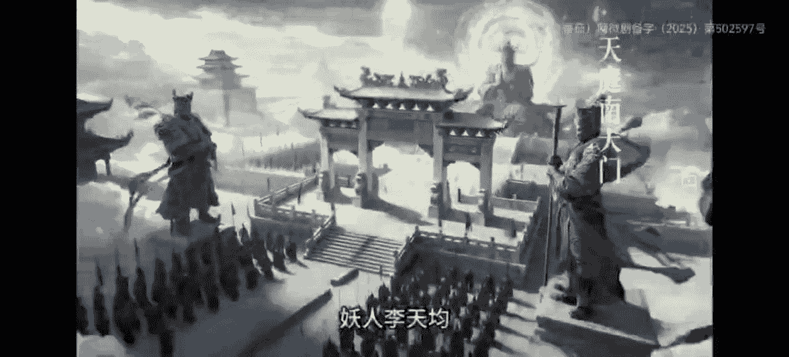

[斩仙台下我震惊了诸神.mp4](https://internal-api-drive-stream.feishu.cn/space/api/box/stream/download/all/KHfeblAAdoyV8qxAua6crQYMn5d)

（此处引用）

仿真人版《斩仙台》

[斩仙台仿真人版.mp4](https://internal-api-drive-stream.feishu.cn/space/api/box/stream/download/all/QaIUbW6WgoqZhMxJKICcwf0KnyR)

---

# 📢课程大纲

1.  探索篇：AI 漫剧生产流程中核心问题探讨；

1.  工具篇：从应用出发国内优质 AIGC 工具解析；

1.  解读篇：视频模型与内容生产的密切关系；

1.  案例篇：《斩仙台仿真人版》完整工作流拆解。

# 📺直播回放

> 直播回放：

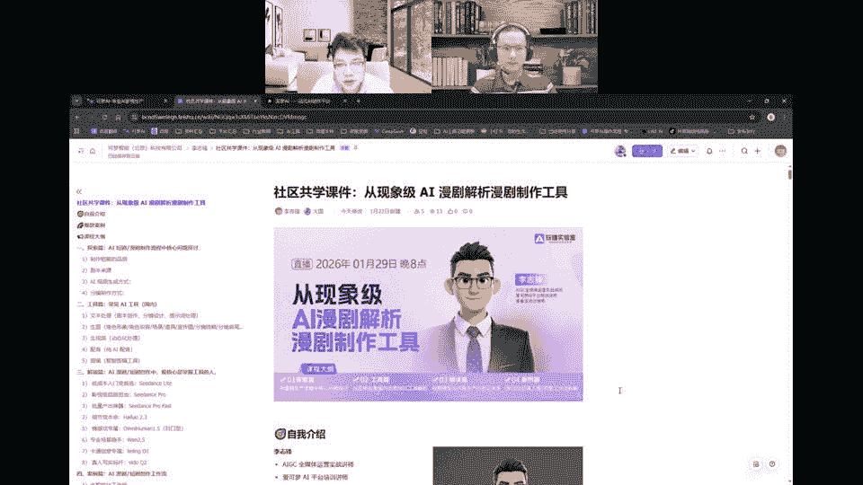

[从现象级AI漫剧解析漫剧制作工具.mp4](https://internal-api-drive-stream.feishu.cn/space/api/box/stream/download/all/ZLgQbYZzdo7R3ZxgnrCcmIAvnod)

---

# 一、探索篇：AI 短剧/漫剧制作流程中核心问题探讨

+   《兴安岭诡事》于 2025 年 2 月 19 日正式上线，首发平台为风芒、抖音及 B 站。上线不到 21 小时播放量即破千万，截至 10 月 17 日累计播放量达 5613.3 万，抖音原生端收益超过 30 万，账号涨粉 10 万+。

+   《奶团太后转》于 2025 年 8 月上线，累计全网播放量超过 2.2 亿。

+   《我靠唱歌打脸全团》于 2025 年 8 月上线，截止目前累计播放量超过 1 亿。

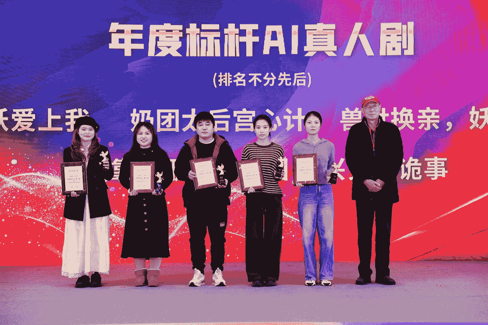

（爱漫剧·AI 漫剧生态产业大会暨首届漫剧热力榜颁奖盛典）

+   《小小神尊穿书反杀白莲花》于 2025 年 12 月上线，截止目前累计播放量 8000 万。

+   《斩仙台仿真人版》于 2026 年 1 月 13 日上线，6 天内播放量即突破 1 亿，红果热度飙到 5757 万，成为 2026 年开年 AI 仿真人短剧的爆款代表。截至现在累计播放量都突破 1.9 亿。

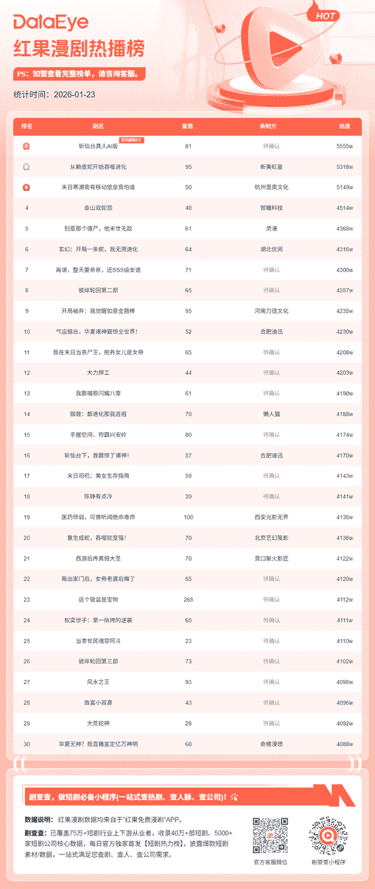

据查查 1 月 23 日榜单截图

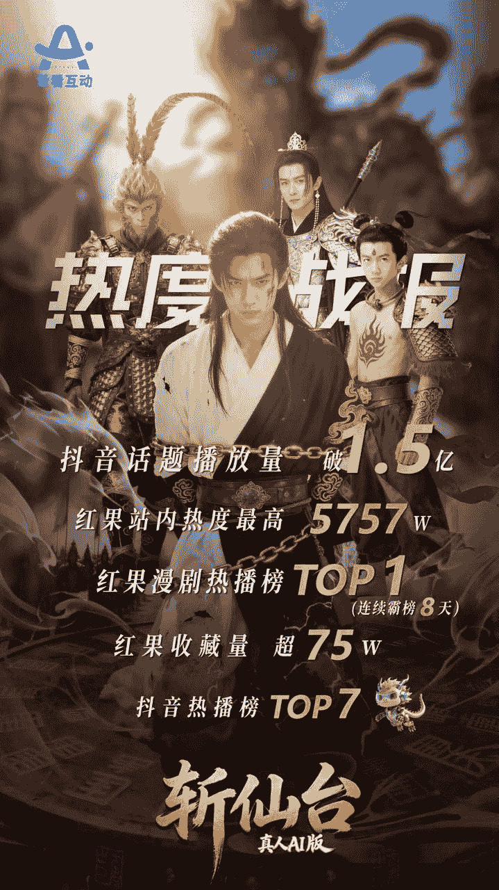

爱看互动 1 月 24 日公布数据

如何做出爆款 AI 仿真人漫剧？

## 1）制作短剧的品质

+   漫剧团队应该注重什么品质的内容输出？

+   作为初创团队首部作品必须是精品嘛？

+   为什么目前大量头部短剧企业每天产量能超过上百部？

+   短剧 2.0 时代对于 AI 短剧创作公司而言，是挑战还是机遇？

冲量短剧 VS 精品短剧 VS IP 化短剧

| **对比维度** | **冲量 AI 短剧** | **精品 AI 短剧** | **IP 化 AI 短剧** |
| --- | --- | --- | --- |
| 核心定义 | 小团队用通用免费 AI 工具，低成本、快速量产的短剧，以 “铺货赚快钱” 为核心目标 | 中型团队用专业 AI 工具链，兼顾技术精度与内容质感，追求单部高口碑、高溢价的短剧 | 头部团队用自研 AI 系统，围绕核心 IP 世界观 / 人物，系列化开发的长效变现短剧 |
| 制作成本 | 单部总投资 5000-3 万元 | 单部总投资 10-50 万元 | 单部总投资 50 万元以上 |
|  |  |  |  |
| 技术应用 | 1. 文本→视频：AI 直接生成碎片化镜头，人工简单拼接 | 1. 文本→视频：AI 生成粗剪镜头，人工精修 + 分镜优化 | 1. 文本→视频：基于 IP 专属模型生成镜头，贴合世界观风格 |
|  |  |  |  |
|  |  |  |  |
|  |  |  |  |
| 内容特质 | 1. 题材：下沉市场爆款套路（赘婿、复仇、婆媳），无创新 | 1. 题材：多元主流题材（都市悬疑、甜宠治愈、职场成长） | 1. 题材：具备延展性的世界观（仙侠、科幻、古风权谋） |
|  |  |  |  |
|  |  |  |  |
|  |  |  |  |
| 制作周期 | 3-7 天 / 部（100 集），一人多岗，边生成边剪辑，分批上线或统一上线。 | 15-30 天 / 部（50 集），分工明确，AI 生成 + 人工精修并行 | 30-60 天 / 季（30 集），前期世界观搭建占比 50%，量产效率随模型迭代提升 |
| 运营策略 | 1. 宣发：无预算，靠个人账号 + 平台自然流量分发 | 1. 宣发：平台流量扶持 + 精准付费投放（抖加、信息流） | 1. 宣发：全平台联动（短视频 + 长视频 + 社交平台），打造 IP 话题 |
|  |  |  |  |
|  |  |  |  |
| 盈利模式 | 1. 核心：平台广告分成 + 分销佣金 | 1. 核心：平台定制费 + 广告植入 + 会员分成 | 1. 核心：IP 授权 + 电商带货 + 衍生内容（漫画、小说、游戏）+ 影视改编 |
|  |  |  |  |
|  |  |  |  |
| 适用主体 | 个人创作者、小型工作室、短剧行业新手 | 中型 MCN 机构、影视公司短剧部门、平台自制团队 | 头部 MCN 机构、大厂短剧部门、有 IP 开发能力的影视公司 |
| 案例 | 4 个人 3 天 | 10 个人一个月 | 80～200 人，1～2 个月 |
| 图片 |  |  |  |

> **总结：**

> 技术核心：冲量 AI 短剧是 “AI 工具堆砌”，只求快速产出；精品 AI 短剧是“人机协同优化”，兼顾效率与质量；IP 化 AI 短剧是“技术为 IP 服务”，靠定制化技术构建壁垒。

> 风险与回报：冲量 AI 短剧风险最低、回报最快但天花板低；精品 AI 短剧风险中等、回报更高且有口碑复利；IP 化 AI 短剧风险最高、投入最大但长期回报无上限。

> 行业定位：冲量 AI 短剧是行业流量基础供给，精品 AI 短剧是行业品质升级标杆，IP 化 AI 短剧是行业长效发展方向。

> **建议：**

> 1、设置品质底线标准，借助热门 IP 内容快速打磨团队制作能力。（生存）

> 2、一方面打造**头部作品**持续破圈，一方面**中腰部作品**持续分割市场。28 比例（发展）

> 3、寻求高效技术工具减少重复劳动，让团队更聚焦于创意优化。（立足）

## 2）剧本来源

+   一部爆火的短剧应该具备什么基因？

+   目前头部企业的剧本从何而来？

+   为什么目前大家都不提倡使用原创剧本？

原创剧本 VS 热门 IP 小说改编剧本 VS 热门短剧翻拍 VS 连载短剧 VS 经典延展

| **剧本类型** | **核心定义** | **核心优势** | **核心劣势** | **适用场景** |
| --- | --- | --- | --- | --- |
| 原创剧本 | 无现成文本 / IP 基础，完全由编剧原创世界观、人物、剧情的剧本 | 1. 内容创新性强，具备独家性和差异化 | 1. 无受众基础，前期宣发成本高 | 1. 追求口碑与艺术价值的院线电影、精品网剧 |
|  |  |  |  |  |
|  |  |  |  |  |
| 热门 IP 小说改编剧本 | 基于已出版的高人气小说（网文 / 实体书）进行影视化改编的剧本 | 1. 自带庞大书粉基础，宣发引流成本低 | 1. 受原著粉期待束缚，改编难度大 | 1. 面向年轻受众的偶像剧、仙侠剧、悬疑剧 |
|  |  |  |  |  |
|  |  |  |  |  |
| 热门短剧翻拍 | 选取某部爆款短剧的核心剧情、人设框架，进行本土化 / 差异化翻拍的剧本 | 1. 验证过的爆款逻辑，降低创作试错成本 | 1. 剧情同质化严重，容易被诟病 “抄袭”“炒冷饭” | 1. 中小成本的短视频平台短剧项目 |
|  |  |  |  |  |
|  |  |  |  |  |
| 连载短剧 | 以 “周更 / 日更” 的连载形式创作的短剧剧本，单集时长短，剧情强反转、强钩子 | 1. 单集制作成本低，容错率高，可根据观众反馈调整剧情 | 1. 剧情碎片化，难以构建完整世界观和深度人物 | 1. 抖音、快手等短视频平台的竖屏短剧 |
|  |  |  |  |  |
|  |  |  |  |  |
| 经典延展 | 基于经典影视 / 文学 IP 的世界观，创作续集、前传、番外或衍生故事的剧本 | 1. 经典 IP 自带国民级认知度，受众覆盖全年龄段 | 1. 创作需贴合原作调性，创新空间受限 | 1. 情怀向的系列电影续集（如《星球大战》衍生剧） |
|  |  |  |  |  |
|  |  |  |  |  |

> **总结：**

> 创作自由度：原创剧本＞连载短剧＞热门 IP 改编＞经典延展＞热门短剧翻拍

> 市场风险：原创剧本＞经典延展＞热门 IP 改编＞连载短剧＞热门短剧翻拍

> 受众基础：经典延展＞热门 IP 改编＞热门短剧翻拍＞连载短剧＞原创剧本

> 制作门槛：原创剧本（艺术门槛高）＞经典延展（情怀门槛高）＞热门 IP 改编（版权 + 改编门槛高）＞连载短剧（钩子设计门槛高）＞热门短剧翻拍（门槛最低）

> **建议：**

> 1、初创团队不要急于独立创作短剧，可以从承制入手。

> 2、有一定资金基础的公司可以选择购买热门 IP 版权进行改编（最好邀请有爆款经验的编剧执行）。

> 3、有一定规模的公司可以选择和平台合作，例如月产 5 部优质短剧的企业可以与红果建联。

> 4、在保障公司正常流水运转的情况之下，打造原创剧本、经典延展。

> 5、对于真人实拍团队转型 AI 仿真人领域的团队，直接采用复刻“翻拍”成 AI 仿真人短剧。

## 3）AI 视频生成方式：

+   AI 漫剧企业制作短剧过程中常用哪种视频生成方式？

+   AI 视频生成过程中控制人物场景稳定的方式？

+   成本控制与品质的权衡之道！

文生视频 VS 首图生视频 VS 首尾帧 VS 参考生模式

| 对比维度 | 文生视频 | 首图生视频 | 首尾帧 | 参考生模式 |
| --- | --- | --- | --- | --- |
| 核心定义 | 仅输入文字描述，AI 自主生成对应画面、动作、镜头的视频制作方式 | 输入一张参考图，AI 基于图像的风格、元素、构图生成连贯视频 | 输入开头帧 + 结尾帧两张参考图，AI 填充中间过渡画面，生成完整视频片段 | 输入多张图像（角色、场景、道具、手绘图等），AI 基于提示词内容，生成完整视频片段 |
| 输入要求 | 提示词（需详细描述场景、人物、动作、风格） | 单张高清参考图（风格 / 元素清晰） | 两张参考图（首尾画面元素关联性强） | 基础输入多张参考图+ 精准提示词描述 |
| 生成原理 | 依赖大语言模型 + 视频生成模型，解析文本语义，自主构建画面序列与动态逻辑 | 提取参考图的视觉特征（色彩、构图、物体、风格），基于特征扩展动态画面 | 分析首尾帧的视觉差异，计算画面元素的运动轨迹与形态变化，生成过渡帧补全视频 | 基于基础输入搭建视频框架，通过提示词约束 AI 生成逻辑，平衡创意性与定制化需求 |
| 可控性 | 低→中，AI 自主创作空间大，易出现与文本不符的画面，细节不可控 | 中，风格 / 元素可控，但画面动态、时长的把控度较弱 | 中→高，首尾画面完全可控，中间过渡的流畅度取决于 AI 对画面的理解 | 高，图片越详细，生成结果越贴合预期，支持角色一致性、镜头语言等精准控制 |
| 优势 | 1. 零视觉素材门槛，仅需文字即可创作 | 1. 风格统一性强，避免画面违和 | 1. 起止画面精准可控，满足定制化需求 | 1. 可控性最强，兼顾创意与标准化 |
|  |  |  |  |  |
|  |  |  |  |  |
| 劣势 | 1. 画面随机性强，细节偏差率高 | 1. 动态效果单一，易出现画面重复循环 | 1. 中间过渡画面可能出现逻辑断层 | 1. 前期筹备周期长，需要设计较多资产 |
|  |  |  |  |  |
|  |  |  |  |  |
| 适用场景 | 1. 手搓 AI 短剧的快速剧情草稿制作 | 1. 风格化短视频（如古风变装、风景延时） | 1. AI 短剧的固定镜头过渡片段（如开门、人物起身） | 1. 工业化 AI 短剧的规模化生产 |
|  |  |  |  |  |
|  |  |  |  |  |

> **总结：**

> 可控性排序：参考生模式 ＞ 首尾帧 ＞ 首图生视频 ＞ 文生视频

> 操作门槛排序：参考生模式 ＞ 首尾帧 ＞ 首图生视频 ＞ 文生视频

> 建议：

> 目前企业常用的工作流：

> 1、AI 漫剧制作：文生和参考生

> 2、AI 仿真人制作：图生和参考生

## 4）分镜制作方式：

+   为什么 2025 年底开始突然出现大量的 AI 漫剧创作工作流？

+   为什么企业宁愿花更多的钱研发工作流，不用手搓的方式？

+   未来手搓短剧还有机会嘛？

手搓 AI 短剧 VS 工业化生产 AI 短剧

| 对比维度 | 手搓 AI 短剧 | 工业化生产 AI 短剧 |
| --- | --- | --- |
| 核心定义 | 单人 / 小团队（1-5 人）用零散 AI 工具（文生图、文生视频、剪映等）“边试边做”，人工主导全流程细节的作坊式制作，无固定 SOP | 依托自研 / 集成 AI 平台，标准化流水线作业，分工精细（策划、编剧组、AI 生成、后期、宣发），人机协同批量产出的规模化模式 |
| 团队与分工 | 一人多岗，身兼编剧、导演、剪辑、美工，依赖个人创意与工具熟练度，无专业分工 | 多部门协同，有专属 AI 工程师、内容审核、数据分析师，流程模块化，专人专岗，协作高效 |
| 成本投入 | 单集成本极低（几十 - 几百元），无设备 / 场地固定成本，人力成本占比 90%+，总投资通常低于 5 万元 | 单集成本较高（几千 - 几万元），有平台研发 / 虚拟影棚 / 设备等固定成本，规模化后边际成本递减，总投资可达百万级 |
| 创作流程 | 无固定流程，“创意→AI 生成→人工修图 / 剪→配音→成片”，可边做边改，灵活度高，周期 3-7 天 / 部（10-30 集） | 标准化流程：市场调研→选题立项→AI 剧本生成→人工润色→分镜设计→AI 渲染→后期合成→数据复盘→宣发上线，周期 15-30 天 / 部，可多项目并行 |
| 产出效率 | 单人日产能 1-3 集，依赖个人效率，无规模化产出能力，爆款随机性强 | 多项目并行，月产数十部甚至上百部，初始提示词 + AI 创作 +  剪辑将成片时间从周级压至小时级 |
| 内容特质 | 题材集中于下沉市场爆款套路（赘婿、逆袭、悬疑反转），剧情碎片化，人设脸谱化，靠强爽点吸引观众，偶尔有小众创新内容 | 题材覆盖广（甜宠、都市、仙侠、职场等），剧情注重逻辑闭环与人物弧光，人设立体，风格统一，适配平台主流受众，有品牌化意识 |
| 技术应用 | 依赖通用 AI 工具，无专属模型，角色一致性、口型匹配等问题需人工反复调整，技术上限受公共工具限制 | 自研 AI 平台 / 专属模型，支持角色形象固定、多人对口型、智能分镜、云端渲染，数字人 / 虚拟场景降低实拍成本，技术可控性强 |
| 宣发与盈利 | 无专项宣发预算，靠平台自然流量 + 个人账号传播，盈利以平台分成为主，不稳定，爆款率低 | 平台流量扶持 + 付费推广 + 达人分销，有成熟宣发链路与数据复盘，盈利多元化（定制费 + 广告 + 电商 + IP 衍生），稳定且可复制 |
| 优势 | 试错成本低，灵活度高，易出接地气 “野生爆款”；创作自由度高，无过多商业束缚 | 内容质量稳定，爆款可复制；规模化产出快速占领市场；专业制作保障内容下限，口碑波动小；数据驱动优化，持续提升爆款率 |
| 劣势 | 内容同质化严重，粗制滥造比例高；缺乏长效盈利模式，难以持续发展；版权意识薄弱，易侵权 | 前期投入高，对市场判断失误风险大；流程僵化易套路化，创新不足；内容受平台规则与商业需求束缚多 |
| 适用主体 | 个人创作者、小型工作室、试水 AI 短剧的新手团队 | 头部 MCN、影视公司、短视频平台自制团队、有资金与技术储备的机构 |
| 工具展示 | 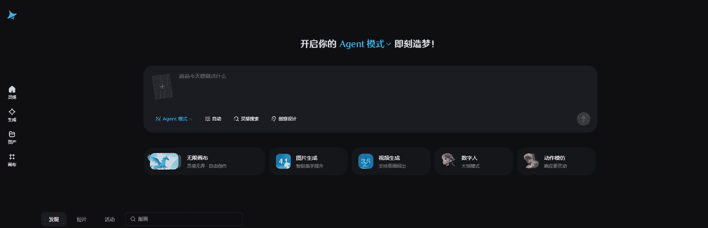 | 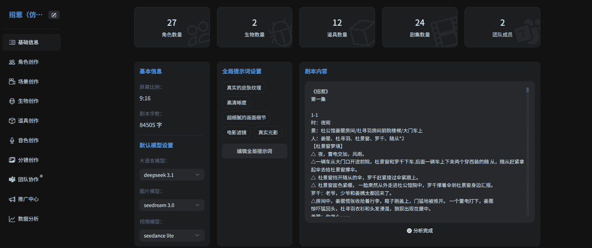 |

> **总结：**

> 核心逻辑：手搓 AI 短剧是 “以小博大” 的个体创意驱动 ，工业化 AI 短剧是 “稳定盈利” 的技术与数据驱动。

> 效率与质量：手搓重灵活与低成本，工业化重规模与标准化。

> 行业定位：手搓是 AI 短剧行业的创新试错者，工业化是行业的规范化推动者。

> **建议：**

> 1、个人或者微小成本创业的团队入行 AI 漫剧行业尽可能选择手搓（会员充值方式）

> 2、有完整架构的团队、承制团队、中大型 AI 漫剧制作团队，建议自行搭建工作流或者购买工作流工具。

---

# 二、工具篇：常见 AI 工具（国内）

目前国内有非常多的优质大模型，通过模型能力衍生出各种优秀的制作工具。但实际上 AI 仅仅是我们工作的一个辅助，最重要的是使用这些工具的人是否具备足够的知识储备。

## 1）文本处理（剧本创作、分镜设计、提示词处理）

首先需要说明，目前 AI 在文本处理上具备一定的能力，但并无法直接应用于内容的生产，作为一个成熟的编剧或者导演，可以适当借鉴 AI 的生产内容。

| **工具** | **主要功能** | **核心优势** | **明显劣势** | **适用场景** |
| --- | --- | --- | --- | --- |
| 通义千问（阿里） | 长文本生成、分镜表 / 台词本结构化输出、多轮迭代、对接阿里云生态 | 中文理解强，支持网文改编，可直接输出可落地的分镜与台词，生态闭环好 | 定制化微调门槛高，纯开源能力弱 | 批量短剧脚本、分镜结构化生成、网文 IP 改编、工业化流水线 |
| 文心一言（百度） | 角色人设、剧情节奏把控、短视频口播 / 旁白、多语言文案 | 中文创作能力强，对短剧爽文 / 甜宠 / 悬疑风格适配好，支持多轮剧情优化 | 长文本连贯性略逊，本地部署成本高 | 短剧文案、角色设定、分集大纲、出海多语言文案 |
| 讯飞星火（科大讯飞） | 语音交互 + 文本生成一体、多角色配音文案、方言适配 | 语音转文本 / 文本转语音无缝衔接，适合有声漫剧，快速出稿 | 纯文本创作深度不足，风格多样性一般 | 口播类短剧、有声漫剧、配音台本、方言内容 |
| DeepSeek-R1/V2 | 开源可本地部署、长上下文、批量脚本生成、定制微调 | 成本极低，可私有化部署，支持自有数据训练，灵活度高 | 需技术团队维护，中文 prompt 优化需额外投入 | 自有 IP 训练、批量脚本生成、内部私有化部署、低成本试错 |
| 豆包（字节） | 对话式交互、短剧风格指令（爽文 / 甜宠 / 悬疑）、快速试错 | 交互友好，生成速度快，支持创意 brainstorm，新手易上手 | 长文本稳定性一般，工业化批量能力弱 | 快速试错、单集短剧本、创意 brainstorm、个人 / 小团队 |

## 2）生图（角色形象/角色妆容/场景/道具/宣传图/分镜线稿/分镜首尾帧）

从 2022 年国内 AI 生图技术高速发展到现在，很多 AI 绘画工具已经非常成熟，基本解决了我们基础内容创作的需求，因此 2025 年市场催生出 AI 漫剧赛道，需要注意的是，我们使用各种 AI 工具的本质是大模型的能力，因此我们在未来的创作过程中，并不能完全依赖某一款工具，而是结合各种大模型的生产优势，以实际生产需求为出发点，择优而用。

| **工具** | **主要功能** | **核心优势** | **明显劣势** | **适用场景** |
| --- | --- | --- | --- | --- |
| 即梦 AI（抖音） | 角色定妆锁特征、分镜批量生成、文生图 / 图生图、对接剪映 | 角色一致性极强，中文提示词友好，分镜自动拆解，一站式出图，竖屏适配 | 免费额度有限，高阶功能需付费，风格多样性略逊 | 漫剧分镜、角色立绘、场景图、封面图，角色一致性要求高的项目 |
| 可灵 AI（快手） | 文生图 / 图生图 / 图生视频一体、风格迁移、批量出图 | 文生图 + 视频一体化，风格迁移能力强，批量出图效率高，适配快手生态 | 角色细节精度一般，付费模式灵活但成本不低 | 短剧场景、角色设计、分镜草图、动态漫帧、快手生态分发 |
| Midjourney（国内第三方接入） | 文生图 / 图生图、高品质关键帧 / 封面、风格多样 | 画质顶尖，风格覆盖广，适合高品质视觉输出，行业认可度高 | 无官方国内版，需第三方接入，角色一致性难控制，版权风险高 | 精品短剧封面、关键帧、概念设计、IP 视觉、高品质单图输出 |
| Stable Diffusion（本地 / 云端） | 开源可定制、LoRA/ControlNet 训练、批量风格化出图 | 开源免费，可定制角色 / 场景 LoRA，成本极低，灵活度拉满 | 需技术部署，prompt 门槛高，新手难上手 | 自有 IP 训练、批量风格化出图、低成本生产、技术团队定制化 |
| WHEE（美图） | 人像 / 动漫风格生成、美颜 / 滤镜、快速出图 | 人像 / 动漫风格强，美颜滤镜丰富，操作简单，新手友好 | 工业化批量能力弱，风格偏甜美，悬疑 / 科幻适配差 | 甜宠 / 都市短剧角色、漫剧头像、封面美化、个人 / 小团队快速出图 |
| NanoBanana | 文本生图、多图融合、自然语言局部精确编辑、角色身份一致性保持、SynthID 水印、4K 分辨率输出（Pro 版）、高级文本渲染 | 角色一致性极强（支持多角色 / 多场景复用），局部编辑精准不破坏整体，支持多图融合，自带 AI 水印合规，Pro 版支持 4K 与专业构图控制 | 原生中文支持一般，主要用于资产生成，批量生图效率低于即梦 / 可灵，Pro 版付费成本高 | 精品短剧角色定妆、关键帧精细化编辑、多图合成场景、需要角色高度一致的系列短剧、合规要求高的商业创作 |

## 3）生视频（动态化处理）

视频大模型从最开始的文生视频的惊艳，到场景人物稳定性的需求；从单一视频片段的生产，到完整剧情内容的串联；从娱乐化的尝试，到 AI 短剧创作这样第一个商业模式落地。

AI 的技术提升给我们提供了支撑，而真正的 AI 短剧创作的本质是创作者们对镜头语言的理解。

| **工具** | **主要功能** | **核心优势** | **明显劣势** | **适用场景** |
| --- | --- | --- | --- | --- |
| 即梦 AI（抖音） | 图生视频 + 文生视频、角色一致性、竖屏适配、对接剪映 | 角色一致性好，竖屏适配，一站式出片（含音效 / 字幕），免费额度友好 | 长视频连贯性一般，高阶功能付费，画质上限中等 | 动态漫、短剧片段、竖屏短视频、批量生成、抖音生态分发 |
| 可灵 AI（快手） | 图生视频 / 文生视频、多镜头 / 转场、口型同步、长片段生成 | 多镜头运镜能力强，口型同步自然，长片段连贯性好，适配快手生态 | 角色细节精度一般，付费成本偏高，版权审核严格 | 短剧正片、动态漫、多场景连贯视频、快手矩阵账号 |
| 商汤 Seko 2.0 | SekoIDX 角色一致性、SekoTalk 多人对口型、多剧集批量生成 | 角色一致性 + 口型同步双强，工业化批量能力拉满，全流程闭环 | 价格高，个人创作者不友好，部署复杂 | 多集 AI 短剧、多人对话场景、声画同步要求高、MCN / 专业团队 |
| PixVerse（爱诗科技） | 文生视频 / 图生视频、风格化、高品质片段生成 | 画质细腻，风格化能力强，科幻 / 奇幻题材适配好，细节还原度高 | 批量效率一般，付费模式按次计费，成本高 | 精品短剧、科幻 / 奇幻题材、高质量片段、IP 概念片 |
| Vidu（清华 + 生数） | 长视频生成（数分钟）、场景连贯性、剧情片适配 | 长视频能力突出，场景连贯性好，剧情逻辑适配强，技术底蕴深 | 生成速度慢，付费门槛高，中文 prompt 优化需经验 | 中长时短剧、剧情连贯片段、概念片、技术团队定制化 |
| VegaAI（右脑科技） | 动漫 / 真人风格兼顾、分镜转视频、风格化短剧 | 双风格适配，分镜转视频效率高，适合漫剧与短剧混合制作 | 画质上限中等，批量能力一般，生态对接弱 | 漫剧转视频、分镜成片、风格化短剧、混合题材制作 |
| Seedance 1.5 Pro | 中文适配、动态漫生成、低成本批量、新手友好 | 中文 prompt 响应好，操作简单，动态漫生成效率高，性价比优 | 画质上限一般，长视频连贯性弱，风格偏动漫 | 动态漫、低成本批量短剧、新手入门、个人 / 小团队 |
| hailuo | 文生视频 / 图生视频，主打**复杂动作、物理真实感、创意特效** | 1. 复杂动作 / 物理效果强（体操、打斗、特效场景）2。 人物一致性（主体参考）好，适合角色连贯 3。 支持 1080P 高清，Hailuo 2.3/Fast 速度快 4。 无限生成（尊享会员），适合反复迭代创意 | 1. 单段时长有限（主流 6–10 秒），长剧需分段拼接 2。 叙事连贯性弱，不适合直接生成完整短剧 3。 口型同步一般，需后期配音对齐 4。 企业级 API / 批量能力不如即梦、可灵成熟 | 短剧分镜生成、特效镜头（打斗 / 悬疑 / 科幻）、动态漫片段、创意实验、精品剧高光片段 |

## 4）配音（纯 AI 配音）

截止目前 AI 配音情感化、拟人化并没有完全实现，因此目前纯 AI 配音大部分出现在 AI 小说漫解和 AI 动态漫类型的内容中。而 AI 仿真人漫剧更倾向于真人配音方式。

| **工具** | **核心优势** | **劣势** | **企业用法** |
| --- | --- | --- | --- |
| 讯飞配音 | 中文情感强、方言多、角色库全、API 批量 | 长文本连贯性一般 | 主力付费剧、方言内容、批量生成 |
| 魔音工坊 | 短剧模板多、情感标注方便、对接剪映 | 高阶功能付费 | 快速出稿、新手团队、短剧专用 |
| 阿里云语音合成 | 稳定、API 成熟、对接阿里云生态 | 情感略逊讯飞 | 工业化流水线、批量脚本生成 |
| 腾讯智影配音 | 数字人 + 配音一体、腾讯生态 | 音色数量一般 | 视频号内容、知识口播、短剧出海 |
| MiniMax 语音 | 克隆效果自然、情感还原好、支持多语言 | 需授权、成本较高 | 主角克隆、出海译制、精品剧 |
| 讯飞听见克隆 | 中文克隆强、合规性好、支持批量 | 需真人授权 | 国内精品、角色一致性、长剧集 |
| 可灵 AI / 即梦 AI | 配音 + 视频一体、口型同步 | 克隆功能需付费 | 动态漫、短剧成片、一站式出片 |

## 5）剪辑（智能剪辑工具）

一个优质的 AI 短剧必然离不开优秀的剪辑，基于现在 AI 视频的生成能力，已经将制作团队从特效制作包装过程中解放出来，这也是 AI 短剧能够大幅度降低成本的主要原因之一。

必须注意的是，剪辑并不是简单的画面的连接（所有的剪辑工具都可以实现），更需要将故事的情感、光影的艺术、用户的情绪等等因素融入到剧情之中。所以在 AI 漫剧创作中，更重要的是要关注剪辑思维，而工具的使用只是为我们提高工作效率提供的基础保障。

| **工具** | **主要功能** | **核心优势** | **明显劣势** | **适用场景** |
| --- | --- | --- | --- | --- |
| **剪映（CapCut）** | AI 自动字幕 / 配音、智能抠像、智能构图、AI 转场 / 模板、智能配乐、一键成片、批量剪辑、对接即梦 AI | 中文生态最强，免费额度足，操作极简，手机 / PC / 平板全平台，抖音 / 快手 / 📕一键分发，AI 功能全且稳定 | 专业级调色 / 特效有限，长视频（&gt;30min）效率一般，批量深度定制弱 | 个人博主、MCN 批量出片、短剧后期包装、口播 / 剧情短视频、新手入门 |
| 必剪 Studio（B 站） | AI 字幕 / 配音、智能剪辑、数字分身、一键投稿 B 站、AI 封面生成、多轨道编辑 | B 站生态闭环，免费数字人出镜，一键投稿流量倾斜，二次元 / 知识区模板丰富 | 其他平台适配一般，AI 功能深度不如剪映，PC 端功能更全 | B 站 UP 主、知识科普、二次元内容、短剧 B 站分发 |
| 万兴喵影（Filmora） | AI 曲线变速、智能调色、多机位剪辑、关键帧、批量剪辑、离线 AI 抠像、鸿蒙适配 | 专业级功能 + AI 辅助，本地算力强，无网也能高效创作，模板 / 教学生态完善 | 免费版有水印，高阶功能付费，上手比剪映略难 | 商业广告、影视二创、专业短视频团队、鸿蒙设备用户 |
| 度加创作（百度） | 文字转视频、AI 蹭热点（热搜素材）、智能字幕 / 配音、一键直发百家号 / 好看视频 | 百度生态流量倾斜，资讯 / 科普类自动生成强，热点素材库丰富 | 创意类内容弱，依赖百度生态，其他平台适配一般 | 资讯科普、本地生活、自媒体搬运号、百家号矩阵 |
| 快影（快手） | AI 字幕 / 配音、智能抠像、一键成片、快手专属模板、直播切片 | 快手生态深度适配，直播切片高效，竖屏模板多，操作简单 | 专业功能弱，长视频能力一般，AI 创意有限 | 快手博主、直播切片、快手短剧、竖屏短视频 |

---

# 三、解读篇：AI 漫剧/短剧创作中，最核心是掌握工具的人。

## 1） 低成本入门党首选：Seedance Lite

**核心适配场景：**电商广告、简单生活短剧，预算有限、追求快速出片的入门创作者。

突出优势：

1.  日常化表情和状态还原精准，行走、递物等基础动作流畅自然，无违和感。

1.  推拉摇等基础运镜稳定，短指令响应不跑偏，新手易上手。

1.  720P 画质完全满足电商带货、生活记录类短视频的传播需求。

**短板：**戏剧化表演缺乏层次，复杂动作和高阶运镜能力较弱。

**选型建议：**适合预算不足的新手，专注做简单、轻量化的短视频内容，无需额外投入学习成本。

**成本：**720P，5 秒，约 1.03 元

[111111.mp4](https://internal-api-drive-stream.feishu.cn/space/api/box/stream/download/all/QbXmbw0btopj6tx7oPIcuLZ9nJg)

## 2） 影视级品质担当：Seedance Pro

**核心适配场景：**玄幻短剧、影视级质感内容创作，追求电影感和细节表现力的中高阶创作者。

**突出优势：**

1.  人物可通过表情 + 肢体动作传递深层情绪，影视氛围感拉满。

1.  格斗、舞蹈等复杂动作连贯丝滑，多人协作场景也能稳定输出。

1.  10 秒内可实现 2-3 个景别无缝切换，航拍等复杂运镜效果稳定，中短指令能精准落地特效细节。

**短板：**生成速度稍慢，长指令逻辑稳定性下降，极端肢体姿态偶尔出现变形。

**选型建议：**适合追求高品质内容的创作者，优先用于制作玄幻、悬疑等强视觉冲击的短剧，牺牲部分效率换取质感。

**成本：**1080P，5 秒，约 3.67 元

[22222.mp4](https://internal-api-drive-stream.feishu.cn/space/api/box/stream/download/all/Namybsh9to0I8AxPiQ6cTDmVnjc)

## 3） 批量产出神器：Seedance Pro Fast

**核心适配场景：：**需要批量产出且不牺牲画质的内容团队。

**突出优势：**

1.  继承 Seedance Pro 的 1080P 高清画质和完整动作逻辑，核心情绪表达自然。

1.  短视频常用的多镜头转场流畅丝滑，生成速度远超 Pro 版本，日更 10 条以上无压力。

**短板：**超复杂动作细节连贯性稍弱，高速生成模式下光影过渡略粗糙。

**选型建议：**适合需要高频更新的自媒体账号，平衡效率与画质，是日更创作者的效率利器。

**成本：**1080P，5 秒，约 2.57 元

[profast.mp4](https://internal-api-drive-stream.feishu.cn/space/api/box/stream/download/all/AyqLbXoyxo0DqwxcyCQc5dvxnPe)

## 2） 细节党本命：Hailuo 2.3

**核心适配场景：**动漫、高品质玄幻短剧，看重微表情和帧间一致性的精细化创作。

**突出优势：**

1.  微表情刻画行业顶尖，眼神、嘴角的细微变化都能精准传情，角色表现力极强。

1.  从细微手势到复杂动作控制精准，帧间一致性超高，景别切换时画质无损失。

1.  风格指令适配精准，能稳定输出统一质感的内容。

**短板：**生成耗时较长，情绪转换的流畅度稍弱，运镜风格可选范围较窄。

**选型建议：**适合对细节要求严苛的创作者，优先用于动漫、玄幻等需要强角色表现力的短剧制作。

**成本：**1080P，6 秒，约 3.2～3.8 元

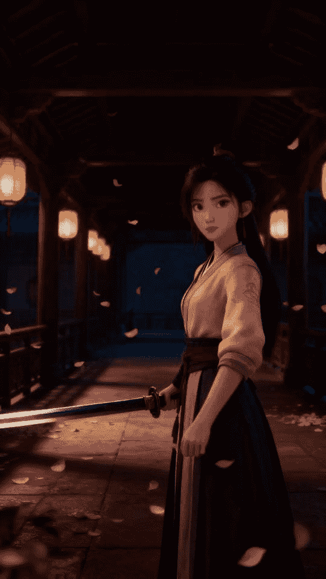

[hailuo.mp4](https://internal-api-drive-stream.feishu.cn/space/api/box/stream/download/all/Ko96bNrRIog6V4xSAZvcAY3jnfg)

## 5） 情感戏专属：OmniHuman1.5（对口型）

**核心适配场景：**催泪情感短剧，需要角色情绪引发观众深度共鸣的内容创作。

**突出优势：**

1.  爆发性愤怒、真挚告白等戏剧性情绪表达精准，感染力极强。

1.  支持匹配音频语义调整表演细节，手持物体、多人对话等交互动作自然不僵硬。

1.  运镜能精准聚焦情绪氛围，强化剧情共情力。

**短板：**复杂动作和物理特效表现较弱，无音频输入时情绪细节稍显单薄。

**选型建议：**专注做情感类短剧的创作者首选，能最大化提升角色情绪的传递效率。

**成本：**1080P，6 秒，约 2.8～3.2 元（API 价格）

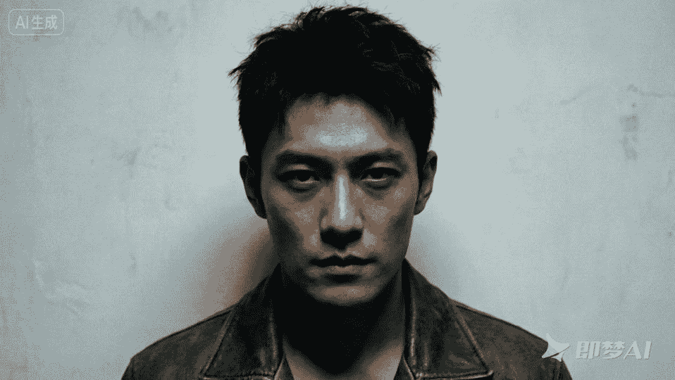

[港普.mp4](https://internal-api-drive-stream.feishu.cn/space/api/box/stream/download/all/LGqAbZtGToJouFxZ9uVcXGyGnzf)

## 6）专业场景稳手：Wan2.5

**核心适配场景：**商业推广、教育类短剧，需要专业姿态和稳定表现的商业化内容创作。

**突出优势：**

1.  表演风格稳定性拉满，讲师手势、产品展示等专业姿态精准到位。

1.  基础及常规复杂动作连贯流畅，长视频运镜无缝衔接，专业场景指令解析准确率高。

1.  时序稳定性强，适合制作长时程的商业、教育内容。

**短板：**面部情绪细节刻画不足，极限特技动作易出现僵硬感。

**选型建议：**适合商业化、教育类内容创作，优先用于产品推广、知识科普等需要专业感的短视频。

**成本：**1080P，6 秒，约 1.5～1.8 元（API 价格）

[wan2.5.mp4](https://internal-api-drive-stream.feishu.cn/space/api/box/stream/download/all/KTe1btXoQoLrSqxXleuc5S6Snng)

## 7）卡通创意专属：keling O1

**核心适配场景：**Q 版动漫、创意短视频，追求可爱画风和快速创意落地的创作者。

**突出优势：**

1.  卡通化、Q 版角色表情演绎生动鲜活，动漫夸张情绪表达精准到位。

1.  跳跃、卡通化打斗等基础动作流畅有趣，快速转场、缩放等运镜能强化创意氛围。

1.  短平快的创意提示词响应极快，可智能补全卡通风格细节。

**短板：**真人化表演效果生硬，复杂真人动作戏适配度低。

**选型建议：**专注做卡通、Q 版创意内容的创作者首选，高效实现趣味化短视频制作。

**成本：**1080P，6 秒，约 2.0～2.5 元（API 价格）

[keling.mp4](https://internal-api-drive-stream.feishu.cn/space/api/box/stream/download/all/HJk2b0HdToNk8Exv9Z9cVc5cnpe)

## 8） 真人写实标杆：vido Q2

**核心适配场景：**真人纪实、职场、家庭类短剧，追求极致真实感的内容创作。

**突出优势：**

1.  真人肖像还原度超高，日常及轻戏剧化情绪表达细腻自然，眼神交流、面部微表情的真实感行业领先。

1.  家务、办公等生活化动作还原精准，肢体姿态自然不僵硬。

1.  跟拍、手持模拟等纪实类运镜稳定，带场景细节的指令解析精准。

**短板：**完全不适配卡通、玄幻风格，高强度动作戏表现薄弱。

**选型建议：**适合做纪实、职场、家庭等现实主义题材短剧，最大化还原真人生活质感。

**成本：**1080P，6 秒，约 1.6～2.0 元（API 价格）

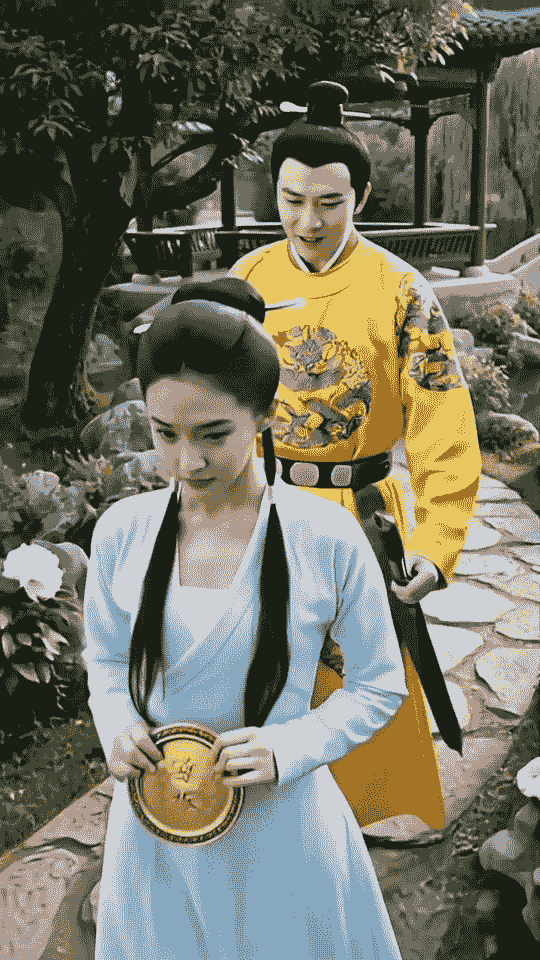

[4444.mp4](https://internal-api-drive-stream.feishu.cn/space/api/box/stream/download/all/FIlCbawTkoDmXexBdX1ciMsCnNe)

---

# 四、案例篇：AI 漫剧/短剧创作工作流

**目前使**用**工作**流的目的主要有两个，一个是纯萌新的朋友，不懂 AIGC，不懂镜头语言，单纯有个想法，想要通过一个成熟的工作流快速把自己的想法变成视频。一个是已经进入 AI 漫剧/短剧行业的大佬，想要提高工作效率，节约大量重复工作量，将更多的注意力放在漫剧/短剧制作精品度上。

实际上，基于目前大模型能力，暂时任何一种目的的工作流都无法真正实现。

## 1）全智能化工作流

① oiioii（个人自媒体创作）

② movieflow（个人自媒体创作）

③ seko（个人自媒体创作）

④ 橙星梦工厂 （剧本+创作+发行）

⑤  …………其实还有很多很多

## 2）半自动化工作流

① 爱可梦（更擅长 AI 仿真人）

② 灵境 AI（专注 AI 漫剧创作）

③ 巨日禄 （方便的资产管理与参考生流程）

④ …………其实还有很多很多

## 3）《斩仙台仿真人版》完整工作流拆解

+   爱可梦官网：**https://kmenga**i.com/【如有需要，请联系大国采买】

+   斩仙台工作流

+   1、全局控制，拆解剧本

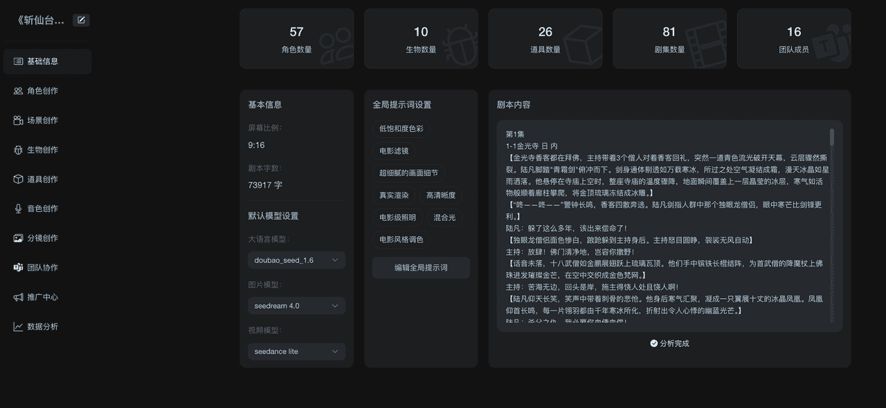

+   2、设计角色，设计装照

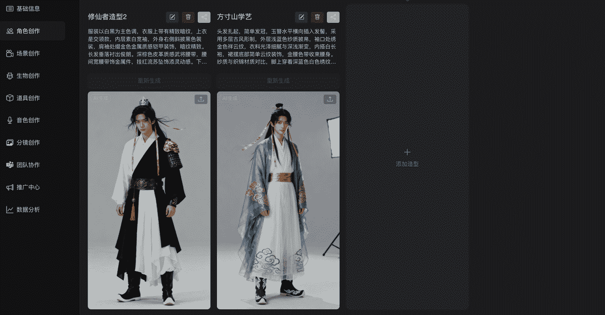

+   3、设计场景/道具/生物等资产

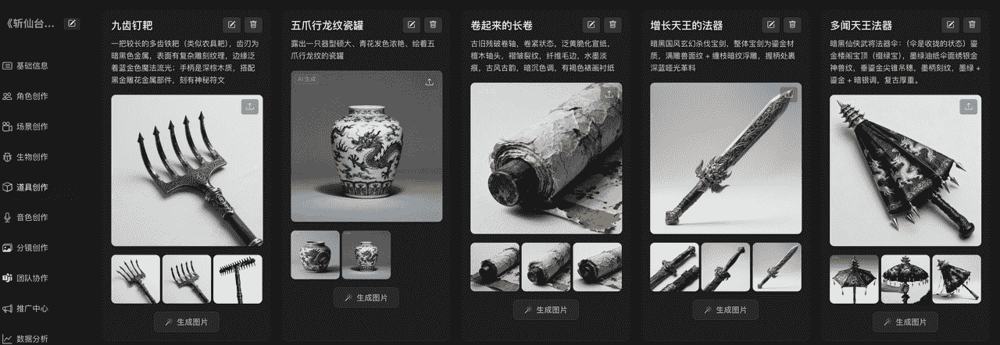

+   4、分镜创作

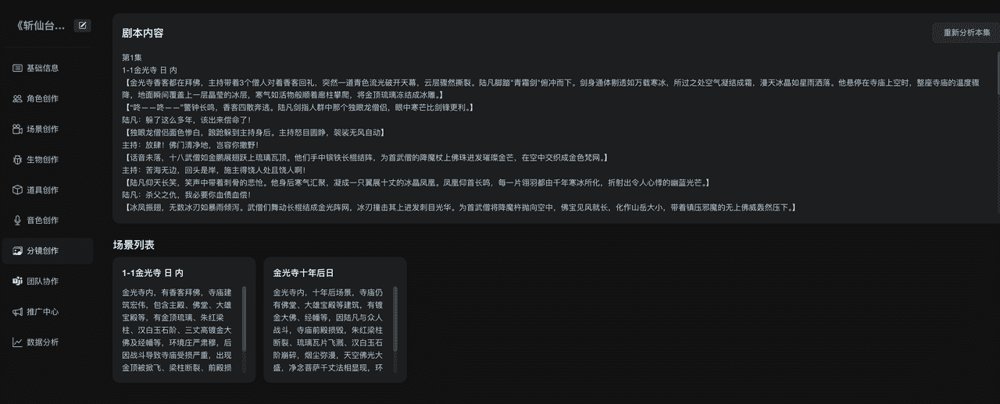

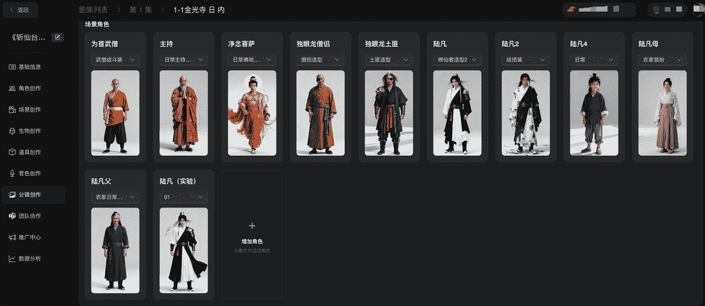

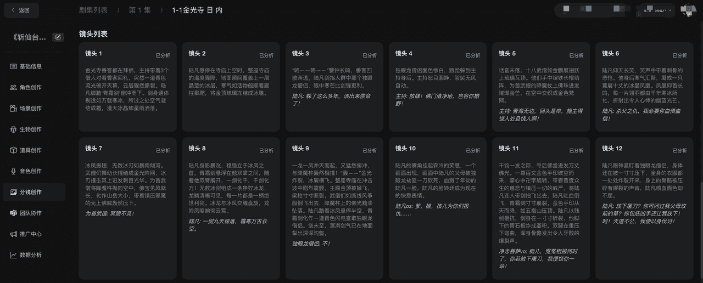

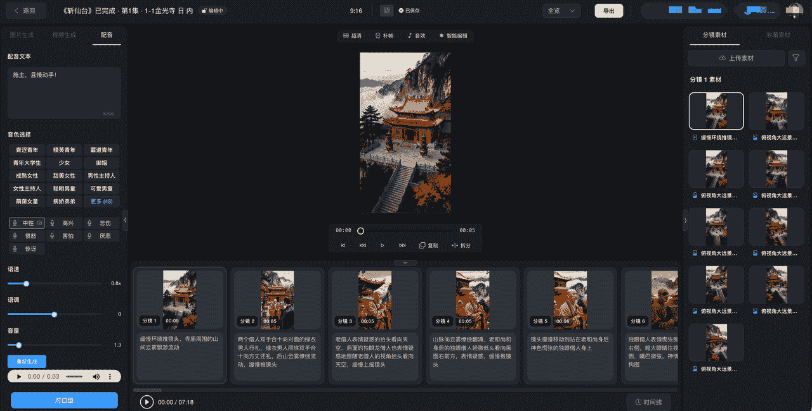

---

# 实战学习

**3** 位教练，2 位助教，1 位顾问，持续 21 天，超过 6 万字的实战手册，带你系统掌握 AI 漫剧的制作能力！

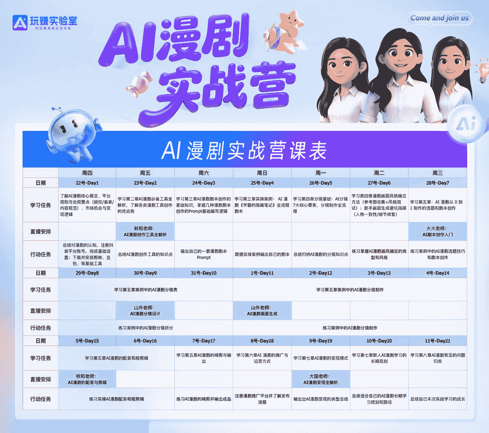

**进 AI 漫剧实战及交**流群联系🛰️

（已有🛰️不用重复加）

