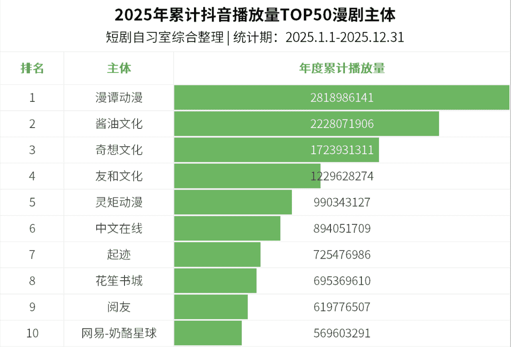
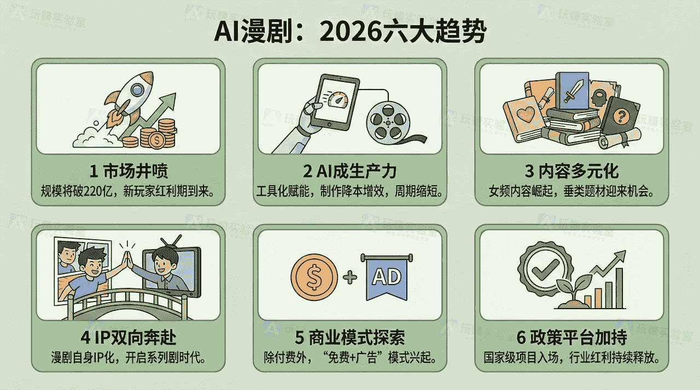
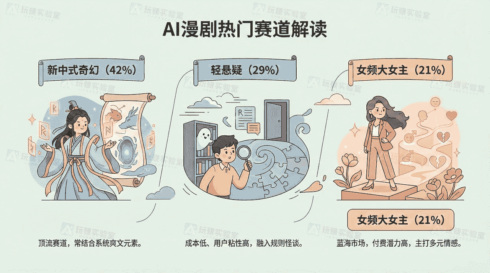
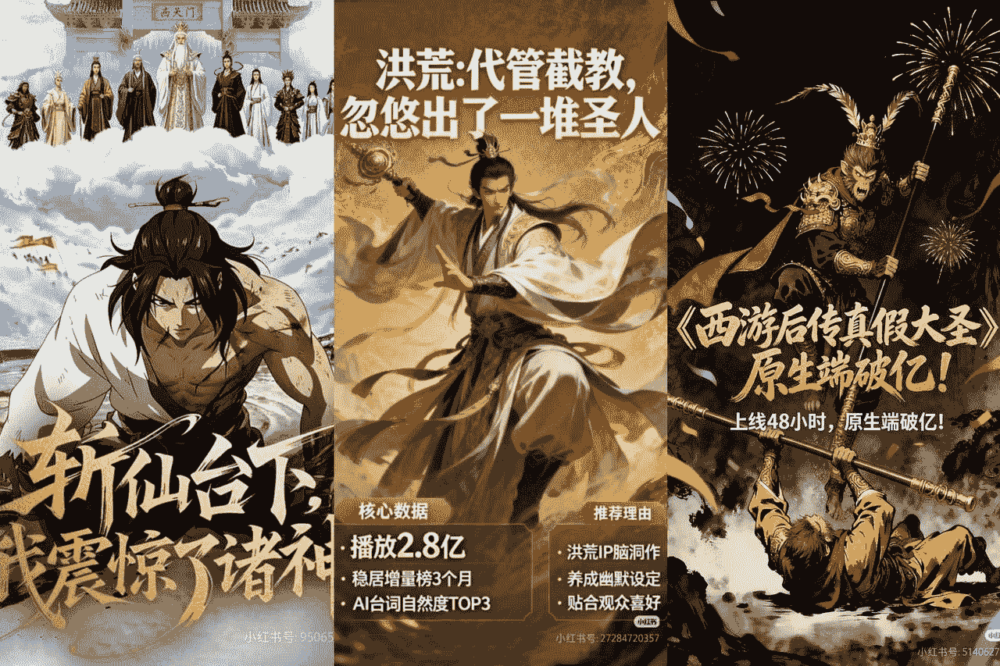
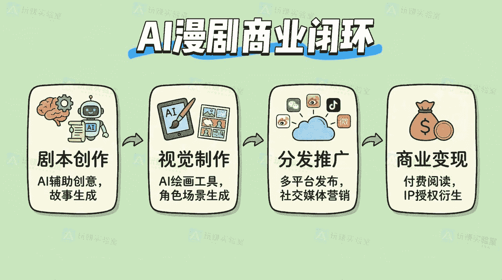
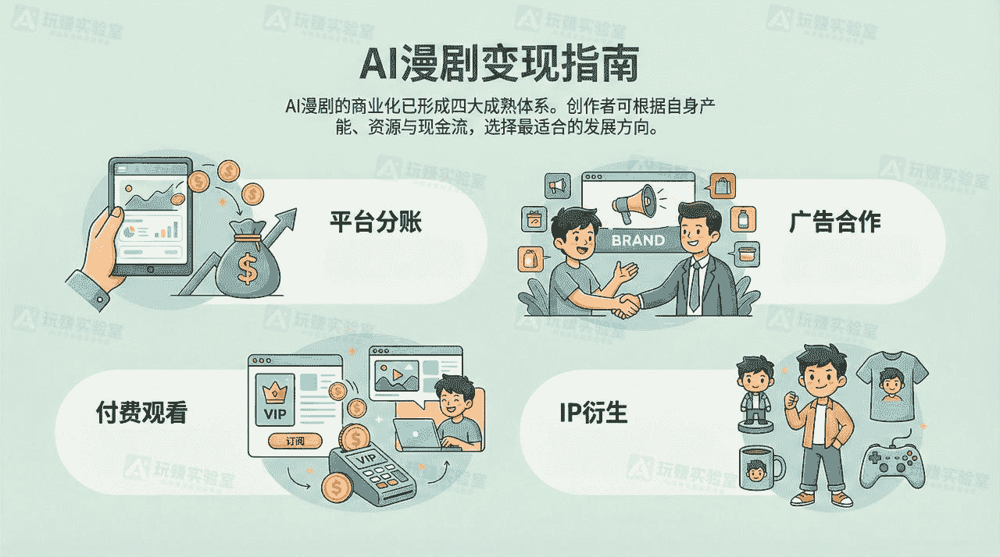

# 社区共学课件：零基础 AI 漫剧入门及制作指南

> 来源：[https://yunyinghui.feishu.cn/docx/Nn2fdSBfco4kxcx9o7scrVdIn0d](https://yunyinghui.feishu.cn/docx/Nn2fdSBfco4kxcx9o7scrVdIn0d)

---

# 自我介绍

**火火**

+   万象 AI 实验室内容共创者

+   重庆交通大学人工智能硕士

+   10 万+粉丝博主，字节小云雀超创

+   昆明自贸区动漫创作合作方

---

# 直播回放

> **直播回放 **

[零基础A漫剧入门及制作指南.mp4](https://internal-api-drive-stream.feishu.cn/space/api/box/stream/download/all/BhRebuNCnoSZsLxvWw6c8YuOnAf)

---

# 一、认知篇：2026 年 AI 漫剧发展趋势解

## AI 漫剧的概念

## 2025 年 AI 漫剧市场观察

#### 1）市场规模：757 亿播放量 +3.7 万部剧目，进入“规模化爆发期”

+   **播放量与消费需求****：2025 年抖音端**漫剧全年累计播放量达 757.72 亿次，其中下半年贡献超 60%增量——7 月后投流日耗从 400 万飙升至 12 月的 2000 万，单月播放量峰值突破 100 亿次（巨量引擎直客业务数据）。这一数据印证了用户对漫剧的消费需求已被完全点燃，尤其 Z 世代用户占比超 72%。

+   **内容供给爆发****：仅抖音平台 2**025 年新上线漫剧达 37583 部，较 2024 年增长超 5 倍。供给爆发的核心驱动力是“技术降门槛”——快手可灵、抖音即梦、Vidu 等 AI 工具实现“角色一致性控制”“动作连贯性优化”，叠加漫屋 AI、幻舟 AI 等一站式平台，使个人创作者“一台电脑即可出片”，中小团队月产能从 2024 年的 5-10 部提升至 2025 年的 50-70 部。

+   **市场结构：“金字塔式分化”显著**从播放量分布看，行业呈现“**头部垄断、尾部沉寂**”的格局（数据来源：《短剧自习室》2025 年度剧目统计）：

| **播放量区间** | **剧目数量（部）** | **占比** | **典型特征** |
| --- | --- | --- | --- |
| ≤100 万 | 30042 | 80% | “炮灰地带”，多为个人创作 |
| 100 万 -1000 万 | 5899 | 15.7% | 中小团队试水作品 |
| 1000 万 -1 亿 | 1573 | 4.2% | 具备一定 IP 基础的作品 |
| 1 亿 -5 亿 | 68 | 0.18% | 头部团队主力作品 |
| &gt;5 亿（剧王） | 1 | 0.003% | AI 漫《斩仙台下，我震惊了诸神》（10.6 亿播放） |

#### 2）技术突破：AI 重构“全流程生产”，成本降至传统模式 1/5

2025 年 AI 技术对漫剧的改造已从“单一环节辅助”升级为“全链路渗透”，核心突破集中在三大领域：

+   **角色与场景一致性**：快手“可灵 AI”的“角色记忆技术”可通过 3-9 张参考图，实现同一角色在不同场景（古风庭院、战斗场景）中的视觉统一，解决早期“每集变脸”的行业痛点；抖音即梦 4.0 支持“风格定制”，输入“国漫水墨风+仙侠场景”即可生成符合设定的批量素材。

+   **生产效率提升**：传统 2D 动画单集（5 分钟）制作需 10 人团队 1 周，成本超 2 万元；2025 年通过“AI 脚本生成+分镜自动化+配音合成”，1 人 3 天可完成 1 集，成本降至 4000 元以内，效率提升超 10 倍（酱油文化案例：月产 100-150 部漫剧，团队规模 1000 人，摘要 1、3）。

+   **工具生态成熟**：形成“脚本-视觉-后期”全链条工具矩阵，免费工具覆盖个人创作需求（如下表）：

| **工具类型** | **代表工具** | **核心功能** | **适用人群** |
| --- | --- | --- | --- |
| 脚本生成 | 豆包、DeepSeek | 结构化分镜输出、爆款逻辑提炼 | 零基础个人 |
| 视觉制作 | 抖音即梦、Vidu | 角色建模、场景生成、动作连贯化 | 个人/中小团队 |
| 后期合成 | 剪映专业版 | AI 配音、自动字幕、转场特效 | 全人群 |
| 一站式平台 | 巨日禄 | 输入剧本自动完成分镜-动画-配音全流程 | 零基础个人 |

#### 3）头部格局：“三强领跑+梯队稳定”，公司化运营成主流

**2025 年抖音端漫剧播放量** TOP10 主体中，漫谭动漫、酱油文化、奇想文化形成“第一梯队”，断层领先（数据来源：《短剧自习室》2025 年度主体排名）：

+   漫谭动漫：年度播放 28.19 亿，巨量引擎日耗破 219 万，单剧月分账超 200 万，连续 3 个月登顶播放增量榜；

+   酱油文化：年度播放 22.28 亿，月营收 5000 万，首个获阅文投资的漫剧公司，IP 改编占比超 60%；

+   奇想文化：传统番剧转型代表，动态漫《全民诡异 开局掌握零元购》全年播放超 3.6 亿，与书旗达成深度合作。

---

## 2026 年 AI 漫剧趋势分析

根据抖音巨量引擎在 2026 年初的最新预测：2026 年，抖音漫剧的市场规模将达到 220 亿元。同时，漫剧用户以 85%的“40 岁以下”年轻人和超 60%的男性为主，他们正以每年 24%的复合增速疯狂消费内容，这里为大家梳理了 6 大核心趋势：

### 趋势一：市场规模持续井喷，“黄金窗口期”就在眼前

前两年的短剧有多火？爆发期（2021 年 -2023 年）《无双》等爆款流水破亿，市场规模 373.9 亿元，但，短剧不是普通人的机会！

2025 年——AI** 漫剧元**年，短剧+漫**剧总产值突破千亿。AI** 漫剧行业从“概念验证”闪电进入“规模化增长与商业化爆发”的黄金窗口。投流日耗从年初的 400 万一路飙升至年末的单日破 2000 万，市场需求被彻底点燃。

2025 年漫剧整体市场规模突破 200 亿量级。这个数字意味着，它不再是小众玩物，而是一个足以孕育巨头、改变无数人命运的全新内容产业，供需两端远未饱和，为新玩家留出了广阔的入场空间和红利期。

目前 AI 漫剧制作人才，是各大制作公司争夺的焦点稀缺资源。

---

### 趋势二：AI 技术“工具性”凸显，效率革命是根本驱动力

如**果说 2025**** 年****上**半年，AI 漫剧还是让人惊叹的“技术奇观”，那么到年底，它已经演变为实实在在的“生产工具”和“效率引擎”。漫剧因 AI 工具赋能，已经成为普通人可参与的机会。

漫剧市场爆发核心标志是 AI 漫剧的成熟与量产，这意味着什么？

意味着 AI 将内容生产的“可变成本”（人力、场地、拍摄周期）大规模转化为“固定成本”（算力、工具采购）。一个传统需要 100 人的剧组，现在可能只需要 10 个懂 AI 工具的核心创意人员。制作周期从天、周计算，压缩到以小时、天为单位。

“AI 不是选择题，而是生存题。” —— 行业头部玩家的这句话，道破了本质。在未来，不会用 AI 工具提升效率的团队，将在成本上毫无竞争力。

---

### **趋势****三**：内容题材从“三幻”独大，走向多元化破局

**2025 年的漫剧**内容，可以概括为 “男频主场，逆袭王道” 。

播放量最高的题材标签是：#架空玄幻#（118.7 亿）、#逆袭#（97.2 亿）、#奇幻#魔幻（69.5 亿）。剧名高频词是：“重生”、“开局”、“无敌”、“系统”。

但是，变化正在发生：

1.  **女频内容即将崛起：**尽管 2025 年 TOP100 中女频剧仅有 6 部，但 #甜宠# 标签依然拿下了超 28 亿播放。多个头部团队已明确表示，女频内容正处于上线测试阶段，2026 年将是其爆发之年。《公主殿下，你的钞能力已到账》

1.  **垂类题材大有可为：**例如“年代”题材，凭借《重生年代我靠神牛迎娶资本家大小姐》等剧，以较小的供给量获得了极高的播放回报，证明了特定用户群强大的付费意愿。

1.  经典 IP 二创需谨慎把握尺度：“西游”、“封神”等元素成为新爆款密码（如周榜冠军《西游后传真假大圣》）。但同时要注意，国家已开展“AI 魔改”专项治理，对经典名著、历史、革命题材的改编有明确红线，核心是“尊重原著精神，不颠覆基本认知和价值观”。

---

### **趋势****四**：IP 化与短剧的“双向奔赴”正在加速

漫剧与 IP 的关系，已从“改编”升级为 “互相成就”。

一方面，漫剧以极低的成本和极快的速度，盘活了大量腰尾部网文 IP，验证了其商业价值。

另一方面，漫剧自身也在快速 IP 化，进入“系列剧时代”。很多爆款都分季开发，多季上榜（如《全民诡异 开局掌握零元购》）。

平台政策也向系列化、IP 化倾斜。例如爱奇艺的漫剧合作计划，明确奖励“有多季规划、更新稳定”的内容。数据显示，集数在 41-60 集、时长在 60-120 分钟的漫剧，是播放表现和商业回报最佳的“黄金区间”，这也为系列开发提供了天然土壤。

本质是“**AI+IP**”的落地，我们很可能正在见证下一个超级内容平台的诞生。

---

### **趋势****五**：商业模式从“付费”单腿走路，到“免费+”多元探索

目前，抖音端付费漫剧在剧目数、播放量上占据绝对主导（占比约 86%-93%）。但免费模式正在悄然发育。

一个标志性事件是：“红果免费漫剧”APP 的上线。这显然是借鉴真人短剧的成功路径，试图以“免费”策略快速构建流量池，通过广告（IAA）模式变现。

行业预测，当付费模式触及增长天花板后，商业模式会向“免费”或“会员”模式倾斜。友和文化联合创始人预测：“春节期，抖音+快手漫剧投流大盘可能突破 4000 万/日，拐点源于 IAA（广告变现）内容的大量供给。”

对于新人来说，这意味着除了传统的付费分账，未来还会有更多基于流量和广告的变现路径可供选择。

---

### **趋势****六****：**政策与平台双重加持，红利持续释放

**国家级 AI 漫剧项目落地**

2026 年，1 月 7 日，中央广播电视总台“赢在一起”央视频 2026 年精品节目片单发布活动在京举行。

活动现场正式官宣《中国 AI 漫剧大会》和《CMG 首届中国 AI 漫剧之夜》两大国家级原创项目，并推出总台首部精品 AI 漫剧《山海经之破混沌记》。

《中国 AI 漫剧大会》定位为大型新业态项目，旨在通过专业赛制系统性发掘、孵化和展示代表中国 AI 漫剧前沿水准的优秀作品，汇聚创作、技术与学术力量，推动行业标准与规范的建立。

《CMG 首届中国 AI 漫剧之夜》以“漫剧连接多元文化”为主题，致力于打造跨界交流与思想碰撞的平台，邀请文化学者、艺术家及产业代表，共同探讨 AI 漫剧的艺术可能性与未来发展路径。

地方政府专项扶持

多地政府已将 AI 漫**剧纳入数字文**创产**业扶持范畴，明确给出资金、**税收、场地等补贴：

浙江省文旅厅《数字文创产业高质量发展三年行动计划（2024-2026）》提**出，对 AI 漫剧等数**字内容**创作项目给予最高 500 **万**元的创作补贴，同时对入驻省**级文创园区的团队给予 3 年场地租金减免。

广东省 “粤文惠” 政策：对 AI 内容创作企业给予增值税即征即退、研发费用加计扣除等税收优惠，单个项目最高可获 200 万元研发补贴。

上海市 “元宇宙文创扶持计划”：将 AI 漫剧纳入元宇宙内容孵化赛道，对优质项目提供 IP 版权登记补贴、海外发行渠道对接等支持。

各大平台流量与分成倾斜

头部短视频平台已针对 AI 漫剧推出专项扶持计划，直接降低创作者启动门槛：

抖音 “漫剧星计划”：对优质 AI 漫剧创作者给予流量分成提升 30%的激励，同时设立 1 亿元专项激励池，每月评选 “漫剧爆款王”，额外奖励 10-50 万流量包；平台还开放小说 IP 库，创作者可免费改编热门网文。

快手 “光合计划 - 漫剧赛道”：新入驻创作者可获得 10 万冷启动流量包，商单对接通道优先开放，且对 AI 漫剧的分成比例最高提升至 40%（普通短剧为 25%）。

视频号 “短剧扶持计划”：AI 漫剧内容可获得 “专属流量标签”，算法推荐权重提升 20%，同时打通微信读书 IP 库，支持漫剧与小说联动变现。

B 站 “国创漫剧扶持”：对原创 AI 漫剧提供创作工具补贴（如 Midjourney 会员、剪映专业版免费使用），优质项目可纳入 B 站 “国创” 专区，获得首页推荐和 IP 孵化资源。

---

## **2026 年**** AI 漫剧****个人创作者机会点展望**

**2026 年 AI **漫剧赛道持续爆发，但个人创作者及小工作室仍有“低门槛试错+垂直突围”的机遇，核心机会集中在：

#### 1、 零门槛入局：工具普惠+高分成

+   工具层面：免费工具（剪映、豆包、即梦 AI）覆盖全流程，个人无需技术背景，1 周可掌握基础操作；

+   分成层面：平台为吸引创作者，分账比例最高达 95%（抖音“星光计划”、番茄 IP 改编补贴），单部播放 100 万即可获得 5-10 万元分账。

#### 2、垂直赛道“小而美”

**个人及小工作室创作**者无需与头部团队比拼 IP 储备，可深耕“细分题材+小众风格”：

+   案例 1：B 站 UP 主“像素诗人”用 AI 制作科幻漫剧《量子玫瑰》，单集成本 200 元，靠“硬科幻+脑洞剧情”3 个月涨粉 50 万；

+   案例 2：小红书博主“汉服画师阿棠”结合汉服与南美魔幻元素，创作《丝绸与火烈鸟》，在抖音获 2.3 亿播放，避开玄幻红海。

#### 3、出海“差异化竞争”

个人及小工作室可借助 AI 翻译工具制作小**语种漫剧（**东南亚印尼语、马来语），主打“本土化题材”（如东南亚民俗恐怖、家庭伦理），避开国内竞争——2026 年东南亚漫剧供给不足，个人作品易获平台流量扶持。

---

#  二、赛道篇：AI 漫剧的 3 大热门赛道解读分析

## 关键词：告别红海赛道  内容精品化

AI 漫剧当前三大热门赛道，分别是：新中式奇幻+系统爽文（顶流赛道）、轻悬疑+规则怪谈（低成本高粘性）、女频大女主+多元情感（蓝海高付费）。

## 赛道一：新中式奇幻+系统爽文（顶流赛道）

+   核心逻辑：传统神话/道家符箓+赛博/机甲等现代设定，传统元素占比 30%-50%；系统规则清晰、每 5 章至少 1 次大冲突，AI 易出视觉奇观，平台流量倾斜明显。

+   爆款案例：《斩仙台下，我震惊了诸神！》融合《西游记》《封神演义》国民 IP，AI 生成宏大战斗场面与快节奏剪辑，播放量达 6.3 亿，成为男频漫剧标杆。

+   创作要点：人设“逆袭+反套路”，场景用 AI 批量生成古风+科幻混合风格，打斗特效 AI 降本增效，单集制作周期从 7 天缩至 1 天。

+   变现路径：平台分成+付费解锁+IP 授权，头部作品单月分成可达百万级。（每个赛道两个案例）

## 赛道二、轻悬疑+规则怪谈（中小团队首选）

+   核心逻辑：3 个以内固定场景（公寓/校园/基地）+ 简单易懂规则 + 每集强反转；制作成本低、更新稳定，用户留存与完播率高，适合小团队与个人创作。

+   爆款案例：《我在末世开超市，S 级诡异抢着来上班》以“末世+超市经营+规则怪谈”组合，单集完播率 12%，全网播放量 2.1 亿，审核风险低。

+   创作要点：规则清晰无歧义，AI 批量生成同场景不同氛围画面，用 AI 配音强化悬疑感，每集结尾留钩子提升追更率。

+   变现路径：平台广告分成+激励计划，单账号月入 3-8 万，起号快、回款稳。

## 赛道三、女频大女主+多元情感（蓝海赛道）

+   核心逻辑：打破男频垄断，聚焦“无恋爱脑女主+清晰成长线+反差情感（年下/救赎）”，付费转化率普遍超男频 30%，市场空间广阔。

+   爆款案例：《星际兽世：雌主她觉醒了神豪系统后杀疯了》以女尊星际兽人世界+神豪系统+大女主逆袭设定，播放量 1.3 亿，付费率领先男频同类作品。

+   创作要点：女主设定“强能力+高智商”，AI 定制将军/总裁/学霸等女强人设，情感细节 AI 自动补充微表情与肢体语言，提升代入感。

+   变现路径：微信小程序“前免费后付费”，单集付费用户超 2 万，月入可达 8 万+，女性向 IP 授权溢价更高。

## 三大赛道对比表

| **赛道** | **适合团队** | **制作成本** | **播放量潜力** | **完播率** | **竞争程度** |
| --- | --- | --- | --- | --- | --- |
| 新中式奇幻+系统爽文 | 中大型团队 | 中高（5-10 万/部） | ★★★★★（1 亿+） | ★★★☆☆( 40-50%) | 高 |
| 轻悬疑+规则怪谈 | 小团队/个人 | 低（&lt;1 万/部） | ★★★☆☆（500 万+） | ★★★★★( 60-80%) | 中 |
| 女频大女主+多元情感 | 全类型团队 | 中（2-5 万/部） | ★★★★☆（8000 万+） | ★★★★☆( 50-60%) | 低（蓝海） |

#### 三大赛道入局建议

+   **新中式奇幻+系统爽文：**适合团队作战，投入中等，回报上限高。

+   **轻悬疑+规则怪谈：**个人/小团队首选，投入低，完播率高，适合快速起号。

+   **女频大女主+多元情感：**蓝海赛道，投入中等，付费转化强，女性用户付费意愿高。

+   **入局建议：**优先选轻悬疑起号练手，同步布局女频赛道，待团队成熟后切入新中式奇幻，构建“快变现+高增长”双轨模式。切记入局就选宏达世界观的主题。

---

# 三、技能篇：AI 漫剧制作流程的核心卡点解读

**AI 漫剧商业闭环基本流程**

一部 AI 漫剧的商业闭环需经历“剧本创作→视觉制作→流量分发→商业化变现”四大环节，每个环节均存在“技术+内容+合规”的核心卡点，解决这些问题是从“能做”到“做好”的关键。（漫剧商业闭环的流程图）

##  卡点一：高质量有版权的原创剧本

### 核心问题

+   **AI 生成剧本“逻辑硬伤”**：目前 AI（如 ChatGPT、豆包）生成的剧本普遍存在“剧情套路化”“人物动机模糊”问题，2026 年开年监测显示，60% AI 剧本有“逆袭剧情重复”（如“废柴觉醒→打脸反派”），用户弃剧率超 50%；

+   **版权侵权风险高**：AI 训练数据含大量未授权网文、漫画，2025 年知乎盐言故事跟进 68 起漫剧侵权案，13 起已立案，单案赔偿金额最高达 50 万元；

+   **原创能力不足**：个人创作者缺乏“用户洞察”，难以打造“强冲突+快节奏”的剧本——漫剧需每 30 秒设置 1 个“钩子”（如“证据出现”“追杀场景”），否则 3 秒完播率会低于 30%。

###  解决方案

+   **“AI 辅助+人工优化”模式**：

1.  用 AI 生成初稿：输入“女频甜宠+重生+职场”，让豆包生成 10 集剧本框架；

1.  人工优化“钩子”：在第 1 集 30 秒加入“女主发现丈夫出轨证据”，第 2 集 1 分钟加入“女主获得重生金手指”；

1.  逻辑校验：用“DeepSeek”分析剧情连贯性，修正“人物动机矛盾”（如“女主明明恨男主，却突然原谅”）。

+   **合规化 IP 获取**：

| **IP 来源渠道** | **优势** | **劣势** | **适用主体** |
| --- | --- | --- | --- |
| 平台开放 IP 库 | 版权清晰，部分免费（如阅文“创作合伙人计划”） | 热门 IP 竞争激烈 | 个人/中小团队 |
| 原创 IP 备案 | 独家性强，可衍生开发 | 需投入 3-6 个月打磨 | 中大型团队 |
| 小众 IP 授权 | 成本低（1-5 万元/部），竞争小 | 知名度低，需自行推广 | 个人/小团队 |

## 卡点二：人物一致性解决

### 核心问题

+   **角色“变脸”**：早期 AI 工具生成的角色在不同场景（如室内/室外）中，五官、发型甚至肤色会变化，用户识别度低，2025 年上半年有 40% AI 漫因“变脸”被用户投诉；

+   **动作僵硬**：AI 生成的角色动作常出现“关节扭曲”“动作不连贯”，尤其是战斗场景，观赏性差；

+   **风格不统一**：同一部漫剧中，角色画风（如国漫 vs 日漫）、场景风格（古风 vs 现代）混杂，破坏沉浸感。

###  解决方案

+   **技术工具选择**：

+   2D 漫：优先用“快手可灵 AI”“抖音即梦 4.0”，上传 3-5 张角色参考图（正面、侧面、动态），生成“角色一致性模型”，后续场景自动匹配角色特征；

+   3D 漫：用“Vidu 3D 模块”，建立角色“骨骼绑定”模板，动作生成时保持关节自然。

+   **人工微调流程**：

1.  AI 生成初稿后，用“Photoshop”修正角色五官差异（如眼睛大小、鼻子形状）；

1.  用“剪映专业版”的“动作顺滑”功能，优化关节扭曲帧（如将“手臂 90 度弯曲”调整为“120 度自然弯曲”）；

1.  风格统一：在 AI 工具中预设“风格关键词”（如“国漫水墨风+古风场景+柔和光影”），所有素材生成时强制匹配该关键词（酱油文化案例：通过此方法将角色一致性合格率从 60%提升至 95%，摘要 3）。

+   **测试验证**：将 3 分钟样片发给 10-20 人测试小组，询问“能否识别出同一角色”，若识别率低于 80%，需重新优化模型。

## 卡点三：流量分发没流量

### 核心问题

+   **平台算法适配难**：抖音、快手的推荐算法侧重“3 秒完播率”“互动率（点赞/评论/转发）”，个人创作者的作品常因“开头无钩子”导致推荐中断；

+   **头部垄断流量**：2025 年 TOP10 漫剧占据 50%以上播放量，中小团队作品易“石沉大海”——播放量≤100 万的剧目占 80%；

+   **标签运营混乱**：错误使用标签（如将“女频甜宠”标为“玄幻”）导致流量精准度低，2026 年开年有 25%作品因标签错误错过目标用户。

### 解决方案

+   **算法适配技巧**：

+   开头 3 秒：用“强视觉钩子”（如女频漫剧开头展示“男主求婚钻戒”，男频漫剧开头展示“战斗爆炸场景”），将 3 秒完播率从 30%提升至 60%以上；

+   互动引导：在第 1 分钟、第 3 分钟加入“弹幕提问”（如“你觉得女主该原谅男主吗？”），提升评论率；

+   发布时间：根据平台数据，抖音漫剧黄金发布时间为 12:00-14:00（午休）、19:00-22:00（晚间），播放量比其他时间高 40%。

+   **差异化流量策略**：

+   个人创作者：聚焦“垂直标签”（如“职场漫剧+反 PUA”“汉服漫剧+传统文化”），避开“玄幻”“甜宠”大标签，精准触达细分用户；

+   中小团队：参与平台“扶持计划”（如抖音“星光计划”、快手“星芒创想计划”），获得额外流量曝光——2025 年参与计划的作品播放量比普通作品高 2 倍。

+   **标签运营规范**：

1.  核心标签（1-2 个）：对应题材（如“#女频甜宠”“#AI 漫”）；

1.  热门标签（1-2 个）：对应平台热榜（如“#2026 职场漫剧新趋势”）；

1.  长尾标签（2-3 个）：对应细分人群（如“#18-25 岁女生必看”“#东南亚民俗漫剧”）；示例：#女频甜宠 #2026 女频漫剧新趋势 #18-25 岁女生必看 #重生职场漫剧（摘要 6）。

## 卡点四：AI 漫剧发布合规性

### 核心问题

+   **AI 生成内容未标注**：2026 年监管要求所有 AI 漫剧标注“AI 生成”，未标注作品一律下架，2025 年 11 月以来已有 500+作品因未标注被处理；

+   **未成年人保护问题**：含暴力、早恋元素的漫剧若未设置“适龄提示”，会被限流——B 站 2026 开年下架 12 部儿童向漫剧；

+   **文化禁忌违规**：出海漫剧易触碰海外文化禁忌（如中东漫剧出现“饮酒镜头”、北美漫剧出现“种族歧视台词”），2025 年有 30%出海作品被平台下架。

### 解决方案

+   **国内合规操作**：

1.  AI 标注：在视频开头/结尾加入“本作品含 AI 生成内容”字幕，时长不少于 3 秒；

1.  适龄提示：根据内容设置“12+”“16+”“18+”提示，儿童向漫剧避免暴力、恐怖元素；

1.  备案流程：登录“国家广播电视总局网络视听节目管理系统”，提交作品信息（含 AI 生成说明、题材类型），备案通过后再上线。

+   **出海合规操作**：

1.  文化审核：聘请本地文化顾问（如东南亚找印尼文化专家、北美找黑人文化顾问），审核剧本与画面；

1.  平台合规：遵守 YouTube、TikTok 海外版的“内容政策”（如 TikTok 北美版禁止“政治敏感内容”），可参考平台“内容审核指南”调整作品；

1.  案例参考：某团队制作中东漫剧时，将“女主穿短裙”改为“穿传统长袍”，播放量提升 50%，未出现违规。

###  核心卡点解决路径总表

| **核心卡点** | **问题表现** | **解决方案** | **工具/资源支持** |
| --- | --- | --- | --- |
| 剧本（版权+质量） | AI 逻辑硬伤、侵权风险、无钩子 | AI 辅助+人工优化、合规 IP 获取、30 秒钩子 | 豆包、DeepSeek、阅文 IP 库、巨量云图 |
| 人物一致性 | 角色变脸、动作僵硬、风格混乱 | 一致性模型、人工微调、风格关键词 | 快手可灵、抖音即梦、Photoshop、剪映 |
| 流量分发 | 3 秒完播率低、头部垄断、标签混乱 | 开头钩子、垂直标签、平台扶持计划 | 巨量云图、抖音星光计划、快手星芒计划 |
| 合规性 | 未标注 AI、未成年人保护、文化禁忌 | AI 标注、适龄提示、本地文化审核 | 广电总局备案系统、本地文化顾问 |

---

# 四、商业篇：AI 漫剧变现的主要 4 大类型

AI 漫剧的变现模式已形成“平台分账+广告合作+付费**观看+IP 衍生”四大体系，**不同模式的“收益周期、操作难度**、适用主体”差异显著，个**人与团队需根据“产能、IP 储备、现金流”选择适配方向。

## 变现类型一：平台分账

####  模式定义

平台分账是指漫剧在抖音、快手、爱奇艺等平台播放后，平台根据“播放量、完播率、广告曝光”向创作者支付分成，是目前最主流、门槛最低的变现方式。

####  核心规则与收益

+   **分账比例**：平台间差异较大，头部平台对优质内容倾斜明显（如下表）；

| **平台** | **基础分账比例** | **优质内容额外分成** | **分账周期** | **核心考核指标** |
| --- | --- | --- | --- | --- |
| 抖音 | 70%-80% | 最高 15%（完播率≥60%） | 1 个月 | 3 秒完播率、广告点击量 |
| 快手 | 65%-75% | 最高 20%（参与星芒计划） | 1 个月 | 播放量、互动率 |
| 爱奇艺 | 75%-85% | 最高 10%（IP 改编） | 2 个月 | 会员观看时长 |
| 番茄小说 | 80%-90% | 最高 5%（原创 IP） | 1 个月 | 阅读转化率（漫剧→小说） |

+   **收益案例**：

+   个人创作者：单部漫剧（20 集，每集 3 分钟）播放 100 万，抖音分账比例 70%，广告曝光收益 5 万元，可得 3.5 万元；

+   中小团队：月产 10 部漫剧，平均每部播放 500 万，快手分账比例 75%，月分账可达 15-20 万元（酱油文化子团队数据。

#### 适用主体与操作建议

+   **适用主体**：零基础个人、小团队（产能≤10 部/月），无 IP 储备、现金流有限；

+   **操作建议**：

1.  前期聚焦 1 个平台：避免多平台分发导致精力分散，建议从抖音/快手起步（用户基数大，分账周期短）；

1.  优化考核指标：通过“开头 3 秒钩子”提升 3 秒完播率（如男频漫剧开头放“战斗场景”），通过“剧中广告植入”（如主角用某品牌手机）提升广告点击量；

1.  参与分账活动：如抖音“漫剧分账挑战赛”，获奖作品可获得额外 50%分账。

##  变现类型二：广告合作

#### 模式定义

**广告合作是指创作者**与品牌方合作，在漫剧中植入“产品镜头、品牌台词”，按“曝光量、转化量”获得广告费，适合“有稳定产能、垂直用户群体”的创作者。

#### 核心形式与收益

+   **主要合作形式**：

| **合作形式** | **操作方式** | **收益计算方式** | **品牌方类型** |
| --- | --- | --- | --- |
| 场景植入 | 剧中出现品牌产品（如主角喝某饮料） | 固定费用（1-5 万元/部） | 快消品、3C 产品 |
| 台词植入 | 角色提及品牌（如“我用 XXAPP 追剧”） | 固定费用+曝光分成 | 互联网平台、游戏 |
| 定制漫剧 | 为品牌定制剧情（如“XX 品牌职场故事”） | 项目费（10-50 万元/部） | 汽车、金融品牌 |

+   **收益趋势**：2026 年开年漫剧广告报价显著上涨，场景植入从 3000-5 万元/条升至 5-15 万元/条，定制漫剧溢价超 100%（某广告公司数据，摘要 6）。

####  适用主体与操作建议

+   **适用主体**：中小团队（产能 10-50 部/月）、有垂直用户（如“职场漫剧”对应职场人群）；

+   **操作建议**：

1.  积累案例：先免费为中小品牌植入（如本地奶茶店），制作“广告合作案例集”，再对接大品牌；

1.  精准匹配：“女频甜宠漫剧”对接美妆、珠宝品牌，“职场漫剧”对接办公软件、咖啡品牌，转化率更高；

1.  避免硬植入：将产品融入剧情（如“女主用 XXAPP 处理工作，解决职场危机”），用户接受度比“直接展示产品”高 3 倍。

## 变现类型三：付费观看

#### 模式定义

付费观看是指用户按“单集”或“全集”付费观看漫剧（如单集 1-3 元，全集 10-20 元），是头部团队的核心变现方式，需“优质 IP+强剧情”支撑。

####  核心规则与收益

+   **付费模式**：

+   单集付费：适合长篇漫剧（30 集以上），用户按需购买，降低决策门槛；

+   全集解锁：适合短篇漫剧（10-20 集），一次性付费，收益集中；

+   会员抢先看：平台会员可免费观看，创作者获得会员分账（如爱奇艺漫剧会员分账占比超 60%）。

+   **收益案例**：

+   漫谭动漫《斩仙台下，我震惊了诸神》（10.6 亿播放）：全集定价 18 元，付费转化率 12%，付费用户超 100 万，付费收益 1800 万元；

+   女频漫剧《重生嫡女：王爷请接招》：单集 2 元，30 集全集 50 元，付费用户 50 万，收益 2500 万元。

#### 适用主体与操作建议

+   **适用主体**：中大型团队（产能 50-100 部/月）、有优质 IP（如阅文 S 级 IP 改编）、剧情能力强；

+   **操作建议**：

1.  试看引流：前 3 集免费，第 4 集开始付费，免费集需埋下“剧情伏笔”（如“女主发现身世之谜，付费集揭晓”）；

1.  定价策略：单集定价 1-2 元（大众题材）、2-3 元（小众优质题材），全集定价为单集总价的 70%（如 30 集单集 2 元，全集 42 元），提升全集购买率；

1.  付费运营：通过“剧情预告”（如“下集男主身份曝光”）、“粉丝群互动”（如投票决定剧情走向），提升复购率。

## 变现类型四：IP 衍生与出海

#### 模式定义

**IP 衍生是指基于漫剧 I**P 开发“衍生品、数字藏品、线下活动”，出海是指将漫剧授权给海外平台或制作本地化版本，两者均为“长期变现”方向，需“IP 知名度”支撑。

#### 核心形式与收益

+   **IP 衍生形式**：

| **衍生类型** | **操作方式** | **收益周期** | **案例** |
| --- | --- | --- | --- |
| 衍生品 | 开发角色手办、周边（如 T 恤、抱枕） | 3-6 个月 | 《斩仙台下》手办定价 99 元，销量 10 万件，收益 990 万元 |
| 数字藏品 | 发行角色 NFT、剧情数字卡片 | 1-2 个月 | 某漫剧数字藏品定价 199 元，销量 5 万份，收益 995 万元 |
| 线下活动 | 漫剧主题展、粉丝见面会 | 1-3 个月 | 《全民诡异》主题展门票 50 元，参展 10 万人次，收益 500 万元 |

+   **出海形式**：

+   平台授权：将漫剧授权给 YouTube、TikTok 海外版，按播放量分账（如 YouTube 分账比例 45%-55%）；

+   本地化制作：针对海外市场改编剧情（如东南亚版加入本地民俗），委托当地团队发行，收益分成（如某团队东南亚出海收益占比达 30%，摘要 3、6）。

#### 适用主体与操作建议

+   **适用主体**：头部团队（有爆款 IP）、中大型团队（有出海能力）；

+   **操作建议**：

1.  IP 沉淀：先通过“平台分账+付费观看”提升 IP 知名度（如播放超 1 亿），再开发衍生；

1.  出海本地化：东南亚市场优先选择“民俗恐怖、家庭伦理”题材，北美市场优先“超级英雄、科幻”题材；

1.  轻资产试错：衍生品先采用“预售+代工”模式（无库存风险），出海先授权再自建团队（摘要 3、6）。

##  四大变现类型对比与适配推荐

| **变现类型** | **收益周期** | **操作难度** | **单部收益上限** | **适用主体** | **推荐优先级（个人）** | **推荐优先级（团队）** |
| --- | --- | --- | --- | --- | --- | --- |
| 平台分账 | 1-2 个月 | ★☆☆☆☆ | 10 万元 | 零基础个人、小团队 | ★★★★★ | ★★★☆☆ |
| 广告合作 | 1 个月 | ★★★☆☆ | 50 万元 | 中小团队（垂直用户） | ★★☆☆☆ | ★★★★☆ |
| 付费观看 | 2-3 个月 | ★★★★☆ | 2000 万元 | 中大型团队（优质 IP） | ★☆☆☆☆ | ★★★★★ |
| IP 衍生+出海 | 3-6 个月 | ★★★★★ | 1000 万元 | 头部团队（爆款 IP） | ★☆☆☆☆ | ★★★☆☆ |

### 个人创作者适配路径（0-1 年）

1.  初期（0-3 个月）：专注“平台分账”，用免费工具制作 2D AI 漫剧（如职场、汉服题材），月产能 3-5 部，目标月收益 1-3 万元；

1.  中期（3-6 个月）：积累播放量（单部超 100 万）后，对接“中小品牌广告合作”（如本地餐饮、美妆），月收益提升至 5-10 万元；

1.  长期（6-12 个月）：深耕垂直赛道（如“职场漫剧”），积累粉丝，尝试“付费观看”（单部定价 5-10 元），月收益 10-20 万元。

### 团队工作室适配路径（0-2 年）

1.  初期（0-6 个月）：“平台分账+广告合作”结合，月产能 10-20 部，目标月收益 10-30 万元；

1.  中期（6-12 个月）：引入优质 IP（如阅文 IP 改编），开展“付费观看”，月产能 50 部，月收益 50-100 万元；

1.  长期（12-24 个月）：开发 IP 衍生（衍生品、数字藏品），布局出海，月收益 100-500 万元（参考酱油文化、漫谭动漫路径，摘要 1、3、6）。

# 总结

从** 2025 年的“爆发元年”**到** 2026 年的“精品化转型”**，AI 漫剧会逐渐告别“**靠量取胜**”的时代，核心竞争力从“**技术门槛**”转向“**内容创意+合规运营**”。对个人创作者而言，“**垂直赛道+工具精通**”是突围关键；对团队而言，“**IP 储备+全链路效率**”是生存根本。

正如友和文化联合创始人曹炎忠所言：“漫剧的拐点，源于优质内容的大量供给。”无论是个人还是团队，唯有深耕内容、敬畏合规、拥抱趋势，才能在上百亿市场红利中抓住属于自己的机遇。

---