# AI漫剧实战营第1期作品展示

> 来源：[https://yunyinghui.feishu.cn/docx/JSPzdMLcyoGHAZxpMnycete2nj3](https://yunyinghui.feishu.cn/docx/JSPzdMLcyoGHAZxpMnycete2nj3)

> **作品声明：**作品来源于万象AI实验室实战伙伴实战学习作业

## 作者：山外、秋和、火火

《灵魂错位》漫剧第1集

[2月3日.mp4](https://internal-api-drive-stream.feishu.cn/space/api/box/stream/download/all/BtNQbe1T4oz87axJn7vcy2wynqc)

##

## 作者：AILI 淑君

[27bc4d779fc4166333cca40c15df5849.mp4](https://internal-api-drive-stream.feishu.cn/space/api/box/stream/download/all/Cpu2bTpx1ox557xAerLcVRjanzh)

> 教练点评：这是一个末日的片子，可以在开头前5秒有一些快切，来展示末日的残酷与生存的艰难。末日题材，节奏一定要做好把控，目前的成片整体有点平。可以尝试在逃避的时候让人物更快，也可以穿插一些人物面部特写镜头来凸显情绪上的恐惧。人物一致性基本不错，要注意人物细节（头发，人数衣服等需要尽量一致），可以继续加油，期待未来完整版作品。

## 作者：庆

《异能契约》漫剧第1集

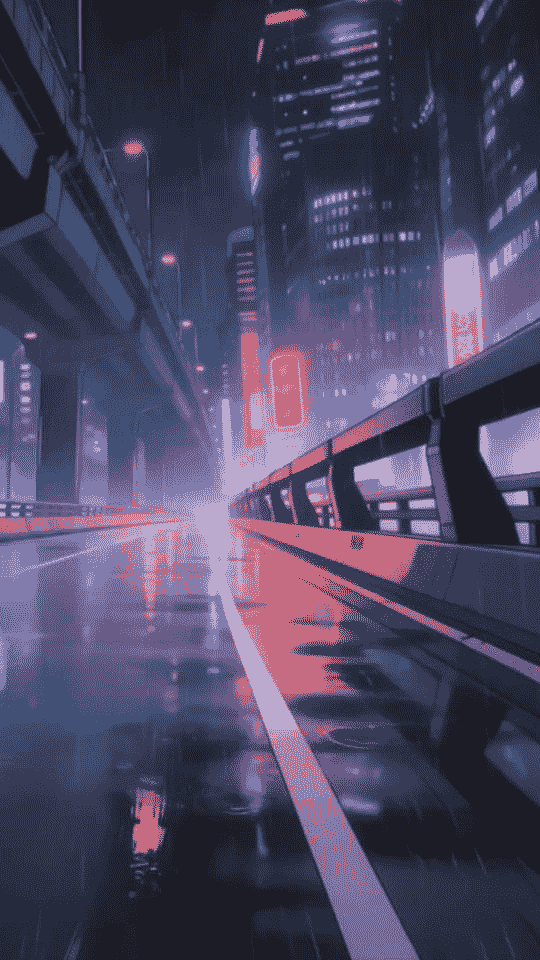

[第一集_x264.mp4](https://internal-api-drive-stream.feishu.cn/space/api/box/stream/download/all/G0XebdXmhoueUrxe2mgcJonUnVh)

《异能契约》漫剧第1集修改

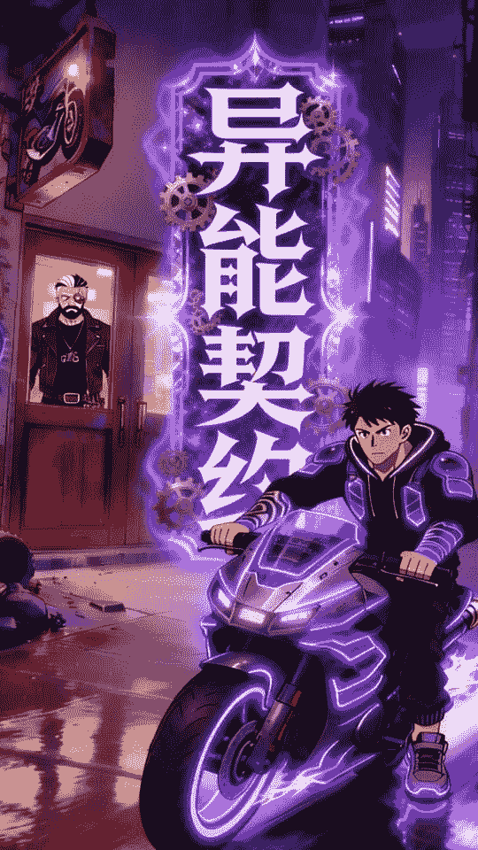

[异能契约重新修改.mp4](https://internal-api-drive-stream.feishu.cn/space/api/box/stream/download/all/FPECbiaFJoc24vxdfclckxMKnph)

> 教练点评：两个版本对比看下来有很多地方进行了优化。作品完成度非常高，会有想看下去的想法。画风很一致，可以看出你有非常扎实的审美和出图的功底。从动效来看，运镜流畅，画面衔接上，会有突然断掉的点，可以通过改变景别来做衔接，配音可能整体还有一些提升空间，字幕可以再优化一下：1、尽可能的断句要短，不出现标点符号；2、如果有字幕的话尽量都有，如果只出一个片段会有作品未完成的错觉。还有我个人的一点建议是，因为“速度”是一个比较关键的点，建议画面的运镜可以再大一些，再“飞”一点，要能在视觉上突出“快”，可以通过加速的方式实现，还有就是通过声音辅助，比如风的声音，引擎的轰鸣声等。“不可能，这速度不是他的”是一种不可置信，可以出现人物的表情，来凸显情绪上的状态。结尾可以再稍微拖长一点，让观众还沉浸在想要停下的状态里，现在收尾有些仓促，有一种戛然而止的感觉。

> 期待后续作品，加油加油！

## 作者：嘉图

第一次练习：《画骨·墨兽篇》

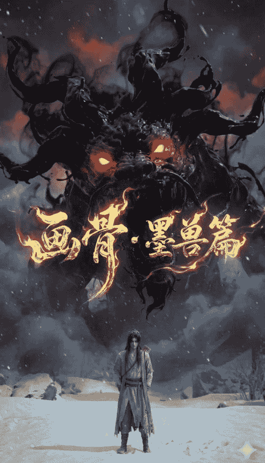

[【样片】画骨·墨兽篇.mp4](https://internal-api-drive-stream.feishu.cn/space/api/box/stream/download/all/YvyybJa88o0nPIx8fEpcY7iwnPe)

第二次练习：《锦绣农途-恶毒贵女只想归隐山林》

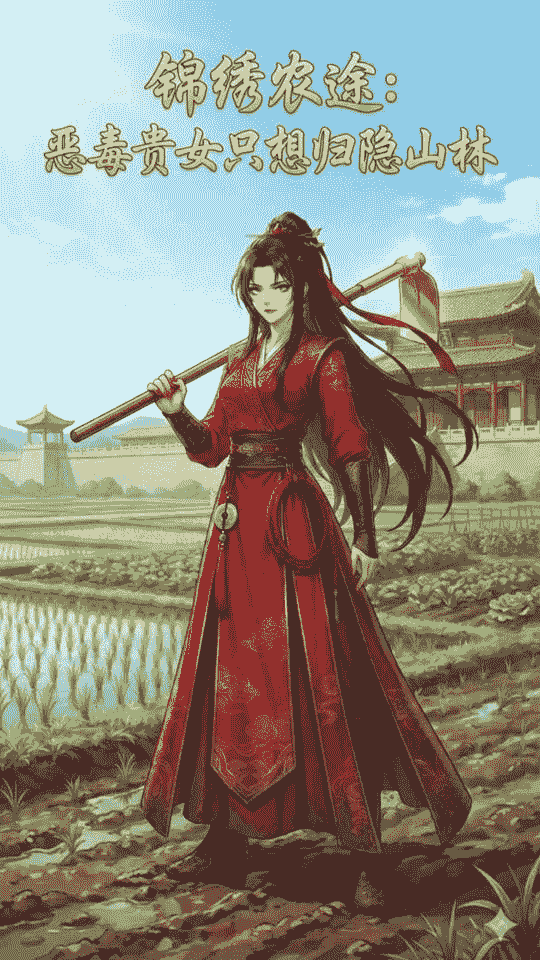

[【样片】锦绣农途.mp4](https://internal-api-drive-stream.feishu.cn/space/api/box/stream/download/all/TGCRbDvrPoccxdxaEwAcKeOBnkk)

> 教练点评：

> 1、画骨·墨兽篇：完成度很高的一个作品，期待后续剧情发展，符合自媒体流量逻辑。人物一致性效果很好。细节上，第一个镜头踩鞋这里，可以采用更近的特写镜头，狠狠踩下去，力量上再大一些，然后前面节奏有点紧凑，可以再最开始配角碾压的时候再嚣张再游刃有余一点，才能形成前后的反差。另外图片右下角的水印尽量去处理干净。全景交代环境和故事背景，特写突出人物性格和情绪。最开始的配角说话，可以对一个口型，用一种嚣张的表情来凸显自己的优越感。饕餮出现之后画面，在节奏上可以做一些调整，烘托出前后的强烈反差来。

> 期待后续完整故事线。

> 2、锦绣农途：首先，这个故事是非常有意思的，希望可以做下去，蹲个后续。

> 小云雀的配音上有一些语气，比AI配音会好一些，但是因为是自动成片，个别镜头画风上是不一致的。这个可以手动替换。细节上可以注意人物的身高比不要差别太大。然后结尾的两个人突然出现，最好在救人之前就有一个位置关系的交代，这样最后出现的时候不突兀。另外可以多添加一些音效来浮现画面中的场景和环境。然后个别人物肢体碰撞，全景略显奇怪，不符合物理规律，建议采用特写镜头完成，规避AI的缺陷。结尾可以再稍微留一个悬念。

> 期待后续完整故事线，PS：两女的故事好大胆。想看后面故事剧情。

## 作者：L-star灵点

神稻降世

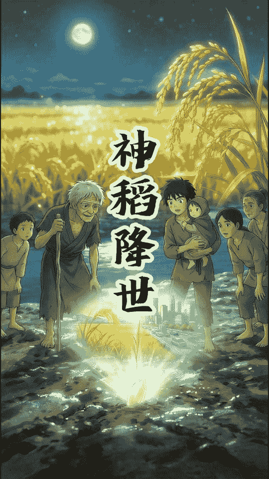

[2月6日(2).mp4](https://internal-api-drive-stream.feishu.cn/space/api/box/stream/download/all/MF7Dbkapzohz8yxmEuuc1p0hnah)

> 教练点评：恭喜你完成了第一个作品。首先这个故事是有一个故事背景的，需要一些理解成本，所以前面交代的部分建议可以让字幕多停留几秒，交代清楚。然后目前的画面多以全景为主，在一些比较紧张的环节，建议可以出几个特写或者近景，首先可以更好的交代人物情绪上的波动，也可以避免画面都是大全景导致比较单调。然后前面的困境可以再停留一下，出现一片死寂，比如可以有人闭上眼睛，这个时候，先听到神鸟的声音，然后由远及近出现，景别从大全景，到特写，这样可以凸显神鸟带来的希望，然后再切人物的近景做烘托。然后神鸟的出现需要推敲一下细节，从逻辑上，一只鸟出现带来食物的种子，这个是比较难求证的，需要时间（种子成长过程）来验证，最好是能够出现一些神迹，比如鸟出现的时候周围有什么变化，或者濒死的人重获生气，才能让普通人这么笃定这是神的赐福。然后种植的过程需要慢一点，通过精心呵护和精心培育，才能烘托出对天神赐下宝物的重视，现在的版本过于快了，可以再优化一下。

> 然后给一个小建议，目前有很多视频生成工具都可以音画同出，尽量避免让它直出带有BGM的，可以提示词规避，或者通过音画分离去掉，否则后续画面与画面间的衔接会出问题，有断点。

> 期待后续有更新。加油！～

## 作者：王奔aa

[2月3日.mp4](https://internal-api-drive-stream.feishu.cn/space/api/box/stream/download/all/W2ecbGPjOonSy9xcurac89aqnbc)

> 教练点评：恭喜完成第一个作品。首先，旁白跟画面可以对应上，目前有一些是没有对应到的状态。然后这是一个有“温度”的主题，那么视觉上就要区分两种温感状态，这个我们可以在画面上体现一下。镯子是一个非常重要的道具，那么我们可以通过一些特写镜头来展示。如果有时间可以完善下重新提交。加油。

## 作者：许善若

《爻变·赤蓝同归》预告

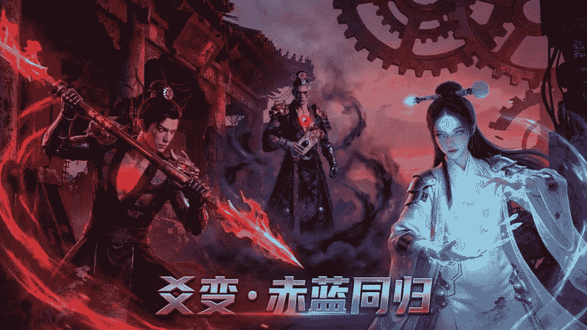

[第一集剪辑.mp4](https://internal-api-drive-stream.feishu.cn/space/api/box/stream/download/all/KOZibU9qSoJP4fxcjQecuS29nIe)

《爻变·赤蓝同归》第一集

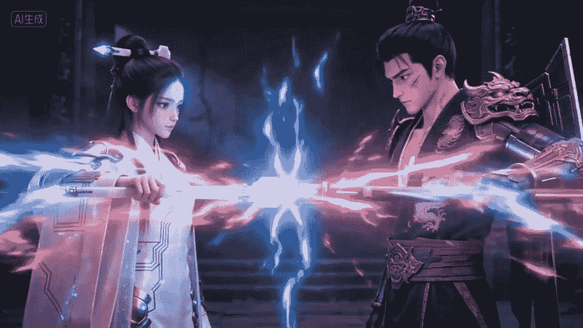

[第二集-完整.mp4](https://internal-api-drive-stream.feishu.cn/space/api/box/stream/download/all/VXc9bTovkoDZk0xtUbwc3P3An8g)

> 教练点评：

> 1、预告：预告片可以少一些逻辑，多一些高燃剧情。对白可以只要一两句，关键的或者是金句即可。可以藏一半露一半的对话是最妙的，既能展露一些画面，又能让观众留有悬念。配乐也可以高燃一些，卡点或者节奏感很强的有一个高潮，然后最后结尾可以再稍微让观众沉浸其中。

> 2、第一集：从观众的角度来看，这是一个有文化底蕴，需要一些理解成本的故事，希望可以适当通过字幕或者包装，提供给观众一些信息（比如地点、人物、时间等）。然后，人物出现直接展开剧情，推荐可以在最开始补充几个展示环境中一些物品信息或者元素的特写镜头，画外音就是人物走过，这样可以适当补充几个信息。节奏前半段过于平，当全息影像出现的时候，可以适当切到主人公的表情，勾起了回忆或者看到了故人后的反应。另外，切镜头的时候，前后两镜如果画面本身元素很相似，建议切到不同景别，否则会有衔接不自然的感觉。

> 0:44这里有个卡顿，看看是否可以优化。

> 找到的纸的发现过程不要漏掉，这是一个关键信息一定要交代清楚怎么出现的，否则观众看上去会觉得突兀。然后男女主兵器合体后没有直接写到后续，只是女主说了一些比较晦涩难懂的台词，这里最好需要在镜头上衔接一下，否则故事这里是有断档的。

> 最后说要防御，建议没出现的那个”不速之客“有一个特写或者是声音或者凿门等的露出，然后主人公有个应对的身形或者备战状态，这样会有一个相对完整的收尾。

> 期待未来精彩篇章。蹲后续。

## 作者：贺兰飞狐

《星灭之刃》第一集

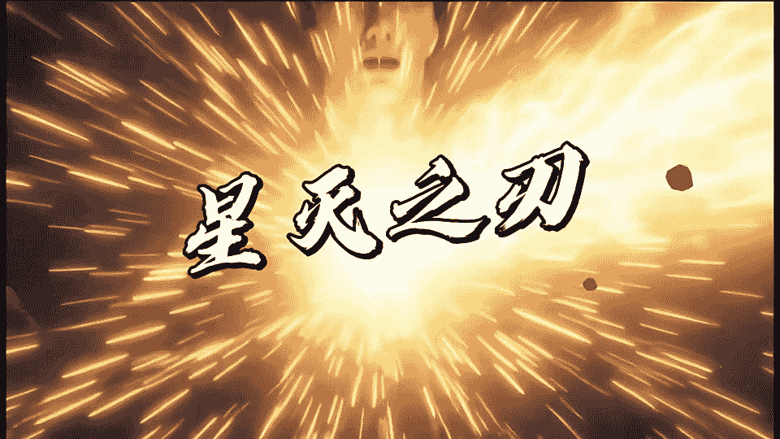

[星灭之刃.mp4](https://internal-api-drive-stream.feishu.cn/space/api/box/stream/download/all/Cf6tb8RG4oyjaRxcRLsc2zVNn4e)

> 教练点评：这个故事需要一些理解成本，建议在最开始的地方加入一些背景介绍，比如世界被什么病毒或者什么要挟着，传说只有星河之力可以拯救世界，而拥有这种能力的人类却寥寥无几。

> 主人公登场在背景介绍之后，前面可以用一些空镜，或者主人公赶往父母家的一些场景来过掉信息。这里可以适当加入一些特写镜头，或者大全景。特写镜头展示人物内心的焦急状态，大全景展现故事背景和环境。可以用高视角垂直镜头等有视觉冲击的视角，或者一些破旧的小路，漏水的水管，大楼顶层的乌鸦的眼睛等来辅助切换画面。镜头可以适当的抖动，或者有手持镜头的感觉，以便体现人物内心的担心和焦虑。开门的镜头需要明确是人物打开的还是内部有人打开门，否则后续剧情发展有理解偏差，建议优化一下。

> 主人公看到母亲的伤口，这里有个细节，站着看伤口和蹲下，空间位置上是镜像的，建议优化一下。

> 开始打斗的部分，是需要一些节奏加快的处理的，剪辑时可以通过快切或者多视角展示场景。

> 不得不说打斗最后几镜的动效非常棒，相信未来可以做出更炫酷的作品。

> 结尾有一点戛然而止，可以再给一个悬念，比如，门外的人停在门口，准备开门等等。

> 蹲一个后续。

## 作者：佚名

[大国1.mp4](https://internal-api-drive-stream.feishu.cn/space/api/box/stream/download/all/OC8Gb2IZSosicVxdD3vcoJnDnLc)

> 教练点评：看上去这是一个重生的故事，那么开头希望可以再快一点，人物呼吸感再强烈起伏一些，因为主人公刚刚经历过一次死亡的记忆，是很有冲击性的。说到心跳还在的时候，可以给到手扶在胸前的特写画面，然后几次心跳，可以给到多一点构图多个视角，可以从主人公多种感知觉（视听触味嗅五感）出发，来考虑增加什么分镜，比如墙边虫子受到惊吓跑走，腐败的一次性杯面上的苍蝇萦绕，头顶的灯在频闪，脸颊的汗水滴落在地。后半段节奏非常好，可以保持这个状态出第二集。结尾略显仓促，可以多一点游戏的画面引人入胜，给观众留下一个钩子。

> 期待后续。

## 作者：寸寸旧时光〆

[我在末世当 队员只挑选废的.mp4](https://internal-api-drive-stream.feishu.cn/space/api/box/stream/download/all/DdhcbXcL6o3RBsx5B3RceHpAnsb)

[怂女误撞太子爷.mp4](https://internal-api-drive-stream.feishu.cn/space/api/box/stream/download/all/NuhYbpByboeugsxzWjRcvJF9nWe)

> 教练点评：

> 1、末世招队员，我挑最废的：封面可以停留2秒，但是不要有音乐播放，音乐在正片开始时再播放。

> 然后人物奔跑的时候是向后的，这个细节可以再优化一下。开篇还是挺有冲击力的，而且一个场景就能说明是末世题材的片子，很不错的开头。然后在镜头衔接上，画面的画风和色调要尽量统一，不要跳帧。然后有一个逻辑点，可能需要通过文字注释补充：为什么一边末世，一边是阳光泳池红酒碰杯，这个可以再明确下是时间不同还是空间不同。然后比如一些具体分镜的细节，包括刚才提到的倒着跑，还有红酒杯多了一个，还有杠铃穿模这些都可以再进行优化。另外结尾有些戛然而止的感觉，可以再给个悬念钩子。

> 2、怂女误撞太子爷：首先封面有一样的问题，可以定格，但是可以先不放音乐。出场人物和时间也可以标注出来，字幕应该是AI自动生成的，建议可以在出视频的时候，用prompt控一下（不要字幕，不要BGM）这样方便后期剪辑统一处理。簪子掉在地上的过程建议展示完整，音效也要出现，现在只有人物捡起簪子的场景，可能没有办法传达清楚。擦拭玉簪后到归还玉簪有一个逻辑断档，建议补充上。到下一个场景，男主找女主少了一个镜头交代（女主需要先得知男主来找自己，才会在下一镜OS分析），然后结尾目前也是突然断掉的，建议再完善一下，留一个铺垫。

> 蹲后续作品，加油。

## 作者：Eling

版本1：鸠占鹊巢

[2月9日鸠占鹊巢.mp4](https://internal-api-drive-stream.feishu.cn/space/api/box/stream/download/all/Eu5KbfGJhoEh2oxMQI2cB9mQnjT)

版本2：AI管家-失控

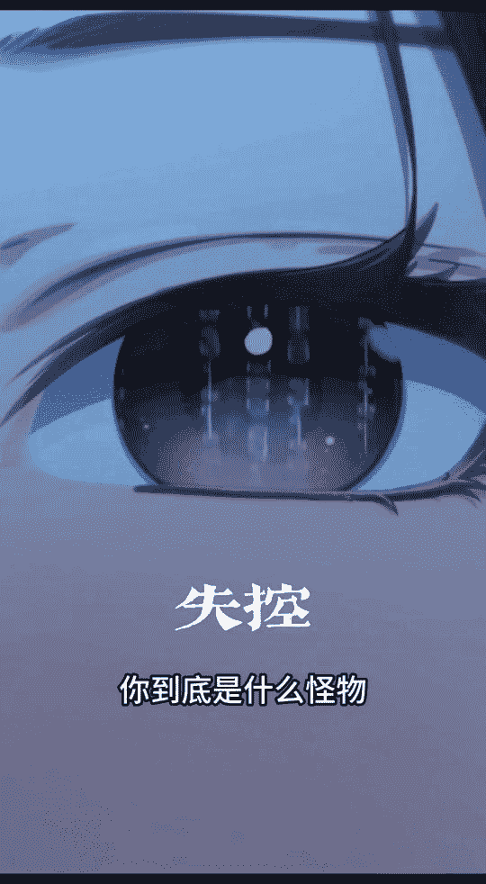

[2月9日AI管家失控.mp4](https://internal-api-drive-stream.feishu.cn/space/api/box/stream/download/all/VVjTbzyYtoCtamxQJkPcig4In3J)

边角料MV：《失控》

[2月10日MV《失控》.mp4](https://internal-api-drive-stream.feishu.cn/space/api/box/stream/download/all/XFocbIcCFoCxG1xhJUkcgMMin2g)

以下用Seedance2.0的实验品

[《失控》Seedance2.0测试版.mp4](https://internal-api-drive-stream.feishu.cn/space/api/box/stream/download/all/HmqsboahKoLNl7xydp8cpsmennh)

Seedance2.0测试先导片

[2月11日Seedance2.0测试失控先导片.mp4](https://internal-api-drive-stream.feishu.cn/space/api/box/stream/download/all/NquiboMqiogt6qxeKrOc8kflnXd)

> 教练点评：

> 1、鸠占鹊巢：这个故事本身是非常好的，我看了5个版本之后，发现这个第一个是故事线交代最明确的，也终于知道小雅不是机器人，是系统接管后优化的一部分。分镜没有太大问题，画面需要优化的是场景的一致性。

> 2、AI管家-失控：这个版本小雅看起来是AI管家，前面有几个分镜快切，与主人公说有小雅在整个人都废了其实氛围是不太一样的，如果前面想烘托一种放松的状态，可以用几个空镜营造舒适感（比如房间空调温度适宜，干净整洁的餐厅和水池，人物半躺在沙发上，中间穿插AI管家和小雅持续运行的镜头，可以是背影可以是局部，可以是特殊视角的特写）然后到了失控的时候才会产生明显的反差。

> 3、MV：《失控》：很不错的剧情衍生作品，画面和分镜都很不错。可以在现有基础上丰富一下剧情和构图、以及视角，然后MV可以再“失控”一些，用户的挣扎镜头和反抗也可以多一些，然后多一些大场景和视觉冲击强的更好。

> 4、Seedance2.0的实验品：sd2.0的这个会略显逻辑错误，恰好我是从最后一个往前看的，所以会有一种不知所云的感觉，建议这里可以推敲一下唱词和逻辑性以及前后分镜的关系。

> 5、Seedance2.0测试先导片：同4，然后多次出现的u盘应该是一个重要道具，建议可以简单介绍一些签署契约的背景。

## 作者：紫罗

[lv_0_20260205172520.mp4](https://internal-api-drive-stream.feishu.cn/space/api/box/stream/download/all/Fkr9bExxIobv80x6BHMcjkLmnEe)

> 教练点评：非常暖心的一个作品，对白和旁白都很有温度。看完被暖到了。

> 画风很治愈，一致性不错，分镜构图丰富，前后衔接自然，继续保持。

> 建议增加一些音效和BGM，恰当的音乐可以为影片增色不少。比如粥冒泡的声音，煤气燃烧的声音，夕阳窗外的环境音，窗帘被风吹动的声音等等。

> 加油，期待后续作品。

## 作者：aben

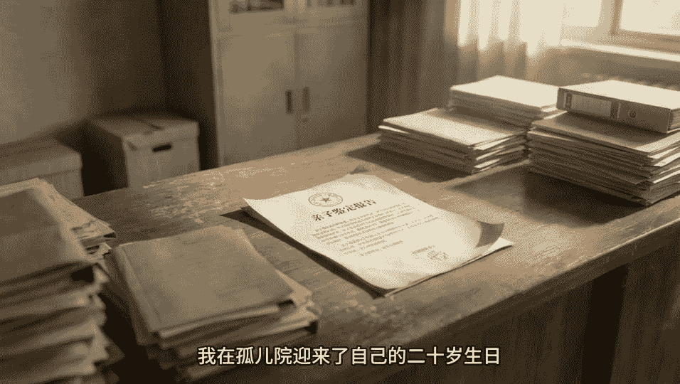

[2月9日.mp4](https://internal-api-drive-stream.feishu.cn/space/api/box/stream/download/all/MpKcb6ojooE3IBxmlylcCSZQnfd)

> 教练点评：恭喜你完成这个作品的创作。能感觉到这个短剧中有两个点，一个是反转，一个是系统。

> 先说反转前后，孤儿院应该是欲扬先抑中抑的部分，可以除了长镜头展示亲子鉴定报告，出现一个孤儿院的大场景，然后有一些生活片段的展示，从而跟后面形成鲜明对比做好铺垫，然后亲子鉴定结果出来，找到亲生父母，开始要有一个反差感，所以剪辑的节奏上，这里要停顿一下，再开始被迎接回家，视角可以从客观视角转到主观视角，来体现这种不真实的懵的感觉。

> 再说系统，系统会给任务，但是前面是完全没有铺垫突然出现的，最好建议可以有一个说明，人物突然做任务没有前后背景的交代是有一点点突然的。

> 总体来说非常棒，加油，期待后续作品。

## 作者：K

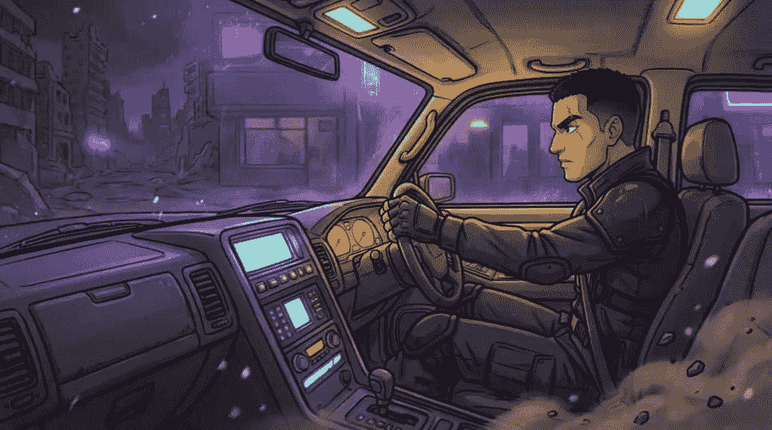

[一路狂飙小游戏的.mp4](https://internal-api-drive-stream.feishu.cn/space/api/box/stream/download/all/Hpgobxh5yokxn9xckbWc1pKUnKd)

> 教练点评：真的是非常符合标题，是个一路狂飙的小游戏。从众多作品中脱颖而出，给我很深的印象。首先，画风非常鲜明，风格保持的很稳，一直加速处理的处理方式是很独特的表达方式。

> 可以增加一些音效和bgm，然后故事线很清楚，是一个在丧失世界中通过芯片信息寻找父母的故事。分镜很好，最开始也出现了人物拿着全家合照的照片，铺垫了主线剧情和感情线。

> 然后修理工的登场有点没有看懂，可能需要一两镜补充一下，交代清楚。然后车子的空间感还有人物数量的细节可能需要再明确下，目前看是一辆普通SUV，而修理画面还有打斗场景空间显得又很大，就会有逻辑bug，总会出戏。打斗的场景逻辑有点混乱，建议去掉一部分，尽量的保持清晰明了的故事线为主。继续加油，期待后续作品。

## 作者：HRZ

[重生之养儿“防老”.mp4](https://internal-api-drive-stream.feishu.cn/space/api/box/stream/download/all/JdO1bLm9kod1DyxexZzcz2pungg)

> 教练点评：故事线非常清晰，重生归来的故事。整体来说没有太大的问题，12秒这里画面细节希望优化，桌子上的手机有点不合理，因为周围太残破，出现一个iphone手机，建议优化一下。

> 37秒睡衣这里与上一镜服装不一致，建议统一一下。然后后面是要重生的，最后结尾可以温情，但是前面建议还是要有反击的感觉，bgm可以稍微做一下调整。加油，很棒的作品。

## 作者：彤小仙

版本 2

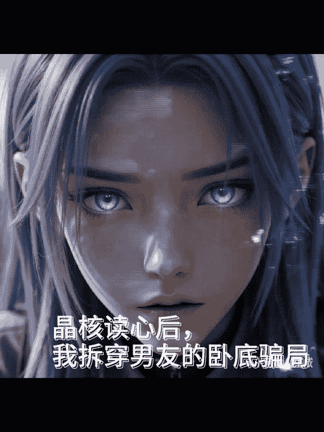

[《晶核读心后，我拆穿男友的卧底骗局》第一集版本 2.mp4](https://internal-api-drive-stream.feishu.cn/space/api/box/stream/download/all/GljJbdnzIo4Sf2xrLjBceMnDnhb)

版本 1

[《晶核读心后，我拆穿男友的卧底骗局》第一集.mp4](https://internal-api-drive-stream.feishu.cn/space/api/box/stream/download/all/Xc4tbZBOkoImWJx8eArcJsm6nQf)

> 教练点评：

> 1、版本1:故事本身很吸引人，画面需要关注人物一致性问题和画面风格不统一的问题。

> 2、版本2:和上一个版本相比，能看出质的提升。而且你也注意到了不一定要用旁白交代大量信息，只靠演绎也可以走故事线，所以可以继续打磨分镜和故事即可。新的版本，你对道具做了优化和调整，人物的形象也提升了，期待完整故事。蹲一个。

## 作者：阿蓝

[lv_0_20260210003816.mp4](https://internal-api-drive-stream.feishu.cn/space/api/box/stream/download/all/BgVdbpeNPoc5PExOVr1ca6b5nnd)

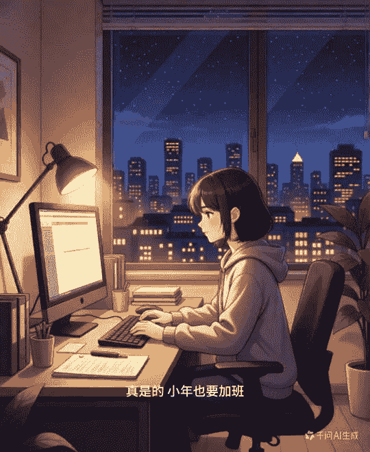

[lv_0_20260210234812.mp4](https://internal-api-drive-stream.feishu.cn/space/api/box/stream/download/all/ATB5bKIl6oaFkHxS5hWc4XNtnT4)

> 教练点评：

> 1、心安即归处：你的运镜是非常好的，画面之间的衔接有逻辑，需要注意画风的一致性。可以简单加一些音效（风、云、麦浪、烟火气、锅气等等。还有首尾帧偶尔画面会有细节乱入或崩坏，可以关注一下这些点优化后会更好。

> 2、小年的饺子：立意很暖心，画风很治愈，风格统一，个别镜头需要注意乱入的部分，比如关灯手机从手里冒出来。最后可以补几个吃饺子和想妈妈的镜头，结尾加一个给妈妈打电话或者自己吃饺子擦掉眼泪的镜头，然后拉到远景渐渐淡出，情绪会更加充盈。建议关注画面宽高比，统一一下会更完美。期待后续作品。

## 作者：米斯特波芝

《我拼命攒晶核救妹，她却刺穿我喂丧尸》第一节

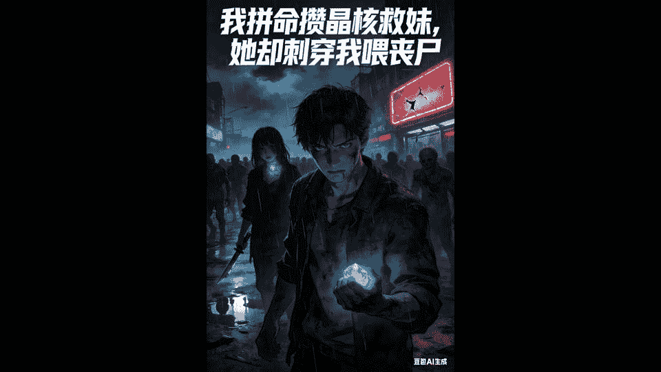

[第一节有封面.mp4](https://internal-api-drive-stream.feishu.cn/space/api/box/stream/download/all/Mi2ObjJb1oZaJIxCcyNcboeGnUF)

> 教练点评：看剧名是个有系统逻辑的短剧作品，期待看到后续完整作品，目前制作的部分，画风很好，部分镜头注意图转视频过程中是否会使画风改变，可以再优化个别镜头，首尾帧衔接使用比较娴熟，可以多一些对白与音效。

> 期待完整剧集。

## 作者：Amanda（早睡早起.11点🙅）

《不嫌弃的价码》

[2月10日.mov](https://internal-api-drive-stream.feishu.cn/space/api/box/stream/download/all/PTBpboL1JotCNZxBzVscrmpDnhf)

> 教练点评：最喜欢这个作品。为你的创意竖起大拇指！

> 作品非常完整，画风有一些变化，可以再通过优化镜头来解决，控制好画风是3d还是写实还是2d，会提升整体效果。

> 这是一个很高级的主题，我个人认为旁白其实是不需要的，单纯从对话也可以讲通整个故事。靠画面来撑起主要的故事。期待看到后续大作！再为你的发心点赞！

## 作者：藤

《九霄浮世绘》第一集

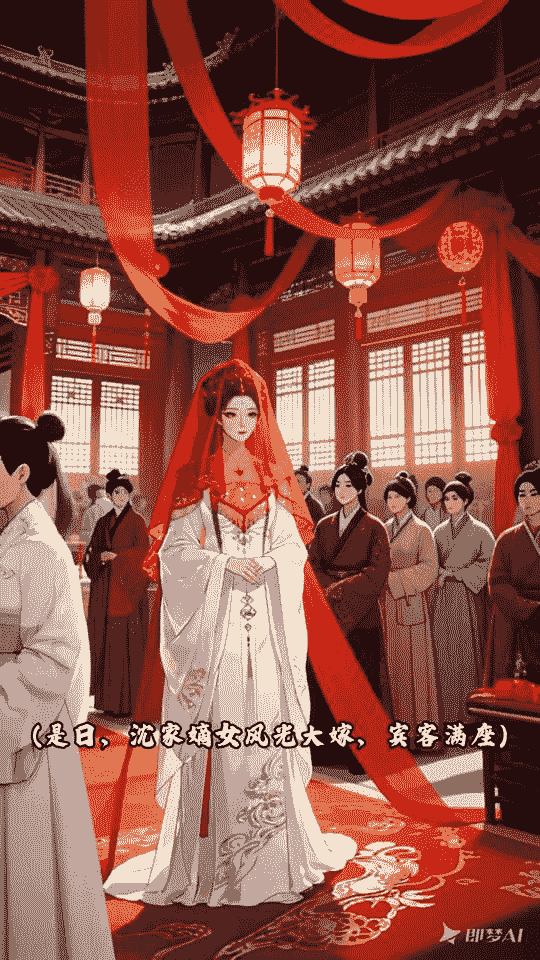

[九霄浮世绘-第一集.mp4](https://internal-api-drive-stream.feishu.cn/space/api/box/stream/download/all/OaW1blV9gopUuWxv9PpcMeknnzf)

> 教练点评：画风很好，每一帧都很精美。对话已经交代了故事线，退婚的话，可以是婚书撕掉，感觉撕掉退婚书是一个穿帮。秘宝出现的时机需要交代一下，主人公拿出来的还是自己出现的，需要说清楚。

> 然后剪辑时建议多放一些音效烘托，比如婚礼有鞭炮声，有敲锣打鼓吹拉弹唱，有宾客，有欢声笑语。最后蓉儿到底，父亲的叫声可以更紧张，更有情绪，会更完美。

> 期待后续作品。

## 作者：跃 迁

漫剧作品模仿 - 灵魂互换第1集（部分）

[漫剧作品模仿 - 灵魂互换第1集（部分）.mp4](https://internal-api-drive-stream.feishu.cn/space/api/box/stream/download/all/EGmabwcKcoQJG4xr6mKctOLsnyf)

> 教练点评：很棒的作品！有几个镜头的处理比我们的动效还惊喜。可以在开门前有一些犹豫，增加人物情绪的铺垫。整体非常不错，期待后续的创作！

## 作者：空海

序列之眼

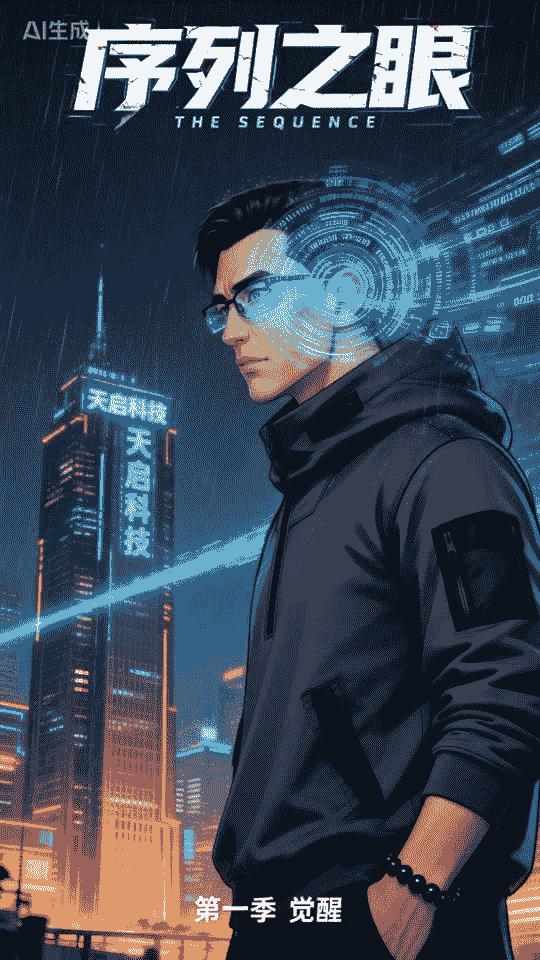

[序列之眼.mp4](https://internal-api-drive-stream.feishu.cn/space/api/box/stream/download/all/EP7fbX6dLohvVyxvfzoc0pMtnBb)

> 教练点评：首先恭喜你完成了第一个短剧剧集制作。画风很统一，而且故事本身有一个很大的世界观。前面是一个主人公的挫折，可以多一些心理防线崩塌的描述，分镜上也可以通过特写镜头来展现人物内心的情绪状态。直到系统提示音响起，作为一个分水岭，开启人生赢家的状态。

> 提个小建议，字幕里可以尽量不出现标点符号，根据意群来分割。

> 画面可以再多丰富一些运镜和构图，现在故事整体有点平，可以通过丰富构图和运镜，以及人物的特写和改变剪辑节奏来优化。

> 期待后续作品。

## 作者：三水

《偷药遇王爷，我竟是他的白月光》

[2月8日 (1)(4).mp4](https://internal-api-drive-stream.feishu.cn/space/api/box/stream/download/all/I3lebqRUroiXQMxfJOpcVgrdnLc)

> 教练点评：片子完成度非常高！叙事清晰，人物一致性保持非常好。开头可以增加两镜女主偷偷摸摸闪过的镜头，或脚步特写，或者头部从墙角冒头再撤回，眼部特写观察没有人后再跑步，到门口开门的动作要蹑手蹑脚，最重要的是关门的动作一定要到位。镜头可以摇晃一些，表示匆忙赶和慌乱。现在的女主过于悠闲，和后面被女配发现时的反应，人设是不一致的。人物在找物品的过程中，没有说话的对象，可以采用内心os的形式展现，不一定要对口型。这样可以规避掉站定再说话的问题，表现出内心的焦急。

## **作者：Julia**

《一觉醒来我换了人生，既要顾家也要逆袭》

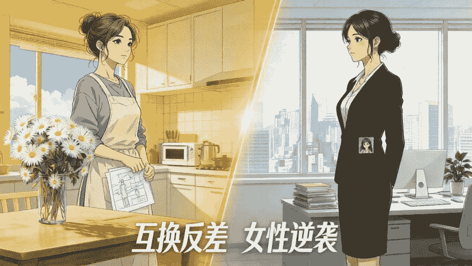

[灵魂互换.mp4](https://internal-api-drive-stream.feishu.cn/space/api/box/stream/download/all/NwE1biWFhoI4yDxw3n5cCsG2ncg)

> 教练点评：开头除了角色独白，还有一些杂音，建议优化一下。然后到星玥的工作场景，室外可以有一些车水马龙的声音，然后到了室内后，开始出现比如打印机的声音等等。当然，因为这是她的个人办公场景，那么可能会没有大职场上办公的杂音多。然后出现了人物打电话的情节，那么是否可以让人物如画的时候就是举着手机打电话的，一直从远处走到电脑前坐下，这样从画面上会合理一些。也可以出现人物的名字，来辅助观众理解这是两个角色。打电话的地方，都是近景，建议可以切一些特写镜头（比如人物眼镜特写、手打字特写、肩膀和面部夹着手机同时打字等画面），一个是增加画面的灵动感，避免画面的单调，一个是从侧面体现人物与家庭主妇工作状态上的对比和反差。然后五个人坐在餐桌上的座次是需要重新修改的，小女孩跟妈妈坐在一侧更加合理，画面左侧还多了一把空着的椅子，细节我们可以处理好哈。在抱怨开始之前，没有铺垫，现在的情节让人感觉是为了吵架而吵架，为了让剧情合理，我们可以加入来到约会现场前，两个人的一些小互动，让家庭主妇的这个角色心生抱怨，然后在这里爆发就会变得更加合理和顺理成章。然后两个人互换的时候，有一些混乱，再醒来可以有一个剧情节奏上的停滞，让两位男士（或者只有一位）守在床前，醒来的时候从第一人称视角来看的话，才会更有冲击力。

> 期待下集。

## 作者：邵士佳

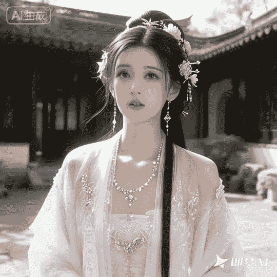

[2月10日 (8).mp4](https://internal-api-drive-stream.feishu.cn/space/api/box/stream/download/all/TpSPbFpvho68Bsxy5psc8Z4Tnaw)

> 教练点评：首先，人物都很美很帅，画面很有故事感，相信你的审美很不错。对白和动效都很不错。

> 在画面生成的过程中，尽量修正比如水印这些小细节，尤其在人物引用的时候建议去掉。开头有点突然，感觉落水后没有衣服的变化，可以优化；前面没有出现陛下，太监就在禀报，会有逻辑不通的感觉，建议在禀报前补一个皇帝登场的镜头，可以补上逻辑断点。中间的画面分镜有音效的切换，不如直接静音后重新统一处理。期待优化后的版本，加油。

## 作者：kuuki

《末世秘境：丧尸的谎言》第一集

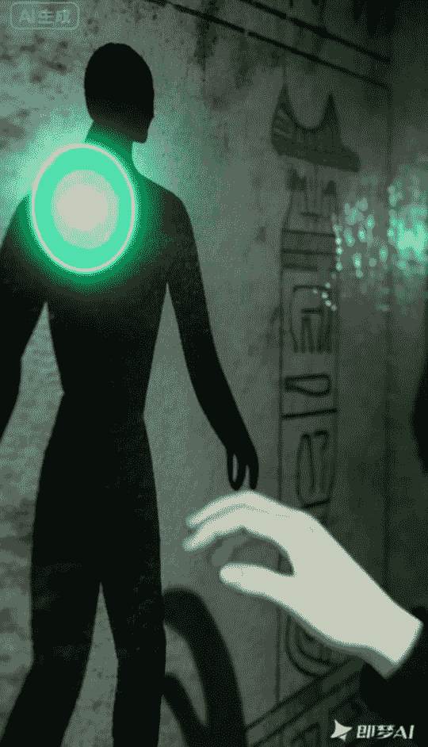

[2月10日.mp4](https://internal-api-drive-stream.feishu.cn/space/api/box/stream/download/all/LGdJbYuQeoS3kzxjinccUxQjnve)

> 教练点评：这是末日丧尸的选题，画风和动效控制的都不错，需要关注画面细节和人物在情绪的状态上的变化，比如丧尸出现，然后老爷爷喊停很人机，这些点都可以优化，结尾戛然而止，可以再继续补充完善。期待完整作品。加油。

## 作者：小丹

《旧笔余温》第一集

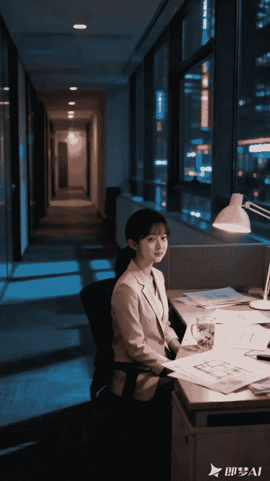

[2月10日.mp4](https://internal-api-drive-stream.feishu.cn/space/api/box/stream/download/all/XDQCbVYnmoGPMzx5vWgcpxoXnRc)

> 教练点评：单独的片段做得很有氛围感，但在分镜布局的合理性和叙述能力方面还需要加强，期待你重新把这个温暖的故事完整呈现

## 作者：简。

**《重生暖婚：渣男贱女别想跑》**

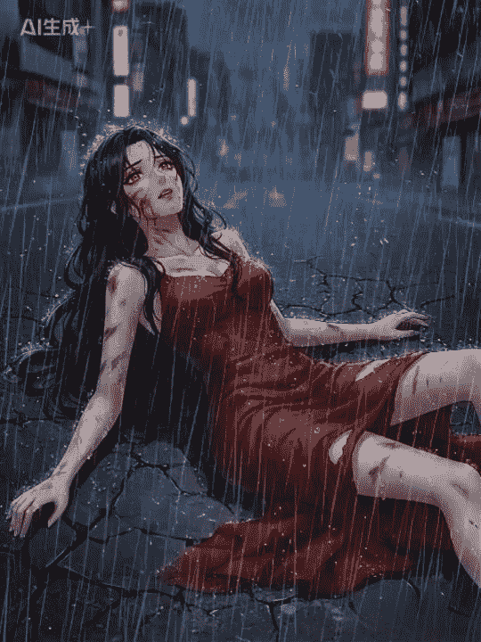

[《重生暖婚：渣男贱女别想跑》.mp4](https://internal-api-drive-stream.feishu.cn/space/api/box/stream/download/all/MNfcbqhEFoui9JxX7KjcI7xTnxb)

> 教练点评：非常棒的作品，选题有热度，人物造型精美一致性高，叙事结构完整，节奏快冲突强，镜头组接丝滑高级，期待你做出更完整优秀的作品。但要注意由于ai的理解能力，表情强度用词要多尝试调节，以便生成更协调效果。

## 作者:大白

作品一：《末日狂飙》

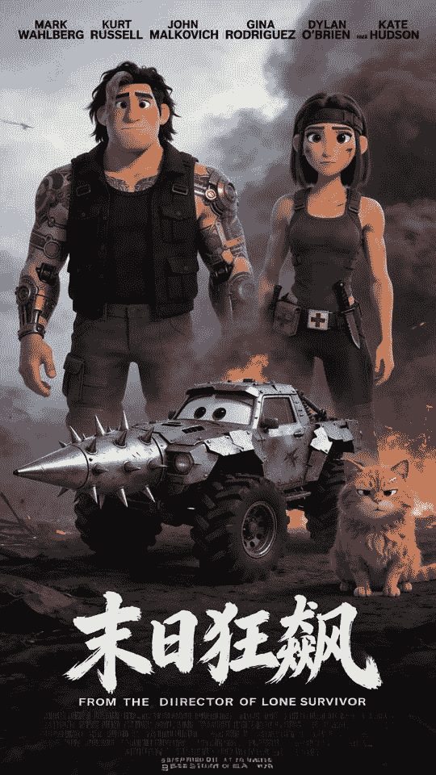

[2月10日.mp4](https://internal-api-drive-stream.feishu.cn/space/api/box/stream/download/all/BRqPbXSUvoRHBfxwT5vcBCkmnSf)

作品二：《末日伙伴》

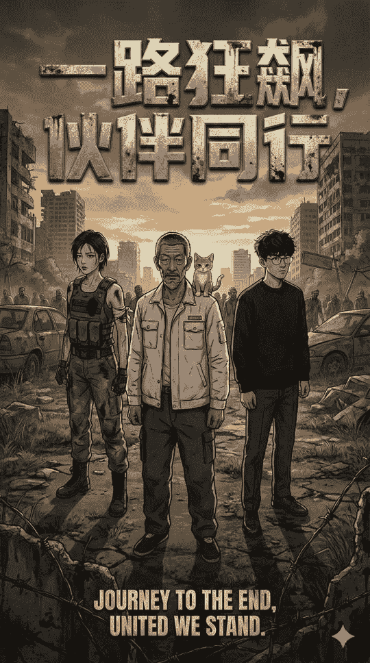

[一路狂飙伙伴同行.mp4](https://internal-api-drive-stream.feishu.cn/space/api/box/stream/download/all/PKYUbGHHmo8O1jxvDjMcsPzMnte)

作品三：《辰如传奇》

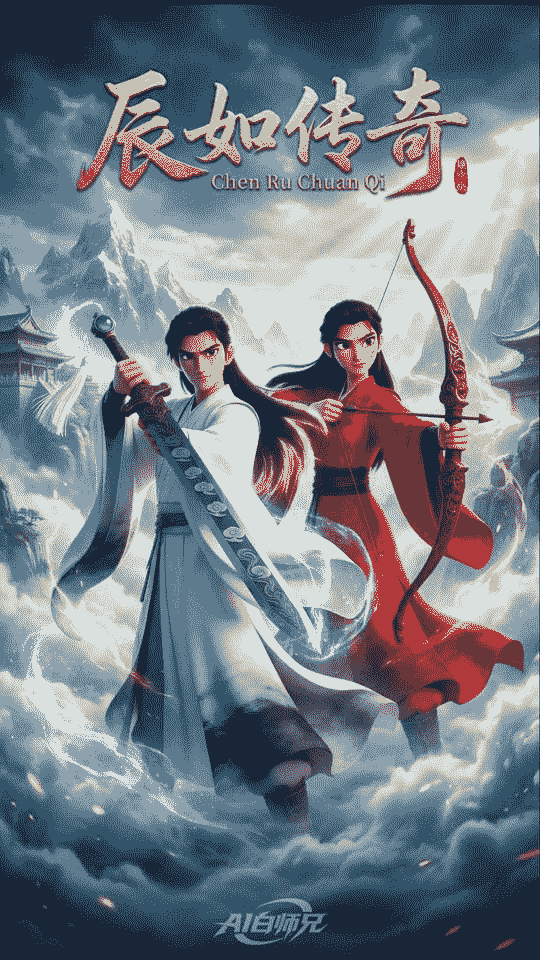

[辰如传奇.mp4](https://internal-api-drive-stream.feishu.cn/space/api/box/stream/download/all/JizLbfBPxoRaFOxS5recTdb9nQg)

> 教练点评：大白同学在群里非常活跃，问题反馈及时，三部作品一部比一部成熟，第三部作品品质优秀、叙事完整、人物和风格统一、画面精美，前两部作品题材精准、剧情紧凑，第一部作为练手存在风格不统一的问题，后续需要优化字幕效果，让字幕醒目又不突兀。

## 作者：璐小瑶

《别卷了！AI室友蹲我腿上卖萌》 第一集开头

[2月10日(1).mp4](https://internal-api-drive-stream.feishu.cn/space/api/box/stream/download/all/J4RDb4vNsoN22sxE7DqcZuHsnsI)

> 教练点评：这部小短片非常温馨，很能引发观众共鸣，虽然因为时间关系没有完成，但能看出剧情虽简单，每个分镜头都很用心，画面布局与合理性方面也都下了功夫，这类作品很适合搭配背景音乐，加上后能进一步拔高整体调性，期待你产出更多温暖、打动人心的完整作品。

## 作者：雪萍

《深夜社死・冲动私信》 第一集开头

[2月10日.mp4](https://internal-api-drive-stream.feishu.cn/space/api/box/stream/download/all/RykgbvjJAopVR4xgbAocEHpZnuf)

> 教练点评：这部短片很有意思，虽然篇幅不长，但叙事能力很强，画面合理、没有多余镜头，镜头切换流畅自然，整体风格也十分统一，完成度很高。这类题材很有市场，期待你产出更多同类型作品

## **作者：星湲（咖啡不加糖）**

《赌石：从被骗光千万身家开始》

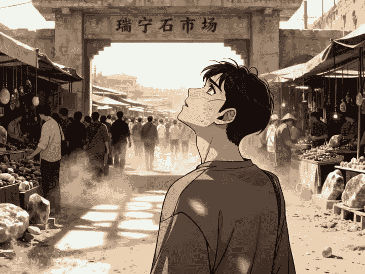

[2月10日.mp4](https://internal-api-drive-stream.feishu.cn/space/api/box/stream/download/all/Rd86bOklaoe6mLxypuWc81nxn5c)

> 教练点评：原创度很高的一部作品，感觉这应该是你提取身边的素材创作的剧本。故事的完成度很高，叙事线也很清晰，但整体制作动态的部分相对少，比较偏向解说漫的类型，建议人物回忆部分多增加动态环节，过去怎么风光，怎么被漂亮女朋友欺骗，这些场景其实非常适合用丰富的剧情体现。整体节奏比较慢，开头剧情也比较平。建议开头以主角被债主爆打开头的场面…但是你很用心的制作了一个完整的故事，这一点是非常值得肯定的！先完成再完美！

## 作者：零点

《PUA老板的代价：我重生后成了他的心头宝熊猫》

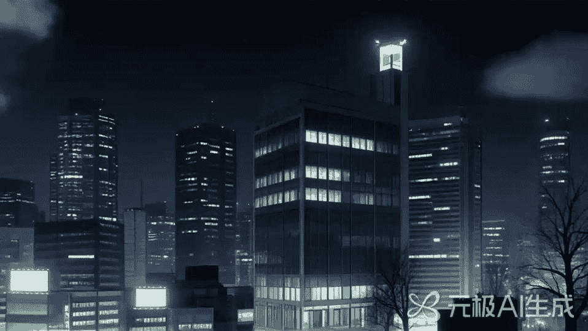

[PUA老板的代价：我重生后成了他的心头宝熊猫.mp4](https://internal-api-drive-stream.feishu.cn/space/api/box/stream/download/all/M5wDbcMX8oBVq1xD8yTcs7lbnod)

> 教练点评：这是你准备的短剧作品第一集，虽然时长较短，但画面精细度很高，能看出十分用心。镜头语言组接逻辑清晰，用大全景交代环境与人物关系，再通过手部特写等细节展现人物情绪变化；尤其女孩加班时头发从整齐到凌乱的细节处理特别出色。整部作品虽短，却充分体现了扎实的创作功底，看得出你认真学习且学有所得。

## 作者：包BBQ

【听见心跳】

[听见心跳.mp4](https://internal-api-drive-stream.feishu.cn/space/api/box/stream/download/all/QBSVbkqoZoi0Z7xTvS3cdzrhnBd)

> 教练点评：这组小短片整体甜度很高，视觉语言表现出色，无论是人物关系的呈现，还是用局部特写传递细腻情感都做得很好，人物风格统一性也较高。三个故事的结尾都略显仓促、不够自然，建议在结尾增加情绪转换，比如使用慢镜头、眼部特写、空镜，或是放慢镜头切换、运用叠画等转场方式；同时既然整体风格偏甜，中间第一次、第二次、第三次的过渡画面可以用更甜美的色调，避免使用黑色。整体来看，短片的完整度还是不错的。

## 作者：嘿嘿,王同学

【时光之约】

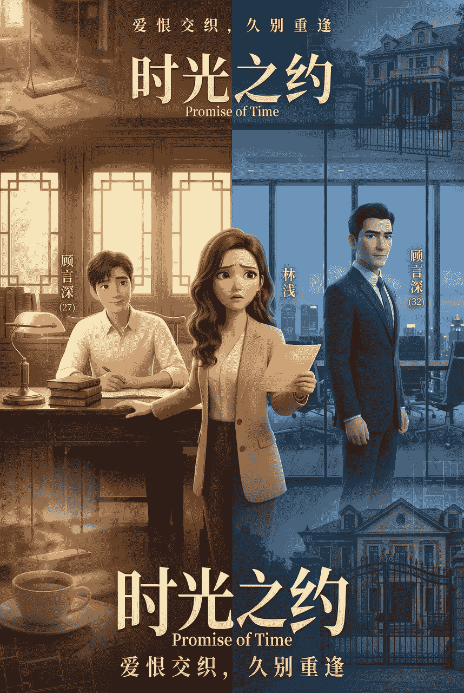

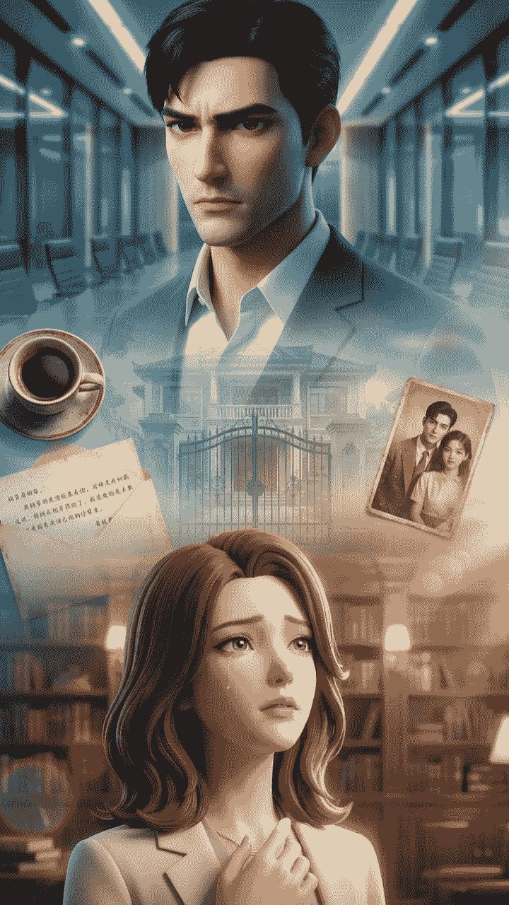

[时光之约_ch1(2).mp4](https://internal-api-drive-stream.feishu.cn/space/api/box/stream/download/all/EoZZbEy9xo5qVxxhQR5c1VSenRe)

视频

> 教练点评：非常惊艳的作品！叙事完整，题材温馨感人，画面制作精良，配音也贴合人物性格，视觉语言表现力很丰富。包括封面也做的非常用心，色调布局非常能体现故事内容。但故事整体发展比较平，让人没太多期待，建议通过改变叙事结构增加冲突和反转。另外回忆部分用闪回的方式做的得更丰富些，整个故事将更完美，如两人以前甜蜜时期的撒糖片段，女主考上国外大学的片段等，女主和男主过去的形象也应该单独设计（五年前的发型，气质，衣着），很棒的作品，期待你更多的内容产出。

## 作者：墨染青衣

灵魂错位模拟案例

[灵魂错位案例模拟.mp4](https://internal-api-drive-stream.feishu.cn/space/api/box/stream/download/all/UvJHbzo3XoL8Ygx9TDccFuBtnne)

> 教练点评：画面简单干净，具备一定的审美能力，单个分镜的完成度较高。这是一部在制作上对空间理解和表达能力要求比较高的作品，所以在制作上整个空间逻辑的表达有待提升，后期多做练习和思考相信能帮你快速提高。

## 作者：麦麦

[灵魂交换作业.mp4](https://internal-api-drive-stream.feishu.cn/space/api/box/stream/download/all/RKGNbaIi6oHdQCx8SbPcKeRLnib)

> 教练点评：在人物和场景方面设计用心，小细节做的很到位，比如办公桌上的小玩偶等，让人感觉很有代入感。茶水间的分镜角度也选的很适合。最后一个镜头开门的方向，以及人物和家具的比例如果能做的更精细会更好。

## 作者：___z.Z、

禁地苏醒第一集

[禁地苏醒.mp4](https://internal-api-drive-stream.feishu.cn/space/api/box/stream/download/all/R8tobLePHoY2ctxJ3EAcCJRsnxd)

> 教练点评：很有意思的作品，我都迫不及待想看一下集了。

> 从开头的远景交代环境，到局部交代人物和环境的关系，层层递进推进剧情发展，整个衔接丝滑有逻辑。个别镜头的衔接可以再做打磨，比如从前面暖色调到禁地，冷暖色调和场景的装换比较突兀，可以考虑从女孩视线引导，或全景交代场景转化的过度关系。

## 作者：臭臭臭熊猫

末日西游

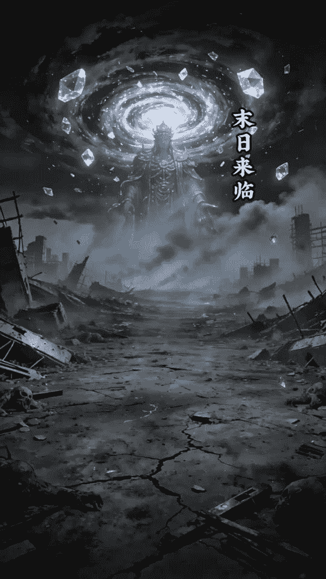

[2月10日(1).mp4](https://internal-api-drive-stream.feishu.cn/space/api/box/stream/download/all/XkNfbPnCTosiZnxwBNhcfyN7nTb)

> 教练点评：

> 很有创意和脑洞的短片。特效打斗场面很燃很有想象力，单场打斗戏现在使用AI比较容易实现比较好的效果，但对于场和场之间的衔接却需要比较高的视觉语言统筹能力，这个题材很有爆款剧的潜质，希望你在这一风格上继续努力，早日做出更惊艳完整的作品。

## 作者：s三木s

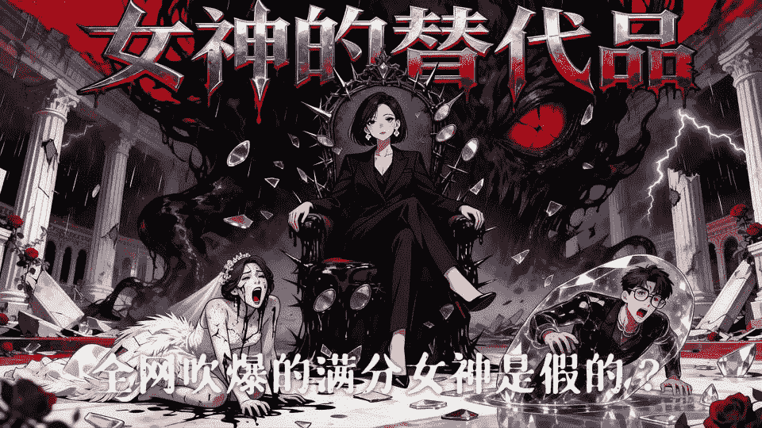

[第一集.mov](https://internal-api-drive-stream.feishu.cn/space/api/box/stream/download/all/T9sEbtSWcozGxpx1NcIcmUu4nWK)

> 教练点评：

> 开头3秒很有吸引力和悬疑感，能吸引大部分观众往下看，后30秒的氛围感拉得很满，铺垫却有些太长，单个画面的完成度很高，画风也很一致，我相信这一定是个很有去很有反差感的故事，期待你的完整作品。

## 作者：张鹏飞

《D级废物？且看我妙手空空》

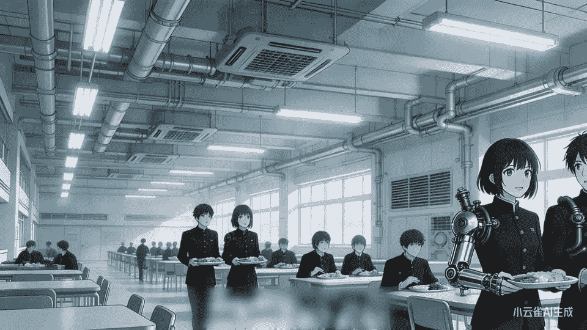

[张鹏飞2月11日作业.mp4](https://internal-api-drive-stream.feishu.cn/space/api/box/stream/download/all/H0RgbVZyIodjrDx4IZVcLYH6nhd)

> 教练点评：这应该是一个异能高校为背景的男频战神逆袭金手指等元素集合的片子，居然是走爆款漫剧方向，可以考虑把最染的画面放在开头，以此来提升观众的留存率。画面中的小元素设计很精美（机械臂），后面几个镜头的景别组接也用得不错。

## 作者：瑞

《恋爱怪谈之美好的表面》

[1.mp4](https://internal-api-drive-stream.feishu.cn/space/api/box/stream/download/all/Tns2bymPzoHxMUxItAGcgTmLnJe)

> 教练点评：这部短片整体很甜很萌，人物造型和氛围都特别贴合目标受众，过肩镜头和镜头组接也都很丝滑。个别细节还可以再打磨得更精细一些，比如女主手上要送给男主的那幅小画可以再精致一点，雨滴落在画面上的水印效果有点破坏美感，调整得更自然柔和就更好了。男主的配音感觉有些不太适合

## 作者：烟柳画桥

《我死后，我的女帝徒弟都泪崩了》

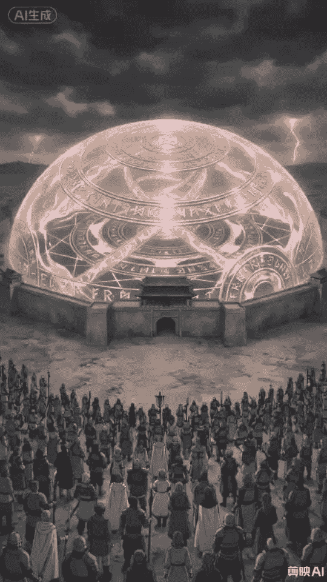

[b667fa7dc77e7a08345e541399c67c99.mp4](https://internal-api-drive-stream.feishu.cn/space/api/box/stream/download/all/IqjpbN7YIoo0fUx5vOOcxl6inFd)

> 教练点评：这部作品是我非常喜欢的一部片子，整体完成度非常高，中间的特效制作也很出色。人物的衣着、长相造型都能很好体现出不同个性，辨识度很高。画面构图上运用了对称构图，很能体现画面美感。只是整体精度感觉还可以再提升一些，建议在开头再增加闪电类特效和音效，会更有吸引力和画面张力，漫剧更适合运用这类效果来增强表现力。

## 作者：_歐

[飞书20260211-095222.mp4](https://internal-api-drive-stream.feishu.cn/space/api/box/stream/download/all/Z2ZKbM5qVolEERx1bmbcUc8TntQ)

> 教练点评：很喜欢的一部作品，风格匹配得也很适合，镜头的组接也比较丝滑，开头的特效用得很克制恰到好处，人物和空间的关系还需要精细化打磨。我们做在小的一个场景，都尽量把房间布局，人物站位、动线、摄像机位置提前考虑清楚。

## 作者：*L*

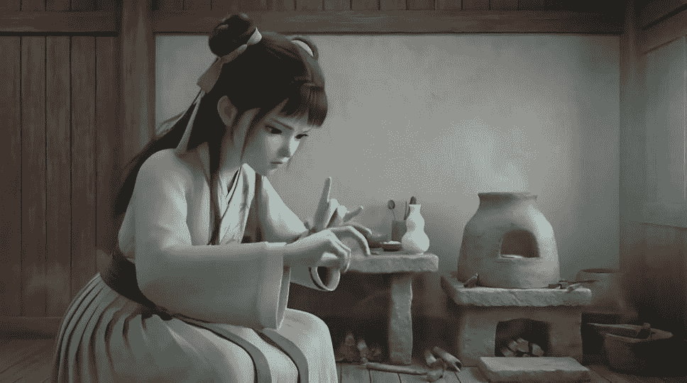

[漫剧小作品.mp4](https://internal-api-drive-stream.feishu.cn/space/api/box/stream/download/all/YCLJbd2aAoqqfxxedOEcLmQ1nbe)

> 教练点评：这是一个很有意思的故事，画面干净，角色风格匹配得很合适，但是多数时候AI做成的分镜描述，仅仅是作为一个参考，我们还需要自己反复打磨怎么衔接，怎么才能把剧情内容表达完整。

## 作者：Jun

**夏日午后抓鱼记**

[5c2c1b76ea34f13469fdd5eb97696fcd.mp4](https://internal-api-drive-stream.feishu.cn/space/api/box/stream/download/all/P3gEbrHvXoFLO7xfTFOcRbbwn6d)

> 教练点评：非常优秀一部小短片，温情满满，容易引起人的共鸣和回忆。镜头语言的叙事能力很厉害。方言的运用在这里起到画龙点睛的效果。红色的字幕让人有些出戏，可以参考电影字幕的配色和字体完善。

## 作者：李杨

《色块》

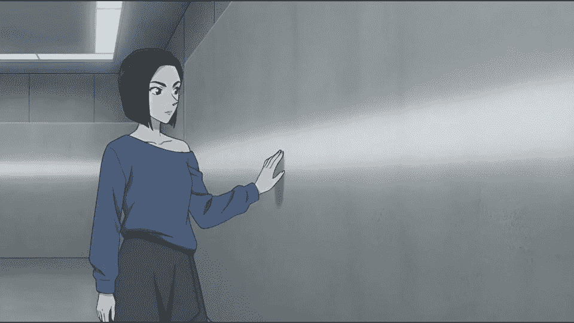

[色块.mp4](https://internal-api-drive-stream.feishu.cn/space/api/box/stream/download/all/NwiKbar8mosm2nxsunqc5Xvtn4f)

> 教练点评：整体是好故事，你应该也是一位《名侦探柯南》的爱好者。角色设计、小素材、效果设计方面非常用心，看的出来是自主创作和思考部分占比很大的一份作品。这一点很值得表扬，不管现在工具进化有多快，但很多基本功是必须通过多训练多思考来提升的。虽然由于故事本身对空间和镜头的叙事能力要很高，所以看上去有些混乱。但我相信你用现在的方法继续练习，将是以后进步和提升得最快的一位。

## 作者：哒哥

《魔尊重生之卑鄙女人》

[魔尊飞升.mp4](https://internal-api-drive-stream.feishu.cn/space/api/box/stream/download/all/YWRRbgtJ3oENF4xJeMncoLkKn6c)

> 教练点评：

> 画面制作精美，特效很炫酷，但这个剧情进度有些仓促，几乎都是靠全景的动作戏撑起整个情节，连续的打斗或对白都会让观众产生疲劳。可以再用心打磨分镜，远景交代环境，全景交代人物和环境关系，中景交代人物关系，特写表现人物情绪。

## 作者：Zoe

《循环》

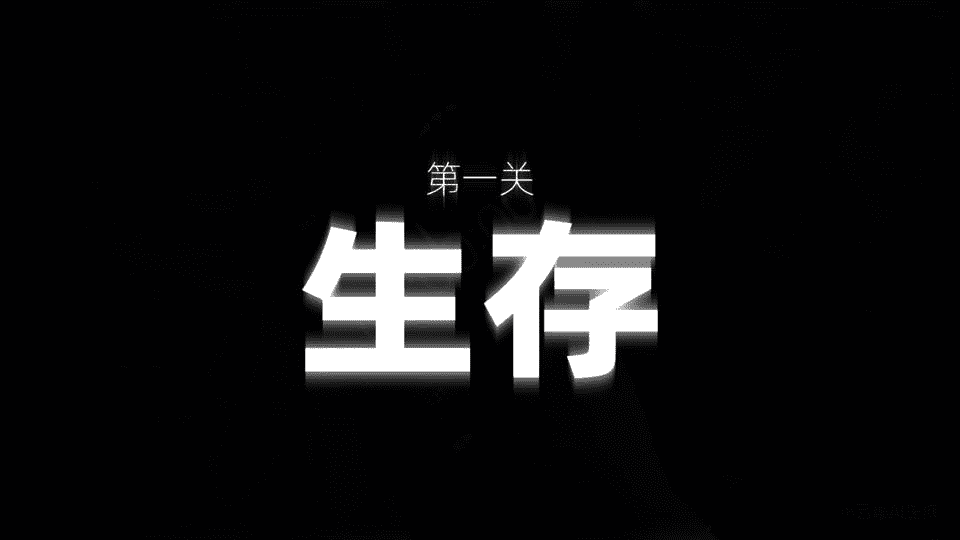

[循环.mp4](https://internal-api-drive-stream.feishu.cn/space/api/box/stream/download/all/Ux6tbHLZ6oSAAbx3bVccBfSvnzf)

> 教练点评：故事设定很棒，小狗视角，他拍视角，完美的运镜让画面丰富起来，但是作为漫剧就不太贴了哦，看出你是有底子在的，继续加油

## 作者：anytime

【地上城与勇士】

[574f58035deddbd1ec5b2d7f4ba598bb_raw.mp4](https://internal-api-drive-stream.feishu.cn/space/api/box/stream/download/all/LhpbbEWysoFPNhxcsAEcQZXFnHh)

> 教练点评：很不错呀，剧情连贯，运镜丰富，缺点就是人物配音不够，目前男主声音比较少，音量比较小

## 作业：大白心想事成

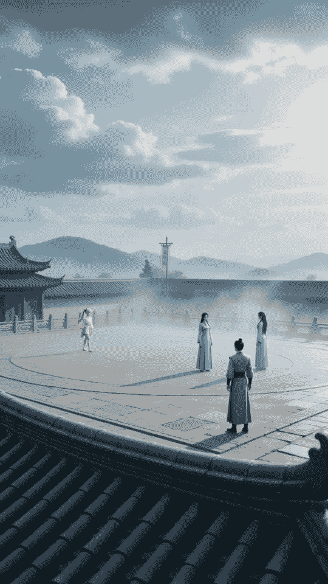

[2月10日(1).mp4](https://internal-api-drive-stream.feishu.cn/space/api/box/stream/download/all/FWxSbG5i0oIhj9xRlqLcLnCjnbd)

> 教练点评：故事设定不错，很有网感，人物角色形象设计好看的，人物配音感情充沛，期待下一集剧情

## 作者：蝶新

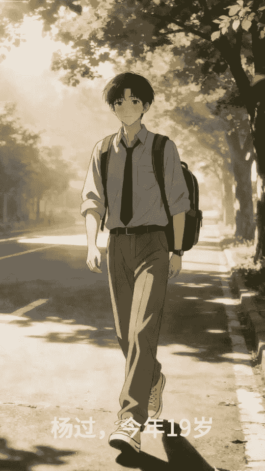

[校花的青睐让我觉醒了序列.mp4](https://internal-api-drive-stream.feishu.cn/space/api/box/stream/download/all/FYKGbdxmdoljWQxbixfcz49lnAh)

> 教练点评：画风不错，故事情节需要丰富一下，男女主在一起的速度有些快了，感觉可以优化一下剧本，增加一下人物角色配音会比较丰富些

## 作者：小妖

《呆萌虎闯森林》

[呆萌虎闯森林.mp4](https://internal-api-drive-stream.feishu.cn/space/api/box/stream/download/all/ObL2bcg6Ooc7DqxazW4cmfZPnkd)

> 教练点评：

> 画风很可爱呀，故事讲的比较简单，用来做绘本故事不错，作为漫剧还不够，剧情上要下功夫。小老虎踩着石头过河的石头，石头表面的积水不对哦

## 作者：Cheny

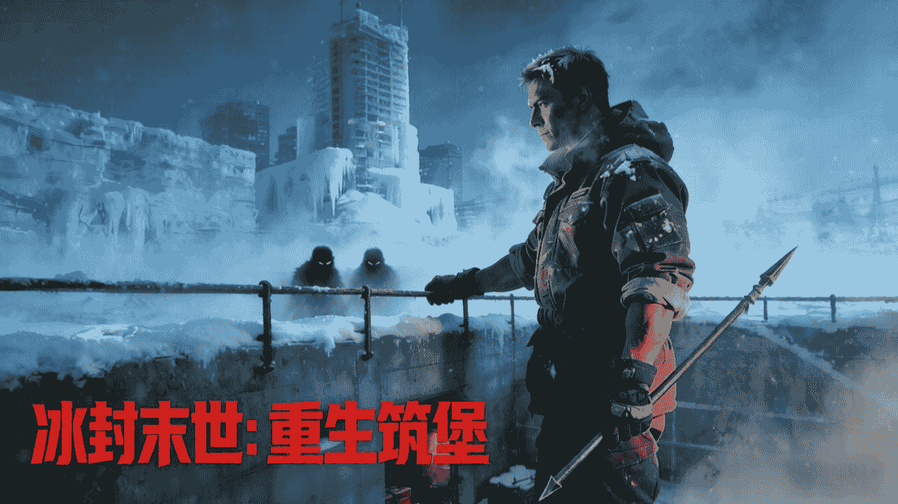

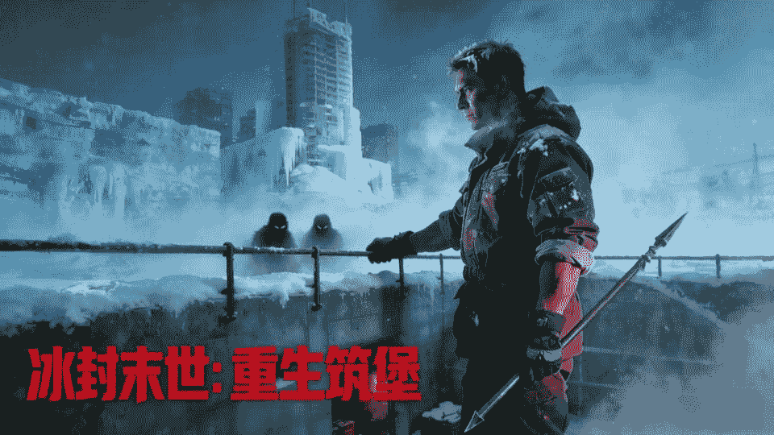

[冰封末世：重生筑堡.mp4](https://internal-api-drive-stream.feishu.cn/space/api/box/stream/download/all/YxR9bNkUpoC07XxzC2zchhOjnrc)

> 教练点评：封面好评，要是制作剧本质感可以达到封面这种质感，就会很不错，目前配音有些不对，中间有重音，女生端着咖啡微笑的表情有点僵硬，酒窝太重了，其他都还好

## 作者：C_

作品：《龙王归来-退婚》

[第一集序幕.mp4](https://internal-api-drive-stream.feishu.cn/space/api/box/stream/download/all/Os6LbNudkoE3nBxS5O9cfvYxnSc)

> 教练点评：故事设定不错，画风可以的，不足的就是在首富女儿从车里出来的瞬间，那个腿展现的有些吓人了，可以改改画面展现

## **作者：jasmine **

**作品《图书馆递错的笔记》**

[图书馆.mp4](https://internal-api-drive-stream.feishu.cn/space/api/box/stream/download/all/JsLMblupBoY0E1xQWgOcrXVsnsg)

> 教练点评：作为解说漫剧是不错的，画风可以，缺点是视频运镜少，杯子倒了水洒出来的画面展示错误，不应该是女生拿着杯子将水洒在书籍表面

## **作者：爱米屋 **

**作品《魂穿胡亥，扭转亡秦局》**

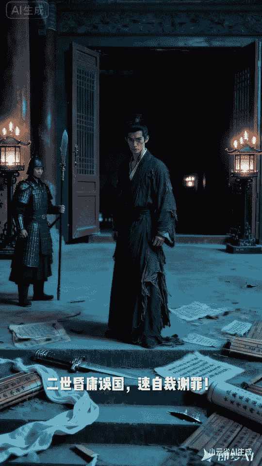

[lv_0_20260211004652.mp4](https://internal-api-drive-stream.feishu.cn/space/api/box/stream/download/all/A1BNbA2WBoEPbPxt8XGcOUhLned)

> 教练点评：历史改编的话，在政策上面有些风险，单看你的短片美术上可以优化看看，视频是运镜少，人脸不一致的问题

## 作者：Karl

作品：《长安的诡秘》

[2月10日.mp4](https://internal-api-drive-stream.feishu.cn/space/api/box/stream/download/all/LBmibDgTYorpgyxJeTucXCIunFh)

> 教练点评：画风可以的，目前没有配音，没有视频动态，作为漫剧标准还不够哦，希望可以完善，结尾黑幕时间比较长

## 作者：迷路的小孩

作品：《凡灵根废物？我靠阵法杀穿修仙界》

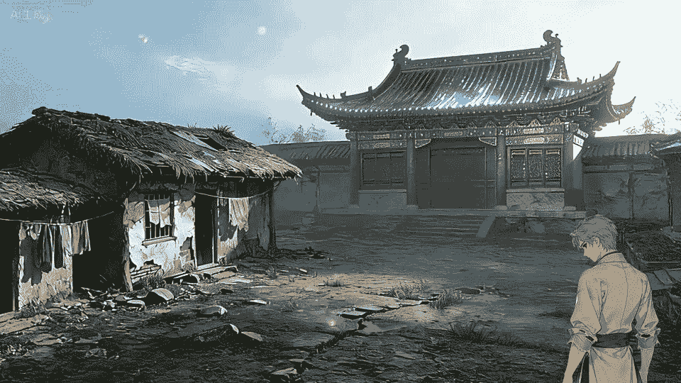

[《凡灵根废物？我靠阵法杀穿修仙界》.mp4](https://internal-api-drive-stream.feishu.cn/space/api/box/stream/download/all/GGk3bR5o1o7eW7xuMQoc2jS3nbd)

> 教练点评：可以看看《凡人修仙传》漫剧找找灵感，前面开头进展比较平，运镜也不够丰富，好的地方是观众可以看出是讲了什么内容的，继续加油

## 作者：🌕

《儿童安全知识》

[萌宝居家安全守护者-Seko-2026-02-11+23_07_16.mp4](https://internal-api-drive-stream.feishu.cn/space/api/box/stream/download/all/XAtnbE3fFoFoMzxOfk1c0gArnQf)

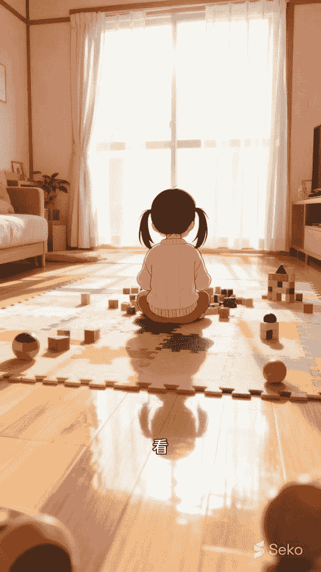

[第1集：11的抽屉大冒险-Seko-2026-02-11+23_07_27.mp4](https://internal-api-drive-stream.feishu.cn/space/api/box/stream/download/all/LFmTb7yFToMBrcxwhh5cMubmnkd)

> 教练点评：

> 立意不错，可以作为电商广告推广片或者公益广告片子，不太符合漫剧哦，画风是可以的，里面小孩子的年龄看着不像婴幼儿，小孩子形象可以在偏小一些

## 作者：RR yo

《尘霜一诺，到底辜负了谁》第一集

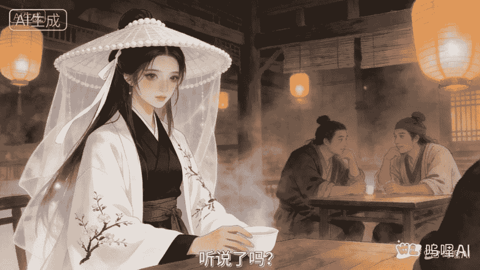

[RR yo-《尘霜一诺，到底辜负了谁》.mp4](https://internal-api-drive-stream.feishu.cn/space/api/box/stream/download/all/AAq9bDdXsoIxHLx3tc1c9mQCnnh)

> 教练点评：开头很不错，画风也好看，但是到了女主穿着黑色刺客衣服的时候，画风有差别没有保持一性，人物也是一致性没有保持的很好，女主也没有开头人物那样好看，字幕包装可以优化，两人的名字占得面积有些大

## 作者：火柴出品

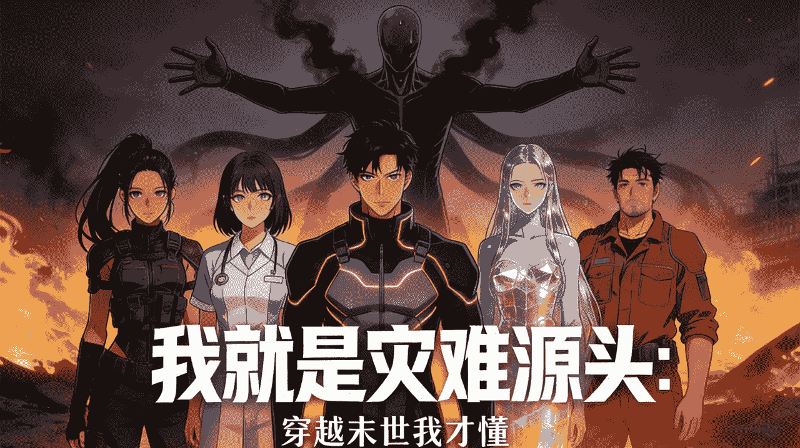

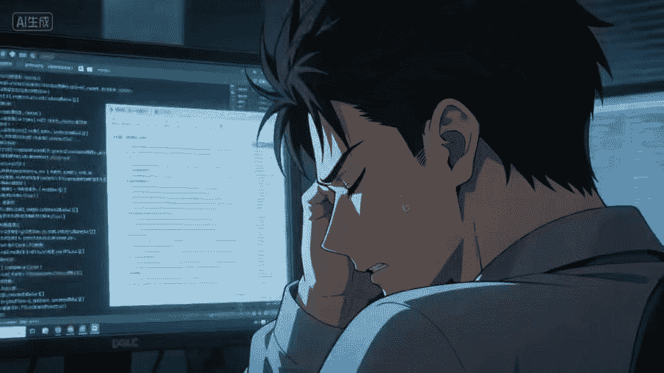

[745ec2447463895280fcafdeb8013a82.mp4](https://internal-api-drive-stream.feishu.cn/space/api/box/stream/download/all/NZ3Lb6Ao0owxh4xvWZxcCNrsn8d)

> 教练点评：看完觉得制作的很棒，是一步很不错的漫剧，剧情比较新颖，短片这样的制作没有什么问题，期待你的续集。海报封面可以优化一下，现在视觉上感觉画面填的太满，字体很挤的感觉

## 作者：阳

作品：《我用麻瓜科技，炸穿巫师界》

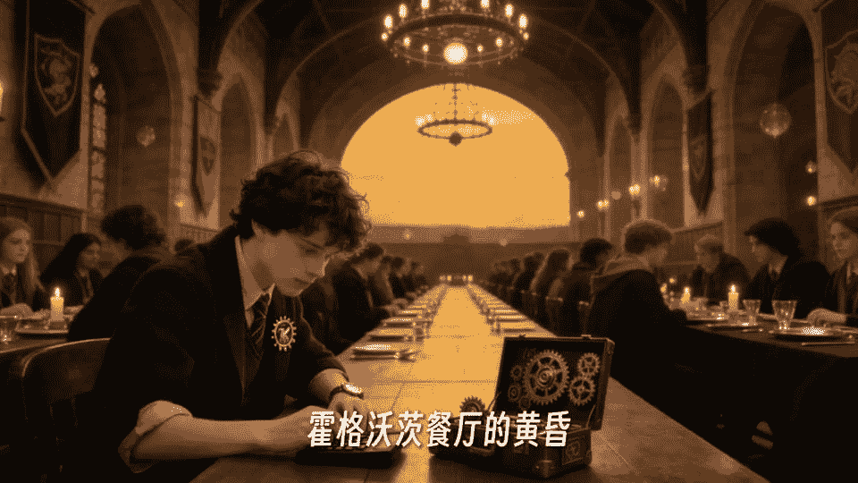

[2月12日.mp4](https://internal-api-drive-stream.feishu.cn/space/api/box/stream/download/all/Td8ZbI1BJo5HZaxbVC9coeQbnvd)

> 教练点评：故事设定比较新颖，可以优化完善，开头运镜太慢了，有点像PPT，最后留疑点让人有想看下去的欲望，视频镜头运镜要丰富些

## 作者：耶

作品：《心焰纪元》

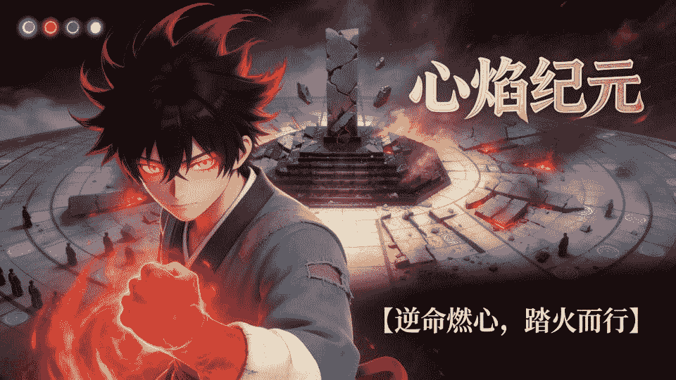

[2月11日.mp4](https://internal-api-drive-stream.feishu.cn/space/api/box/stream/download/all/JCbFb7cftodzRVxMtiWcF0fBnMf)

> 教练点评：慢镜头特写很不错，人物变身画面看着比较燃，就是男生短发跟这种玄幻修仙世界的环境有种割裂感，剧情可以继续完成，整体制作表现不错的

## 作者：草花

作品:《我的合租男友》

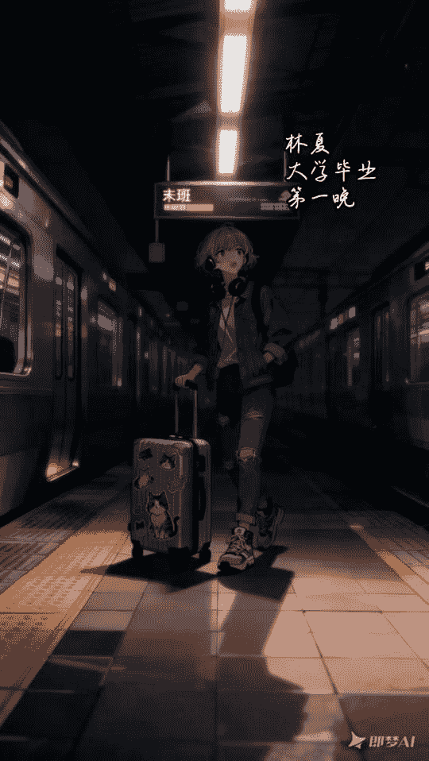

[lv_0_20260212090401.mp4](https://internal-api-drive-stream.feishu.cn/space/api/box/stream/download/all/IPVabasApoMvf9xXx1tc32AKnsg)

> 教练点评：剧情不是很新颖，配音AI感很重，画风是可以的，前面拉着行李箱的镜头语言和节奏感是不错的，到后面感觉运镜比较平，音效配的比较平淡

## 作者：J.A

《灵触觉醒》

……感觉来搞笑的……即梦生视频各种卡提示词差点胎死腹中……外加配音潦草了……

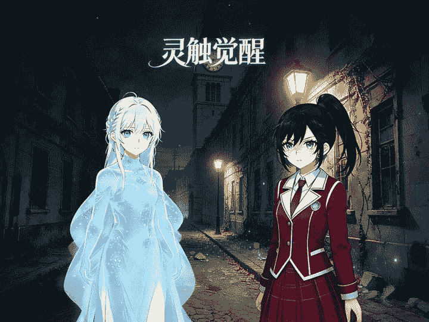

[灵触觉醒.mp4](https://internal-api-drive-stream.feishu.cn/space/api/box/stream/download/all/NLrVbvJg3oVy4jxYCTpc3S3gnke)

> 教练点评：

> 零基础的话能做出来就很不错了，可以看出这个故事要讲的内容，bug在配音ai感很重，魔鬼出来的时候镜头运镜视觉有些长了，声音没有跟上

##  作者：曹铁柱

《哆啦A梦&比比勇闯远古森林》

原来的剧本设计做到后面发现不太行，用最新的 即梦 2.0 做了一集动画故事~

[8b011463e1b25c71a092b6fe24845019_raw.mp4](https://internal-api-drive-stream.feishu.cn/space/api/box/stream/download/all/KKsQbrODTolBW8xCCuEcthy2nBf)

> 教练点评：看完很治愈，做的很棒，可以出多集小短片，剧情现在有些短了，其他没有问题。表情、声音、一致性都很不错

## 作者：404_not_found

《KPI垫底后，我解锁了神明百年阴谋》

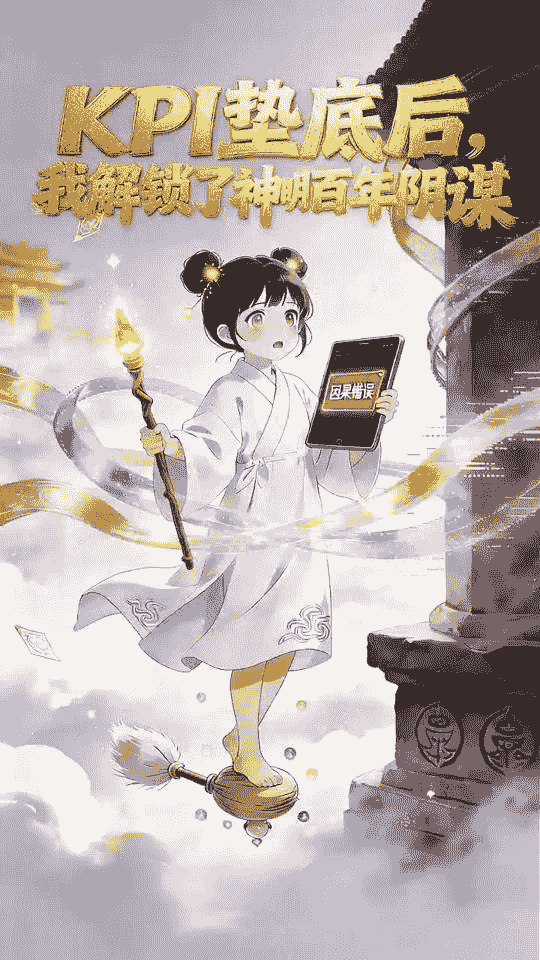

[54955406be92bd76799bb884990af06c.mp4](https://internal-api-drive-stream.feishu.cn/space/api/box/stream/download/all/N7HcbFbOnogc1cxxCILcedginEd)

> 教练点评：故事设定不错的，女主道具需要优化，人物站位存在一些比例上的错误，可以纠正过来，画面第一集的配乐有点平了

## 作者：西早月月鸟（无隅灵视）

《魔尊退休，被选入勇者小队讨伐自己》预告DEMO

[10.mp4](https://internal-api-drive-stream.feishu.cn/space/api/box/stream/download/all/PbwXbTVcRoelzQxod1ac0uqinOb)

> 教练点评：这个故事设定很有意思比较新颖，剧本可以好好开发，现在制作的程度上有解说漫的感觉，画风现在有些简单，画风是二次元和3D画风混在一起，看着有些割裂感，魔尊退休前形象不一致需要优化，可以往精品漫剧质感上去靠近

## 作者：月光如盐（玄荒晶源纪）demo

[2月12日.mp4](https://internal-api-drive-stream.feishu.cn/space/api/box/stream/download/all/ZvskbCIRXo3MU9xU5rVcTmUcn5c)

> 教练点评：短片做的很完整，这种3D游戏CG画风很不错，故事线讲的很完善，人物打斗动作连贯。人物配音感情充沛，镜头运镜丰富，可以看出有底子在的，这个故事可以出多集会是一部不错的漫剧

## 作者：于思佳

[山海奇镜.mp4](https://internal-api-drive-stream.feishu.cn/space/api/box/stream/download/all/KaJOba8G6o2Xvkxjc6DcH6Iln9P)

> 教练点评：画面画风不错，山海动物描绘的很形象，缺点就是运镜很少，动物运动幅度小，人物一致性不够，画面缺少运镜，给人的视觉感受画面比较平淡，优化一下是一部不错的片子，可以网上找找将山海经动物故事的短片案例学习一下

## 作者: 焱火流年《一路狂飙》

[mmexport1770861195956.mp4](https://internal-api-drive-stream.feishu.cn/space/api/box/stream/download/all/Lt6xbjuSLomgqqxMv8vcW7qXnEh)

> 教练点评：这部片子整体完成度不错，就是立意浅了一些，只展现一路狂飙这个概念，如果去创作漫剧故事内容可以深挖。人物配音很不错，感情充沛。车辆变形让人眼前一亮，还有人物面对突发情况的一个表情绘制的都很到位

## 作者：moira2333

[2月12日.mp4](https://internal-api-drive-stream.feishu.cn/space/api/box/stream/download/all/Qj0gbz4UnoulqkxPjd2c9P2NnXV)

> 教练点评：故事线很完整，画风不错，人物一致性保持的很好。春节回家，年轻女性被催婚是常态也是热点，以宠物视角去讲反抗传统催婚压迫，很容易引起共鸣，是一部不错的片子，缺点是猫猫会讲人话的这个声音音色不一致，猫猫说话后一桌子人不说话，这个变化节奏有些快了，其他都展现的不错，期待优化后的作品

## 作者：火星喵

[2月12日(2).mp4](https://internal-api-drive-stream.feishu.cn/space/api/box/stream/download/all/KFwbbAkynoBpvHxTt6rcKWbsnEn)

> 教练点评：故事网感很好，美中不足的是继母人物衣服很影响美感，不符合中国古代服饰，女佣人的脸不一致，整体画风是可以的，后期优化修改要注意人物衣服服饰的一致性，声音可以换个新的，目前的声音不好听

## 作者：甜度

[2月12日.mp4](https://internal-api-drive-stream.feishu.cn/space/api/box/stream/download/all/IoHgb30gooigXFxWHXiceOhOnoS)

> 教练点评：结尾的反应好绝。有一种看日漫的感觉。画风很稳，前面的铺垫让结尾形成了强烈的反差感。相信你是一个很会讲故事的创作者，期待后续作品。

作者：KK《丧尸末日我被最亲密的两个人双重背叛》

[最终成品.mp4](https://internal-api-drive-stream.feishu.cn/space/api/box/stream/download/all/LLiobLqWJo6CRmx2DKfcxRMInkc)

---

# 📱交流合作

持**续关**注**并更新 A****I 短剧/漫剧的相关资讯动态，研究报告，商业落地，常见问题，永久免费在线查看**。已建立社群聊聊 AI 短剧/漫剧发展、应用、对接及合作，邀请嘉宾讲课，没进群的可以扫码加入，群满可加大国微信 ID：zhangyuguo94s（备注：短剧），已经在社群内的无需重复加入，开源知识库及社群学习全部为公开免费分享。

**5000 人飞书学习交流群**

**AI 短剧微信学习交流群**

好友（ID：zhangyuguo94s）

**扫码交流、进群、合作**