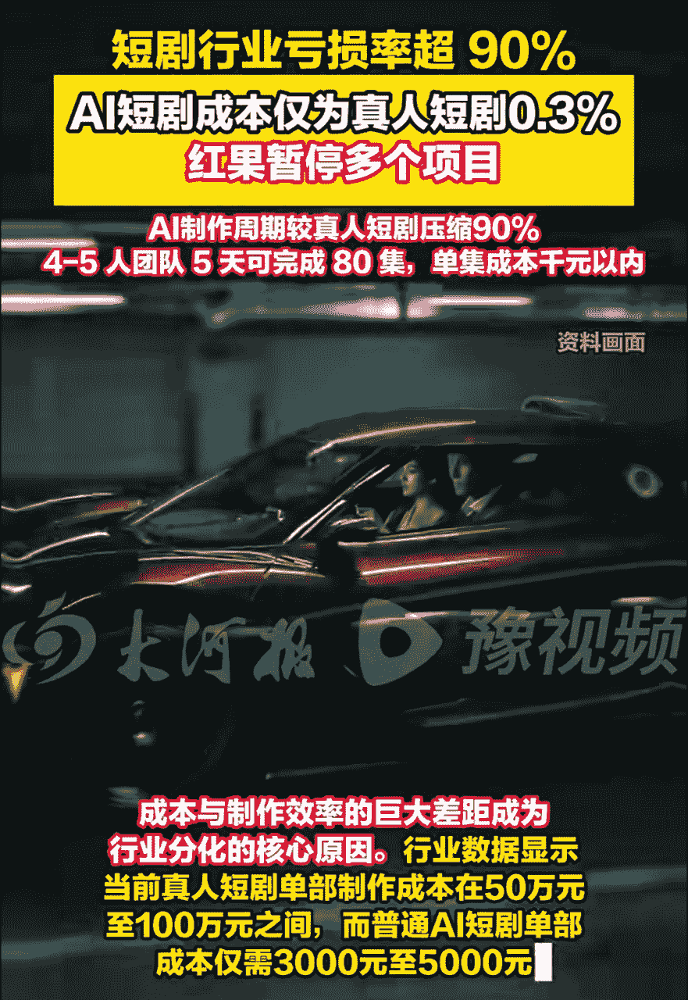
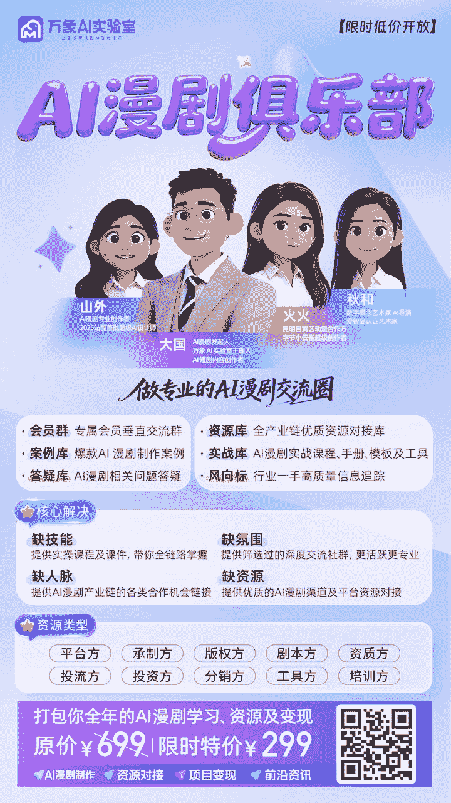
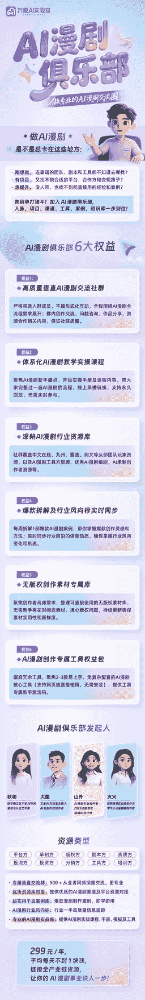

# AI 漫剧俱乐部会员招募介绍

> 来源：[https://yunyinghui.feishu.cn/docx/UK8ndDR1CoZgP6xHq58c3yMpnUd](https://yunyinghui.feishu.cn/docx/UK8ndDR1CoZgP6xHq58c3yMpnUd)

> **适用人群：** AI 短剧兴趣人员、内容创作者、从业人员等

> **首发时间：**2026 年 3 月 6 日

> **更新时间：**2026 年 3 月 6 日

> **内容出品人：**** **

> **内容出品方：**[万象 AI 实验室](https://yunyinghui.feishu.cn/wiki/WhelwZnxQi55mpkOzatc3Xran5b?from=from_copylink)

> **使用建议：**建议电脑端打开学习，如果需要快速定位到精确内容，可以使用快捷键 Ctrl +F/Command +F 的形式，搜索关键字/词，查找你想要的内容。

>

> **持续更新 AI 漫剧俱乐部的****相关服务介绍**，欢迎收藏、转发和支持，内容创作不易，请勿直接抄袭搬运。

非常感谢大家对 AI 漫剧/AI 短剧的关注，也感谢大家对万象 AI 实验室的关注[AI 短剧学习手册（行业首发&持续更新 ing...](https://yunyinghui.feishu.cn/wiki/V4HzwWEHZikxbekDEEncVR3Yn7d?from=from_copylink)我们从 2025 年上半年开始关注的 AI 短剧赛道，然后去年的 12 月写了 ，截止 3 月份超 1.5 万人学习。

手册发布过去也有 2 个多月了，我知道这两个多月很多人都是跑步入场的。当然，还有很多人想入局，又没有路子，资源和靠谱的教程，市面上的各种 AI 短剧，漫剧培训，层次不齐，往往还价格不菲，我们做社区和科普的初心，就是希望在最大的能力下，帮助大家用最低成本建立基础的认知和思考，能够有机会和一群专业的人深入学习交流。

可以明确的是：做 AI 短剧/AI 漫剧最赚钱的那批人，肯定现在不在干培训！但是市场上确实有人才缺口和断档的情况，我们希望大家能够找到一个比较靠谱，真诚，又有价值的圈子来深耕交流，至少能够降低外面被割韭菜的情况，千万不要花几千块，几万块学个什么短平快的课程，因为 AI 短剧/漫剧的能力，不是短期可以培养的，尤其是手搓的情况下，一些大公司之所以能够日产百部剧，一个是确实人多，另外大多数这类公司都有工业化的生产流程和工具，普通人想玩，根本很难有机会和愿意下本。

当然，面向普通人的生产工具，随着技术的迭代，也在不断地变化，但是我觉得一个最根本的情况是，如果你真的喜欢这个，想往这个方面走，一定要记住，找对的圈子深度学习。过去我自己也是，加了很多 AI 的短剧和漫剧圈子，花了大概万把块进核心圈子深度了解和学习。我可能不是专门去研究这个 AI 漫剧/AI 短剧到底是怎么制作的，而是要慢慢看清这个生态和机会，到底适合谁，到底哪里有坑，可以肯定的是，本身就在短剧赛道的那些大公司，一直在赚钱，疯狂在赚钱，有极度缺人的时候。但是同时，作为很多个体，能跑出来的玩家并不多，能自主掌控全流程商业化变现的人才更是少的可怜。

就在前几天，刷到一个新闻，变化和影响确实太大了，红果都在陆续暂停真人剧的投入了，转型 AI 的内容生产。

然后年前，我们跑了一期的《AI 漫剧实战营》，大概是 250 多个人参加了，其中带着一部分人去参加了小云雀的 AI 漫剧大赛，目前还在赛程中。

我们建开源的免费群也有蛮长的时间了，整体看下来，确实免费群就是不如付费群的活跃，很多人也就是围观看看，所以，针对真正想要学习和交流的合作的，还是得有个筛选的机制。

所以，我们决定，做一个**《AI 漫剧俱乐部》**的产品，希望筛选一部分真正的玩家交流，学习和合作。

我们希望打造一个良好的交流圈子，里面包含了教学教程以及行业资源的合作，我把我花钱买来的资源，懂得教学的老师都拉进来，希望可以对大家有至少节约学习的成本，但是我们有有运营，有投入，这是不可避免的成本，但是我们很看好这个赛道。

所以，我正式发布：**《AI 漫剧俱乐部》这个产品**，逐步筛选，愿意和大国一同深度在圈层交流的人群，把教程（以后别问在哪里学），资源，工具都包含进来，让大家多多少少还是能够进到一个有筛选机制的圈层来深入交流，而不是围观状态。

AI 漫剧/短剧不是速成的能力，希望各位看好的，记得不要追求任何速成课程，几千块几万块的也教不了你马上赚钱的，大家需要的是能够在一个圈层长期浸润，交流和灌输，而我们就是陪伴大家成长的一个圈子。

**AI 漫剧俱乐部的，**前500位价格只要 299 元/年，请 4 位老师吃饭一个价格，陪伴你一年的 AI 漫剧成长。

包含：**垂直的 AI 漫剧交流群 1 年+全年的 AI 漫剧的动态风向标分析+AI 漫剧资源对**接+AI 漫剧教学教程+AI 短剧/漫剧类的大赛指导+AI 漫剧类账号起号的指导

报名完加我🛰️（ID:zhangyuguo94s）拉群，已经有的不用重复加，后面有什么 AI 工具福利，也会赠送给大家的，做 AI 短剧/漫剧很消耗算力，这个价格可能你做一部漫剧的成本都不到。

当然，我们 AI 漫剧俱乐部产品，也支持分销，也许不能让大家赚到很多钱，但是肯定可以让大家少花冤枉钱。可以没有基础，但是必须要愿意花时间去学去练习，理论知识替代不了实操，而实操能发现很多问题，我们可以尽最大的努力帮你解决这些问题，4 个发起人都在群里，及时看到及时答疑。

我在 AI 漫剧俱乐部，等你来报道！

