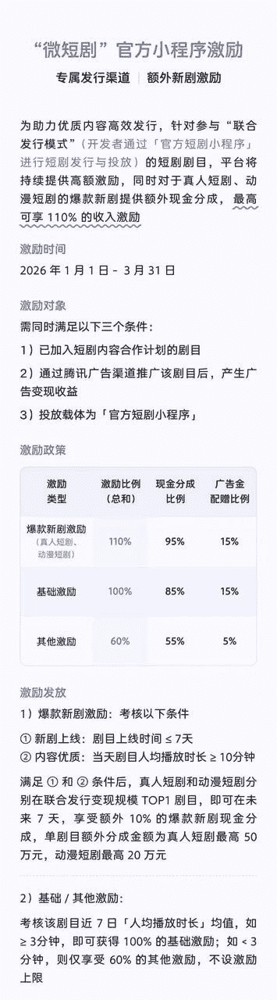
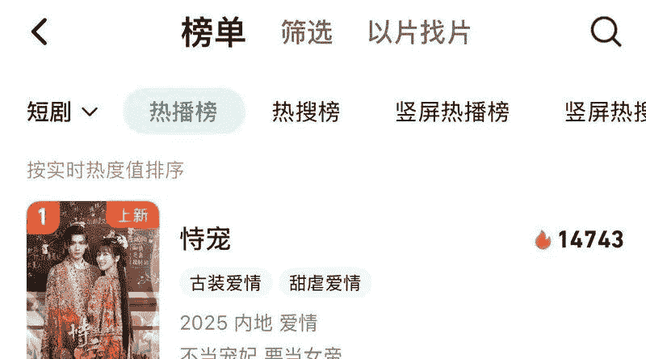

# AI 漫剧行业大记事

> 来源：[https://yunyinghui.feishu.cn/docx/WPiKdwbQaoGEb6xG3DIcRYBXncb](https://yunyinghui.feishu.cn/docx/WPiKdwbQaoGEb6xG3DIcRYBXncb)

> **适用人群：**互联网关注 AI 漫剧/短剧发展人群

> **内容出品方：**[万象 AI 实验室](https://yunyinghui.feishu.cn/wiki/WhelwZnxQi55mpkOzatc3Xran5b?from=from_copylink)

> **内容负责人：**** **

> **使用建议：**如果需要快速定位到精确内容，可以使用快捷键 Ctrl +F/Command +F 的形式，搜索关键字/词，查找你想要的内容。

> **持续更新 ****A**I 短剧/漫剧发展的相关资讯动态，每天一分钟，知晓 AI 短剧/漫剧圈内事儿！永久免费在线查看，欢迎收藏转发支持，文末有惊喜。

# 2026 年

## 1月

# 2025 年

## 12 月

### 微信广告团队发布 2026 年“微短剧&小说”小程序新年激励政策

12 月 29 日，微信广告团队正式发布 2026 年“微短剧&小说”小程序新年激励政策，通过“阶梯式分成+爆款专项补贴”的组合策略，为微短剧（含真人、动漫品类）与网络小说小程序开发者，提供现金与广告金双重激励，进一步完善，微信生态的内容商业化链路。

此次激励政策按“微短剧 IAA 小程序”“官方短剧小程序联合发行”“小说 IAA 小程序”，三大维度精准划分。在微短剧 IAA 小程序方面，2026 年 1-3 月限时激励期内，人均访问时长≥3 分钟的小程序，广告变现收入可享 70%现金分成 +15%广告金配赠，综合分成比例达 85%；4-6 月常规激励期内，同条件小程序分成调整为 70%现金 +10%广告金，综合 80%；若人均访问时长<3 分钟，则仅享 55%现金 +5%广告金，综合 60%。

### **2025 首届文旅短剧大荟举行**

12 月 27 日，2025 首届文旅短剧大荟在台州开幕。本次活动以“剧力文旅  影耀台州”为主题，旨在搭建“文旅+短剧”产业生态平台，推动短剧创作与城市文旅深度融合。

作为“文旅+短剧”产业生态平台，本次活动是响应国家广播电视总局“跟着微短剧去旅行”创作计划的重要实践，推动文旅短剧从“简单植入”向“深度融合”转型，打通线上流量与线下消费的场景壁垒，让短剧不只可“看”，更可“游”、可“感”、可“体验”。

### 微短剧《乐乐成长记》首映新闻发布会举行

12 月 28 日上午，微短剧《乐乐成长记》新闻发布会召开，一部展现始兴风情、聚焦儿童成长并借儿童视角，呈现家乡文化与发展的，微短剧作品正式亮相。《乐乐成长记》主要讲述了三年级学生赵小乐，因父母忙碌沉迷游戏、染上了一些不好的习惯，暑假时和姐姐赵小雅，被送回始兴外婆家后，受环境影响，变成一个勤劳、有礼貌、懂感恩好孩子，后因父亲因公牺牲后，母亲结束城市事业返乡，开民宿创业，逐渐走出伤痛，还结识返乡青年开启新感情，最终一家在始兴定居的故事。

### 微短剧《今夕何夕》红果短剧，ai 荔枝，荔枝新闻上线播出

12 月 27 日，由江苏广电总台网络产品部打造的，微短剧《今夕何夕》，在红果短剧平台上线。ai 荔枝、荔枝新闻将同步播出。《今夕何夕》以“小切口映照大情怀”为创作宗旨，借微短剧的凝练形式，承载深沉的历史回望与青春担当。短剧立足于青春化叙事，通过主人公对于，人生意义的抉择，以启发当代青年的使命探索，推动红色精神与年轻观众的“双向奔赴”。剧中既蕴含着对家国命运的深刻思考，也以诗意的影像，承载非遗淮剧的独特魅力，表达人生成长与文化传承的积极主题。

### 文旅微短剧《溜溜的她》央视频上线

12 月 27 日，由云南省文化馆指导，云南童眼影视传媒有限公司拍摄的，云南文旅微短剧《溜溜的她》，正式上线央视频！该剧讲述了主人公李晓云，在逆境中寻找自我、追求自由的故事，还探讨了个人成长、文化传承与历史记忆的主题。影片通过李晓云的旅程，展现了一个女性在传统观念与现代生活，夹缝中挣扎求存的形象，她的成长象征着个体在社会压力下的，自我救赎和精神解放。

### 奇幻轻喜微短剧《重启黄昏时》上线

12 月 28 日，由浙江卫视中国蓝新平台、乐松娱乐、华语之声传媒、网视版全通联合出品的奇幻轻喜微短剧《重启黄昏时》，在 Z 视介、抖音、红果短剧等平台正式上线。

《重启黄昏时》不仅是一部文艺作品，更是一次聚焦老年群体精神文化需求、展现当代老年生活多样可能性的温情尝试。它旨在用轻盈有趣的微短剧形式，深度聚焦老年群体的精神世界与情感需求，尝试打破外界对老年生活的刻板想象，展现其丰富、精彩、充满活力的一面，助力营造“老有所乐、老有所爱”的社会氛围，生动诠释浙江省在积极应对人口老龄化、高质量建设老年友好型社会进程中的文化探索与人文温度。

### 文旅微短剧《九龙湖之有间客栈》央视频平台上线

12 月 29 日，由浙文影业、宁波市镇海区委宣传部、九龙湖镇人民政府共同指导策划的，文旅微短剧《九龙湖之有间客栈》，在央视频平台上线。《九龙湖之有间客栈》以宁波九龙湖的，秀美风光为真实背景，讲述几位性格各异的年轻人，在经营一家湖畔客栈的过程中，如何相互支撑，共同守护梦想与爱情的成长故事。

### **短剧《恃宠》上线播出**

12 月 29 日，由鲸鱼影业原创出品，短剧《恃宠》正式开播。《恃宠》的核心创新在于构建了一组“双穿越”CP，并融入“作者与角色”的命运博弈。“我与皇上携手改命，皇上竟是书写我命运之人”，这一设定让情感关系在信任与怀疑中层层递进，张力十足。剧中塑造了一位“反套路”大女主，她以现代思维，打破传统叙事框架，主动破局。

### **微短剧《热血龙舟魂》上线**

12 月 29 日，由广西日报传媒集团、广西云数字媒体集团出品，梧州市委宣传部、藤县县委宣传部联合出品的，微短剧《热血龙舟魂》正式上线。该剧通过青春化叙事和 AI 技术赋能，将梧州当地龙母、龙舟、美食、特产等文旅元素和，热血体育竞技相融合，为剧集打开了新的想象空间，是广西日报传媒集团，探索“新闻+微短剧+文旅”创新实践的，又一个新的案例。

### **精品横屏微短剧《今生情定 214**》爱奇艺、腾讯视频、优酷、央视频上线播出

12 月 30 日，由广电新视点中心、迪庆州文旅局、同程旅行联合出品，迪庆州融媒体中心联合摄制的 24 集精品横屏微短剧《今生情定 214》，在爱奇艺、腾讯视频、优酷、央视频四大平台同步首播。

《今生情定 214》突破“模式化甜宠”的创作窠臼，以“时间循环”为叙事核心，构建起“情感线+使命线+成长线”的，三维叙事体系。以香格里拉壮丽风光为叙事基底，以“寻找彩虹鸟”为情感脉络，深度融合迪庆非遗瑰宝与，多民族共生图景，既是一场关于爱与信念的治愈之旅，更是一部全方位展现香格里拉，文旅魅力与生态价值的影像力作。

### **微短剧《你好，铁门关》上线**

12 月 31 日，由新疆生产建设兵团第二师铁门关市党委宣传部、河北援疆干部人才第二师铁门关市分指挥部、河北广播电视台出品，微短剧《你好，铁门关》全网上线。

《你好，铁门关》以“丝路雄关·红色铁门关”为核心文化 IP，有机融合张骞通西域的历史典故、兵团精神的时代价值、铁门关的地域特色及发展新貌，作品紧扣“历史活化、文旅融合”主线，将千年雄关的自然之美、历史之韵与人间烟火，浓缩于每集几分钟的紧凑剧情中。

### 乡村振兴微短剧《海南合家欢》之浪漫爱情海开机

12 月 27 日，乡村振兴微短剧《海南合家欢》之浪漫爱情海，在临高县美夏渔村开机。《海南合家欢》以临高本土生活为蓝本，聚焦一个普通海南家庭的日常故事，通过诙谐幽默的剧情、鲜活立体的人物，展现了海南人乐观豁达的生活态度，同时融入了临高渔歌、特色美食、滨海风光等地域元素，让观众在欢笑中感受海岛文化的独特魅力。

### **精品竖屏短剧《蛊色撩人》开机**

12 月 28 日，由腾讯视频出品、曲江影视集团及旗下曲影传媒制作的，现代爱情精品竖屏短剧《蛊色撩人》，西安正式开机。《蛊色撩人》不止于描绘爱情，更旨在讲述一个，关于“真诚”与“守护”  的成长故事。当持有不同信念与背景的两个人相遇，剧集将探讨他们，如何打破内心的壁垒，在冲突与理解中，重新认识自我与世界。角色的选择与蜕变，传递的是关于勇敢面对、坦诚相待与坚定守护的积极价值观。

### 都市时空之旅短剧《穿书娇妻：大佬为我站起来了》热度 4257 万

12 月 28 日，红果飙升榜穿书分类，更新数据显示，都市时空之旅短剧《穿书娇妻：大佬为我站起来了》，飙升值登顶榜单，成为当日穿书类短剧热度，增长最快的作品，其总热度达 4257 万，仅上线第二天便收获 17.5 万次点赞，展现出极强的市场号召力。

### 古装短剧《恃宠》热度值 14743

12 月 29 日，古装短剧《恃宠》首日站内热度值便冲到了 14743，一举拿下平台短剧热播榜 TOP1 的宝座。《恃宠》的首日登顶，只是 2025 年末，短剧狂潮中的一个高光瞬间。这个行业正在经历从，“流量争夺”到“品质竞争”的，深刻转变。

### 江西广电局开展“一市一品、百县百剧”精品创作

近日，关于开展“一市一品、百县百剧”精品创作，推动赣派微短剧繁荣发展的实施意见。实施“微短剧+”行动计划，推动微短剧赋能千行百业、走进千家万户。坚持用小切口解析大主题，用小故事折射大时代，用小人物彰显大情怀，生动讲好江西故事，讲好江西老百姓自己的故事，传播时代发展强音，展示江西崭新形象。挖掘江西文化，讲好江西故事。依托我省“红色、绿色、古色”资源，聚焦微短剧赋能千行百业，引导创作者通过采风、调研、交流等多种形式，深度挖掘当地历史文化积淀和改革发展实践，推出一批富有江西元素的微短剧精品剧本。

### 内蒙古广电局开展“跟着微短剧去运动”创作计划的通知

近日，深入贯彻党的二十大和二十届历次全会精神，全面落实《国务院办公厅关于释放体育消费潜力进一步推进体育产业高质量发展的意见》，贯彻落实《国家广播电视总局关于实施“微短剧”行动计划赋能千行百业的通知》《体育总局办公厅 广电总局办公厅关于实施“跟着微短剧去运动”创作计划的通知》，进一步激发全社会参与，内蒙古体育主题微短剧创作的活力，推动微短剧与体育领域深入结合，促进全民健身与全民健康深度融合，现就开展“跟着微短剧去运动”创作计划通知如下。“跟着微短剧深耕‘体育+’”。鼓励深入“体育+文旅”、“体育+科技”、“体育+农林”、“体育+公益”等跨界融合方向开展创作，充分展现体育在推动经济社会发展、服务国家战略、促进跨领域协同中的多元价值与综合功能。

### 河南省政府办公厅发布《河南省支持微短剧产业高质量发展若干政策措施》

近日，河南省政府办公厅印发《河南省支持微短剧产业高质量发展若干政策措施》，从资金奖励、产业链完善、服务保障等多方面释放政策红利，精准对接行业发展需求与市场关切，全力推动微短剧产业高质量发展，助力打造全国具有影响力的，微短剧产业高地。产业链完善提升，是政策扶持的重点方向。《措施》明确，河南将打造微短剧产业发展集聚区，对投资 2000 万元以上的，影视数字科技项目，最高给予 300 万元补助；培育播出平台与经营主体，对优质播出平台最高奖励 300 万元，分年度培育，100 家左右省级重点企业，优质企业最高可获 100 万元奖励。深入实施“微短剧+”行动计划，对充分展示河南文旅资源、特色文化的微短剧，上线后最高给予 50 万元支持。

### **短剧《晋商传奇》新闻发布会举行**

12 月 21 日，王荣宏电影馆山西会馆，系列短剧《晋商传奇》，开机新闻发布会举行。该系列短剧计划，未来三年拍摄数千部作品，聚焦 365 行商业文化，深度挖掘晋商精神内核。项目将点燃“三把火”：一是推动“人人看短剧”向“人人拍短剧”转变，为普通人提供免费培训、明星助力等全方位扶持；二是将企业宣传片升级为，人人爱看的故事型短剧，让企业文化走出“自娱自乐”的局限，实现家喻户晓；三是创新“宠粉福利”模式，企业拍摄短剧时优先选拔消费者担任演员，会员可享受“买一送一”的表演学习福利，实现表演爱好者、企业、影视行业的三方共赢，蓝图绘就，合作启航。

### **湾区微短剧产业联盟成立**

12 月 22 日，海珠区 2025 年文商旅融合发展大会暨，数字文娱产业招商推介会在，国际媒体港东塔隆重举行。湾区微短剧产业联盟正式成立。该联盟旨在整合政、校、企资源，构建涵盖创作、拍摄、投流、出海的，全产业链协作平台，积极与微信、红果、快手等平台开展合作，推动行业标准制定与版权保护，引导行业向规范化、精品化、创新化方向健康发展，努力汇聚最优秀的人才、最前沿的技术。

###  宜宾市“千部 AI 漫剧合作计划”发布

12 月 23 日，宜宾市“千部 AI 漫剧合作计划”正式发布，重点文旅微短剧 《一骑红尘妃子笑》 同步开机。根据规划，宜宾将以“四个一”内容战略为引领，即一部电影凝练城市精神、一部电视剧演绎时代故事、一百部微短剧激活文旅场景、一千部 AI 漫剧创新数字体验，系统打造具有区域，影响力的文旅 IP 集群，为宜宾“三地三中心”建设注入强劲动能。此次开机的《一骑红尘妃子笑》，是宜宾首部定制文旅微短剧，也是国家与省级重点扶持项目，该剧以跨越古今的悬疑爱情为主线，融合宜宾的历史文化与自然风情，讲述一个关于守护与传承的动人故事。

### ** 郑州微短剧出海计划发布仪式举**行

12 月 23 日，郑州微短剧出海计划发布仪式在河南郑州举行。活动现场发布了“加强微短剧智库研究，引领行业发展”微短剧出海课题研究计划。针对微短剧企业在剧集出海、传播资源对接等方面的需求，提供精准支持与服务：整合双方资源，助推郑州微短剧产业整体竞争力、影响力提升：共同推动微短剧，内容创新与文化传播，讲好郑州故事、河南故事、中国故事，将郑州建设成为，微短剧产业的集聚高地、文化创新表达的策源地。

### 2025 南京微短剧投融资对接活动举行

12 月 23 日，由南京文化产业协会微短剧产业联盟、南京文化金融服务中心、南京电影协会主办，2025 南京微短剧投融资对接活动正式举行。本次对接活动以政策解读、平台推介、需求对接等模式，实现资源精准匹配与高效对接。为破解行业普遍存在的“融资难、融资贵、对接散”痛点，南京微短剧产业联盟联合多方力量，搭建精准投融资对接平台，本次“微光聚变・短剧长投”，2025 南京微短剧投融资对接活动应运而生，既是政策落地的具体实践，更是产业与资本深度融合的重要举措。

### ** 支付宝短剧频道上**线

12 月 23 日，支付宝内容创作者大会上，首次对外公布了全新内容板块，短剧业务的进展：支付宝短剧频道上线，并在首页开设短剧独立入口。目前，已有 2 万部版权短剧免费看，人均观看时长近 1 小时。2026 年，支付宝计划推出 50 部独家短剧，并继续大力推进新热真人短剧和，AI 短剧的合作。针对短剧业务的合作政策和，激励方案也将全面升级，以保底分成为主，包含行业优质新热剧集，最高 5 万元/部的现金保底激励，配套叠加独立分成政策、独立考核标准、专属分成后台等，广纳更多优秀的短剧行业伙伴。

### 古装甜虐权谋短剧《愿得安宁锦瑟鸣》红果短剧 APP 上线播出

12 月 20 日，古装甜虐权谋短剧《愿得安宁锦瑟鸣》，在红果短剧 APP 独播上线。《愿得安宁锦瑟鸣》以“宿命纠缠”为核心，构建了一段兼具情感张力与，权谋深度的故事脉络。剧情围绕失忆女刺客周安宁与，镇西将军谢锦鸣展开：身负绝技的周安宁，因意外失忆陷入困境，为营救被挟持的弟弟，受相府二小姐李婉儿所托，以舞娘身份潜入侯府，伺机接近“不良于行”的谢锦鸣。

### **网络短剧《梦到盐都放灯时》上线**

12 月 20 日，由自贡市委宣传部出品，成都锦瑞和邦影业制作，自贡文旅发展集团、成都广电能量公司参与联合制片的，网络短剧《梦到盐都放灯时》，在抖音、红果、腾讯视频等，主流平台正式上线。《梦到盐都放灯时》创新采用了“古今对话”的，沉浸式戏剧结构。剧情不仅跟随陆游的诗意足迹，探秘盐都往事，更以彩灯技艺为核心纽带，串联起古代文人情怀与，当代“Z 世代”的文化觉醒。

### 精品短剧《东山顶上》腾讯视频上线播出

12 月 21 日，由陕西省广播电视局、陕西省电视艺术家协会指导，西藏民族大学、陕西中秦鸿基影视、陕西华商影业联合出品的，精品短剧《东山顶上》，在腾讯视频独家播出。该剧始于雪域高原上，农奴姐妹格桑梅朵与格桑德吉，为追寻自由的逃亡。与解放军军官，怡高远的命运邂逅，不仅改写了个体人生，更见证了西藏社会，翻天覆地的时代变迁。女主角格桑梅朵，从受尽苦难的农奴少女，在西藏公学（西藏民族大学前身）培养教育下，最终成长为勇敢，追求真理的新时代女性，其坚韧蜕变之路充满戏剧张力。

### **竖屏短剧《华商风云录》上线播出**

12 月 22 日，由泰国亚洲大众集团有限公司制作出品的，竖屏短剧《华商风云录》上线播出！《华商风云录》以曼谷“唐人街”为风云舞台，讲述了一段充满背叛、重生与崛起的江湖故事。女主十三妹在被，司徒耀扬背叛后，逃亡至唐人街，意外救下遇险的，潮义安首领陈浩东，从此踏入这个充满，规矩与血腥的灰色地带。

### 短剧《爱在离别时相遇》红果、抖音、小红书平台上线

12 月 23 日，由我知文化联合出品的，短剧《爱在离别时相遇》，正式登陆红果、抖音、小红书三大平台！该剧讲述七年前，女主林婉儿为救男主霍斯礼，毅然捐献了自己的眼角膜，从此陷入黑暗。可这份深情，却因一场精心策划的误会，让霍斯礼将她视作“贪慕虚荣的拜金女”，狠心抛弃。独自承受失明痛苦的林婉儿，意外发现自己怀有身孕，为了孩子，她咬牙撑过七年艰辛岁月，将女儿暖暖抚养长大。

### 原创精品短剧集《奇迹》CCTV-1 黄金档上线播出

12 月 22 日，由中央广播电视总台、中共深圳市委宣传部、深圳广播电影电视集团出品，深圳市腾讯计算机系统有限公司、深圳市福田区人民政府联合出品，中央广播电视总台首部，原创精品短剧集《奇迹》，登陆 CCTV-1 晚八点黄金档首播，《奇迹》用短小精悍的短剧集形式，回溯深圳 45 年来从小渔村到，国际化都市的发展巨变。剧集打破单一叙事模式，涵盖怀旧、青春、喜剧、悬疑等多元风格，聚焦科技创新、生态保护、深港融合、文化出海等主题，既展现了深交所开市、智慧城市建设等时代印记，也刻画了创业者、建设者、普通人的鲜活故事，在宏大时代叙事中融入细腻情感表达。

### 经济犯罪题材微短剧《隐秘的 ID 之天价打赏》腾讯视频上线播出

12 月 23 日，由公安部经济犯罪侦查局、广东省公安厅经侦总队指导，腾讯视频、广州泽影文化传媒有限公司联合出品，经济犯罪题材微短剧《隐秘的 ID 之天价打赏》，在腾讯视频上线开播。该剧以真实案件为依托，将镜头对准无形战场上的经济安全卫士，生动呈现了新时代经侦民警，运用智慧与科技，在庞杂资金数据和复杂人性交织的迷局中，守护百姓财产安全、捍卫经济秩序的鲜活故事。

### 法治微短剧《最终的真相》上线播出

12 月 23 日，由苏州市相城区司法局联合，苏州市广播电视总台精心打造的，相城首部法治微短剧《最终的真相》，上线播出！《最终的真相》以民法典第 1142 条第 3 款，“立有数份遗嘱，内容相抵触的，以最后的遗嘱为准”，这一重要法条，为故事创作的核心锚点。剧情围绕一位老人身后留下的，多份内容相悖的遗嘱展开，由此引发了一场，牵动人心的家事纠纷。亲人之间，情感与利益交织，真相扑朔迷离。

###  原创短剧《月照金台》ANZO 昂首资本官网，红果短剧平台上线

12 月 24 日，由 ANZO Capital 出品并赞助、原创短剧《月照金台》，在 ANZO 昂首资本官网，红果短剧平台上线！，《月照金台》以 “交易” 为叙事内核，围绕七皇子与现代交易员，跨越时空的精神共鸣展开。剧情通过戏剧化表达，将复杂的交易逻辑，转化为易懂的情节冲突，探讨人在多变环境中，如何坚守诚信底线、做出理性决策，让专业金融知识走出圈层，变得有温度、有共鸣。

### 精品文旅微短剧《念君》红果，抖音平台上线

12 月 24 日，由上海市青浦区文化和旅游局、上海市青浦区金泽镇人民政府指导，上海尚世影业有限公司、上海金泽旅游发展有限公司、厦门乐道互娱文化传媒有限公司共同出品的，精品文旅微短剧《念君》，在红果和抖音平台同步上线。该剧讲述了现代文物修复师唐念，因一本神秘古籍《金泽造桥志》，三次穿越时空，与命中注定的沈君宴在宋朝、民国、当代三世轮回中，从宿命对立到彼此守护，一场跨越千年的深情谜局就此揭开。

### 文旅短剧《星之祈愿》芒果 TV 上线播出

12 月 24 日，非遗烟花文旅短剧《星之祈愿》，在芒果 TV 开播。《星之祈愿》讲述的正是这样一个，关于“心愿”的故事：小男孩葛星星因思念爷爷，意外进入成人世界，与东星烟花的宋时璟灵魂互换，带着各自对生活、工作的困惑、期待与未说出口的情感，共同策划了一次特别的“烟花创意会”。

### 文旅微短剧《疯狂的桔子》腾讯，优酷上线

12 月 26 日，由广东俪莱元文化传播有限公司打造，十六集文旅微短剧《疯狂的桔子》，在腾讯、优酷首发。该剧讲述了农业大学毕业的，“富二代”乐俊峰放弃继承家业，到偏远的西岸村担任村长的故事。初到村里的乐俊峰，不仅遭遇了村民们的“花式欢迎”，还被橘子种植、销售等难题困住。但这位看似“镀金”的“公子哥”，实则是个肯实干的年轻人，他凭着所学专业知识，从橘子品种选择、种植管理，到采摘储存、直播带货，一步步摸索实践，带领村里的年轻伙伴攻克难关，最终让小橘子成为，乡村致富的大产业，展现了新时代青年扎根乡村、助力振兴的精神风貌。

### ** 精品短剧《厌朱墙》上**线

12 月 26 日，由广东人民出版社精心打造的，首部精品短剧《厌朱墙》，正式上线。该剧改编自番茄小说平台，高人气作品《登云天》的剧集，深度融合古装、权谋与情感元素，讲述了家奴南瑾，为替惨死的父母伸冤，在状告无门后，毅然潜入深宫，于朱墙之内步步为营、逆天改命的跌宕故事。

###  “非遗”主题微短剧《顾盼锦年》开机

12 月 21 日，“非遗”主题微短剧《顾盼锦年》，在江苏无锡举行开机仪式。该剧讲述了，年轻的女督造苏婉与穿越时空的宋锦，传承人顾苏安合力克服重重困难、互生情愫的动人故事。以第一批国家级非物质文化遗产项目，宋锦织造技艺代表性传承人的，传奇人生故事为主线，是一部融汇，青春叙事与家国情怀的短剧。

### ** 精品短剧《不祭罗裙祭烽火》开**机

12 月 22 日，由保利文娱科技，番茄小说携手出品的，精品短剧《不祭罗裙祭烽火》，正式开机，《不祭罗裙祭烽火》改编自番茄小说，知名作家九创的巅峰上榜作品，原著以古风权谋为基调，围绕“重生女将、女扮男装” 的核心设定，讲述了女主宗延黎，携前世遗憾重生，于乱世中扛起责任、南征北战的热血故事。作品深耕家国情怀内核，将个人成长与家国命运紧密相连，既刻画了金戈铁马的战争豪情，也展现了乱世之中的人性百态，传递出忠诚、担当、坚守的正向价值观。

### **非遗传承短剧《鼓动青春》开机**

12 月 22 日，由榆林能源科技职业学院联合出品，非遗传承系列短剧《鼓动青春》，在陕西榆林正式开机。该剧以“横山老腰鼓非遗传承进校园”为主题，围绕青年学生研学、演练与传承老腰鼓技艺的，成长历程展开，将校园生活与乡土情怀相融合，生动展现传统文化在，当代青年中焕发的新活力。

### **甜宠题材短剧《升温诱哄》开机**

12 月 22 日，由江西时刻互动科技股份有限公司出品，甜宠题材短剧《升温诱哄》，开机仪式举行。《升温诱哄》剧情聚焦豪门千金与被其，悉心抚养的男主之间的情感羁绊，细腻描绘了两人从超越血缘的“姐弟”情谊，逐步向真挚爱情递进的过程，其间穿插催眠干扰、身世迷雾、蛊术危机等强情节冲突，甜虐交织的叙事风格极具看点。

### **微短剧《纸间微光》开机**

12 月 22 日，由广州理工学院人文与教育学院出品、创作先锋工作室创作、广州桔子影视制作有限公司联合制作的，微短剧《纸间微光》，在惠州校区大礼堂举行开机仪式。《纸间微光》以校园生活、客家文化与传统剪纸为核心，聚焦青年学子在，非遗传承中的困惑与探索、坚守与创新。“纸间微光”不仅是对精益求精技能的追求，更象征着平凡个体在，文化传承中的不凡力量。

### **青瓷主题微短剧《南海一号》开机**

12 月 23 日，丽由水首部四县市国企联合投资的，青瓷主题微短剧《南海一号》，在龙泉市正式开机。该剧讲述现代学生江筱月，因瓷穿越至南宋处州的奇幻故事。故事的核心场景，聚焦龙泉窑场，江筱月带着现代思维走进古窑，在拉坯、施釉、烧窑的釉火交织间，体悟龙泉青瓷匠人“择一事、终一生”的工匠精神。

### 微短剧《三十不惑，我为自己出征》开机

12 月 23 日，由桐乡籍导演朱哲漪的，微短剧《三十不惑，我为自己出征》，在桐乡正式开机。《三十不惑，我为自己出征》属于当下流行的女性成长题材，剧情将围绕女主角林知悦展开，讲述一位女性如何挣脱，重男轻女的原生家庭束缚，从一名家庭主妇成长为独立自强，并为更多女性带来希望的优秀企业家。

### 精品原创短剧《我在大明开银行》开机

12 月 23 日，由山西星卫视传媒有限公司、华盈文化传播有限公司、华舰文化传媒科技（山西）有限公司联合出品，重庆四月联盟倾力制作的，精品原创短剧《我在大明开银行》正式开机。本剧以晋商文化为核心题材，讲述了身怀现代银行防伪的专家，魂穿到明万历年间，成为晋商王氏钱庄嫡女王御澜，她临危受命执掌家族票号，凭借超前理念破局传统商业模式困局，更在国家危难之际以金融之力，彰显晋商家国担当的，跨时空传奇故事。

### **精品短剧《梦影》开机**

12 月 23 日，由湖北长江电影集团有限责任公司、红果短剧、北京银兴影业有限公司联合出品的，精品短剧《梦影》，在浙江横店正式开机。《梦影》以青春化、创新性的短剧形式，践行文化传承使命。作品将“胶片”这一电影核心载体与，精神符号作为叙事主线，通过“时空对话”的巧妙架构，打通历史与现实的边界，让百年影史与当代观众深情对望，使百年前电影先驱的赤诚初心，以鲜活且富有，感染力的方式走进今人视野。

### 温情治愈竖屏短剧《重养计划》开机

12 月 23 日，由浙江之江容量无限科技有限公司、青岛海文影业有限公司、满堂星影业、种太阳工作室、无糖文化联合出品，小糖罐短剧精心制作，温情治愈竖屏短剧《重养计划》，在山东青岛正式开机。该剧以“重生”为引，通过女孩夏念初重获新生后，逐步揭开父母以“谎言”守护亲情的暖心故事，细腻探讨当代家庭关系与，情感陪伴的核心真谛，用轻松温情的叙事风格，为观众勾勒出一幅，关于爱与陪伴的家庭画卷。

### ** 微短剧《客家药王》开**机

12 月 23 日，微短剧《客家药王》，开机仪式在曲江区举行。该剧以中医为题材，带你穿越回 1992 年的粤北深山，看中医高材生刘霍，如何“重生逆袭”，抓住时代机遇，玩转“中医+产业+乡村振兴”，用医术和智慧带领家乡走向振兴。

### 竖屏短剧《华商风云录》热度值 339 万

12 月 22 日，由泰国亚洲大众集团有限公司制作出品的，竖屏短剧《华商风云录》上线播出！单平台预约人数突破 1.2 万+：上线仅 10 分钟，平台热度值即飙升至 339 万，繁花剧场累计热度已超过 745 万次。凭借强劲的数据表现，《华商风云录》以黑马之姿强势开局，正式拉开一段属于唐人街的热血传奇。

###  精品短剧集《奇迹》播放量超 1.9 亿

12 月 22 日，由中央广播电视总台携手深圳共创的，精品短剧集《奇迹》首播后，收视率与网络热度双双表现强劲：酷云实时收视峰值 2.1858%，同时段全频道电视剧排名 top 2；腾讯站内开分 9.5，剧集频频位列，腾讯电视剧期待榜首位；微博热搜开播日超 135 条，抖音平台上主话题“总台首部原创精品短剧集奇迹”，播放量超 1.9 亿。

