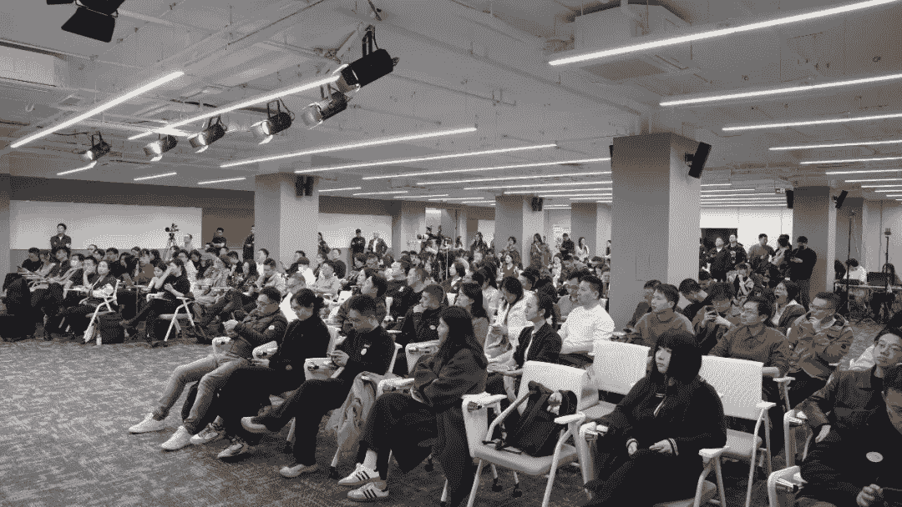
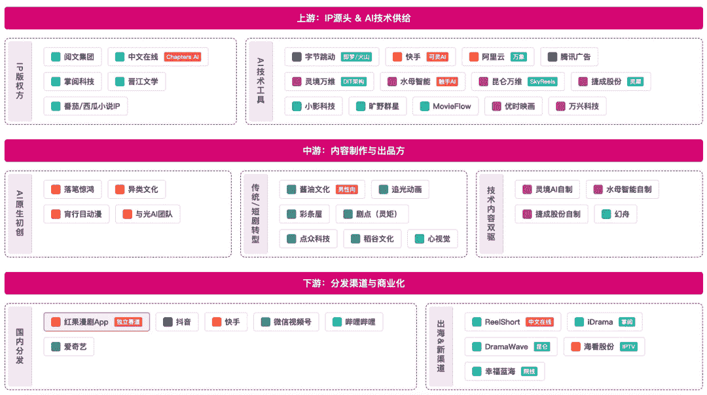
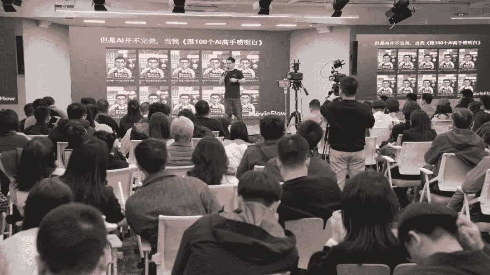
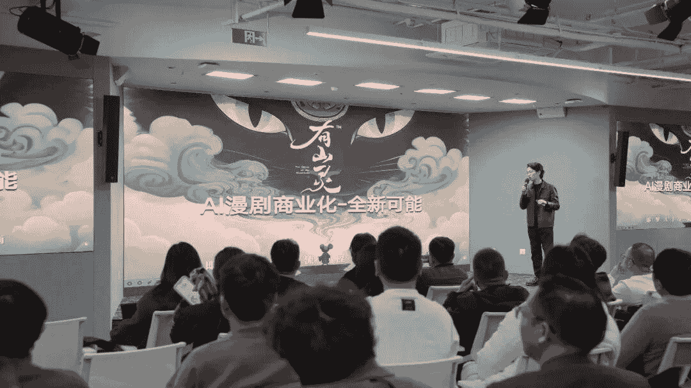

# 杭州AI DAY：AI 漫短剧从0到百万GMV的可复制路径

> 来源：[https://yunyinghui.feishu.cn/docx/Eyw5dX825o2kytxFKk9cvWgdnrg](https://yunyinghui.feishu.cn/docx/Eyw5dX825o2kytxFKk9cvWgdnrg)

> **内容来源**：巴九灵 吴晓波频道

> **发布日期：**2025-12-25 08:20:48

> **推荐理由：**这篇文章是关于第三期“杭州AI DAY”沙龙活动的总结，主题为“AI漫短剧”。AI漫短剧的黄金时代是技术、内容与商业协同作战的结果。活动为从业者提供了从工具使用、内容创作到商业变现的实用方法论，并指出了未来的发展方向和合作机会。

> **文章核心内容的提炼总结：**

> **1. 行业背景与机遇：**

+   AI技术（如万相、Vidu Agent、Seedance等）已从“技术演示”进入“产品交付”阶段，显著提升了漫短剧的生产效率（如100集短剧制作周期可压缩至一周到一个月）并降低了成本。

+   行业处于高速增长期（2025年上半年上线超3000部，月复合增长率80%），行业图谱尚不完善，存在大量市场空白和机遇。

1.  **从创作到变现的实战路径：**

+   **工具选型：** 介绍了三类核心工具以提高效率：

+   全流程创作（如MovieFlow）： 一站式平台，兼顾AI效率与创作者控制感。

+   出海适配（如小影科技影伙引擎）： 提供多语种配音、字幕等底层基础设施。

+   工业化生产（如旷野群星Mulan）： “AI工厂”模式，实现资产复用和规模化生产。

+   **内容创作：**

+   聚焦**女频内容**，强调以用户情绪为核心（“起点三问”）。

+   拆解用户需求（显性、隐性、情绪结果），精准运用“先虐后爽”等经典套路。

+   AI用于生成人设、分镜，人工聚焦台词和情绪校准。

+   **商业变现：**

+   **IP联名前置化：** 在漫剧上线前与品牌合作，自然融入品牌元素。

+   **多平台分发与衍生品开发：** 结合头部IP平台，通过多形态内容放大IP价值。

+   **广告与漫剧融合：** 用AI广告业务反哺漫剧研发和品牌定制。

1.  **未来趋势与创作者指南：**

+   **技术趋势：** 大模型成为基础设施，叙事一致性和工作流整合是关键。工具走向更可控、资产在线化。

+   **创作者能力：** 核心价值转向**审美、导演思维和情感注入**，而非单纯生产。

+   **生态机会：** 中小团队可聚焦垂直题材、出海小语种、工具开发等细分赛道。

1.  **活动呼吁：**

+   文章最后发起了“杭州AI DAY共建计划”，邀请高校、投资人、企业、社群等各方伙伴加入，共同推动AI漫短剧生态的发展。

当AI撞上百亿市场，漫短剧风头正劲，可入局者却满是迷茫：产业链繁杂，从哪切入以至于不做无用功？AI工具扎堆，选哪种才真提效？内容创作扎堆女频、IP 改编，如何跳出套路精准击中用户情绪？

这些绕不开的痛点，正是12月19日第三期杭州AI DAY想要解答的。这场吴晓波频道和非凡产研联合主办的杭州AI DAY&非凡Open Day“AI漫短剧实干家开放麦”线下沙龙，吸引了200多位创作者、创业者从各地奔赴而来。

现场，8位分享嘉宾用真实案例拆解产业链的每个关键节点，奉上工具选型、内容创作、商业变现与出海破局的实战秘籍。

## **行业全景：**

## **AI重构内容生产底层逻辑**

活动开场，非凡产研数据研究负责人宦家臣用一组硬核数据勾勒出行业全貌：2025年上半年，国内上线的漫短剧已超3000部，月复合增长率高达80%。

更关键的信号是，AI模型迭代已实现从“技术演示”到“产品交付”的跨越—— 万相2.6×千问AI小剧场 、被抢内测名额的 Vidu Agent ，以及能力持续上台阶的 Seedance 1.5 Pro 等， 强化了音画同步、主体一致性与指令可控性。

技术升级直接颠覆生产效率：“现在100集短剧的制作周期能压缩至一周到一个月，且支持方言等多样化语言输出，成本大幅降低但效果不减”。

宦家臣分享的AI漫短剧行业图谱（1.0版本）显示，中文在线、旷野群星、小影科技、MovieFlow等企业已率先布局，而图谱中大量空位，正预示着行业尚未定型的巨大机遇。

AI漫短剧行业图谱（1.0版本）

## **核心干货：**

## 从创作到变现，实战方法论+工具秘籍

▶️ 第一， 工具选型：选对工具=效率翻倍，3类核心工具清单

沙龙现场嘉宾一致认为，AI漫短剧工具已形成清晰的分层矩阵，创作者可根据需求精准选择：

**◎ **全流程创作工具

MovieFlow联合创始人梁巍介绍道，MovieFlow支持1-10分钟长视频生成。从灵感到分镜、从镜头调度到配乐节奏，全都能装进一站式平台里，再配上一套足够精细的编辑器，让创作者不是在抽卡，而是在精修，既有 AI 的效率，也保留电影人的控制感。

**◎ **出海适配工具

小影科技业务VP吴婉萱介绍道，“影伙引擎”能为短剧出海厂商提供多语种、多角色、高情感的音色克隆配音、字幕重构方案，以及批量生成AI素材的工具——听起来是声音和素材，本质上是整个短剧出海链路的底层基础设施。

**◎ **工业化生产工具

旷野群星Mulan，主打“AI工厂”模式，将角色、场景、IP等资产在线化，拆解破碎流程，原本需一个月制作的 泡面番（ 单集时间很短的连载动画） ，如今扔一份脚本即可生成，实现“资产复用+精准调校”的高品质规模化生产。

旷野群星创始人兼CEO刘如山告诉大家，在正式做出Mulan这款产品之前，他们为一家上市公司连续6个月交付AI视频内容，每个月最低600 条、最高破千，还要背流量KPI。

这样的高压项目，把资产离线、流程破碎、沟通成本极高等问题暴露得一清二楚：有才华的创作者被困在重复搬运和工具切换中，小白用户则被陡峭的学习曲线挡在门外，这让团队意识到，如果不做一款真正承载完整工作流的产品，所谓AI提效只会沦为PPT上的笑话。

▶️ 第二， 内容创作：女频爆款方法论，精准击中情绪需求

AIGC创作者“@玩AI的小笼包”（孙畅悦）分享了女频内容的黄金创作逻辑：

**◎ **起点三问，找准用户情绪：

创作前先明确“她是谁？点开视频时情绪是什么状态？关掉时希望变成什么状态？”，而非先想“我要讲什么故事”。比如职场女性用户多带着“疲惫压抑”的情绪点开视频，核心需求是“瞬间身份翻转的极致补偿”。

**◎ **需求三层拆解法：

显性需求（想放松），隐性需求（被认可、被理解、替代性成功），情绪结果（打造稳定可反复进入的情绪安全区）——乙女向内容爆火的核心，正是满足了“男主主动选择你、情绪被当作事实”的隐性需求。

**◎ **套路不怕重复，就怕不准 ：

“先虐后爽”“追妻火葬场”等套路经久不衰，关键在于精准击中情感痛点。女频内容已从“被选择”的玛丽苏，升级为“自己选”的自主意识表达，爱女文学、大女主题材的创新，本质是需求贴合的升级。

**◎ **AI提效技巧：

用AI生成多版本人设图，筛选后固定角色资产；将爆款脚本拆分为“情绪钩子+冲突升级+爽点释放”三段式结构，用AI批量生成分镜，人工聚焦台词打磨与情绪校准。

▶️ 第三，商业变现：3条可复制路径，从0到百万GMV实战

与光同尘联合创始人&CEO陈发灵分享了从广告转型漫剧的变现经验。与光原创动画《有山灵》和if品牌的联名合作，打开了漫剧的商业化的模式，相较传统影视剧长周期、高投入的项目，AI漫剧兼具内容延展性强、商业植入灵活、成本周期可控等优势。

其核心路径可复制：

**◎ **IP 联名前置化：

漫剧上线前就与品牌达成联名，将品牌元素自然融入剧情（如道具、场景），而非后期植入。《有山灵》结合非遗文化与《山海经》元素，推出联名“仙酿果酒，自然有灵”，精准匹配目标用户审美。

**◎ **多平台分发+衍生品开发：

与番茄、阅文等头部IP平台合作改编，覆盖红果、抖音、B站等多渠道，通过“精品AI漫剧+2D动态漫剧+表情包漫剧”多形态内容放大IP价值，再授权开发商业衍生品。

百度智能云空间智能解决方案总监孔伟健也强调，AI服务能力如果只停留在技术层是没有意义的，它必须和 IP 金字塔 连在一起——通过百度百家号等渠道验证IP价值、放大头部内容，再回到生产侧反哺模型与工具，让工作流与内容资产形成一个正向循环。

**◎ **广告与漫剧融合 ：

将AI广告的盈利投入漫剧研发，用广告业务积累的品牌资源反哺漫剧商业化。与光同尘为巴拉巴拉打造的AI广告，用AI生成模特与虚拟场景，将原本百万级预算、两三月周期的项目，压缩至低成本快速交付，这种模式已延伸至漫剧品牌定制。

▶️ 第四，行业未来：2026年核心趋势与创作者生存指南

沙龙现场达成三大共识，为创作者指明方向：

**◎ **技术趋势

大模型将成为“水电煤”，叙事一致性与工作流整合是核心竞争力。AI工具将从“随机生成”走向“完全可控”，Mulan的“在线虚拟剧组”、MovieFlow的“无限裂变创意生成”，都在指向“资产在线化、流程模块化”的方向。

**◎ **创作者核心能力

AI解决形式供给，审美与导演思维成为护城河。未来创作者的价值，在于“评判AI生成结果、修正细节偏差、注入情感温度”，而非单纯的内容生产。

大有空间创始人&董事长黑羽希望，未来好的内容，不只是“被看见”，更能“被一起生活”——用户可以在其中停留、共创、消费，而AI所做的，是帮创作者把过去需要高投入、高门槛才能打造的虚拟体验，变成一门可以规模化复制的情绪生意。

**◎ **生态机会

行业图谱仍有大量空位，中小团队可聚焦细分赛道——如女频垂直题材、出海小语种内容、AI漫剧工具插件开发等。非凡产研也将持续更新行业图谱，收录上下游企业，为创业者提供对接机会。

这场杭州AI DAY传递的核心认知是：AI漫短剧的黄金时代，不是技术的独角戏，而是“技术+内容+商业”的协同作战。

活动的热闹背后，是每一位实干者的坚守，也是开放协作生态的力量。

在此，我们再次发起杭州AI DAY共建计划，诚挚邀请更多伙伴加入：欢迎高校与研究机构带来前沿学术洞察；期待投资人关注优质项目与创作者，为AI落地注入资本活水；邀请社群伙伴共同组织主题沙龙、行业论坛；也盼望更多企业参与路演发布、技能培训、社群搭建，让AI能力触达每一个有需要的人。

无论是想成为下一场活动的联合主办方，想分享你的实战案例，还是想对接产业链资源、推广创新产品，杭州AI DAY都将为你敞开大门。