# AI 声音工具精选

> 来源：[https://yunyinghui.feishu.cn/docx/GFLudeeO3ovryjxXyWXcIDv4nOd](https://yunyinghui.feishu.cn/docx/GFLudeeO3ovryjxXyWXcIDv4nOd)

> **适用人群：****互联网 AI 声音工具人群**

> 首发时间：2024 年 4 月 7 日

> 更新时间：2024 年 4 月 7 日

> **内容出品人：**

> **内容出品方：**[Mix AI Lab](https://yunyinghui.feishu.cn/wiki/WhelwZnxQi55mpkOzatc3Xran5b?from=from_copylink)

> **使用建议：**如果需要快速定位到精确内容，可以使用快捷键 Ctrl +F/Command +F 的形式，搜索关键字/词，查找你想要的内容。

> **持续更新 AI 声音好用的****相关工具，****工**具介绍等内容，工具经过测评口碑相对比较不错的精选出来，永久免费在线查看，欢迎收藏转发支持，文末有惊喜。

# 更新记录

# 声音工具导航

| ## 声音工具导航 |  |  |  |  |
| --- | --- | --- | --- | --- |
| [**AI 音乐声音**](https://yunyinghui.feishu.cn/wiki/YnOFw3beaihY4YkDe9DcrNnzn2b?open_in_browser=true#part-H4P4d9yAhoj2lGxclTBcE8zonwg) | [**AI 声音变音**](https://yunyinghui.feishu.cn/wiki/YnOFw3beaihY4YkDe9DcrNnzn2b?open_in_browser=true#part-Yxe2dk4pFoOA7Nx8SoncyjB8nOe) | [**AI 文字转声音**](https://yunyinghui.feishu.cn/wiki/YnOFw3beaihY4YkDe9DcrNnzn2b?open_in_browser=true#part-Mm6md3GHToJPI9xp9u2cppaYnXd) | [**AI 声音克隆**](https://yunyinghui.feishu.cn/wiki/YnOFw3beaihY4YkDe9DcrNnzn2b?open_in_browser=true#part-KEjAdt1c8oB8CgxQswhcODBxniG) | [**AI 声音降噪**](https://yunyinghui.feishu.cn/wiki/YnOFw3beaihY4YkDe9DcrNnzn2b?open_in_browser=true#part-DQ2DdGcuioZtmnxT2HWcMnMmn8e) |
| [**AI 声音分离**](https://yunyinghui.feishu.cn/wiki/YnOFw3beaihY4YkDe9DcrNnzn2b?open_in_browser=true#part-ZgTnd3yTHov3n8xb9PXc59eEn2f) | [**AI 声音转文字**](https://yunyinghui.feishu.cn/wiki/YnOFw3beaihY4YkDe9DcrNnzn2b?open_in_browser=true#part-E3eud5BleovHtlx0RY0cbW28nQd) | [**AI 声音总结**](https://yunyinghui.feishu.cn/wiki/YnOFw3beaihY4YkDe9DcrNnzn2b?open_in_browser=true#part-G4ZLdb7PDoBZQHx5Gluc5ny4nEp) |  |  |

# AI 音乐声音

## 1.Suno.ai

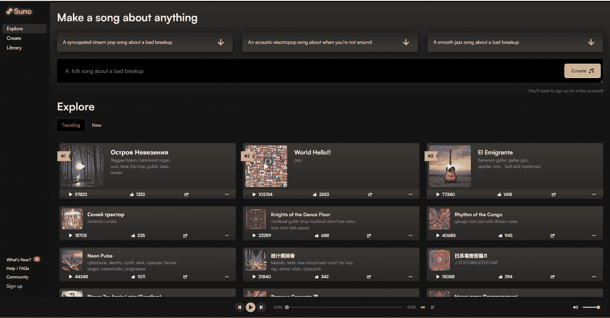

**工具介绍：**最强音乐类 AI—音乐 AI 领域的 ChatGPT。

**工具优点：**效果十分理想，旋律抓耳、编曲有逻辑与细节；生成速度较快，约 1 分钟生成 2 分钟的音乐；可选人声或纯音乐生成。

**是否免费：**免费/付费，非充值用户每天 5 次免费，1 次生成并列的 2 首相同主题。

**网络条件：**需要特殊网络

**体验网址：**https://www.suno.ai/

**使用建议：**为了充分利用 Suno.ai 的音乐生成能力，建议用户首先明确自己的音乐风格和需求。可以尝试不同的风格和情感组合，如流行、爵士、电子等，以及欢快、悲伤、浪漫等情感。此外，还可以选择不同的乐器和节奏，以及是否需要人声。通过实验和探索，用户可以找到最适合自己需求的音乐创作方式。如果对音乐术语不熟悉，可以使用 Suno.ai 提供的示例提示词，或者参考其他音乐平台上的风格。最后，不要忘记享受创作过程，让 AI 帮助你将创意变为现实。

## 2.TME Studio

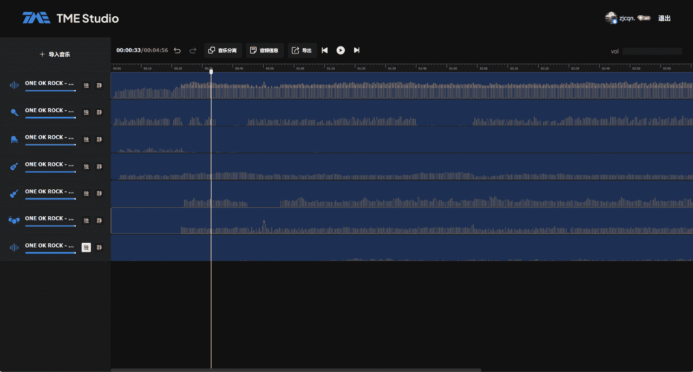

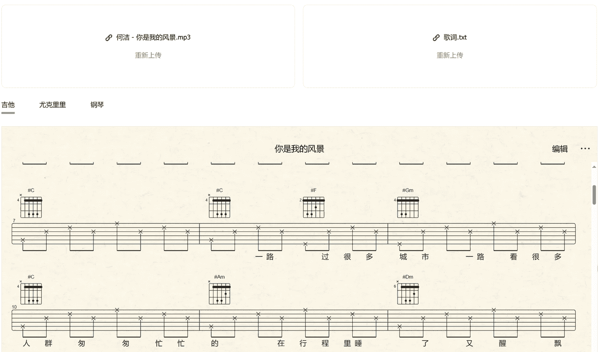

**工具介绍：**音乐信号处理平台，提供高质量的音轨分离、辅助写词、智能谱曲（扒谱）等。

**工具优点：**操作简单，功能强大，能够提取歌曲的采样率、位深、BPM、节奏、节拍、调性、和弦进行、鼓点识别、副歌识别等信息，从而为用户提供更深层次的音乐创作支持。

**是否免费：**免费

**网络条件：**不需要特殊网络

**体验网址：**https://y.qq.com/tme_studio/index.html

**使用建议：**非常适合于想要获得高质量原声伴奏、乐理分析报告、扒谱的音乐爱好者们，为了充分利用 TME Studio 的功能，建议用户上传高质量的音轨以进行分离和分析。

# AI 声音变音

## 1.大饼变声

**工具介绍：**免费的 AI 变声软件，支持实时语音变声，适用于快手、斗鱼、虎牙、Steam 等平台和游戏内变声，也可以用于日常的 PC 端的视频会议、直播等在线场景。

**工具优点：**声音种类选择多，资源占用少，使用门槛低，转换延迟较低（1s 左右）但是仍然可感。

**是否免费：**免费

**网络条件：**不需要特殊网络

**体验网址：**https://dubbing.tech/

**使用建议：**可用于游戏娱乐或在线场景下的个人语音隐私保护，兼具可玩性和实用性。但是由于有可感的延迟，使用的时候建议不要开启音频回放，会影响正常说话的节奏。

## 2.Voice.ai

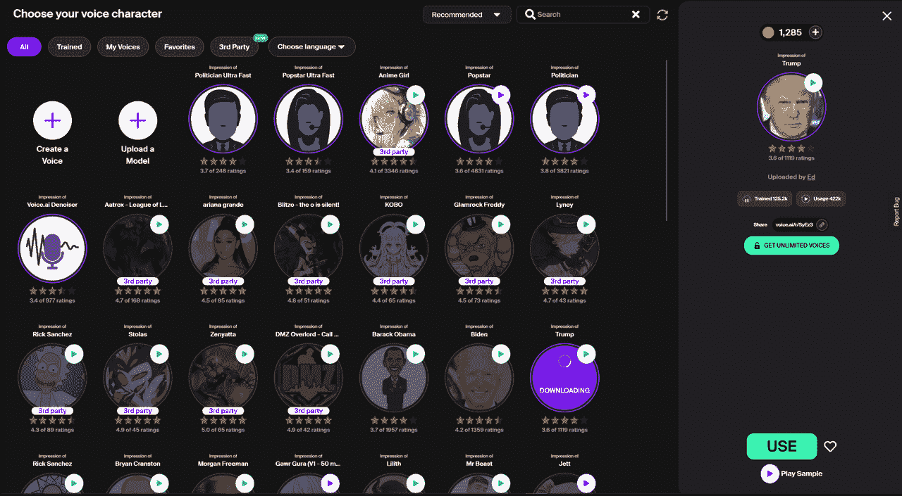

**工具介绍：**一款高质量实时语音变声器，支持实时语音变声，适用于快手、斗鱼、虎牙、Steam 等平台和游戏内变声，也可以用于日常的 PC 端的视频会议、直播等在线场景。能够在转换声音的同时转换说话人的说话习惯，表现力更高。

**工具优点：**转换质量高，声音种类选择多，保留了目标说话人的说话习惯，可玩性很高。

**工具局限性：**对中文支持较差，计算机资源占用较多，一般需要本地搭载 GPU。

**是否免费：**免费/15 刀每月，免费账号可以通过挖矿获得积分，4600 积分可以兑换一个永久的声音，付费用户不受限制，还自己训练声音

**网络条件：**需要特殊网络

**体验网址：**https://voice.ai

**使用建议：**可用于游戏娱乐或在线场景下的个人语音隐私保护，兼具可玩性和实用性。但是由于有可感的延迟，使用的时候建议不要开启音频回放，会影响正常说话的节奏。

# AI 文字转声音

语音合成（Text-to-Speech）受语言种类影响较大，国外工具大多没法适配中文生成，因此只推荐国内的工具，即配音工具。

## 1.魔音工坊

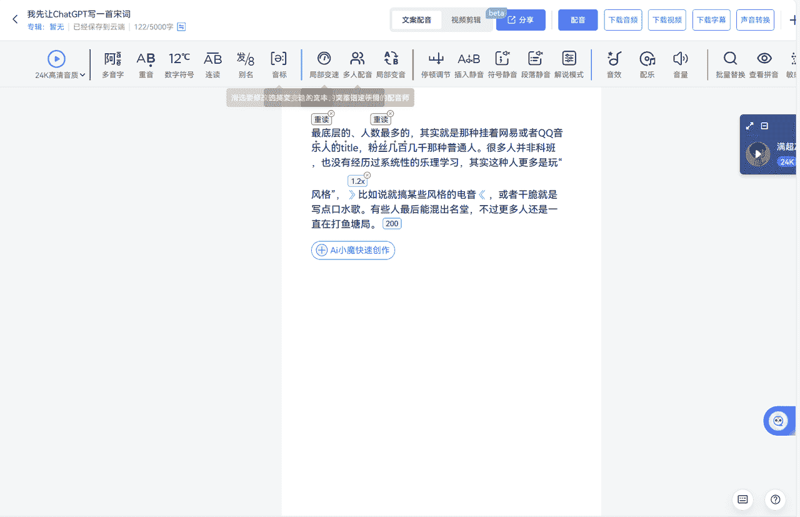

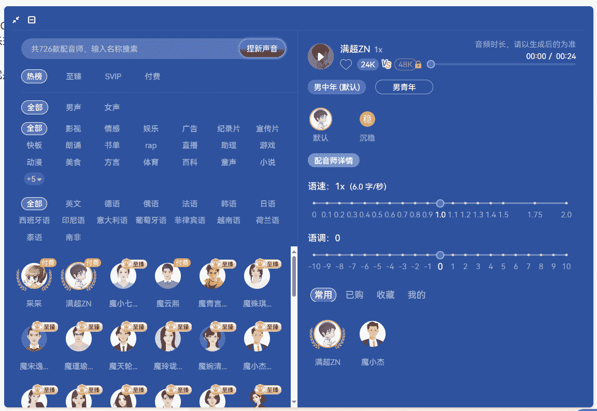

**工具介绍：**AI 配音工具，提供多种声音、风格和语言，适用于短视频、新闻等场景。

**工具优点：**高度可定制化，声音种类选择多，可玩性很高。

**是否免费：**24/83 每月两档付费

**网络条件：**不需要特殊网络

**体验网址：**https://www.moyin.com/

**使用建议：**适用于常见场景，尤其适用于对朗读细节控制要求高的人群

## 2.TTSMaker

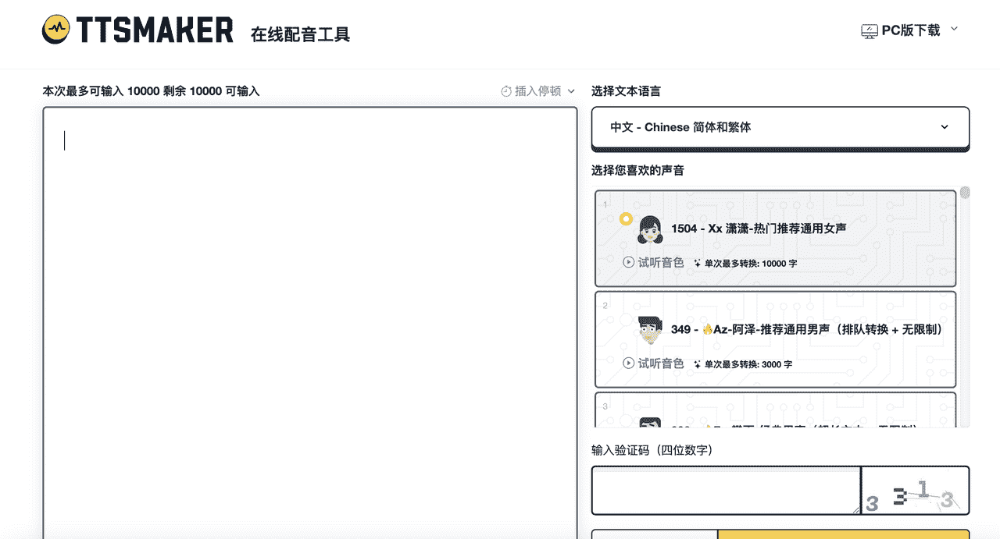

**工具介绍：**一款免费的文本转语音工具，提供人工智能语音合成服务，支持多种语言：英语、中文、日语、韩语，法语等及多种语音配音风格。

目前支持 36 种语音风格可选择。每一种语音风格单词转换转换支持文字数量不同。有的支持长文本转换和无限使用，有的则有文字数量限制！

**工具优点：**免费的文字转语音工具

**是否免费：**免费

**网络条件：**不需要特殊网络

**体验网址：**https://ttsmaker.cn/?ref=www.tudingai.com

**使用建议：**作为一款优秀的 AI 配音工具，TTSMaker 可以轻松地将文本转换为语音。

## 3.微软文字转语音

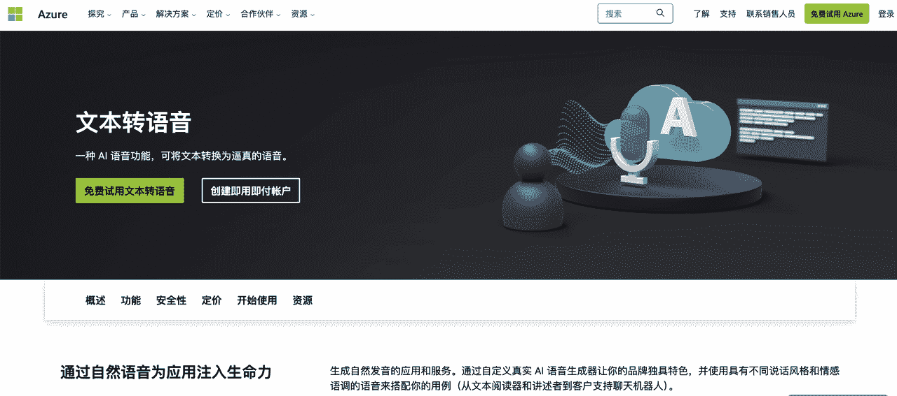

**工具介绍：**微软文本转语音，支持选择多种语音风格，可调节语速，可将文本转换为逼真的语音。

**工具优点：**微调合成的语音音频以适应你的方案。

**是否免费：**有免费额度，付费

**网络条件：**不需要特殊网络

**体验网址：**https://azure.microsoft.com/zh-cn/products/ai-services/text-to-speech/#features

**使用建议：**效果尚可

# AI 声音克隆

**目前声音克隆有两个**比较好的工具，但是第一个需要自己部署。

**1) GPT-SoVITS**

是一个由 RVC 变声器创始人“花儿不哭”推出的免费开源项目。

AI 克隆声音的软件 GPT-SoVITS 下载地址「链接：https://pan.xunlei.com/s/VNur6S-N4M8gY8GydoXhWEueA1?pwd=ni4f# 提取码：ni4f”

[声音克隆教程-GPT-SoVITS](https://yunyinghui.feishu.cn/wiki/JrB0wurEhixI4AkyZvaccgNFnqb?from=from_copylink)

**2) Voice Engine**

**OpenAI 雪藏的新产品**——语音合成引擎 Voice Engine，终于被正式揭幕。

有了它，只需 15 秒的语音样本，就能克隆出一个人的声音，而且还能跨越语言！

APP 版 ChatGPT 中的语音对话功能，也正是由这项技术所驱动。目前，OpenAI 仅针对少部分内测用户开放了 Voice Engine

**介绍地址：**https://openai.com/blog/navigating-the-challenges-and-opportunities-of-synthetic-voices

## 1.瑞声 Reecho.ai

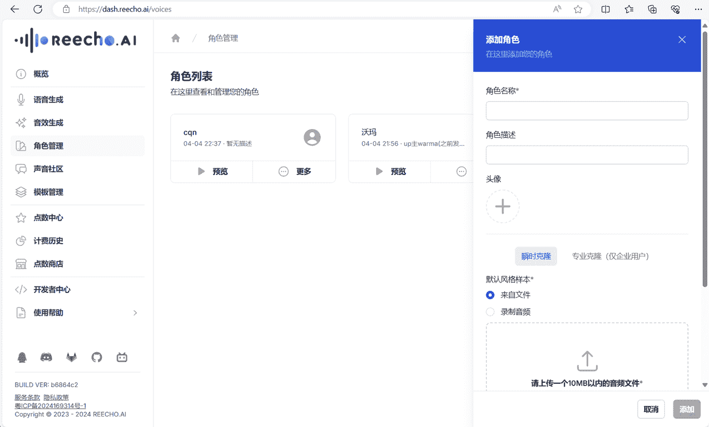

**工具介绍：**Reech.AI 是一款高质量语音生成工具，除了提供了多种富有表现力的声音，还提供了高质量的语音克隆模型，能够从 5～8s 的录音中学习到具有目标说话人声音、语调、语气、说话节奏等语音特征。

**工具优点：**免费的语音克隆，高质量高表现力，界面简洁易操作。

**是否免费：**免费/付费，免费用户提供 998 点数每天，声音数量不限，更高质量的专业克隆需要企业账户。

**网络条件：**不需要特殊网络

**体验网址：**https://www.reecho.ai/

**使用建议：**高质量语音克隆

## 2.蓝藻 AI

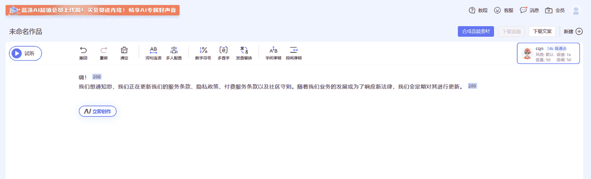

**工具介绍：**蓝藻 AI 是一个语音生成服务提供平台，提供多种声音、风格和语言，适用于短视频、新闻等场景。

**工具优点：**生成速度快，合成内容高度可控

**工具缺点：**需要录制 20 条规定文本的语音用于提取声音特征，无法随意克隆他人声音，高质量克隆需要付费。

**客户端：**网页版

**是否免费：**免费/付费

**网络条件：**不需要特殊网络

**体验网址：**https://aigc.unisound.com/home

## 3.MockingBird

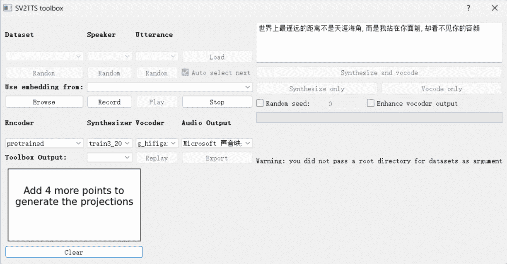

**工具介绍：**MockingBird是一款先进的TTS（文本到语音）项目，使用深度学习模型生[声音克隆教程-MockingBird ](https://yunyinghui.feishu.cn/wiki/PgTywZRWtirE1ekVNnccSrDwn6b)高质量的合成语音。它由一组热衷于自然语言处理和语音技术的研究人员和工程师开发。

**客户端：**本地部署

**是否免费：**免费

**网络条件：**不需要特殊网络

**体验网址：****h**ttps://github.com/babysor/MockingBird/blob/main/README-CN.md

# AI 声音降噪

## 1.Audo Studio

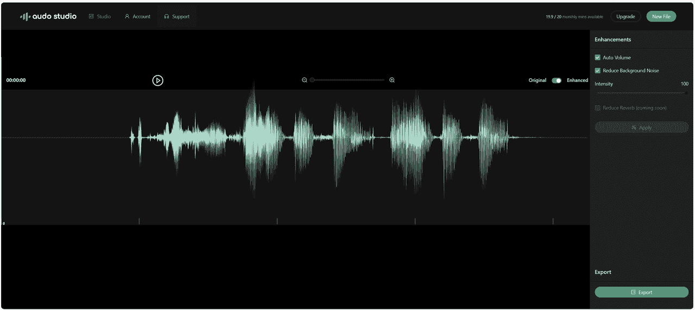

**工具介绍：**Audo Studio 是一款 AI 音频清洗工具，可以帮助用户消除噪音、平衡声音、调节音量等。同时，它还可以平衡声音，使不同部分的声音更加协调，让听者更加舒适。

**客户端：**网页版

**是否免费：**每个月 20 分钟的免费额度，超出需要付费

**网络条件：**不需要特殊网络

**体验网址：**https://app.audostudio.com

**使用建议：**视频剪辑中的人声音轨预处理。

## 2.Krisp

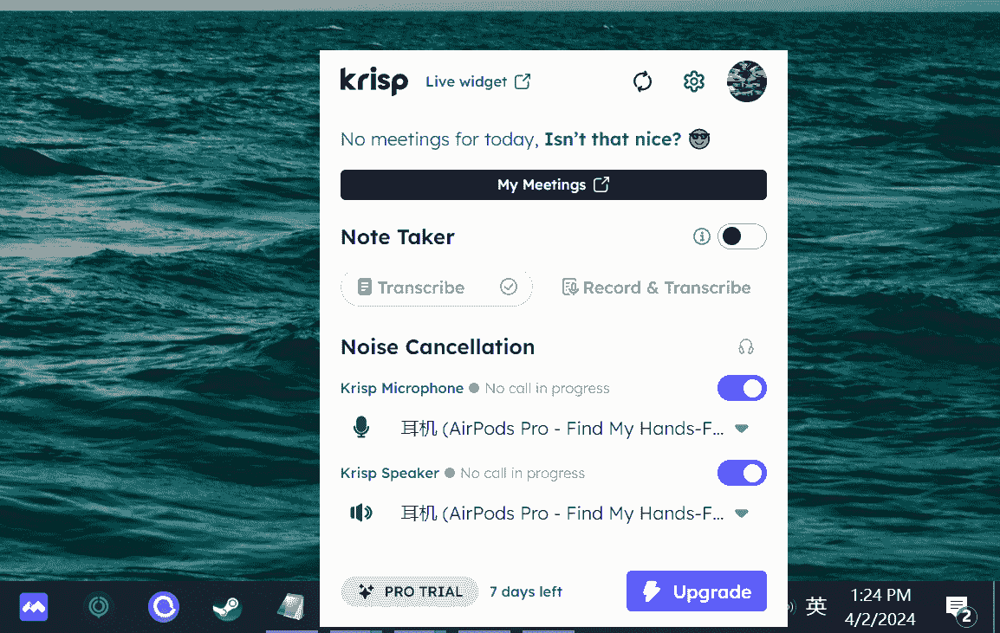

**工具介绍：**Krisp 是一款降噪应用，可以在视频会议中消除背景噪音，让人们听到更清晰的声音。也适用于呼叫中心，帮助从嘈杂的地方打电话的人，还额外提供了语音实时转写和录音的功能。

**工具优点：**使用方便，降噪效果很好，可以同时对扬声器和麦克风的声音进行降噪。

**客户端：**PC 端

**是否免费：**基础降噪功能可以免费使用

**网络条件：**不需要特殊网络

**体验网址：**https://app.krisp.ai/

**使用建议：**经常需要视频会议人群，尤其是周围录音环境比较差的。

# AI 声音分离

## 1.**NovaMSS**

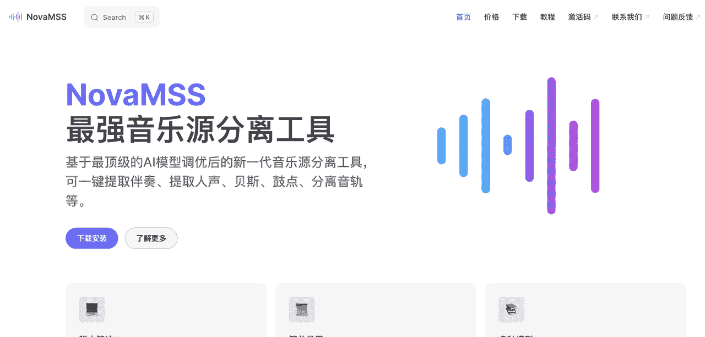

**工具介绍：**基于最顶级的 AI 模型调优后的新一代音乐源分离工具，可一键提取伴奏、提取人声、贝斯、鼓点、分离音轨等。

**工具优点：**

+   一键提取人声、伴奏、贝斯、鼓声等

+   搭载多种通用算法模型，平衡分离质量和效率

+   音频文件批量处理，可一键处理上千个文件

**客户端：**PC 端

**是否免费：**有免费，也有付费

**网络条件：**不需要特殊网络

**体验网址：**https://novamss.com/?ref=www.ainav.cn

**使用建议：**基础功能基本能够满足，能省则省

## 2.UVR5

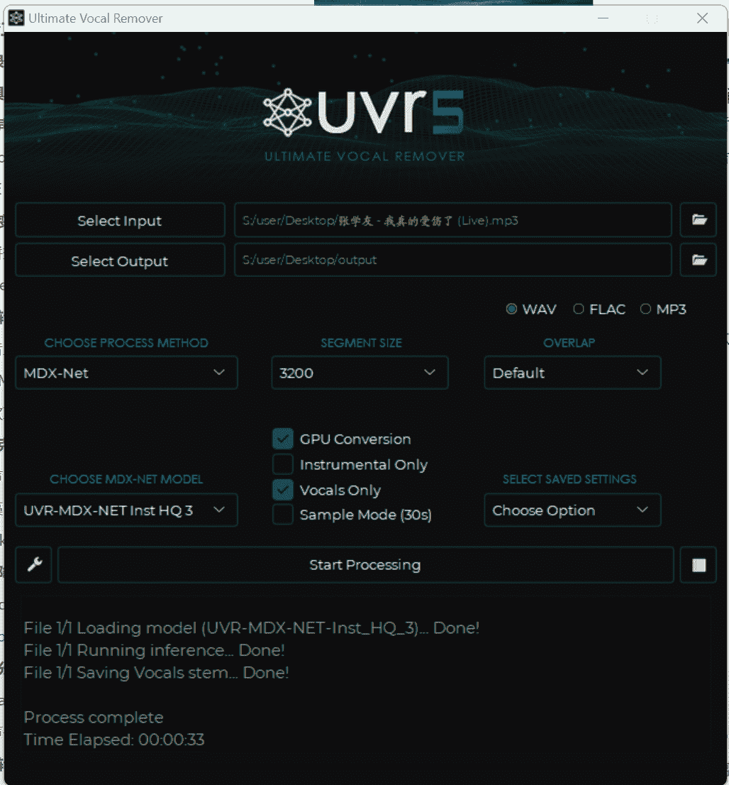

**工具介绍：**强大的免费音源分离工具，支持本地GPU加速，可以快速地高质量地分离人声和乐器声，常用的歌声克隆的数据处理工具

**客户端：**PC 端，本地安装

**是否免费：**免费

**网络条件：**不需要特殊网络

**体验网址：**https://ultimatevocalremover.com/

**使用建议：**进入github Releases后从下载1G多的exe文件即可

## 3.人声去除

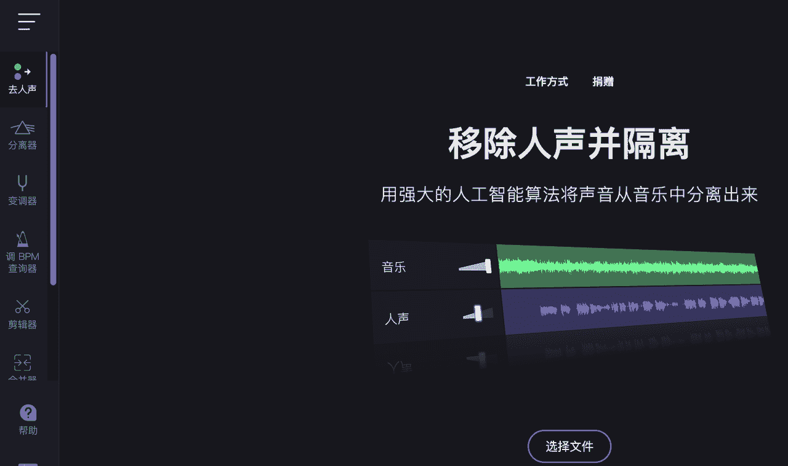

工具介绍：用强大的 AI 算法将声音从音乐中分离出来

**工具优点：**免费工具，功能强大

**客户端：**PC 端

**是否免费：**免费

**网络条件：**不需要特殊网络

**体验网址：**https://vocalremover.org/zh/

**使用建议：**基础功能基本能够满足

# AI 声音转文字

## 1.通义听悟

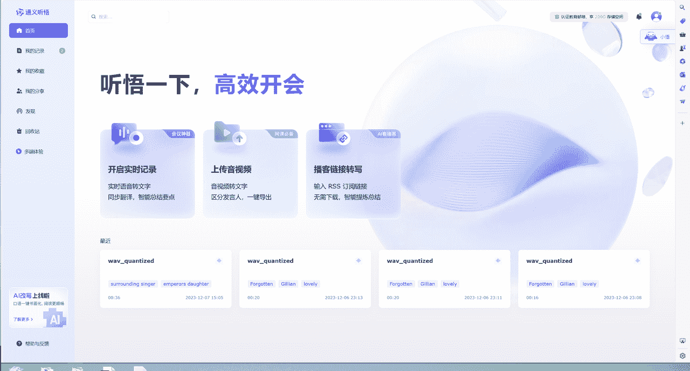

**工具介绍：**"通义听悟"是阿里云于 2023 年推出的一款工作学习 AI 助手。它利用先进的语音 AI 技术，能够将音频视频内容转写为文字，并通过大语言模型提供全文摘要、章节速览、发言总结等功能，帮助用户更高效地处理和理解音视频资料。此外，通义听悟还提供实时记录、翻译、发言人区分等多种功能，以支持会议、学习、访谈等多种场景。

**工具优点：**高质量语音转写、实时语音转录、多场景适用、多导出格式支持

**是否免费：**大量免费转写时长

**网络条件：**不需要特殊网络

**体验网址：**https://tingwu.aliyun.com/home

**使用建议：**语音识别比较好的工具，但是有收费的服务

## 2.飞书妙记

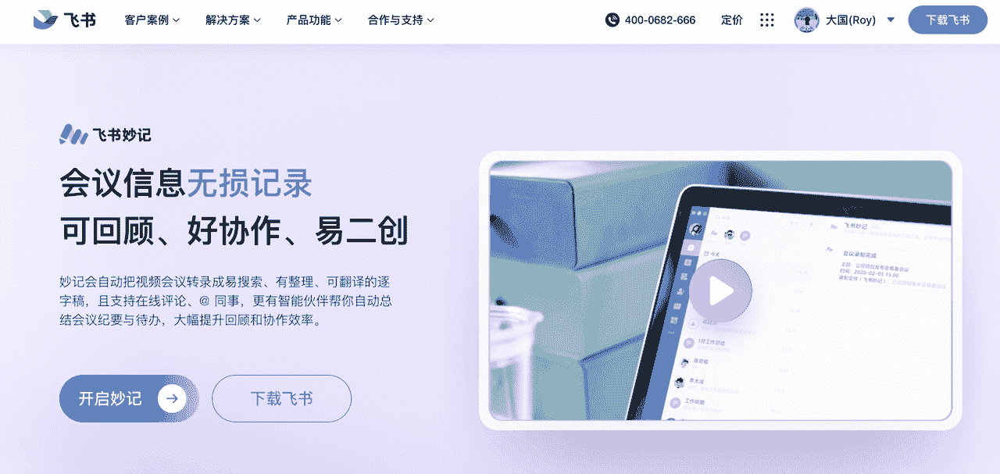

**工具介绍：**妙记是飞书旗下一款音视频转文字的效率工具，在会议、培训、访谈、课堂等不同场景下，将你的音视频内容转录为搜索便捷、重点高亮、互动多样的智能文字笔记，帮助你高效整理会议纪要，完整沉淀培训内容，一键收录访谈全程，清晰记录课堂重点。

**工具优点：**高质量语音转写、实时语音转录、多场景适用、多导出格式支持

**是否免费：**大量免费转写时长

**网络条件：**不需要特殊网络

**体验网址：****https://www.feish**u.cn/product/minutes

**使用建议：**语音识别比较好的工具

## OpenAI Whiper

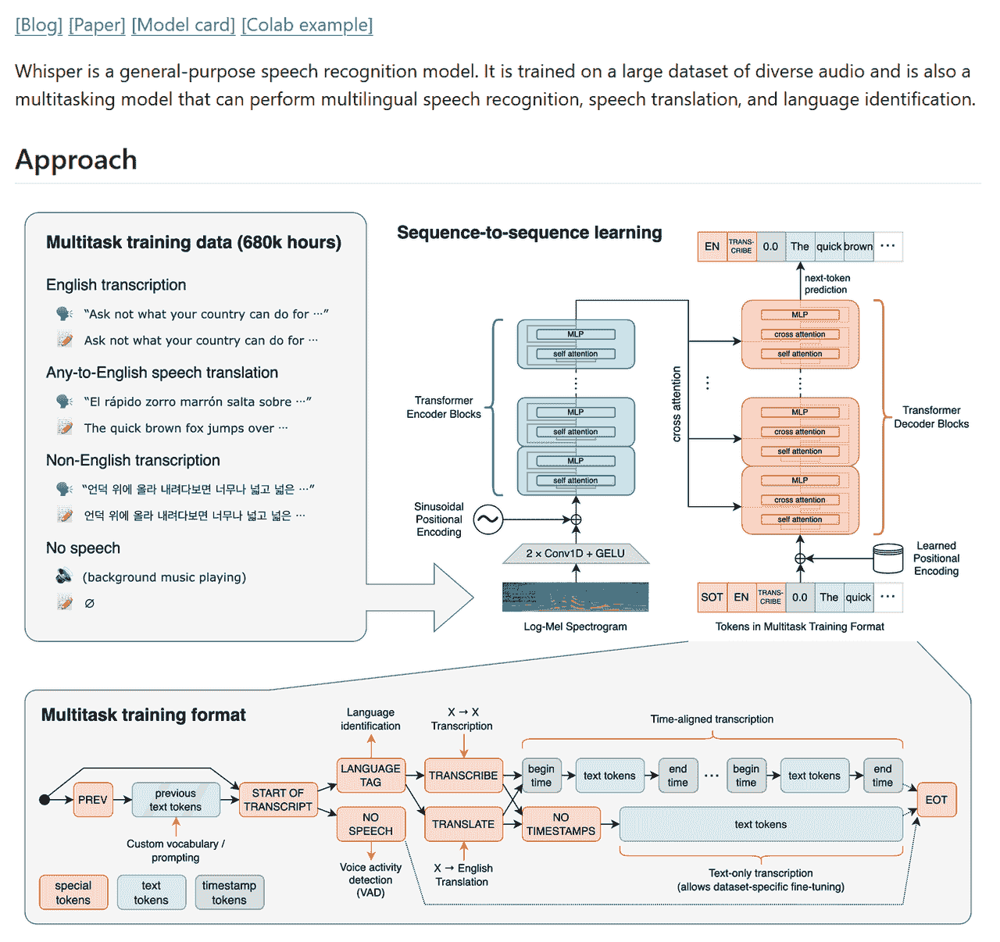

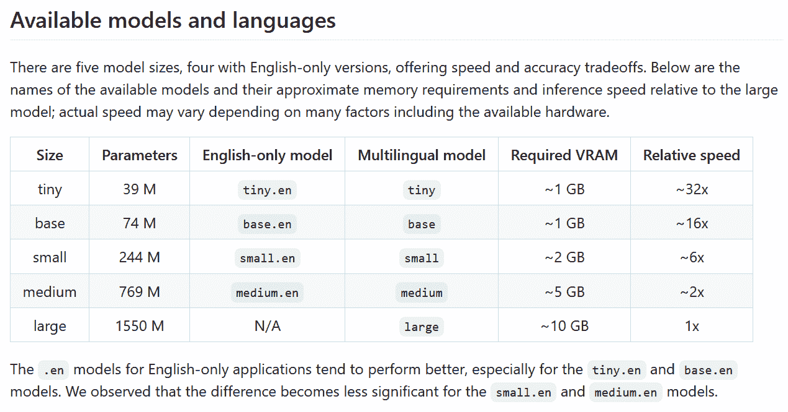

**工具介绍：**开源语音转文字工具，可以实现跨语言的语音转文字。

**体验网址：**https://github.com/openai/whisper

**是否免费：**免费

# AI 声音总结

## 1.BibiGPT

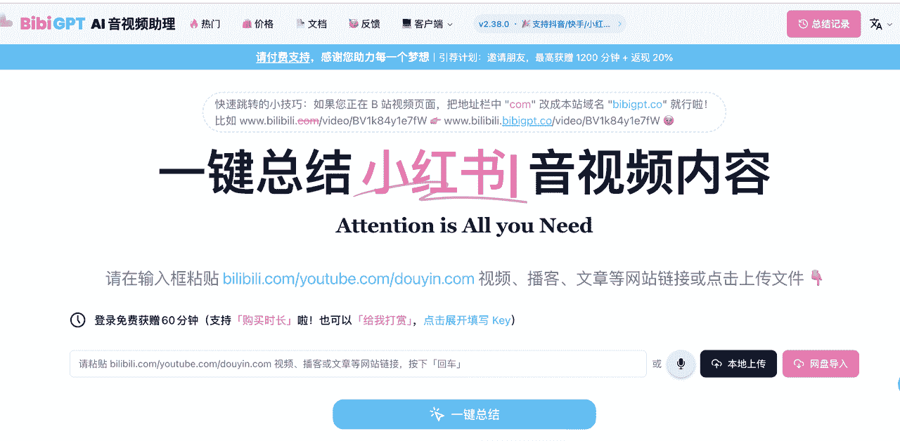

**工具介绍：**一键总结本地及在线网络的音视频内容总结

**是否免费：**有免费也有付费

**网络条件：**不需要特殊网络

**体验网址：**https://bibigpt.co/

**使用建议：**语音总结比较好的实用工具

## AI播客

AI播客是通过大模型对素材进行智能重构，形成单人或多人的播客脚本，然后通过拟人化的文本转语音（TTS）技术进行呈现。这种新技术的优势在于能够以生动的，人们习惯的乐于接受的形式帮助人们快速了解素材的主要内容，并潜移默化地加入AI理解和分析。

1.  Google-NotebookLM

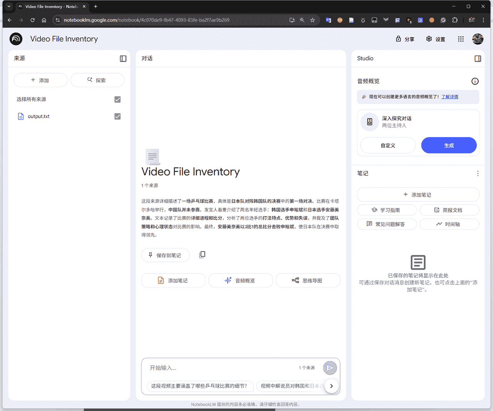

**工具介绍：**作为一款AI笔记工具，NotebookLM的“音频概览”（Audio Overviews）功能允许用户将上传的文档、网页链接甚至YouTube视频转化为双人对话式播客。

**是否免费：**有免费也有付费

**网络条件：**需要特殊网络

**体验网址：****https://****notebook.google**

优势：

+   内容整合能力强： 能够综合多个来源的信息，生成有逻辑、有深度的对话内容。

+   语音自然度高**：** 听起来很舒服，就像是真的一样，让人愿意听，喜欢听。

+   互动性强：支持打断和对话，但是目前还没有开放

+   自定义较强：可以指定system_prompt对生成内容进行一定程度的定制化

劣势：

+   产品形式单一：局限于笔记本应用内部的小功能

+   自定义有限：音色不能定制，不能设置声音性别

1.  豆包-AI播客

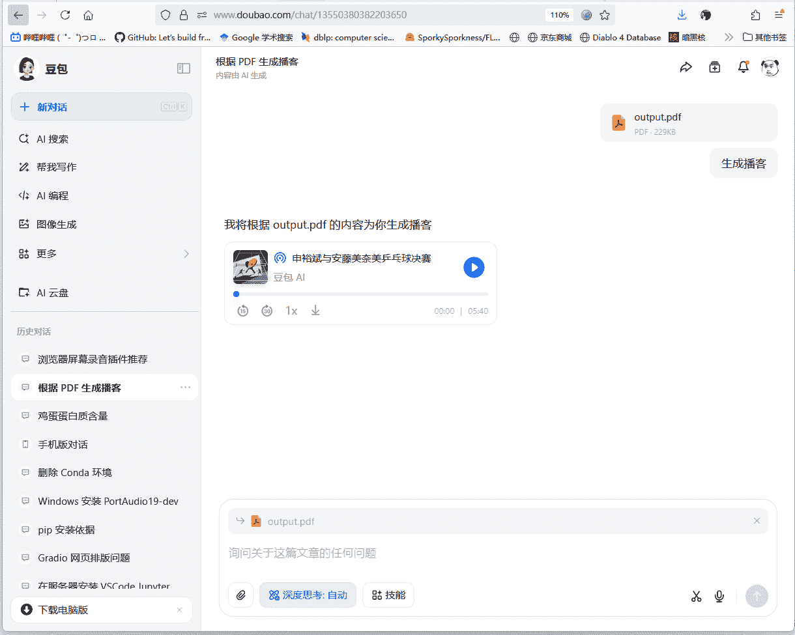

优势：

+   生成速度非常快

+   脚本内容质量高

+   声音自然，比google的还要好

劣势：

+   不能自定义音色、内容

+   输入格式单一，只能上传pdf，连txt和文本直接输入都不行

# 学习交流社群

1.持续关注并更新 AI 的**相关资讯动态，研究报告，赚钱案**例，常见问题，永久免费在线查看，无收费内容，目标是成为最大的免费 AI 学习社群。

2.已建立社群聊聊 **AI** 发展及应用，**没进群的可以扫码加入，群满可加 AI 研究爱好者大国微信 ID：zyg90s（备**注：AI），已经在社群内的无需重复加入，开源知识库及社群学习全部为公开免费分享。

3.**关于文档负责人**

**大国**：高帆文化CEO，曾就职于教培大厂，目前创业，主攻研究AI落地应用、企业流量增长及达人IP孵化。

**潜犊：**花名潜犊，浙江大学计算机学院人工智能专业在读博士生，从事 AIGC 语音内容生成技术及其安全问题研究，聚焦语音克隆、伪造样本检测、声音数字水印等。

**飞书学习群**

好友（ID：zhangyuguo94s）

**扫码加微信入微信群**

**微信好友**

进群或者加好友了解更多 AI 相关信息

**觉得有用欢迎留个赞**