# Suno 学习手册（行业首发&持续更新 ing...

> 来源：[https://yunyinghui.feishu.cn/docx/WZOYd9aDxoMMzDxCW77chqsNnEc](https://yunyinghui.feishu.cn/docx/WZOYd9aDxoMMzDxCW77chqsNnEc)

> 首发时间：2024 年 6 月 6 日

> 更新时间：2024 年 6 月 6 日

> **内容出品人：**** **

> **内容出品方：**[Mix AI Lab](https://yunyinghui.feishu.cn/wiki/WhelwZnxQi55mpkOzatc3Xran5b?from=from_copylink)

> **使用建议：**如果需要快速定位到精确内容，可以使用快捷键 Ctrl +F/Command +F 的形式，搜索关键字/词，查找你想要的内容。

> **为 AI 实验室同学持续更新** Suno 基本介绍，注册方法，操作教程，变现思路等学习内容，为初入 AI 音乐领域的小伙伴进行知识科普。

> 🎯全**网最接地气 AI 知识库：「**[**AI 实验室」知识库（**](https://yunyinghui.feishu.cn/wiki/space/7340161844864598017?ccm_open_type=lark_wiki_spaceLink&open_tab_from=wiki_home)AI 绘画、AI 写作、AI 视频等应用技能）

# 一、基本介绍

## 工具介绍

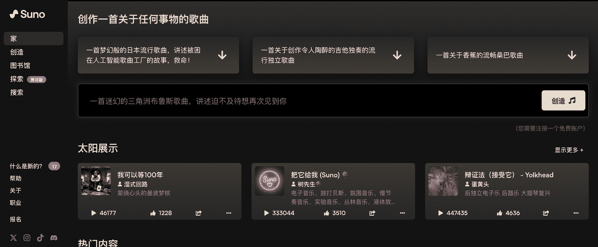

Suno AI，简称 Suno，是一款生成式人工智能音乐创作程序，旨在产生人声与乐器相结合的逼真歌曲。2023 年 12 月 20 日，Suno AI 在推出网络应用程序并与微软建立合作关系（微软将 Suno 作为插件纳入 Microsoft Copilot）后，开始广泛使用。2022 年 3 月，Suno AI 成立。2023 年 4 月，Suno 在 GitHub 和 Hugging Face 上发布了名为“Bark”的开源文字到语音和音讯模型，采用 MIT 授权条款。2024 年 3 月 21 日 Suno 向所有用户发布 v3 版本，新版本允许用户使用免费账户创建 2 分钟的歌曲，随即开始走红。

**官方网站：**https://suno.com/（🪜）

## 创始团队

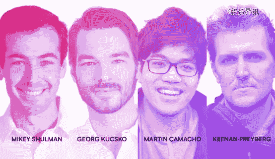

Suno 由音乐家和技术专家** **Mikey Shulman， Georg Kucsko， Martin Camacho 和 Keenan Freyberg 创立。

创始人名叫 Mikey Shulman，本科毕业于哥伦比亚大学应用物理专业，博士毕业于哈佛大学物理学专业，曾经研究过物理和量子计算，是个正儿八经的理工男。

担任首席架构师的 Camacho，本科就读于哈佛大学计算机科学与数学，18 岁就毕业。

担任机器学习研发主管的 Georg Kucsko，本硕毕业于瑞士苏黎世联邦理工学院物理专业，并取得哈佛大学物理学博士学位。

担任战略推广主管 Freyberg 本科毕业于美国乔治华盛顿大学。

Suno 的创始人都是在马萨诸塞州剑桥市的金融人工智能公司 Kensho 工作期间认识的。最终，他们因为对音乐创作的共同热情走到了一起，决定创办一个 AI 音乐创作平台。

CEO Mikey Shulman 花了数年的时间在纽约的乐队里演奏、录音和演出，亲身体验到制作音乐，并让别人能够欣赏到这些作品是极具挑战的事情。这样的经历不仅激发了创始团队想要降低有抱负的艺术家的制作门槛，他们还想通过人工智能技术来帮助普通人去创作原创音乐，Suno 应运而生。

## 融资历史

2022 年，Suno 就进行了种子轮融资，融资金额达到 140 万美元。同年进行了 A 轮融资。

2024 年 5 月 22 日消息，Suno 宣布完成 B 轮融资 1.25 亿美元，由光速全球领投，本轮融资后 Suno 估值达到 5 亿美元。新筹集的资金将用于扩大公司的员工队伍，截至今年早些时候，公司仅有 12 名员工。目前 Suno 已有超 1000 万用户，其中还包括获得格莱美奖的艺术家们。

## 功能优势

### **提高创作效率**

传统的音乐创作通常需要耗费大量时间和精力。而通过 Suno，用户可以在短时间内生成高质量的音乐作品，这对于音乐人来说，意味着可以更高效地进行创作，尝试更多不同的创意和风格。

### **降低创作门槛**

对于很多没有专业音乐知识的人来说，创作音乐是一件困难的事情，而 Suno 的出现，使得任何人都可以轻松创作音乐。只需几步简单的操作，就可以生成一首完整的音乐作品，极大地降低了音乐创作的门槛。

### **无限创意可能**

人工智能的一个显著优势在于它几乎可以生成无限量的创意，Suno 可以不断生成不同风格和主题的音乐，用户可以根据自己的需求和喜好进行选择和调整。这种无限创意的可能性，为音乐创作带来了更多的灵感和可能。

## 适用人群

**父母**

父母可以将 suno 作为家庭教育的一部分，引导孩子发展音乐才能。通过互动式的音乐创作平台，suno 帮助孩子提高音乐素养，激发创造力，同时增强家庭成员间的互动和情感联系。

**情侣**

情侣可以使用 suno 作为增进关系的桥梁，共同创作音乐，记录彼此的重要时刻。suno 提供的合作功能让情侣可以一起编曲，制作专属的情歌，增强彼此的感情。

**自媒体人**

自媒体人可以把 suno 当成一个高效的音乐制作助手，快速制作专业的背景音乐或主题曲。suno 的 AI 驱动工具可以根据视频内容自动生成匹配的音乐，提升内容的吸引力和观众的观看体验。

**音乐人**

音乐人可以将 suno 视为创作的合作伙伴，提供新的灵感和音乐元素。无论是编曲、和声还是节奏创新，suno 的高级功能都能帮助音乐人突破艺术限制，探索新的音乐风格和表现形式。

**老年人**

对于乐于学习的老年人，suno 可以成为他们的音乐导师。通过简单的界面和指导，suno 教会老年人如何创作音乐，同时让他们接触到新技术，活跃思维，享受创作的乐趣。

## 功能更新

**更新详情**

2024 年 6 月 13 日：更新上传参考音频

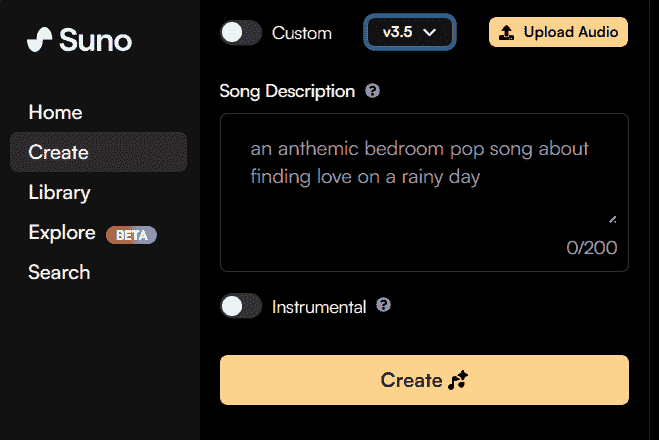

# 二、注册方法

## 1、访问 Suno 官网

首先，你需要访问 Suno 的官方网站：https://app.suno.ai/，点击报名按钮。

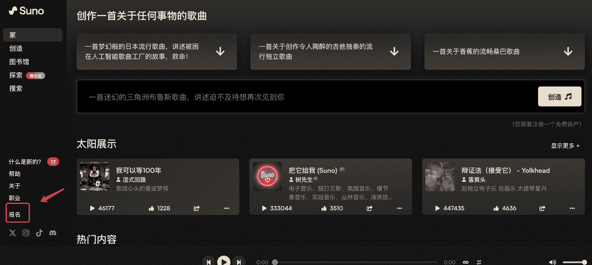

## 2、账号要求

为了使用 Suno，你需要拥有 Discord、谷歌或微软中的至少一个账号，确保你的网络环境稳定，以便顺利使用该平台，显示自己的头像后即为登录成功。

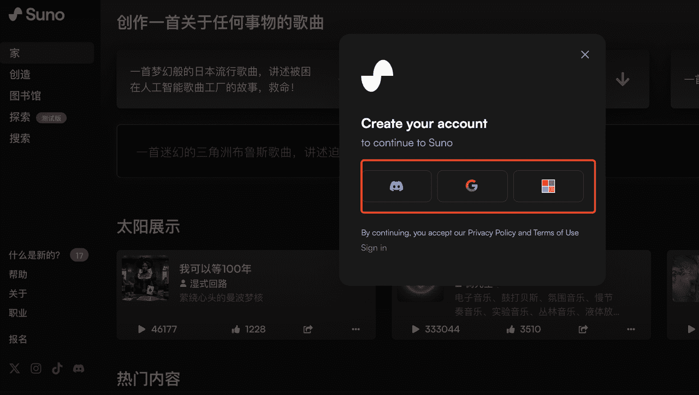

## 3、订阅信息

1.  免费用户，Suno 为免费用户提供每天 50 积分，每首歌消耗 5 积分，因此每天可以创作 10 首歌曲， 但是每次点击生成都会生成两首歌曲。如果你有多个账号，可以白嫖来创作更多的音乐作品。

1.  Pro 用户，每个月 2500 点数（大约 500 首歌）: 按月来算每个月 10 美元， 按年来的话， 每个月 8 美元， 每年 96 美元。

1.  Premier 用户，每个月 10000 点数（大约 2000 首歌）: 按月来算每个月 30 美元， 按年来的话， 每个月 24 美元， 每年 288 美元。

注意：服务器爆满的时候，免费用户可能不能创作歌曲，起码得 pro 以上的用户才可以创作。

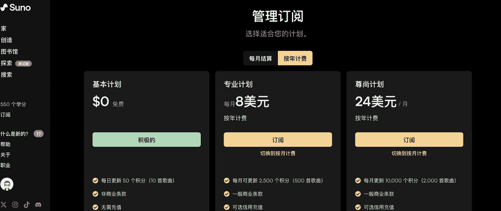

# 三、操作教程

## 首页界面介绍

Suno 的操作页面设计直观，即使是音乐创作的新手也能快速上手。你可以输入自己的歌词，选择器乐选项来创作纯音乐，或者在音乐风格中选择流行、抒情、摇滚等多种风格。此外，你还可以指定声音的性别和类型，以及歌曲的语言和乐器。

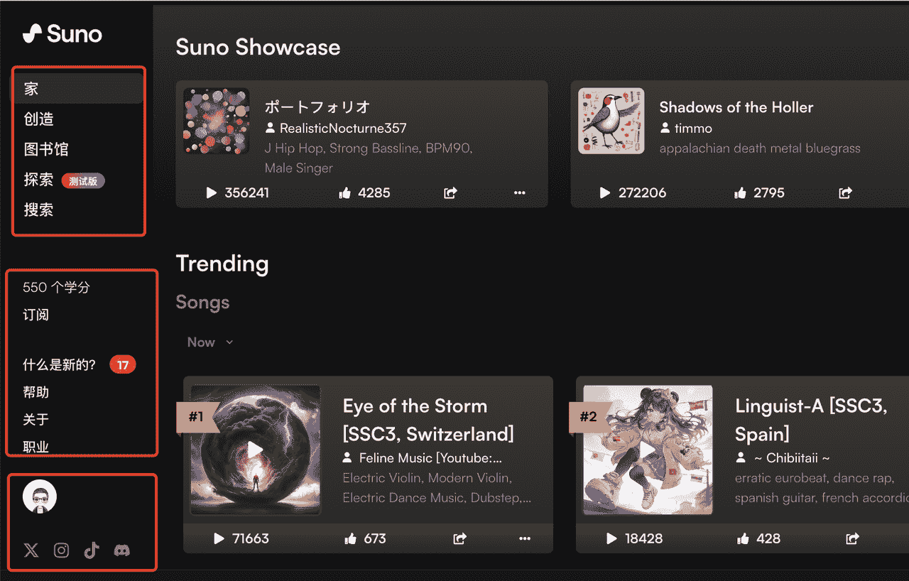

1 家：打开的主页面

2 探索：可以发现别人制作的音乐

3 创作：自己创作音乐

4 图书馆：管理自己的音乐作品

5 搜索：可以搜索相关的 AI 音乐作品

6 积分和订阅：自己剩余积分和订阅套餐的地方

## 创作界面介绍

Create 界面有**默认**和**自定义**两种模式，点击 “自定义模式” 按钮进行模式切换。默认模式使用的是 V 3.5 模型，只需向它描述你想要的歌曲即可生成，跟在 Copilot 上使用的方法一样；在自定义模式中，你可以输入想要的音乐风格和歌词，或者让 AI 帮你写歌词。

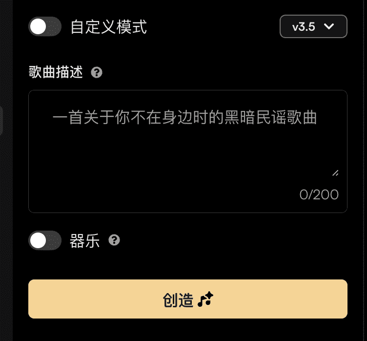

默认模式

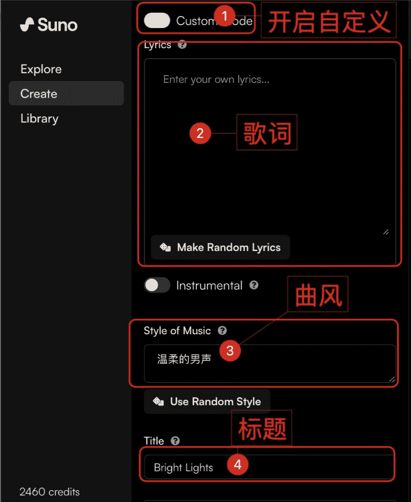

自定义模式

## 作品管理介绍

下载和删除歌曲，生成的歌曲可以通过点击下载按钮来保存到你的设备上，如果你不再需要某首歌曲，可以将其移至“废纸篓”中，或者选择永久删除。

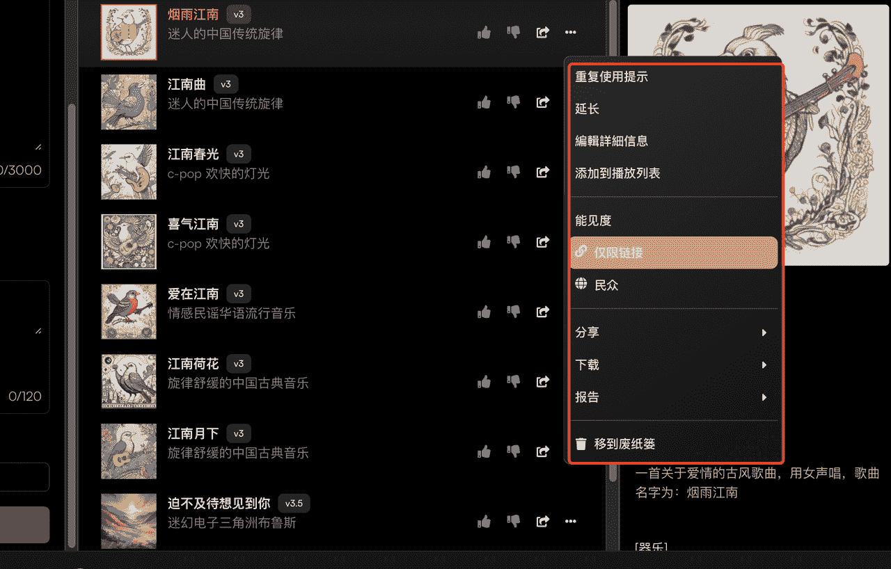

# 四、操作技巧

## 1.纯音乐生成

把** Instrumental **选项打开，生成的就是纯音乐，当然有时候可能也不那么纯，做配乐使用最好都听一下～

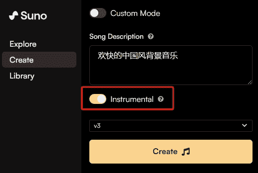

## 2.歌曲节奏控制技巧

在歌词中可添加以下一些提示符，用于对歌曲节奏进行控制，虽然有时候也未必按照提示内容来控制，但总比不用要强一些。

[Intro]（前奏）

[Verse]（主歌）

[Chorus]（副歌/高潮）

[Bridge]（桥段）

[Rap]（说唱）

[outro]（尾声）

另外还可以在句尾括号重复指定词获得二重奏的感觉，如：

[Verse 1]

岁月的痕迹 随风悄然飘散 （悄然飘散）

梦想的方向 淡淡的微笑 （淡淡的微笑）

汗水洒下 才能换来辉煌 （辉煌）

## 3.解决漏字问题

有时候会发现有的字始终唱不出来，说明 **Suno **可能还不认识这些字，就可以使用同音同声字来替换。

## 4.学习优秀作品

可以多看看广场 Explore 中的优秀作品，学习下别人是如何写提示词的，当然还可以直接通过 Remix 功能，一键复制他人的歌词和提示词等自己抽卡试试。

## 5.生成超过 2 分钟的音乐

目前第一次生成的都是两分钟以内的歌曲，比较长的歌词可能唱不完，继续生成的话可以在喜欢的歌曲上点击...符号，然后选择 Continue From This Song 就可以，把要继续唱下去的歌词再填写进去（虽然偶尔完整歌词也会接下去唱，但不如片段更可控）。

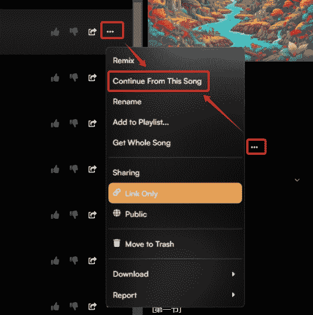

而且最近更新后可以从指定的位置往后唱了，这大大提升了完成一整首比较完美歌曲的可控性，这样只要前面唱的没问题，后面不喜欢就可以从指定时间重新抽卡。

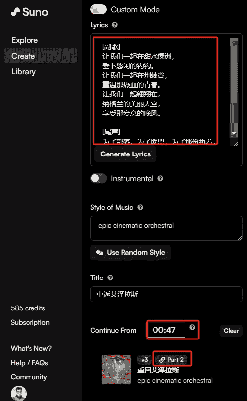

原则上歌曲是可以无限延续下去的，现在也没测试出最长限制，我试过延续 5 次是没问题的，每次续杯最长 1 分钟，生成 5、6 分钟的一首长歌曲是完全没问题的。

一首歌完成后，再最后一趴上点击 Get Whole Song 等待一会就会把自己选定的所有片段无缝连接起来，当然这需要额外花费 5 积分，处理效果还是比较完美的。之前没发现这功能还傻傻的手动去拼接～～

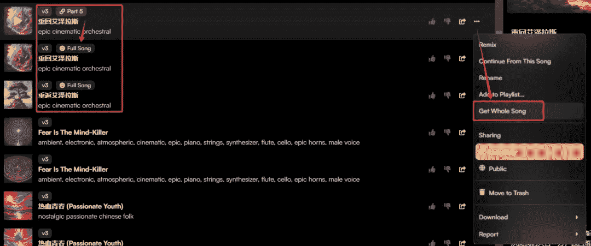

# 五、辅助工具

Suno 音乐创作大师【中文】：https://chat.openai.com/g/g-mlWtT8URF-sunoyin-le-chuang-zuo-da-shi

# 六、提示词相关

## 音乐提示词参考

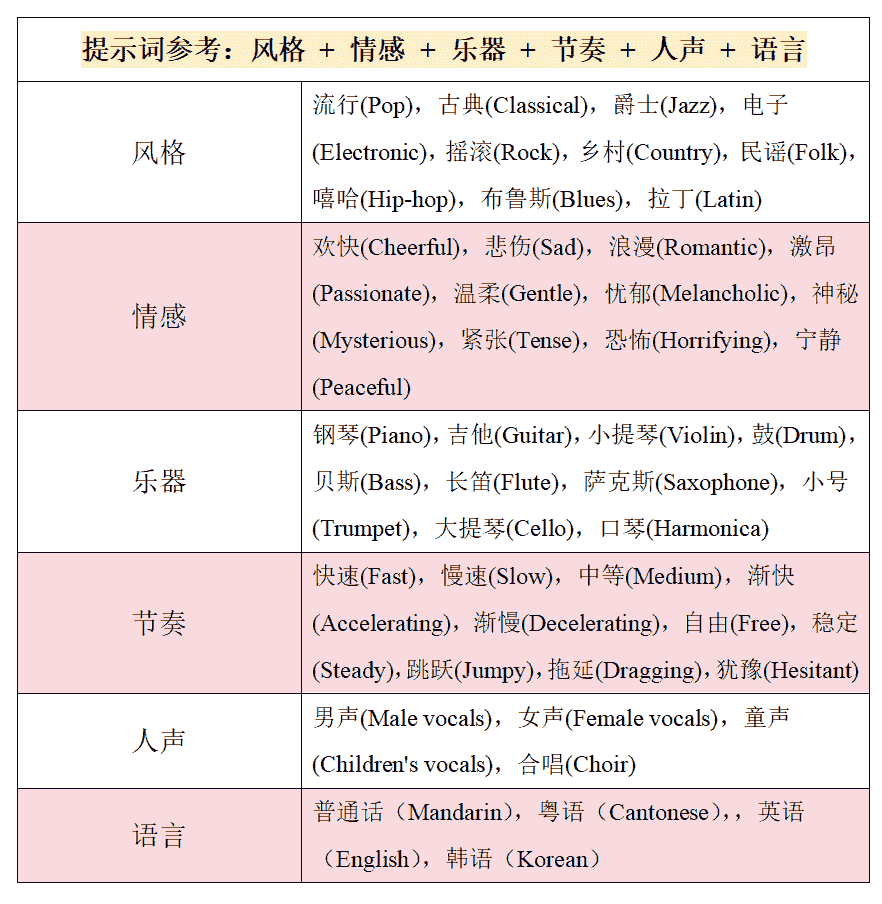

## 歌词创作提示词

以 ChatGPT 为例，先让 ChatGPT 帮我们生成一首歌词，然后我们去套用，前期结合官方给出的这些格式，模仿即可。

**Prompt:**

你是一名顶级唱作人，现在我要你帮我写一段 XX 歌词，描述的是一个 XX 故事，体量控制在 2 分钟以内，你要确保歌词流畅押韵，富有文学运维。在副歌部分要设计具有感染力和记忆点的重复歌词，请按照以下结构帮我创作：

““

[instrumental intro]

[Verse 1]<歌词>

[Chorus]<歌词>

[Verse 2]<歌词>

[Chorus]<歌词>

[Bridge]<歌词>

[Chorus<歌词>[Outro]

[End]

””

输出歌词以后，再根据歌词和故事内容，以英文词组的形式再给出歌曲的 prompt:

请按以下格式帮我输出英文 prompt:

<音乐流派>、

<音乐风格>、

<情绪>、

<乐器）>

<主题或场景>、

<节奏>、

<人声描述）>

等到熟练之后，再慢慢融入更丰富的“元标签”，比如：结构类元标签、唱法类元标签、乐器类元标签等。

## 音乐风格提示词

设定音乐风格，有三种思路：

① 根据自己的理解设定（最好有一点乐理知识）

② 如果喜欢某一首歌旋律，去网上找它的 BPM 和 Key

③ 结合官方给的”热门风格“，去进行设定

我们将 Suno 官方全部“热门风格”整理出来，汇总成下面的表格，然后利用 GPT-4 直接生成提示词。

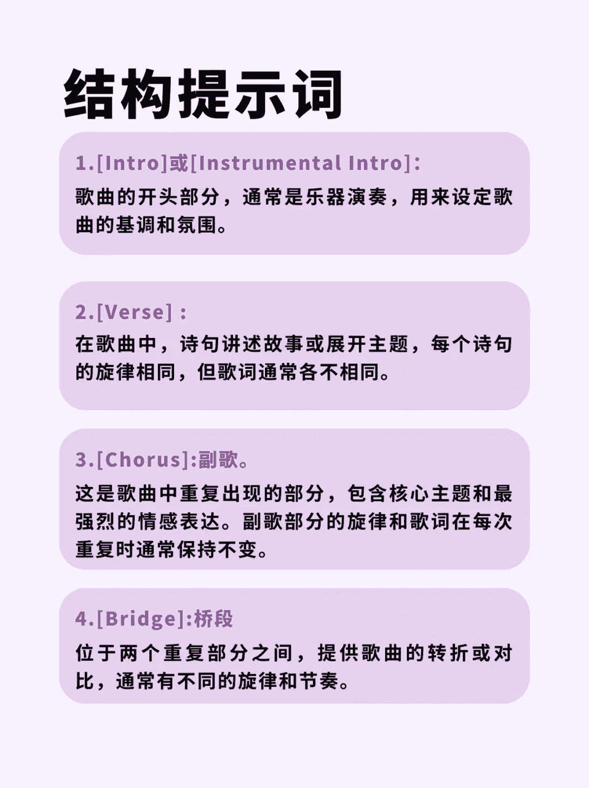

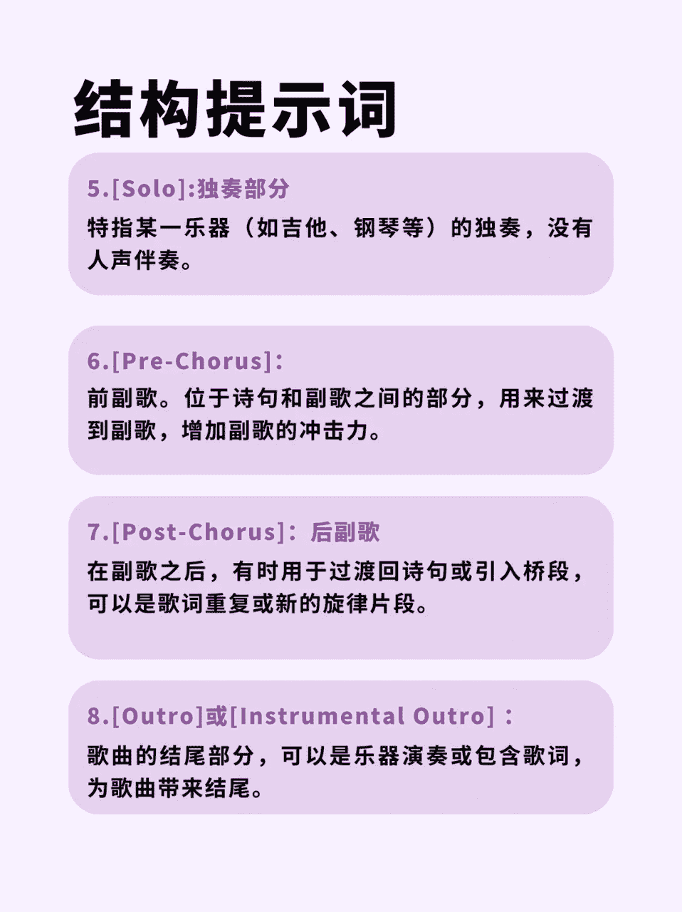

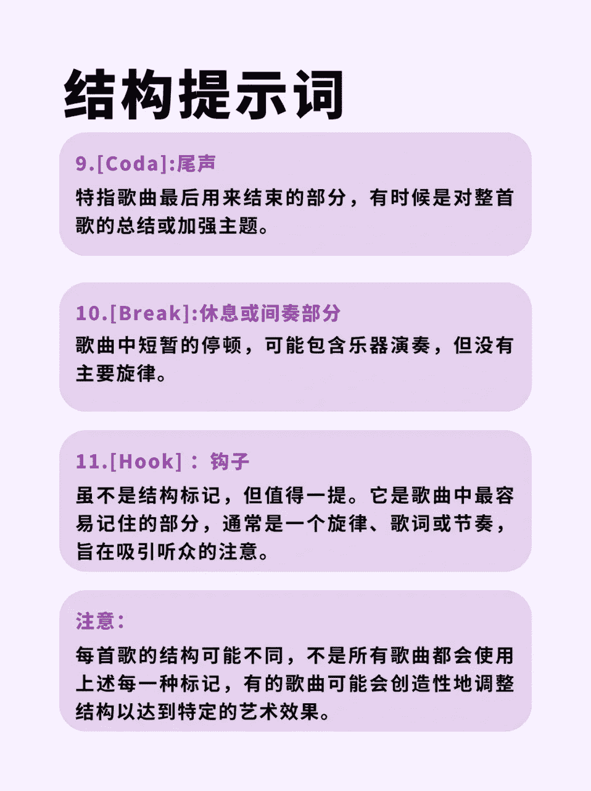

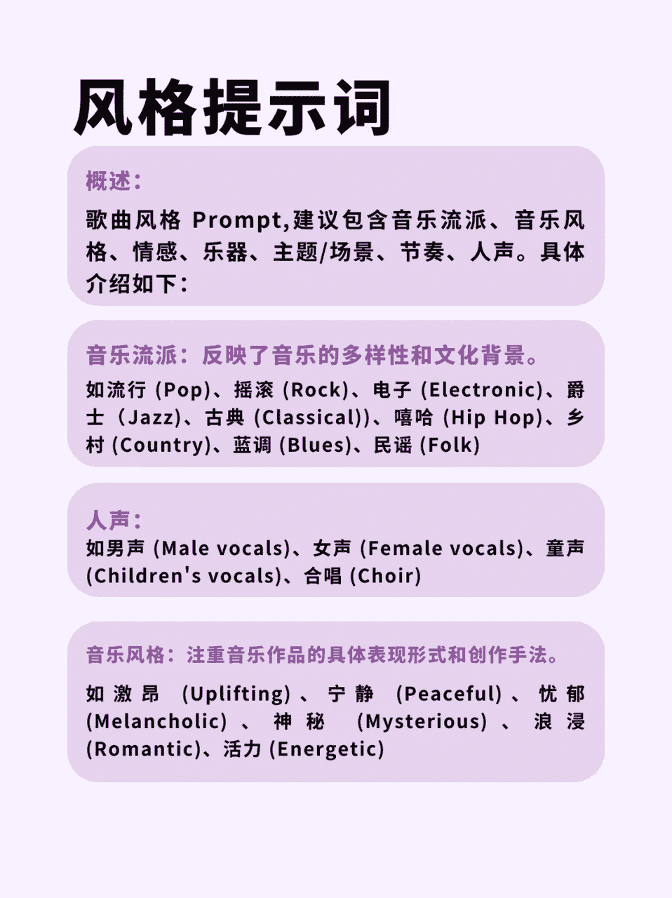

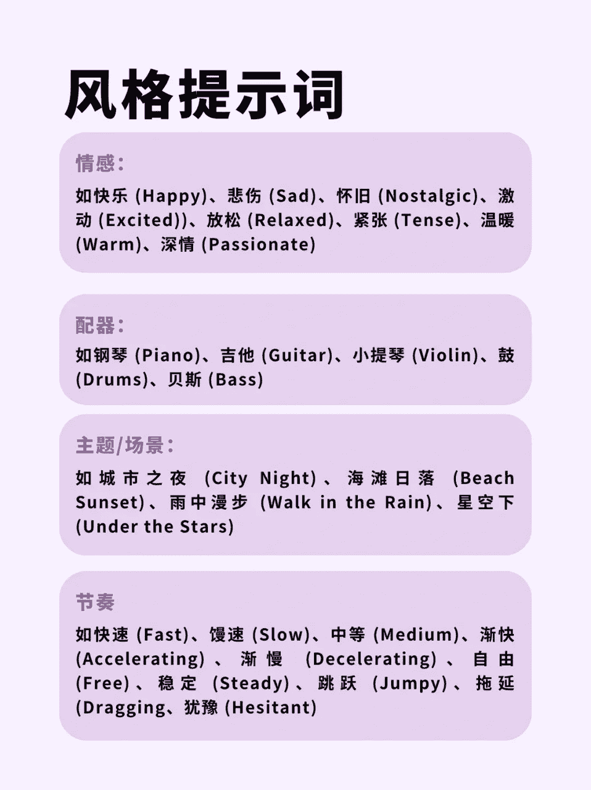

# 七、变现模式

随着 Suno 等 AI 音乐生成工具的出现，为音乐创作和相关领域带来了新的商业机会。以下是盘点通过 Suno 等工具赚钱的方法：

## 定制音乐服务

利用 Suno 等工具为个人或企业提供定制音乐服务。这可以包括为婚礼、生日、节日等特殊场合创作专属音乐，或者为企业宣传片、广告、视频内容等制作背景音乐。

## 音乐交易平台

在音乐交易平台上注册并接单，为客户提供根据他们的需求生成的音乐作品。这些平台通常允许创作者根据客户需求进行音乐创作，并为这些服务收费。

## 售卖音乐作品

通过 Suno 等工具创作音乐后，可以将这些作品上传到音乐销售平台，如网易云、🐧 音乐、Spotify、Apple Music 等，通过版权收入获得收益。

## 直播和社交媒体

在直播或社交媒体平台上展示 AI 音乐生成的过程，并为观众提供现场定制音乐服务。观众可以通过打赏、关注或点赞来获得定制音乐，创作者可以通过这种方式获得收入。

## 教育和培训

提供关于如何使用 Suno 等 AI 音乐生成工具的教育和培训服务。许多对音乐创作感兴趣的人可能需要学习如何有效利用这些工具，你可以为他们提供教程、在线课程或一对一辅导。

## 内容创作和版权

创作原创音乐内容并申请版权保护，随后通过授权使用、广告、商业合作等方式获得收益。

## 音乐相关的商品化

将音乐与商品结合，例如制作音乐主题的 T 恤、海报、手机壳等商品，通过电商平台销售。

## 音乐活动和体验

组织音乐相关的活动或体验，如音乐会、工作坊、互动体验等，将 AI 音乐生成作为吸引参与者的特色。

## 技术合作与开发

与音乐制作公司、游戏开发商、广告公司等进行技术合作，提供 AI 音乐生成服务或共同开发新的音乐产品。

## 域名相关抢注

互联网域名一直是有一个投资的生态，投资 AI 音乐或者带 Suno 相关的域名，也是一个赚钱方式。

通过上述方法，Suno 等 AI 音乐生成工具不仅降低了音乐创作的门槛，也为音乐产业带来了新的商业模式和收入来源。随着技术的不断进步和市场的发展，未来可能会出现更多创新的赚钱方式。

# 八、演示作品

## 纯音乐作品

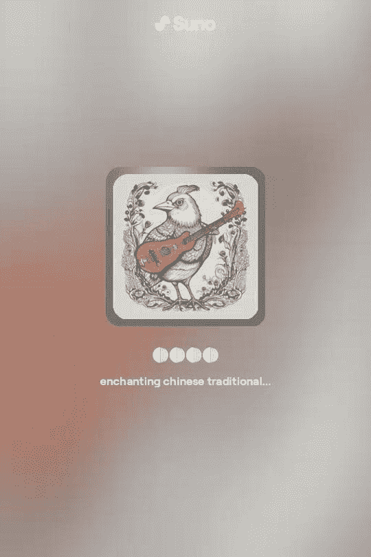

[烟雨江南.mp4](https://internal-api-drive-stream.feishu.cn/space/api/box/stream/download/all/AAWpbtnaeonZMmxrO1QcqDORnHg)

**烟雨江南**

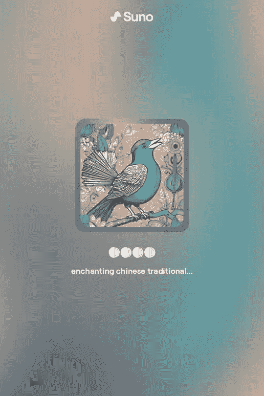

[江南曲.mp4](https://internal-api-drive-stream.feishu.cn/space/api/box/stream/download/all/Rjd4boaDBovolbx0DYAcm4hInuc)

**江南曲**

## 歌词作品

# 附：音乐知识

## 歌曲结构

> 常见的歌曲结构

> Intro（引子或前奏）：歌曲的开始部分，通常用来建立歌曲的基调和氛围。引子可能包含一些基本的旋律或节奏元素，但通常不包括主要的歌词。

> Verse（诗歌部分 / 主歌）：这部分是歌曲的主体，通常包含歌曲的主要故事或情感内容。每个诗歌部分可能有不同的歌词，但通常保持相同的旋律和节奏模式。

> Chorus（合唱部分 / 副歌）：通常是歌曲中最具辨识度的部分，重复出现，包含主要的主题和旋律。合唱部分是歌曲中最易被记住的部分，往往包含 “钩子”（hook）—— 一种特别引人入胜的旋律或歌词。

> Bridge（桥接部分）：这一部分出现在歌曲后半部，提供了与前面诗歌和合唱部分不同的旋律和节奏，用来增加歌曲的多样性和深度。

> Outro（尾奏）：歌曲的结尾部分，与引子相似，但用来结束歌曲。尾奏可以是对引子的重复，或者提供一种平静下来的感觉，渐渐带出歌曲。

> Pre-Chorus（前副歌）（可选）：在某些歌曲中，前副歌作为从诗歌部分到合唱部分的过渡。它可以增加歌曲的动态范围，为合唱部分的到来建立情感张力。

> 间奏（Interlude）（可选）：间奏是歌曲中的一个部分，其中不包含歌词，只有乐器演奏，通常用于连接两个不同的歌唱部分，如两个诗歌部分或诗歌部分到合唱部分之间，提供歌曲的情感转换或增强歌曲的整体感觉。

## 元标签

> 元标签（Metatags）是用于音乐创作时提供额外的指导。它们类似于电影剧本中的舞台指导或括号内的内容，用来指导 AI 生成音乐时的风格和情感，而不直接在最终的作品中被演唱出来。

> 元标签呈现 [verse] 、[chorus] 的形式，可以用来描述歌曲结构，流派，唱腔等，在用户的不停创作下，已经衍生了众多类型。

>

> 例子：

> [Verse]：指示一首歌的诗句开始。

> [Chorus]：标志着副歌的开始。

> [whispering]：建议以低语的方式演唱。

> [Guitar Solo]：建议有一段吉他独奏。

## 流派

> 音乐知识科普：什么是流派？什么是风格？

> **流派（Genre）：**

> 音乐流派是指一群共享特定音乐特性和传统的作品集合，是分类音乐多样性的一种方式。诸如摇滚、爵士、古典、电子和乡村音乐等，都是独具特色的流派。这些分类主要基于作品的结构、节奏、和声以及乐器使用等关键因素。每个流派都是音乐历史长河中的一部分，不仅代表了一段时间的音乐趋势，还深受其历史和文化背景的影响。音乐流派的形成和发展，不仅是艺术表达的演变，也是文化交流和社会变迁的见证。

> **风格（Style）：**

> 风格在艺术领域，尤其是音乐创作中，主要指艺术家或作品所展现的独特特征和创作手法。它是艺术家个性化的音乐表达，不受限于单一流派，而是可以跨越和融合多种音乐风格。例如，一位流行音乐艺术家可能通过其特有的唱腔或舞台表演风格，展示其独特的艺术个性。这些元素共同构成了艺术家独一无二的音乐风格，使其作品与众不同，成为其艺术标识的一部分。

### Genre（流派）

### Styles（风格）

### Song Types（歌曲类型）

**Country（乡村）**

+   Blueg+rass（草莓乐）

+   Country（乡村音乐）

+   Folk（民谣）

**Dance（舞曲）**

+   Afro-Cuban（阿弗罗-古巴）

+   Dance Pop（流行舞曲）

+   Disco（迪斯科）

+   Dubstep（配音步）

+   Disco Funk（迪斯科放克）

+   EDM（电子舞曲）

+   Electro（电子）

+   High-NRG（高能量）

+   House（浩室音乐）

+   Trance（迷幻舞曲）

**Downtempo（缓拍）**

+   Ambient（环境音）

+   Drum'n'bass（鼓与贝斯）

+   Dubstep（配音步）

+   Electronic（电子音乐）

+   IDM（智能舞曲）

+   Synthpop（合成流行）

+   Synthwave（合成波）

+   Techno（技术音乐）

+   Trap（陷阱音乐）

Jazz/Soul（爵士/灵魂）

+   Bebop（比博普）

+   Gospel（福音）

+   Jazz（爵士）

+   Latin Jazz（拉丁爵士）

+   RnB（节奏蓝调）

+   Soul（灵魂乐）

**Latin（拉丁）**

+   Bossa Nova（波萨诺瓦）

+   Latin Jazz（拉丁爵士）

+   Forró（弗约罗）

+   Salsa（萨尔萨舞）

+   Tango（探戈）

**Reggae（雷鬼）**

+   Dancehall（舞厅）

+   Dub（配音）

+   Reggae（雷鬼）

+   Reggaeton（雷盖顿）

+   Afrobeat（非洲节奏）

**Metal（金属）**

+   Black Metal（黑金属）

+   Deathcore（死亡核）

+   Death Metal（死亡金属）

+   Festive Heavy Metal（节日重金属）

+   Heavy Metal（重金属）

+   Nu Metal（新金属）

+   Power Metal（力量金属）

+   Metalcore（金属核）

**Popular（流行）**

+   Pop（流行音乐）

+   Dance Pop（流行舞曲）

+   Pop Rock（流行摇滚）

+   Kpop（韩流音乐）

+   Jpop（日流音乐）

+   RnB（节奏蓝调）

+   Synthpop（合成流行）

**Rock（摇滚）**

+   Classic Rock（经典摇滚）

+   Blues Rock（布鲁斯摇滚）

+   Emo（情绪）

+   Glam Rock（华丽摇滚）

+   Indie（独立音乐）

+   Industrial Rock（工业摇滚）

+   Punk（朋克摇滚）

+   Rock（摇滚）

+   Skate Rock（滑板摇滚）

+   Skatecore（滑板核）

**Urban（城市音乐）**

+   Funk（放克）

+   HipHop（嘻哈）

+   RnB（节奏蓝调）

+   Phonk（酸音乐）

+   Rap（说唱）

+   Trap（陷阱音乐）

**Danceable（可跳舞的）**

+   Disco（迪斯科）

+   Syncopated（切分节奏）

+   Groovy（悠扬）

+   Tipsy（微醺）

**Dark（黑暗）**

+   Dark（黑暗）

+   Doom（末日）

+   Dramatic（戏剧性）

+   Sinister（阴险）

**Electric（电子）**

+   Art（艺术）

+   Nu（新流行）

+   Progressive（进步）

**Hard（强硬）**

+   Aggressive（激进）

+   Banger（热门曲目）

+   Power（力量）

+   Stadium（体育场）

+   Stomp（重踏）

**Lyrical（抒情的）**

+   Broadway（百老汇）

+   Cabaret（歌舞表演）

+   Lounge（酒吧歌手）

+   Operatic（歌剧式的）

+   Storytelling（讲故事）

+   Torch-Lounge（酒吧歌曲）

+   Theatrical（戏剧性的）

+   Troubadour（吟游诗人）

+   Vegas（拉斯维加斯风格）

**Magical（神奇）**

+   Ethereal（虚幻）

+   Majestic（雄伟）

+   Mysterious（神秘）

**Minimal（简约）**

+   Ambient（环境音乐）

+   Cinematic（电影）

+   Slow（缓慢）

+   Sparse（稀疏）

**Party（派对）**

+   Glam（华丽）

+   Glitter（闪耀）

+   Groovy（悠扬）

+   Grooveout（活力爆发）

**Soft（柔和）**

+   Ambient（环境音乐）

+   Bedroom（卧室）

+   Chillwave（轻松浪潮）

+   Ethereal（虚幻）

+   Intimate（亲密）

**Weird（奇怪）**

+   Carnival（嘉年华）

+   Haunted（鬼屋）

+   Random（随机）

+   Musicbox（音乐盒）

+   Hollow（空洞）

World/Ethnic（世界/民族）

+   Arabian（阿拉伯）

+   Bangra（班格拉舞）

+   Calypso（卡利普索）

+   Egyptian（埃及）

+   Jewish Music（犹太音乐）

+   Klezmer（克莱兹默音乐）

+   Middle East（中东）

+   Polka（波尔卡）

+   Russian Navy Song（俄罗斯海军歌曲）

+   Suomipop（芬兰流行音乐）

+   Tribal（部落）

**BackGround（背景乐）**

+   Elevator（电梯音乐）

+   Jingle（广告歌曲）

+   Muzak（环境音乐）

Call to Prayer（祈祷呼唤）

+   Adhan（安讫）

+   Call to Prayer（祈祷呼唤）

+   Gregorian Chant（格里高利圣歌）

**Character（角色）**

+   Strut（趾高气昂地走）

+   March（进行曲）

+   I Want Song（渴望之歌）

**Children（儿童）**

+   Children's（儿童的）

+   Lullaby（摇篮曲）

+   Sing-along（合唱歌曲）

**Retro（复古）**

+   1960s（1960 年代）

+   Barbershop（理发店四重唱）

+   Big Band（大乐队）

+   Classic（经典的）

+   Doo Wop（一种节奏蓝调风格的音乐）

+   Girl Group（女子组合）

+   Swing（摇摆乐）

+   Traditional（传统的）

Traditional（传统的）

+   Barbershop（理发店四重唱）

+   Christmas Carol（圣诞颂歌）

+   Traditional（传统的）

## Tempo TAGs （速度控制标签）

### 慢速至极慢 （Lento to Largo）

+   严肃（Grave）：20-40 BPM

+   广板（Largo）：40-60 BPM

+   较广板（Larghetto）：60-66 BPM

### 缓慢（Adagio）

+   缓慢（Lento）：45-60 BPM

+   极缓慢（Adagissimo）：非常缓慢

+   慢板（Adagio）：66-76 BPM

### 行板（Andante）

+   广泛地（Largamente）：广泛地

+   行板（Andante）：76-108 BPM

+   较行板（Andantino）：略快于行板（但有时解释为略慢于行板）

### **中板（Moderato）**

+   行板中板（Andante moderato）：介于行板和中板之间

+   中板（Moderato）：108-120 BPM

+   小快板（Allegretto）：112-120 BPM

+   舒适的速度（Tempo comodo）：以舒适的速度

### **快板（Allegro）**

+   中快板（Allegro moderato）：116-120 BPM

+   快板（Allegro）：120-168 BPM

+   快活板（Allegro vivace）：132-140 BPM

+   活泼（Vivace）：140-176 BPM

+   极快板（Allegro assai）：非常快

+   非常快板（Molto allegro）：非常快

+   极快活泼（Vivacissimo）：非常活泼且快速

### 极快至极速（Presto to Prestissimo）

+   快活板或快活板（Allegrissimo or Allegro vivace）：172-176 BPM

+   极快板（Presto）：168-200 BPM

+   极速板（Prestissimo）：200+ BPM

### 反映变化或特性的额外术语

+   渐快（Accelerando）：逐渐加速

+   渐慢（Ritardando）：逐渐减慢

+   广板（Rallentando）：变宽，通常意味着减慢速度

+   自由拍（Rubato）：为表达目的而具有灵活的节奏

+   活泼（Mosso）：动作，更活泼

+   带动作（Con moto）：带有动作

+   原速（Tempo primo）：回到第一速度

+   双速（Doppio movimento）：速度加倍

+   延长（Sostenuto）：持续，可以暗示较慢的速度

+   加宽（Allargando）：加宽，通常放慢速度

+   加速（Stringendo）：加速前进

+   平静（Tranquillo）：平静地，可以暗示较慢的速度

+   有活力（Con brio）：有活力，暗示活泼的节奏

+   唱歌般的（Cantabile）：以唱歌的方式，节奏可以变化

+   开玩笑的（Scherzando）：玩耍或开玩笑

+   行进曲速度（Tempo di marcia）：行军节奏，可变

+   精确的速度（Tempo giusto）：严格的、确切的速度

+   活泼（Animato）：动画或活泼的

---

# 学习交流社群

1.持续关注并更新 AI 的**相关资讯动态，研究报告，赚钱案**例，常见问题，永久免费在线查看，无收费内容，目标是成为最大的免费 AI 学习社群。

2.已建立社群聊聊 **AI** 发展及应用，**没进群的可以扫码加入，群满可加 AI 研究爱好者大国🛰️ ID：zyg90s（备**注：AI），已经在社群内的无需重复加入，开源知识库及社群学习全部为公开免费分享。

3.**关于文档负责人大国**：高**帆文化 CEO，曾就职于教培大厂，目前创业，主**攻研究 AI 落地应用、企业流量增长及达人 IP 孵化。联合作者言川，站酷/优设 AI 领域大 V，AI 教程全网累计阅读量超过 500 万。

**5000 人飞书学习群**

**飞书扫码进群学习**

好友（ID：zhangyuguo94s）

**扫码加🛰️入🛰️群**