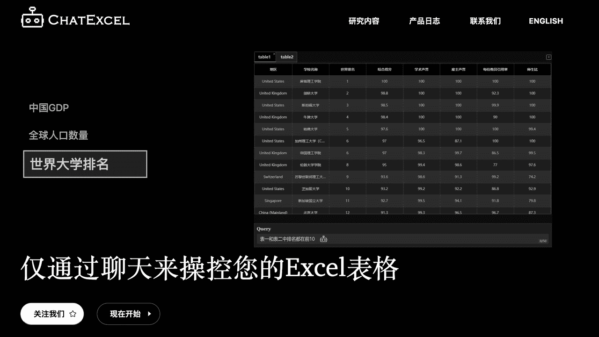
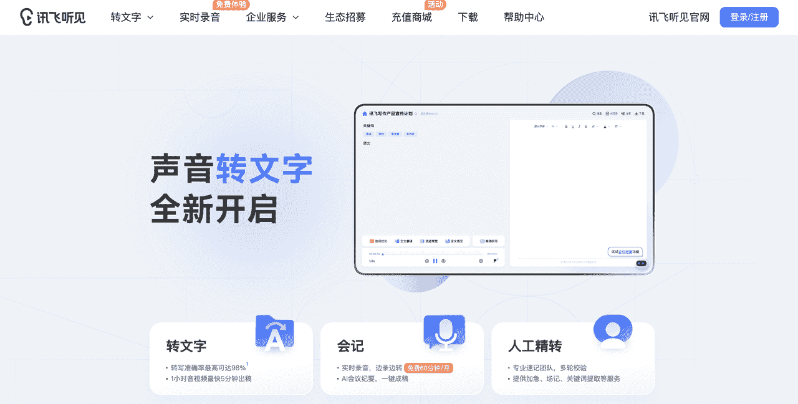
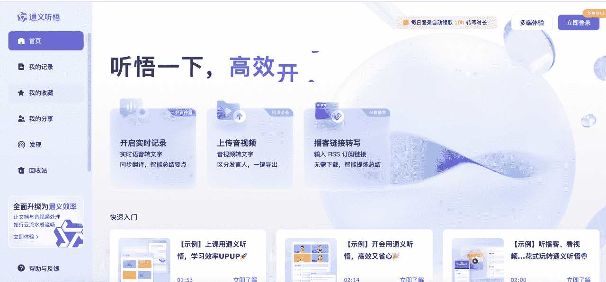
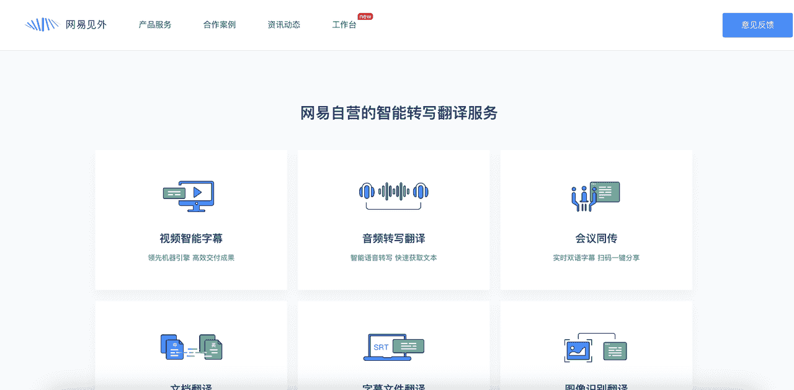
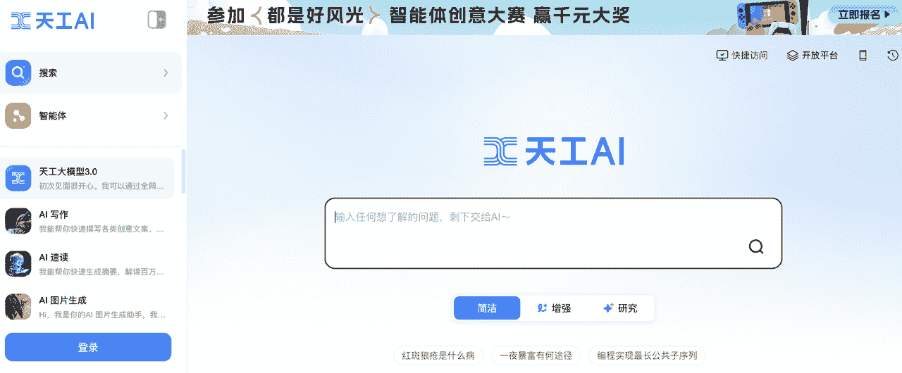
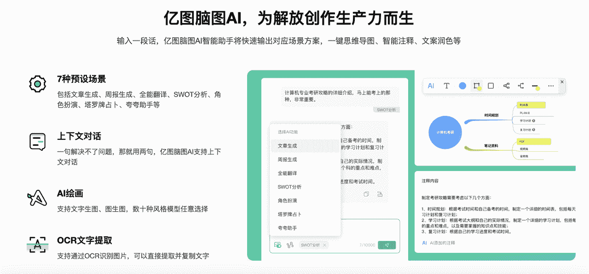

# AI 办公工具精选

> 来源：[https://yunyinghui.feishu.cn/docx/NBDpdkELuoLQ1TxJpUUcgA9mnEg](https://yunyinghui.feishu.cn/docx/NBDpdkELuoLQ1TxJpUUcgA9mnEg)

> **适用人群：****学习 AI 办公人群**

> 首发时间：2024 年 5 月 7 日

> 更新时间：2024 年 5 月 7 日

> **内容出品人：**

> **内容出品方：**[Mix AI Lab](https://yunyinghui.feishu.cn/wiki/WhelwZnxQi55mpkOzatc3Xran5b?from=from_copylink)

> **使用建议：**如果需要快速定位到精确内容，可以使用快捷键 Ctrl +F/Command +F 的形式，搜索关键字/词，查找你想要的内容。

> **持续更新 AI 办公好用的****相**关工具，工具介绍等内容，工具经过测评口碑相对比较不错的精选出来，永久免费在线查看，欢迎收藏转发支持，文末有惊喜，大国出品，必属精品。

# 更新记录

# 办公工具导航

| ## 办公工具导航 |  |  |  |  |
| --- | --- | --- | --- | --- |
| [**AI PPT**](https://yunyinghui.feishu.cn/wiki/Of1XwXFrMijDBTknW5KcjZZAn8f#part-QxisdrWh0o9fP0xXKr9cBFlznae) | [**AI E**](https://yunyinghui.feishu.cn/wiki/Of1XwXFrMijDBTknW5KcjZZAn8f#part-KzJzdKOXxoAKAIx46CvcB7GdnIb)[**xcel**](https://yunyinghui.feishu.cn/wiki/Of1XwXFrMijDBTknW5KcjZZAn8f#part-KzJzdKOXxoAKAIx46CvcB7GdnIb) | [**AI **](https://yunyinghui.feishu.cn/wiki/Of1XwXFrMijDBTknW5KcjZZAn8f#part-SxeMdz6aQotKm1xSSQrcaYQ5nog)[**文档**](https://yunyinghui.feishu.cn/wiki/Of1XwXFrMijDBTknW5KcjZZAn8f#part-SxeMdz6aQotKm1xSSQrcaYQ5nog) | [**AI 会议**](https://yunyinghui.feishu.cn/wiki/Of1XwXFrMijDBTknW5KcjZZAn8f#part-NYrGdyyDKo5moKxzt3qc90oYnxg) | [**AI 翻译**](https://yunyinghui.feishu.cn/wiki/Of1XwXFrMijDBTknW5KcjZZAn8f#part-DG4DdMG0LoU6sFx69zzcy1b2nKd) |
| [**AI 搜索**](https://yunyinghui.feishu.cn/wiki/Of1XwXFrMijDBTknW5KcjZZAn8f#part-AM7Edg0PaorfT7xduD3cS9bRnfb) | [**AI 导图**](https://yunyinghui.feishu.cn/wiki/Of1XwXFrMijDBTknW5KcjZZAn8f#part-ETasd4uNYohWbkx0wWCcnL0znRc) |  |  |  |

# AI PPT

## 1.WPS AI

**工具介绍：**只需要输入主题或上传文档，WPS AI 为你一键生成 PPT，将你从繁琐的 PPT 制作工作中“释放”。自动生成大纲，点击即可一键生成完整 PPT。还支持生成单页、扩写、改写、润色等能力。可将现有的 Word 文档内容快速转换成 PPT 演示文稿，方便进行演讲、汇报或教学。WPS AI 提供精美模版，各式风格、配色、版式一键切换

**工具优点：**中国协同办公赛道首个落地的生成式 AI 应用，功能齐全，可以满足基本的使用需求。

**是否免费：**免费体验，付费使用。

**网络条件：**正常网络

**体验网址：**[WPS AI](https://ai.wps.cn/introduction?position=wps-ai-landing-ppt)

**使用建议：**WPS 将 AI 能力与现有软件结合起来，对外观排版的可控制性更强，定制化程度更高，用户的迁移、学习成本也更小，使用起来方便上手。

## 2.Gamma APP

**工具介绍：**Gamma 是一个在线网页版创建 PPT 的工具，用户可以最少的格式化和设计工作来创建和展示内容，支持多种样式和功能，包括聚光灯、AI 操作、输入数学符号和代码、突出重点等。

**工具优点：**

1）模板多，且非常惊艳，不管是颜色还是布局；

2）AI 自动生成文案，智能程度高，还可以不断调整

3）自动配图，准确率高；

4）板式、字体等调整非常灵活，PPT 位置移动也很方便。

5）AI 和人工修改结合，可以大幅提升效率。

6）支持跨设备使用：你可以在任何设备上阅读和分享 Gamma 生成的内容，包括笔记本电脑、平板电脑和手机，方便灵活。

**是否免费：**免费体验，付费工具

**网络条件：**直连网速较慢，尽量挂科学

**体验网址：**[G](https://gamma.app/?lng=zh-CN)amma App: Generate AI Presentations， Webpages & Docs

**使用建议：**

1）Gamma 的模板就很值得使用，非常多的选择；

2）操作界面友好、清晰，很容易上手。

3）可以各种修改和调整，弥补 AI 的不足。

## 3.**歌者PPT**

**网址**

http://gezhe.com

**功能**

+   话题生成：一键生成PPT内容

+   资料转换：支持多种文件格式转PPT

+   多语言支持：生成多语言PPT

+   模板和案例：海量模板和案例库

+   在线编辑和分享：生成结果可自由编辑并在线分享

+   增值服务：自定义模板、字体、动效等

**简介**

歌者PPT（gezhe.com）是一款永久免费的智能 PPT 生成工具。用户可以轻松将任何主题或资料转化为PPT，并选择应用大量精美的模板。无论是商务演示、教育培训、学术报告还是专业领域，歌者 PPT 都能提供便捷的操作和智能化体验，让幻灯片制作变得更加轻松高效。

**产品优势**

+   **免费使用**：所有功能永久免费。

+   **智能易用**：通过 AI 技术简化 PPT 制作流程，易于上手。

+   **海量案例**：大量精美模板和优秀案例可供选择和下载。

+   **资料转 PPT 很专业**：支持多种文件格式，转换过程中尊重原文内容。

+   **AI 翻译：**保持 PPT 原始排版不变，多语言在线即时翻译。

**推荐理由：**

首先，歌者 PPT 完全免费，这对于经常需要制作演示文稿的学生和职场人士来说，简直是福音。

其次，它的智能化程度令人印象深刻。通过AI技术，歌者PPT可以快速将各种资料转换成精美的PPT，整个过程既高效又准确。

歌者 PPT 的模板和案例库非常丰富，无论是职场办公还是学术演讲，你总能找到适合的模版或案例。歌者PPT对多语言的支持使得它在国际化环境中也非常实用，可以一键生成目标语言的PPT，也可以把写好的PPT翻译成其他语言。

这款工具特别适合那些不太擅长制作PPT或者时间紧张的人群，几乎无需学习成本就能上手使用。

# AI Excel

## 1) ChatExcel

**工具介绍：**ChatExcel 是一个基于微软 Excel 的聊天机器人，可以帮助你快速地进行数据处理和操作。由北大团队推出，旨在降低 Excel 的使用门槛和技术难度。ChatExcel 可以满足使用者持续交互、迭代更新的需求、使用者提出的新需求+上一轮生成的表格可以满足使用者检测结果、在任一步骤上退回重做、随时可做出调整和修改的需求，还可以实现跨表格协作处理。

**工具优点：**

1）可以根据用户提出的新需求和上一轮生成的表格，动态地调整和更新数据处理过程和结果

2）可以对原始数据源进行实时监测和同步更新

3）可以实现对多个表格之间的关联和处理

4）此产品完全开放，测试者无需注册任何信息，打开网页就能用，不限次数

**是否免费：**免费体验

**网络条件：**正常网络

**体验网址：**[酷表 ChatExcel](https://chatexcel.com/)

**使用建议：**

1）ChatExcel 支持中文和英文，可以根据自己的习惯选择语言。

2）ChatExcel 支持多种数据处理和操作，包括求和、平均数、最大值、最小值、排序等，可以根据需要选择使用。

3）ChatExcel 还支持自定义命令，可以根据自己的需求添加自定义命令，提高工作效率。

4）ChatExcel 会自动保存历史记录，可以通过历史记录查看之前的操作和结果。

## 2) Ajelix

**工具介绍：**Ajelix 是一款 AI Excel & Google Sheets 工具，可帮助用户以 10 倍的速度编写和解释公式、翻译电子表格、生成模板以及编写 VBA 脚本。 它提供的工具包括 Excel 公式生成器、Excel VBA 脚本生成器、Excel 模板生成器、Google 表格公式生成器、Google Apps 脚本生成器、公式和脚本库、Excel 文件转换器、Excel 插件和虚拟 AI 助手。 该工具还提供业务服务，例如 Excel 自动化和咨询、Google 表格自动化和咨询、业务流程分析和优化、动态报告开发、Web 开发、业务数据分析和预测以及 WordPress 开发。

**工具优点：**可以识别关键词，并根据这些关键词自动生成 Excel 公式，如果想要编写 Excel 程序，还可以将文本翻译成 VBA 脚本。

**是否免费：**免费体验，付费工具

**网络条件：**正常网络

**体验网址：**[E](https://ajelix.com/)xcel Formula Generator & AI Excel Tools & Business Intelligence

**使用建议：**不仅有公式生成器，还有公式和脚本库，能与同事一起协作完成。

# AI 文档

## 1.ChatPDF

**工具介绍：**ChatPDF 是国外小哥 Mathis Lichtenberger 开发的一个应用。它是基于 OpenAI 的 Chat API，给 PDF 的每一段创建语义索引，然后使用关联最密切的段落去提示 （prompt） Chat API。

**工具优点：**无需注册，登录，通过上传 PDF 文件到 ChatPDF，就能实现和 PDF 跨语言对话，并根据 PDF 内容回答的提问，可以同时处理多个 PDF 文件。

**是否免费：**ChatPDF 允许您免费使用它，每天提供 2 个 PDF，每个最多 120 页。如需更多信息，可以升级到 ChatPDF Plus。

**网络条件：**科学网络

**体验网址：**[www.chatpdf.com](https://www.chatpdf.com/)

**使用建议：**

1）涉密内容不要上传。

2）ChatPDF 暂时还不支持 PDF 中图片的内容。

3）需要登录账号，才能保存和 PDF 的聊天历史。

## 2.云一朵

**工具介绍：**百度网盘内置的工具，可以直接@网盘里面的文件，对文件进行互动提问。

**工具优点：**免费功能，核心优势在于可以将百度网盘中的任意格式文档作为 AI 对话的材料，只需要在提问框输入“@+文件名”即可，在文档预览界面则直接提问即可。

**是否免费：**网盘用户免费

**网络条件：**正常网络

**体验网址：**[pan.baidu.com](https://pan.baidu.com/disk/main#/index?category=all&path=%2F)

**使用建议：**部分 doc、ppt 文档无法解读，上下文对话有时会失效。

# AI 会议

## 1.飞书妙记

**工具介绍：**飞书妙记是一款音视频转文字的效率工具，可在会议、培训、访谈、课堂等不同场景，将你的音视频内容转录为搜索便捷、重点高亮、互动多样的智能文字笔记。帮助你高效整理会议纪要、完整沉淀培训内容、一键收录访谈全程、清晰记录课堂重点，提升工作与学习效率。

**工具优点：**只需要注册就可以免费使用，支持音频转文字、视频转文字。还支持多种语言翻译，包括普通话、英语、日语，转好的文件可导出。妙记会自动把视频会议转录成易搜索、有整理、可翻译的逐字稿，且支持在线评论、@ 同事，更有智能伙伴帮你自动总结会议纪要与待办，大幅提升回顾和协作效率。

**是否免费：**是

**网络条件：**正常网络

**体验网址：**[飞书妙记-智能会议纪要，快捷语音识别转文](https://www.feishu.cn/product/minutes?ref=www.ainav.cn)字，将会议交流沉淀为知识，一切皆可妙记！

**使用建议：**

打开妙记，可以在左侧看到视频画面，右侧看到自动生成的文字记录。

+   定位：点击文字记录内的任意字词，即可定位至对应的音视频位置。点击视频画面下方的发言人时间轴，还可快速定位到特定发言人的发言内容。

+   查找：在搜索框内输入内容，搜索结果会自动高亮，点击即可定位至对应的音视频位置。

+   翻译：点击搜索框右上方的 **源语言** 下拉框，可选择将文字记录翻译为其他语言。

+   播客模式：你可以一边收听妙记音频，一边查看文字记录辅助理解。你也可以在后台播放妙记的同时，在移动设备上进行其他操作，提升工作效率，高效利用碎片化时间。

+

## 2.讯飞听见

**工具介绍：**讯飞听见是由科大讯飞推出的以语音转文字为核心功能的系列产品和服务。讯飞听见 APP 是一款语音转文字及多语种翻译的手机应用，同时支持多语种在线实时翻译、文档上传翻译。手机端一站式完成录音、转写、翻译、编辑、导出。

**工具优点：**

1）转写准确率最高可达 98%

2）1 小时音视频最快 5 分钟出稿

3）实时录音，边录边转

4）AI 会议纪要，一键成稿

**是否免费：**有付费功能

**网络条件：**正常网络

**体验网址：**讯飞听见-在线语音转文字-录音转文字

**使用建议：**

1）目前实时语音转文字浏览、实时翻译浏览（含悬浮字幕功能）均限时免费；

2）如要获取文字结果（含分享文本内容 ）则需要进行付费，可至个人中心选择优惠套餐。

## 3.腾讯会议

**工具介绍：**腾讯会议是腾讯云旗下的一款音视频会议软件，于 2019 年 12 月底上线。2020 年 1 月 24 日起腾讯会议面向用户免费开放 300 人的会议协同能力，直至疫情结束。

**工具优点：**

1）提供全流程的 AI 小助手，通过简单自然的指令，完成信息提取、内容分析、会管会控等多种复杂任务，提升开会和信息流转效率。

2）时紧急回顾：不必担心走神错过关键信息。只需点击“刚刚说了什么”，AI 小助手即刻为你回顾会上最近 1、3、5 分钟的会议内容，让你随时紧跟会议进展，高效参与讨论。

3）会中实时会议纪要：实时提炼会议当前议程下的讨论内容，随时浏览会议重点。

4）个性化纪要总结：解锁边开会边用小助手总结固定发言人或关键词内容，让你针对性地掌握你关心的一切

**是否免费：**否

**网络条件：**正常网络

**体验网址：**meeting.tencent.com

**使用建议：**需要申请小助手的权限

## 4.通义听悟

**工具介绍：**“通义听悟”是阿里云推出的基于大模型的工作学习 AI 助手，于 2023 年 6 月 1 日开始正式公测。2023 年 11 月，阿里云在 2023 云栖大会正式上线通义听悟-工作学习 AI 助手。

**工具优点：**在开会、上课、访谈、培训、直播、看视频、听播客等音视频内容场景中，能记、能翻、能存、能划重点。

**是否免费：**免费和付费都有。

**网络条件：**正常网络

**体验网址：**通义听悟 - 你的工作学习 AI 助手

**使用建议：** 在上传音视频文件时，尽量选择清晰、完整、无杂音的文件，以便于通义听悟更好地识别和处理您的文件。

# AI 翻译

## 1.网易见外

**工具介绍：**网易见外是网易出品的一个多功能黑科技网站，它致力于用语音识别转写文字、机器翻译等技术为从事和爱好语音转写、翻译的人员提供更便捷的听翻工具，从而提升工作效率，降低转写成本。这个平台提供了一系列的实用功能，包括但不限于视频翻译、视频转写、字幕翻译、文档翻译、语音翻译、语音转写、会议同传和图片翻译。

**工具优点：**网易见外最大的优点在于其多种功能和应用程序的特性。不仅能够满足用户基本的办公需求，而且提供了多个模块的应用程序和工具，让用户能够更加高效地完成任务和工作。

**是否免费：**有付费，有免费

**网络条件：**正常网络

**体验网址：**网易见外 - AI 智能语音转写听翻平台

**使用建议：**

1）网易见外提供每天免费 2 小时的使用时间，基本上可以不用付费。

2）网易见外的语音转写功能，瞬间帮你把音频文件，转为可编写的文档。

## 2.讯飞智能翻译

**工具介绍：**讯飞智能翻译平台是专业的在线文档翻译平台，提供 PDF/Word/Excel/PPT 文件翻译、图片识别翻译、在线翻译等服务，支持 22 种文档格式以及 60 多种语种和中文互译，译文结果高度还原原。

**工具优点：**翻译功能强大

**是否免费：**部分免费，有付费

**网络条件：**正常网络

**体验网址：**[讯飞智能翻译平台](https://fanyi.xfyun.cn/)

**使用建议：**费用比较贵，比较适用于专业人士和企业

## 3.腾讯翻译君

**工具介绍：**翻译君是腾讯最新出品的实时会话翻译软件，支持中、英、日、韩等多门语言。具有精准语言识别，高效、免费等特点。非常适用于境外旅游、对外交流、口语练习等情境，让你体验同声传译般的流畅和快感。

**工具优点：**

+   语音翻译 | 无需打字，对着说话，精准识别并翻译；

+   同声传译 | 独家免费体验，声画同步，实时翻译，炫酷又高效；

+   AR 翻译 | 对准内容，自动扫描，结果实时实景呈现；

+   文本翻译 | 无需会员 VIP，免费使用新牛津，词典例句更多更权威；

+   口语评测 | 拒绝哑巴英语，智能跟读评测，趣味打分。

**是否免费：**免费

**网络条件：**正常网络

**体验网址：**[fanyi.qq.com](https://fanyi.qq.com/)

**使用建议：**建议使用 APP 客户端，功能更丰富。

## 4.火山翻译

**工具介绍：**由字节跳动 AI Lab（人工智能实验室）自主研发，屡次斩获机器翻译大赛重磅奖项、学术研究成果国际知名，保证了先进的翻译质量和服务优化的长期投入。

**工具优点：**从个人到企业，从文本翻译到音视频翻译，从标准 API 到定制化服务，各类型能力可满足不同场景需要。

**是否免费：**有免费，有付费

**网络条件：**正常网络

**体验网址：**[fanyi.qq.com](https://fanyi.qq.com/)

**使用建议：**

+   官方网页端，且功能丰富

+   安装「火山翻译」浏览器插件，外语网页一键翻译、划取查词

# AI 搜索

## 1.秘塔搜索

**工具介绍：**秘塔 AI 搜索是由上海秘塔网络科技有限公司开发的新一代智能搜索引擎，「专注于为用户提供一个无广告、高效的搜索体验」。秘塔 AI 搜索深度理解用户查询意图，并从「全网抓取信息进行分析」，以结构化的方式展示关键信息、事件时间线和相关人物资料。同时，它还提供详细的信息来源链接，确保用户能够验证搜索结果的准确性和可靠性。

**工具优点：**语义理解能力强、支持多轮对话式搜索、支持语音输入、没有广告等优点，秘塔 AI 搜索则会附上思维导图、大纲、相关事件、相关人物等结构化的信息展示。

**是否免费：**免费

**网络条件：**正常网络

**体验网址：**https://metaso.cn/

**使用建议：**

1）不支持连续对话：只能对话一次，不能基于搜索结果进行多轮对话。

2）根据信息源总结的答案可能不对：根据搜索结果进行总结的时候，可能总结出错误的答案，需要根据信息源再核对一边。

3）思维导图不能编辑：搜索的答案未必准确，思维导图不能编辑，就意味着难以修改错误的答案，思维导图的意义就大大降低。当原始答案有错误时，等于没有这个功能。

## 2.天工 AI 搜索

**工具介绍：**天工 AI 搜索是昆仑万维推出的国内第一款 AI 搜索产品，它通过对话式交互，理解用户需求，提供精准和个性化的回答。天工 AI 搜索不仅支持文本搜索，还支持图片搜索和语音搜索。

**工具优点：**

一是在大模型技术方面，天工 AI 搜索采用了大语言模型技术，这种技术具有强大的语义理解和生成能力，能够更好地理解用户的搜索意图，并提供准确、个性化的搜索结果。大模型技术的应用使得搜索结果更加精确、全面，提升了搜索的效果和用户体验；并且搜索能够解决大模型的幻觉问题，让大模型实现更快的迭代进化。

二是在自然语言搜索方面，天工 AI 搜索主打自然语言搜索，用户可以用简单的语言进行提问，无需拘泥于特定关键词或操作符。天工 AI 搜索能够分析用户的真实意图，并捕捉问题中的上下文关系，从而提供更精确、更全面的搜索结果。

三是在多模态搜索能力方面，天工 AI 搜索在未来将进一步升级迭代，增加多模态搜索能力。这意味着天工 AI 搜索将能够处理多种不同的信息形式，如文字、图像、音频等，从而更好地满足用户的搜索需求。

**是否免费：**是

**网络条件：**正常网络

**体验网址：**[www.tiangong.cn](https://www.tiangong.cn/)

**使用建议：**天工 AI 搜索测试中，也可以观察到互联网上搜索不到提问相关内容时回答“未搜索到”的情况。

## 3.iAsk.Ai

**工具介绍：**iAsk.Ai 是一个免费的 AI 搜索引擎，允许用户提问 AI 问题并立即获取准确、事实的答案，而不存储用户数据。它使用先进的自然语言处理（NLP）和经过精细调整的大规模 Transformer 语言模型，提供客观和可靠的回答。

**工具优点：**iAsk.Ai 能够理解用户的意图，并自动分析、筛选相关信息，最终生成简洁、精准的搜索结果。这种一键生成的方式，不仅提高了搜索效率，还降低了使用门槛，让更多人能够享受到智能搜索带来的便利。

**是否免费：**是

**网络条件：**正常网络

**体验网址：**[As](https://iask.ai/)k AI Questions · Free AI Search Engine · iAsk.Ai is a Free Answer Engine， Enabling Users to Ask Ch

**使用建议：**用户可以通过自然语言输入问题或需求，无需复杂的关键词组合或搜索语法。

# AI 导图

## 1.**亿图脑图 AI**

**工具介绍：**输入一段话，亿图脑图 AI 智能助手将快速输出对应场景方案，一键思维导图、智能注释、文案润色等。

**工具优点：**

1）支持一键生成多层级思维导图，

2）支持一键开启 AI 连续对话模式，训练你的专属 AI 智能助手

3）支持文章生成、周报生成、文案润色、头脑风暴等七大实用预设场景

4）支持一键智能注释功能，快速获取关键词解释和相关信息

**是否免费：**否

**网络条件：**正常网络

**体验网址：**亿图脑图 MindMaster 多平台思维导图软件，让您的创意破茧而出

**使用建议：**直接上手体验效果，目前看来算比较好用的。

## 2.Xmind AI

**工具介绍：**Xmind AI 是 Xmind 旗下一款出色的独立产品。 Xmind AI 诞生于 Xmind.works 和 Xmind Copilot 两条产品线的合并，是一款具有独特方法的新颖产品，可帮助用户一键拓展思路，基于思维导图结构高效生成文章，让你的文章创作更高效、更流畅、更具无限想象。

**工具优点：**

1）One-liner:一句话生成思维导图

2）Inspire Me:一键提供灵感和思路

3）Outliner:一键总结文章思路

4）Ghostwriter:一键帮你高效成文

**是否免费：**免费体验，付费使用

**网络条件：**正常网络

**体验网址：**[Xmind AI](https://xmind.ai/?ref=ai-bot.cn)

**使用建议：**Xmind AI 提供免费版本，具有无限节点和地图、插入关系、边界、摘要等基本功能，并提供 Pitch 和 AI 功能的试用版。除此之外，Xmind AI 还提供付费套餐。每月 7.99 美元或每年 79 美元，您可以获得实时协作编辑、500 个 AI 积分、推荐、任务跟踪等特殊功能。

## 3.Chatmind

**工具介绍：**ChatMind 是国内的开发者团队推出的 Al 思维导图工具，是由 GPT4 驱动的聊天引导式思维导图。可以应用于笔记、日程安排、项目管理、头脑风暴、框架等多种场景。该工具不仅可以帮助用户快速总结和分析，还可以持续提供创意灵感。

**工具优点：**简单易用、功能丰富、协作性强等。

**是否免费：**免费体验，付费使用

**网络条件：**正常网络

**体验网址：**[Chatmind: AI-Native Mind Map](https://chatmind.tech/cn)ping Online by Xmind

**使用建议：**直接谷歌账号登录，需要🪜

---

# AI 学习交流社群

1.持续关注并更新 AI 的**相关资讯动态，研究报告，赚钱案**例，常见问题，永久免费在线查看，无收费内容，目标是成为最大的免费 AI 学习社群。

2.已建立社群聊聊 **AI** 发展及应用，**没进群的可以扫码加入，群满可加 AI 研究爱好者大国🛰️ ID：zyg90s（备**注：AI），已经在社群内的无需重复加入，开源知识库及社群学习全部为公开免费分享。

3.**关于文档负责人大国**：高帆文化CEO，曾就职于教培大厂，目前创业，主攻研究AI落地应用、企业流量增长及达人IP孵化。

**飞书学习交流群**

**飞书扫码进群学习**

好友（ID：zhangyuguo94s）

**扫码加🛰️入🛰️群**

进群或者加好友了解更多 AIGC 实战案例

**觉得有用欢迎留个赞**