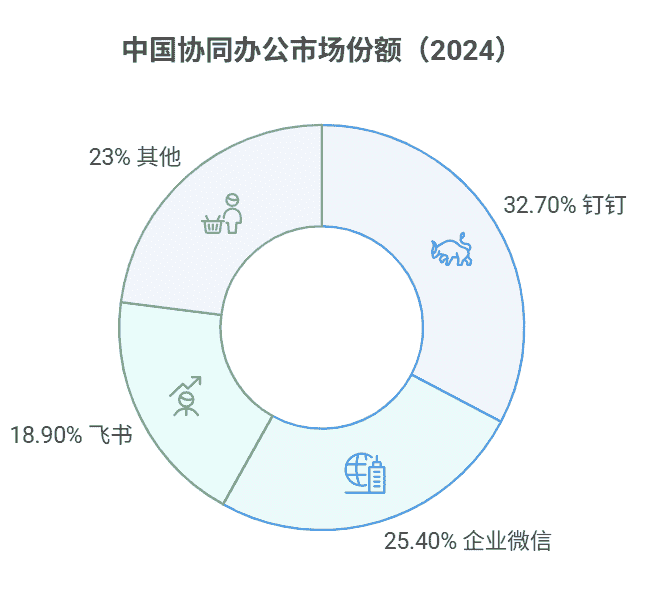
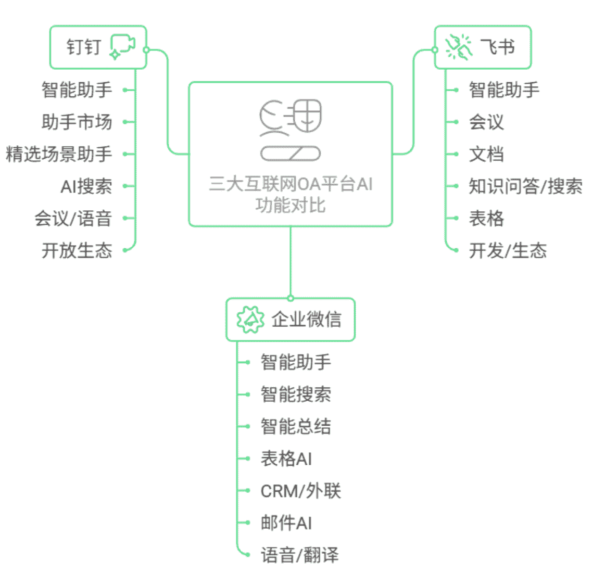

# AI 办公工具对比手册：飞书 VS 钉钉 VS 企业微信

> 来源：[https://yunyinghui.feishu.cn/docx/KX9od7sMXo5B58xJNN8chXidnWg](https://yunyinghui.feishu.cn/docx/KX9od7sMXo5B58xJNN8chXidnWg)

> **适用人群：**互联网 AI 办公学习及企业管理人群

> **首发时间：**2025 年 11 月 10 日

> **更新时间：**2025 年 11 月 10 日

> **内容出品人：**** **

> **内容出品方：**[玩赚 AI 实验室](https://yunyinghui.feishu.cn/wiki/WhelwZnxQi55mpkOzatc3Xran5b?from=from_copylink)

> **使用建议：**如果需要快速定位到精确内容，可以使用快捷键 Ctrl +F/Command +F 的形式，搜索关键字/词，查找你想要的内容。

>

> **为 AI 实验室同学持续更新** AI 办公工具的产品介绍、功能对比，使用建议等相关学习材料，为 AI 办公工具提效的小伙伴进行扫盲科普。

>

> 🎯全**网最接地气 AI 知识库：「**[**AI 实验室」知识库（**](https://yunyinghui.feishu.cn/wiki/space/7340161844864598017?ccm_open_type=lark_wiki_spaceLink&open_tab_from=wiki_home)AI 设计、AI 办公、AI 视频等应用技能）

# 前言

作为一名 AI 领域的创作者以及一位创业者，深知好的 AI 办公工具对办公效率提升的重要性。本手册整合了 2025 年最新办公相关行业报告、官方功能手册与 30 + 真实企业 / 个人使用案例，总结出这份万字《AI 办公工具对比手册：飞书 VS 钉钉 VS 企业微信》。

这里咱们不是简单罗列功能，而是带着 “帮大家少走弯路” 的初衷，把三大平台的核心差异、独家优势、适配场景拆解得明明白白。

如果你是企业决策者，手册里有按行业、规模划分的选型决策建议，还有安全合规、生态集成、成本测算的深度分析，甚至标注了各平台不可替代的核心模块（比如飞书的全球化协作、企业微信的私域联动、钉钉的流程管控），帮你避开 “功能冗余”“适配不足” 的坑，用最低成本搭建高效协作体系；如果你是个人用户，不管是自由职业者的文档协作、创业者的流程管理，还是私域运营者的客户连接、学生党的小组协作，都能在里面找到精准的场景化推荐，清晰梳理出免费功能边界、付费增强性价比，甚至还有工具组合使用的效率技巧。

手册里没有空洞的理论，每一个功能对比都有权威数据和来源支撑，每一条选型建议都来自真实用户反馈，从核心功能细分到独家模块拆解，从企业战略适配到个人效率提升，全维度覆盖你的需求。不管你是想升级团队协作工具，还是想找一款适配自己的高效办公软件，这份手册都能帮你省去大量调研时间，快速锁定最适合的选择 —— 相信我，花 1 小时读完，能帮你避开 90% 的选型误区，让 AI 办公真正赋能工作，而不是成为额外的负担。

国内协同办公市场正处在⼀个高速增长的黄金时期，根据艾媒数据，2024 年中国协同办公市场规模已达到 319.6 亿元，并预计在 2025 年将突破 414 亿元，展现出强劲的增长潜力。在这个巨大的市场中，头部效应极为明显，钉钉、企业微信和飞书三者合计占据了超过 75%的市场份额 ，形成了稳固的“三足鼎立”格局。

以下是飞书、企业微信、钉钉的多维度对比分析，基于 2025 年最新行业报告与官方数据，为企业或者个人提供科学决策依据。

---

# 一、核心指标对比表

## 1.核心指标对比

| ### **维度** |  |  |  |
| --- | --- | --- | --- |
| **市场定位** | 高净值创新型企业的数字化协作中枢，聚焦互联网、新能源、AI 等高知识密度行业 | 微信生态延伸的社会化协作平台，强于零售、服务业的客户连接与私域运营 | 传统行业数字化转型工具，覆盖政务、教育、制造业等场景 |
| **用户规模** | - 注册用户：1.5 亿（2025 预测） | - 企业组织数：超 1400 万 | - 企业组织数：2300 万 |
| **AI 能力** | - 智能伙伴（Aily）：支持自然语言生成文档、数据分析、流程自动 | - 智能搜索：口语化提问关联聊天、文档、会议记录 | - AI 搜问：企业级搜索引擎，支持工单自动派单、合同风险识别 |
| **核心功能** | - 一体化协作：文档+会议+OKR+多维表格深度整合 | - 微信互通：客户管理、朋友圈营销、小程序联动 | - 强管控流程：考勤、审批、日志汇报精细化管理 |
| **安全性** | - 18 项合规认证：等保三级、ISO 27001/27018/27701、GDPR | - 私有化部署：支持央国企数据本地化存储 | - 端到端加密：支持人脸/指纹认证、IP 白名单 |
| **定价策略** | - 订阅制：50-120 元/人/月（商业版） | - 基础免费：客户数≤2000 免费 | - 专业版：9800 元/年（含 20 账号） |
| **典型客户** | 小米、理想汽车、元气森林、智谱 | 森马、银泰百货、某省级政务平台 | 三一集团、夸父炸串、德香苑烤鸭 |

### **飞书**

### **企业微信**

### **钉钉**

## 2.客户人群对比

**钉钉**在传统行业和政务领域渗透率高，覆盖包括一汽、长城、蒙牛等中国 500 强企业。钉钉在政务领域与南方电网、碧桂园等企业深度合作，政务组织贡献了钉钉近 1/3 的活跃度。钉钉用户中，A 股上市公司占比达 79%，制造业、零售业、教育行业是其主要客户群体。钉钉的客户结构以中小微企业为主，2023 年数据显示小微企业占比 58%，中型企业占比 30%，大型企业占比 12%。

**企业微信**在零售、教育、金融等行业表现突出，其会话存档、客户标签、群发管理等功能构建了完整的私域运营闭环。企业微信在制造业也有显著布局，如景旺电子、宝武集团等大型制造企业使用企业微信进行内部沟通和外部客户管理。企业微信的客户结构以民营企业为主，占 53%，中小微企业占 32.17%。企业微信在私域流量运营方面具有独特优势，如顺丰速运通过企业微信将 30 万一线快递员和终端消费者连接起来，为消费者提供更好的服务，同时提高一线收派件服务的效率和质量。

**飞书**在互联网、新能源汽车、新消费领域占据优势，其客户包括小米、理想汽车、小鹏、蔚来、蜜雪冰城等知名企业。飞书在新能源汽车行业渗透率达 40%，销量前 30 的新能源汽车品牌中有 60%使用飞书。飞书客户中，千人以上企业贡献 65%以上收入，客单价显著高于行业均值。飞书在 AI 创业公司中也获得早期认可，如 DeepSeek、智元机器人等选择飞书作为协作平台。

值得注意的是，大客户争夺战已成为三款平台竞争的焦点。钉钉、企业微信和飞书对头部客户展开激烈争夺，如一所浙江地区的重点学校，起初是钉钉的客户，后来被企业微信突破，但又被钉钉花大力气抢了回来。完美日记曾经是企业微信的重点客户，后来切换到飞书。蔚小理本来是飞书标榜的"先进企业"代言人，但企业微信也拿到了小鹏汽车的外部营销系统。这种客户争夺反映了平台在企业级市场的野心，大客户不仅是"秀肌肉"的标杆，也是活跃度的"扛把子"和商业化的必经战场。

## 3.**商业模式对比**

**钉钉**采用基础免费+增值服务收费的模式，2025 上半财年软件订阅 ARR 达 2 亿美元，目标在 2025 年实现盈亏平衡。钉钉付费组织数超过 19 万，但免费用户占比仍高，商业化效率有待提升。其付费策略依赖生态整合（如阿里云数据服务），同时推出智能硬件 DingTalk A1（售价 799 元）等高附加值产品。钉钉 AI 应用数已达 141 万，但需解决界面复杂度高、员工抵触感强等问题以提升付费意愿。

**企业微信**以微信生态连接为核心，按员工数量阶梯收费，基础版免费，私有化部署客单价达 80 万元/年，利润率更高。2024 年企业微信收入达 196 亿元，同比增长 100%，付费企业客户突破 800 万家。

企业微信在政务和制造业收入增长显著，如"粤政易"覆盖 300 万用户，工业场景收入占比从 8%提升至 17%。企业微信第三方应用需付费（90 天试用后），如微加平台提供企业微信集成服务，支持建站、营销、培训等功能。

企业微信依托微信支付融合，实现小程序商城对话直达，形成独特的私域流量运营闭环。

** 飞书**采用高端订阅模式，2023 年 ARR 达 2 亿美元，2024 年预计突破 3 亿美元。飞书商业化依赖高客单价大客户，如新能源汽车行业 Top 30 的 60%使用飞书。飞书推出多维表格独立销售策略，启动与钉钉、企业微信的平台互通，试图最大化撬动流量变现和商业机会。飞书在 AI 创业公司中获得早期认可，如 DeepSeek、智元机器人等 AI 领域新锐企业选择飞书作为协作平台。飞书还推出开发套件，支持企业自助接入 DeepSeek R1 模型，每人限量 100 万 token，超过上限后需绑定火山引擎账号获取更多资源。

# 二、核心功能深度解析

## 1. **核心功能模块对比**

核心功能细分对比表（按模块划分）

| ## **核心模块** | ## **细分功能点** | ## **飞书** | ## **企业微信** | ## **钉钉** | ## **三方差异点总结** |
| --- | --- | --- | --- | --- | --- |
| 文档协作 | 实时协同编辑 | 支持 1000 人同时编辑，多端实时同步，文档内可直接批注、@提醒并串联对话 | 支持多人在线编辑，与微信端无缝互通，编辑操作简化易上手 | 支持多人协作，内置 WPS 文档，单元格可嵌入文档元素，实现“表格即文档” | 飞书协作深度最高，批注与对话联动；钉钉侧重文档与表格融合；企业微信胜在微信生态互通与易用性 |
|  | 版本管理 | 支持 1000 次历史版本追溯，可版本比对、一键回退，标注新增/删除内容 | 基础版本记录与回退，无精细化比对功能 | 支持历史版本查看，可导出不同版本文件 | 飞书版本管理最精细；钉钉、企业微信满足基础需求，无高级比对功能 |
|  | 权限管控 | 字段/记录/视图三级权限，支持自定义权限组，可设置“阅后即焚” | 文档/文件夹级基础权限，支持对外分享时设置访问范围 | 文档/表格级权限管控，支持加密分享与访问日志追踪 | 飞书权限颗粒度最细；钉钉侧重安全追踪；企业微信权限设计轻量化 |
| 项目与目标管理 | OKR 工具 | 原生内置 OKR 模块，支持目标对齐、权重设置、进度自动统计与复盘打分 | 无原生 OKR 功能，需依赖第三方应用 | 无原生 OKR 功能，可通过表格自定义搭建简易版本 | 飞书是唯一原生支持 OKR 全流程管理的平台；其他两者需额外适配 |
|  | 项目跟踪 | 飞书项目模块支持自定义工作项、流程与视图，与文档/IM 无缝联动 | 通过智能表格配置甘特图/看板，复杂项目需依赖第三方应用 | 支持任务拆解、进度追踪，可与审批流程联动 | 飞书项目管理原生整合性强；钉钉侧重任务与流程绑定；企业微信仅满足基础项目跟踪需求 |
| 客户管理 | 外部客户连接 | 需通过单独联系方式添加，无微信生态直接互通功能 | 与微信无缝互通，支持客户添加、标签分类、离职成员客户继承 | 需通过钉钉好友或链接添加，外部触达依赖自身生态 | 企业微信核心优势是微信生态互通；钉钉、飞书外部客户连接需脱离微信场景 |
|  | 私域运营工具 | 无专属私域功能，需通过多维表格间接管理客户数据，飞书私域这块对外的管理能力，比钉钉和企业微信都不占据优势 | 支持客户朋友圈定向发送、互动数据追踪、统一内容素材库管理 | 提供客户群管理、智能客服自动应答功能 | 企业微信私域运营功能最完善；钉钉侧重客户群管控；飞书无专项私域工具 |
| 会议功能 | 实时转写与纪要 | 妙记功能支持多语言实时转写、发言人标注、关键词定位，自动生成结构化纪要 | 支持会议录音转写，生成基础文字纪要，无发言人区分 | 闪记功能实时生成字幕与摘要，自动提取议题、待办事项 | 飞书转写与纪要精细化程度最高；钉钉侧重待办事项提取；企业微信仅满足基础转写需求 |
|  | 会议规模与稳定性 | 支持万人级会议，跨国场景双数据中心保障连接稳定性 | 支持千人级会议，依托微信服务器保障国内场景稳定性 | 支持十万人级会议，适配大型企业全员会议场景 | 钉钉会议规模上限最高；飞书适配跨国场景；企业微信聚焦中小型团队会议 |
| AI 功能 | 内容创作辅助 | 支持文档续写、润色、翻译，可生成思维导图与 PPT | 智能总结工作汇报，支持简单文案生成与优化 | 可通过自然语言生成周报、竞品分析等文案，支持表格数据分析生成图表 | 飞书侧重内容创作全流程辅助；钉钉偏向办公文案与数据可视化；企业微信功能较基础 |
|  | 业务流程自动化 | 支持自然语言描述搭建业务系统，多维表格 AI 字段实现数据自动处理 | 智能表格 AI 字段支持客户评论分类、图片内容识别 | 宜搭 AI 可通过自然语言生成业务应用，工单助理自动派单与跟进 | 钉钉低代码 AI 搭建能力最强；飞书侧重数据处理自动化；企业微信 AI 聚焦客户相关场景 |
| 安全合规 | 部署方式 | 公有云为主，支持部分数据私有化配置 | 支持公有云与私有部署，私有部署版支持国密算法与信创适配 | 支持公有云、混合云与私有部署，推出“数据沙箱”保障数据安全 | 钉钉与企业微信部署灵活性更高；飞书以公有云为主，私有化支持有限 |
|  | 合规认证 | 拥有等保三级、ISO 27001/27018、GDPR 等 18 项国际国内认证 | 通过等保三级认证，私有部署版满足金融/央国企合规要求 | 支持国密算法、端到端加密，通过政务场景专项合规认证 | 飞书合规认证覆盖最广（含国际标准）；企业微信适配金融/央国企；钉钉侧重政务合规 |
| 生态集成 | 第三方工具对接 | 开放 API 接口，开发者数量 1.2 万，支持与企业微信互通 | 开放 API 接口，支持接入自有模型或第三方工具，生态适配偏客户管理类 | 开放平台成熟，开发者数量 7.8 万，覆盖 ERP、CRM 等全场景工具 | 钉钉生态最成熟、工具最多；企业微信侧重客户相关工具对接；飞书生态规模较小但适配核心场景 |
|  | 硬件联动 | 无专属办公硬件，需通过第三方适配 | 支持基础考勤机、打印机联动，硬件生态较薄弱 | 深度整合智能考勤机（0.6 秒刷脸、离线存储）、会议一体机等自有硬件 | 钉钉软硬件一体化优势显著；其他两者硬件联动能力薄弱 |

### 说明

1.  功能对比聚焦“原生核心功能”，第三方插件/定制化开发功能未纳入，避免混淆核心能力边界。

1.  差异点总结突出“不可替代性”优势，帮助企业快速匹配核心需求（如私域运营优先企业微信，OKR 管理优先飞书）。

## **2.AI 功能差异化对比**

## **3.独家模块与领先优势**

### 1）飞书

#### 1. 多维表格数据库与 AI 原生整合

+   **独家功能**：多维表格支持单表 1000 万行数据处理，通过 “对话式交互” 实现业务系统搭建飞书。例如，某新能源汽车企业用其管理全球供应链，通过 AI 字段自动识别供应商风险，响应速度从 2 天缩短至 3 小时。

+   **领先优势**：AI 字段捷径覆盖翻译、OCR 识别、智能推荐等 10 + 场景，支持调用火山引擎 DeepSeek 大模型生成 SQL 查询，非技术人员可零代码构建数据分析看板飞书。仪表盘新增切片器、透视表等专业分析工具，某影视公司用其管理 100 + 项目，拍摄进度跟踪效率提升 60%飞书。

#### 2. **全球化合规与跨国协作**

+   **独家能力**：采用 “国内飞书 + 海外 Lark” 双产品策略，部署中国、美国、日本、新加坡四大数据中心，满足 GDPR、CCPA、APPI 等 20 + 国际合规标准。

+   **领先优势**：跨国会议支持实时多语言翻译（中 / 英 / 日），发言者声纹识别准确率达 98%，某跨国科技公司用其实现全球 30 个时区团队的无缝协作飞书。文档支持 “地区权限隔离”，例如欧洲团队无法访问亚太数据，确保数据主权安全。

#### 3. **低代码平台与企业级 AI 应用**

+   **独家功能**：飞书妙搭低代码平台支持 “AI 生成应用”，某医疗设备企业用其 3 天搭建出临床试验管理系统，替代原需 3 个月的定制开发。

+   **领先优势**：与多维表格深度联动，自动化流程支持 “消息触发 + 公式计算”，某金融机构用其实现客户投诉处理全流程自动化，响应时效提升 80%飞书。

### 2）企业微信

#### 1. **微信互通与客户全生命周期管理**

+   **独家功能**：唯一可直接添加微信用户为客户的办公平台，支持客户朋友圈定向投放、会话存档（30 元 / 人 / 年）、离职继承等核心私域功能企业微信。例如，某美妆品牌通过企业微信智能表格分析客户复购率，营销 ROI 提升 30%。

+   **领先优势**：客户信息自动建档并生成跟进总结，AI 字段支持批量分析微信聊天记录，识别高潜客户准确率达 92%。某零售品牌用其整合全平台订单数据，库存周转率提升 25%。

#### 2. **AI 驱动的内外协作效率**

+   **独家功能**：智能表格 AI 字段支持客户评论情感分类（准确率 92%）、图片内容识别（如巡检照片自动判断合规性），3 分钟处理千条数据。智能机器人接入企业知识库，员工提问响应准确率达 92%。

+   **领先优势**：邮件模块支持 “AI 写邮件”，自动整合聊天记录生成正文，英文语法纠错准确率 98%，某外贸企业用其节省 70% 邮件撰写时间。

#### 3. **政务与教育行业深度渗透**

+   **独家能力**：私有部署版支持国密算法与信创适配，某省级政务平台用其实现全省公务员移动办公，通过等保三级认证企业微信。

+   **领先优势**：教育行业解决方案覆盖家校沟通、在线教学、考试管理全流程，某中学用其班级群功能减少 70% 纸质通知发放企业微信。

### 3）钉钉

#### 1. **制造业与传统行业数字化基建**

+   **独家功能**：审批流程支持多级分支与条件判断，某汽车零部件企业用其将询价周期从 7 天压缩至 2 天。AI 表格单表支持 1000 万热行，德香苑烤鸭用其实现菜品销量秒级分析，备货效率提升 40%。

+   **领先优势**：深度集成 ERP（用友 / 金蝶）、MES 系统，某食品加工企业用其实现生产计划与库存的实时联动，原料损耗率下降 15%。

#### 2. **AI 普惠与低代码开发**

+   **独家功能**：推出覆盖六大场景的 “精选 AI 助理”，如工单助理自动派单、合同助理实时检测风险条款，企业可免费试用基础版。AI 创业助理为小微企业提供工商注册、财税法务等一站式服务，某初创公司用其将合同审核时间从 3 天缩短至 30 分钟。

+   **领先优势**：宜搭低代码平台支持 “AI 生成应用”，某物流企业用其 1 周搭建出运输调度系统，开发成本降低 80%。

#### 3. **硬件生态与安全合规**

+   **独家能力**：智能考勤机支持 0.6 秒刷脸识别、离线存储，某制造业工厂用其将考勤纠纷减少 90%。会议支持国密加密与参会者身份多重验证，适用于军工、政务等高保密场景。

+   **领先优势**：提供 “数据沙箱” 功能，企业可在隔离环境中测试 AI 模型，某金融机构用其验证风控算法，降低生产环境试错成本 60%。

---

# 三、行业适配与决策建议

## 1. **制造业与供应链**

+   **优先选择钉钉**：

优势：ERP 深度集成（用友、金蝶）、生产流程自动化（如设备巡检模板）、数据安全机制（IP 白名单、本地加密）。

案例：三一集团 5 万员工使用钉钉管理生产安全，跨部门协作效率提升 50%。

## 2. **销售驱动型企业**

+   **优先选择企业微信**：

优势：微信生态无缝连接、客户资源零流失（离职继承功能）、低成本私域运营（朋友圈营销、客户群管理）。

案例：某美妆品牌通过企业微信智能表格分析客户复购率，营销 ROI 提升 30%。

## 3. **创新驱动型团队**

+   **优先选择飞书**：

优势：文档协作效率提升 30%、OKR 透明化管理、AI 批量处理任务（如会议纪要生成）。

案例：小米研发团队用飞书多维表格跟踪 1000+需求，版本迭代周期缩短 20%。

## 4. **混合需求企业**

+   **组合方案**：

+   钉钉（生产流程）+ 企业微信（客户沟通）+ 飞书（研发协作）

+   成本优化：钉钉基础版（8-15 万/年）+ 企业微信免费版 + 飞书部分采购（如研发团队）。

## 5. 个体用户需求

### 1） **学生与自由职业者**

+   **核心需求**：文档协作、任务管理、轻量级会议

+   **推荐工具**：**飞书**

+   **优势**：

+   多维表格支持零代码搭建个人知识库（如课程笔记、项目进度表），AI 字段自动翻译文献。

+   免费版支持 25 人会议 + 实时转写，适合小组讨论与线上课程记录飞书。

+   飞书云文档支持多端同步，替代本地 Office，避免文件丢失风险。

+   **替代方案**：

+   若需与微信好友高频协作，可搭配**企业微信**（免费版支持微信文件直接打开）。

### 2）**创业者与小微团队负责人**

+   **核心需求**：客户管理、流程审批、AI 工具降本

+   **推荐工具**：**钉钉**

+   **优势**：

+   AI 创业助理免费试用，支持合同审核、工商注册等基础服务，节省法律咨询成本。

+   审批流程支持多级分支，适合报销、请假等日常管理，与企业微信相比操作更直观。

+   智能考勤机（如 M2S）离线存储数据，适合线下门店或兼职团队管理。

+   **替代方案**：

+   若需私域运营，可选择**企业微信**（需企业认证，300 元 / 年）。

### 3）**销售与私域运营者**

+   **核心需求**：微信生态互通、客户数据分析

+   **推荐工具**：**企业微信**

+   **优势**：

+   直接添加微信客户，支持客户标签分类、朋友圈定向发送，私域运营效率最大化。

+   智能表格 AI 字段可批量分析客户评论情感（需专业版），识别高潜客户。

+   会话存档功能（30 元 / 人 / 月）满足合规性需求，适合金融、教育等行业。

+   **替代方案**：

+   若需跨国客户管理，可搭配**飞书**（国际版 Lark 支持多语言翻译）。

### 4） **远程工作者与自由开发者**

+   **核心需求**：全球化协作、低代码开发

+   **推荐工具**：**飞书**

+   **优势**：

+   国际版 Lark 支持 GDPR 合规，跨国会议延迟低于 100ms，适合与海外团队协作飞书。

+   多维表格 + 自动化流程可零代码搭建个人 CRM 系统，例如用 AI 字段自动识别邮件中的客户需求。

+   开放 API 支持与 GitHub、Notion 等工具集成，适合技术型个人用户。

+   **替代方案**：

+   若需本地化部署，可选择**钉钉**（私有化版本支持数据沙箱）。

> **总结**

>

> **完全免费方案**：

+   **飞书**（文档协作 + 任务管理）+ **企业微信**（微信生态互通）+ **钉钉**（审批流程）。

+   适合预算有限、需求分散的个人用户，功能覆盖全面且无费用压力。

+   **效率优先**：选择**飞书**，适合需要文档协作、项目管理与 AI 辅助的用户。

+   **微信生态依赖**：选择**企业微信**，适合销售、私域运营者及老年用户。

+   **流程化管理**：选择**钉钉**，适合创业者、线下团队及需审批功能的用户。

+   **混合使用**：根据具体场景灵活搭配，最大化工具价值。

---

# 四、选型决策关键步骤

## **需求优先级排序**

+   核心需求：客户管理 → 企业微信；流程管控 → 钉钉；创新协作 → 飞书。

+   次要需求：成本、国际化、硬件集成等。

## **功能验证与试用**

+   邀请 IT、业务部门共同测试核心功能（如审批流程、客户管理），对比操作体验与学习成本。

+   飞书提供免费试用版，钉钉专业版支持 30 天免费体验。

## **生态兼容性评估**

+   现有系统：ERP（用友/金蝶优先选钉钉）、CRM（Salesforce 优先选飞书）。

+   硬件设备：已有钉钉考勤机可直接集成，降低采购成本。

## **长期战略匹配**

+   国际化布局：飞书海外版 Lark 支持多语言协作与本地化合规。

+   AI 投入规划：需深度定制 AI 应用 → 飞书（开放 API）；需行业解决方案 → 钉钉（如医疗大模型）。

> **风险提示**

+   **钉钉**：功能冗余可能增加培训成本，年轻员工接受度较低。

+   **企业微信**：客户数据留存需额外付费（会话存档 30 元/人/年），深度分析依赖第三方 BI 工具。

+   **飞书**：生态成熟度不足（开发者数量 1.2 万 vs 钉钉 7.8 万），传统行业适配需定制化开发。

# 五、AI 办公工具未来趋势

1.  **AI 深度嵌入工作流**：

+   飞书将推出“AI 生成应用”功能，非技术人员可零代码搭建业务系统。

+   钉钉计划开放行业大模型（如制造业质量检测模型），降低企业 AI 落地门槛。

1.  **跨平台整合加速**：

+   飞书多维表格已支持企业微信和钉钉，实现跨平台数据互通。

+   企业微信 5.0 开放 API，可与飞书、钉钉系统对接，打破信息孤岛。

1.  **安全合规升级**：

+   三大平台均加强数据主权保护，钉钉推出“数据沙箱”，企业微信私有部署支持信创适配，飞书强化动态权限管控。

### 总结

+   **首选飞书**：适合追求创新协作、AI 驱动的科技型企业，长期可提升组织效率 20%-30%。

+   **首选企业微信**：适合依赖微信生态、注重客户运营的零售与服务业，成本优势显著。

+   **首选钉钉**：适合流程管控严格、需深度集成 ERP 的制造业与传统行业，短期内不可替代。

+   **混用多种平台的情况正在变得普遍**，如泡泡玛特内部办公同时用飞书和钉钉，外部营销用企业微信；南方电网内部用了自己开发的 elink 协同软件，机房巡检用了钉钉。这种"混用"趋势反映了企业对不同平台特性的综合考量，也预示了协同办公市场未来可能走向更加开放和整合的方向。

>

> 企业应根据自身业务特性、数字化成熟度及长期战略，选择最能赋能业务增长的协作平台。

---

# 结语

大国是重度的飞书用户，其他的办公工具也都体验过，整体体验感还是觉得飞书更好，但其他平台也有飞书所不具备的优势，所以往往也是结合着用。好工具选择不具有绝对的排斥性，这个市场也没有绝对完美的工具，能够解决我们的核心痛点和需求就是好工具。

---

# AI 办公学习交流社群

1.持续关注并更新 AI 的相关资讯动态，研究报告，赚钱案例，常见问题，永久免费在线查看，目标是成为最大的免费 AI 落地学习社群。

2.已建立社群聊聊 **AI** **飞书办公提效**及应用，**没进群的可以扫码加入，群满可加 AI 研究爱好者大国微信 ID：zyg90s（备**注：AI），已经在社群内的无需重复加入，开源知识库及社群学习全部为公开免费分享。

3.**关于文档负责人大国**：高帆文化 CEO，曾就职于教培大厂，目前创业，主攻研究 AI 落地应用、企业流量增长及达人 IP 孵化。

**飞书学习交流群**

**飞书扫码进群学习**

好友（ID：zhangyuguo94s）

**扫码加微信入微信群**

进群或者加好友了解更多 AI 落地实战案例

**觉得有用欢迎留个赞**