# 大仙课合集｜跟着王大仙，做飞书多维表格高手！

> 来源：[https://yunyinghui.feishu.cn/docx/KOkVdaaNnoD1HxxVsrjcgl8enkc](https://yunyinghui.feishu.cn/docx/KOkVdaaNnoD1HxxVsrjcgl8enkc)

# 💡 写在前头：

大家好！我是**王大仙**，来自飞书多维表格产品市场团队，在过去的几年里为几百家客户落地了上千个基于飞书多维表格的真实场景，而在 2024 年里与大家熟悉起来，是通过这样一场场直播培训：

<https://bytedance.larkoffice.com/share/base/dashboard/shrcnQKewr1ZNfEadnhAz9JP5rc?iframeFrom=docx&ccm_open=iframe>

每场直播的反馈我都会看，每一条反馈也都帮我将课程打**磨****得更好。非常感谢在**过去一年里参与直播的 28836 位用户，是你们将「教飞书多维表格」这件听起来有点枯燥的事变成了一场盛大的共创，也因为你们的支持，越来越多志同道合的朋友加入了飞书多维表格学习之旅。

在这过程中，我发现并充分验**证了几条能让****新手最快上手飞书多维表格的路**径，我愿称之为飞书多维表格的「速通秘籍」。我觉得是时候为这个我朝朝暮暮为之奋斗的优秀产品匹配一套有调性、有干货、有颜值的课程了，将我的毕生所学和悟到的道都融进去，让更多人学会飞书多维表格、爱上飞书多维表格。

当然，也倒逼我开发几套新的高品质内容，探索教飞书多维表格的不同方法。

**这就是这篇文档与大家****见面的初心。你可以把**它看成是「飞书多维表格学院」，你能在这里找到所有我最引以为傲的内容，包括最新的精品课程、模板、案例，我也盘点了过去一年中做过的直播培训，挑出我最满意也是效果最好的，一次性、系统化地给到大家。

**希望**你们能学到真本领，也欢迎大家将这套课程分享给身边想成为业务高手、AI 高手的同事、朋友！

# 🚀 课程合集：

> 该文档属于「多维表格大仙课：人人都是业务高手」课程知识库，仅包含大仙最新制作的精品课程，涵盖飞书多维表格从入门到精通的关键路径。除此之外，还有：

+   [【大咖直播课】影视飓风 Tim：我的 AI 管理课](https://larkcommunity.feishu.cn/wiki/XiA5wfTTWigqzok5qnzcr21inFN)视飓风 Tim 教你如何用 AI 管理团队：

+   [【大咖直播课】AJ x 卡兹克：当飞书多维表格遇上 DeepSeek](https://larkcommunity.feishu.cn/wiki/F3BqwWvKJiST9ukHxzHcsZmvnDb)J 和卡兹克教你如何用 AI 激发生产力：

+   [【职场直播课】用飞书多维表格搞定年终复盘](https://larkcommunity.feishu.cn/wiki/FviuwSjLhiq836kManvcgP0endH)大仙教你怎么用飞书多维表格搞定年终复盘：

> 更多课程，详见下方 👇

# 🤞 大仙承诺：

<https://larkcommunity.feishu.cn/minutes/embed/obcnbj5wjlk6dlo2mv7ruw6f?from=ccm>

1.  **我不会甩官方定义，而**是会结合过去几年的实操经验，告诉你一条最短的认知、上手路径

就像读书的时候，找准那几个通用公式，就能举一反三、一通百通，轻松应付各种题型。学飞书多维表格也是，你完全不用一个场景一个场景地学过去，学会飞书多维表格，你只需要领悟 14 个字；落地飞书多维表格，3 个核心场景就够了。

1.  **不仅教你怎么****用，更会手把手**带你把飞书多维表格落地在业务中，让价值被看见

这意味着，我的课不只是产品课或者 AI 课，本质上是业务课，我会把做业务的方法（e.g. 汇报的框架、拆解业务流程的思路）内化到我的教学中，我希望学完课的你，不仅能成为产品高手，更能成为业务高手，让飞书多维表格成为你在业务中的立身之本，把你的业务认知最大化变现。

1.  **给你各行各业拿来**就能用的最佳实践，要抄就抄最好的作业

即：模板。从前我觉得模板是伪命题——不会搭表的人看不懂，会搭表的人看不上。但最近，从客户、Maker 中涌现了一批非常精品的飞书多维表格模板，可以说是课程的完美教具，我都为大家收集了过来，请你们一边上课，一边灵活选用模板做实操演练。

正如我一直跟大家强调的：飞书多维表格很难学？并非这样，只是你没找到窍门罢了。飞书多维表格用得好不好，跟你会不会代码没有任何关系，跟你懂不懂表格有一点点关系，但起到决定性作用的，是你能不能把你的业务流程、场景表述清楚。

# 📖 课前准备：

## ⏬ 如果你还没下载飞书多维表格：

1.  点击进入：https://base.feishu.cn

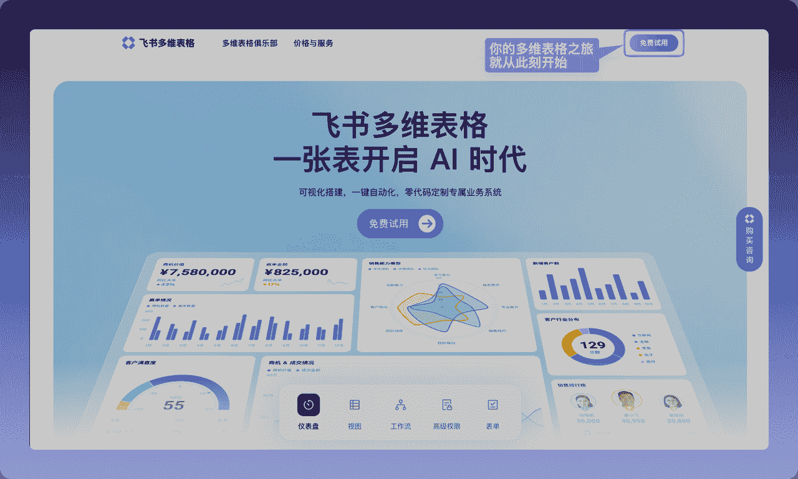

1.  用你的手机号/邮箱完成注册：

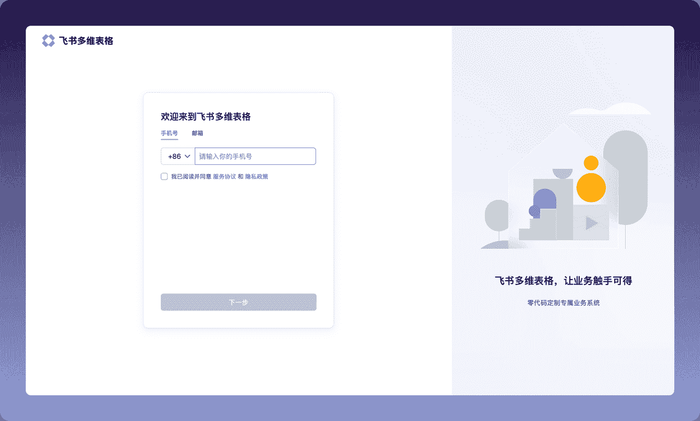

1.  点击紫框按钮新建多维表格：

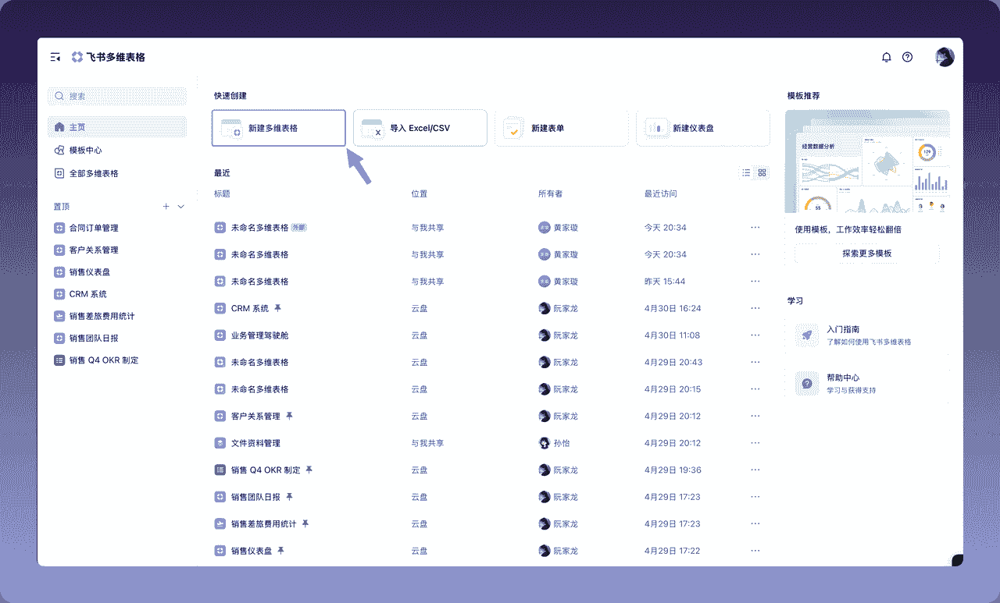

1.  或者也可以先点击白框模板中心开始体验：

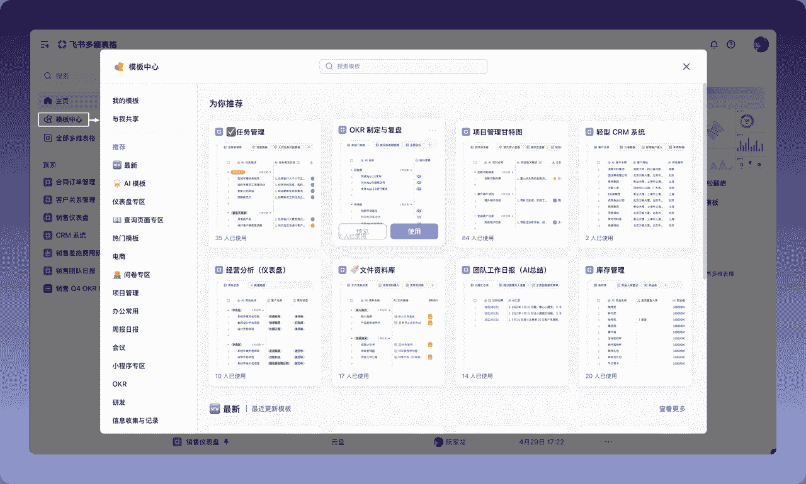

## 📚 本知识库使用指南：

1.  课程**字幕大仙均亲自校对**，记得关闭播放器字幕：

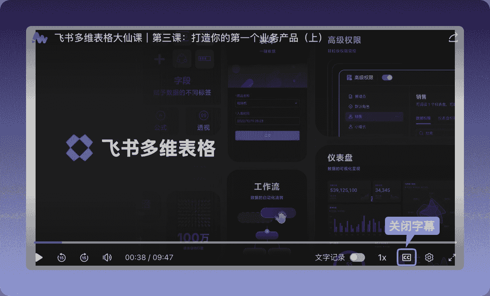

1.  课程均为**妙记**，可网页打开查看更多信息：

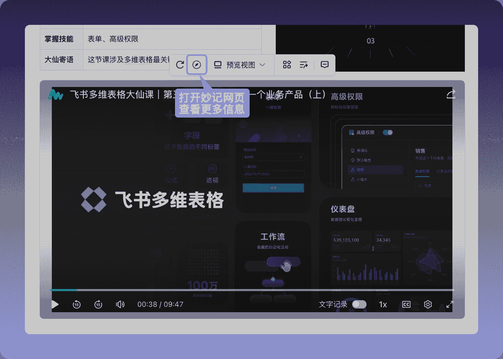

1.  这是份**知识库**，千万不要错过其他高价值文档：

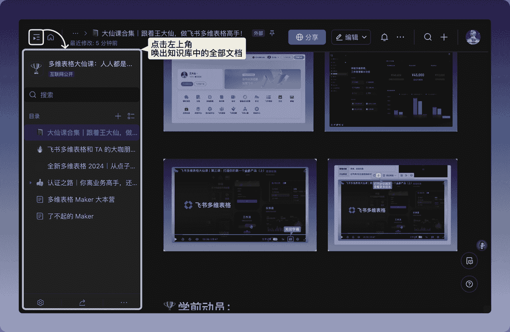

1.  如果觉得知识库不错，欢迎**分享**给你的朋友/同事们：

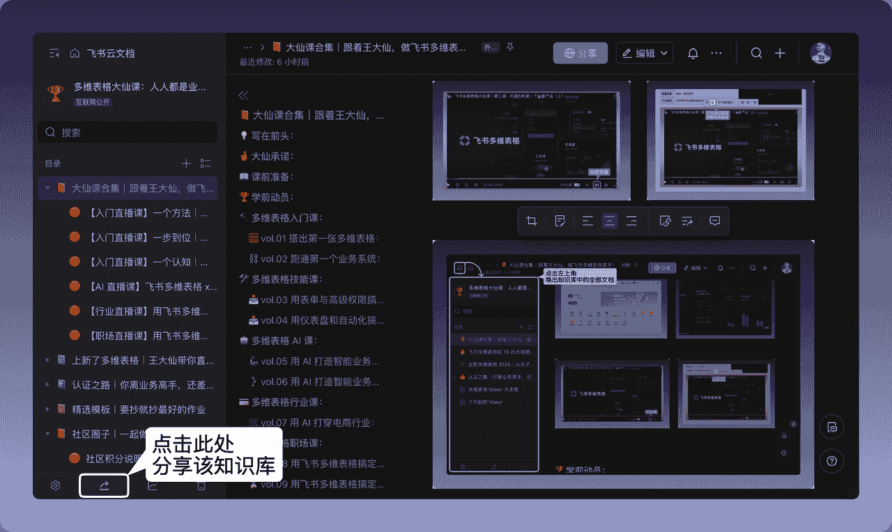

# 🏆 学前动员：

> **为什么要学习飞书多维表格？**

1.  用飞书多维表格，变现业务认知，**把业务做成产品**，让人人能通过这套产品，立刻上手业务

1.  飞书多维表格是每个人将业务、工作接入 AI 的最好跳板，是真实可落地的 AI

<https://bytedance.larkoffice.com/minutes/embed/obcn6s8m995ux224db79n3c8?from=ccm>

# ⛏️ 多维表格入门课：

> **学习目标：**

1.  搭建出第一个**有实际价值**的飞书多维表格

1.  用飞书多维表格搭建出第一个**能跑通**的业务流程、业务系统，如**敏捷项目管理系统**

## 🧮 vol.01 搭出第一张多维表格：

| **学习时长** | 18 分 50 秒 |
| --- | --- |
| **学习难度** | **入门级** |
| **所需材料** | 请先下载[年终活动复盘.xlsx](https://larkcommunity.feishu.cn/wiki/DakhwlCS9iJJFPkTJsIcJKyGn5d?from=from_copylink)，并跟随视频操作 |
| **掌握技能** | 导入 Excel、字段、视图，表单和仪表盘的基础操作 |
| 大仙寄语 | 第一课，很简单，好好学，立刻会 |

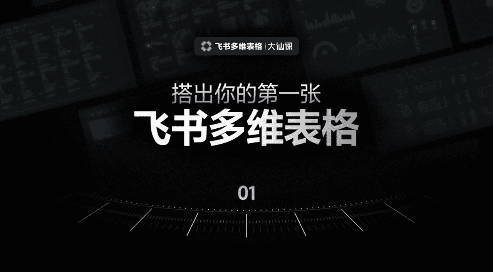

**-**** ****正式开讲 -**

<https://larkcommunity.feishu.cn/minutes/embed/obcnbh246yg26p389p7udv68?from=ccm>

> **课后作业：**

> [第 1 题：将 Excel 导入飞书多维表格，打造活动数据分析系统](https://larkcommunity.feishu.cn/wiki/ZvblwDmD2iV9TAkH0Egc0AicnS0?renamingWikiNode=false)

> [第 2 题：将 Excel 导入多维表格，并添加表单和仪表盘](https://larkcommunity.feishu.cn/wiki/AGQHw3zmziASAkkNaajc8MoMnFo)

> [第 3 题：学会用 AI 写公式，完成将判断应用在现有多维表格上](https://larkcommunity.feishu.cn/wiki/BNxCwpJjaihTSWk5z4rc0zcunPh)

> **课中短暂出现的两个模板：**[进销存系统](https://larkcommunity.feishu.cn/wiki/HPxzwu3EEiVh2jkZHoMcaMhyn1c?from=from_copylink)｜[客户关系管理](https://larkcommunity.feishu.cn/wiki/XTHIwZ90nimBY5ko2tPcuqS0nVd?from=from_copylink)

## ⛓️ vol.02 跑通第一个业务系统：

| **学习时长** | 21 分 23 秒 |
| --- | --- |
| **学习难度** | **进阶级** |
| **所需材料** | [【第一步】敏捷项目管理系统](https://larkcommunity.feishu.cn/wiki/MEawwrBhZiDAbEkTkiMcNa5lnvd?table=tbl0UGRvIjFrIjql&amp;view=vewaBQHgDM)，跟随视频操作 |
| **掌握技能** | 查找引用、关联字段，以及工作流的基础操作 |
| 大仙寄语 | 这节课涉及多维表格最关键的灵魂操作，认真学 |

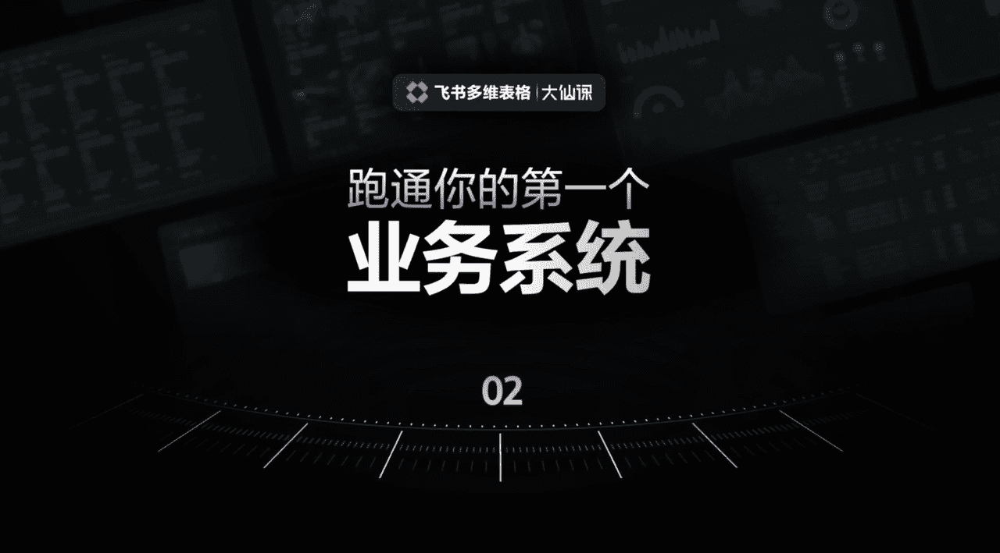

**- 正式开讲 -**

<https://larkcommunity.feishu.cn/minutes/embed/obcnbi5e73zkx2b53pd7e727?from=ccm>

> **课后作业：**

> [第 1 题：自动测算项目进度，并以进度条可视化呈现](https://larkcommunity.feishu.cn/wiki/E7wkwoAg4i3ox5kqifdcVGV4nok)

> [第 5 题：用工作流同步跟进记录中的任务状态与任务表中的任务状态](https://larkcommunity.feishu.cn/wiki/BAcdwCaEoig3LYkva9Rc9kjZngg)

> 举一反三题：[第 4 题：创建投票系统，并显示每位投票者的信息](https://larkcommunity.feishu.cn/wiki/R9s7w9oxriqAMzksunTcVNFgnlh)

# 🛠️ 多维表格技能课：

> **学习目标：**

1.  掌握**表单**和**高级权限****这两项飞书多维表**格的核心能力，搞定数据的录入与管理

1.  掌握**仪表盘**和**自动化****这两项飞书多维表格的核**心能力，搞定数据的呈现、分析与推送

1.  用飞书多维表格搭建出**实际可用的业务产品**，如**客户跟进产品**、**库存管理产品**等

## 📥 vol.03 用表单与高级权限搞定数据录入：

| **学习时长** | 9 分 47 秒 |
| --- | --- |
| **学习难度** | **入门级** |
| **所需材料** | [📦 IT 物品领用系统](https://larkcommunity.feishu.cn/wiki/QCDawxNqgiQtGtkO58ocuRzpn2D?from=from_copylink)｜[客户关系管理系统](https://larkcommunity.feishu.cn/wiki/QDIjwfk6tiZbNckk0CkcnxTZn5c?from=from_copylink)｜[⏱️ 多维表格仪表盘美化大法](https://bytedance.larkoffice.com/wiki/RsC7wGEcYiXX2rkMe20cByQPn1c) |
| **掌握技能** | 表单、高级权限 |
| 大仙寄语 | 表单搞定录入，高级权限搞定管理，产品第一步！ |

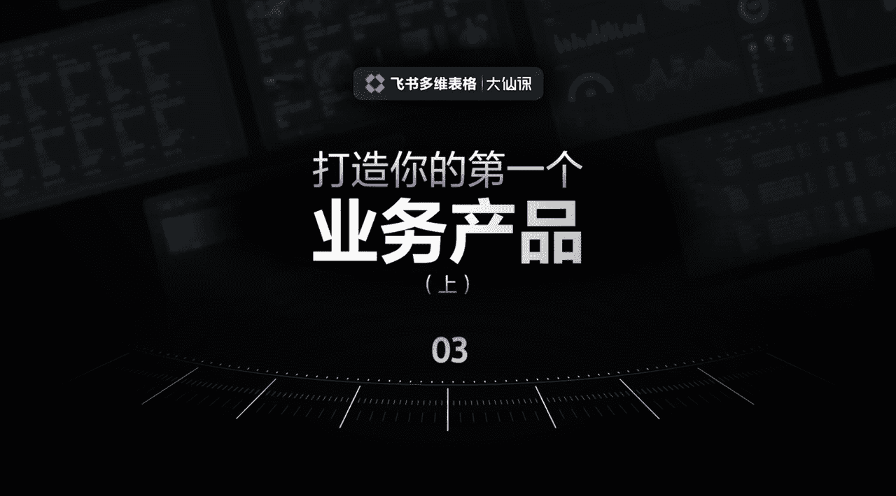

**- 正式开讲 -**

<https://larkcommunity.feishu.cn/minutes/embed/obcnb75z4w35rs4s5cet9aav?from=ccm>

**-「仪表盘」技能提高班 -**

<https://bytedance.larkoffice.com/minutes/embed/obcnc3f8421oy863jyx76169?from=ccm>

> **课后作业：**

> [第 7 题：从 0 到 1，搭建一个调研问卷](https://larkcommunity.feishu.cn/wiki/HYBnwxOkQiJBzSkM28jcUewjnrh)

> [第 8 题：在表单中呈现公式计算、查找引用结果，将表单做成索引页](https://larkcommunity.feishu.cn/wiki/TFsdw1UehiZB6lk1IokcAxdbnRh)

> [第 9 题：统计问卷填报时长](https://larkcommunity.feishu.cn/wiki/RExVwe3e5ioDeKkd0l0clrNFnGb)

> [第 10 题：利用高级权限打造千人千面的飞书多维表格](https://larkcommunity.feishu.cn/wiki/Sz5awEW82iRTP5k4jYJcAUKknIg)

## 📤 vol.04 用仪表盘和自动化搞定数据输出：

| **学习时长** | 17 分 36 秒 |
| --- | --- |
| **学习难度** | **入门级** |
| **所需材料** | [人人都是 BI 高手](https://larkcommunity.feishu.cn/base/AhnSbypNDaPQrFsTrZjcsVkknEh)｜[💰 销售管理系统](https://larkcommunity.feishu.cn/wiki/XMtew6akpiFCL4knK0UcVOQ9nPc?from=from_copylink)｜[大仙小灶｜工作流场景应用总结 &amp; 教学](https://larkcommunity.feishu.cn/wiki/Efz5wF8KPipTajkUVQCcer1fnCe) |
| **掌握技能** | 仪表盘、自动化 |
| 大仙寄语 | 仪表盘搞定呈现，自动化搞定推送，你也可以！ |

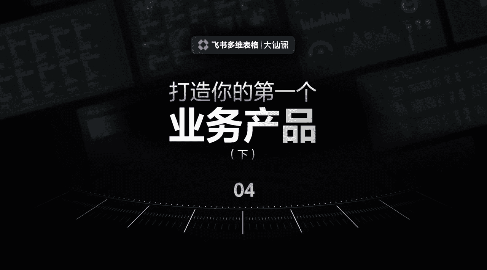

**- 正式开讲 -**

<https://larkcommunity.feishu.cn/minutes/embed/obcncc6hz28ot48814whdp2r?from=ccm>

**-「工作流」技能提高班 -**

<https://bytedance.larkoffice.com/minutes/embed/obcnzm6bq39cld866egc59fx?from=ccm>

<https://bytedance.larkoffice.com/minutes/embed/obcnzobda4gnulra2x6p6v8f?from=ccm>

> **课后作业：**

> [用合适的图表组件呈现合适的数据](https://larkcommunity.feishu.cn/wiki/TANPwZjDPipJWZkaYE3cP9RBnvf)

# 🤖 多维表格 AI 课：

> **学习目标：**

1.  掌握飞书多维表格中的 **AI 字段捷径**，并搭建出第一个** AI 工作流**，即 1.0 版本的飞书多维表格 AI 产品

1.  掌握一系列**三方 AI 字段捷径**，并搭建出 2**.0 版本的**飞**书多维表格 **A**I 产品，如客户之声产**品、智能巡检产品、爆款拆解 & 生成产品等

## 🦾 vol.05 用 AI 打造智能业务产品 1.0：

| **学习时长** | 21 分 30 秒 |
| --- | --- |
| **学习难度** | **入门级** |
| **所需材料** | [用户评价分析](https://larkcommunity.feishu.cn/base/Ys3Ab2v1wa7plmsMStjcG9MFn7b?table=tbleMm0OldFRldPK&amp;view=vewilj1TqJ)｜[小红书 AI 爆款印钞机](https://larkcommunity.feishu.cn/base/GZycbzQW2aqjWBsHei5cGa6EnPg?from=from_copylink) |
| **掌握技能** | AI 字段捷径 |
| 大仙寄语 | 尝试用藏在列里的 AI，加速你的 AI 产品之路吧！ |

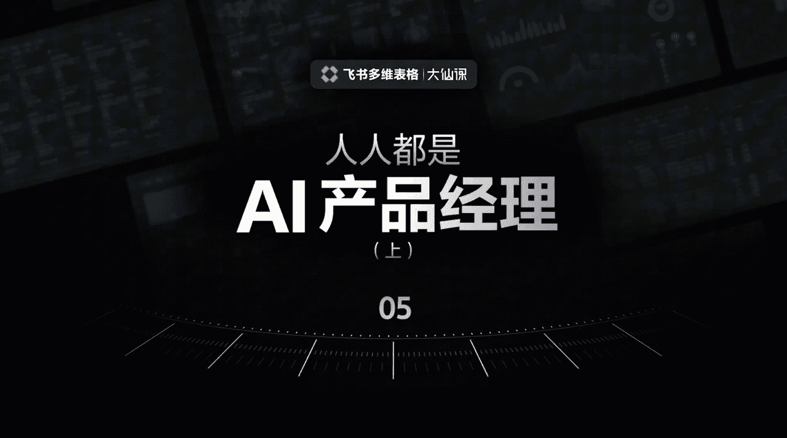

**- 正式开讲 -**

<https://larkcommunity.feishu.cn/minutes/embed/obcnb72583m57982uxitb47o?from=ccm>

> **课后作业：**

> [第 12 集：利用 AI 字段捷径实现 100 条客户之声的批量处理](https://larkcommunity.feishu.cn/wiki/ZKWVwsxWkiRQAtkx5qdc2499n9g)

> [飞书多维表格 + AI 实现小红书爆款内容创作](https://larkcommunity.feishu.cn/wiki/Dv5jwwrGhiR1FYk7Fddcj08intb)

## 🦿 vol.06 用 AI 打造智能业务产品 2.0：

| **学习时长** | 23 分 07 秒 |
| --- | --- |
| **学习难度** | **进阶级** |
| **所需材料** | [客户之声分析系统](https://larkcommunity.feishu.cn/base/WbbebbCikaFLlesciwfcfemynDf?table=tbluKthtbj5l4jmJ&amp;view=vew9umcMAC)｜[AI 智能巡检系统](https://larkcommunity.feishu.cn/wiki/TSlEwPkpWiqE7hkZUONcDmT8nId?table=tbla1ATfeLsOWpkS&amp;view=vew3EPX2Gh)｜[爆款视频印钞机](https://larkcommunity.feishu.cn/wiki/PcJywqzBYiUA1KkEypjcEMpQn1g?table=tbloJVFt92fqI0BH&amp;view=vew09cf19R) |
| **掌握技能** | AI 字段捷径、关联字段、查找引用字段、工作流 |
| 大仙寄语 | 最后一课，集大成者，尝试用 AI 盘活整表数据吧！ |

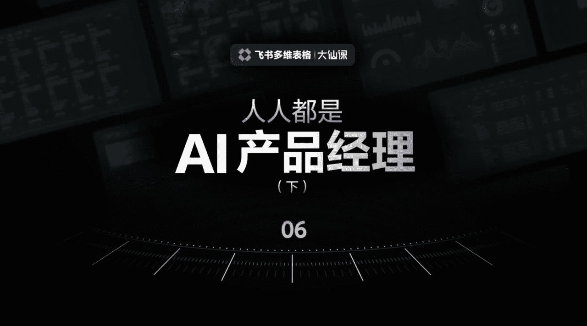

**- 正式开讲 -**

<https://larkcommunity.feishu.cn/minutes/embed/obcnb75wj15vjcl1o198jw83?from=ccm>

> **课后作业：**

> 大仙在出了！

# 🔮 多维表格模板精选：

**精品业务模板：**

+   [【模板】汉得｜瀑布式项目管理工作台](https://bytedance.larkoffice.com/wiki/SqPbwjT7PiDQb1kwmPtceP2vnlg?renamingWikiNode=true&table=blk5TcIHSuwrf0fK)

+   [【精品模板】电商行业一张表管公司（完整接入 DeepSeek）](https://larkcommunity.feishu.cn/base/O4SKbxN1Fa71CLsIHTucatOCn3e?from=from_copylink)

+   [【模板】餐饮行业一张表管公司 ](https://larkcommunity.feishu.cn/base/XyZNbCL1OaMOBAsRNBYcsiQbnH7?from=from_copylink)

+   [【模板】SaaS 行业一张表管公司](https://larkcommunity.feishu.cn/base/YgG5bIifuaxDjHsvcc3ciYlwnzc?table=blkmc7Vt10HiovEO)

+   [【模板】客户关系管理系统](https://larkcommunity.feishu.cn/base/JhJeb1hTba1128sE2xQc0gXNnTe?from=from_copylink)

+   [【模板】人才管理系统](https://larkcommunity.feishu.cn/wiki/IPswwxMrEi1MMAkkLkqchEkonYc?table=blkebceHJMeiwbYS)

+   [【模板】产品方案 & 设计方案评审汇总 ](https://larkcommunity.feishu.cn/wiki/ZkmcwCSXXiEyzfkObBocUGJonKb?from=from_copylink)

+   [【模板】决策层数据分析看板](https://larkcommunity.feishu.cn/wiki/BrPuwQsPwiVzvKkVCXYcLFdQnwf?table=blkNx56zzoH5KKBA)

+   [【模板】数字化智能工厂看板](https://larkcommunity.feishu.cn/base/YoKhbTe0WarSl3s2XcMcWonon2d?table=blkf2N5np7jscRw0)

+   [【模板】经销商管理](https://larkcommunity.feishu.cn/base/DVfLbzNkpaoWxjscmqScToHnn8f?table=blkqLR5f6wFrZZGn)

+   [【模板】敏捷项目管理甘特图](https://larkcommunity.feishu.cn/wiki/NpR6wqpcSiMJNTkHmk3cym0Hnsc?table=tblSeB1B9osj7D1q&view=vew9mCGWw3)

+   [【模板】新店开业管理系统](https://larkcommunity.feishu.cn/wiki/QFWuwQi5hiUppkkxC8gc2IJTn0f?table=tbl28EzAYQgnjN4v&view=vewSJRLhjU)

+   [【模板】巡检管理](https://larkcommunity.feishu.cn/base/IOrubqYTKaS2fcs1PKCcsx1anBf?table=blkWxoDgzLWDjZjX)

+   [2024 个人成长复盘](https://digitalsolution.feishu.cn/base/J93ObhudNa9DjvsIuUEcHUTknd9?table=tbljIQNXQE5kMAIi&view=vewBuvJdJe)

**仪表盘相关模板：**

+   [人人都是 BI 高手](https://larkcommunity.feishu.cn/base/AhnSbypNDaPQrFsTrZjcsVkknEh?from=from_copylink)

+   [订单&库存管理系统](https://bytedance.larkoffice.com/base/ECOsbLH1Ia8qA0s4zdcc6FBQn7c?from=from_copylink)（多数据源分析）

+   [项目管理](https://bytedance.larkoffice.com/base/KvrabalbiaIbwhsatxoca91fnzc?table=blkKzNift1hsOnzA)

+   [销售管理](https://bytedance.larkoffice.com/base/Xe8TbP6ARaud9asRWv4cAmNVnYu?table=blkwN9BmoC6aixWR)

+   [库存管理](https://bytedance.larkoffice.com/base/BMBubU0IwawgkNsoDlKc3CZYnDg?table=blkN8RpWxCQrfIg1)

+   [经营分析（仪表盘）](https://bytedance.larkoffice.com/base/GKGFb5CvVaSuGIsN4REcWXffnEh?table=blkeH8RZ75IJKQSa)

+   [电商订单看板 ](https://bytedance.larkoffice.com/base/BREvboF74aWCsisRxE3cPe94nwd?table=blkLEPVD43PiSlF8)

**工作流相关模板：**

+   [客户咨询管理](https://bytedance.larkoffice.com/wiki/P13DwreniinLfRkKyfIcGnOCnAh?table=tblOWM1DPiPGnAIY&view=vew4SUMdA1)

+   [外部访客管理](https://bytedance.larkoffice.com/wiki/Lzj6wrrY9iXOyfkjM1Rc8BlRnle?table=tbl1EDI02QiMoMcl&view=vew4SUMdA1)

+   [销售喜报通知](https://bytedance.larkoffice.com/wiki/JDjtw3v2GiObLgkXZzxcht8vnRe?table=tblT7XWmklRFY0H4&view=vew4SUMdA1)

+   [员工离职交接](https://bytedance.larkoffice.com/wiki/M2GfwPVPpiuvUpkpLfEchoP5n2d?table=tblifmkUTAwXzHE1&view=vewvSgXzRg)

+   [物品领用申请模板](https://bytedance.larkoffice.com/wiki/NMhowk44IiaADlky9wJcCggLnUd?table=tblURSbsQC6482Xy&view=vewBTxe9mt)

+   [【循环模版】任务管理——给特定用户批量发送带用户特征的消息](https://bytedance.larkoffice.com/wiki/TobgwF7gyietTLkadLscYVstnKv?table=tblR4z2YZyg1wuOE&view=vewXxBNTOK)

+   [【循环模板】巡检分配--判断任务中的每一个人是否存在休假记录](https://bytedance.larkoffice.com/wiki/J75kwFKL9iLVu7kqRw6cjIH3nge?table=tblK7pE1IbV2uEtf&view=vewrKtHTzL)

+   [【循环模版】门店任务派发](https://bytedance.larkoffice.com/wiki/CFSQwltbAiCJNCkjVoJckJWPnVh?table=tblnSgxMJafuh3v0&view=vew0werUf6)

+   [【循环模板】发送定制化生日祝福](https://bytedance.larkoffice.com/wiki/MEukwBnfui1goWkwin5cDzvdnqf?table=tblTwy26n4y52m0z&view=vew12fOio3)

+   [【Q&A 模板】新增数据时的常见问题](https://bytedance.larkoffice.com/wiki/JxXQwLBqfiPGfWk2EPIc8OCXnle?table=tblFfh9ubPcKm1vK&view=vew0werUf6)

# ➕ 关注王大仙，获取最新资讯：

[王大仙的来时路.mp4](https://internal-api-drive-stream.feishu.cn/space/api/box/stream/download/all/XleNboejlo3Bs3xvoi2cpqi0nAh)

2024 年 4 月 18 日录制的第一节课

# 🔍 快速查找你需要的内容

[🎓 官](https://larkcommunity.feishu.cn/wiki/HsPKw9kKdiM5oik9IghcBFlynqc?from=from_copylink)[**方全套课程**](https://larkcommunity.feishu.cn/wiki/HsPKw9kKdiM5oik9IghcBFlynqc?from=from_copylink)

> 从 0 到 1 的系统化教学，由大仙带你夯实基础，快速上手多维表格核心功能。

[**🎁 多维表格精选模板**](https://larkcommunity.feishu.cn/wiki/F189w9UJYiSMKCk6qmJc9ibRnGc?from=from_copylink)

> 获取各场景各功能的最新最强的多维表格模板，帮你快速解决业务问题！

[**🎖️ 上新了飞书多维表格**](https://larkcommunity.feishu.cn/wiki/NWuQwFPDmieaBRkigAzcyXz8nrE?from=from_copylink)

> 学习飞书多维表格中最新上线的高价值新能力，让大家第一时间学会、用上。

🏆 金牌 Maker 实战分享

> 汇聚金牌 Maker 的真实业务案例与独家解决方案。拒绝纸上谈兵，看高手如何解决真问题！

[💬 常](https://larkcommunity.feishu.cn/wiki/L31Ew18rBiInpNkR5O7c5t6enSd?from=from_copylink)[**见产品 FAQ**](https://larkcommunity.feishu.cn/wiki/L31Ew18rBiInpNkR5O7c5t6enSd?from=from_copylink)

> 整理了大部分用户都会遇到的高频问题，遇到问题先查这里，帮你节省大量时间！

[**🙆‍♂️ 加入多维表格大本营**](https://go.larkoffice.com/join-chat/00fn1bc7-0223-4245-a091-13b942c3e676)

> 和各位优秀的 Maker 一共交流，一人行快，众人行远，和大家一同探索多维表格的魅力！

[**🎯 飞书多维表格技能中心**](https://larkcommunity.feishu.cn/wiki/CrtiwTtuZiJ5qwkqpa1cMRL0n4e)

> 不管是新手入门，还是针对性提升某特定功能的熟练度，都能在这里精准找到所需内容！