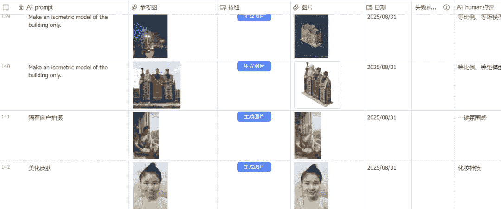
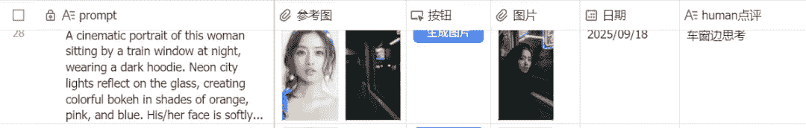
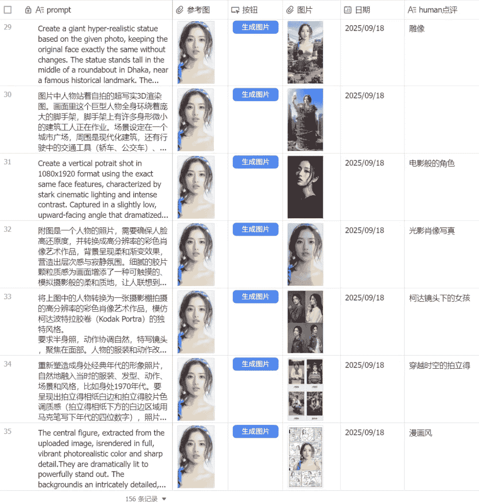
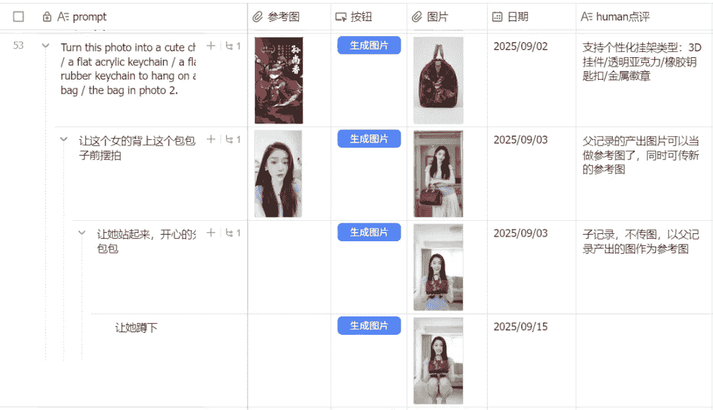
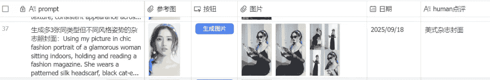
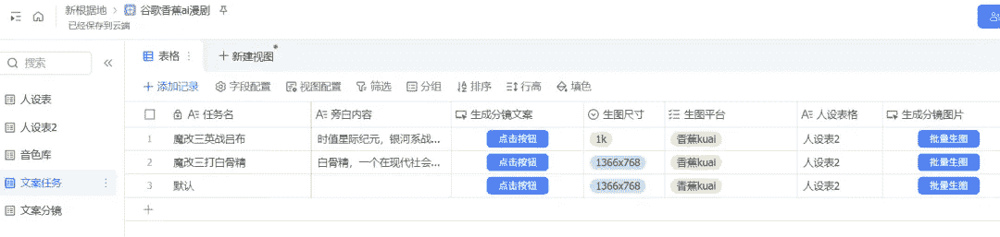
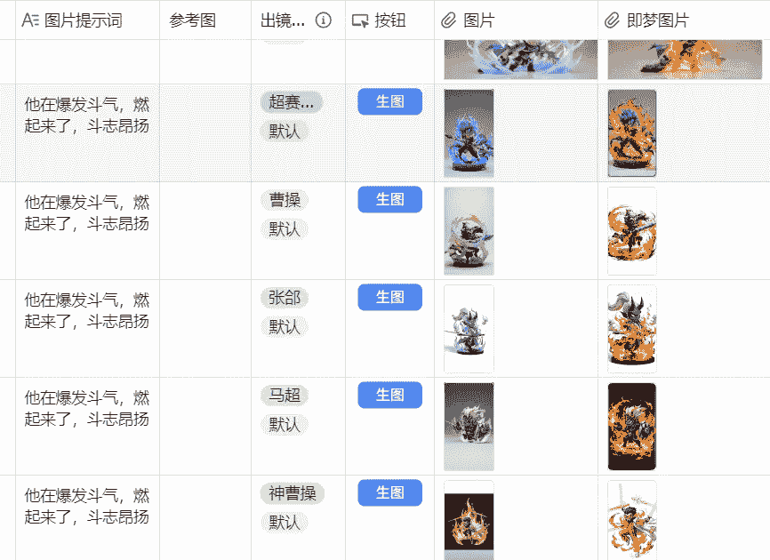
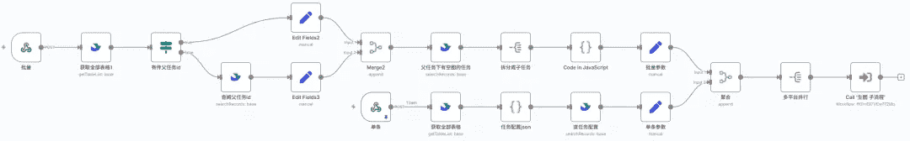
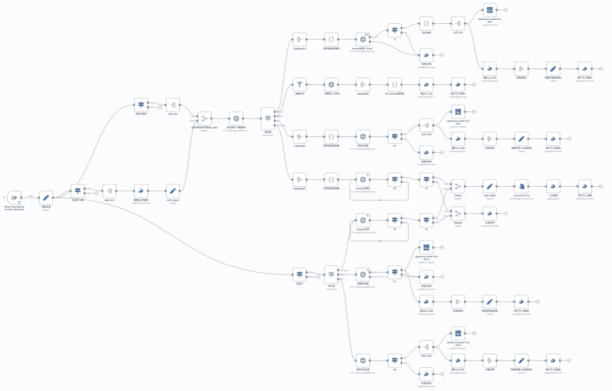
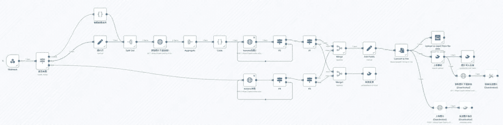

# 我把nano banana接入了飞书多维表格，一键批量出图100张。

> 来源：[https://yunyinghui.feishu.cn/docx/MCHId9uXvoYTYXxYzaCcK8A5nke](https://yunyinghui.feishu.cn/docx/MCHId9uXvoYTYXxYzaCcK8A5nke)

我把nano banana接入了飞书多维表格！

是的，就是最火的3d手办图的开创模型，google最新的生图模型，屠榜的aigc画图模型，国内网络无法正常访问，需要借助各种中转平台才能访问的nano banana。

其他各大博主都已经分享过各种邪修玩法，我就不赘述了，主要说说我自己原创的内容。

不止是在飞书多维表格里能一键生成，还能批量生成。

单条生成的工作流，大概在8.31号就做好了。

等到现在才发，是一直在完善更多功能。

另一方面，之前搞得号全来做👸号ai爆文了，就没有👸号可以用了。

现在想搞个人IP，垂直号，就跳了其中一个号拿出来用。这个表格，且听我一一道来。

**1.提示词存储。**

目前多维表格在实现一键生图的过程中，顺带实现了存储所有的提示词。

既保留了所有的生成记录，也保留了所有的提示词样板。

我陆续收集了全网👸号和x上各大ai博主分享的提示词，接近140种邪修玩法，不敢说最全，只能说挺全的。

**2.支持多图参考**

参考图可以放多张，数量并没有设置上限。

模型本身的上限，或者说接口的上限，就是这里参考图的上限。

只要在参考图一列放入需要的全部参考图即可。

得益于飞书多维表格的强大，你可以快速在多行表格中进行拖拉拽，将一张图快速复制到其他提示词上。

一个人像想要批量同时出几种风格的写真？那就看你的提示词库有多少了。

**3.子记录改图**

差不多9月初实现的功能。

子记录可以直接拿父记录的结果图片作为新的参考图，继续输入提示词，进行二次改图生图。

继续生成子记录，可以继续改图，和官网接近一样的改图体验。

对话式改图。嘿嘿，应该是全网独家。我自认为这个体验还是挺不错的。

因为经历过几次复制粘贴改图的麻烦，所以也是借用飞书多维表格的能力，实现了这个改图的功能。

**4.接受多图产出**

这个功能是不稳定的，倒不是我实现的不稳定，是接口的不稳定。遗憾，因为不是官方接口，用的是中转接口。

大部分时候，你让他生成多张图片，中转平台只能返回一张，少数情况会返回多张。接口也兼容了。聊胜于无吧。

为什么不用官方。

官方太贵了，3毛一张。但中转1毛以下一张的都有，因为暂时自己用着玩，所以就挑便宜的用了。

**其他功能：**

+   一键批量出图。

+   nano banan+即梦 多平台pk 同时出图。

+   用人设库，选名字就能出图（给短剧用的）

这两功能都实现了。留个悬念，下期讲。

怎么实现的呢？

一是得益于飞书多维表格的强大。

我写这篇👸号文章的时候，已经有公司把多维表格捷径直接打通nano banana了。其实一早就知道捷径能搞，而且实现可能会更优雅一些，更好推广一些。

但我并不会自己搞捷径。

但是我会n8n啊。

通过飞书多维表格作为前端。作为玩家操作，配置的界面。

n8n作为后端。来处理所有的生图请求。我实现了上面提到的全部功能。

这是截止今天9.21我n8n的生图工作流。

他实现了：

从单条到批量并发

从单平台到多平台并发 （香蕉，即梦，不同的中转平台）

对参考图，参考人物等各种判断。

子工作流分离。（拆分后才实现了并发）

8.31的时候，接的是openrouter的接口，那时还是免费，没用几天就没用免费额度了，然后换成了其他中转接口。下面是这个工作流最原始的版本：

现在这个工作流做出来，结合我自己的观察，它适配很多领域：

+   👸号漫画图文批量

+   📕笔记批量

+   ai动态漫，漫画短剧

+   电商批量出图

+   各种批量出图改图的领域

忘了说了，我还把最近爆火的声音克隆模型indextts2也接入了飞书多维表格。留个悬念，以后再说。很高兴你看到了这里。新人ai博主，第一次分享。以上，除了收集到的生图提示词库不是原创，其他均为原创。

同名👸号：AI鹏少