# Gemini Cli + Obsidian 才是知识管理的神！！（附教程）

> 来源：[https://yunyinghui.feishu.cn/docx/C6FXdjhqnofPilxpF8zcjcOJn2b](https://yunyinghui.feishu.cn/docx/C6FXdjhqnofPilxpF8zcjcOJn2b)

> **作者：**苍何  **公众号：**苍何

> **推荐理由：**这篇文章详细介绍了作者如何将 Gemini Cli（谷歌的 AI 终端工具）与 Obsidian（本地化双链笔记软件）结合，构建高效的知识管理与内容创作工作流。

大家好，我是消失了几天的苍何。

前段时间真是忙成🐶，搬家、活动、出差。。。

这几天花时间重新梳理了自己的知识管理和内容创作工作流，是时候拿出来给大家分享一波了。

有数据分析系统：

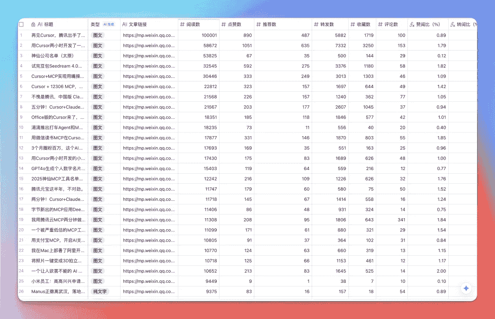

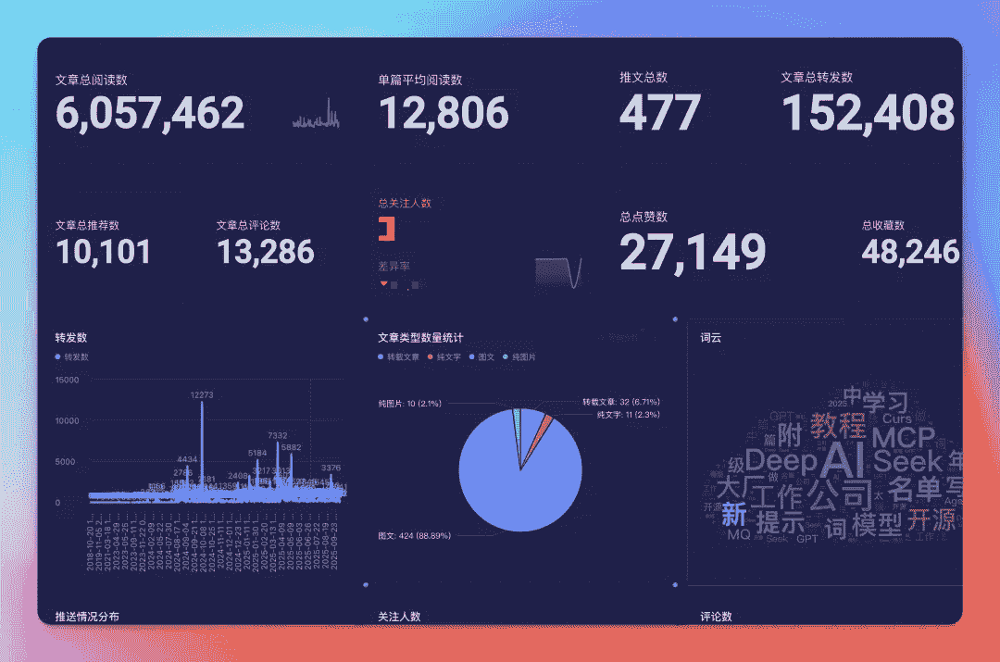

有内容辅助创作工作流：

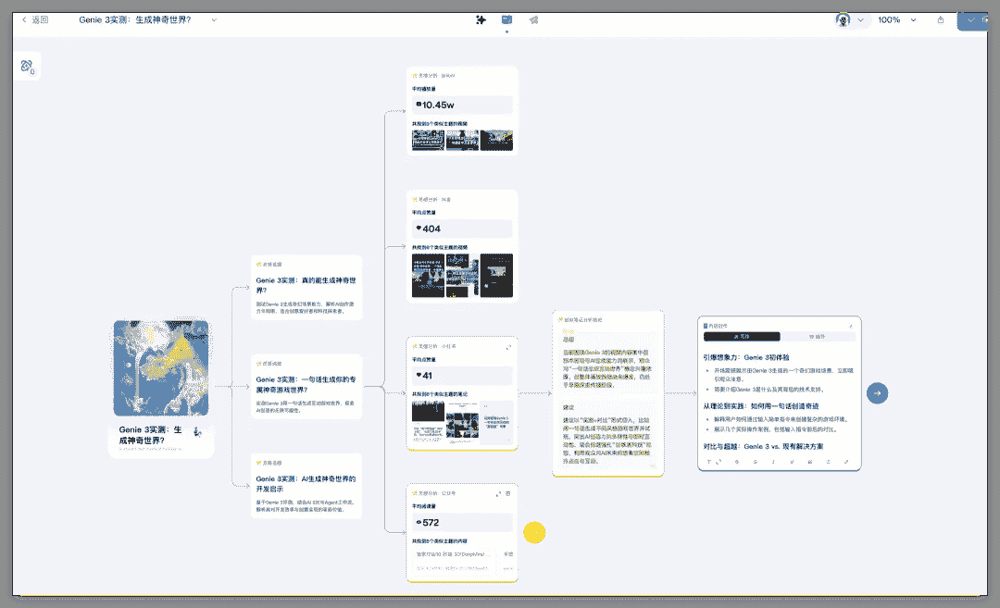

有多平台同步工作流：

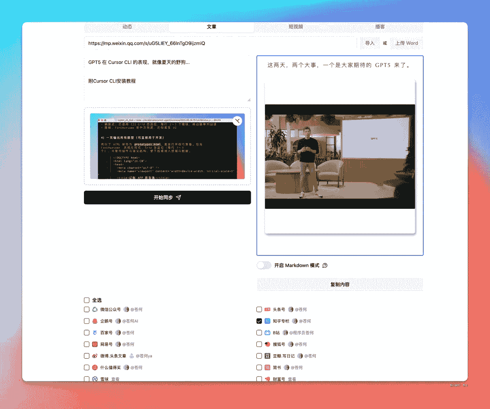

其实还有很多的整理，但一篇文章不可能说的完，也欢迎持续关注苍何的分享。

今天这篇文章主要分享我在 Obsidian 中结合 Gemini Cli 做知识管理和辅助内容创作的心得。

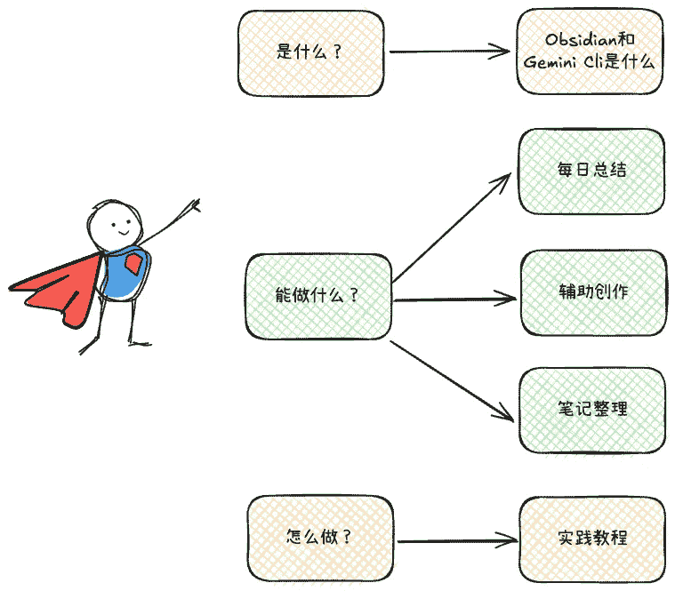

> 如果喜欢这篇文章，请毫不留情的点赞转发给需要的盆友。

# 是什么？

Obsidian 是一款本地化的双链笔记软件，所有文件存储都以 markdown 格式（AI 最喜欢了），且都存在本地，可以说是当下最安全的知识管理工具了。

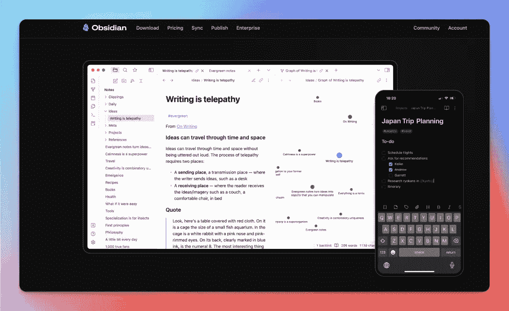

我的所有笔记、公众号文章以及每日总结，统统都放在了 Obsidian。

**经过长时间的使用，我摸出了一套**超高效的 AI 工作流，它能帮我们 自动排版、辅助创作、一键发布 。

而 Gemini Cli 是谷歌的 AI 终端工具，它像 Claude Code，但又不是。其底层模型 Gemini 2.5 pro 拥有强大的上下文能力和优秀的写作能力。

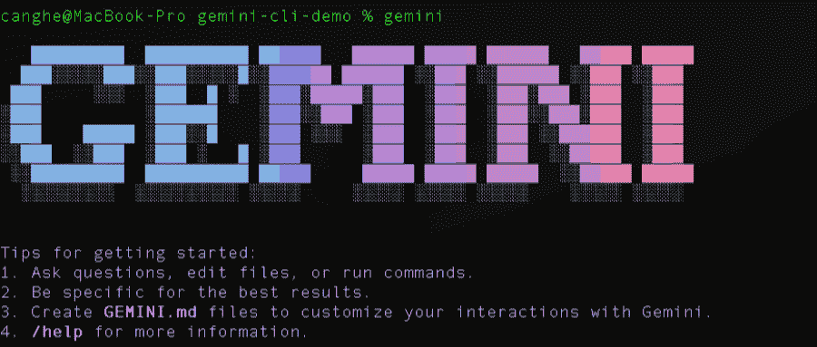

Gemini Cli 能直接在 Obsidian 中使用，借助其强大的 Agent 能力，能完成非常多的工作。

**所以 Gemini Cli + Obsidian，**天然为 AI 时代下的个人知识管理而生。

# 辅助创作

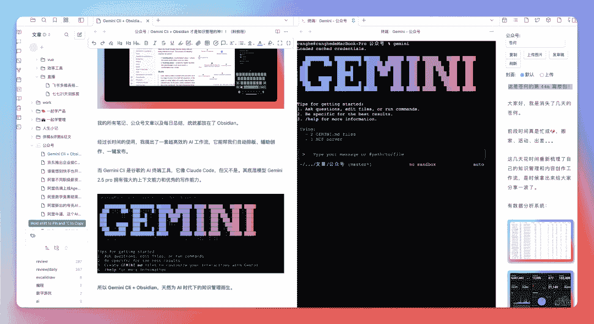

这张截图就是在 obsidian 中完成辅助创作的工作流。

> 具体教程在文末，这里先来个思路的整理。

内容创作其实是有逻辑的，从灵感、选题、到标题，再到开头、Case、最后结尾，这些流程中，AI 能辅助大大提效。

我会让 Gemini Cli 读取我 Obsidian 中的历史文章，学习我的风格，给一些灵感选题，创意 Case。

然后再借助 MCP，把一些满意的 case 自动同步到飞书多维表格中，做 case 合集，方便日后有一些相似选题的参考。

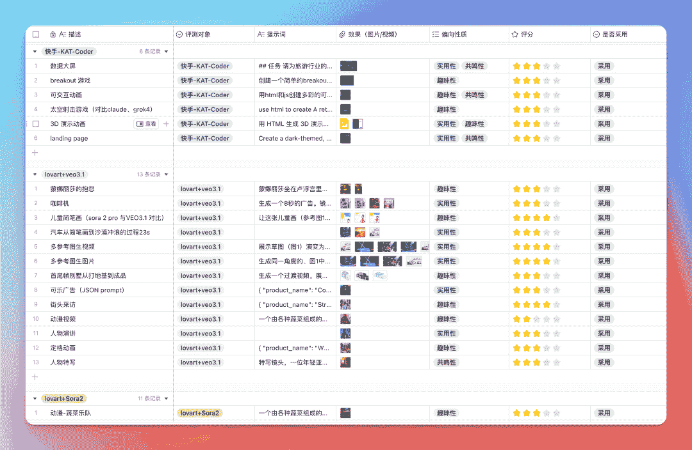

在起标题时，它能学习我的爆款标题，给我一些标题的灵感。

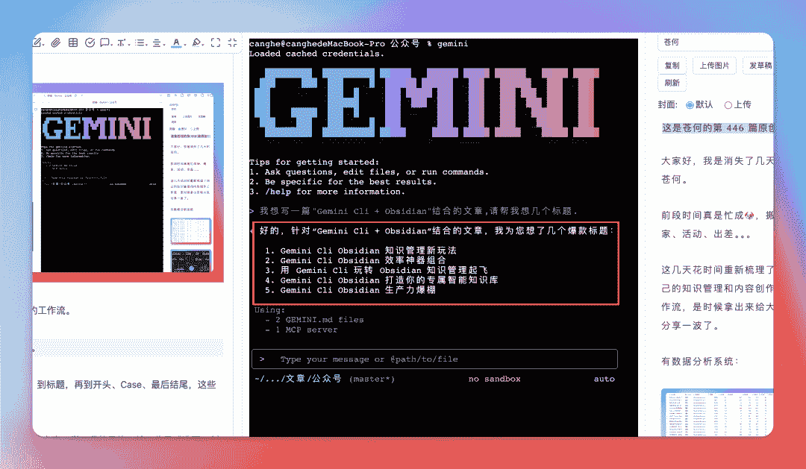

在正文需要引用一些我曾看过的书、做过的笔记时，看过的金句，我只需要让 Gemini Cli 自动帮我检索查找，并帮我自动写入到文章中。比如：

> 提示词：帮我找下我的笔记中王小波关于生命的理解的句子， 并帮我写入到该文章中

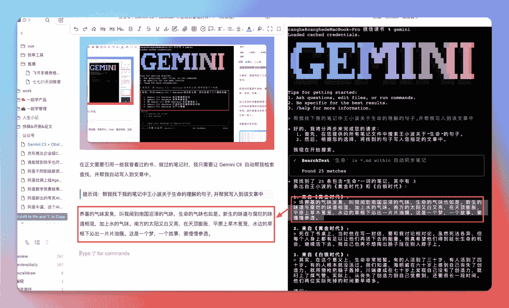

这里的素材来源是我在微信读书中划线的内容，配置了插件，自动同步到了 Obsidian，所以 gemini 能快速的帮我检索到具体摘要。

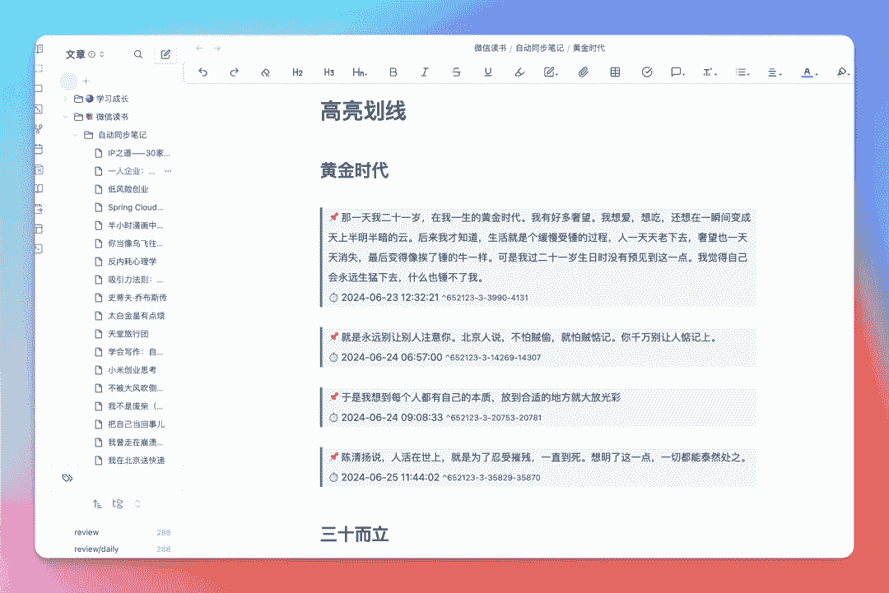

Agent 帮我做了这些用传统 ob 搜索无法解决的问题，关于生命的思考和理解，这种非确定性的搜索，就该交给大模型。

所以，你看，我们看的每一本书，做的每个笔记，在这一刻，都融合了。

写作本身是基于素材和经验，结合思考而成的，用这套工作流，充分验了那句经典：

**每一步都作数，每一步都有用。**

最强的还不止于此，配上即梦或者 minimax MCP，还能辅助配图，

> 提示词：帮我调用 minimax-mcp 给我的文字配个图：“每一步都作数，每一步都有用”。


然后这个文章配图就很神奇的嵌入到了我的文章中。

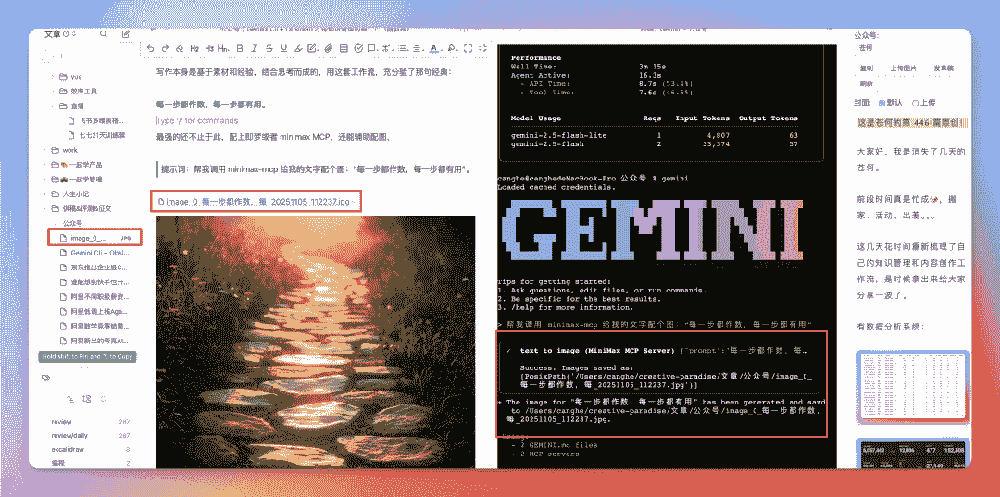

等文章写完后，在右侧会有对应公众号预览，直接就可以一键发布，整个效率拉满。

这是当下我用 Gemini Cli + Obsidian 辅助创作的思路，你会发现 AI 在整个过程中起了非常多的作用。

但我并不建议，你上来就让 AI 直接写一篇文章，它大概率写出的是没什么价值的垃圾。

比较好的方式是， **和** AI 结对创作，AI 为你提供辅助，包括灵感、素材、标题、案例，你提供思路和思考，配合上自己一贯以来的文风，让 AI 更懂你。

# 每日总结

我有个臭毛病，每天总会总结自己一天做了啥，原来我是通过模板配置来进行的每日总结和回顾。

这个模板是长这样的：

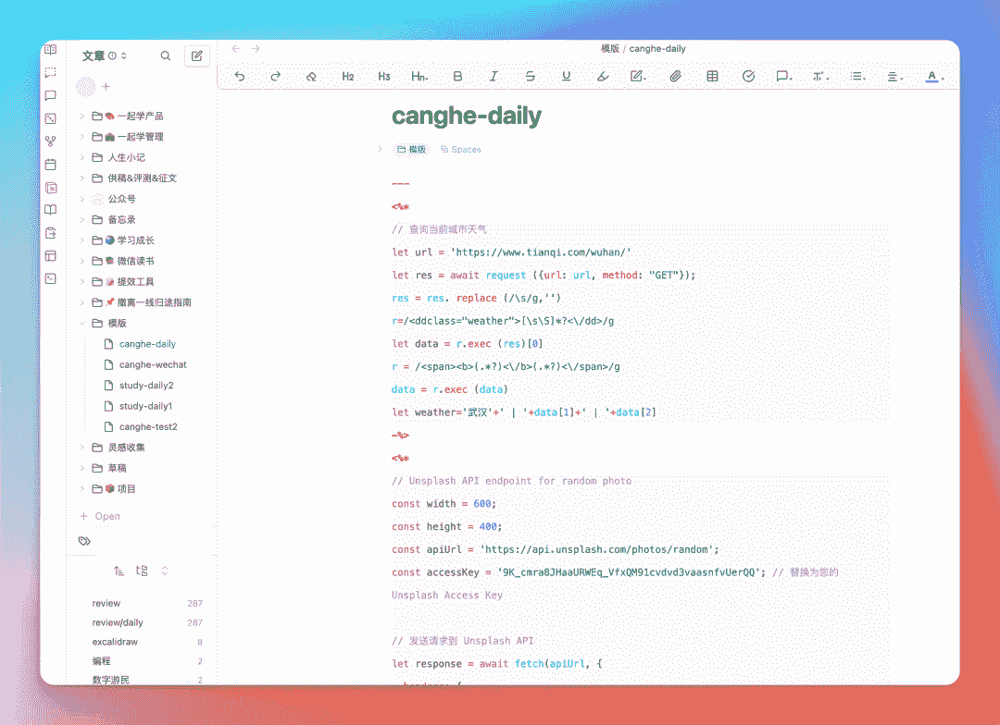

可以说，非常繁琐，现在有了 Gemini Cli，我可以让它自动帮我总结整理今日所思，所做，所学，然后基于配置模板帮我生成每日总结。

```
# 任务  
在&quot;人生小记&quot;文件夹中创建今天（2025-11-05）的日报  
  
# 步骤  
1.找到今天创建或编辑的所有文档；  
2.阅读所有的内容；  
3.按照&quot;模板/canghe-daily&quot;模板中的维度，分析我今天做了什么，学到了什么知识？  
4.基于我的活动记录，给我提供一些基于这些内容的思考  
  
# 要求  
 -写入文档时，注意中文(utf-8)兼容问题
 -不要过多发挥，请基于文档内容
```

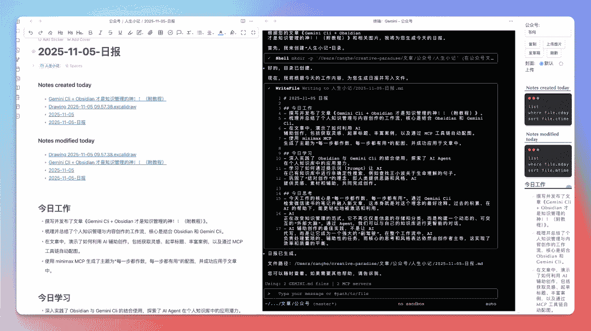

这个操作目前需要手动触发，后期我也在考虑结合 n8n 工作流做再一次改造。

又再一次将输入-整理 -输出，进行了高效的表达。

# 笔记整理

现在我的 Obsidian 仓库有些乱，那其实也可以直接让 Gemini 来做整理。

不过这个功能，要慎用，有时候会发生莫名其妙的瞎搞，哈哈哈。

也很简单，只需要把需求给到 Gemini，多加约束，能产生意想不到的效果。

# 实践教程

整个工作流搭建并不复杂，首先需要下载 obsidian。

```
地址：https://obsidian.md/
```

这是个开源免费的软件，下载就可以直接用了。

其他的配置可以先不管。先建一个仓库，然后在 obsidian 中打开插件市场，找到 Terminal 插件，安装。

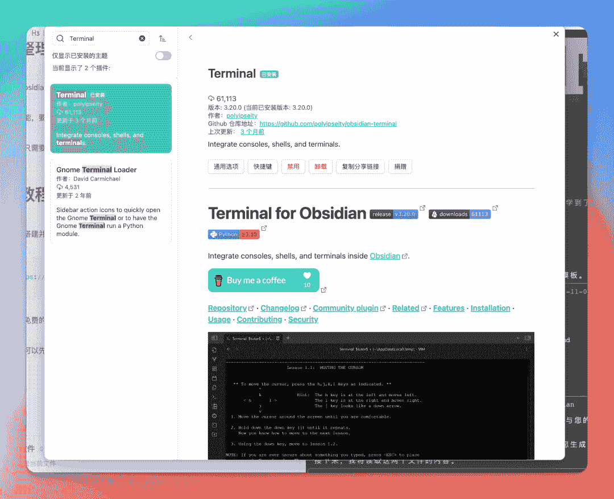

这是为了将 Gemini Cli 直接集成进 Obsidian。

安装完插件后需要点开一下配置，这里很重要，不然本地电脑的环境变量是没法带出来的。

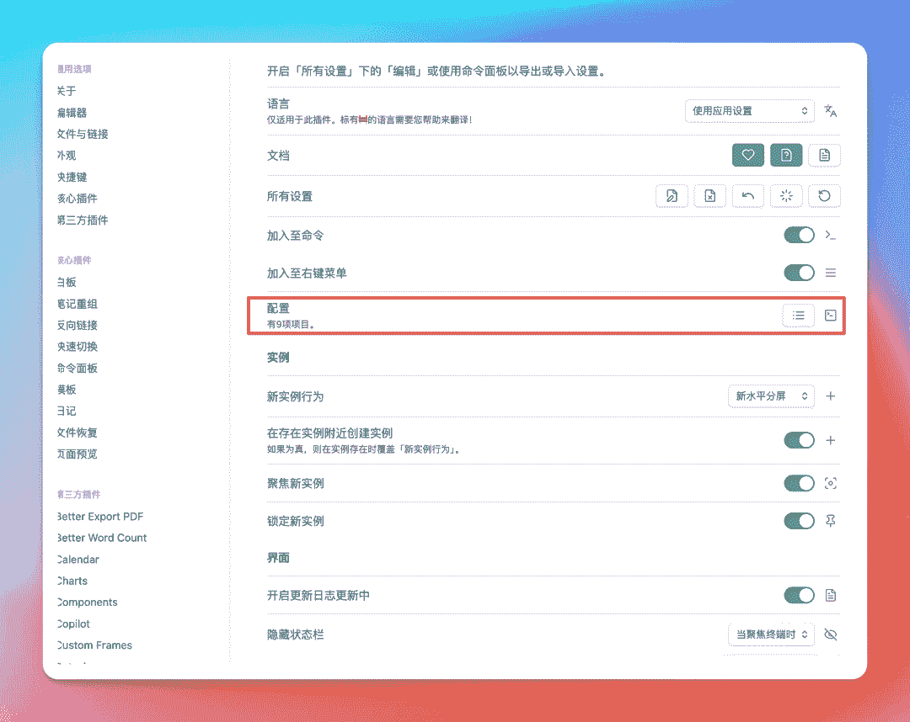

在配置中选择想要的终端，比如我习惯的 macos。

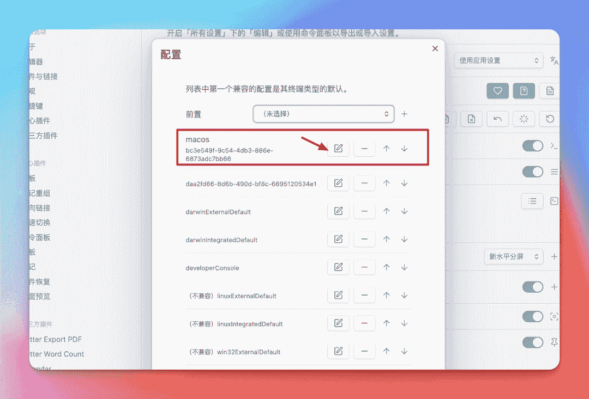

然后添加一个参数。

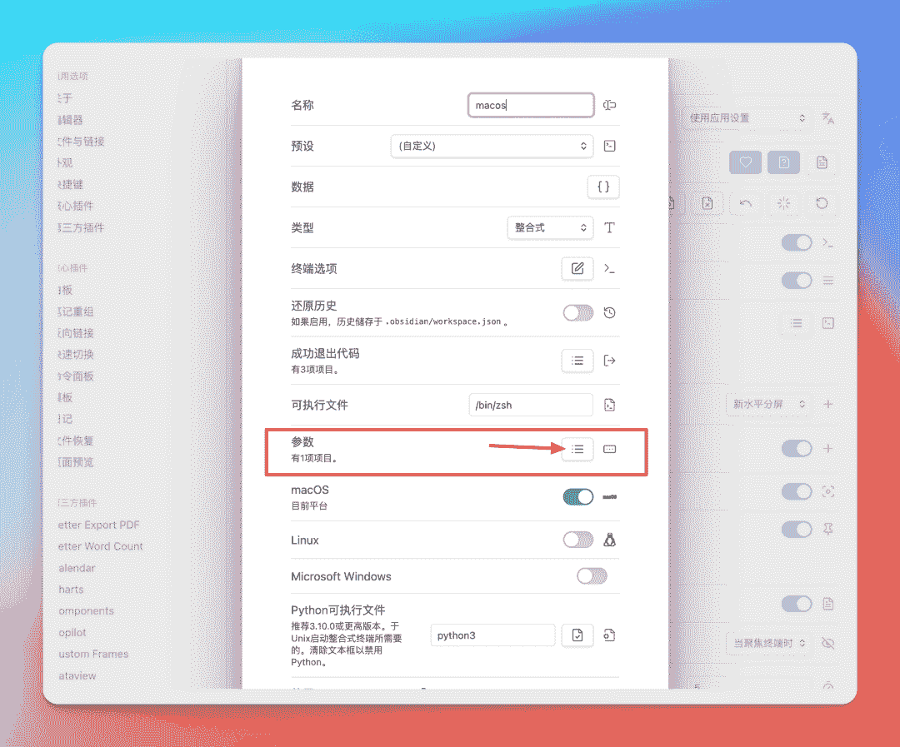

添加：-l

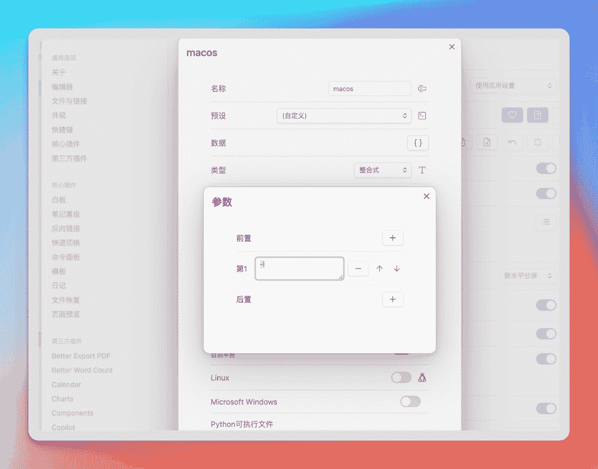

> 注意这里的 l 是 L。

输入快捷键 cmd+p 调出命令面板，输入：终端，选择整合式。

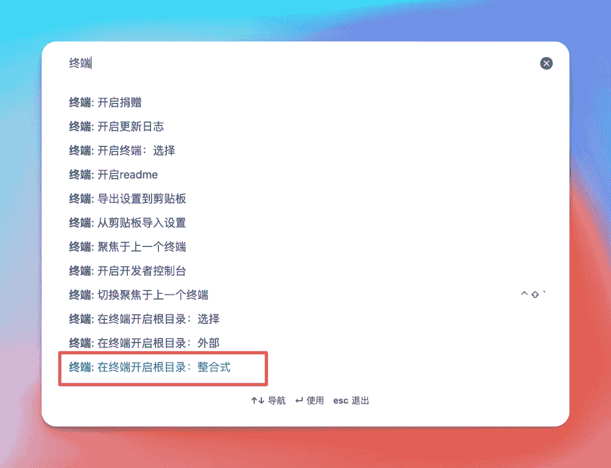

就可以在右边看到终端了。

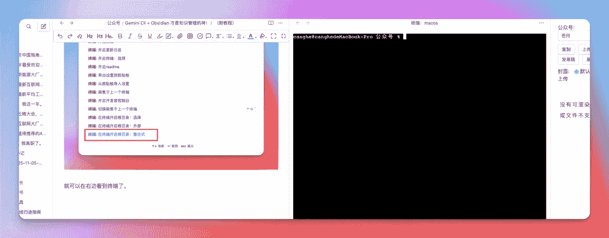

接下来是安装下 Gemini Cli，复制如下命令到终端。

```
npx https://github.com/google-gemini/gemini-cli 
或者： 
npm install -g @google/gemini-cli 
```

这里需要开启代理，如果是用的 clash，建议开启 TUN 模式。

一个屁功夫就会下载好，然后登录下谷歌账号，就可以痛快使用了。

终端中输入：gemini

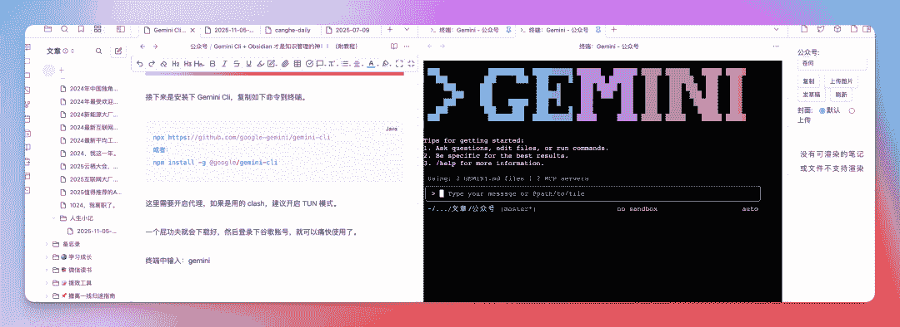

# 写在最后

好了，今天的分享就到这里。

讲真的，工具只是手段，真正重要的是我们如何利用它们来沉淀思考、激发创意。Obsidian + Gemini Cli 的组合，就像是为我们的大脑装上了一个智能的副驾驶，它不会替代我们思考，但却能在我们需要的每一个瞬间，提供最恰当的助力。

看着自己的一篇篇文章、一个个笔记，在 AI 的帮助下串联、生长，那种感觉真的很奇妙。这不仅仅是效率的提升，更是一种创作的幸福感。

**记住，你的每一次记录，每一次思考，都是在为你未**来的自己铺路。 别让灵感溜走，也别让知识沉睡，从现在开始，让它们在你的数字花园里，生根发芽，枝繁叶茂。

希望这套工作流也能给你带来一些启发。

如果你也有什么好玩的 AI 工作流，欢迎在评论区和我分享。