# AI 商业设计工具精选

> 来源：[https://yunyinghui.feishu.cn/docx/Nxt7dL1CRoD5mDxiUWuc2NYGnOe](https://yunyinghui.feishu.cn/docx/Nxt7dL1CRoD5mDxiUWuc2NYGnOe)

> **首****发**时间：2025 年 5 月 16 日

> **更新时间：202****5**** 年**** 5 ****月 ****1****9 日**

> **内容出品：**[Mix AI Lab](https://yunyinghui.feishu.cn/wiki/WhelwZnxQi55mpkOzatc3Xran5b?from=from_copylink)

> **使用建议：**如果需要快速定位到精确内容，可以使用快捷键 Ctrl +F/Command +F 的形式，搜索关键字/词，查找你想要的内容。

> **特别说明：**飞书内容花了大量心思做构思和整理，请勿直接抄袭复制，如有发现会追究相关责任。

> **为 AI 实验室同学持续更新**** AI 商业设计相关的精选工具****等学习内容。**

# 商业设计工具导航

| # **商业设计工具导航** |  |  |  |  |
| --- | --- | --- | --- | --- |
| [AI 设计智能体](https://yunyinghui.feishu.cn/wiki/F2KVwnoCqiVVAVk7S1Kcuv0Ynfd#W7jrdtVUIoVK96x4yQIczqy1nDe) | [AI 综合设计工具](https://yunyinghui.feishu.cn/wiki/F2KVwnoCqiVVAVk7S1Kcuv0Ynfd#ZYSKdQMQboPNIfxkMNWcZSXvnGg) | [AI 商品图](https://yunyinghui.feishu.cn/wiki/F2KVwnoCqiVVAVk7S1Kcuv0Ynfd#ZHa4dv2o0ohJG5xFl7YcZPGdnog) | [AI 写真](https://yunyinghui.feishu.cn/wiki/F2KVwnoCqiVVAVk7S1Kcuv0Ynfd#ISycdKjm0o6lEnxfR0YcQjg4naf) | [AI logo 设计](https://yunyinghui.feishu.cn/wiki/F2KVwnoCqiVVAVk7S1Kcuv0Ynfd#TLzidHE6KoYKVBxekBIcBXwDnhh) |
| [AI 字体设计](https://yunyinghui.feishu.cn/wiki/F2KVwnoCqiVVAVk7S1Kcuv0Ynfd#TtJBdpjJ9o3T4PxnEktchLm4n5o) | [AI 海报设计](https://yunyinghui.feishu.cn/wiki/F2KVwnoCqiVVAVk7S1Kcuv0Ynfd#MTqsdRc0qofQPax2Mbbc63Zgngr) | [AI 3D 设计](https://yunyinghui.feishu.cn/wiki/F2KVwnoCqiVVAVk7S1Kcuv0Ynfd?open_in_browser=true#share-P3gUdh2JYo0OxOxNobtcGbw3nih) |  |  |

# AI 设计智能体

## 1) Lovart.ai

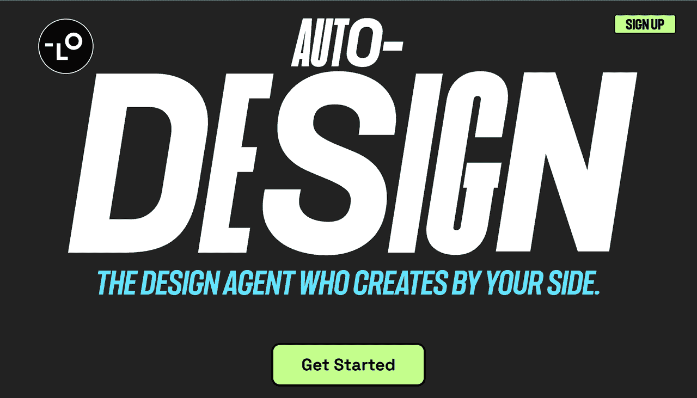

**工具介绍：**Lovart.ai 是全球首个专注于全链路设计的 AI 智能体（Design Agent）​​，由 Lovart AI 团队于 2025 年 5 月 13 日正式推出。该工具通过整合 GPT Image-1、Flux Pro、Kling AI、Suno AI 等前沿多模态模型，实现从创意构思到成品交付的全流程自动化设计。用户仅需输入自然语言指令，即可生成品牌 VI 系统、广告视频、海报设计等复杂视觉方案，日均生成设计作品超 5 万次，覆盖电商、影视、营销等 30+行业场景

**工具能力：**

+   品牌全案设计：输入品牌关键词，自动生成 LOGO、VI 手册、包装设计等系列化视觉方案，并输出标准化色彩与字体文件。

+   广告视频制作：输入“30 秒摩托车广告”，AI 自动拆解任务，生成分镜脚本、角色设计、视频片段及背景音乐，最终剪辑成完整影片。

+   图文分离编辑：生成的海报自动分离文字图层，支持自由修改文字内容、颜色与排版，非 Lovart 生成的海报也可提取文字。

+   多模型调度：调用 GPT Image-1 生成图像、Kling AI 制作视频、Suno AI 合成音乐，确保风格一致性。

+   二次创作支持：上传图片后，AI 可基于素材生成商品主图、联名周边

**是否免费：**免费体验（目前需要邀请码）

**网络条件：**需要特殊网络

**工具网站：**https://www.lovart.ai/

# AI 综合设计工具

## 1）稿定 AI 设计

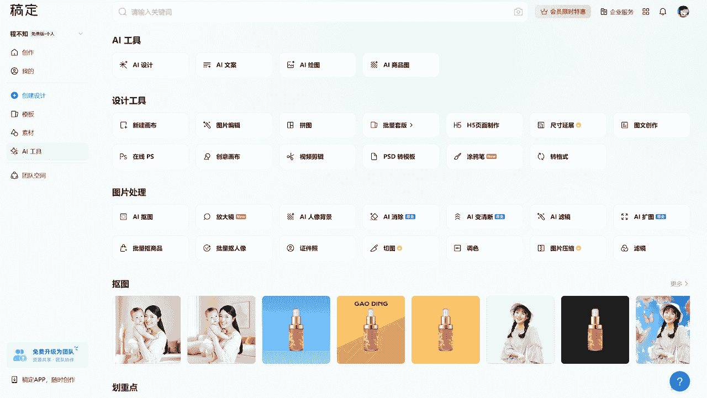

**工具介绍：**稿定 AI 是由稿定设计（厦门）科技有限公司开发的一站式 AI 设计平台，聚焦“AI+创意”场景，提供从文案生成到视觉设计的全链路自动化服务，是国内首个通过备案的 AI 设计工具

**工具能力：**

> **AI 创意生成**

+   智能设计：输入主题文字（如“母亲节促销”），自动生成大字封面、科普对比图、商品主图等设计稿，支持批量导出。

+   多模态绘图：通过文本描述或上传参考图生成插画、动漫头像等，支持“实景生成”“线稿上色”等 10+艺术风格。

> **图片智能处理**

+   精准编辑：AI 抠图（毛发级精度）、AI 消除（去除水印/杂物）、AI 扩图（无损放大至 4K 分辨率）。

+   场景优化：自动匹配商品图与背景（如雪地/森林场景），支持透明素材生成与证件照制作。

> **商业化工具链**

+   电商赋能：从商品图合成到详情页设计全流程支持

> **协作与生态**

+   云端协作：支持多人在线编辑与实时预览

**是否免费：**免费体验

**网络条件：**不需要特殊网络

**工具网站：**https://www.gaoding.com/create-design?hmsr=aigc.cn-aigc.cn-gdai--gdaidetail-gdaidetail-bdqd&utm_source=aigc.cn

## **2）堆友 AI 设计平台**

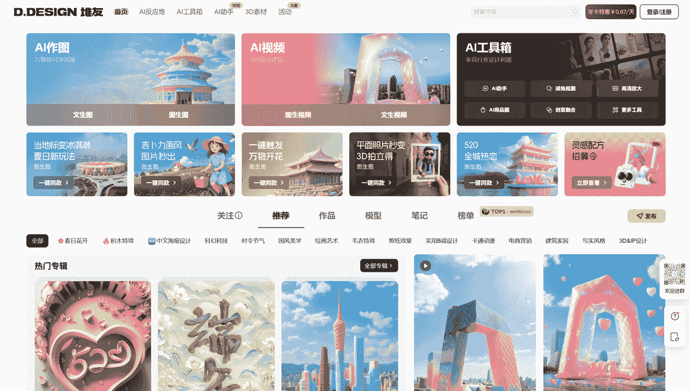

**工具介绍：**堆友 AI 设计平台是阿里巴巴集团旗下 Alibaba Design 团队打造的全成长周期设计师服务平台，定位于“设计师的好朋友”，以提升设计品质、效率、技能、成就和收入为核心价值

**工具能力：**

> **AI 创意生成与优化**

+   多模态生成：支持文生图、图生图、社区同款复刻，提供 200+风格模型（如国风手绘、电影质感摄影）和动态控制参数（如采样方法、随机种子）。

> **智能优化工具：**

+   顽兔抠图：1 秒完成毛发级抠图，支持批量处理 20 张图片。

+   高清放大：最高支持 16 倍无损放大，适配电商大图需求。

+   人脸修复：智能识别并优化人物面部细节。

> **电商设计：**

+   鹿班营销图：一键生成高点击率商品主图，自动渲染阴影与场景。

+   模特换肤：替换全球肤色模特，节省跨境电商拍摄成本 90%以上。

+   创意字体：输入文字描述即可生成艺术字（如枯木纹理、羽毛质感），支持 PNG 透明背景导出。

> **3D 设计与素材生态**

+   在线渲染器：实时调整 3D 素材角度、颜色、材质，支持导出高清渲染图。

+   素材库：提供数万款 3D 模型（如国风美学、科幻科技），可直接编辑或下载商用。

**是否免费：**免费体验

**网络条件：**不需要特殊网络

**工具网站：**https://d.design/?from=aigccn

## **3）美图设计室**

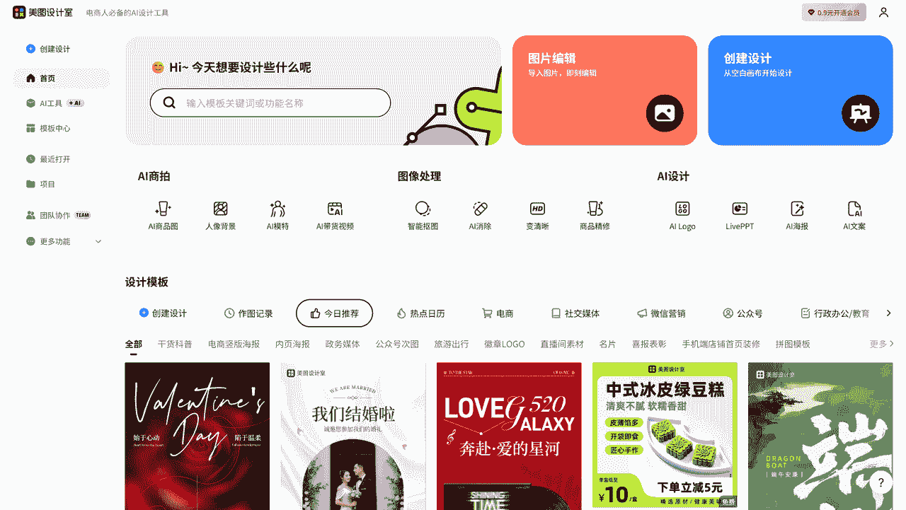

**工具介绍：**美图设计室是美图公司推出的一站式 AI 智能设计平台，定位于“零门槛、高效率”的设计工具，服务于电商、广告创意、教育、自媒体等多元场景。该工具以 AI 技术为核心，整合了设计生成、图像处理、商业变现等全链路能力

**工具能力：**

> **AI 创意生成**

+   AI 海报：输入主副标题或上传产品图，AI 自动生成电商主图、节日祝福海报等，支持批量导出与多风格切换

+   LivePPT：输入主题，AI 自动生成 16-20 页结构化 PPT，每日免费生成 4 次，支持动态背景与智能排版。

> **图像智能处理**

+   AI 消除与修复：一键去除水印、瑕疵，支持毛发级抠图与 16 倍无损放大，适用于商品图优化。

+   AI 模特试衣：上传服装图或人台图，AI 生成虚拟模特试穿效果。

+   智能场景合成：上传商品图后自动匹配背景，生成多场景展示图。

> **商业化工具链**

+   电商全流程支持：从商品抠图、详情页设计到优惠券生成，覆盖电商推广全周期，支持多平台尺寸适配。

> **协作与教育场景**

+   教学材料制作：快速生成教学 PPT、科普对比图，支持教育机构定制模板。

+   团队协作：支持多人在线编辑与权限管理，设计文件实时同步至云端

**是否免费：**免费体验

**网络条件：**不需要特殊网络

**工具网站：****https://www.designkit.**com/?channel=aigcdhz

# AI 电商设计

## **1）图应**

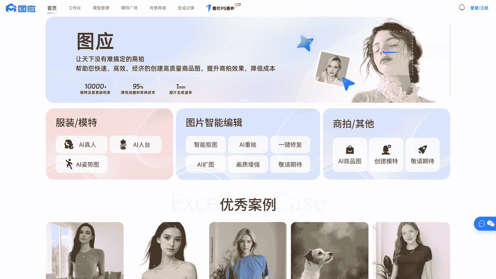

**工具介绍：**图应是一款基于 AIGC 技术的智能化商拍服务平台，专注于服装、时尚、电商等领域的商品图像生成与优化。其核心目标是通过 AI 技术替代传统拍摄流程，降低 90%以上的拍摄成本，同时提升商品视觉呈现的专业度和多样性

**工具能力：**

> **AI 模特与场景生成**

+   真人模特模拟：上传服装图或人台图，AI 生成不同肤色、人种、发色的真人模特试穿效果，支持动态姿势调整与多角度展示。

+   场景定制：自动匹配商品与背景（如雪地、森林），生成真实光影效果，支持一键替换场景。

> **图像智能处理**

+   智能抠图：毛发级精度抠图，支持批量处理 20 张图片，适配电商主图优化需求。

+   细节增强：16 倍无损放大功能，提升商品图清晰度；AI 修复功能可去除水印、瑕疵，优化画质。

> **垂直行业解决方案**

+   电商全链路支持：从商品平铺图生成、详情页设计到多平台尺寸适配（如淘宝、拼多多），覆盖推广全周期。

+   跨境试衣优化：提供全球肤色模特库，支持一键换肤换装，节省跨境拍摄成本。

**是否免费：**免费体验

**网络条件：**不需要特殊网络

**工具网站：**https://tuingai.com/#/home

## **2）Pebblely 宝贝丽**

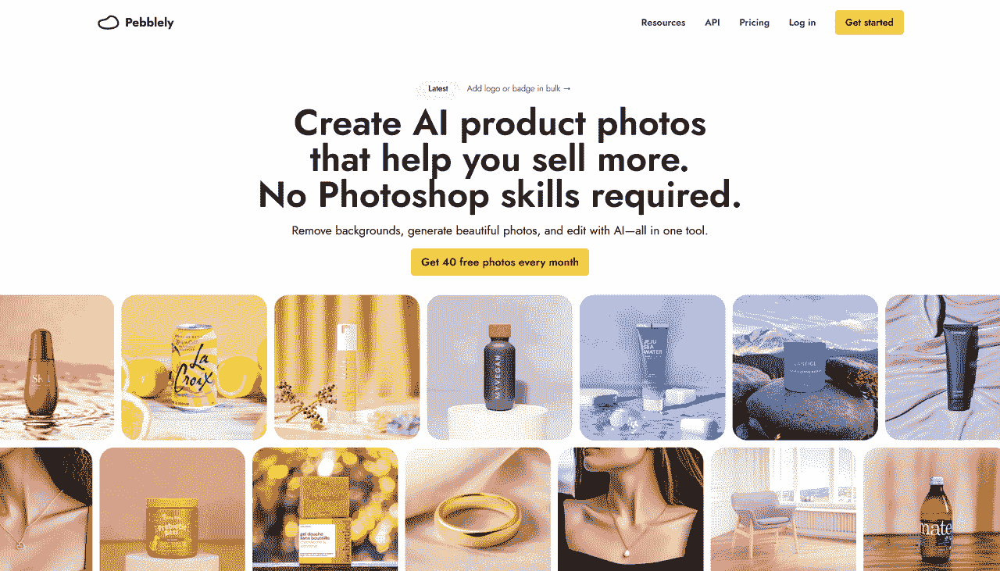

**工具介绍：**Pebblely 宝贝丽是一款基于人工智能的电商专用视觉设计工具，专注于通过 AI 技术为中小型电商企业、创业者和设计师提供低成本、高效率的产品图片生成与优化服务。其核心目标是替代传统摄影流程，帮助用户快速生成符合营销需求的高质量视觉素材，覆盖电商平台、社交媒体等多渠道推广场景

**工具能力：**

> **智能场景生成**

+   主题库支持：提供 40+默认主题，一键生成不同风格的场景图，自动添加阴影、反射等专业效果。

+   自定义描述：通过自然语言输入生成个性化背景，支持否定提示排除不想要的元素。

> **图像处理与优化**

+   极速抠图：AI 自动移除复杂背景（如毛发级抠图精度），支持批量处理 20 张图片。

+   细节增强：16 倍无损放大、瑕疵修复（去除水印/杂物）及光影优化功能，提升图片专业度。

> **多平台适配与扩展**

+   尺寸调整：支持生成 2048×2048 分辨率图像，适配 Instagram、Facebook、淘宝等不同平台尺寸要求。

+   多媒体扩展：将单张图片转换为横幅广告、社交媒体故事、电子邮件封面等多样化素材

**工具网站：**https://pebblely.com/

## **3）羚珑**

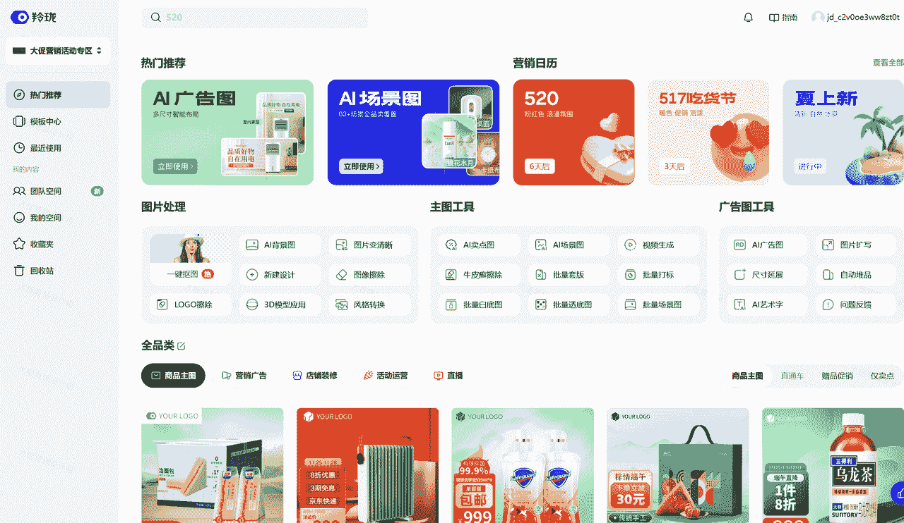

**工具介绍：**羚珑是京东零售集团用户体验设计部推出的一站式智能设计工具，定位于“泛零售领域商家的设计合作伙伴”，专注于电商营销、广告创意、店铺装修等场景的视觉设计需求。

**工具能力：**

> **核心设计功能**

+   智能抠图：一键去除复杂背景（毛发级精度），支持批量处理 20 张图片，提供普通/人像双模式。

+   模板化设计：提供电商主图、广告 Banner、直播贴片等 20 万+模板，支持智能配色与尺寸延展

+   视频生成：输入商品 SKU 或上传素材，自动生成带 3D 特效的短视频广告

> **垂直场景工具**

+   电商营销：批量生成商品主图、详情页设计，支持“智能腰带”文案自动排版与促销信息植入。

+   直播支持：提供直播间背景图、悬浮字幕模板，助力快速制作高转化率素材。

+   企业服务：企业用户可定制私有素材库，并通过“羚珑企业专区”实现设计流程标准化。

**是否免费：**免费体验

**网络条件：**不需要特殊网络

**工具网站：**https://ling.jd.com/?autologin=0

## **4）灵动 AI**

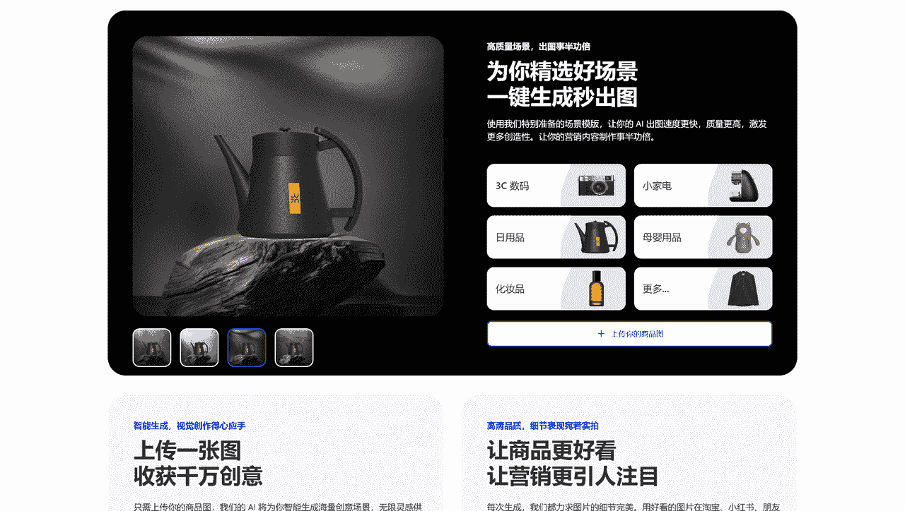

**工具介绍：**由灵动无限科技开发，专注于电商设计领域，通过生成式 AI 技术快速生成商品场景图，帮助商家降低拍摄成本。其核心价值在于提供海量模板（如节日活动、自然户外等场景）和智能图像处理能力，日均生成超 5 万张图片，适用于电商主图、详情页设计等场景

**工具能力：**

+   智能抠图与场景融合：自动提取商品主体，支持毛发级精度抠图，内置上百种场景模板。

+   高清放大与细节优化：最高支持 4K 分辨率无损放大，修复水印、瑕疵等图像问题。

+   批量生成与多平台适配：可批量处理 20 张以上图片，适配淘宝、拼多多等电商平台尺寸要求

**是否免费：**免费体验

**网络条件：**不需要特殊网络

**工具网站：**https://www.redoon.cn/index

## **5）小 K 电商图**

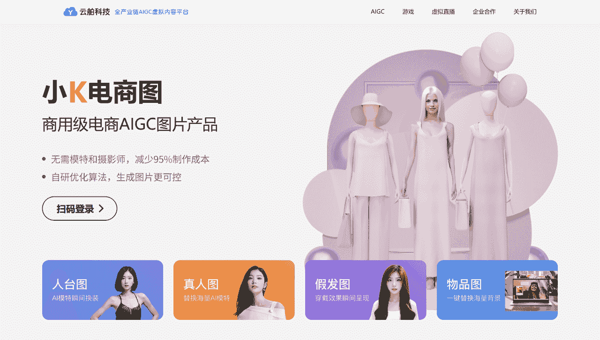

**工具介绍：**小 K 电商图是云舶科技推出的 AI 电商图片处理工具，专注于通过生成式 AI 技术帮助用户快速生成高质量电商图片，无需真人模特和摄影师即可完成商品展示图制作，大幅降低传统拍摄成本。该工具基于自研优化算法和 Stable Diffusion 技术，结合姿态识别、背景融合等核心技术，提升图片生成的可控性和真实感，适用于服装、饰品、家居等多类商品

**工具能力：**

+   AI 模特生成：支持根据真人照片生成 AI 模特，覆盖不同地域、年龄和表情，并支持定制专属模特。

+   背景更换与扩展：智能替换或扩展商品背景，结合光影融合算法提升真实感

+   真人模特补充与换脸：为人台图或假发图补充真人模特，并支持更换脸部以适应不同营销需求。

+   姿势识别与优化：通过自研算法精准控制 AI 模特动作，解决传统 AI 绘图的手部细节问题

**是否免费：**免费体验

**网络条件：**不需要特殊网络

**工具网站：**https://ds.yunboai.com/#/

# AI 写真设计

## 1）像素蛋糕 PixCake

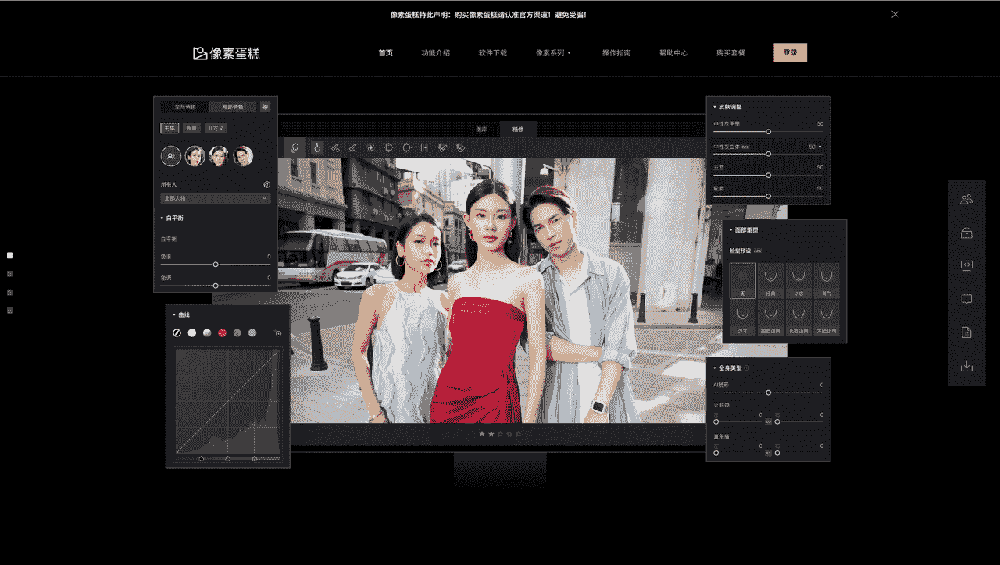

**工具介绍：**像素蛋糕 PixCake 是由厦门像甜科技有限公司开发的商业级 AI 修图软件，专注于为摄影行业提供高效、专业的图像处理解决方案。自上线以来，已成为婚纱摄影、婚礼跟拍、电商广告等领域的首选工具

**工具能力：**

> **核心修图功能**

+   人像处理：一键祛除痘痘、法令纹、黑眼圈，支持皮肤质感调整（透亮/红润/美白）。

+   全身美型：智能瘦腿、瘦腰，区分大小腿调整，保留自然人体比例。

> **智能调色与追色：**

+   内置 70+热门滤镜，支持 RAW 转档调色及 AI 色彩风格匹配，确保组图色彩一致性。

+   通过“AI 追色”功能批量导入样片，自动统一色调。

**是否免费：**免费体验

**网络条件：**不需要特殊网络条件

**工具网站：**https://www.pixcakeai.com/

## 2）咻图 AI

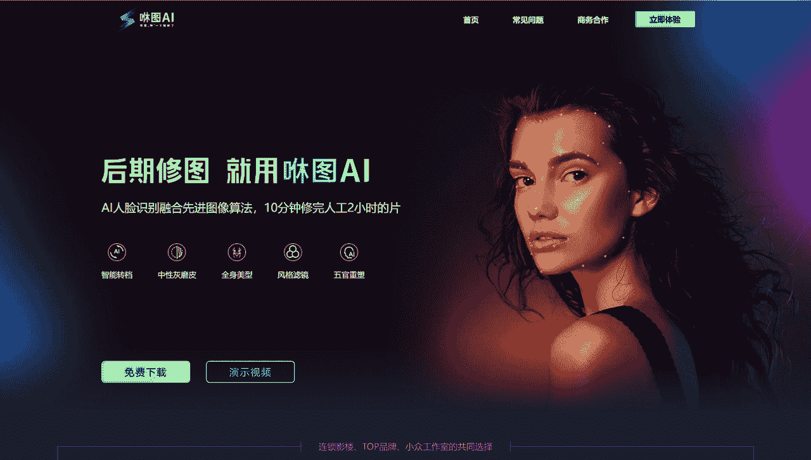

**工具介绍：**咻图 AI 是一款专注于影楼及摄影后期处理的 AI 修图工具，由海南星图速云科技开发，旨在通过 AI 技术简化传统修图流程，提升效率与出片质量。其核心功能包括智能转档、批量修图、人像美化和场景优化

**工具能力：**

+   智能转档与调色：支持 RAW 和 JPG 文件导入，自动完成转档、曝光矫正及色彩统一。

+   人像美化：AI 模拟专业修图师操作，提供磨皮、祛痘、五官微调，保留自然肌理。

+   全身塑形：智能识别性别与年龄，调整身体比例（如瘦腿、瘦腰），优化脸部轮廓

**是否免费：**免费体验

**网络条件：**不需要特殊网络条件

**工具网站：**https://www.aixtsy.com/

## 3） 醒蓝 AI

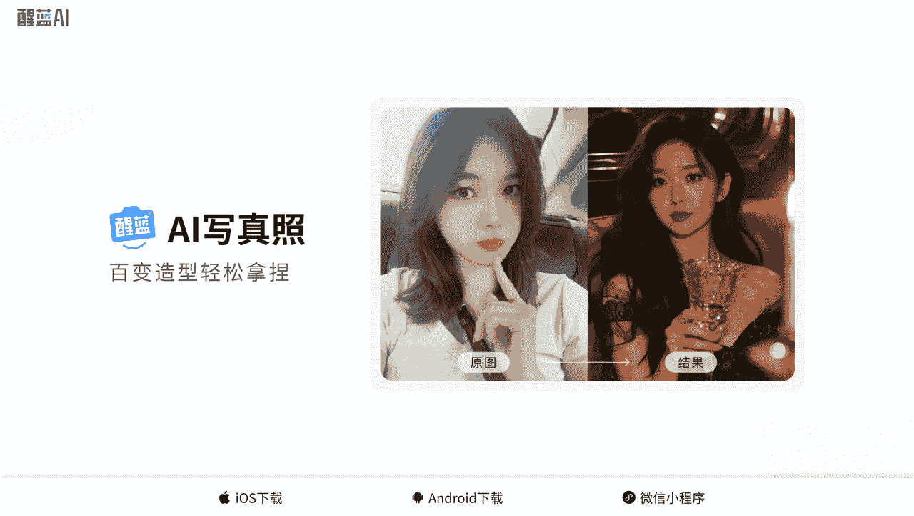

**工具介绍：**醒蓝 AI 是由上海绘镜网络科技有限公司开发的 AI 摄影与图像处理工具，专注于通过生成式 AI 技术帮助用户快速生成高质量证件照、职业形象照、艺术写真等。其核心功能包括智能换脸、背景替换、虚拟形象定制等，适用于求职、社交、电商展示等多场景需求。醒蓝 AI 基于深度学习算法优化，结合人脸识别、图像分割等技术，可快速学习用户面部特征并生成个性化照片，大幅降低传统摄影成本

**工具能力：**

+   证件照生成：支持 1 寸、2 寸等多种尺寸及红/蓝/白底背景，涵盖考试、签证、社保等场景，可一键生成高清无水印证件照。

+   AI 写真与风格模板：提供清新、韩式、婚纱、复古、职场等风格模板，用户上传 4-10 张照片即可生成数字分身，快速制作艺术写真或虚拟形象。

+   智能换脸与换装：通过 AI 技术实现面部特征迁移，支持服饰更换（如西装、汉服等），并优化细节（如肤色、发型）以增强真实感

**是否免费：**免费体验

**网络条件：**不需要特殊网络条件

**工具网站：**https://xinglanai.com/

# AI Logo 设计

## 1）标小智 Logosc

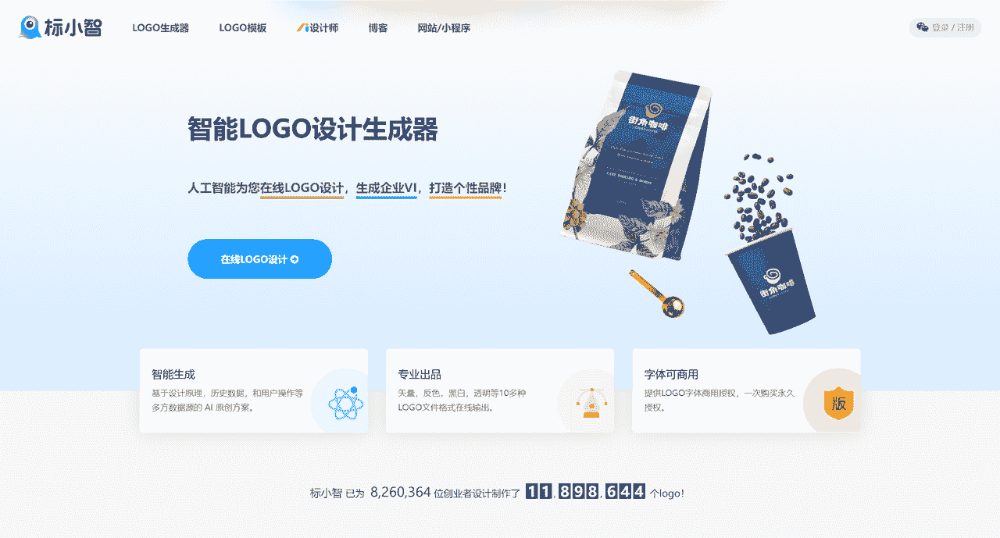

**工具介绍：**标小智 Logosc 是由上海婷平网络科技有限公司开发的 AI 智能设计工具，专注于为中小企业和个人用户提供高效的品牌视觉设计解决方案。自上线以来，已服务超 500 万用户，日均生成 LOGO 超 10 万件。其核心定位是通过 AI 技术简化传统设计流程，覆盖 LOGO 设计、企业 VI 生成、名片/海报制作等多种场景，助力用户快速打造专业品牌形象

**工具能力：**

> **智能 LOGO 生成**

+   AI 原创方案：基于品牌名称、行业、配色等输入，一键生成 20+设计方案，支持动态调整字体、颜色、排版等细节。

+   虚拟设计师辅助：提供配色建议、行业特征匹配及符号学优化。

> **多场景扩展设计**

+   企业 VI 系统：自动生成品牌规范手册，包含字体、色值、LOGO 水印等资源。

+   营销物料制作：支持名片、海报、包装设计，并生成社交媒体封面、视频动效等适配素材

**是否免费：**免费体验

**网络条件：**不需要特殊网络

**工具网站：**https://www.logosc.cn/?coupon=AIGC

## 2）U 钙网

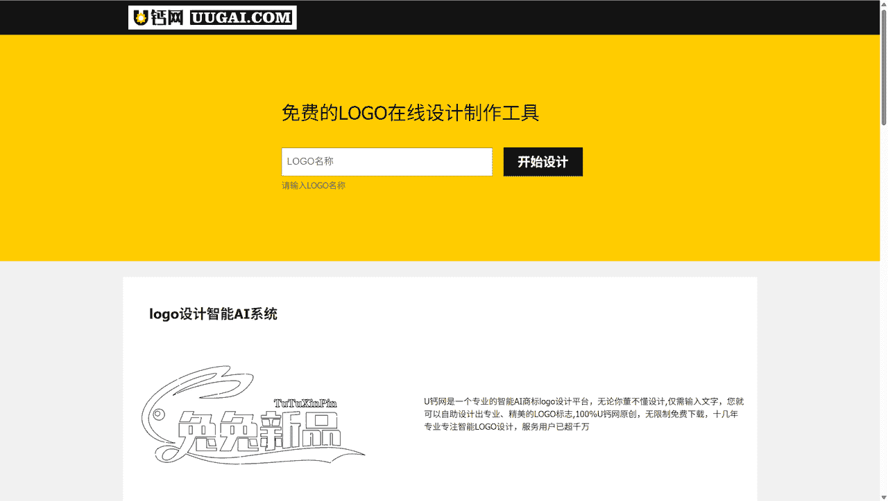

**工具介绍：**U 钙网是一款完全免费的在线 LOGO 智能设计工具，专注于为个人、中小企业和创业者提供高效便捷的品牌标识设计服务。其核心优势在于通过 AI 算法快速生成原创 LOGO 方案，支持中英文设计，覆盖科技、餐饮、文创等 30+行业

**工具能力：**

+   AI 动态设计：输入品牌名称后，AI 自动生成 20+风格化方案（如极简、复古、Q 版），支持动态调整配色、字体和图形比例。

+   行业适配：提供电商、餐饮、教育等垂直领域模板，例如输入“香浓咖啡屋”可生成咖啡杯、咖啡豆等主题图标。

+   字体与图标库：近百种可商用字体选择，支持中英文混排，图标可替换为动物、建筑等元素

**是否免费：免费体验**

**网络条件：不需要特殊网络**

**工具网站：**https://www.uugai.com/

## 3)  Logo123

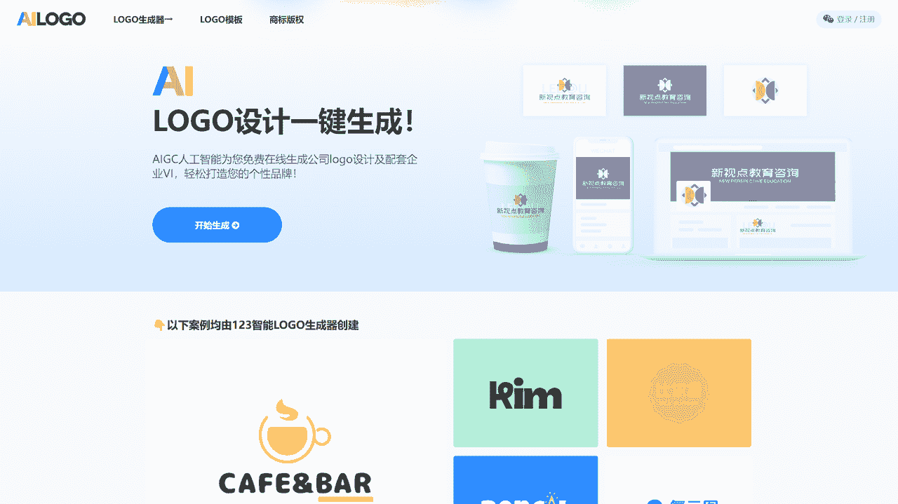

**工具介绍：**Logo123 是由上海婷平网络科技有限公司运营的在线 LOGO 设计平台，成立于 2011 年，专注于为企业和个人提供高效、低成本的品牌标识设计服务。该平台结合了 AI 生成技术与专业设计师定制，用户可通过简单操作快速生成 LOGO，或选择深度定制服务满足高端需求

**工具能力：**

+   AI 智能生成：输入品牌名称和行业类别，AI 自动生成多套 LOGO 方案，支持在线编辑颜色、字体、图标等元素。

+   设计师定制：与专业设计师一对一合作，通过“创意 PK”模式从多个方案中挑选最优设计，确保独特性和品牌契合度。

+   品牌 VI 配套服务：除 LOGO 外，支持名片、企业 VI、PPT 模板等全套品牌形象设计。

+   智能优化工具：内置反选抠图、光影融合算法，解决复杂背景或细节问题（如发丝遮挡）

**是否免费：免费体验**

**网络条件：不需要特殊网络**

**工具网站：****https://ai.logo12**3.com/?coupon=AIGCCN

## 4）标智客 AI Logo

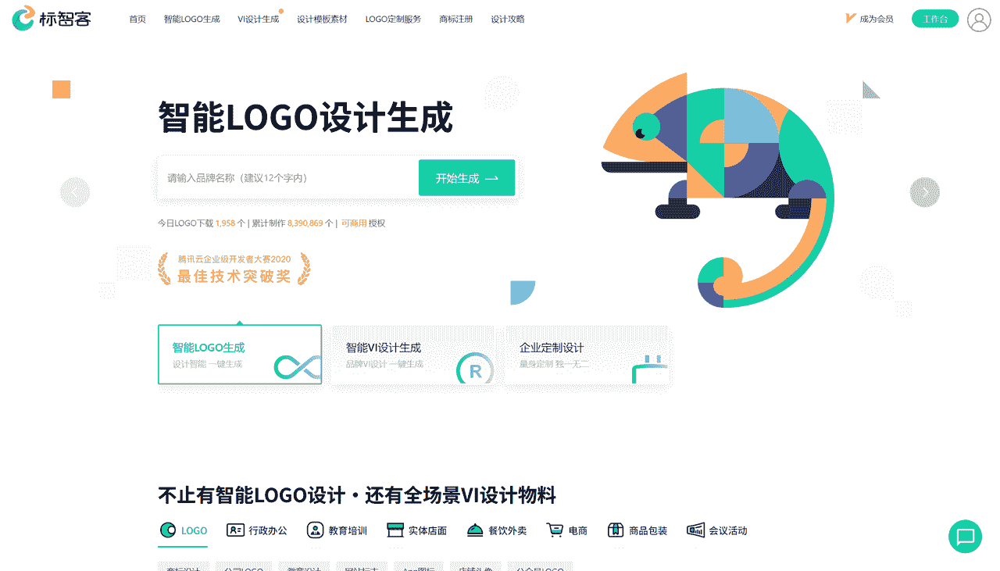

**工具介绍：**标智客是由特创易研发的 AI 智能 Logo 设计工具，专注于为中小微企业、创业者和个人用户提供低成本、高效率的品牌标识设计服务。该平台结合数据算法驱动与近 10 万版权模板素材，覆盖餐饮、科技、教育等 150+细分行业，支持用户通过简单输入品牌名称和行业信息快速生成专业级 Logo 设计。其核心优势在于“AI 生成+人工定制”双模式，既满足快速设计需求，又支持深度原创定制

**工具能力：**

+   AI 智能生成：输入品牌名称和行业后，AI 自动分析并生成图文结合、文字、徽章等多类型 Logo，支持“换色”“生成相似”“按图形创意”等多样化调整。

+   在线高级编辑：提供全能编辑器，可调整字体、颜色、图标、背景等元素，支持矢量文件（AI/PSD）下载，适配印刷与数字场景。

+   智能筛选与商标注册：按“可商标注册”“喜欢”等标签筛选设计，并提供商标冲突查询服务，降低注册风险

**是否免费：免费体验**

**网络条件：不需要特殊网络**

**工具网站：**https://www.logomaker.com.cn/

# AI 字体设计

## 1）字体家 AI 神笔

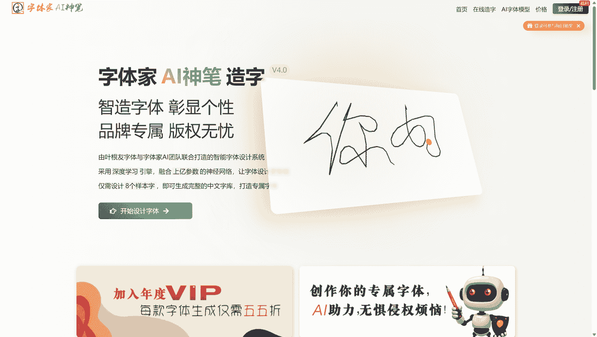

**工具介绍：**字体家 AI 神笔是由叶根友字体与字体家团队联合开发的 AI 智能造字工具，基于深度学习技术，用户仅需手写少量汉字（如 8 个）即可生成包含 6000+汉字的完整字库。该工具专注于简化传统字体设计流程，支持个人用户、设计师及企业快速创建个性化字体，覆盖品牌 VI 设计、广告包装、出版物等场景

**工具能力：**

+   屏幕书写：用鼠标或触控笔手写 8 个汉字，AI 自动生成字库，支持动态调整笔刷类型。

+   纸上造字：上传 10 个手写汉字照片，AI 分析生成字库，需注意字迹清晰、背景简洁。

+   创意辅助：通过“字体创意模式”，输入关键词，AI 自动生成风格化字体灵感，支持生成单字或整套字库

**是否免费：**免费体验

**网络条件：**不需要特殊网络

**工具网站：****https://www.ai.zitiji**a.com/?referer=72925

## 2) Fontjoy

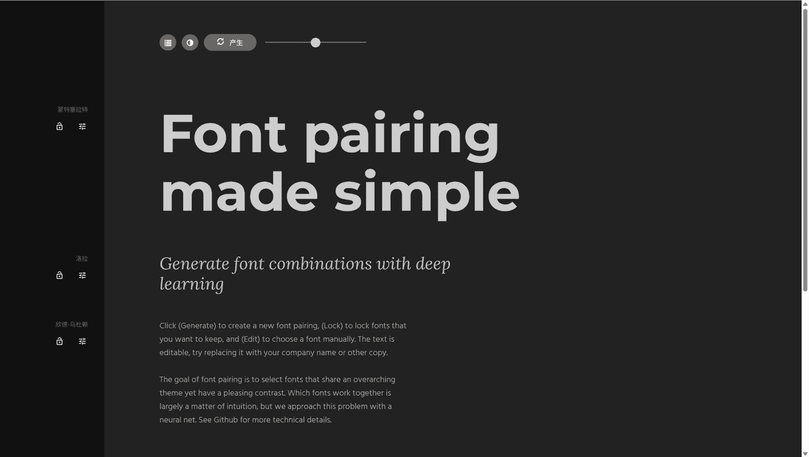

**工具介绍：**Fontjoy 是一款基于深度学习技术的在线字体配对工具，旨在帮助设计师、开发者和普通用户快速生成视觉协调的字体组合。其核心技术通过神经网络算法分析字体特征（如字重、风格、比例等），并生成向量化的视觉表示，从而智能推荐对比度适宜且风格和谐的字体搭配方案

**工具能力：**

+   智能字体配对：输入关键词或选择设计需求，AI 自动生成 3-5 组字体组合，涵盖标题、正文等层级。

+   对比度调节：提供“相似→差异”滑动条，用户可调整字体间的对比程度，平衡统一性与视觉冲击力。

+   实时预览与锁定：生成结果可实时查看应用效果，支持锁定特定字体并重新生成匹配方案

**是否免费：**免费体验

**网络条件：**需要特殊网络

**工具网站：**https://fontjoy.com/

## 3)   Word-As-Image

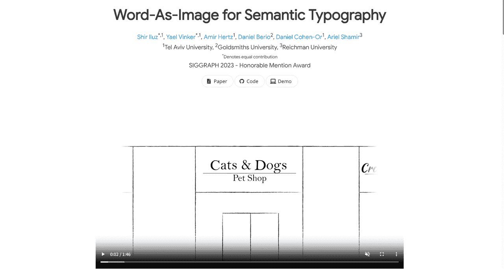

**工具介绍：**Word-As-Image 是一种基于生成式 AI 技术的语义化字体设计工具，其核心理念是通过修改单词内字符的矢量形状，使文字整体外观与其语义高度契合。该工具由学术研究团队开发，结合 Stable Diffusion 模型与矢量控制点优化算法，能够在保持文字可读性的前提下实现创意化设计，适用于品牌标识、艺术海报、数字广告等场景

**工具能力：**

+   语义化字体生成：输入任意英文单词，AI 自动解析其语义，并生成融合相关元素的字体变形方案，支持不同风格的自定义。

+   矢量控制点编辑：用户可手动调整字母的贝塞尔曲线控制点，精细控制笔画细节，支持导出 SVG/AI 格式文件。

+   动态风格迁移：通过风格维持损失函数（Tone-Preserving Loss）确保变形后的字体保留原字体的核心特征，避免过度抽象化导致的辨识度下降。

**是否免费：**免费体验

**网络条件：**需要特殊网络

**工具网站：****https://wordasimage.github.io**/Word-As-Image-Page/

# AI 海报设计

## 1) AI Poster Maker

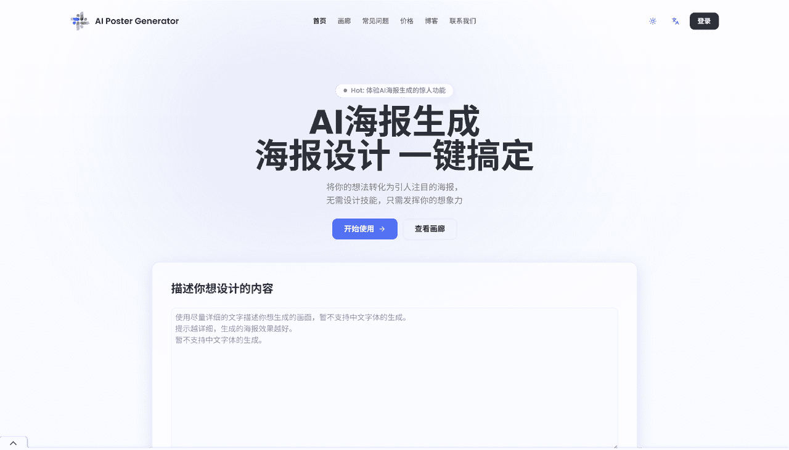

**工具介绍：**AI Poster Maker 是一款基于人工智能技术的在线海报生成工具，专为快速制作专业级视觉内容而设计。用户无需设计经验，只需输入主题或关键词，即可通过 AI 算法生成适配多种场景（如社交媒体、广告宣传、活动推广）的海报作品。该工具通过智能布局、文本集成和风格优化，显著降低设计门槛

**工具能力：**

+   AI 动态排版：自动优化文字与图片的布局，确保视觉协调性，支持现代、复古、艺术等 20+风格模板。

+   文本智能生成：根据关键词生成匹配的文案，并融入设计（如“香浓咖啡屋”自动添加咖啡杯图标）。

+   多语言支持：中文输入可直接生成设计，但英文提示效果更佳。

+   多格式导出：支持 PNG、PDF 等格式，适配线上发布与线下印刷。

+   批量生成：一次生成多款不同风格海报，满足营销活动需求

**是否免费：**免费体验

**网络条件：**不需要特殊网络

**工具网站：**https://ai-poster-maker.com/zh

## 2）千图设计室

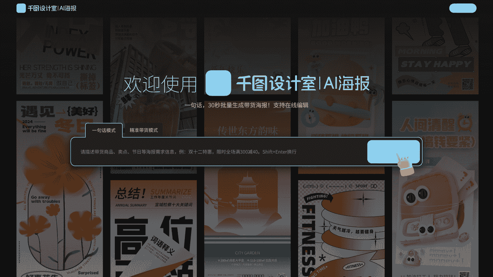

**工具介绍：**千图设计室 AI 海报是由千图网开发的智能在线设计平台，专注于通过 AI 技术快速生成营销海报，覆盖节日宣传、电商推广、社交媒体配图等场景。用户仅需输入一句话描述需求（如“38 妇女节焕颜时刻，限时满 300 减 40”），即可在 30 秒内生成多套风格化方案，支持在线编辑与批量生产

**工具能力：**

+   AI 动态排版：输入文案后，AI 自动匹配图形、配色与文字布局，支持极简、复古、科技感等 20+风格。

+   精准带货模式：上传商品图后，AI 结合商品类型（如美妆、数码）生成促销海报，自动优化卖点展示。

+   批量生成：单次可生成 4-8 套方案，适用于连锁品牌分店或大型活动需求。

+   在线编辑：用户可实时修改文字字体、颜色、图片比例，并替换为自有素材（如品牌 Logo）。

+   智能抠图与修复：支持一键去除背景、修复模糊图片，提升素材质量。

**是否免费：免费体验**

**网络条件：不需要特殊网络**

**工具网站：**https://hihaibao.com/?from=ai-bot

# AI 3D 设计

## 1) Tripo AI

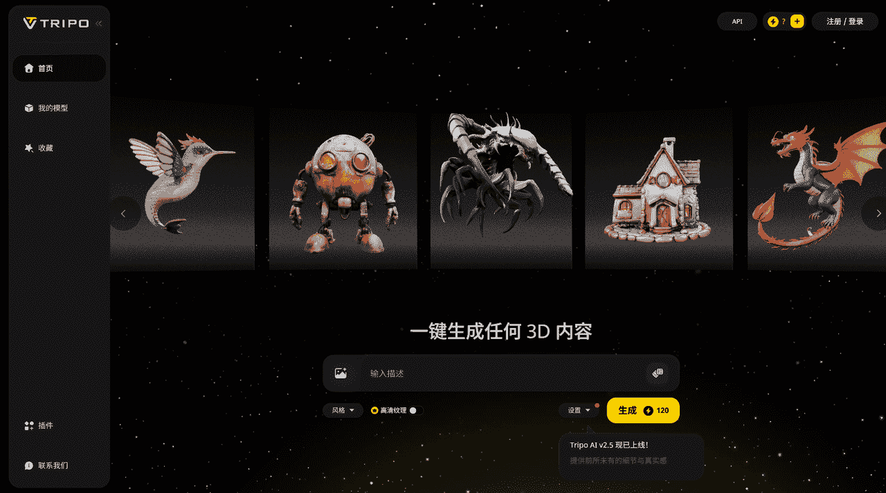

**工具介绍：**Tripo AI 是由硅谷初创公司 VAST 开发的 AI 驱动 3D 建模工具，专注于通过生成式 AI 技术快速生成高精度、可编辑的 3D 模型。其核心能力包括 文本生成 3D（文生 3D） 和 图像生成 3D（图生 3D）​​，支持生成带纹理的网格模型，适用于游戏开发、影视动画、工业设计等领域

**工具能力：**

+   文生 3D：输入文本描述（如“被藤蔓缠绕的城堡”），AI 自动生成 4 个候选模型，支持调整风格（蒸汽朋克、卡通等）、面数限制和负面提示词控制。

+   图生 3D：上传单张或多视角 2D 图片，生成带贴图的 3D 模型，支持材质适配与光影优化，还原细节如服装褶皱、机械结构等

+   风格化处理：一键切换乐高、体素化（像素风格）、Voronoi（几何镂空）等风格。

+   骨骼绑定与动画：自动绑定 20 个关键骨骼，生成行走、奔跑等预设动作，支持导出至 Blender、Unity 等工具二次编辑

**是否免费：免费体验**

**网络条件：需要特殊网络**

**工具网站：**https://www.tripo3d.ai/

## 2) Vizcom

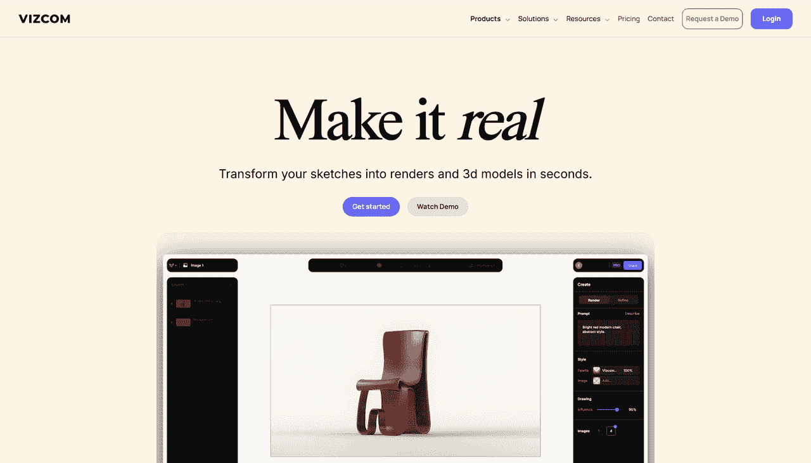

**工具介绍：**Vizcom 是一款面向设计师和创意专业人士的 AI 驱动创意工具，专注于将手绘草图快速转化为高质量渲染图，显著提升设计效率。Vizcom 通过 AI 技术重新定义了设计工作流，其核心价值在于将传统耗时的渲染过程自动化，释放设计师的创意潜能。对于需要快速验证概念的专业人士而言，这是一款兼具效率与灵活性的工具，尤其适合工业设计、游戏开发等领域。

**工具能力：**

+   草图转渲染图：通过深度学习与图像处理技术，Vizcom 能够将用户的手绘草图（包括纸质或数字绘图）实时转换为逼真的产品设计图或场景渲染图，耗时仅需几秒至几分钟。

+   工业设计：快速生成产品概念图，加速团队讨论与迭代。室内设计：将布局草图转化为效果图，便于客户沟通。

+   游戏与影视：辅助角色或场景的早期视觉开发。

+   支持团队实时协作、历史版本回溯，并可导出高清文件或直接保存至云端。

**是否免费：免费体验**

**网络条件：需要特殊网络**

**工具网站：**https://www.vizcom.ai/

##  3）腾讯混元 3D

**工具介绍：**腾讯混元 3D 是由腾讯研发的一站式 AI 3D 内容创作平台，基于 Hunyuan3D-2.0 大模型构建，支持通过文本、图片或草图快速生成高质量 3D 模型。该工具融合了深度学习、计算机视觉和几何优化算法，旨在降低 3D 创作门槛，覆盖游戏开发、影视动画、工业设计、电商展示、3D 打印等场景

**工具能力：**

+   多模态输入：支持文生 3D、图生 3D、草图转 3D 等。

+   工业级输出：生成模型兼容主流格式，适配游戏引擎、3D 打印工具及移动端交互。

+   开源生态：Hunyuan3D-2.0 系列模型及创作引擎已开源，开发者可通过 GitHub、Hugging Face 获取代码与模型权重。

**是否免费：免费体验**

**网络条件：不需要特殊网络**

**工具网站：**https://3d.hunyuan.tencent.com/

## 4) Meshy

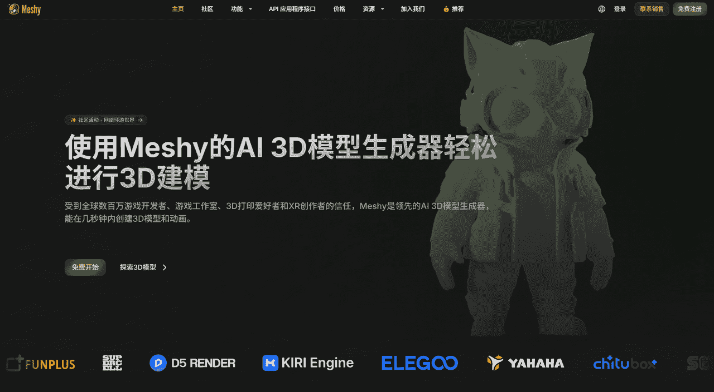

**工具介绍：**Meshy 是一款基于生成式 AI 技术的 3D 内容创作工具，由计算机图形学专家胡渊鸣团队开发，专注于通过文本或图像快速生成高质量 3D 模型及贴图。其核心定位为“零门槛 3D 创作”，支持文生 3D（Text-to-3D）、图生 3D（Image-to-3D）、AI 贴图生成等功能，覆盖游戏开发、影视动画、工业设计、电商展示及 3D 打印等场景

**工具能力：**

+   文本生成 3D：输入自然语言描述，AI 自动生成 4 个候选模型，支持调整艺术风格。

+   图像生成 3D：上传单张或多视角 2D 图片（支持 Midjourney、Stable Diffusion 等工具生成的图像），生成带贴图的 3D 模型，还原细节如服装褶皱、机械结构。

+   AI 贴图生成：为导入的 3D 模型自动生成 PBR 材质贴图（反照率、法线、粗糙度等），适配 Unity、Blender 等工具的动态光照渲染

**是否免费：免费体验**

**网络条件：不需要特殊网络**

**工具网站：**https://www.meshy.ai/

## 5) CSM

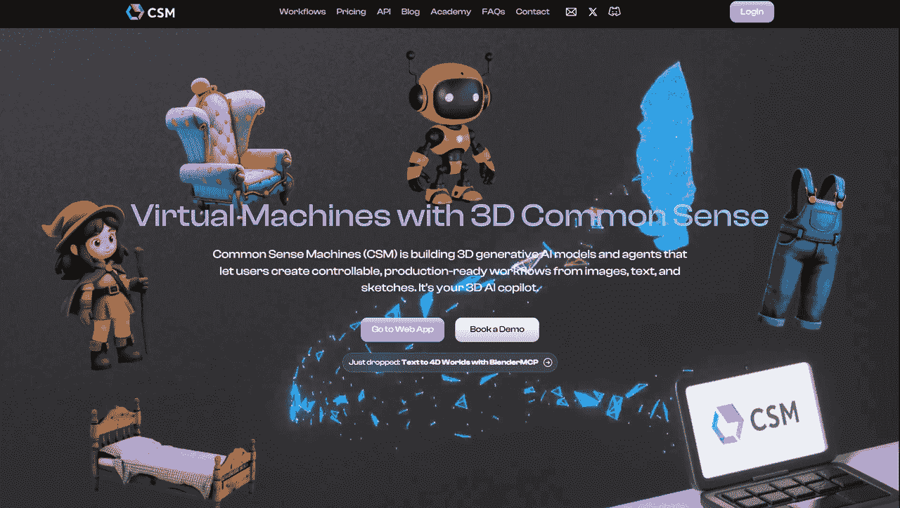

**工具介绍：**Common Sense Machines（CSM）是由前 Google DeepMind 研究科学家 Tejas Kulkarni 团队开发的一款 AI 驱动的 3D 内容生成工具，支持通过图像、文本或草图快速生成可适配游戏引擎的 3D 模型和动态场景。其核心技术基于深度学习与计算机视觉，能够将 2D 输入转化为高精度 3D 资产，适用于游戏开发、影视动画、工业设计等领域

**工具能力：**

+   图生 3D：上传单张或多视角图片，AI 自动生成带贴图的 3D 模型，支持格式包括 GLB、USDZ 等。

+   文生 3D：输入文本描述，生成多个候选模型并支持风格调整。

+   草图转 3D：手绘线稿可直接转化为可编辑的 3D 资产，支持骨骼绑定和动画预设。

+   提供 AI 渲染器，用户可在统一画布中构建交互式 3D 世界，实时调整光照、材质和摄像机角度。

+   内置游戏引擎（如 Unity、Unreal Engine）兼容模板，支持一键导出并优化模型拓扑结构

**是否免费：免费体验**

**网络条件：不需要特殊网络**

**工具网站：**https://www.csm.ai/

---

# AI 设计学习交流群

1.持续关注并更新 AI 的**相关资讯动态，研究报告，赚钱案**例，常见问题，永久免费在线查看，无收费内容，目标是成为最大的免费 AI 学习社群。

2.已建立社群聊聊 **AI** 发展及应用，**没进群的可以扫码加入，群满可加 AI 研究爱好者大国微信 ID：zyg90s（备**注：AI），已经在社群内的无需重复加入，开源知识库及社群学习全部为公开免费分享。

3.**关于文档负责人大国**：高帆文化 CEO，曾就职于教培大厂，目前创业，主攻研究 AI 落地应用、企业流量增长及达人 IP 孵化。

**飞书学习群**

**飞书扫码进群学习**

好友（ID：zhangyuguo94s）

**扫码加微信入微信群**

---

**END，**这个 AI 知识库不只是一个数据仓库，更是推动每个人进步的强大引擎。我们希望你能从中受益，并将其分享给更多的人，让更多的人获得这份力量。感谢你的支持和分享～